# Software Requirements Specification (SRS) for the LavaRápido System

**Web and Mobile Booking and Management Platform for a Car Wash**

Juan Camilo Guilombo Osorio, Brayan Estiven Patiño Cabrera and Merari Urbano Quintero

Centro de la Industria, la Empresa y los Servicios, Servicio Nacional de Aprendizaje (SENA), Huila Regional

Software Analysis and Development Technologist program (ADSO), group (ficha) 3145556

Instructor: Karol Daniela Correa

Version 7.1, October 17, 2026

---

## Version Control

**Table 1**
*Document Version History*

| Version | Date | Author | Description of the change |
|---|---|---|---|
| V2 | 2026-09-08 | Development team | First version of the SRS. It described a mobile service with coverage zones and an online payment gateway. |
| V3 | 2026-10-06 | Development team | Actual scope: a single fixed car wash, payment by QR code or bank transfer with a receipt, microservice architecture, requirements RF-001 to RF-026 with their status, and new use cases. |
| V4 | 2026-10-08 | Development team | Restructured according to IEEE 830 and ISO/IEC/IEEE 29148, in APA 7 format. Status checked against the code as of October 8, 2026. New requirements RF-027 to RF-035 and use cases CU26 to CU29, business rules, flows and life cycles, data requirements, classified constraints, verifiable acceptance criteria, traceability matrix and APA references. |
| V5 | 2026-10-09 | Development team | Verification with the system running (six services, gateway and web), and a fix to a gateway route and to a styling error in promotions. Use case and state diagrams in Mermaid, web screenshots in every module and an updated count of automated tests. |
| V6 | 2026-10-15 | Development team | Status checked against the code as of October 15, 2026. Account lockout (RF-004b), automatic assignment (RF-008), operator choice by the customer (RF-010), payment history filters (RF-015) and operator availability (RF-022) are now implemented. New requirements RF-036 to RF-038 (inspection report, business data and operator profile) and use case CU30. Service start window, alert for bookings without an operator, notifications in each account's language, profile address, 57 tables, 601 automated tests and measurements for RNF-001 and RNF-008. |
| V7 | 2026-10-16 | Development team | Complete review with the system running in Docker. The date and time the customer accepts the Terms and the Data Processing Policy are stored on the server (RR-01); HTTPS active on the public server; reason why a time is rejected (closed day, outside opening hours, time passed, or no free bay); 639 automated tests and 19 end-to-end tests passed. |
| V7.1 | 2026-10-17 | Development team | Status verified against the code as of October 17, 2026: the inspection report (RF-036) is also managed from the mobile app, and the RNF-008 width check was extended to 60 web screens and 26 mobile app screens, with no overflow. |
| V7.2 | 2026-10-19 | Development team | Continuous integration with GitHub Actions in the 10 repositories: every change is built and its tests are run. Continuous integration with Jenkins is removed from the pending items. |

---

## Abstract

This document specifies the requirements of LavaRápido, a web and mobile platform that organizes the operation of a single-site car wash: customer and vehicle registration, booking of time slots with opening-hours and bay validation, automatic or manual operator assignment, service execution and rating, vehicle inspection report, payment by QR code or bank transfer with receipt review, promotions, loyalty points and notifications. The specification follows the structure of IEEE 830 (IEEE, 1998) and ISO/IEC/IEEE 29148 (ISO/IEC/IEEE, 2018), and is based on the project's technical documentation (`vehicle-w-docs` repository) and on the code of its seven server components, reviewed on October 16, 2026. It defines 41 functional requirements with verifiable acceptance criteria, 12 non-functional requirements with their verification metric, 30 use cases, the business rules, the life cycles of the booking, the payment and the service execution, the data requirements, and the technical, data, operational and regulatory constraints. As of October 16, 2026, 40 functional requirements are implemented and 1 is partially implemented.

**Keywords:** requirements specification, car wash, bookings, microservices, use cases.

---

## Table of Contents

1. [Introduction](#1-introduction)
2. [Project Context](#2-project-context)
3. [Overall Description](#3-overall-description)
4. [External Interface Requirements](#4-external-interface-requirements)
5. [Functional Requirements](#5-functional-requirements)
6. [Non-Functional Requirements](#6-non-functional-requirements)
7. [Use Case Model](#7-use-case-model)
8. [Business Flows](#8-business-flows)
9. [Data Requirements](#9-data-requirements)
10. [Traceability Matrix](#10-traceability-matrix)
11. [Progress Status and Open Decisions](#11-progress-status-and-open-decisions)
12. [References](#references)

---

## 1. Introduction

Many car washes still run on paper. Bookings come in by phone or customers show up without notice, time slots overlap, operator assignment depends on who happens to be available that day, and cash payments are not linked to any booking. LavaRápido brings these processes together: the customer registers their vehicles, books a service at a free time, pays by QR code or bank transfer and rates the service; the operator checks their assigned services and records their progress; and the administrator sets up the catalog, the opening hours and the bays, manages the operators and reviews payments.

### 1.1 Purpose

This document defines, completely and verifiably, what the LavaRápido system must do and under which quality conditions. It serves as an agreement between the development team, the SENA technical instructors and the person who manages the car wash, and as the basis for design, testing and product acceptance. Its structure follows the IEEE 830 recommended practice (IEEE, 1998) and the software requirements specification contents of ISO/IEC/IEEE 29148 (ISO/IEC/IEEE, 2018); the document format follows the publication manual of the American Psychological Association [APA] (2020).

### 1.2 Product Scope

The system consists of a web application, an Android mobile application and a REST API organized into six microservices behind an API Gateway. It runs a single car wash and covers the following functions:

- Registration, sign-in, password recovery and change, and account administration for three fixed roles: customer, operator and administrator.
- Registration of the customer's vehicles; the vehicle type determines the price of each service.
- Service catalog with price and duration by vehicle type, weekly opening hours with exceptions, and wash bays.
- Booking of time slots with availability validation, rescheduling and cancellation before the service starts.
- Automatic operator assignment when the booking is confirmed, optional operator choice by the customer and manual assignment by the administrator, with validation of shifts, absences and schedule overlaps.
- Start and finish of the service by the operator, and rating of the service by the customer.
- Vehicle inspection report for long services, shared with the customer through a link.
- Payment by QR code or bank transfer with a receipt reviewed by the administrator, and cash payment recorded by the administrator.
- Promotions with a percentage discount and a loyalty points program.
- Notifications in an inbox, by push and by email; a dashboard per role; visual theme and language per account; operational reports.

Out of scope for this version: the iOS application, home service, electronic invoicing with the Colombian tax authority (DIAN), supplies inventory control, online payment gateways, and deployment to pre-production and production environments.

### 1.3 Definitions, Acronyms and Abbreviations

**Table 2**
*Domain Terms*

| Term | Definition |
|---|---|
| User | Person with an account in the system and one of three fixed roles: customer, operator or administrator. |
| Customer | User who registers vehicles, books and pays for services, and rates the service received. |
| Operator | Car wash employee who performs the assigned services and records their start and finish. |
| Administrator | Person in charge of the car wash operation; configures the system and reviews payments. |
| Booking | Confirmed time slot to wash one of the customer's vehicles on a date, at a time and in a bay. It contains one or more service lines. |
| Service line | Each service included in a booking, with the price in force when the booking was made. |
| Bay | Physical wash station at the site. Two active bookings cannot use the same bay at overlapping times. |
| Time slot | Start interval offered by the system when booking; 30 minutes by default. |
| Opening hours and exception | Weekly opening hours of the site and dates with a special opening or closing (for example, public holidays). |
| Operator shift | Weekly schedule in which the operator can receive assignments. |
| Absence | Period in which an operator cannot receive assignments. |
| Operator profile | The operator's specialty and skills, each skill with its level (certified, expert or advanced). |
| Inspection report | Review of the vehicle in five phases (reception, exterior, interior, engine and delivery) with findings and photos, shared with the customer through a link. It applies to services of 180 minutes or more. |
| Finding | Note in the inspection report about an area of the vehicle, with its severity (informational, minor or major) and up to 5 photos. |
| Business data | Legal, tax and contact information of the car wash that the administrator keeps in the settings. |
| Service execution | Record of the work done by an operator on a service line, with its status and times. |
| Payment method | Cash, Nequi, Daviplata or bank transfer. |
| Payment account | Car wash details (holder, number, QR code and instructions) used to receive payments through a digital method. |
| Receipt | JPG or PNG image that the customer uploads as proof of a digital payment. |
| Reference code | Transaction number shown on the receipt. It cannot be repeated across different bookings. |
| Rating | Whole score from 1 to 5, with an optional comment, that the customer gives to a completed booking. |
| Promotion | Coupon with a code, validity period, discount percentage and, optionally, a minimum number of points to unlock it. |
| Loyalty points | Points the customer earns for each paid service; they unlock promotions and are not deducted when a promotion is redeemed. |
| Points ledger | Record of point movements; it is the only valid source of the customer's balance. |
| Notification | Message to a user about a relevant event, with a read or unread status. |

**Table 3**
*Acronyms and Abbreviations*

| Acronym | Meaning |
|---|---|
| ADR | Architecture Decision Record: record of an architecture decision with its context and consequences. |
| ADSO | Software Analysis and Development Technologist program (Tecnólogo en Análisis y Desarrollo de Software). |
| AMQP | Advanced Message Queuing Protocol, the messaging protocol used by RabbitMQ. |
| API / REST API | Application programming interface; the system's API exposes resources over HTTP with JSON bodies. |
| API Gateway | Single entry point that receives the requests from the web and the app and routes them to the right service. |
| BCrypt | Adaptive password-derivation function used to store passwords (Provos & Mazières, 1999). |
| COP | Colombian peso. |
| CORS | Cross-Origin Resource Sharing, the browser mechanism that authorizes requests between origins. |
| CU | Use case (*caso de uso*); the identifiers are kept from the Spanish version. |
| HU | User story (*historia de usuario*). |
| JWT | JSON Web Token: signed token that identifies the user and their role in each request (Jones et al., 2015). |
| Liquibase | Tool that versions and applies database schema changes. |
| Microservice | Independently deployable service with a single responsibility that owns its data schemas. |
| MoSCoW | Prioritization technique: must have, should have, could have and won't have (Wiegers & Beatty, 2013). |
| QR | Quick response code used to receive digital payments. |
| RabbitMQ | Message broker through which the services publish domain events. |
| RF / RNF | Functional requirement / non-functional requirement (*requisito funcional / no funcional*); the identifiers are kept from the Spanish version. |
| SENA | Servicio Nacional de Aprendizaje, Colombia's National Learning Service. |
| SMTP | Simple Mail Transfer Protocol, the email sending protocol. |
| SRS | Software Requirements Specification. |
| UML | Unified Modeling Language, used in the use case and state diagrams. |

### 1.4 Reference Documents

Besides the bibliographic references listed at the end, this SRS relies on the project's technical documentation (Guilombo Osorio et al., 2026). Table 4 lists the internal documents it is based on.

**Table 4**
*Internal Reference Documents*

| Document | Location in the `vehicle-w-docs` repository | Use in this SRS |
|---|---|---|
| Scope and glossary | `01-context/scope.md`, `01-context/glossary.md` | Scope, exclusions, assumptions and constraints |
| Domain model | `02-domain/entities-and-rules.md`, `02-domain/domain-events.md` | Business rules, life cycles and events |
| Requirements and user stories | `04-requirements/` | Functional and non-functional requirements, acceptance criteria and traceability |
| Architecture decisions | `05-architecture/decisions/records/` (ADR-001 to ADR-015) | Design decisions and technical constraints |
| Data model | `06-data/models.md` | Schemas, tables and integrity rules |
| API contracts | `07-api/contracts/openapi/` | Software and communication interfaces |
| UML diagrams | `08-uml/diagrams/source/` | Sequence and state diagrams |

### 1.5 Document Overview

Section 2 presents the project context: problem, rationale, objectives and team. Section 3 describes the product, its users, the constraints and the design decisions. Section 4 specifies the external interfaces. Sections 5 and 6 contain the functional and non-functional requirements, each module with screenshots of the running system. Section 7 develops the use case model (with one diagram per actor) and section 8 the business flows and life cycles. Section 9 defines the data requirements, section 10 the traceability and section 11 the progress status and open decisions.

---

## 2. Project Context

### 2.1 Problem Statement

How can a digital system organize bookings, operator assignment, payment records and service tracking in a car wash, in order to reduce operational errors and improve the customer experience?

Today, customers only find out whether a time slot is free once they get to the site, bookings are written down by hand and easily overlap, and the operator depends on verbal instructions to know which service is theirs. In addition, a cash payment is not linked to the booking, and there is no history to review the service provided or the customer's rating.

### 2.2 Rationale

A car wash with digital bookings reduces walk-ins without an appointment, organizes the use of the bays and the operators' workload, and leaves a verifiable record of every payment. For the customer, knowing the actual availability avoids unnecessary trips; for the administrator, receipt review and operational reports replace manual control. For the team, the project applies what was learned in the program: microservice architecture, domain-driven design (Evans, 2003), hexagonal architecture (Cockburn, 2005), concurrency control, JWT authentication and automated testing.

### 2.3 Objectives

#### 2.3.1 General Objective

To develop a web and mobile system that organizes the booking, operator assignment, payment and tracking of washes in a car wash, ensuring that each bay and each operator is assigned without schedule overlaps and that each payment is linked to its booking.

#### 2.3.2 Specific Objectives

- Allow the customer to register their vehicles and book a service at an available time from the web or the Android app.
- Validate the site's opening hours and bay availability before confirming a booking, and offer alternative times when the slot is taken.
- Assign operators without schedule overlaps, blocking anyone who is off shift, absent or already has a booking at that time.
- Record payments by QR code, bank transfer or cash, with receipt review by the administrator.
- Build an administration module to manage the catalog, prices, opening hours, bays, operators, payments, promotions and reports.
- Allow the customer to rate each completed service and earn points that unlock promotions.

### 2.4 People Involved

**Table 5**
*Project Team*

| Name | Role | Responsibility | Contact |
|---|---|---|---|
| Brayan Estiven Patiño Cabrera | Project lead | Coordinates development, manages scope and schedule, and makes sure the requirements are met. | bspc1507@gmail.com |
| Merari Urbano Quintero | Backend lead | Develops the business logic of the services and exposes it through the REST API. | merariurbano0322@gmail.com |
| Juan Camilo Guilombo Osorio | Frontend lead | Designs and develops the web and mobile interfaces, and keeps the visual style consistent across platforms. | cguilombo587@gmail.com |

*Note.* All three members are apprentices of SENA's Software Analysis and Development Technologist program, group 3145556.

---

## 3. Overall Description

### 3.1 Product Perspective

LavaRápido is a new product that replaces the manual coordination of a car wash. It does not integrate with a payment gateway: digital payment happens outside the platform, by QR code or bank transfer, and the system receives the receipt, puts it under review and records the administrator's decision (ADR-008). Figure 1 shows the components that were built and how they actually communicate.

**Figure 1**
*LavaRápido Component Architecture (C4, Container Level)*

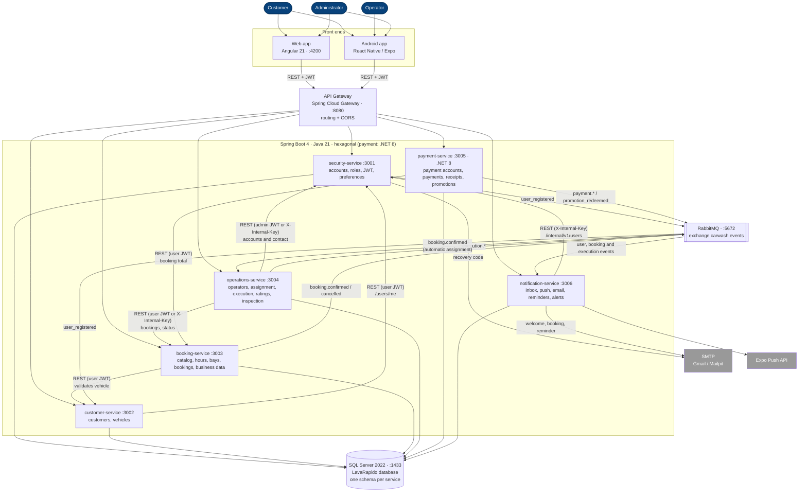

*Note.* All services share one SQL Server instance, but each one owns its schemas and there are no foreign keys between services (ADR-003). Diagram by the authors, based on `lavarapido-infra/docker-compose.yml`.

**Table 6**
*System Components and Their Responsibility*

| Component | Port | Technology | Responsibility |
|---|---|---|---|
| API Gateway | 8080 | Spring Cloud Gateway | Single entry point for the web and the app; routes by path and answers CORS. It does not expose internal routes. |
| security-service | 3001 | Java 21, Spring Boot 4 | Accounts, roles and permissions, JWT authentication, lockout after failed attempts, password recovery, profile address and preferences. |
| customer-service | 3002 | Java 21, Spring Boot 4 | Customer profile, vehicles and vehicle types. |
| booking-service | 3003 | Java 21, Spring Boot 4 | Catalog and prices, opening hours, bays, availability, bookings, day summary and business data. |
| operations-service | 3004 | Java 21, Spring Boot 4 | Operators, profile, shifts, absences, automatic and manual assignment, execution, ratings, metrics and inspection report. |
| payment-service | 3005 | .NET 8 | Payment accounts, payments, receipts, history with filters, refunds, promotions and points. |
| notification-service | 3006 | Java 21, Spring Boot 4 | Notification inbox, push, emails, reminders and administrator alerts, in each account's language. |
| Web application | — | Angular 21 | Interface for the three roles in the browser. |
| Mobile application | — | React Native 0.86, Expo SDK 57 | Interface for the three roles on Android. |
| SQL Server | 1433 | SQL Server 2022 | Database: 9 schemas and 57 tables, versioned with Liquibase. |
| RabbitMQ | 5672 | RabbitMQ 4 | Domain event bus (exchange `carwash.events`). |

### 3.2 Product Functions

The functions are grouped into nine modules, which organize the functional requirements of section 5 (see Table 7).

**Table 7**
*Functional Modules of the System*

| Module | Main functions | Requirements |
|---|---|---|
| Authentication and accounts | Registration, sign-in, password recovery and change, lockout, own account, users, roles and permissions | RF-001 to RF-004b, RF-027 to RF-029 |
| Vehicles | Registration and management of the customer's vehicles | RF-030 |
| Catalog, opening hours and bays | Services and prices by vehicle type, opening hours with exceptions, bays and business data | RF-021, RF-031, RF-032, RF-037 |
| Bookings | Request, availability, rescheduling, cancellation and administrative management | RF-005 to RF-007, RF-033 |
| Operations | Assignment, assigned services, execution, rating, availability, operator profile and inspection report | RF-008 to RF-012b, RF-022, RF-036, RF-038 |
| Payments | Payment accounts, methods, receipts, review, history, refunds | RF-013 to RF-016, RF-034, RF-035 |
| Dashboard and notifications | Dashboard per role, notifications, theme and language | RF-017 to RF-020 |
| Reports | Services, revenue, ratings and performance | RF-023 |
| Promotions and points | Promotions, coupon redemption and loyalty points | RF-024 to RF-026 |

### 3.3 User Characteristics

The system has three fixed roles and one non-human actor (see Table 8). No role requires technical training; knowing how to use a browser or a mobile app is enough.

**Table 8**
*System Actors*

| Actor | Description | Main activities |
|---|---|---|
| Customer | Person who brings their vehicle to the car wash. Uses the Android app or the web. | Registers vehicles, books (and may choose the operator), reschedules or cancels, pays, applies promotions, checks their history, rates the service and receives the inspection report. |
| Operator | Employee who washes the vehicles. Uses the app or the web at the site. | Checks their assigned services, schedule and ratings, and indicates when each service starts and ends. |
| Administrator | Person in charge of the car wash operation. | Sets up the catalog, prices, opening hours, bays, payment accounts and business data; manages users, operators and bookings; assigns or reassigns services; records the inspection report; reviews payments; manages promotions; checks reports and metrics. |
| System | Automatic processes (timers and event consumers). | Validates availability, assigns operators when the booking is confirmed, sends reminders, alerts and notifications, and credits points. |

### 3.4 Constraints

**Table 9**
*System Constraints*

| ID | Type | Constraint |
|---|---|---|
| RT-01 | Technical | The backend uses Java 21 with Spring Boot 4 and Spring Cloud Gateway; payment-service uses .NET 8 (ADR-013). The web uses Angular 21 and the mobile app uses React Native with Expo. |
| RT-02 | Technical | Every external request enters through the API Gateway (port 8080). The `/internal/**` routes can only be reached between services, with a shared key. |
| RT-03 | Technical | The services use a single SQL Server 2022 instance, with one schema per service and no foreign keys between services (ADR-003). |
| RT-04 | Technical | Business rules are implemented in the domain, with no dependency on frameworks or on the database (hexagonal architecture, ADR-007). |
| RT-05 | Technical | In this version, the whole solution runs in Docker containers with Docker Compose, without cloud infrastructure. |
| RD-01 | Data | Statuses are stored as English codes and translated in the interface (ADR-010). |
| RD-02 | Data | Records with history (users, vehicles, services, bays) are deactivated, not deleted. |
| RD-03 | Data | The receipt is stored in the database as a data URL and the inspection report photos as binary data, until file storage is available; the server limits the request body to 8 MB. |
| RD-04 | Data | Amounts are expressed in Colombian pesos (COP). |
| RO-01 | Operational | The system runs a single car wash: it does not handle branches, coverage zones or routes. |
| RO-02 | Operational | An internet connection is required to check availability, book and pay. |
| RO-03 | Operational | Payment verification is manual: it depends on the administrator reviewing the receipts. |
| RO-04 | Operational | Assignment depends on the operators' shifts and absences being up to date. |
| RO-05 | Operational | RabbitMQ events require messaging to be enabled (`MESSAGING_ENABLED` or `app.messaging.enabled` flag); it is disabled by default. Automatic assignment also needs the internal key (`INTERNAL_API_KEY`) and can be turned off with `AUTO_ASSIGN_ENABLED=false`. |
| RR-01 | Regulatory | Personal data is handled according to Law 1581 of 2012 (Congreso de la República de Colombia, 2012); the customer accepts the policy when registering, and the server stores the date and time of the acceptance. |
| RR-02 | Regulatory | The system does not capture, transmit or store payment card data. |
| RP-01 | Project | Team of three part-time apprentices; no assigned budget (estimated cost under real conditions: COP 212,925,240, according to the *Technical and Economic Proposal*); delivery on the academic date. |

### 3.5 Assumptions and Dependencies

- Customers accept paying by QR code or bank transfer and uploading the receipt, instead of using an automatic gateway.
- Customers have an Android device or a browser, and an internet connection when booking.
- The site has fixed opening hours and operators with defined shifts; the administrator keeps opening hours, catalog, prices and payment accounts up to date.
- The data volume corresponds to an academic project, not to a large-scale real operation.
- Email depends on an SMTP server (Mailpit in development) and push on the Expo Push service (Expo, n.d.). If they fail, the notification stays in the inbox and the rest of the system keeps working.
- The status of services and ratings is updated when the user opens the screen; there are no real-time updates.

### 3.6 Design Decisions

During analysis and development, decisions were made that change the original specification. Each one is recorded in an ADR in the documentation repository; Table 10 summarizes those that affect the requirements.

**Table 10**
*Architecture Decisions That Affect the Requirements*

| ADR | Decision | Effect on the requirements |
|---|---|---|
| ADR-003 | One schema per service in a shared instance, with no foreign keys between services. | References between services are validated through the API (RT-03). |
| ADR-004 | REST for synchronous queries and RabbitMQ for non-blocking notices. | A booking is confirmed even if the notice email fails (RNF-012). |
| ADR-006 | JWT authentication and role-based authorization. | Defines RNF-004 and the redirect by role (RF-002). |
| ADR-007 | Hexagonal architecture in each service. | Business rules are tested without infrastructure (RNF-006). |
| ADR-008 | Manual payment verified with a receipt; no gateway. | Gives rise to RF-013 to RF-016 and RF-034. |
| ADR-010 | Data model aligned with the screens; statuses in English. | Registration does not ask for an address (RF-001); the address is an optional profile field (RF-027) and the business data is stored on the server (RF-037). |
| ADR-011 | Event-driven notifications, with push and email, in each account's language. | Defines the types in RF-018, the alert for bookings without an operator and the inspection report notice. |
| ADR-013 | payment-service in .NET 8. | Technical constraint RT-01. |
| ADR-014 | Integration of operations with bookings, and assignment rules. | Defines RF-008, RF-009, RF-010 and RF-012b, with the 15-minute start window. |
| ADR-015 | Points that unlock promotions, a real percentage discount, fixed roles with editable permissions, and a bay per booking. | Redefines RF-024 to RF-026 and gives rise to RF-029. |

---

## 4. External Interface Requirements

### 4.1 User Interfaces

- The interface is available in Spanish, English, French and Portuguese; amounts are shown in COP and dates according to the selected language.
- Each form points out the field that failed validation, and each action that changes data shows a confirmation or error message.
- Destructive actions (cancelling a booking, deactivating an account, rejecting a payment) ask for confirmation.
- Customer: book (with an optional operator choice), check the history, pay, apply promotions, rate and open the inspection report. Operator: view, start and finish their services. Administrator: management of the catalog, opening hours, bays, business data, users, operators, bookings, inspection reports, payments, promotions and reports.
- There are four color palettes for the user to choose from, saved per account.

Figure 2 shows the actual sign-in screen of the web application, the common entry point for the three roles.

**Figure 2**
*Sign-In Screen (evidence of RF-002)*

### 4.2 Hardware Interfaces

The system does not control any hardware devices. Users need a computer with a browser, or an Android phone with a camera or gallery for the receipt. Development requires a computer with Docker Desktop, Java 21, .NET 8 and Node.js.

### 4.3 Software Interfaces

**Table 11**
*Software Interfaces*

| External system | Version | Purpose | Interface type |
|---|---|---|---|
| Android | 8.0 or later | Operating system of the mobile app | Platform |
| Chrome, Firefox and Edge | Current stable version | Running the web application | Platform |
| SQL Server | 2022 | Data persistence for each service | TDS protocol (port 1433) |
| RabbitMQ | 4 | Publishing and consuming domain events | AMQP (port 5672) |
| SMTP server | Mailpit in development | Recovery code, welcome, booking notices and reminders | SMTP with STARTTLS |
| Expo Push | Expo service | Push notifications to the Android app | HTTPS |

### 4.4 Communication Interfaces

- The web and the app communicate with the API Gateway over HTTPS in every environment reachable from outside the development team's computers; HTTP is only allowed in local development.
- The API uses REST with JSON bodies under the `/api/v1` prefix and receives the token in the `Authorization: Bearer` header.
- Each request carries a correlation identifier (`X-Correlation-Id`) that is written to the logs.
- The services call each other over REST on the `/internal/**` routes, authenticated with the `X-Internal-Key` header, and publish events to the `carwash.events` exchange in RabbitMQ.

---

## 5. Functional Requirements

### 5.1 Conventions

Each requirement has a unique identifier that is kept across versions. Each requirement is written as a verifiable capability and comes with measurable acceptance criteria (Wiegers & Beatty, 2013).

Priority follows the MoSCoW technique: Essential (must have), Desirable (should have) and Optional (could have). The status of each requirement was verified against the code and the automated tests on October 16, 2026: Implemented (built and tested), Partial (partly built; what is missing is stated) and Pending (not built).

### 5.2 Authentication and Accounts

**Table 12**
*Authentication and Account Requirements (security-service)*

| ID | Requirement | Acceptance criteria | Priority | Status |
|---|---|---|---|---|
| RF-001 | **Customer registration.** The system must allow a person to create a customer account with ID number, first names, last names, phone, email and password, after accepting the personal data processing policy. | • If the email is already registered, the system rejects the request with a message saying so and does not create the account. • The password meets the policy in RNF-004. • When the account is created, the customer profile is created in customer-service and a welcome email is sent. • No address is requested, because the service is provided at the site. | Essential | Implemented |
| RF-002 | **Sign-in.** The system must authenticate the user with email and password, issue a JWT token and redirect them to their role's dashboard. | • With valid credentials, the user reaches their role's dashboard (customer, operator or administrator). • With invalid credentials, the message is generic and does not reveal whether the email exists. • A deactivated account cannot sign in. | Essential | Implemented |
| RF-003 | **Password recovery.** The system must allow resetting the password with a 6-digit code sent to the registered email. | • The code expires after 15 minutes and is invalidated after 5 failed attempts. • For an unregistered email, the response is identical and no email is sent. • The code is stored only as a hash, is single-use, and requesting a new one invalidates the previous one. • The new password cannot be the same as the current one. | Desirable | Implemented |
| RF-004 | **Password change.** The system must allow the authenticated user to change their password after validating the current one. | • If the current password does not match, the change is rejected and the password stays the same. • The new password meets the policy in RNF-004. | Desirable | Implemented |
| RF-004b | **Lockout after failed attempts.** The system must lock the account for 15 minutes after 5 failed sign-in attempts within 15 minutes. | • During the lockout, sign-in is rejected with a 423 response (`ACCOUNT_LOCKED`) and a message explaining the lockout, even if the password is correct. • A correct sign-in before the fifth failure clears the count. • A successful password reset (RF-003) lifts the lockout. | Essential | Implemented |
| RF-027 | **Own account management.** The system must allow the user to view and update their profile data and contact address, change their email, sign out and deactivate their account. | • Signing out revokes the session on the server. • The address is optional, has up to 200 characters and is stored on the server, so it is the same on the web and in the app; saving it empty deletes it. • Accounts are deactivated, not deleted, to keep bookings, payments and ratings. | Desirable | Implemented |
| RF-028 | **User administration.** The system must allow the administrator to list users with their registration date, create operator and administrator accounts, and activate or deactivate accounts. | • A deactivated account cannot sign in and keeps its history. • Only the administrator role can use this function (403 response for the other roles). | Desirable | Implemented |
| RF-029 | **Roles and permissions.** The system must handle three fixed roles (administrator, operator and customer) and allow the administrator to view and edit the permission matrix of each role. | • Roles cannot be created or deleted. • In this version the matrix is informational: effective authorization is based on the role in the JWT token (ADR-015). | Optional | Implemented |

**Evidence in the system (authentication and accounts module)**

| RF | Screen |
|---|---|
| RF-001 (registration) |  |
| RF-003 (password recovery) |  |
| RF-004, RF-027 (profile, password change and own account) |  |
| RF-028 (user administration) |  |
| RF-029 (roles and permissions) |  |

### 5.3 Vehicles

**Table 13**
*Vehicle Requirements (customer-service)*

| ID | Requirement | Acceptance criteria | Priority | Status |
|---|---|---|---|---|
| RF-030 | **Customer vehicle management.** The system must allow the customer to register, view, edit and remove their vehicles, indicating the license plate and vehicle type. | • Only the owner manages their vehicles; the administrator can view them. • Removing a vehicle does not delete the past bookings in which it was used. • The vehicle type determines the price of each service (RF-031). | Essential | Implemented |

**Evidence:** 

### 5.4 Catalog, Opening Hours and Bays

**Table 14**
*Catalog, Opening Hours and Bay Requirements (booking-service)*

| ID | Requirement | Acceptance criteria | Priority | Status |
|---|---|---|---|---|
| RF-031 | **Service catalog and prices.** The system must allow the administrator to create, edit, activate, deactivate and delete wash services, with category, description, price and estimated duration by vehicle type, and loyalty points. | • A price change does not modify existing bookings: each line keeps the price in force when the booking was made. • Two overlapping active rates are not allowed for the same service and vehicle type. • Only active services are offered when booking. | Essential | Implemented |
| RF-021 | **Opening hours and exceptions.** The system must allow the administrator to set the site's weekly opening hours, the daily break and the exceptions (public holidays and special hours). | • If the closing time is earlier than or equal to the opening time, the change is rejected. • The new opening hours apply to later availability checks. • Each change is recorded in the opening-hours history. | Desirable | Implemented |
| RF-032 | **Bay management.** The system must allow the administrator to create, edit, deactivate and delete the site's wash bays. | • Only active bays are used to confirm new bookings. | Essential | Implemented |
| RF-037 | **Business data.** The system must allow the administrator to view and update the car wash data: legal information (legal name, tax ID, business type, foundation date, legal representative), tax information (tax regime, CIIU activity, DIAN resolution, invoice prefix and range) and service channels (website, social networks, support line and service hours). | • The data is stored in booking-service and is the same on the web and in the app. • The legal name, tax ID and address are required; the phone has at least 7 digits, the email must be valid and the foundation date cannot be in the future. • The public page and the help center show the saved email, phone, support line and service hours. | Desirable | Implemented |

**Evidence:**

| RF | Screen |
|---|---|
| RF-031 (catalog and prices) | 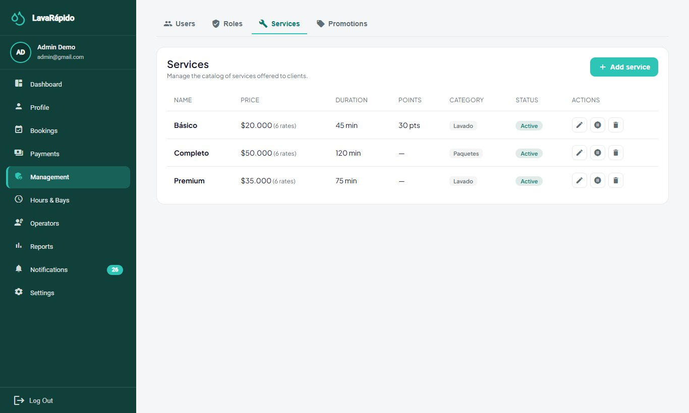 |
| RF-021, RF-032 (opening hours and bays) |  |

### 5.5 Bookings

**Table 15**
*Booking Requirements (booking-service)*

| ID | Requirement | Acceptance criteria | Priority | Status |
|---|---|---|---|---|
| RF-005 | **Booking request.** The system must allow the customer to book one or more services for one of their vehicles, choosing the date and start time. | • The price of each service matches the selected vehicle type. • Times are offered in 30-minute slots and up to 60 days ahead (configurable values). • Only the customer's own vehicles are accepted. | Essential | Implemented |
| RF-006 | **Availability check.** Before confirming, the system must validate the site's opening hours, their exceptions and the existence of an active bay without overlapping bookings. | • With a free bay, the booking is confirmed immediately with the bay assigned. • With no free bay, nothing is saved and up to 5 alternative times on the same day are offered. • When two requests arrive at the same time for the same bay and time, only one is confirmed (RNF-003). | Essential | Implemented |
| RF-007 | **Rescheduling and cancellation.** The system must allow the customer to reschedule or cancel their booking while it is in the Scheduled or Confirmed status. | • Rescheduling assigns a new time and bay, and keeps the prices. • Cancellation requires a reason from the list of reasons and frees the bay. • Once the service is in progress or finished, both actions are blocked with an explanatory message. | Essential | Implemented |
| RF-033 | **Administrative booking management.** The system must allow the administrator to view all bookings within a date range and change their status (confirm, cancel with a reason, mark as "no-show"), following the life cycle in Figure 4. | • A transition that the life cycle does not allow is rejected. | Desirable | Implemented |

**Evidence:**

| RF | Screen |
|---|---|
| RF-005, RF-006 (booking request) |  |
| RF-007 (history / reschedule / cancel) |  |
| RF-033, RF-009 (administrative management and assignment) | 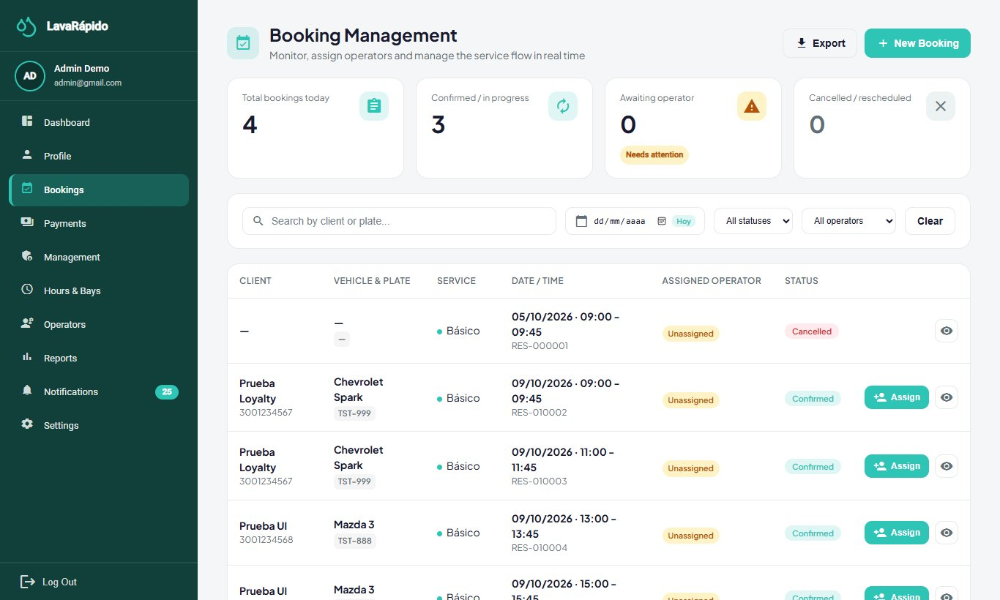 |

### 5.6 Operations

**Table 16**
*Operations Requirements (operations-service)*

| ID | Requirement | Acceptance criteria | Priority | Status |
|---|---|---|---|---|
| RF-008 | **Automatic operator assignment.** The system must automatically assign an available operator to each confirmed booking. | • An operator is eligible if their account is active, they have a shift that covers the slot, and they have no absence and no other overlapping booking. • If the customer chose an operator (RF-010) who is still free, that operator is assigned; otherwise the one with the fewest bookings that day is chosen, and ties are broken by the lowest identifier. • Rescheduling keeps the operator the booking already had. • If no operator is available, the booking stays unassigned and the administrators get an alert when less than 2 hours remain before the start, so they can assign one manually (RF-009). | Essential | Implemented |
| RF-009 | **Manual assignment and reassignment.** The system must allow the administrator to assign or reassign an operator to a booking from a list of candidates. | • The list shows available operators first, sorted by name, with their average rating, and the reason why the rest are unavailable. • Assigning an operator who is inactive, off shift, absent or has another booking at that time is blocked. • Reassignment is only possible while the execution is pending; the assigned operator receives a notification. | Desirable | Implemented |
| RF-010 | **Operator choice by the customer.** The system must allow the customer to optionally choose an operator from the list of available ones when booking. | • After picking the time, the customer sees the operators who are free at that time, with their first name and average rating; no contact data is shown. • If they choose no one, the car wash assigns a free operator (RF-008). • If the chosen operator is no longer free when the booking is confirmed, another free operator is assigned and the customer sees on their home screen the name of the person who will serve them. | Desirable | Implemented |
| RF-011 | **Assigned services.** The system must show the operator their assigned bookings with customer, vehicle, time, services and bay. | • The operator only sees the bookings assigned to them. | Essential | Implemented |
| RF-012b | **Service start and finish.** The system must allow the operator to mark the service assigned to them as started and as finished. | • It can only be started from 15 minutes before the booking time; before that, the button is disabled and the server answers `SERVICE_TOO_EARLY`. • The booking moves to In progress when started and to Completed when finished; starting it cancels the pending reminders. • The action is blocked if the booking is assigned to another operator. | Essential | Implemented |
| RF-012 | **Service rating.** The system must allow the customer to rate one of their completed bookings, only once, with a whole score from 1 to 5 and an optional comment of up to 500 characters. | • A booking that is not completed cannot be rated, and a booking cannot be rated twice. • The comment requires a score. • The rating applies to all lines of the booking and feeds the operator's average. • The customer sees the operator's first name and the operator sees the customer's first name. | Desirable | Implemented |
| RF-022 | **Operator availability.** The system must record each operator's weekly shift and absences, and allow activating or deactivating them. | • The administrator records and adjusts shifts and absences; the operator views their schedule. • The recorded availability feeds RF-008, RF-009 and RF-010. • The administrator sees the team summary: active operators, operators available and absent today, services this week against the previous one, and average rating. | Desirable | Implemented |
| RF-036 | **Vehicle inspection report.** The system must allow the administrator to record an inspection report for bookings of 180 minutes or more and share it with the customer. | • The report has five phases, in the order in which the vehicle is walked through (reception, exterior, interior, engine and delivery), each one Pending, In progress or Done; recording a finding in a pending phase moves it to In progress. • Each finding states the area (up to 120 characters), a note (up to 500), the severity (informational, minor or major) and up to 5 photos. • It can only be created for Confirmed, In progress or Completed bookings, and only edited while the booking is Confirmed or In progress. • The link only shows the report after it is published, and only a published report can be shared; when it is shared, the customer gets a notification with the link. • The public link uses a random code, not the booking number, and shows a masked license plate. • The report is managed from the web and from the mobile app; on the phone the photos are taken with the camera or picked from the gallery and are shrunk before uploading. | Desirable | Implemented |
| RF-038 | **Operator profile.** The system must allow the administrator to record the operator's specialty and skills, each with its level (certified, expert or advanced). | • The specialty has up to 80 characters. • An operator has at most 10 skills, each with a unique name of up to 60 characters. • Saving replaces the whole list of skills. | Optional | Implemented |

**Evidence:**

| RF | Screen |
|---|---|
| RF-011 (services assigned to the operator) |  |
| RF-012b (start and finish, operator dashboard) |  |
| RF-012 (service ratings) | 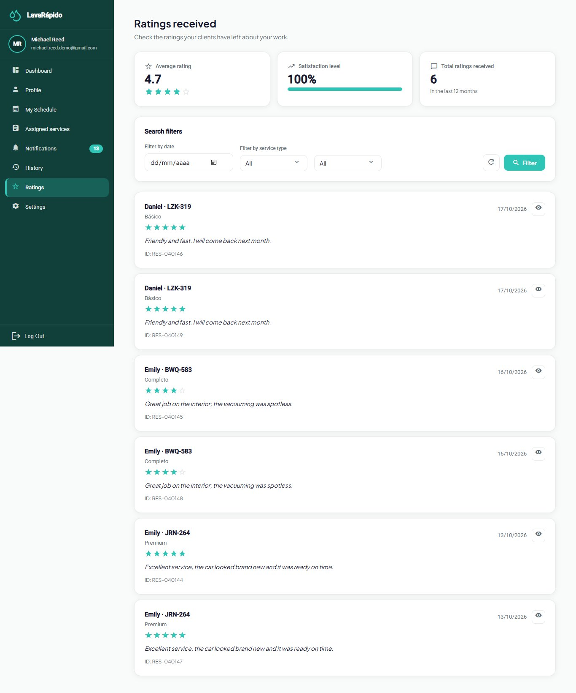 |
| RF-022 (operator availability, admin view) | 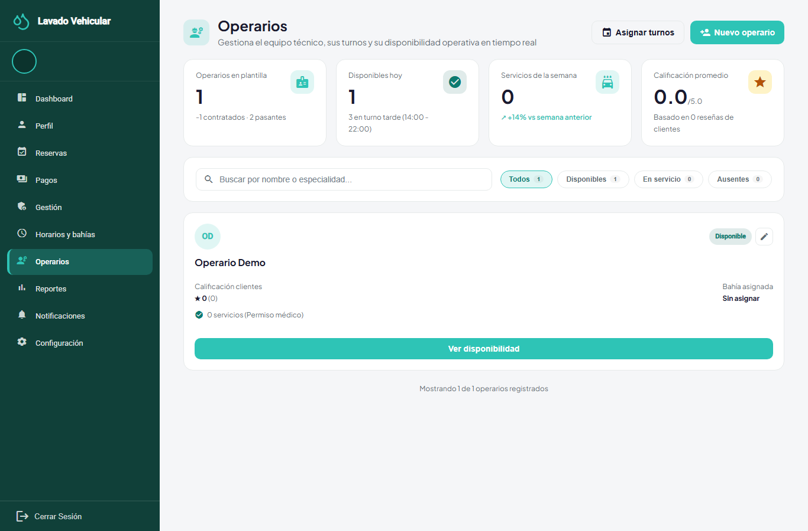 |
| RF-022 (the operator's own view) |  |

### 5.7 Payments

**Table 17**
*Payment Requirements (payment-service)*

| ID | Requirement | Acceptance criteria | Priority | Status |
|---|---|---|---|---|
| RF-034 | **Site payment accounts.** The system must allow the administrator to create, edit, activate and deactivate the payment accounts for each digital method (holder, account number, QR image and instructions). | • Only active accounts are shown to the customer. | Essential | Implemented |
| RF-013 | **Payment methods.** The system must show the customer the site's payment methods (cash, Nequi, Daviplata and bank transfer) and, for each digital method, its QR code and instructions. | • Cash does not show a QR code. | Essential | Implemented |
| RF-013b | **Receipt upload.** For a digital method, the system must allow the customer to upload the receipt with the declared amount and the transaction reference code. | • JPG or PNG images of up to 10 MB are accepted; the app compresses them before sending. • The payment goes to Under review and is linked to the booking. • Cash does not require a receipt. | Essential | Implemented |
| RF-014 | **Payment review.** The system must allow the administrator to approve or reject a payment under review by comparing the declared amount with the amount due, and to record cash payments directly. | • Rejection requires a reason; the customer is notified and can send another receipt. • A booking can have at most one approved payment. • Approval credits the loyalty points (RF-026). | Essential | Implemented |
| RF-015 | **Payment history.** The system must show the customer their payment history sorted by date and linked to each service. | • Payments are sorted from the most recent booking to the oldest. • They can be filtered by booking date range and by service name (`GET /payments/me?from=&to=&service=`); a start date later than the end date is rejected with `INVALID_DATE_RANGE`. • With no payments, a message says so. | Desirable | Implemented |
| RF-016 | **Payment constraints.** The system must not capture or store card data and must reject a receipt whose reference code already appears in the payment of another booking. | • The rejection returns the error code `TRANSACTION_REFERENCE_REUSED`. | Essential | Implemented |
| RF-035 | **Refund.** The system must allow the administrator to mark an approved payment as refunded. | • Only an Approved payment can move to Refunded; the `payment.refunded` event is published. | Optional | Implemented |

**Evidence:**

| RF | Screen |
|---|---|
| RF-013, RF-013b, RF-016, RF-025 (payment, coupon) | 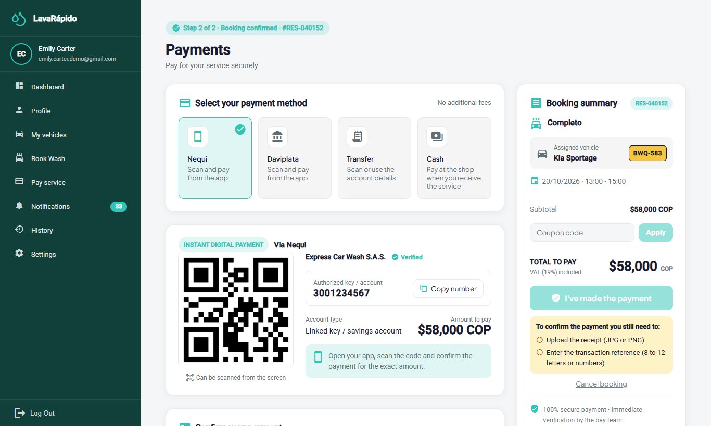 |
| RF-014, RF-035 (review and refund) |  |
| RF-034 (site payment accounts) | 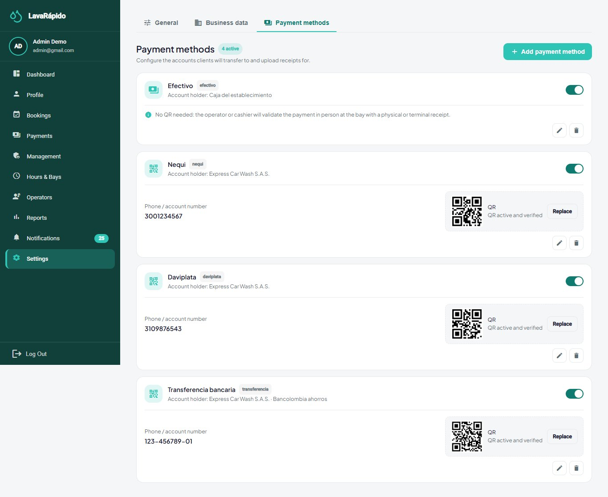 |
| RF-015 (history, within bookings) |  |

### 5.8 Dashboard, Notifications, Preferences and Reports

**Table 18**
*Dashboard, Notification, Preference and Report Requirements*

| ID | Requirement | Acceptance criteria | Priority | Status |
|---|---|---|---|---|
| RF-017 | **Dashboard per role.** The system must show each role a dashboard with summary metrics and shortcuts. | • With no data, a message says so instead of an empty screen. • The administrator dashboard compares today's bookings with the previous day's, counted by booking-service in the car wash's time zone. • The customer dashboard shows their next service with the name of the assigned operator. | Desirable | Implemented |
| RF-018 | **Notifications.** The system must notify users about relevant events in an inbox with read/unread status, by push in the mobile app and by email for booking events. | • Types: welcome, booking created, confirmed and cancelled, reminder, operator assigned, service started and finished, payment confirmed and rejected, promotion available and redeemed, inspection report shared, and system message. • Reminders are sent 24 hours and 1 hour before the booking and are cancelled when the service starts or finishes. • The administrators get an alert when a booking starts in less than 2 hours and still has no operator. • Each notification is written in the language of the account that receives it. • Opening a notification marks it as read. | Desirable | Implemented |
| RF-019 | **Visual theme per account.** The system must allow choosing between four color palettes and keep the choice in the user's account. | • When another account signs in on the same device, that account's theme is applied. | Optional | Implemented |
| RF-020 | **Language per account.** The system must allow switching the interface language between Spanish, English, French and Portuguese, and keep it in the account. | • Without a session, the chosen language is remembered in the browser. | Optional | Implemented |
| RF-023 | **Operational reports.** The system must generate reports on services performed, revenue, average rating and performance per operator for a chosen period. | • With no data in the period, a message says so. | Desirable | **Partial.** The web reads real bookings and payments, and operations-service computes each operator's weekly metrics (services, punctuality, revenue and worked hours) and the team summary; consolidated reports for a chosen period are missing. |

**Evidence:**

| RF | Screen |
|---|---|
| RF-017 (admin / customer / operator dashboard) |  ·  |
| RF-018 (notifications) | 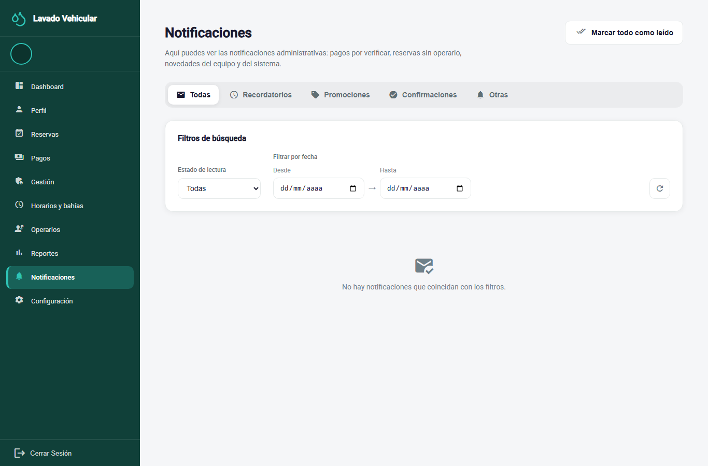 ·  |
| RF-019, RF-020 (theme and language) | 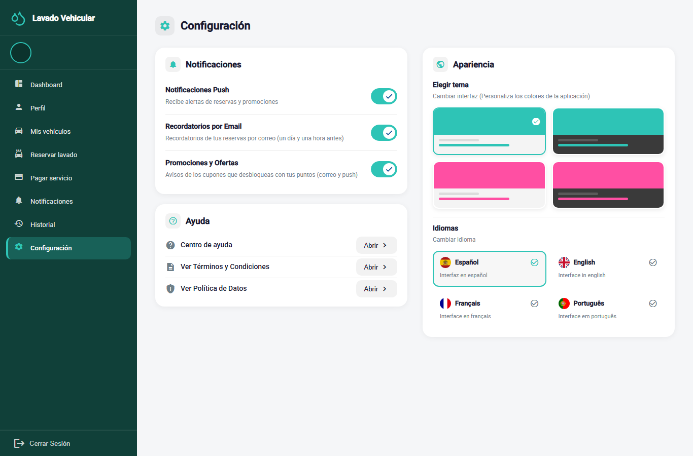 |
| RF-023 (reports) |  |

### 5.9 Promotions and Loyalty

**Table 19**
*Promotion and Loyalty Requirements (payment-service)*

| ID | Requirement | Acceptance criteria | Priority | Status |
|---|---|---|---|---|
| RF-024 | **Promotion management.** The system must allow the administrator to create, edit, activate, deactivate and delete promotions with a code, validity period, discount percentage (1 to 100) and required points. | • A deactivated or expired promotion cannot be applied to new payments. | Desirable | Implemented |
| RF-025 | **Applying a promotion at payment.** The system must allow the customer to apply the code of a valid promotion when paying for a booking. | • The system checks that the promotion is active, within its validity period and unlocked by the customer's points. • The discount is calculated on the booking total and never exceeds it. • If the promotion does not apply, the customer is told and the original amount is kept; if it applies, the redemption is notified in the app and by email. | Optional | Implemented |
| RF-026 | **Loyalty points.** The system must credit the customer with the points of each paid service and use the accumulated balance to unlock promotions. | • Points are credited only once per booking, when its payment is approved. • The balance is calculated from the ledger of movements and never from a copy in the profile. • Redeeming a promotion does not consume points. | Optional | Implemented |

**Evidence:**

| RF | Screen |
|---|---|
| RF-024 (promotion management) | 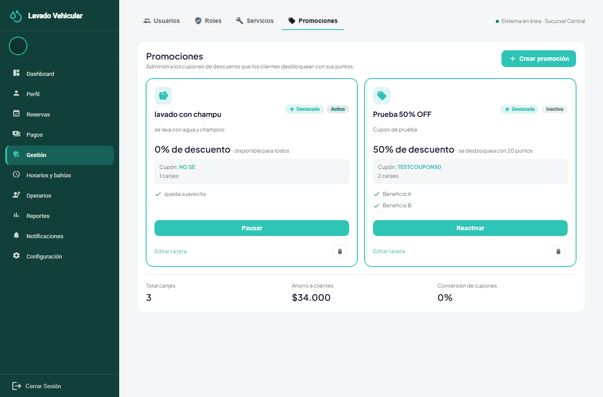 |
| RF-025, RF-026 (redeeming a coupon / points balance on the customer dashboard) |  ·  |

### 5.10 Business Rules

Business rules are conditions that the system must always keep, regardless of the screen or the service that performs the operation. Table 20 lists them with their identifier from the domain model.

**Table 20**
*System Business Rules*

| ID | Rule | Requirement |
|---|---|---|
| INV-BOOK-001/002 | A booking requires a vehicle that belongs to the customer making the booking. | RF-005 |
| INV-BOOK-003 | A booking has at least one service line; the same rate is not repeated within a booking. | RF-005 |
| INV-BOOK-004 | The booking end time is later than the start time. | RF-005 |
| INV-BOOK-005/006 | A booking is only confirmed within opening hours and with an active bay without overlapping bookings. | RF-006 |
| INV-BOOK-007 | Only Scheduled or Confirmed bookings can be rescheduled or cancelled. | RF-007 |
| INV-BOOK-008 | Each line keeps the price in force when the booking was made, even if the catalog changes later. | RF-031 |
| INV-EXEC-001/002 | Each service line has at most one execution and one responsible operator. | RF-009 |
| INV-EXEC-003 | An operator cannot have overlapping services. | RF-009 |
| INV-EXEC-004 | Only the assigned operator updates the progress of their service. | RF-012b |
| RN-EXEC-01 | A service can only be started from 15 minutes before the booking time. | RF-012b |
| RN-ASSIGN-01 | Automatic assignment respects the customer's choice if that operator is free; otherwise it picks the one with the fewest bookings that day and, in a tie, the one with the lowest identifier. | RF-008, RF-010 |
| RN-AUTH-01 | Five wrong passwords within 15 minutes lock the account for 15 minutes. | RF-004b |
| RN-INSP-01 | The inspection report only applies to bookings of 180 minutes or more and can only be edited while the vehicle is at the car wash (booking Confirmed or In progress). | RF-036 |
| INV-RATING-001 to 004 | The rating is unique, a whole number from 1 to 5, and given after completion; the comment requires a score. | RF-012 |
| INV-PAY-001 | Every payment belongs to a booking; a booking has at most one approved payment. | RF-014 |
| INV-PAY-002/003 | Digital payments require a receipt; cash payments are recorded by the administrator. | RF-013b |
| INV-PAY-005 | A difference between the declared amount and the amount due is a reason for rejection, never for automatic approval. | RF-014 |
| INV-PAY-006 | A reference code is not reused across bookings. | RF-016 |
| INV-PAY-007 | The system does not capture or store card data. | RF-016 |
| INV-LOY-001 | The points balance is always calculated from the ledger of movements. | RF-026 |
| RN-PROMO-01 | The discount is a percentage (1 to 100), is applied to the booking total and never exceeds it. | RF-025 |

---

## 6. Non-Functional Requirements

Non-functional requirements are classified according to the product quality characteristics of ISO/IEC 25010 (ISO/IEC, 2023). Each one has a metric or criterion that can be verified in the local Docker environment (see Table 21). The requirements of 1,000 concurrent users in the cloud and 99% availability from earlier versions were withdrawn, because the project is not deployed to production.

**Table 21**
*Non-Functional Requirements*

| ID | Characteristic | Requirement and metric | Verification | Status |
|---|---|---|---|---|
| RNF-001 | Performance efficiency | The 95th percentile of the response time of the booking and authentication endpoints is under 2 seconds, and the availability query responds in under 2 seconds with the test data set. | Script `lavarapido-infra/e2e/performance.js`: 30 requests per endpoint through the gateway in the local environment | **Implemented.** Measured on October 14, 2026: the highest 95th percentile was 686 ms (`/payments/me`). |
| RNF-002 | Availability | All services answer UP on their health endpoint (`/actuator/health` or `/health`) during every academic review session. | Check before each session | **Implemented.** Verified live on October 9, 2026: the 6 services and the gateway answered `200 OK`. |
| RNF-003 | Integrity and concurrency | Under simultaneous requests, only one booking takes a bay in a slot; a busy operator is not assigned; a booking does not have two approved payments (filtered unique index) and a reference code is not repeated. | Integration tests | Partial: rules implemented; integration tests pending |
| RNF-004 | Security | Private endpoints with JWT (401 without a token or with an expired token); token validity of 1 hour; BCrypt passwords of 8 to 72 characters, with at least one uppercase letter, one number and one special character, and no spaces; access by role (403 between roles) and by resource owner; lockout after 5 failed attempts; secrets only in environment variables; HTTPS outside development. | Web tests by role, password policy and lockout tests, a test that the gateway does not expose `/internal`, code review | **Implemented**; on the public server Caddy serves everything over HTTPS. |
| RNF-005 | Maintainability: observability | Each service writes requests and errors to standard output with the `X-Correlation-Id` correlation identifier. | Log review with `docker logs` | Partial |
| RNF-006 | Maintainability | Every change goes through a Pull Request with at least one approval, uses Conventional Commits and versions schema changes with Liquibase; frontend and backend communicate only through the API. | GitHub history and code review | Partial |
| RNF-007 | Portability | A new team member brings up the whole solution in Docker containers by following the local installation guide, on any of the team's operating systems. | Installation from scratch on more than one computer | Partial |
| RNF-008 | Compatibility | The app works on Android 8.0 or later; the web works on the current versions of Chrome, Firefox and Edge, and is usable from 360 px wide. | Script `lavarapido-infra/e2e/width-360.js` for the web; manual tests on devices and emulators | Partial: on October 17, 2026, none of the 60 web screens measured (360 and 768 px) or of the 26 mobile app screens (360 px, in their web version) scrolls sideways or clips content; testing on an Android 8 device is still missing. |
| RNF-009 | Usability | A customer completes a booking in 5 steps or fewer from the dashboard; each form points out the invalid field; each action that changes data shows a confirmation or an error. | Review of flows and forms | Partial: booking takes 5 steps (vehicle, service, date, time and confirm; choosing the operator is optional) and the form messages were reviewed in the 4 languages; a test with users is still missing. |
| RNF-010 | Usability: localization | All screens are available in the four languages with no untranslated keys; amounts in COP; dates in the format of each language. | Manual review per language | Partial |
| RNF-011 | Reliability: idempotency | A domain event received more than once produces a single effect (one notification, one points credit). | Unit tests of the event consumer and the points credit | Implemented |
| RNF-012 | Reliability: fault tolerance | A failure of the SMTP server, Expo Push or RabbitMQ does not prevent confirming a booking or approving a payment; the notification stays in the inbox. | Test with the external service stopped | Implemented |

---

## 7. Use Case Model

### 7.1 Use Case Diagram

The 30 use cases are presented in four diagrams, one per actor, grouped by module (Figures 3a to 3d).

**Figure 3a**
*Use Cases Common to the Three Roles*

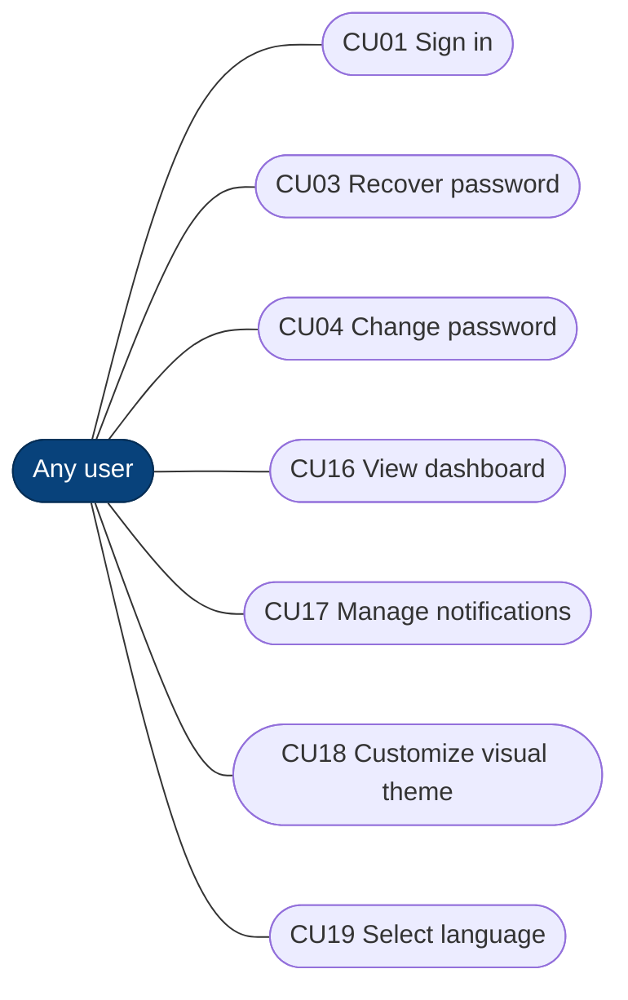

**Figure 3b**
*Customer Use Cases*

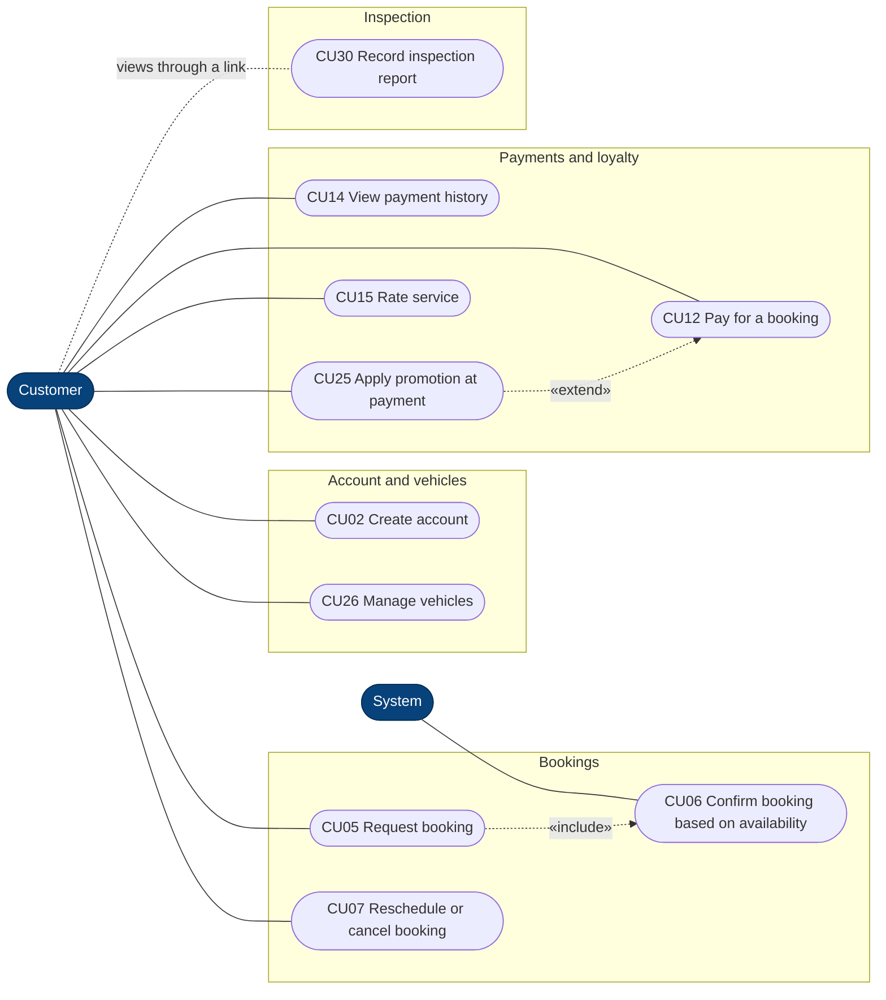

*Note.* `«include»` means that CU05 always runs CU06; `«extend»` means that CU25 optionally extends CU12. The customer does not record the inspection report (CU30): they view it through the link the administrator shares.

**Figure 3c**
*Operator Use Cases*

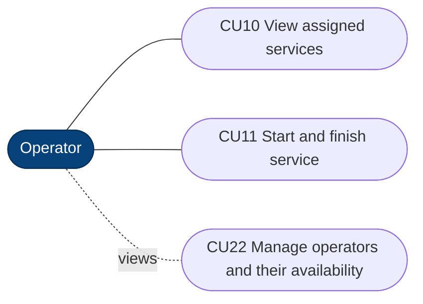

**Figure 3d**
*Administrator and System Use Cases*

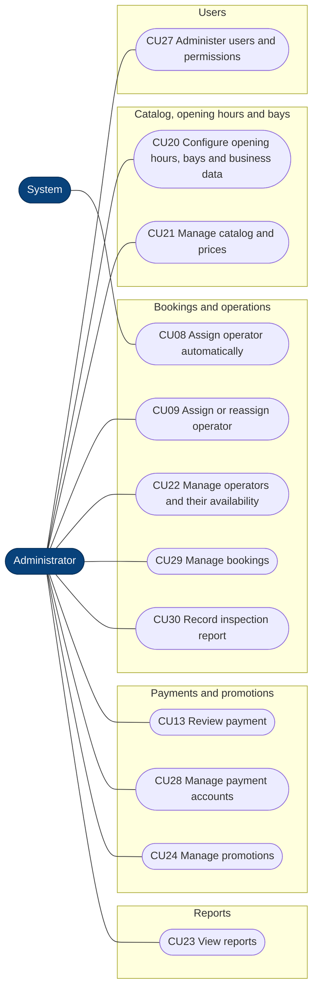

*Note.* CU22 appears as a view-only use case in the operator diagram and as full management in the administrator diagram, since the administrator is the one who records shifts, absences and the operator profile (RF-022, RF-038). CU08 is run by the system each time a booking is confirmed. Diagrams by the authors.

### 7.2 Actor and Use Case Matrix

**Table 22**
*Use Cases by Actor*

| Actor | Use cases |
|---|---|
| All roles | CU01, CU03, CU04, CU16, CU17, CU18, CU19 |
| Customer | CU02, CU05, CU06, CU07, CU12, CU14, CU15, CU25, CU26, CU30 (view only) |
| Operator | CU10, CU11, CU22 (view only) |
| Administrator | CU09, CU13, CU20, CU21, CU22, CU23, CU24, CU27, CU28, CU29, CU30 |
| System | CU06 (included in CU05), CU08 |

### 7.3 Use Case Specifications

Each use case is specified with the Cockburn (2001) format: actors, precondition, main flow, alternative flows, postcondition, requirements covered and status.

**Table 23**
*CU01: Sign in*

| Field | Description |
|---|---|
| Actors | Customer, operator, administrator. |
| Precondition | The user has an active account. |
| Main flow | 1. The user enters email and password. 2. The system validates the credentials and issues the token. 3. The system redirects to the role's dashboard. |
| Alternative flows | • Invalid credentials: a generic message is shown. • Five failed attempts in 15 minutes: the account is locked for 15 minutes and the system offers password recovery, which lifts the lockout. |
| Postcondition | The user stays authenticated while the token is valid (1 hour). |
| Requirements | RF-002, RF-004b |
| Status | Implemented |

**Table 24**
*CU02: Create account*

| Field | Description |
|---|---|
| Actors | Customer. |
| Precondition | There is no account with the same email. |
| Main flow | 1. The customer fills in their personal data and password. 2. They accept the data processing policy. 3. The system creates the account and the profile, and sends the welcome email. |
| Alternative flows | • Email already registered: the customer is informed and the account is not created. • Password that does not meet the policy: the broken rules are shown. |
| Postcondition | The account and the customer profile are created. |
| Requirements | RF-001 |
| Status | Implemented |

**Table 25**
*CU03: Recover password*

| Field | Description |
|---|---|
| Actors | Customer, operator, administrator. |
| Precondition | The user has access to their account's email. |
| Main flow | 1. The user enters their email. 2. The system sends a 6-digit code. 3. The user types the code and the new password. |
| Alternative flows | • Expired code or 5 failed attempts: the user requests a new code. • Unregistered email: the response is identical and no email is sent. • New password equal to the current one: it is rejected and the user can try another one without requesting a new code. |
| Postcondition | The password is updated, the code is no longer valid and, if the account was locked, the lockout is lifted. |
| Requirements | RF-003 |
| Status | Implemented |

**Table 26**
*CU04: Change password*

| Field | Description |
|---|---|
| Actors | Customer, operator, administrator. |
| Precondition | The user is authenticated. |
| Main flow | 1. The user types the current password and the new one. 2. The system validates and saves the change. |
| Alternative flows | • Wrong current password or invalid new password: the change is rejected. |
| Postcondition | The password is updated. |
| Requirements | RF-004 |
| Status | Implemented |

**Table 27**
*CU05: Request booking*

| Field | Description |
|---|---|
| Actors | Customer. |
| Precondition | The customer is authenticated and has at least one registered vehicle. |
| Main flow | 1. The customer chooses the vehicle. 2. They choose one or more services; the system shows the price according to the vehicle type. 3. They choose date and time. 4. If they want, they choose an operator from the list of those free at that time. 5. The system runs CU06. |
| Alternative flows | • No registered vehicles: the system asks the customer to register one (CU26). • No one free at that time: the booking goes ahead without an operator preference. |
| Postcondition | The request is ready for the availability check. |
| Requirements | RF-005, RF-010 |
| Status | Implemented |

**Table 28**
*CU06: Confirm booking based on availability*

| Field | Description |
|---|---|
| Actors | System (included in CU05). |
| Precondition | There is a booking request in progress. |
| Main flow | 1. The system checks the opening hours, the exceptions and the active bays. 2. With a free bay, it confirms the booking and assigns the bay. 3. It publishes the confirmation: the customer is notified, the reminders are scheduled and CU08 runs. |
| Alternative flows | • No free bay: nothing is saved and up to 5 alternative times on the same day are offered. |
| Postcondition | The booking is Confirmed and the bay is taken in that slot. |
| Requirements | RF-006 |
| Status | Implemented |

**Table 29**
*CU07: Reschedule or cancel booking*

| Field | Description |
|---|---|
| Actors | Customer. |
| Precondition | The booking is in the Scheduled or Confirmed status. |
| Main flow | 1. The customer opens the booking from their history. 2. They change the date and time, or cancel it giving a reason. 3. The system saves the change and sends a notification. |
| Alternative flows | • Service in progress or finished: the action is blocked with an explanatory message. • New time without availability: alternatives are offered. |
| Postcondition | The booking is rescheduled or cancelled; if cancelled, the bay is freed. |
| Requirements | RF-007 |
| Status | Implemented |

**Table 30**
*CU08: Assign operator automatically*

| Field | Description |
|---|---|
| Actors | System. |
| Precondition | The booking is Confirmed and has no operator. |
| Main flow | 1. When the booking confirmation arrives, the system identifies the eligible operators for the slot. 2. If the customer chose an operator who is free, it assigns them; otherwise it picks the one with the fewest bookings that day (tie: lowest identifier). 3. It notifies the customer and the operator. |
| Alternative flows | • No eligible operators: the booking stays without an operator and, when less than 2 hours remain, the administrators get an alert so they can run CU09. • Rescheduled booking that already had an operator: the operator is kept. |
| Postcondition | The service has an assigned and notified operator. |
| Requirements | RF-008, RF-010 |
| Status | Implemented |

**Table 31**
*CU09: Assign or reassign operator*

| Field | Description |
|---|---|
| Actors | Administrator. |
| Precondition | The booking has not started. |
| Main flow | 1. The administrator opens the booking. 2. The system shows the candidates: available ones first, by name, with their rating. 3. The administrator picks an operator and confirms. 4. The system notifies the operator. |
| Alternative flows | • Operator not available: the assignment is blocked and the reason is shown. • Execution already started: reassignment is blocked. |
| Postcondition | The booking is assigned to the chosen operator. |
| Requirements | RF-009 |
| Status | Implemented |

**Table 32**
*CU10: View assigned services*

| Field | Description |
|---|---|
| Actors | Operator. |
| Precondition | The operator is authenticated. |
| Main flow | 1. The operator opens their dashboard. 2. They see their bookings with customer, vehicle, time, services and bay. |
| Alternative flows | • No assigned services: a message says so. |
| Postcondition | The operator knows their work. |
| Requirements | RF-011 |
| Status | Implemented |

**Table 33**
*CU11: Start and finish service*

| Field | Description |
|---|---|
| Actors | Operator. |
| Precondition | The booking is assigned to the operator, is Confirmed and 15 minutes or less remain before its start time. |
| Main flow | 1. The operator marks the service as started. 2. When done, they mark it as finished. |
| Alternative flows | • Booking of another operator, or before the 15-minute window: the action is blocked. |
| Postcondition | The booking is Completed, the pending reminders are cancelled and the customer can rate it. |
| Requirements | RF-012b |
| Status | Implemented |

**Table 34**
*CU12: Pay for a booking*

| Field | Description |
|---|---|
| Actors | Customer. |
| Precondition | The booking is confirmed and has no approved payment. |
| Main flow | 1. The customer chooses the payment method. 2. For a digital method, they see the QR code and the instructions. 3. They upload the receipt with the declared amount and the reference code. 4. The payment goes to Under review. |
| Alternative flows | • Cash: no receipt is uploaded and the administrator records the payment. • Reference code already used in another booking: the receipt is rejected. • The customer can apply a promotion (CU25). |
| Postcondition | The payment is recorded and linked to the booking. |
| Requirements | RF-013, RF-013b, RF-016 |
| Status | Implemented |

**Table 35**
*CU13: Review payment*

| Field | Description |
|---|---|
| Actors | Administrator. |
| Precondition | There is a payment under review or a cash payment to record. |
| Main flow | 1. The administrator opens the pending payments. 2. They compare the declared amount with the amount due. 3. They approve or reject the payment. |
| Alternative flows | • Different amount or unreadable receipt: they reject it with a reason and the customer can resend. • Approved payment that must be returned: they mark it as refunded (RF-035). |
| Postcondition | The payment is approved or rejected and the customer is notified; approval credits points. |
| Requirements | RF-014, RF-035 |
| Status | Implemented |

**Table 36**
*CU14: View payment history*

| Field | Description |
|---|---|
| Actors | Customer. |
| Precondition | The customer is authenticated. |
| Main flow | 1. The customer opens the history. 2. They see their payments with date, service, amount and status, from the most recent booking to the oldest. 3. If they want, they filter by dates or by service. |
| Alternative flows | • No payments: a message says so. |
| Postcondition | The customer knows the status of their payments. |
| Requirements | RF-015 |
| Status | Implemented |

**Table 37**
*CU15: Rate service*

| Field | Description |
|---|---|
| Actors | Customer. |
| Precondition | The booking is Completed and has not been rated. |
| Main flow | 1. The customer picks a score from 1 to 5. 2. They write an optional comment. 3. They save the rating. |
| Alternative flows | • Booking not completed or already rated: the system rejects the rating. |
| Postcondition | The rating is linked to the booking and its lines. |
| Requirements | RF-012 |
| Status | Implemented |

**Table 38**
*CU16: View dashboard*

| Field | Description |
|---|---|
| Actors | Customer, operator, administrator. |
| Precondition | The user is authenticated. |
| Main flow | 1. The user enters the system. 2. They see the summary and the shortcuts of their role. |
| Alternative flows | • No data: a message says so. |
| Postcondition | The user has an overview of their activity. |
| Requirements | RF-017 |
| Status | Implemented |

**Table 39**
*CU17: Manage notifications*

| Field | Description |
|---|---|
| Actors | Customer, operator, administrator. |
| Precondition | The user is authenticated. |
| Main flow | 1. The user opens the inbox. 2. They see the notifications with their status. 3. They open one and it is marked as read. |
| Alternative flows | • No notifications: the inbox shows a message saying so. |
| Postcondition | The user is informed about the relevant events. |
| Requirements | RF-018 |
| Status | Implemented |

**Table 40**
*CU18: Customize visual theme*

| Field | Description |
|---|---|
| Actors | Customer, operator, administrator. |
| Precondition | The user is authenticated. |
| Main flow | 1. The user picks one of the four palettes. 2. The system applies it and saves it in the account. |
| Alternative flows | • Saving fails: the theme is applied on the device and the account keeps its previous one. |
| Postcondition | The theme is linked to the account. |
| Requirements | RF-019 |
| Status | Implemented |

**Table 41**
*CU19: Select language*

| Field | Description |
|---|---|
| Actors | Any user, with or without a session. |
| Precondition | None. |
| Main flow | 1. The user picks the language. 2. The system updates the interface texts. |
| Alternative flows | • Without a session: the language is only remembered in the browser. |
| Postcondition | The interface is shown in the chosen language; with a session, it is saved in the account. |
| Requirements | RF-020 |
| Status | Implemented |

**Table 42**
*CU20: Configure opening hours, bays and business data*

| Field | Description |
|---|---|
| Actors | Administrator. |
| Precondition | The administrator is authenticated. |
| Main flow | 1. They set the weekly opening hours and the daily break. 2. They record exceptions (public holidays, special hours). 3. They create, edit or deactivate bays. 4. They update the legal, tax and service data of the business. |
| Alternative flows | • Closing time earlier than or equal to the opening time: the change is rejected. • Missing legal name, tax ID or address, or an invalid email or phone: the business data is not saved. |
| Postcondition | The opening hours and the bays apply to later bookings; the business data is shown on the web and in the app. |
| Requirements | RF-021, RF-032, RF-037 |
| Status | Implemented |

**Table 43**
*CU21: Manage catalog and prices*

| Field | Description |
|---|---|
| Actors | Administrator. |
| Precondition | The administrator is authenticated. |
| Main flow | 1. They create or edit a service. 2. They set the price and duration by vehicle type, and its points. 3. They activate or deactivate the service. |
| Alternative flows | • Required data is missing or the rate overlaps another active one: the system says so before saving. |
| Postcondition | The catalog is updated; existing bookings keep their price. |
| Requirements | RF-031 |
| Status | Implemented |

**Table 44**
*CU22: Manage operators and their availability*

| Field | Description |
|---|---|
| Actors | Administrator (operator: view only). |
| Precondition | The user is authenticated. |
| Main flow | 1. The administrator records the operator's weekly shift. 2. They record or delete absences. 3. They edit the operator's specialty and skills. 4. They activate or deactivate the operator. 5. They check the operator's weekly metrics and the team summary. |
| Alternative flows | • Absence that overlaps an assigned service: the system warns about it. |
| Postcondition | The availability is updated for automatic and manual assignment. |
| Requirements | RF-022, RF-038 |
| Status | Implemented |

**Table 45**
*CU23: View reports*

| Field | Description |
|---|---|
| Actors | Administrator. |
| Precondition | The administrator is authenticated. |
| Main flow | 1. They open the reports section. 2. They choose the type of report and the period. |
| Alternative flows | • No data in the period: a message says so. |
| Postcondition | The administrator has information to make decisions. |
| Requirements | RF-023 |
| Status | Partial |

**Table 46**
*CU24: Manage promotions*

| Field | Description |
|---|---|
| Actors | Administrator. |
| Precondition | The administrator is authenticated. |
| Main flow | 1. They create or edit a promotion with a code, validity period, percentage and required points. 2. They activate or deactivate it. |
| Alternative flows | • Data is missing or the percentage is outside 1 to 100: the system says so before saving. |
| Postcondition | The promotion becomes available or disabled. |
| Requirements | RF-024 |
| Status | Implemented |

**Table 47**
*CU25: Apply promotion at payment*

| Field | Description |
|---|---|
| Actors | Customer (extends CU12). |
| Precondition | The customer has a booking to pay and an unlocked promotion. |
| Main flow | 1. During payment, the customer enters the promotion code. 2. The system checks validity, status and points, and calculates the discount. 3. The customer pays the discounted amount. |
| Alternative flows | • Expired or inactive promotion, or not enough points: the customer is told and the original amount is kept. |
| Postcondition | The redemption is recorded in the booking and the customer is notified. |
| Requirements | RF-025, RF-026 |
| Status | Implemented |

**Table 48**
*CU26: Manage vehicles*

| Field | Description |
|---|---|
| Actors | Customer. |
| Precondition | The customer is authenticated. |
| Main flow | 1. The customer registers a vehicle with license plate and type. 2. They view, edit or remove their vehicles. |
| Alternative flows | • Incomplete data: the system points out the missing field. |
| Postcondition | The vehicles are available for booking. |
| Requirements | RF-030 |
| Status | Implemented |

**Table 49**
*CU27: Administer users and permissions*

| Field | Description |
|---|---|
| Actors | Administrator. |
| Precondition | The administrator is authenticated. |
| Main flow | 1. They list the users. 2. They create operator or administrator accounts. 3. They activate or deactivate accounts. 4. They edit a role's permission matrix. |
| Alternative flows | • Email already registered: the account is not created. |
| Postcondition | The accounts and the permission matrix are updated. |
| Requirements | RF-028, RF-029 |
| Status | Implemented |

**Table 50**
*CU28: Manage payment accounts*

| Field | Description |
|---|---|
| Actors | Administrator. |
| Precondition | The administrator is authenticated. |
| Main flow | 1. They create or edit a payment account with holder, number, QR code and instructions. 2. They activate or deactivate it. |
| Alternative flows | • Required data is missing: the system asks for it before saving. |
| Postcondition | Active accounts are shown to the customer at payment. |
| Requirements | RF-034 |
| Status | Implemented |

**Table 51**
*CU29: Manage bookings*

| Field | Description |
|---|---|
| Actors | Administrator. |
| Precondition | The administrator is authenticated. |
| Main flow | 1. They view the bookings within a date range. 2. They change the status of a booking (cancel with a reason, mark as "no-show"). |
| Alternative flows | • Transition not allowed by the life cycle: it is rejected. |
| Postcondition | The booking is in the new status and the customer is notified. |
| Requirements | RF-033 |
| Status | Implemented |

**Table 52**
*CU30: Record inspection report*

| Field | Description |
|---|---|
| Actors | Administrator (customer: view only). |
| Precondition | The booking lasts 180 minutes or more and is Confirmed or In progress. |
| Main flow | 1. The administrator opens the booking's report. 2. They go through the phases in order (reception, exterior, interior, engine and delivery) and mark each one in progress or done. 3. They record the findings with area, note, severity and photos. 4. They publish the report. 5. They share it: the customer gets a notification with the link. 6. The customer opens the link and sees the report with a masked license plate. |
| Alternative flows | • Booking shorter than 180 minutes, cancelled or pending: it does not accept a report. • Completed booking: the report can be viewed but not edited. • More than 5 photos in a finding: rejected. • Sharing before publishing: rejected. |
| Postcondition | The report is published and the customer has the link. |
| Requirements | RF-036 |
| Status | Implemented |

---

## 8. Business Flows

### 8.1 Main Flow: From Booking to Rating

The main business flow goes through the system's services in the following order:

1. The customer creates their account (CU02); security-service publishes the registration and customer-service creates the profile; notification-service sends the welcome message.
2. The customer registers their vehicle (CU26) and requests a booking (CU05).
3. booking-service validates opening hours and bays (CU06), confirms the booking and publishes `booking.confirmed`; notification-service sends the notice and schedules the 24-hour and 1-hour reminders.
4. operations-service receives `booking.confirmed` and assigns a free operator (CU08): the one the customer chose if still free or, otherwise, the one with the fewest bookings that day. The customer and the operator are notified. If no one was free, the administrator assigns one by hand (CU09) and gets an alert when less than 2 hours remain.
5. The customer pays (CU12): they upload the receipt and, if they want, apply a promotion (CU25). The administrator reviews the payment (CU13); when it is approved, the points are credited and the customer is notified.
6. From 15 minutes before the time, the operator starts the service and finishes it when done (CU11); the booking moves to In progress and then to Completed, and the pending reminders are cancelled. For services of 180 minutes or more, the administrator records the inspection report and shares it with the customer (CU30).
7. The customer rates the service (CU15).

The rule that defines whether payment must be approved before the service starts is still open (section 11.3); today steps 5 and 6 are independent.

### 8.2 Booking Life Cycle

Figure 4 shows the statuses of a booking and the allowed transitions.

**Figure 4**
*Booking State Diagram*

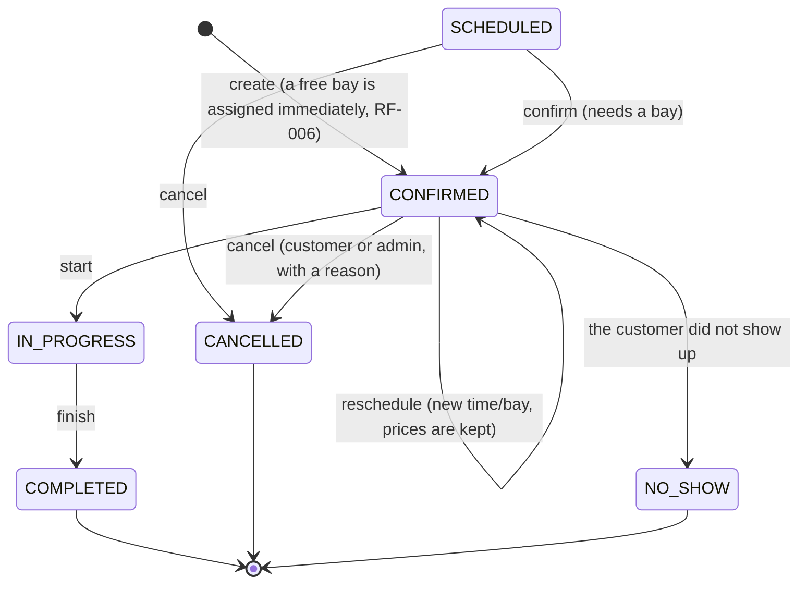

*Note.* The uppercase codes are the ones the system stores (ADR-010). Only `SCHEDULED` and `CONFIRMED` can be rescheduled or cancelled (RF-007). `SCHEDULED`, `CONFIRMED` and `IN_PROGRESS` take up the bay. `SCHEDULED` exists in the model, but the current flow never creates a booking in that status: every booking starts directly as `CONFIRMED`. Source: `booking-service`, `Booking.moveTo`, `Booking.cancel`, `BookingStatus`.

### 8.3 Payment and Execution Life Cycles

**Figure 5**
*Payment State Diagram*

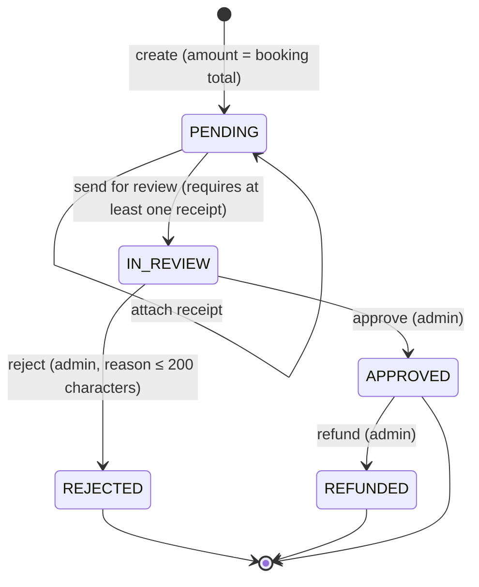

*Note.* A payment reported by the customer moves from `PENDING` to `IN_REVIEW` in the same request; a manual (cash) payment goes straight to `APPROVED`. A booking allows only one approved payment (filtered unique index) and only one open payment (`PENDING`/`IN_REVIEW`) at a time. After `REJECTED`, the customer can report a new payment for the same booking. Source: `payment-service`, `Payment` aggregate.

**Figure 6**
*Service Execution State Diagram*

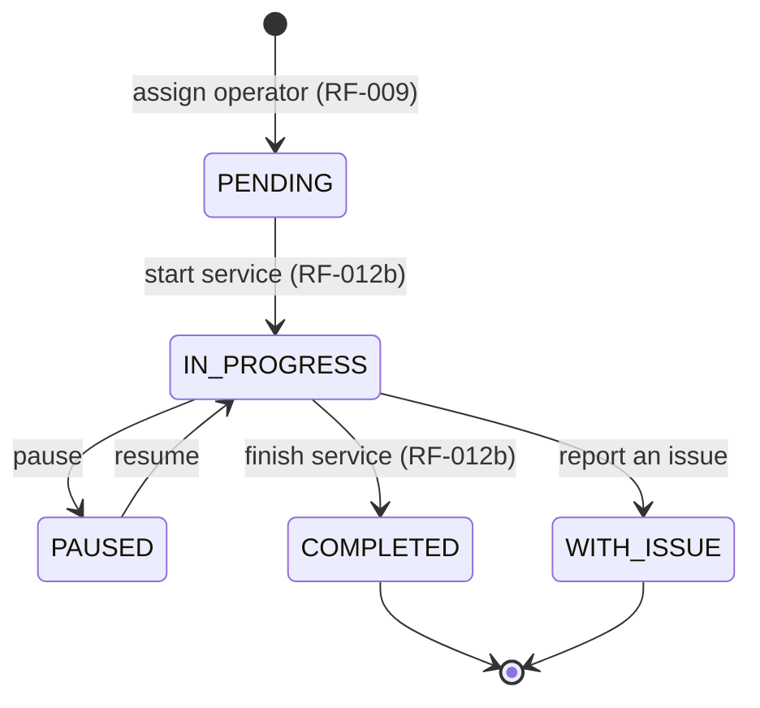

*Note.* `COMPLETED` enables the customer's rating (RF-012). Source: `operations-service` (statuses: Pending, In progress, Paused, Completed, With issue).

### 8.4 Domain Events and Notifications

The services publish events to RabbitMQ to notify other services without blocking the operation (ADR-004). Table 53 links each event to its effect.

**Table 53**
*Domain Events and Their Effect*

| Event | Producer | Effect |
|---|---|---|
| `security.user_registered` | security-service | customer-service creates the profile (`customer.provisioned`); welcome notification. |
| `security.user.deactivated` | security-service | Consumer services stop offering the account. |
| `customer.vehicle.registered/updated/removed` | customer-service | Vehicle data is synchronized for bookings. |
| `booking.created`, `booking.confirmed` | booking-service | Booking notifications and reminder scheduling; operations-service assigns the operator automatically, with the customer's preference if there is one. |
| `booking.cancelled` | booking-service | Cancellation notice and cancellation of the reminders. |
| `payment.confirmed`, `payment.rejected` | payment-service | Notification of the payment review result. |
| `payment.refunded` | payment-service | Refund record. |
| `payment.promotion_redeemed` | payment-service | Notification of the redemption in the inbox and by email. |
| `execution.operator_assigned` | operations-service | Notification to the customer and the operator; the booking no longer counts as unassigned. |
| `execution.service_started`, `execution.service_completed` | operations-service | Notification to the customer and cancellation of the pending reminders. |
| `execution.inspection_shared` | operations-service | Notification to the customer with the inspection report link. |

*Note.* Each notification is written in the language of the account that receives it. The alert for bookings without an operator does not depend on an event: notification-service periodically checks the confirmed bookings that start in less than 2 hours without an operator.

---

## 9. Data Requirements

### 9.1 Data Ownership

The database has 9 schemas and 57 tables. Each schema has a single owner service, which is the only one allowed to write to it (see Table 54).

**Table 54**
*Data Schemas and Owner Service*

| Schema | Owner service | Main data |
|---|---|---|
| `security` | security-service | People, addresses, accounts with their registration date, roles, permissions, sessions, lockouts after failed attempts, recovery codes and preferences. |
| `customer` | customer-service | Customers, vehicles and vehicle types. |
| `catalog` | booking-service | Categories, services, prices by vehicle type and points per service. |
| `booking` | booking-service | Site with its legal, tax and service data, opening hours, exceptions, bays, bookings, lines, cancellation reasons and opening-hours history. |
| `execution` | operations-service | Operators with their specialty and skills, shifts, absences, executions with their rating, and inspection reports with their phases, findings and photos. |
| `payment` | payment-service | Payment methods and accounts, payments, receipts and points ledger. |
| `promotion` | payment-service | Promotions, discount types and redemptions per booking. |
| `notification` | notification-service | Notifications, types, push devices, reminders, booking tracking for the alerts and processed events. |
| `audit` | security-service | Change audit log. |

### 9.2 Integrity and Retention Rules

- References between schemas of different services are stored as identifiers without a foreign key and are validated through the API.
- Critical constraints are also enforced in the database: a filtered unique index for a single approved payment per booking, an index on the reference code, and range constraints for scores and percentages.
- The prices and points of each booking line are a copy of the value in force when the booking was made.
- Passwords and recovery codes are stored only as a hash.
- The public link of the inspection report uses a random code and does not show the customer's email, phone or full license plate.
- Records with history are not deleted; they are deactivated. This version does not define a retention or deletion policy for personal data, which must be defined before a real deployment in accordance with Law 1581 of 2012.
- Every schema change is applied with a versioned Liquibase migration.

---

## 10. Traceability Matrix

Table 55 links each functional requirement to its user story, its use cases, the service that implements it and its status. The requirements without a user story (RF-027 to RF-038) describe built functions that must be added to the backlog.

**Table 55**
*Functional Requirements Traceability*

| RF | Name | HU | CU | Service | Status |
|---|---|---|---|---|---|
| RF-001 | Customer registration | HU-AUTH-001 | CU02 | security | Implemented |
| RF-002 | Sign-in | HU-AUTH-002 | CU01 | security | Implemented |
| RF-003 | Password recovery | HU-AUTH-003 | CU03 | security | Implemented |
| RF-004 | Password change | HU-AUTH-004 | CU04 | security | Implemented |
| RF-004b | Lockout after failed attempts | HU-AUTH-002 | CU01 | security | Implemented |
| RF-005 | Booking request | HU-BOOK-001 | CU05 | booking | Implemented |
| RF-006 | Availability check | HU-BOOK-001 | CU06 | booking | Implemented |
| RF-007 | Rescheduling and cancellation | HU-BOOK-002 | CU07 | booking | Implemented |
| RF-008 | Automatic operator assignment | HU-BOOK-003 | CU08 | operations, booking | Implemented |
| RF-009 | Manual assignment and reassignment | HU-BOOK-006 | CU09 | operations | Implemented |
| RF-010 | Operator choice by the customer | HU-BOOK-004 | CU05, CU08 | operations, booking | Implemented |
| RF-011 | Assigned services | HU-BOOK-007 | CU10 | operations | Implemented |
| RF-012 | Service rating | HU-BOOK-005 | CU15 | operations | Implemented |
| RF-012b | Service start and finish | HU-BOOK-007 | CU11 | operations | Implemented |
| RF-013 | Payment methods | HU-PAY-001 | CU12 | payment | Implemented |
| RF-013b | Receipt upload | HU-PAY-001 | CU12 | payment | Implemented |
| RF-014 | Payment review | HU-PAY-003 | CU13 | payment | Implemented |
| RF-015 | Payment history | HU-PAY-002 | CU14 | payment | Implemented |
| RF-016 | Payment constraints | HU-PAY-001 | CU12 | payment | Implemented |
| RF-017 | Dashboard per role | HU-UI-001 | CU16 | frontend | Implemented |
| RF-018 | Notifications | HU-UI-002 | CU17 | notification | Implemented |
| RF-019 | Visual theme per account | HU-UI-003 | CU18 | security | Implemented |
| RF-020 | Language per account | HU-UI-003 | CU19 | security | Implemented |
| RF-021 | Opening hours and exceptions | HU-ADMIN-001 | CU20 | booking | Implemented |
| RF-022 | Operator availability | HU-ADMIN-001 | CU22 | operations | Implemented |
| RF-023 | Operational reports | HU-ADMIN-001 | CU23 | booking, operations, payment | Partial |
| RF-024 | Promotion management | HU-PROMO-001 | CU24 | payment | Implemented |
| RF-025 | Applying a promotion at payment | HU-PROMO-002 | CU25 | payment | Implemented |
| RF-026 | Loyalty points | HU-PROMO-002 | CU25 | payment | Implemented |
| RF-027 | Own account management | — | — | security | Implemented |
| RF-028 | User administration | — | CU27 | security | Implemented |
| RF-029 | Roles and permissions | — | CU27 | security | Implemented |
| RF-030 | Customer vehicle management | — | CU26 | customer | Implemented |
| RF-031 | Service catalog and prices | — | CU21 | booking | Implemented |
| RF-032 | Bay management | — | CU20 | booking | Implemented |
| RF-033 | Administrative booking management | — | CU29 | booking | Implemented |
| RF-034 | Site payment accounts | — | CU28 | payment | Implemented |
| RF-035 | Refund | — | CU13 | payment | Implemented |
| RF-036 | Vehicle inspection report | — | CU30 | operations, notification | Implemented |
| RF-037 | Business data | — | CU20 | booking | Implemented |
| RF-038 | Operator profile | — | CU22 | operations | Implemented |

---

## 11. Progress Status and Open Decisions

### 11.1 Progress Summary

Of the 41 functional requirements, 40 are implemented and 1 is partially implemented (RF-023, consolidated reports). The seven server components are built; on October 9, 2026 the six services and the gateway were started, and each one answered `200 OK` on its health endpoint. The web and the Android app are connected to the six services through the gateway. Table 56 summarizes the automated tests of the services and the web, run on October 16, 2026.

**Table 56**
*Automated Tests by Component*

| Component | Command | Tests | Count date |
|---|---|---|---|
| Web application (Angular) | `npx ng test --watch=false` | 43 | October 16, 2026 |
| api-gateway | `./mvnw test` | 34 | October 16, 2026 |
| security-service | `./mvnw test` | 147 | October 16, 2026 |
| customer-service | `./mvnw test` | 68 | October 16, 2026 |
| booking-service | `./mvnw test` | 40 | October 16, 2026 |
| operations-service | `./mvnw test` | 54 | October 16, 2026 |
| notification-service | `./mvnw test` | 112 | October 16, 2026 |
| payment-service | `dotnet test` | 141 | October 16, 2026 |
| **Total** | | **639** | |

*Note.* All tests passed. payment-service also has 7 integration tests that are skipped because they need SQL Server. In addition, `lavarapido-infra/e2e` has 19 end-to-end tests that run with the system up and passed on October 16, 2026: the booking flow with operator choice and automatic assignment, the complete flow of the three roles (booking, payment, approval with points, service, and rating), the inspection report with photos and public link, and the access rules per role. The folder also includes the RNF-001 measurement and the check of the web screens at 360 px (RNF-008). During the manual review of October 9, a missing API Gateway route (`/api/v1/loyalty/**`) and a style that misaligned the promotion badges were fixed.

### 11.2 Pending Items for Delivery

- Complete the consolidated reports for a chosen period (RF-023).
- Write the user stories for RF-027 to RF-038.
- Write integration tests against SQL Server for the concurrency rules (RNF-003).
- Test the app on an Android 8 device (RNF-008) and run a usability test with users (RNF-009).
- Add the end-to-end tests to the continuous integration; today they are run by hand with the system up.

### 11.3 Open Decisions

**Table 57**
*Open Decisions*

| Topic | Current situation | Owner |
|---|---|---|
| Payment before the service | It has not been defined whether payment must be approved before the service starts. | Team and car wash manager |
| Permissions by role | The permission matrix is editable but is not applied to authorization (ADR-015). | Backend lead |
| Displayed promotion price | The price shown on the promotion card and its actual discount percentage are not tied together by any rule. | Team |
| Data retention | There is no retention or deletion policy for personal data. | Project lead |

---

## References

American Psychological Association. (2020). *Publication manual of the American Psychological Association* (7th ed.). https://doi.org/10.1037/0000165-000

Cockburn, A. (2001). *Writing effective use cases*. Addison-Wesley.

Cockburn, A. (2005). *Hexagonal architecture*. https://alistair.cockburn.us/hexagonal-architecture/

Congreso de la República de Colombia. (2012, October 17). *Ley Estatutaria 1581 de 2012, por la cual se dictan disposiciones generales para la protección de datos personales* [Statutory Law 1581 of 2012, setting out general provisions for the protection of personal data]. https://www.funcionpublica.gov.co/eva/gestornormativo/norma.php?i=49981

Evans, E. (2003). *Domain-driven design: Tackling complexity in the heart of software*. Addison-Wesley.

Expo. (n.d.). *Push notifications overview*. Expo Documentation. https://docs.expo.dev/push-notifications/overview/

Guilombo Osorio, J. C., Patiño Cabrera, B. E., & Urbano Quintero, M. (2026). *Documentación técnica del proyecto LavaRápido* [LavaRápido project technical documentation; unpublished software documentation, vehicle-w-docs repository]. Servicio Nacional de Aprendizaje.

IEEE. (1998). *IEEE recommended practice for software requirements specifications* (IEEE Std 830-1998). https://doi.org/10.1109/IEEESTD.1998.88286

ISO/IEC. (2023). *Systems and software engineering — Systems and software Quality Requirements and Evaluation (SQuaRE) — Product quality model* (ISO/IEC 25010:2023). https://www.iso.org/standard/78176.html

ISO/IEC/IEEE. (2018). *Systems and software engineering — Life cycle processes — Requirements engineering* (ISO/IEC/IEEE 29148:2018). https://www.iso.org/standard/72089.html

Jones, M., Bradley, J., & Sakimura, N. (2015). *JSON Web Token (JWT)* (RFC 7519). Internet Engineering Task Force. https://doi.org/10.17487/RFC7519

Provos, N., & Mazières, D. (1999). A future-adaptable password scheme. In *Proceedings of the 1999 USENIX Annual Technical Conference*. USENIX Association. https://www.usenix.org/legacy/events/usenix99/provos.html

Wiegers, K., & Beatty, J. (2013). *Software requirements* (3rd ed.). Microsoft Press.
