# Informe de Especificación de Requisitos de Software (SRS) del Sistema LavaRápido

**Plataforma Web y Móvil de Reservas y Gestión para un Lavadero de Vehículos**

Juan Camilo Guilombo Osorio, Brayan Estiven Patiño Cabrera y Merari Urbano Quintero

Centro de la Industria, la Empresa y los Servicios, Servicio Nacional de Aprendizaje (SENA), Regional Huila

Tecnólogo en Análisis y Desarrollo de Software (ADSO), ficha 3145556

Instructora: Karol Daniela Correa

Versión 7.6, 20 de octubre de 2026

---

## Control de Versiones

**Tabla 1**
*Historial de Versiones del Documento*

| Versión | Fecha | Autor | Descripción del cambio |
|---|---|---|---|
| V2 | 08/09/2026 | Equipo de desarrollo | Primera versión del SRS. Describía un servicio móvil con zonas de cobertura y una pasarela de pago en línea. |
| V3 | 06/10/2026 | Equipo de desarrollo | Alcance real: lavadero fijo, pago por QR o transferencia con comprobante, arquitectura de microservicios, requisitos RF-001 a RF-026 con su estado y nuevos casos de uso. |
| V4 | 08/10/2026 | Equipo de desarrollo | Reestructuración según IEEE 830 e ISO/IEC/IEEE 29148 y formato APA 7. Estado verificado contra el código al 8 de octubre de 2026. Nuevos requisitos RF-027 a RF-035 y casos de uso CU26 a CU29, reglas de negocio, flujos y ciclos de vida, requisitos de datos, restricciones clasificadas, criterios de aceptación verificables, matriz de trazabilidad y referencias en formato APA. |
| V5 | 09/10/2026 | Equipo de desarrollo | Verificación con el sistema en ejecución (seis servicios, gateway y web) y corrección de una ruta del gateway y de un error de estilos en las promociones. Diagramas de casos de uso y de estados en Mermaid, capturas de la web en cada módulo y conteo actualizado de pruebas automatizadas. |
| V6 | 15/10/2026 | Equipo de desarrollo | Estado verificado contra el código al 15 de octubre de 2026. Quedan implementados el bloqueo de cuenta (RF-004b), la asignación automática (RF-008), la elección de operario por el cliente (RF-010), los filtros del historial de pagos (RF-015) y la disponibilidad de operarios (RF-022). Nuevos requisitos RF-036 a RF-038 (informe de inspección, datos del negocio y ficha del operario) y caso de uso CU30. Ventana de inicio del servicio, alerta de reserva sin operario, notificaciones en el idioma de la cuenta, dirección del perfil, 57 tablas, 601 pruebas automatizadas y mediciones de RNF-001 y RNF-008. |
| V7 | 16/10/2026 | Equipo de desarrollo | Revisión completa con el sistema corriendo en Docker. La fecha y la hora en que el cliente acepta los Términos y la Política de Tratamiento de Datos quedan guardadas en el servidor (RR-01); HTTPS activo en el servidor público; motivo del rechazo de una hora (día cerrado, fuera del horario, hora pasada o sin bahía libre); 639 pruebas automatizadas y 19 pruebas de punta a punta aprobadas. |
| V7.1 | 17/10/2026 | Equipo de desarrollo | Estado verificado contra el código al 17 de octubre de 2026: el informe de inspección (RF-036) también se gestiona desde la aplicación móvil, y la revisión de ancho de RNF-008 se amplió a 60 pantallas web y 26 de la app móvil, sin desbordes. |
| V7.2 | 19/10/2026 | Equipo de desarrollo | Integración continua con GitHub Actions en los 10 repositorios: en cada cambio se compila y se corren las pruebas. Se retira de los pendientes la integración continua con Jenkins. |
| V7.3 | 19/10/2026 | Equipo de desarrollo | El administrador puede cambiar el rol de una cuenta (RF-028, CU27); una cuenta de administrador no se desactiva y un administrador no cierra su propia cuenta (RF-027). |
| V7.4 | 19/10/2026 | Equipo de desarrollo | Nuevos casos de uso CU31 (gestionar la cuenta propia, RF-027) y CU32 (procesos automáticos: primer administrador, notificaciones por evento, recordatorios, alerta de reserva sin operario y aviso de versión nueva). Pasan a ser 32 casos de uso. |
| V7.5 | 19/10/2026 | Equipo de desarrollo | Pruebas del 19 de octubre de 2026 (655 automatizadas, 19 de punta a punta y 42 casos funcionales, Tabla 58) y capturas del sistema tomadas de nuevo ese día. |
| V7.6 | 20/10/2026 | Equipo de desarrollo | Se retira el cambio de rol de una cuenta, que el equipo revirtió en el código (RF-028, CU27): el rol se asigna al crear la cuenta y el sistema no ofrece cambiarlo. Una cuenta de administrador sigue sin poder desactivarse y un administrador no cierra su propia cuenta. Se corrigen la tabla de eventos de dominio (solo viajan por RabbitMQ los eventos que tienen consumidor), los tipos de notificación de RF-018 y el detalle con botón "Ir a…" de CU17, el diagrama de estados de la ejecución (Figura 6: sin pausa ni novedad, que no se usan) y la restricción RT-05 (servidor público en Azure). RF-007 y CU07: el cliente solo cancela, sin escribir motivo, y la reprogramación la hace el administrador (RF-033, CU29). |

---

## Resumen

Este documento especifica los requisitos de LavaRápido, una plataforma web y móvil que organiza la operación de un lavadero de vehículos de un único local: registro de clientes y vehículos, reserva de turnos con validación de horario y bahías, asignación automática o manual de operarios, ejecución y calificación del servicio, informe de inspección del vehículo, pago por QR o transferencia con revisión del comprobante, promociones, puntos de fidelización y notificaciones. La especificación sigue la estructura de IEEE 830 (IEEE, 1998) y de ISO/IEC/IEEE 29148 (ISO/IEC/IEEE, 2018), y se basa en la documentación técnica del proyecto (repositorio `vehicle-w-docs`) y en el código de sus siete componentes de servidor, revisado el 20 de octubre de 2026. Define 41 requisitos funcionales con criterios de aceptación verificables, 12 requisitos no funcionales con su métrica de verificación, 32 casos de uso, las reglas de negocio, los ciclos de vida de la reserva, del pago y de la ejecución, los requisitos de datos y las restricciones técnicas, de datos, de operación y regulatorias. Al 20 de octubre de 2026, 40 requisitos funcionales están implementados y 1 parcialmente.

**Palabras clave:** especificación de requisitos, lavadero de vehículos, reservas, microservicios, casos de uso.

---

## Tabla de Contenido

1. [Introducción](#1-introducción)
2. [Contexto del Proyecto](#2-contexto-del-proyecto)
3. [Descripción General](#3-descripción-general)
4. [Requisitos de Interfaces Externas](#4-requisitos-de-interfaces-externas)
5. [Requisitos Funcionales](#5-requisitos-funcionales)
6. [Requisitos No Funcionales](#6-requisitos-no-funcionales)
7. [Modelo de Casos de Uso](#7-modelo-de-casos-de-uso)
8. [Flujos de Negocio](#8-flujos-de-negocio)
9. [Requisitos de Datos](#9-requisitos-de-datos)
10. [Matriz de Trazabilidad](#10-matriz-de-trazabilidad)
11. [Estado de Avance y Decisiones Abiertas](#11-estado-de-avance-y-decisiones-abiertas)
12. [Referencias](#referencias)

---

## 1. Introducción

Muchos lavaderos de vehículos siguen organizándose a mano. Las reservas llegan por llamada o el cliente llega al local sin aviso, los turnos se cruzan, la asignación de operarios depende de quién esté disponible ese día y los pagos en efectivo no quedan asociados a ninguna reserva. LavaRápido centraliza estos procesos: el cliente registra sus vehículos, reserva un servicio en un horario libre, paga por QR o transferencia y califica el servicio; el operario consulta sus servicios asignados y registra su avance; y el administrador configura el catálogo, el horario y las bahías, gestiona a los operarios y revisa los pagos.

### 1.1 Propósito

Este documento define, de forma completa y verificable, qué debe hacer el sistema LavaRápido y bajo qué condiciones de calidad debe hacerlo. Sirve como acuerdo entre el equipo de desarrollo, los instructores técnicos del SENA y quien administra el lavadero, y como base para el diseño, las pruebas y la aceptación del producto. Su estructura sigue la práctica recomendada IEEE 830 (IEEE, 1998) y los contenidos de especificación de requisitos de software de ISO/IEC/IEEE 29148 (ISO/IEC/IEEE, 2018); el formato del documento sigue el manual de publicaciones de la American Psychological Association [APA] (2020).

### 1.2 Alcance del Producto

El sistema se compone de una aplicación web, una aplicación móvil para Android y una API REST organizada en seis microservicios detrás de un API Gateway. Opera un único lavadero y comprende las funciones siguientes:

- Registro, inicio de sesión, recuperación y cambio de contraseña, y administración de cuentas para tres roles fijos: cliente, operario y administrador.
- Registro de los vehículos del cliente; el tipo de vehículo determina el precio de cada servicio.
- Catálogo de servicios con precio y duración por tipo de vehículo, horario semanal con excepciones y bahías de lavado.
- Reserva de turnos con validación de disponibilidad, reprogramación y cancelación antes del inicio del servicio.
- Asignación automática de operarios al confirmar la reserva, elección opcional del operario por el cliente y asignación manual por el administrador, con validación de turno, ausencias y cruces de horario.
- Inicio y finalización del servicio por parte del operario, y calificación del servicio por el cliente.
- Informe de inspección del vehículo para los servicios largos, compartido con el cliente por un enlace.
- Pago por QR o transferencia con comprobante revisado por el administrador, y pago en efectivo registrado por el administrador.
- Promociones con descuento porcentual y programa de puntos de fidelización.
- Notificaciones en bandeja, por push y por correo; panel por rol; tema visual e idioma por cuenta; reportes operativos.

Quedan fuera del alcance de esta versión: la aplicación para iOS, el servicio a domicilio, la facturación electrónica ante la Dirección de Impuestos y Aduanas Nacionales (DIAN), el control de inventario de insumos, las pasarelas de pago en línea y un ambiente de preproducción. El sistema se publica en un único servidor (una máquina virtual de Azure con Docker Compose) para la revisión académica, no para la operación real de un lavadero.

### 1.3 Definiciones, Acrónimos y Abreviaturas

**Tabla 2**
*Términos del Dominio*

| Término | Definición |
|---|---|
| Usuario | Persona con una cuenta en el sistema y uno de tres roles fijos: cliente, operario o administrador. |
| Cliente | Usuario que registra vehículos, reserva y paga servicios, y califica el servicio recibido. |
| Operario | Empleado del lavadero que ejecuta los servicios asignados y registra su inicio y su fin. |
| Administrador | Persona encargada de la operación del lavadero; configura el sistema y revisa los pagos. |
| Reserva | Turno confirmado para lavar un vehículo del cliente en una fecha, una hora y una bahía. Contiene una o más líneas de servicio. |
| Línea de servicio | Cada servicio incluido en una reserva, con el precio vigente al momento de reservar. |
| Bahía | Puesto físico de lavado del local. Dos reservas activas no pueden ocupar la misma bahía en horarios solapados. |
| Franja | Intervalo de inicio que ofrece el sistema al reservar; por defecto, de 30 minutos. |
| Horario y excepción | Horario semanal de atención del local y fechas con apertura o cierre especial (por ejemplo, festivos). |
| Turno del operario | Horario semanal en el que el operario puede recibir asignaciones. |
| Ausencia | Periodo en el que un operario no puede recibir asignaciones. |
| Ficha del operario | Especialidad y habilidades del operario, cada habilidad con su nivel (certificado, experto o avanzado). |
| Informe de inspección | Revisión del vehículo en cinco fases (recepción, exterior, interior, motor y entrega) con hallazgos y fotos, que se comparte con el cliente por un enlace. Aplica a los servicios de 180 minutos o más. |
| Hallazgo | Observación del informe de inspección sobre una zona del vehículo, con su gravedad (informativo, menor o importante) y hasta 5 fotos. |
| Datos del negocio | Información legal, tributaria y de contacto del lavadero que el administrador mantiene en la configuración. |
| Ejecución del servicio | Registro del trabajo realizado por un operario sobre una línea de servicio, con su estado y sus tiempos. |
| Método de pago | Efectivo, Nequi, Daviplata o transferencia bancaria. |
| Cuenta de pago | Datos del local (titular, número, código QR e instrucciones) para recibir pagos por un método digital. |
| Comprobante | Imagen JPG o PNG que el cliente sube como soporte de un pago digital. |
| Código de referencia | Número de la transacción que figura en el comprobante. No puede repetirse entre reservas distintas. |
| Calificación | Puntaje entero de 1 a 5 con comentario opcional que el cliente otorga a una reserva completada. |
| Promoción | Cupón con código, vigencia, porcentaje de descuento y, opcionalmente, un mínimo de puntos para desbloquearlo. |
| Puntos de fidelización | Puntos que el cliente acumula por cada servicio pagado; desbloquean promociones y no se descuentan al canjearlas. |
| Libro de puntos | Registro de movimientos de puntos; es la única fuente válida del saldo del cliente. |
| Notificación | Mensaje para un usuario sobre un evento relevante, con estado leído o no leído. |

**Tabla 3**
*Acrónimos y Abreviaturas*

| Sigla | Significado |
|---|---|
| ADR | Architecture Decision Record: registro de una decisión de arquitectura con su contexto y sus consecuencias. |
| ADSO | Tecnólogo en Análisis y Desarrollo de Software. |
| AMQP | Advanced Message Queuing Protocol, protocolo de mensajería que usa RabbitMQ. |
| API / API REST | Interfaz de programación de aplicaciones; la del sistema expone recursos por HTTP con cuerpos JSON. |
| API Gateway | Punto de entrada único que recibe las peticiones de la web y de la aplicación y las enruta al servicio correspondiente. |
| BCrypt | Función de derivación de contraseñas adaptativa usada para guardar contraseñas (Provos y Mazières, 1999). |
| COP | Peso colombiano. |
| CORS | Cross-Origin Resource Sharing, mecanismo del navegador para autorizar peticiones entre orígenes. |
| CU | Caso de uso. |
| HU | Historia de usuario. |
| JWT | JSON Web Token: token firmado que identifica al usuario y su rol en cada petición (Jones et al., 2015). |
| Liquibase | Herramienta que versiona y aplica los cambios del esquema de base de datos. |
| Microservicio | Servicio desplegable de forma independiente, con una responsabilidad y dueño de sus esquemas de datos. |
| MoSCoW | Técnica de priorización: debe tener, debería tener, podría tener y no tendrá (Wiegers y Beatty, 2013). |
| QR | Código de respuesta rápida usado para recibir pagos digitales. |
| RabbitMQ | Intermediario de mensajes por el que los servicios publican eventos de dominio. |
| RF / RNF | Requisito funcional / requisito no funcional. |
| SENA | Servicio Nacional de Aprendizaje. |
| SMTP | Simple Mail Transfer Protocol, protocolo de envío de correo electrónico. |
| SRS | Software Requirements Specification: especificación de requisitos de software. |
| UML | Unified Modeling Language, lenguaje de modelado usado en los diagramas de casos de uso y de estados. |

### 1.4 Documentos de Referencia

Además de las referencias bibliográficas listadas al final, este SRS se apoya en la documentación técnica del proyecto (Guilombo Osorio et al., 2026). La Tabla 4 indica los documentos internos en los que se basa.

**Tabla 4**
*Documentos Internos de Referencia*

| Documento | Ubicación en el repositorio `vehicle-w-docs` | Uso en este SRS |
|---|---|---|
| Alcance y glosario | `01-context/scope.md`, `01-context/glossary.md` | Alcance, exclusiones, supuestos y restricciones |
| Modelo de dominio | `02-domain/entities-and-rules.md`, `02-domain/domain-events.md` | Reglas de negocio, ciclos de vida y eventos |
| Requisitos e historias de usuario | `04-requirements/` | Requisitos funcionales, no funcionales, criterios de aceptación y trazabilidad |
| Decisiones de arquitectura | `05-architecture/decisions/records/` (ADR-001 a ADR-015) | Decisiones de diseño y restricciones técnicas |
| Modelo de datos | `06-data/models.md` | Esquemas, tablas y reglas de integridad |
| Contratos de API | `07-api/contracts/openapi/` | Interfaces de software y de comunicación |
| Diagramas UML | `08-uml/diagrams/source/` | Secuencias y diagramas de estado |

### 1.5 Visión General del Documento

La sección 2 presenta el contexto del proyecto: problema, justificación, objetivos y equipo. La sección 3 describe el producto, sus usuarios, las restricciones y las decisiones de diseño. La sección 4 especifica las interfaces externas. Las secciones 5 y 6 contienen los requisitos funcionales y no funcionales, cada módulo con capturas del sistema en ejecución. La sección 7 desarrolla el modelo de casos de uso (con un diagrama por actor) y la sección 8 los flujos de negocio y los ciclos de vida. La sección 9 define los requisitos de datos, la sección 10 la trazabilidad y la sección 11 el estado de avance y las decisiones abiertas.

---

## 2. Contexto del Proyecto

### 2.1 Planteamiento del Problema

¿De qué manera un sistema digital puede organizar las reservas, la asignación de operarios, el registro de pagos y el seguimiento de los servicios en un lavadero de vehículos, para reducir los errores operativos y mejorar la experiencia del cliente?

Hoy la disponibilidad de un turno no se conoce hasta llegar al local, las reservas se anotan a mano y se cruzan con facilidad, y el operario depende de instrucciones verbales para saber qué servicio le corresponde. Además, un pago en efectivo no queda ligado a la reserva y no existe un historial que permita revisar el servicio prestado ni la calificación del cliente.

### 2.2 Justificación

Un lavadero con reservas digitales reduce las visitas sin cita, ordena el uso de las bahías y la carga de los operarios, y deja un registro verificable de cada pago. Para el cliente, conocer la disponibilidad real evita desplazamientos innecesarios; para el administrador, la revisión de comprobantes y los reportes operativos sustituyen el control manual. Para el equipo, el proyecto aplica lo estudiado en la formación: arquitectura de microservicios, diseño guiado por el dominio (Evans, 2003), arquitectura hexagonal (Cockburn, 2005), control de concurrencia, autenticación con JWT y pruebas automatizadas.

### 2.3 Objetivos

#### 2.3.1 Objetivo General

Desarrollar un sistema web y móvil que organice la reserva, la asignación de operarios, el pago y el seguimiento de los lavados en un lavadero de vehículos, garantizando que cada bahía y cada operario se asignen sin cruces de horario y que cada pago quede asociado a su reserva.

#### 2.3.2 Objetivos Específicos

- Permitir que el cliente registre sus vehículos y reserve un servicio en un horario disponible desde la web o la aplicación Android.
- Validar el horario del local y la disponibilidad de las bahías antes de confirmar una reserva, y ofrecer horas alternativas cuando el turno esté ocupado.
- Asignar operarios sin cruces de horario, bloqueando a quien no esté en turno, esté ausente o ya tenga una reserva a esa hora.
- Registrar los pagos por QR, transferencia o efectivo, con la revisión del comprobante por parte del administrador.
- Construir un módulo administrativo para gestionar catálogo, precios, horario, bahías, operarios, pagos, promociones y reportes.
- Permitir que el cliente califique cada servicio completado y acumule puntos que desbloquean promociones.

### 2.4 Personal Involucrado

**Tabla 5**
*Equipo del Proyecto*

| Nombre | Rol | Responsabilidad | Contacto |
|---|---|---|---|
| Brayan Estiven Patiño Cabrera | Líder de proyecto | Coordina el desarrollo, gestiona el alcance y el cronograma, y vela por el cumplimiento de los requisitos. | bspc1507@gmail.com |
| Merari Urbano Quintero | Líder de backend | Desarrolla la lógica de negocio de los servicios y su exposición por la API REST. | merariurbano0322@gmail.com |
| Juan Camilo Guilombo Osorio | Líder de frontend | Diseña y desarrolla las interfaces web y móvil, y cuida la consistencia visual entre plataformas. | cguilombo587@gmail.com |

*Nota.* Los tres integrantes son aprendices del programa Tecnólogo en Análisis y Desarrollo de Software del SENA, ficha 3145556.

---

## 3. Descripción General

### 3.1 Perspectiva del Producto

LavaRápido es un producto nuevo que reemplaza la coordinación manual de un lavadero. No se integra con una pasarela de pago: el pago digital se realiza fuera de la plataforma, con QR o transferencia, y el sistema recibe el comprobante, lo deja en revisión y registra la decisión del administrador (ADR-008). La Figura 1 muestra los componentes construidos y su comunicación real.

**Figura 1**
*Arquitectura de Componentes del Sistema LavaRápido (C4, Nivel de Contenedores)*

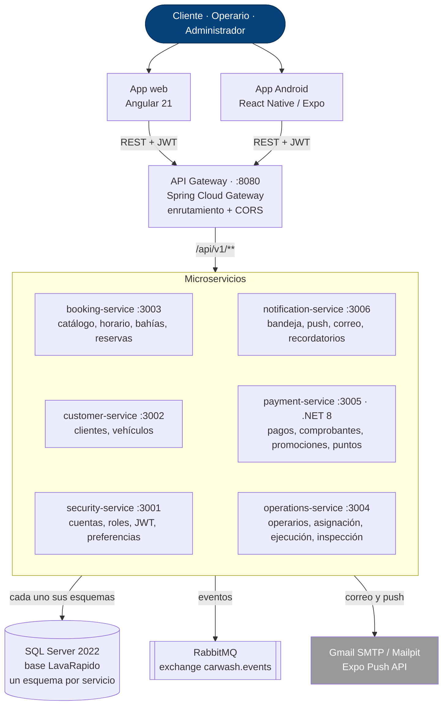

*Nota.* Todos los servicios comparten una instancia de SQL Server, pero cada uno es dueño de sus esquemas y no existen claves foráneas entre servicios (ADR-003). La Tabla 55 relaciona los eventos con su efecto y la sección 3.3 del *Documento de diseño del software* detalla las llamadas REST entre servicios. Elaboración propia a partir de `lavarapido-infra/docker-compose.yml`.

**Tabla 6**
*Componentes del Sistema y su Responsabilidad*

| Componente | Puerto | Tecnología | Responsabilidad |
|---|---|---|---|
| API Gateway | 8080 | Spring Cloud Gateway | Entrada única para la web y la aplicación; enruta por ruta y responde CORS. No expone las rutas internas. |
| security-service | 3001 | Java 21, Spring Boot 4 | Cuentas, roles y permisos, autenticación con JWT, bloqueo por intentos fallidos, recuperación de contraseña, dirección del perfil y preferencias. |
| customer-service | 3002 | Java 21, Spring Boot 4 | Perfil del cliente, vehículos y tipos de vehículo. |
| booking-service | 3003 | Java 21, Spring Boot 4 | Catálogo y precios, horario, bahías, disponibilidad, reservas, resumen del día y datos del negocio. |
| operations-service | 3004 | Java 21, Spring Boot 4 | Operarios, ficha, turnos, ausencias, asignación automática y manual, ejecución, calificaciones, métricas e informe de inspección. |
| payment-service | 3005 | .NET 8 | Cuentas de pago, pagos, comprobantes, historial con filtros, reembolsos, promociones y puntos. |
| notification-service | 3006 | Java 21, Spring Boot 4 | Bandeja de notificaciones, push, correos, recordatorios y alertas al administrador, en el idioma de cada cuenta. |
| Aplicación web | — | Angular 21 | Interfaz para los tres roles en navegador. |
| Aplicación móvil | — | React Native 0.86, Expo SDK 57 | Interfaz para los tres roles en Android. |
| SQL Server | 1433 | SQL Server 2022 | Base de datos: 9 esquemas y 57 tablas, versionados con Liquibase. |
| RabbitMQ | 5672 | RabbitMQ 4 | Bus de eventos de dominio (exchange `carwash.events`). |

### 3.2 Funciones del Producto

Las funciones se agrupan en nueve módulos, que organizan los requisitos funcionales de la sección 5 (véase la Tabla 7).

**Tabla 7**
*Módulos Funcionales del Sistema*

| Módulo | Funciones principales | Requisitos |
|---|---|---|
| Autenticación y cuentas | Registro, inicio de sesión, recuperación y cambio de contraseña, bloqueo, cuenta propia, usuarios, roles y permisos | RF-001 a RF-004b, RF-027 a RF-029 |
| Vehículos | Registro y gestión de los vehículos del cliente | RF-030 |
| Catálogo, horario y bahías | Servicios y precios por tipo de vehículo, horario con excepciones, bahías y datos del negocio | RF-021, RF-031, RF-032, RF-037 |
| Reservas | Solicitud, disponibilidad, reprogramación, cancelación y gestión administrativa | RF-005 a RF-007, RF-033 |
| Operación | Asignación, servicios asignados, ejecución, calificación, disponibilidad, ficha del operario e informe de inspección | RF-008 a RF-012b, RF-022, RF-036, RF-038 |
| Pagos | Cuentas de pago, métodos, comprobantes, revisión, historial, reembolsos | RF-013 a RF-016, RF-034, RF-035 |
| Panel y notificaciones | Panel por rol, notificaciones, tema e idioma | RF-017 a RF-020 |
| Reportes | Servicios, ingresos, calificaciones y desempeño | RF-023 |
| Promociones y puntos | Promociones, canje de cupones y puntos de fidelización | RF-024 a RF-026 |

### 3.3 Características de los Usuarios

El sistema tiene tres roles fijos y un actor no humano (véase la Tabla 8). Ningún rol requiere formación técnica; basta con saber usar un navegador o una aplicación móvil.

**Tabla 8**
*Actores del Sistema*

| Actor | Descripción | Actividades principales |
|---|---|---|
| Cliente | Persona que lleva su vehículo al lavadero. Usa la aplicación Android o la web. | Registra vehículos, reserva (y si quiere elige el operario), cancela, paga, aplica promociones, consulta su historial, califica el servicio y recibe el informe de inspección. |
| Operario | Empleado que lava los vehículos. Usa la aplicación o la web en el local. | Consulta sus servicios asignados, su agenda y sus calificaciones, e indica cuándo inicia y termina cada servicio. |
| Administrador | Persona encargada de la operación del lavadero. | Configura catálogo, precios, horario, bahías, cuentas de pago y datos del negocio; gestiona usuarios, operarios y reservas; asigna o reasigna servicios; registra el informe de inspección; revisa pagos; gestiona promociones; consulta reportes y métricas. |
| Sistema | Procesos automáticos (temporizadores y consumidores de eventos). | Valida disponibilidad, asigna operarios al confirmar la reserva, envía recordatorios, alertas y notificaciones, y acredita puntos. |

### 3.4 Restricciones

**Tabla 9**
*Restricciones del Sistema*

| ID | Tipo | Restricción |
|---|---|---|
| RT-01 | Técnica | El backend usa Java 21 con Spring Boot 4 y Spring Cloud Gateway; payment-service usa .NET 8 (ADR-013). La web usa Angular 21 y la aplicación móvil React Native con Expo. |
| RT-02 | Técnica | Toda petición externa entra por el API Gateway (puerto 8080). Las rutas `/internal/**` solo son accesibles entre servicios, con una llave compartida. |
| RT-03 | Técnica | Los servicios usan una única instancia de SQL Server 2022, con un esquema por servicio y sin claves foráneas entre servicios (ADR-003). |
| RT-04 | Técnica | Las reglas de negocio se implementan en el dominio, sin dependencia de frameworks ni de la base de datos (arquitectura hexagonal, ADR-007). |
| RT-05 | Técnica | Toda la solución se ejecuta en contenedores Docker con Docker Compose, en local y en una máquina virtual de Azure detrás de Caddy (HTTPS); no se usan servicios administrados de la nube. |
| RD-01 | De datos | Los estados se guardan con códigos en inglés y se traducen en la interfaz (ADR-010). |
| RD-02 | De datos | Los registros con historial (usuarios, vehículos, servicios, bahías) se desactivan y no se borran. |
| RD-03 | De datos | El comprobante se guarda en la base de datos como data URL y las fotos del informe de inspección como datos binarios, hasta disponer de un almacenamiento de archivos; el servidor limita el cuerpo de la petición a 8 MB. |
| RD-04 | De datos | Los montos se expresan en pesos colombianos (COP). |
| RO-01 | De operación | El sistema opera un único lavadero: no maneja sedes, zonas de cobertura ni rutas. |
| RO-02 | De operación | Se requiere conexión a internet para consultar disponibilidad, reservar y pagar. |
| RO-03 | De operación | La verificación de pagos es manual: depende de que el administrador revise los comprobantes. |
| RO-04 | De operación | La asignación depende de que los turnos y las ausencias de los operarios estén actualizados. |
| RO-05 | De operación | Los eventos por RabbitMQ requieren activar la mensajería (bandera `MESSAGING_ENABLED` o `app.messaging.enabled`); por defecto está desactivada. La asignación automática necesita además la llave interna (`INTERNAL_API_KEY`) y se puede apagar con `AUTO_ASSIGN_ENABLED=false`. |
| RR-01 | Regulatoria | Los datos personales se tratan según la Ley 1581 de 2012 (Congreso de la República de Colombia, 2012); el cliente acepta la política al registrarse y el servidor guarda la fecha y la hora de la aceptación. |
| RR-02 | Regulatoria | El sistema no captura, transmite ni almacena datos de tarjetas de pago. |
| RP-01 | De proyecto | Equipo de tres aprendices a tiempo parcial; sin presupuesto asignado (costo estimado en condiciones reales: COP 212.925.240, según la *Propuesta técnica y económica*); entrega en la fecha académica. |

### 3.5 Suposiciones y Dependencias

- Los clientes aceptan pagar por QR o transferencia y subir el comprobante, en lugar de una pasarela automática.
- Los clientes disponen de un dispositivo Android o de un navegador, y de conexión a internet al reservar.
- El local tiene un horario fijo y operarios con turnos definidos; el administrador mantiene actualizados horario, catálogo, precios y cuentas de pago.
- El volumen de datos corresponde a un proyecto académico y no a una operación real a gran escala.
- El correo depende de un servidor SMTP (Mailpit en desarrollo) y el push del servicio Expo Push (Expo, s. f.). Si fallan, la notificación queda en la bandeja y el resto del sistema sigue funcionando.
- El estado de los servicios y las calificaciones se actualiza cuando el usuario consulta la pantalla; no hay actualización en tiempo real.

### 3.6 Decisiones de Diseño

Durante el análisis y el desarrollo se tomaron decisiones que modifican la especificación original. Cada una consta en un ADR del repositorio de documentación; la Tabla 10 resume las que afectan los requisitos.

**Tabla 10**
*Decisiones de Arquitectura que Afectan los Requisitos*

| ADR | Decisión | Efecto en los requisitos |
|---|---|---|
| ADR-003 | Un esquema por servicio en una instancia compartida, sin claves foráneas entre servicios. | Las referencias entre servicios se validan por API (RT-03). |
| ADR-004 | REST para consultas síncronas y RabbitMQ para avisos no bloqueantes. | Una reserva se confirma aunque falle el correo de aviso (RNF-012). |
| ADR-006 | Autenticación con JWT y autorización por rol. | Define RNF-004 y la redirección por rol (RF-002). |
| ADR-007 | Arquitectura hexagonal en cada servicio. | Las reglas de negocio se prueban sin infraestructura (RNF-006). |
| ADR-008 | Pago manual verificado con comprobante; sin pasarela. | Origina RF-013 a RF-016 y RF-034. |
| ADR-010 | Modelo de datos alineado con las pantallas; estados en inglés. | El registro no pide dirección (RF-001); la dirección es un dato opcional del perfil (RF-027) y los datos del negocio se guardan en el servidor (RF-037). |
| ADR-011 | Notificaciones por eventos, con push y correo, en el idioma de cada cuenta. | Define los tipos de RF-018, la alerta de reserva sin operario y el aviso del informe de inspección. |
| ADR-013 | payment-service en .NET 8. | Restricción técnica RT-01. |
| ADR-014 | Integración de operaciones con reservas y reglas de asignación. | Define RF-008, RF-009, RF-010 y RF-012b, con la ventana de inicio de 15 minutos. |
| ADR-015 | Puntos que desbloquean promociones, descuento porcentual real, roles fijos con permisos editables y bahía por reserva. | Redefine RF-024 a RF-026 y origina RF-029. |

---

## 4. Requisitos de Interfaces Externas

### 4.1 Interfaces de Usuario

- La interfaz está disponible en español, inglés, francés y portugués; los montos se muestran en COP y las fechas según el idioma elegido.
- Cada formulario identifica el campo que falló la validación y cada acción que cambia datos muestra un mensaje de confirmación o de error.
- Las acciones destructivas (cancelar una reserva, desactivar una cuenta, rechazar un pago) piden confirmación.
- Cliente: reservar (con elección opcional del operario), consultar el historial, pagar, aplicar promociones, calificar y abrir el informe de inspección. Operario: ver, iniciar y finalizar sus servicios. Administrador: gestión de catálogo, horario, bahías, datos del negocio, usuarios, operarios, reservas, informes de inspección, pagos, promociones y reportes.
- Hay cuatro paletas visuales a elección del usuario, guardadas por cuenta.

La Figura 2 muestra la pantalla de inicio de sesión real de la aplicación web, punto de entrada común a los tres roles.

**Figura 2**
*Pantalla de Inicio de Sesión (evidencia de RF-002)*

### 4.2 Interfaces de Hardware

El sistema no controla dispositivos de hardware. Los usuarios requieren un computador con navegador o un teléfono Android con cámara o galería para el comprobante. Para el desarrollo se requiere un equipo con Docker Desktop, Java 21, .NET 8 y Node.js.

### 4.3 Interfaces de Software

**Tabla 11**
*Interfaces de Software*

| Sistema externo | Versión | Propósito | Tipo de interfaz |
|---|---|---|---|
| Android | 8.0 o superior | Sistema operativo de la aplicación móvil | Plataforma |
| Chrome, Firefox y Edge | Versión estable vigente | Ejecución de la aplicación web | Plataforma |
| SQL Server | 2022 | Persistencia de los datos de cada servicio | Protocolo TDS (puerto 1433) |
| RabbitMQ | 4 | Publicación y consumo de eventos de dominio | AMQP (puerto 5672) |
| Servidor SMTP | Mailpit en desarrollo | Código de recuperación, bienvenida, avisos de reserva y recordatorios | SMTP con STARTTLS |
| Expo Push | Servicio de Expo | Notificaciones push a la aplicación Android | HTTPS |

### 4.4 Interfaces de Comunicación

- La web y la aplicación se comunican con el API Gateway por HTTPS en todo ambiente accesible fuera de los computadores del equipo de desarrollo; HTTP solo se admite en desarrollo local.
- La API usa REST con cuerpos JSON bajo el prefijo `/api/v1` y recibe el token en el encabezado `Authorization: Bearer`.
- Cada petición lleva un identificador de correlación (`X-Correlation-Id`) que se registra en las bitácoras.
- Los servicios se consultan entre sí por REST en las rutas `/internal/**`, autenticadas con el encabezado `X-Internal-Key`, y publican eventos en el exchange `carwash.events` de RabbitMQ.

---

## 5. Requisitos Funcionales

### 5.1 Convenciones

Cada requisito tiene un identificador único que se conserva entre versiones. Cada requisito se redacta como una capacidad verificable y se acompaña de criterios de aceptación medibles (Wiegers y Beatty, 2013).

La prioridad sigue la técnica MoSCoW: Esencial (debe tener), Deseable (debería tener) y Opcional (podría tener). El estado de cada requisito se verificó contra el código y las pruebas automatizadas el 20 de octubre de 2026: Implementado (construido y probado), Parcial (construido en parte; se indica qué falta) y Pendiente (no construido).

### 5.2 Autenticación y Cuentas

**Tabla 12**
*Requisitos de Autenticación y Cuentas (security-service)*

| ID | Requisito | Criterios de aceptación | Prioridad | Estado |
|---|---|---|---|---|
| RF-001 | **Registro de cliente.** El sistema debe permitir que una persona cree una cuenta de cliente con número de documento, nombres, apellidos, teléfono, correo electrónico y contraseña, previa aceptación de la política de tratamiento de datos personales. | • Si el correo ya está registrado, el sistema rechaza la solicitud con un mensaje que lo indica y no crea la cuenta. • La contraseña cumple la política de RNF-004. • Al crear la cuenta se crea el perfil de cliente en customer-service y se envía un correo de bienvenida. • No se solicita dirección, porque el servicio se presta en el local. | Esencial | Implementado |
| RF-002 | **Inicio de sesión.** El sistema debe autenticar al usuario con correo y contraseña, emitir un token JWT y redirigirlo al panel de su rol. | • Con credenciales válidas, el usuario llega al panel de su rol (cliente, operario o administrador). • Con credenciales inválidas, el mensaje es genérico y no revela si el correo existe. • Una cuenta desactivada no puede iniciar sesión. | Esencial | Implementado |
| RF-003 | **Recuperación de contraseña.** El sistema debe permitir restablecer la contraseña con un código de 6 dígitos enviado al correo registrado. | • El código vence a los 15 minutos y se invalida tras 5 intentos fallidos. • Ante un correo no registrado, la respuesta es idéntica y no se envía correo. • El código se guarda solo como hash, es de un solo uso y pedir uno nuevo invalida el anterior. • La nueva contraseña no puede ser igual a la actual. | Deseable | Implementado |
| RF-004 | **Cambio de contraseña.** El sistema debe permitir que el usuario autenticado cambie su contraseña después de validar la actual. | • Si la contraseña actual no coincide, el cambio se rechaza y la contraseña no varía. • La nueva contraseña cumple la política de RNF-004. | Deseable | Implementado |
| RF-004b | **Bloqueo por intentos fallidos.** El sistema debe bloquear la cuenta durante 15 minutos tras 5 intentos fallidos de inicio de sesión dentro de un lapso de 15 minutos. | • Durante el bloqueo, el inicio de sesión se rechaza con la respuesta 423 (`ACCOUNT_LOCKED`) y un mensaje que explica el bloqueo, aunque la contraseña sea correcta. • Un inicio de sesión correcto antes del quinto fallo borra el conteo. • Un restablecimiento exitoso de contraseña (RF-003) levanta el bloqueo. | Esencial | Implementado |
| RF-027 | **Gestión de la cuenta propia.** El sistema debe permitir que el usuario consulte y actualice sus datos de perfil y su dirección de contacto, cambie su correo, cierre sesión y desactive su cuenta. | • Cerrar sesión revoca la sesión en el servidor. • Desactivar la cuenta pide la contraseña actual y cierra todas las sesiones; un administrador no puede cerrar su propia cuenta. • La dirección es opcional, tiene hasta 200 caracteres y se guarda en el servidor, de modo que es la misma en la web y en la aplicación; guardarla vacía la borra. • Las cuentas se desactivan y no se borran, para conservar reservas, pagos y calificaciones. | Deseable | Implementado |
| RF-028 | **Administración de usuarios.** El sistema debe permitir que el administrador liste los usuarios con su fecha de registro, cree cuentas de operario y de administrador, y active o desactive cuentas. | • Una cuenta desactivada no puede iniciar sesión, se cierran todas sus sesiones y conserva su historial. • El rol se asigna al crear la cuenta (cliente por el registro público; operario o administrador cuando la crea un administrador) y el sistema no ofrece cambiarlo después. • Una cuenta de administrador no se puede desactivar (`ADMIN_CANNOT_BE_DISABLED`) y el administrador no puede desactivar su propia cuenta. • Solo el rol administrador accede a esta función (respuesta 403 para los demás roles). | Deseable | Implementado |
| RF-029 | **Roles y permisos.** El sistema debe manejar tres roles fijos (administrador, operario y cliente) y permitir que el administrador consulte y edite la matriz de permisos de cada rol. | • No se pueden crear ni borrar roles. • En esta versión la matriz es informativa: la autorización efectiva se basa en el rol del token JWT (ADR-015). | Opcional | Implementado |

**Evidencia en el sistema (módulo de autenticación y cuentas)**

| RF | Pantalla |
|---|---|
| RF-001 (registro) | 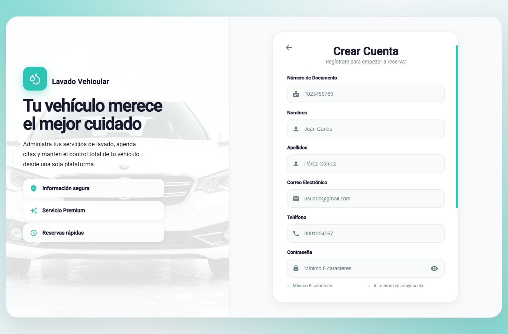 |
| RF-003 (recuperar contraseña) |  |
| RF-004, RF-027 (perfil, cambio de contraseña y cuenta propia) | 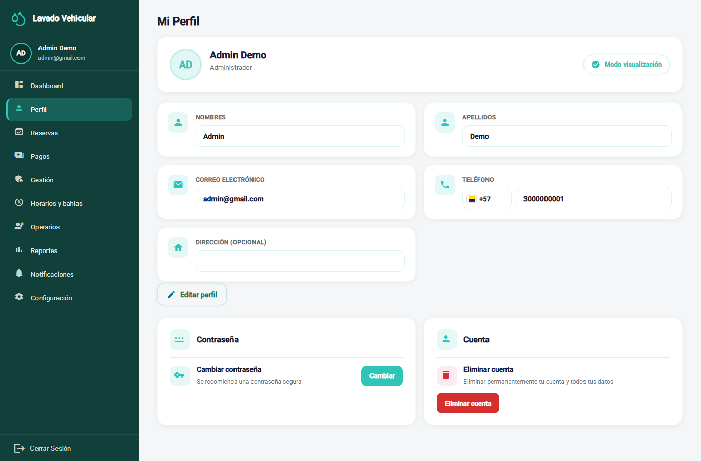 |
| RF-028 (administración de usuarios) | 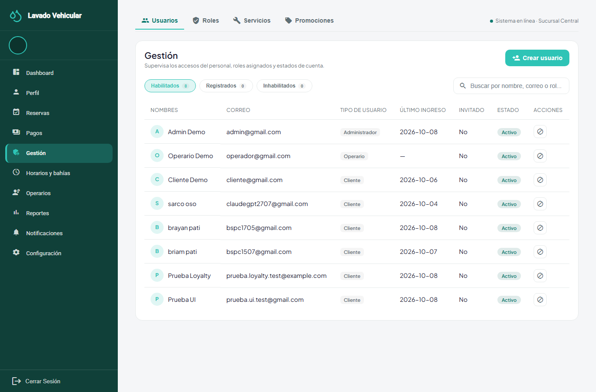 |
| RF-029 (roles y permisos) | 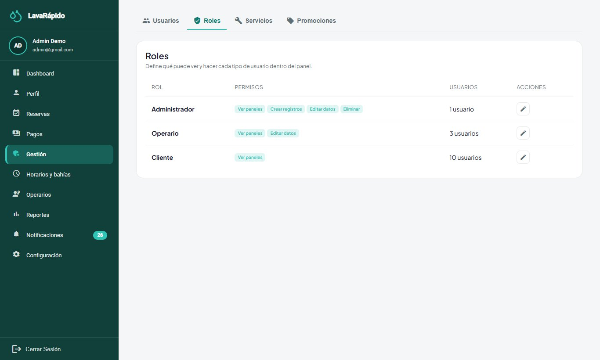 |

### 5.3 Vehículos

**Tabla 13**
*Requisitos de Vehículos (customer-service)*

| ID | Requisito | Criterios de aceptación | Prioridad | Estado |
|---|---|---|---|---|
| RF-030 | **Gestión de vehículos del cliente.** El sistema debe permitir que el cliente registre, consulte, edite y retire sus vehículos, indicando placa y tipo de vehículo. | • Solo el dueño gestiona sus vehículos; el administrador puede consultarlos. • Retirar un vehículo no borra las reservas históricas en las que se usó. • El tipo de vehículo determina el precio de cada servicio (RF-031). | Esencial | Implementado |

**Evidencia:** 

### 5.4 Catálogo, Horario y Bahías

**Tabla 14**
*Requisitos de Catálogo, Horario y Bahías (booking-service)*

| ID | Requisito | Criterios de aceptación | Prioridad | Estado |
|---|---|---|---|---|
| RF-031 | **Catálogo de servicios y precios.** El sistema debe permitir que el administrador cree, edite, active, desactive y elimine servicios de lavado, con categoría, descripción, precio y duración estimada por tipo de vehículo y puntos de fidelización. | • Un cambio de precio no modifica las reservas existentes: cada línea conserva el precio vigente al reservar. • No se permiten dos tarifas vigentes solapadas para el mismo servicio y tipo de vehículo. • Solo los servicios activos se ofrecen al reservar. | Esencial | Implementado |
| RF-021 | **Horario y excepciones.** El sistema debe permitir que el administrador configure el horario semanal del local, la pausa del día y las excepciones (festivos y horarios especiales). | • Si la hora de cierre es anterior o igual a la de apertura, el cambio se rechaza. • El nuevo horario aplica a las validaciones de disponibilidad posteriores. • Cada cambio queda registrado en el historial de horario. | Deseable | Implementado |
| RF-032 | **Gestión de bahías.** El sistema debe permitir que el administrador cree, edite, desactive y elimine las bahías de lavado del local. | • Solo las bahías activas se usan para confirmar reservas nuevas. | Esencial | Implementado |
| RF-037 | **Datos del negocio.** El sistema debe permitir que el administrador consulte y actualice los datos del lavadero: información legal (razón social, NIT, tipo de negocio, fecha de fundación, representante legal), tributaria (régimen, actividad CIIU, resolución DIAN, prefijo y rango de facturación) y canales de atención (sitio web, redes sociales, línea de atención y horario de atención). | • Los datos se guardan en booking-service y son los mismos en la web y en la aplicación. • La razón social, el NIT y la dirección son obligatorios; el teléfono tiene al menos 7 dígitos, el correo debe ser válido y la fecha de fundación no puede estar en el futuro. • La página pública y el centro de ayuda muestran el correo, el teléfono, la línea de atención y el horario guardados. | Deseable | Implementado |

**Evidencia:**

| RF | Pantalla |
|---|---|
| RF-031 (catálogo y precios) | 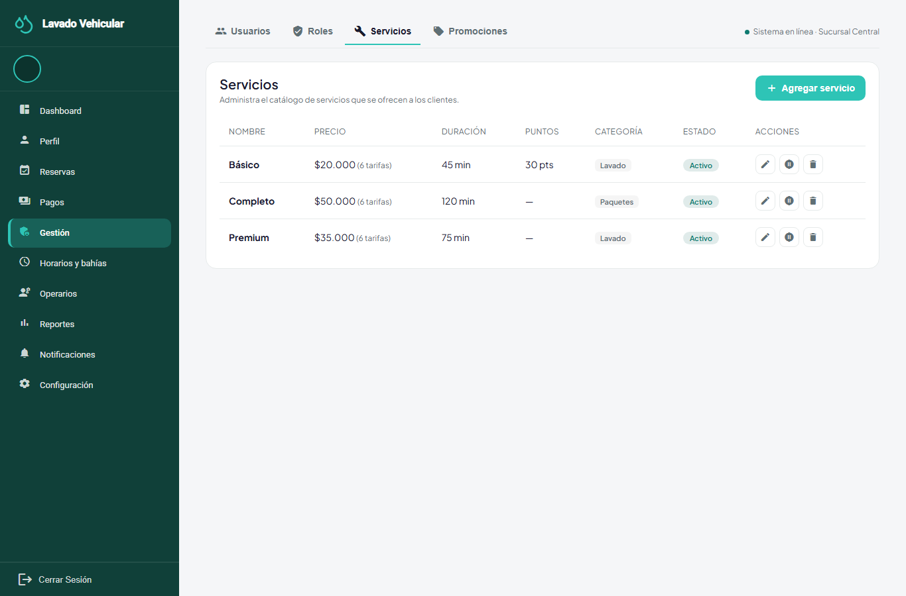 |
| RF-021, RF-032 (horario y bahías) |  |

### 5.5 Reservas

**Tabla 15**
*Requisitos de Reservas (booking-service)*

| ID | Requisito | Criterios de aceptación | Prioridad | Estado |
|---|---|---|---|---|
| RF-005 | **Solicitud de reserva.** El sistema debe permitir que el cliente reserve uno o más servicios para uno de sus vehículos, eligiendo fecha y hora de inicio. | • El precio de cada servicio corresponde al tipo de vehículo elegido. • Las horas se ofrecen en franjas de 30 minutos y hasta 60 días hacia adelante (valores configurables). • Solo se aceptan vehículos del propio cliente. | Esencial | Implementado |
| RF-006 | **Validación de disponibilidad.** Antes de confirmar, el sistema debe validar el horario del local, sus excepciones y la existencia de una bahía activa sin reservas solapadas. | • Con bahía libre, la reserva queda confirmada de inmediato con la bahía asignada. • Sin bahía libre, no se guarda nada y se ofrecen hasta 5 horas alternativas del mismo día. • Ante dos solicitudes simultáneas por la misma bahía y hora, solo una se confirma (RNF-003). | Esencial | Implementado |
| RF-007 | **Modificación y cancelación.** El sistema debe permitir que el cliente cancele su reserva mientras esté en estado Programada o Confirmada y antes de su hora de inicio, y que el administrador la reprograme (RF-033). | • El cliente cancela desde su historial confirmando un diálogo, sin escribir motivo: el sistema guarda el motivo `CUSTOMER_REQUEST` y libera la bahía. • La reprogramación, que hace el administrador, asigna nueva hora y bahía, y conserva los precios. • Con el servicio en proceso o terminado, o pasada la hora de inicio en el caso del cliente, la acción se bloquea (`BOOKING_NOT_CHANGEABLE`). • La API también acepta que el cliente reprograme (`PUT /bookings/{id}`), pero la web y la app no ofrecen esa pantalla (acción de mejora AM-03). | Esencial | Implementado |
| RF-033 | **Gestión administrativa de reservas.** El sistema debe permitir que el administrador consulte todas las reservas por rango de fechas y cambie su estado (confirmar, cancelar con motivo, marcar "no asistió") o la reprograme, respetando el ciclo de vida de la Figura 4. | • Una transición no permitida por el ciclo de vida se rechaza. | Deseable | Implementado |

**Evidencia:**

| RF | Pantalla |
|---|---|
| RF-005, RF-006 (solicitar reserva) |  |
| RF-007 (historial y cancelación) | 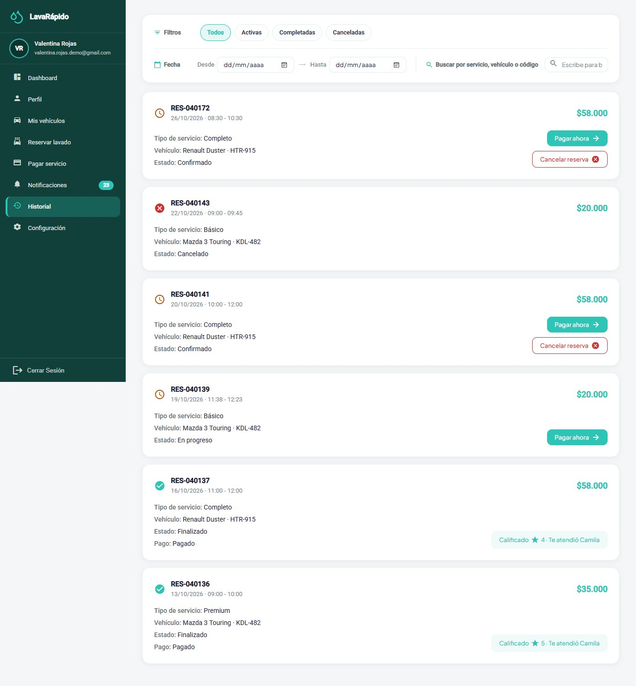 |
| RF-033, RF-009 (gestión administrativa y asignación) |  |

### 5.6 Operación

**Tabla 16**
*Requisitos de Operación (operations-service)*

| ID | Requisito | Criterios de aceptación | Prioridad | Estado |
|---|---|---|---|---|
| RF-008 | **Asignación automática de operario.** El sistema debe asignar automáticamente un operario disponible a cada reserva confirmada. | • Es elegible el operario con cuenta activa, con turno que cubra la franja, sin ausencia y sin otra reserva solapada. • Si el cliente eligió un operario (RF-010) y sigue libre, se le asigna a él; si no, se elige al de menos reservas ese día y el empate se resuelve por el menor identificador. • Una reprogramación conserva el operario que ya tenía la reserva. • Si no hay operario disponible, la reserva queda sin asignar y los administradores reciben una alerta cuando faltan menos de 2 horas para el inicio, para que asignen manualmente (RF-009). | Esencial | Implementado |
| RF-009 | **Asignación y reasignación manual.** El sistema debe permitir que el administrador asigne o reasigne un operario a una reserva desde una lista de candidatos. | • La lista muestra primero a los disponibles, ordenados por nombre, con su calificación promedio y el motivo de no disponibilidad de los demás. • Se bloquea la asignación de un operario inactivo, sin turno, ausente o con otra reserva a esa hora. • La reasignación solo procede mientras la ejecución esté pendiente; el operario asignado recibe una notificación. | Deseable | Implementado |
| RF-010 | **Elección de operario por el cliente.** El sistema debe permitir que el cliente elija, de forma opcional, un operario de la lista de disponibles al reservar. | • Al escoger la hora, el cliente ve los operarios libres en ese horario con su primer nombre y su calificación promedio; no ve datos de contacto. • Si no elige ninguno, el lavadero asigna uno libre (RF-008). • Si el operario elegido ya no está libre al confirmar, se asigna otro operario libre y el cliente ve en su inicio el nombre de quien lo atenderá. | Deseable | Implementado |
| RF-011 | **Servicios asignados.** El sistema debe mostrar al operario sus reservas asignadas con cliente, vehículo, hora, servicios y bahía. | • El operario solo ve las reservas asignadas a él. | Esencial | Implementado |
| RF-012b | **Inicio y finalización del servicio.** El sistema debe permitir que el operario marque como iniciado y como finalizado el servicio asignado a él. | • Solo puede iniciarse desde 15 minutos antes de la hora de la reserva; antes, el botón aparece deshabilitado y el servidor responde `SERVICE_TOO_EARLY`. • La reserva pasa a En proceso al iniciar y a Completada al finalizar; al iniciar se cancelan los recordatorios pendientes. • La acción se bloquea si la reserva está asignada a otro operario. | Esencial | Implementado |
| RF-012 | **Calificación del servicio.** El sistema debe permitir que el cliente califique, una sola vez, una reserva propia completada, con un puntaje entero de 1 a 5 y un comentario opcional de hasta 500 caracteres. | • No se puede calificar una reserva no completada ni calificar dos veces. • El comentario requiere puntaje. • La calificación se aplica a todas las líneas de la reserva y alimenta el promedio del operario. • El cliente ve el primer nombre del operario y el operario ve el primer nombre del cliente. | Deseable | Implementado |
| RF-022 | **Disponibilidad de operarios.** El sistema debe registrar el turno semanal y las ausencias de cada operario, y permitir activarlo o desactivarlo. | • El administrador registra y ajusta turnos y ausencias; el operario consulta su agenda. • La disponibilidad registrada alimenta RF-008, RF-009 y RF-010. • El administrador ve el resumen del equipo: operarios activos, disponibles y ausentes hoy, servicios de la semana frente a la anterior y calificación promedio. | Deseable | Implementado |
| RF-036 | **Informe de inspección del vehículo.** El sistema debe permitir que el administrador registre un informe de inspección para las reservas de 180 minutos o más y lo comparta con el cliente. | • El informe tiene cinco fases, en el orden en que se recorre el vehículo (recepción, exterior, interior, motor y entrega), cada una Pendiente, En curso o Terminada; registrar un hallazgo en una fase pendiente la pone En curso. • Cada hallazgo indica la zona (hasta 120 caracteres), una nota (hasta 500), la gravedad (informativo, menor o importante) y hasta 5 fotos. • Solo se crea para reservas Confirmadas, En proceso o Completadas, y solo se edita mientras la reserva está Confirmada o En proceso. • El enlace solo muestra el informe después de publicarlo, y solo se puede compartir un informe publicado; al compartirlo, el cliente recibe una notificación con el enlace. • El enlace público usa un código aleatorio, no el número de la reserva, y muestra la placa enmascarada. • El informe se gestiona desde la web y desde la aplicación móvil; en el celular las fotos se toman con la cámara o se eligen de la galería y se reducen antes de subirlas. | Deseable | Implementado |
| RF-038 | **Ficha del operario.** El sistema debe permitir que el administrador registre la especialidad del operario y sus habilidades, cada una con su nivel (certificado, experto o avanzado). | • La especialidad tiene hasta 80 caracteres. • Un operario tiene como máximo 10 habilidades, con nombre único de hasta 60 caracteres. • Guardar reemplaza la lista completa de habilidades. | Opcional | Implementado |

**Evidencia:**

| RF | Pantalla |
|---|---|
| RF-011 (servicios asignados al operario) |  |
| RF-012b (iniciar y finalizar, panel del operario) |  |
| RF-012 (calificaciones del servicio) | 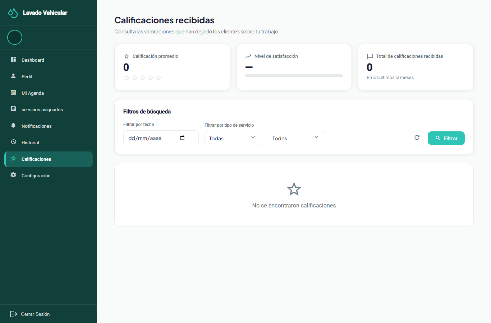 |
| RF-022 (disponibilidad de operarios, vista admin) |  |
| RF-022 (consulta del propio operario) | 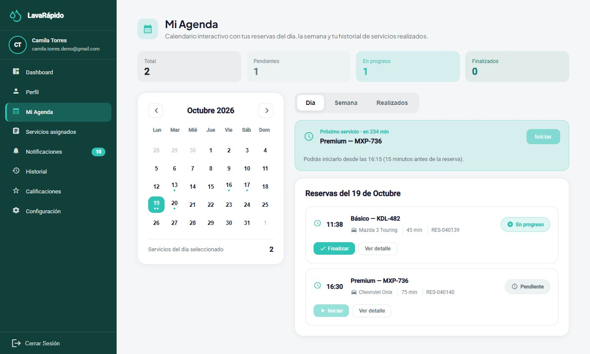 |

### 5.7 Pagos

**Tabla 17**
*Requisitos de Pagos (payment-service)*

| ID | Requisito | Criterios de aceptación | Prioridad | Estado |
|---|---|---|---|---|
| RF-034 | **Cuentas de pago del local.** El sistema debe permitir que el administrador cree, edite, active y desactive las cuentas de pago de cada método digital (titular, número de cuenta, imagen QR e instrucciones). | • Solo las cuentas activas se muestran al cliente. | Esencial | Implementado |
| RF-013 | **Métodos de pago.** El sistema debe mostrar al cliente los métodos de pago del local (efectivo, Nequi, Daviplata y transferencia bancaria) y, para cada método digital, su QR e instrucciones. | • El efectivo no muestra QR. | Esencial | Implementado |
| RF-013b | **Carga del comprobante.** Para un método digital, el sistema debe permitir que el cliente suba el comprobante con el valor declarado y el código de referencia de la transacción. | • Se aceptan imágenes JPG o PNG de hasta 10 MB; la aplicación las comprime antes de enviarlas. • El pago queda En revisión y ligado a la reserva. • El efectivo no requiere comprobante. | Esencial | Implementado |
| RF-014 | **Revisión del pago.** El sistema debe permitir que el administrador apruebe o rechace un pago en revisión comparando el valor declarado con el valor a pagar, y registre directamente los pagos en efectivo. | • El rechazo exige un motivo; el cliente es notificado y puede enviar otro comprobante. • Una reserva admite como máximo un pago aprobado. • La aprobación acredita los puntos de fidelización (RF-026). | Esencial | Implementado |
| RF-015 | **Historial de pagos.** El sistema debe mostrar al cliente su historial de pagos ordenado por fecha y asociado a cada servicio. | • Los pagos se ordenan de la reserva más reciente a la más antigua. • Se puede filtrar por rango de fechas de la reserva y por nombre del servicio (`GET /payments/me?from=&to=&service=`); una fecha inicial posterior a la final se rechaza con `INVALID_DATE_RANGE`. • Sin pagos, se muestra un mensaje que lo indica. | Deseable | Implementado |
| RF-016 | **Restricciones de pago.** El sistema no debe capturar ni almacenar datos de tarjeta y debe rechazar un comprobante cuyo código de referencia ya figure en el pago de otra reserva. | • El rechazo devuelve el código de error `TRANSACTION_REFERENCE_REUSED`. | Esencial | Implementado |
| RF-035 | **Reembolso.** El sistema debe permitir que el administrador marque como reembolsado un pago aprobado. | • Solo un pago Aprobado puede pasar a Reembolsado; se publica el evento `payment.refunded`. | Opcional | Implementado |

**Evidencia:**

| RF | Pantalla |
|---|---|
| RF-013, RF-013b, RF-016, RF-025 (pagar, cupón) |  |
| RF-014, RF-035 (revisión y reembolso) |  |
| RF-034 (cuentas de pago del local) | 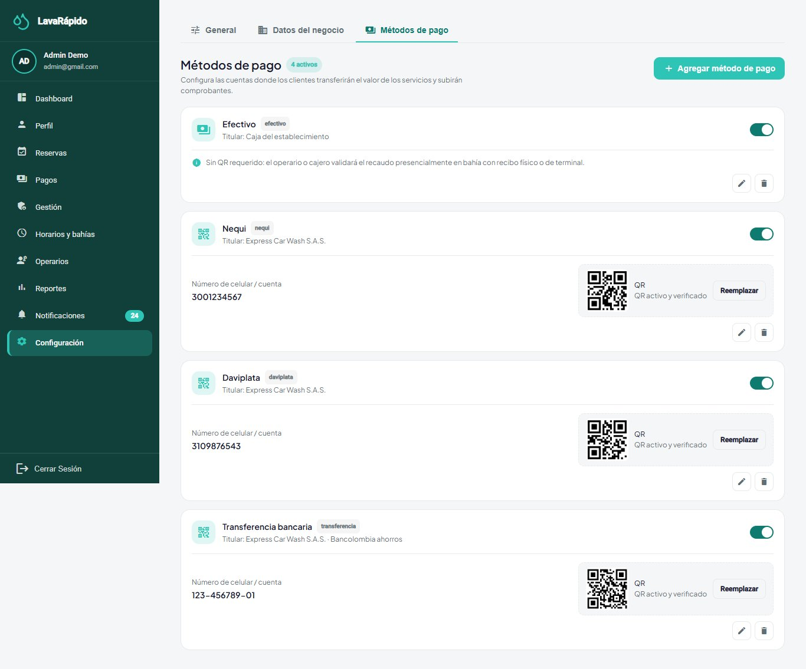 |
| RF-015 (historial, dentro de reservas) |  |

### 5.8 Panel, Notificaciones, Preferencias y Reportes

**Tabla 18**
*Requisitos de Panel, Notificaciones, Preferencias y Reportes*

| ID | Requisito | Criterios de aceptación | Prioridad | Estado |
|---|---|---|---|---|
| RF-017 | **Panel por rol.** El sistema debe mostrar a cada rol un panel con métricas de resumen y accesos rápidos. | • Sin datos, se muestra un mensaje que lo indica en lugar de una pantalla vacía. • El panel del administrador compara las reservas del día con las del día anterior, contadas por booking-service con la fecha del lavadero. • El panel del cliente muestra su próximo servicio con el nombre del operario asignado. | Deseable | Implementado |
| RF-018 | **Notificaciones.** El sistema debe notificar a los usuarios los eventos relevantes en una bandeja con estado leído/no leído, por push en la aplicación móvil y por correo en los eventos de reserva. | • Tipos: bienvenida, reserva creada, confirmada y cancelada, recordatorio, operario asignado, servicio iniciado y finalizado, pago confirmado, rechazado y reembolsado, puntos ganados, promoción disponible y canjeada, informe de inspección compartido, aviso de versión nueva de la app y mensaje del sistema; el personal recibe además avisos de servicio cancelado, reprogramado o retirado (operario) y de reserva creada, reprogramada, cancelada o sin operario (administrador). • Los recordatorios se envían 24 horas y 1 hora antes de la reserva y se cancelan cuando el servicio inicia o termina. • Los administradores reciben una alerta cuando una reserva empieza en menos de 2 horas y sigue sin operario. • Cada notificación se escribe en el idioma de la cuenta que la recibe. • Abrir una notificación la marca como leída. | Deseable | Implementado |
| RF-019 | **Tema visual por cuenta.** El sistema debe permitir elegir entre cuatro paletas visuales y conservar la elección en la cuenta del usuario. | • Al iniciar sesión con otra cuenta en el mismo equipo se aplica el tema de esa cuenta. | Opcional | Implementado |
| RF-020 | **Idioma por cuenta.** El sistema debe permitir cambiar el idioma de la interfaz entre español, inglés, francés y portugués, y conservarlo en la cuenta. | • Sin sesión, el idioma elegido se recuerda en el navegador. | Opcional | Implementado |
| RF-023 | **Reportes operativos.** El sistema debe generar reportes de servicios realizados, ingresos, calificación promedio y desempeño por operario para un periodo elegido. | • Sin datos en el periodo, se muestra un mensaje que lo indica. | Deseable | **Parcial.** La web lee reservas y pagos reales, y operations-service calcula las métricas semanales de cada operario (servicios, puntualidad, ingresos y horas trabajadas) y el resumen del equipo; faltan los reportes consolidados para un periodo elegido. |

**Evidencia:**

| RF | Pantalla |
|---|---|
| RF-017 (panel admin / cliente / operario) |  ·  |
| RF-018 (notificaciones) | 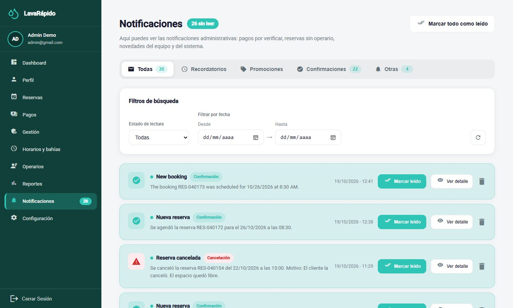 · 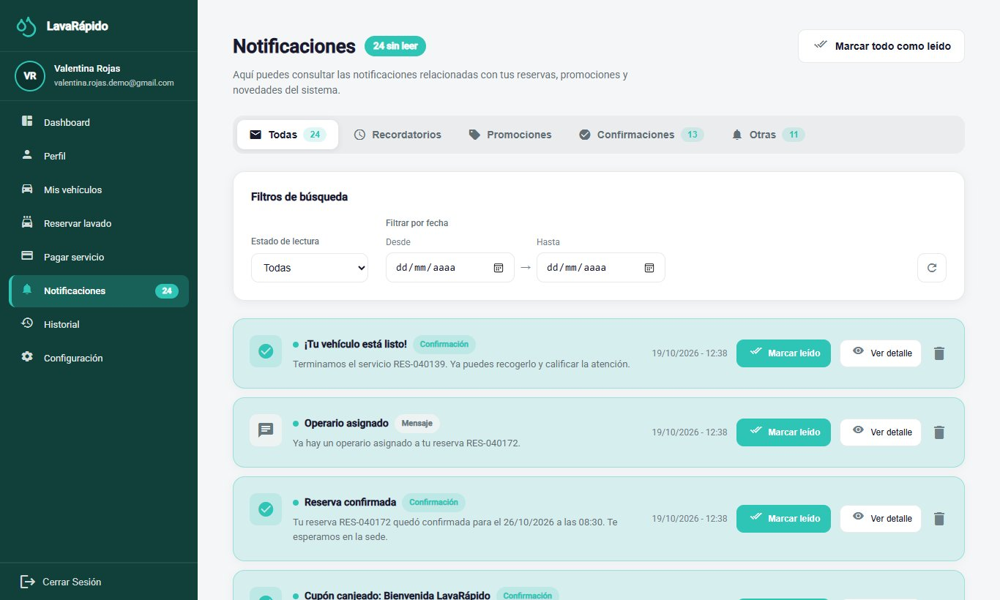 |
| RF-019, RF-020 (tema e idioma) |  |
| RF-023 (reportes) |  |

### 5.9 Promociones y Fidelización

**Tabla 19**
*Requisitos de Promociones y Fidelización (payment-service)*

| ID | Requisito | Criterios de aceptación | Prioridad | Estado |
|---|---|---|---|---|
| RF-024 | **Gestión de promociones.** El sistema debe permitir que el administrador cree, edite, active, desactive y elimine promociones con código, vigencia, porcentaje de descuento (1 a 100) y puntos requeridos. | • Una promoción desactivada o vencida no puede aplicarse a pagos nuevos. | Deseable | Implementado |
| RF-025 | **Aplicación de promoción en el pago.** El sistema debe permitir que el cliente aplique el código de una promoción vigente al pagar una reserva. | • Se valida que la promoción esté activa, vigente y desbloqueada por los puntos del cliente. • El descuento se calcula sobre el total de la reserva y no lo supera. • Si la promoción no aplica, se informa y se mantiene el valor original; si aplica, se notifica el canje en la aplicación y por correo. | Opcional | Implementado |
| RF-026 | **Puntos de fidelización.** El sistema debe acreditar al cliente los puntos de cada servicio pagado y usar el saldo acumulado para desbloquear promociones. | • Los puntos se acreditan una sola vez por reserva al aprobarse su pago. • El saldo se calcula desde el libro de movimientos y nunca desde una copia en el perfil. • Canjear una promoción no consume puntos. | Opcional | Implementado |

**Evidencia:**

| RF | Pantalla |
|---|---|
| RF-024 (gestión de promociones) | 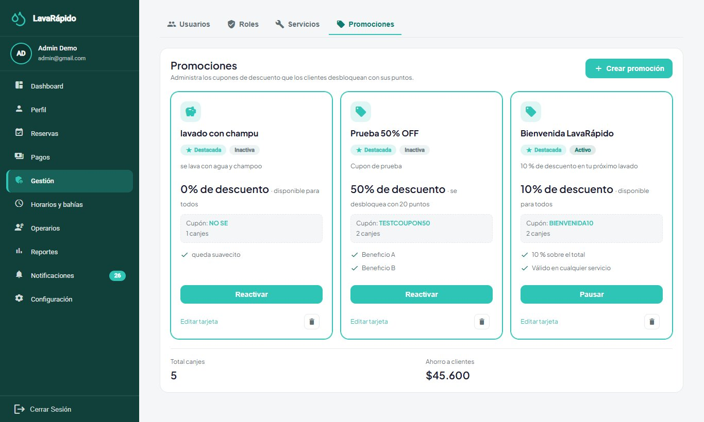 |
| RF-025, RF-026 (canjear cupón / saldo de puntos en el dashboard del cliente) |  ·  |

### 5.10 Reglas de Negocio

Las reglas de negocio son condiciones que el sistema debe mantener siempre, con independencia de la pantalla o del servicio que ejecute la operación. La Tabla 20 las lista con su identificador del modelo de dominio.

**Tabla 20**
*Reglas de Negocio del Sistema*

| ID | Regla | Requisito |
|---|---|---|
| INV-BOOK-001/002 | Una reserva requiere un vehículo que pertenezca al cliente que reserva. | RF-005 |
| INV-BOOK-003 | Una reserva tiene al menos una línea de servicio; la misma tarifa no se repite en una reserva. | RF-005 |
| INV-BOOK-004 | La hora de fin de la reserva es posterior a la de inicio. | RF-005 |
| INV-BOOK-005/006 | Una reserva solo se confirma dentro del horario y con una bahía activa sin reservas solapadas. | RF-006 |
| INV-BOOK-007 | Solo las reservas Programadas o Confirmadas se pueden reprogramar o cancelar; el cliente solo cancela antes de la hora de inicio. | RF-007 |
| INV-BOOK-008 | Cada línea conserva el precio vigente al reservar, aunque el catálogo cambie después. | RF-031 |
| INV-EXEC-001/002 | Cada línea de servicio tiene a lo sumo una ejecución y un operario responsable. | RF-009 |
| INV-EXEC-003 | Un operario no puede tener servicios solapados. | RF-009 |
| INV-EXEC-004 | Solo el operario asignado actualiza el avance de su servicio. | RF-012b |
| RN-EXEC-01 | Un servicio solo se inicia desde 15 minutos antes de la hora de la reserva. | RF-012b |
| RN-ASSIGN-01 | La asignación automática respeta la elección del cliente si ese operario está libre; si no, elige al de menos reservas del día y, en empate, al de menor identificador. | RF-008, RF-010 |
| RN-AUTH-01 | Cinco contraseñas erradas dentro de 15 minutos bloquean la cuenta 15 minutos. | RF-004b |
| RN-INSP-01 | El informe de inspección solo aplica a reservas de 180 minutos o más y solo se edita mientras el vehículo está en el lavadero (reserva Confirmada o En proceso). | RF-036 |
| INV-RATING-001 a 004 | La calificación es única, entera de 1 a 5, posterior a la finalización; el comentario requiere puntaje. | RF-012 |
| INV-PAY-001 | Todo pago pertenece a una reserva; una reserva tiene como máximo un pago aprobado. | RF-014 |
| INV-PAY-002/003 | Los pagos digitales requieren comprobante; el efectivo lo registra el administrador. | RF-013b |
| INV-PAY-005 | Una diferencia entre el valor declarado y el valor a pagar es motivo de rechazo, nunca de aprobación automática. | RF-014 |
| INV-PAY-006 | Un código de referencia no se reutiliza entre reservas. | RF-016 |
| INV-PAY-007 | El sistema no captura ni almacena datos de tarjeta. | RF-016 |
| INV-LOY-001 | El saldo de puntos se calcula siempre desde el libro de movimientos. | RF-026 |
| RN-PROMO-01 | El descuento es porcentual (1 a 100), se aplica sobre el total de la reserva y no lo supera. | RF-025 |

---

## 6. Requisitos No Funcionales

Los requisitos no funcionales se clasifican según las características de calidad del producto de ISO/IEC 25010 (ISO/IEC, 2023). Cada uno tiene una métrica o un criterio verificable en el ambiente local con Docker (véase la Tabla 21). Se retiran de versiones anteriores los requisitos de 1000 usuarios concurrentes en la nube y de disponibilidad del 99 %, porque el sistema solo se publica en un servidor para la revisión académica y no atiende la operación real de un lavadero.

**Tabla 21**
*Requisitos No Funcionales*

| ID | Característica | Requisito y métrica | Verificación | Estado |
|---|---|---|---|---|
| RNF-001 | Eficiencia de desempeño | El percentil 95 del tiempo de respuesta de los endpoints de reserva y de autenticación es menor de 2 segundos, y la consulta de disponibilidad responde en menos de 2 segundos con el conjunto de datos de prueba. | Script `lavarapido-infra/e2e/performance.js`: 30 peticiones por endpoint a través del gateway en el ambiente local | **Implementado.** Medido el 14 de octubre de 2026: el percentil 95 más alto fue de 686 ms (`/payments/me`). |
| RNF-002 | Disponibilidad | Todos los servicios responden UP en su endpoint de salud (`/actuator/health` o `/health`) durante cada sesión de revisión académica. | Verificación antes de cada sesión | **Implementado.** Verificado en vivo el 9 de octubre de 2026: los 6 servicios y el gateway respondieron `200 OK`. |
| RNF-003 | Integridad y concurrencia | Ante solicitudes simultáneas, solo una reserva ocupa una bahía en una franja; no se asigna un operario ocupado; una reserva no tiene dos pagos aprobados (índice único filtrado) y un código de referencia no se repite. | Pruebas de integración | Parcial: reglas implementadas; pruebas de integración pendientes |
| RNF-004 | Seguridad | Endpoints privados con JWT (401 sin token o con token vencido); vigencia del token de 1 hora; contraseñas con BCrypt de 8 a 72 caracteres, con al menos una mayúscula, un número y un carácter especial, sin espacios; acceso por rol (403 entre roles) y por dueño del recurso; bloqueo tras 5 intentos fallidos; secretos solo en variables de entorno; HTTPS fuera de desarrollo. | Pruebas web por rol, pruebas de política de contraseñas y de bloqueo, prueba de que el gateway no expone `/internal`, revisión de código | **Implementado**; en el servidor público Caddy sirve todo por HTTPS. |
| RNF-005 | Mantenibilidad: observabilidad | Cada servicio escribe en la salida estándar las peticiones y errores con el identificador de correlación `X-Correlation-Id`. | Revisión de bitácoras con `docker logs` | Parcial |
| RNF-006 | Mantenibilidad | Todo cambio entra por Pull Request con al menos una aprobación, usa Conventional Commits y versiona los cambios de esquema con Liquibase; frontend y backend se comunican solo por la API. | Historial de GitHub y revisión de código | Parcial |
| RNF-007 | Portabilidad | Un integrante nuevo levanta toda la solución en contenedores Docker siguiendo la guía de instalación local, en cualquier sistema operativo del equipo. | Instalación desde cero en más de un equipo | Parcial |
| RNF-008 | Compatibilidad | La aplicación funciona en Android 8.0 o superior; la web, en las versiones vigentes de Chrome, Firefox y Edge, y es usable desde 360 px de ancho. | Script `lavarapido-infra/e2e/width-360.js` para la web; pruebas manuales en dispositivos y emuladores | Parcial: el 17 de octubre de 2026 ninguna de las 60 pantallas web medidas (360 y 768 px) ni de las 26 pantallas de la app móvil (360 px, en su versión web) se sale de lado ni recorta contenido; falta probar en un dispositivo con Android 8. |
| RNF-009 | Usabilidad | Un cliente completa una reserva en 5 pasos o menos desde el panel; cada formulario identifica el campo inválido; cada acción que cambia datos muestra confirmación o error. | Revisión de flujos y formularios | Parcial: la reserva toma 5 pasos (vehículo, servicio, fecha, hora y confirmar; elegir operario es opcional) y los mensajes de los formularios se revisaron en los 4 idiomas; falta una prueba con usuarios. |
| RNF-010 | Usabilidad: localización | Todas las pantallas están en los cuatro idiomas sin claves sin traducir; montos en COP; fechas en el formato del idioma. | Revisión manual por idioma | Parcial |
| RNF-011 | Fiabilidad: idempotencia | Un evento de dominio recibido más de una vez produce un solo efecto (una notificación, un abono de puntos). | Pruebas unitarias del consumidor de eventos y del abono de puntos | Implementado |
| RNF-012 | Fiabilidad: tolerancia a fallos | La falla del servidor SMTP, de Expo Push o de RabbitMQ no impide confirmar una reserva ni aprobar un pago; la notificación queda en la bandeja. | Prueba con el servicio externo detenido | Implementado |

---

## 7. Modelo de Casos de Uso

### 7.1 Diagrama de Casos de Uso

Los 32 casos de uso se presentan en cuatro diagramas, uno por actor, agrupados por módulo (Figuras 3a a 3d).

**Figura 3a**
*Casos de Uso Comunes a los Tres Roles*

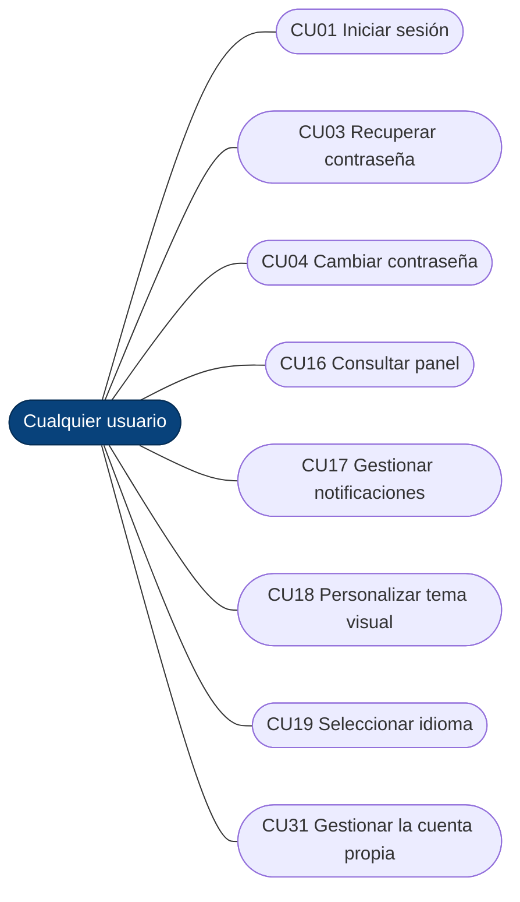

**Figura 3b**
*Casos de Uso del Cliente*

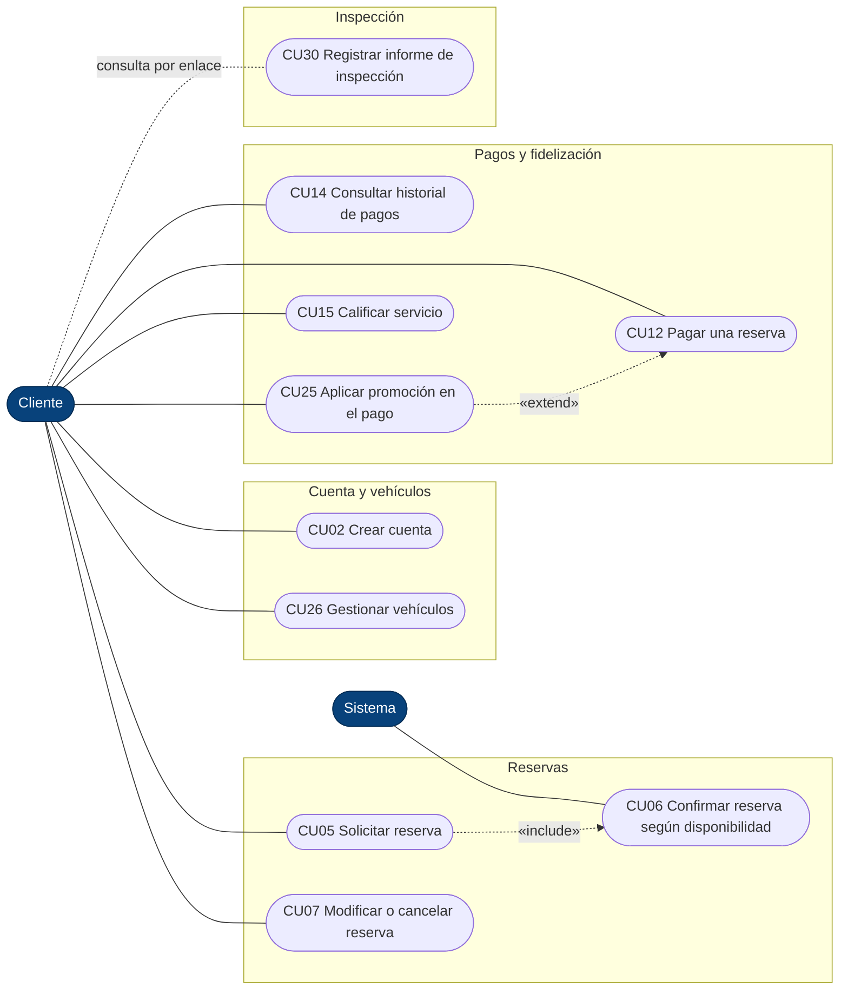

*Nota.* `«include»` indica que CU05 siempre ejecuta CU06; `«extend»` indica que CU25 amplía opcionalmente CU12. El cliente no registra el informe de inspección (CU30): lo consulta por el enlace que le comparte el administrador.

**Figura 3c**
*Casos de Uso del Operario*

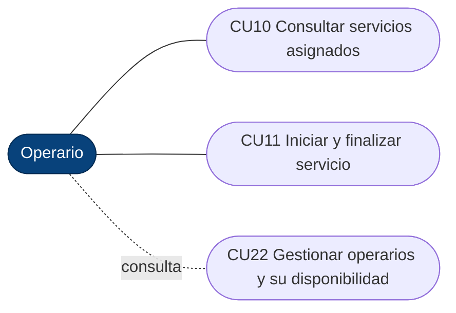

**Figura 3d**
*Casos de Uso del Administrador y del Sistema*

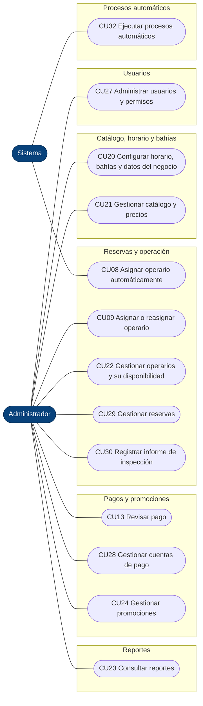

*Nota.* CU22 aparece como consulta en el diagrama del operario y como gestión en el del administrador, que es quien registra los turnos, las ausencias y la ficha del operario (RF-022, RF-038). CU08 lo ejecuta el sistema al confirmarse cada reserva, y CU32 agrupa los procesos que corren sin que nadie los pida (recordatorios, alertas, avisos y primer administrador). Elaboración propia.

### 7.2 Matriz de Actores y Casos de Uso

**Tabla 22**
*Casos de Uso por Actor*

| Actor | Casos de uso |
|---|---|
| Todos los roles | CU01, CU03, CU04, CU16, CU17, CU18, CU19, CU31 |
| Cliente | CU02, CU05, CU06, CU07, CU12, CU14, CU15, CU25, CU26, CU30 (consulta) |
| Operario | CU10, CU11, CU22 (consulta) |
| Administrador | CU09, CU13, CU20, CU21, CU22, CU23, CU24, CU27, CU28, CU29, CU30 |
| Sistema | CU06 (incluido en CU05), CU08, CU32 |

### 7.3 Especificación de los Casos de Uso

Cada caso de uso se especifica con el formato de Cockburn (2001): actores, precondición, flujo normal, flujos alternos, postcondición, requisitos que cubre y estado.

**Tabla 23**
*CU01: Iniciar sesión*

| Campo | Descripción |
|---|---|
| Actores | Cliente, operario, administrador. |
| Precondición | El usuario tiene una cuenta activa. |
| Flujo normal | 1. El usuario ingresa correo y contraseña. 2. El sistema valida las credenciales y emite el token. 3. El sistema redirige al panel del rol. |
| Flujos alternos | • Credenciales inválidas: se muestra un mensaje genérico. • Cinco intentos fallidos en 15 minutos: la cuenta se bloquea 15 minutos y el sistema ofrece recuperar la contraseña, que levanta el bloqueo. |
| Postcondición | El usuario queda autenticado durante la vigencia del token (1 hora). |
| Requisitos | RF-002, RF-004b |
| Estado | Implementado |

**Tabla 24**
*CU02: Crear cuenta*

| Campo | Descripción |
|---|---|
| Actores | Cliente. |
| Precondición | No existe una cuenta con el mismo correo. |
| Flujo normal | 1. El cliente diligencia sus datos personales y la contraseña. 2. Acepta la política de tratamiento de datos. 3. El sistema crea la cuenta y el perfil, y envía el correo de bienvenida. |
| Flujos alternos | • Correo ya registrado: se informa y no se crea la cuenta. • Contraseña que no cumple la política: se indican las reglas incumplidas. |
| Postcondición | La cuenta y el perfil de cliente quedan creados. |
| Requisitos | RF-001 |
| Estado | Implementado |

**Tabla 25**
*CU03: Recuperar contraseña*

| Campo | Descripción |
|---|---|
| Actores | Cliente, operario, administrador. |
| Precondición | El usuario tiene acceso al correo de su cuenta. |
| Flujo normal | 1. El usuario ingresa su correo. 2. El sistema envía un código de 6 dígitos. 3. El usuario escribe el código y la nueva contraseña. |
| Flujos alternos | • Código vencido o 5 intentos fallidos: el usuario solicita un código nuevo. • Correo no registrado: la respuesta es idéntica y no se envía correo. • Nueva contraseña igual a la actual: se rechaza y el usuario puede intentar con otra sin pedir un código nuevo. |
| Postcondición | La contraseña queda actualizada, el código deja de ser válido y, si la cuenta estaba bloqueada, el bloqueo se levanta. |
| Requisitos | RF-003 |
| Estado | Implementado |

**Tabla 26**
*CU04: Cambiar contraseña*

| Campo | Descripción |
|---|---|
| Actores | Cliente, operario, administrador. |
| Precondición | El usuario está autenticado. |
| Flujo normal | 1. El usuario escribe la contraseña actual y la nueva. 2. El sistema valida y guarda el cambio. |
| Flujos alternos | • Contraseña actual incorrecta o nueva contraseña inválida: el cambio se rechaza. |
| Postcondición | La contraseña queda actualizada. |
| Requisitos | RF-004 |
| Estado | Implementado |

**Tabla 27**
*CU05: Solicitar reserva*

| Campo | Descripción |
|---|---|
| Actores | Cliente. |
| Precondición | El cliente está autenticado y tiene al menos un vehículo registrado. |
| Flujo normal | 1. El cliente elige el vehículo. 2. Elige uno o más servicios; el sistema muestra el precio según el tipo de vehículo. 3. Elige fecha y hora. 4. Si quiere, elige un operario de la lista de libres en ese horario. 5. El sistema ejecuta CU06. |
| Flujos alternos | • Sin vehículos registrados: el sistema pide registrar uno (CU26). • Nadie libre en ese horario: la reserva sigue sin preferencia de operario. |
| Postcondición | La solicitud queda lista para validar la disponibilidad. |
| Requisitos | RF-005, RF-010 |
| Estado | Implementado |

**Tabla 28**
*CU06: Confirmar reserva según disponibilidad*

| Campo | Descripción |
|---|---|
| Actores | Sistema (incluido en CU05). |
| Precondición | Existe una solicitud de reserva en curso. |
| Flujo normal | 1. El sistema revisa el horario, las excepciones y las bahías activas. 2. Con una bahía libre, confirma la reserva y la asigna. 3. Publica la confirmación: se notifica al cliente, se programan los recordatorios y se ejecuta CU08. |
| Flujos alternos | • Sin bahía libre: no se guarda nada y se ofrecen hasta 5 horas alternativas del mismo día. |
| Postcondición | La reserva queda Confirmada y la bahía ocupada en esa franja. |
| Requisitos | RF-006 |
| Estado | Implementado |

**Tabla 29**
*CU07: Modificar o cancelar reserva*

| Campo | Descripción |
|---|---|
| Actores | Cliente. |
| Precondición | La reserva está en estado Programada o Confirmada. |
| Flujo normal | 1. El cliente abre la reserva desde su historial. 2. Elige cancelarla y confirma en el diálogo (no escribe motivo). 3. El sistema la cancela con el motivo `CUSTOMER_REQUEST`, libera la bahía y notifica. |
| Flujos alternos | • Servicio en proceso o terminado, o ya pasó la hora de inicio: la cancelación se bloquea con un mensaje explicativo. • Para cambiar la fecha o la hora, el cliente cancela y reserva de nuevo, o lo pide al lavadero: la reprogramación la hace el administrador (CU29). |
| Postcondición | La reserva queda cancelada y la bahía se libera. |
| Requisitos | RF-007 |
| Estado | Implementado |

**Tabla 30**
*CU08: Asignar operario automáticamente*

| Campo | Descripción |
|---|---|
| Actores | Sistema. |
| Precondición | La reserva está Confirmada y sin operario. |
| Flujo normal | 1. Al recibir la confirmación de la reserva, el sistema identifica a los operarios elegibles para la franja. 2. Si el cliente eligió un operario y está libre, lo asigna; si no, elige al de menos reservas ese día (empate: menor identificador). 3. Notifica al cliente y al operario. |
| Flujos alternos | • Sin operarios elegibles: la reserva queda sin operario y, cuando faltan menos de 2 horas, los administradores reciben una alerta para CU09. • Reserva reprogramada que ya tenía operario: se conserva. |
| Postcondición | El servicio tiene un operario asignado y notificado. |
| Requisitos | RF-008, RF-010 |
| Estado | Implementado |

**Tabla 31**
*CU09: Asignar o reasignar operario*

| Campo | Descripción |
|---|---|
| Actores | Administrador. |
| Precondición | La reserva no ha iniciado. |
| Flujo normal | 1. El administrador abre la reserva. 2. El sistema muestra los candidatos: disponibles primero, por nombre, con su calificación. 3. El administrador elige un operario y confirma. 4. El sistema notifica al operario. |
| Flujos alternos | • Operario no disponible: la asignación se bloquea y se muestra el motivo. • Ejecución ya iniciada: la reasignación se bloquea. |
| Postcondición | La reserva queda asignada al operario elegido. |
| Requisitos | RF-009 |
| Estado | Implementado |

**Tabla 32**
*CU10: Consultar servicios asignados*

| Campo | Descripción |
|---|---|
| Actores | Operario. |
| Precondición | El operario está autenticado. |
| Flujo normal | 1. El operario abre su panel. 2. Ve sus reservas con cliente, vehículo, hora, servicios y bahía. |
| Flujos alternos | • Sin servicios asignados: se muestra un mensaje que lo indica. |
| Postcondición | El operario conoce su trabajo. |
| Requisitos | RF-011 |
| Estado | Implementado |

**Tabla 33**
*CU11: Iniciar y finalizar servicio*

| Campo | Descripción |
|---|---|
| Actores | Operario. |
| Precondición | La reserva está asignada al operario, está Confirmada y faltan 15 minutos o menos para su hora de inicio. |
| Flujo normal | 1. El operario marca el servicio como iniciado. 2. Al terminar, lo marca como finalizado. |
| Flujos alternos | • Reserva de otro operario o antes de la ventana de 15 minutos: la acción se bloquea. |
| Postcondición | La reserva queda Completada, los recordatorios pendientes se cancelan y el cliente puede calificarla. |
| Requisitos | RF-012b |
| Estado | Implementado |

**Tabla 34**
*CU12: Pagar una reserva*

| Campo | Descripción |
|---|---|
| Actores | Cliente. |
| Precondición | La reserva está confirmada y no tiene un pago aprobado. |
| Flujo normal | 1. El cliente elige el método de pago. 2. Para un método digital, ve el QR y las instrucciones. 3. Sube el comprobante con el valor declarado y el código de referencia. 4. El pago queda En revisión. |
| Flujos alternos | • Efectivo: no se sube comprobante y el administrador registra el pago. • Código de referencia ya usado en otra reserva: el comprobante se rechaza. • El cliente puede aplicar una promoción (CU25). |
| Postcondición | El pago queda registrado y ligado a la reserva. |
| Requisitos | RF-013, RF-013b, RF-016 |
| Estado | Implementado |

**Tabla 35**
*CU13: Revisar pago*

| Campo | Descripción |
|---|---|
| Actores | Administrador. |
| Precondición | Existe un pago en revisión o un pago en efectivo por registrar. |
| Flujo normal | 1. El administrador abre los pagos pendientes. 2. Compara el valor declarado con el valor a pagar. 3. Aprueba o rechaza el pago. |
| Flujos alternos | • Valor distinto o comprobante ilegible: rechaza con motivo y el cliente puede reenviar. • Pago aprobado que debe devolverse: lo marca como reembolsado (RF-035). |
| Postcondición | El pago queda aprobado o rechazado y el cliente es notificado; la aprobación acredita puntos. |
| Requisitos | RF-014, RF-035 |
| Estado | Implementado |

**Tabla 36**
*CU14: Consultar historial de pagos*

| Campo | Descripción |
|---|---|
| Actores | Cliente. |
| Precondición | El cliente está autenticado. |
| Flujo normal | 1. El cliente abre el historial. 2. Ve sus pagos con fecha, servicio, valor y estado, de la reserva más reciente a la más antigua. 3. Si quiere, filtra por fechas o por servicio. |
| Flujos alternos | • Sin pagos: se muestra un mensaje que lo indica. |
| Postcondición | El cliente conoce el estado de sus pagos. |
| Requisitos | RF-015 |
| Estado | Implementado |

**Tabla 37**
*CU15: Calificar servicio*

| Campo | Descripción |
|---|---|
| Actores | Cliente. |
| Precondición | La reserva está Completada y no ha sido calificada. |
| Flujo normal | 1. El cliente elige un puntaje de 1 a 5. 2. Escribe un comentario opcional. 3. Guarda la calificación. |
| Flujos alternos | • Reserva no completada o ya calificada: el sistema rechaza la calificación. |
| Postcondición | La calificación queda asociada a la reserva y a sus líneas. |
| Requisitos | RF-012 |
| Estado | Implementado |

**Tabla 38**
*CU16: Consultar panel*

| Campo | Descripción |
|---|---|
| Actores | Cliente, operario, administrador. |
| Precondición | El usuario está autenticado. |
| Flujo normal | 1. El usuario entra al sistema. 2. Ve el resumen y los accesos rápidos de su rol. |
| Flujos alternos | • Sin datos: se muestra un mensaje que lo indica. |
| Postcondición | El usuario tiene una visión general de su actividad. |
| Requisitos | RF-017 |
| Estado | Implementado |

**Tabla 39**
*CU17: Gestionar notificaciones*

| Campo | Descripción |
|---|---|
| Actores | Cliente, operario, administrador. |
| Precondición | El usuario está autenticado. |
| Flujo normal | 1. El usuario abre la bandeja, ordenada de la más reciente a la más antigua. 2. Ve las notificaciones con su estado. 3. Al hacer clic en una, se abre su detalle y queda marcada como leída. 4. Si la notificación se refiere a una sección (por ejemplo, una reserva o un pago), el botón "Ir a…" lleva a esa pantalla. |
| Flujos alternos | • Sin notificaciones: la bandeja muestra un mensaje que lo indica. |
| Postcondición | El usuario queda informado de los eventos relevantes. |
| Requisitos | RF-018 |
| Estado | Implementado |

**Tabla 40**
*CU18: Personalizar tema visual*

| Campo | Descripción |
|---|---|
| Actores | Cliente, operario, administrador. |
| Precondición | El usuario está autenticado. |
| Flujo normal | 1. El usuario elige una de las cuatro paletas. 2. El sistema la aplica y la guarda en la cuenta. |
| Flujos alternos | • Falla al guardar: el tema se aplica en el equipo y se conserva el de la cuenta. |
| Postcondición | El tema queda asociado a la cuenta. |
| Requisitos | RF-019 |
| Estado | Implementado |

**Tabla 41**
*CU19: Seleccionar idioma*

| Campo | Descripción |
|---|---|
| Actores | Cualquier usuario, con o sin sesión. |
| Precondición | Ninguna. |
| Flujo normal | 1. El usuario elige el idioma. 2. El sistema actualiza los textos de la interfaz. |
| Flujos alternos | • Sin sesión: el idioma se recuerda solo en el navegador. |
| Postcondición | La interfaz se muestra en el idioma elegido; con sesión, queda guardado en la cuenta. |
| Requisitos | RF-020 |
| Estado | Implementado |

**Tabla 42**
*CU20: Configurar horario, bahías y datos del negocio*

| Campo | Descripción |
|---|---|
| Actores | Administrador. |
| Precondición | El administrador está autenticado. |
| Flujo normal | 1. Configura el horario semanal y la pausa del día. 2. Registra excepciones (festivos, horarios especiales). 3. Crea, edita o desactiva bahías. 4. Actualiza los datos legales, tributarios y de atención del negocio. |
| Flujos alternos | • Hora de cierre anterior o igual a la de apertura: el cambio se rechaza. • Falta la razón social, el NIT o la dirección, o el correo o el teléfono no son válidos: los datos del negocio no se guardan. |
| Postcondición | El horario y las bahías aplican a las reservas siguientes; los datos del negocio se ven en la web y en la aplicación. |
| Requisitos | RF-021, RF-032, RF-037 |
| Estado | Implementado |

**Tabla 43**
*CU21: Gestionar catálogo y precios*

| Campo | Descripción |
|---|---|
| Actores | Administrador. |
| Precondición | El administrador está autenticado. |
| Flujo normal | 1. Crea o edita un servicio. 2. Define precio y duración por tipo de vehículo, y sus puntos. 3. Activa o desactiva el servicio. |
| Flujos alternos | • Faltan datos obligatorios o la tarifa se solapa con otra vigente: el sistema lo indica antes de guardar. |
| Postcondición | El catálogo queda actualizado; las reservas existentes conservan su precio. |
| Requisitos | RF-031 |
| Estado | Implementado |

**Tabla 44**
*CU22: Gestionar operarios y su disponibilidad*

| Campo | Descripción |
|---|---|
| Actores | Administrador (operario: consulta). |
| Precondición | El usuario está autenticado. |
| Flujo normal | 1. El administrador registra el turno semanal del operario. 2. Registra o elimina ausencias. 3. Edita la especialidad y las habilidades del operario. 4. Activa o desactiva al operario. 5. Consulta las métricas semanales del operario y el resumen del equipo. |
| Flujos alternos | • Ausencia que se cruza con un servicio asignado: el sistema lo advierte. |
| Postcondición | La disponibilidad queda actualizada para la asignación automática y manual. |
| Requisitos | RF-022, RF-038 |
| Estado | Implementado |

**Tabla 45**
*CU23: Consultar reportes*

| Campo | Descripción |
|---|---|
| Actores | Administrador. |
| Precondición | El administrador está autenticado. |
| Flujo normal | 1. Abre la sección de reportes. 2. Elige el tipo de reporte y el periodo. |
| Flujos alternos | • Sin datos en el periodo: se muestra un mensaje que lo indica. |
| Postcondición | El administrador dispone de información para decidir. |
| Requisitos | RF-023 |
| Estado | Parcial |

**Tabla 46**
*CU24: Gestionar promociones*

| Campo | Descripción |
|---|---|
| Actores | Administrador. |
| Precondición | El administrador está autenticado. |
| Flujo normal | 1. Crea o edita una promoción con código, vigencia, porcentaje y puntos requeridos. 2. La activa o desactiva. |
| Flujos alternos | • Faltan datos o el porcentaje está fuera de 1 a 100: el sistema lo indica antes de guardar. |
| Postcondición | La promoción queda disponible o deshabilitada. |
| Requisitos | RF-024 |
| Estado | Implementado |

**Tabla 47**
*CU25: Aplicar promoción en el pago*

| Campo | Descripción |
|---|---|
| Actores | Cliente (extiende CU12). |
| Precondición | El cliente tiene una reserva por pagar y una promoción desbloqueada. |
| Flujo normal | 1. Durante el pago, el cliente ingresa el código de la promoción. 2. El sistema valida vigencia, estado y puntos, y calcula el descuento. 3. El cliente paga el valor con descuento. |
| Flujos alternos | • Promoción vencida, inactiva o sin puntos suficientes: se informa y se mantiene el valor original. |
| Postcondición | El canje queda registrado en la reserva y se notifica al cliente. |
| Requisitos | RF-025, RF-026 |
| Estado | Implementado |

**Tabla 48**
*CU26: Gestionar vehículos*

| Campo | Descripción |
|---|---|
| Actores | Cliente. |
| Precondición | El cliente está autenticado. |
| Flujo normal | 1. El cliente registra un vehículo con placa y tipo. 2. Consulta, edita o retira sus vehículos. |
| Flujos alternos | • Datos incompletos: el sistema indica el campo que falta. |
| Postcondición | Los vehículos quedan disponibles para reservar. |
| Requisitos | RF-030 |
| Estado | Implementado |

**Tabla 49**
*CU27: Administrar usuarios y permisos*

| Campo | Descripción |
|---|---|
| Actores | Administrador. |
| Precondición | El administrador está autenticado. |
| Flujo normal | 1. Lista los usuarios. 2. Crea cuentas de operario o administrador. 3. Activa o desactiva cuentas. 4. Edita la matriz de permisos de un rol. |
| Flujos alternos | • Correo ya registrado: la cuenta no se crea. • Intenta desactivar una cuenta de administrador o la suya: el sistema lo impide y lo explica. |
| Postcondición | Las cuentas y la matriz de permisos quedan actualizadas. |
| Requisitos | RF-028, RF-029 |
| Estado | Implementado |

**Tabla 50**
*CU28: Gestionar cuentas de pago*

| Campo | Descripción |
|---|---|
| Actores | Administrador. |
| Precondición | El administrador está autenticado. |
| Flujo normal | 1. Crea o edita una cuenta de pago con titular, número, QR e instrucciones. 2. La activa o desactiva. |
| Flujos alternos | • Faltan datos obligatorios: el sistema los pide antes de guardar. |
| Postcondición | Las cuentas activas se muestran al cliente al pagar. |
| Requisitos | RF-034 |
| Estado | Implementado |

**Tabla 51**
*CU29: Gestionar reservas*

| Campo | Descripción |
|---|---|
| Actores | Administrador. |
| Precondición | El administrador está autenticado. |
| Flujo normal | 1. Consulta las reservas por rango de fechas. 2. Cambia el estado de una reserva (cancelar con motivo, marcar "no asistió"). 3. Si hace falta, la reprograma a otra fecha y hora, con nueva bahía y los mismos precios. |
| Flujos alternos | • Transición no permitida por el ciclo de vida: se rechaza. |
| Postcondición | La reserva queda en el nuevo estado y se notifica al cliente. |
| Requisitos | RF-033 |
| Estado | Implementado |

**Tabla 52**
*CU30: Registrar informe de inspección*

| Campo | Descripción |
|---|---|
| Actores | Administrador (cliente: consulta). |
| Precondición | La reserva dura 180 minutos o más y está Confirmada o En proceso. |
| Flujo normal | 1. El administrador abre el informe de la reserva. 2. Recorre las fases en orden (recepción, exterior, interior, motor y entrega) y marca cada una en curso o terminada. 3. Registra los hallazgos con zona, nota, gravedad y fotos. 4. Publica el informe. 5. Lo comparte: el cliente recibe una notificación con el enlace. 6. El cliente abre el enlace y ve el informe con la placa enmascarada. |
| Flujos alternos | • Reserva de menos de 180 minutos, cancelada o pendiente: no admite informe. • Reserva Completada: el informe se puede ver pero no editar. • Más de 5 fotos en un hallazgo: se rechaza. • Compartir antes de publicar: se rechaza. |
| Postcondición | El informe queda publicado y el cliente tiene el enlace. |
| Requisitos | RF-036 |
| Estado | Implementado |

**Tabla 53**
*CU31: Gestionar la cuenta propia*

| Campo | Descripción |
|---|---|
| Actores | Cliente, operario o administrador (cada uno con su cuenta). |
| Precondición | El usuario está autenticado. |
| Flujo normal | 1. Abre su perfil. 2. Actualiza nombres, apellidos, teléfono y dirección de contacto. 3. Cambia su correo confirmando la contraseña actual. 4. Cierra la sesión. 5. Si ya no usará la cuenta, la desactiva confirmando la contraseña: se cierran todas sus sesiones. |
| Flujos alternos | • Correo ya registrado por otra cuenta: no se cambia. • Contraseña actual incorrecta: no se cambia el correo ni se desactiva la cuenta. • Cuenta de administrador: no tiene la opción de desactivarse. • Dirección vacía: se borra. |
| Postcondición | Los datos del perfil quedan actualizados, o la cuenta queda desactivada con su historial. |
| Requisitos | RF-027 |
| Estado | Implementado |

**Tabla 54**
*CU32: Ejecutar procesos automáticos*

| Campo | Descripción |
|---|---|
| Actores | Sistema (tareas programadas y eventos). Para el aviso de una versión nueva de la app, lo inicia un integrante del equipo al publicar el APK. |
| Precondición | Los servicios y RabbitMQ están en marcha. |
| Flujo normal | 1. Al arrancar, si no existe ningún administrador, el sistema crea el primero con los datos de la configuración del servidor. 2. Cada evento de reserva, operario, pago o inspección se convierte en notificaciones para el cliente, el operario y los administradores, una sola vez por evento. 3. Al confirmarse una reserva programa sus recordatorios (24 horas y 1 hora antes) y los envía a su hora. 4. Dos horas antes de una reserva sin operario avisa a los administradores. 5. Al publicarse un APK nuevo avisa a los usuarios que tienen la app instalada. |
| Flujos alternos | • La reserva se cancela, inicia o termina: los recordatorios pendientes se quitan. • El servicio estuvo apagado y la hora de la reserva ya pasó: el recordatorio se cierra sin enviarse. • La misma versión de la app se publica otra vez: no se repite el aviso. • Ya existe un administrador: no se crea otro. |
| Postcondición | Los usuarios reciben los avisos que les corresponden, sin duplicados. |
| Requisitos | RF-018 |
| Estado | Implementado |

---

## 8. Flujos de Negocio

### 8.1 Flujo Principal: de la Reserva a la Calificación

El flujo principal del negocio recorre los servicios del sistema en el orden siguiente:

1. El cliente crea su cuenta (CU02); security-service publica el registro y customer-service crea el perfil; notification-service envía la bienvenida.
2. El cliente registra su vehículo (CU26) y solicita una reserva (CU05).
3. booking-service valida horario y bahías (CU06), confirma la reserva y publica `booking.confirmed`; notification-service notifica y programa los recordatorios de 24 horas y 1 hora.
4. operations-service recibe `booking.confirmed` y asigna un operario libre (CU08): el que eligió el cliente si sigue libre o, si no, el de menos reservas ese día. El cliente y el operario reciben la notificación. Si nadie estaba libre, el administrador asigna a mano (CU09) y recibe una alerta cuando faltan menos de 2 horas.
5. El cliente paga (CU12): sube el comprobante y, si lo desea, aplica una promoción (CU25). El administrador revisa el pago (CU13); al aprobarlo, se acreditan los puntos y se notifica al cliente.
6. Desde 15 minutos antes de la hora, el operario inicia el servicio y al terminar lo finaliza (CU11); la reserva pasa a En proceso y luego a Completada, y los recordatorios pendientes se cancelan. En los servicios de 180 minutos o más, el administrador registra el informe de inspección y lo comparte con el cliente (CU30).
7. El cliente califica el servicio (CU15).

La regla que define si el pago debe estar aprobado antes de iniciar el servicio sigue abierta (sección 11.3); hoy los pasos 5 y 6 son independientes.

### 8.2 Ciclo de Vida de la Reserva

La Figura 4 muestra los estados de una reserva y las transiciones permitidas.

**Figura 4**
*Diagrama de Estados de la Reserva*

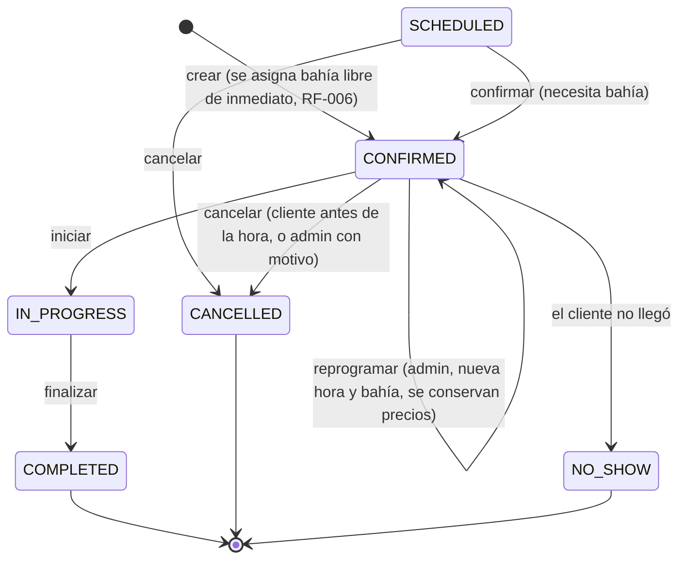

*Nota.* Los códigos en mayúsculas son los que guarda el sistema (ADR-010). Solo `SCHEDULED` y `CONFIRMED` se pueden reprogramar o cancelar (RF-007). `SCHEDULED`, `CONFIRMED` e `IN_PROGRESS` ocupan la bahía. `SCHEDULED` existe en el modelo pero el flujo actual nunca crea una reserva en ese estado: toda reserva nace `CONFIRMED` directamente. Fuente: `booking-service`, `Booking.moveTo`, `Booking.cancel`, `BookingStatus`.

### 8.3 Ciclos de Vida del Pago y de la Ejecución

**Figura 5**
*Diagrama de Estados del Pago*

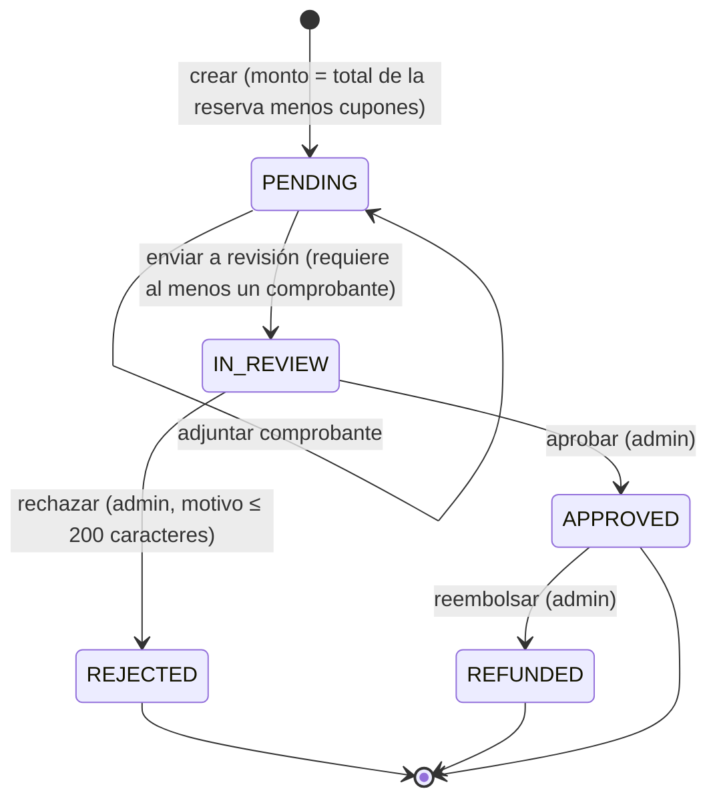

*Nota.* Un pago reportado por el cliente pasa de `PENDING` a `IN_REVIEW` en la misma petición; un pago manual (efectivo) pasa directo a `APPROVED`. Una reserva admite un solo pago aprobado (índice único filtrado) y un solo pago abierto (`PENDING`/`IN_REVIEW`) a la vez. Después de `REJECTED`, el cliente puede reportar un nuevo pago para la misma reserva. Fuente: `payment-service`, agregado `Payment`.

**Figura 6**
*Diagrama de Estados de la Ejecución del Servicio*

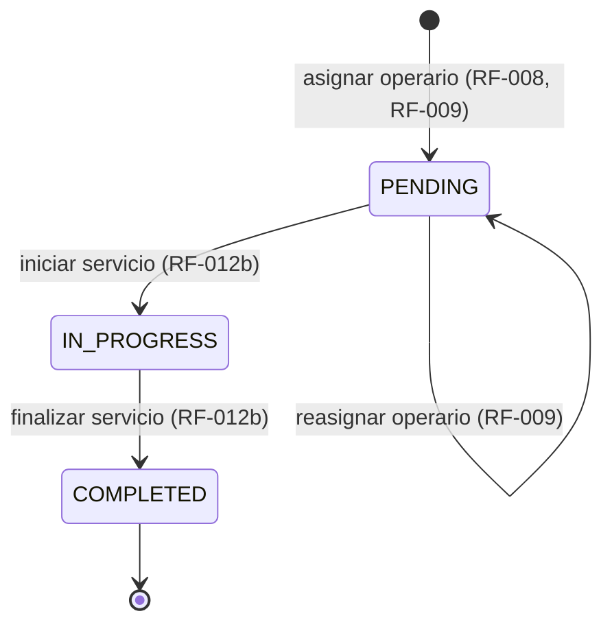

*Nota.* `COMPLETED` habilita la calificación del cliente (RF-012). El catálogo de estados también tiene `PAUSED` (Pausada) y `WITH_ISSUE` (Con novedad), pero ninguna operación del sistema lleva una ejecución a esos estados. Fuente: `operations-service`, `ServiceExecution` (`reassign`, `start`, `finish`) y `ExecutionStatus`.

### 8.4 Eventos de Dominio y Notificaciones

Los servicios publican eventos en RabbitMQ para avisar a otros servicios sin bloquear la operación (ADR-004). La Tabla 55 relaciona cada evento con su efecto.

**Tabla 55**
*Eventos de Dominio y su Efecto*

| Evento | Productor | Efecto |
|---|---|---|
| `security.user_registered` | security-service | customer-service crea el perfil (`customer.provisioned`); notificación de bienvenida. |
| `booking.confirmed` | booking-service | Se publica al crear y al reprogramar una reserva. Notificación de reserva y programación de recordatorios; operations-service asigna el operario de forma automática, con la preferencia del cliente si la hay. |
| `booking.cancelled` | booking-service | Notificación de cancelación y anulación de recordatorios. |
| `payment.confirmed`, `payment.rejected` | payment-service | Notificación del resultado de la revisión del pago. |
| `payment.refunded` | payment-service | Notificación del reembolso al cliente. |
| `payment.promotion_redeemed` | payment-service | Notificación del canje en la bandeja y por correo. |
| `payment.loyalty_points_earned` | payment-service | Notificación de los puntos ganados y, por cada promoción que esos puntos desbloquean, un aviso con su código. |
| `execution.operator_assigned` | operations-service | Notificación al cliente y al operario; la reserva deja de figurar como sin operario. |
| `execution.service_started`, `execution.service_completed` | operations-service | Notificación al cliente y cancelación de los recordatorios pendientes. |
| `execution.inspection_shared` | operations-service | Notificación al cliente con el enlace del informe de inspección. |

*Nota.* Cada notificación se escribe en el idioma de la cuenta que la recibe. Los eventos `security.user.deactivated`, `customer.provisioned` y `customer.vehicle.registered/updated/removed` existen en el dominio, pero hoy solo se escriben en la bitácora del servicio: no se publican en RabbitMQ porque ningún servicio los consume. notification-service también escucha `booking.created`, que booking-service no publica. La alerta de reserva sin operario no depende de un evento: notification-service revisa periódicamente las reservas confirmadas que empiezan en menos de 2 horas sin operario.

---

## 9. Requisitos de Datos

### 9.1 Propiedad de los Datos

La base de datos tiene 9 esquemas y 57 tablas. Cada esquema tiene un único servicio dueño, que es el único autorizado para escribir en él (véase la Tabla 56).

**Tabla 56**
*Esquemas de Datos y Servicio Dueño*

| Esquema | Servicio dueño | Datos principales |
|---|---|---|
| `security` | security-service | Personas, direcciones, cuentas con su fecha de registro, roles, permisos, sesiones, bloqueos por intentos fallidos, códigos de recuperación y preferencias. |
| `customer` | customer-service | Clientes, vehículos y tipos de vehículo. |
| `catalog` | booking-service | Categorías, servicios, precios por tipo de vehículo y puntos por servicio. |
| `booking` | booking-service | Establecimiento con sus datos legales, tributarios y de atención, horario, excepciones, bahías, reservas, líneas, motivos de cancelación e historial de horario. |
| `execution` | operations-service | Operarios con su especialidad y habilidades, turnos, ausencias, ejecuciones con su calificación e informes de inspección con sus fases, hallazgos y fotos. |
| `payment` | payment-service | Métodos y cuentas de pago, pagos, comprobantes y libro de puntos. |
| `promotion` | payment-service | Promociones, tipos de descuento y canjes por reserva. |
| `notification` | notification-service | Notificaciones, tipos, dispositivos push, recordatorios, seguimiento de reservas para las alertas y eventos procesados. |
| `audit` | security-service | Registro de auditoría de cambios. |

### 9.2 Reglas de Integridad y Conservación

- Las referencias entre esquemas de servicios distintos se guardan como identificadores sin clave foránea y se validan por API.
- Las restricciones críticas se aplican también en la base de datos: índice único filtrado para un solo pago aprobado por reserva, índice sobre el código de referencia y restricciones de rango para puntajes y porcentajes.
- Los precios y los puntos de cada línea de reserva son una copia del valor vigente al reservar.
- Las contraseñas y los códigos de recuperación se guardan solo como hash.
- El enlace público del informe de inspección usa un código aleatorio y no muestra el correo, el teléfono ni la placa completa del cliente.
- No se borran registros con historial; se desactivan. Esta versión no define una política de retención ni de supresión de datos personales, que deberá definirse antes de un despliegue real conforme a la Ley 1581 de 2012.
- Todo cambio de esquema se aplica con una migración versionada de Liquibase.

---

## 10. Matriz de Trazabilidad

La Tabla 57 relaciona cada requisito funcional con su historia de usuario, sus casos de uso, el servicio que lo implementa y su estado. Los requisitos sin historia de usuario (RF-027 a RF-038) describen funciones construidas que deben incorporarse al backlog.

**Tabla 57**
*Trazabilidad de Requisitos Funcionales*

| RF | Nombre | HU | CU | Servicio | Estado |
|---|---|---|---|---|---|
| RF-001 | Registro de cliente | HU-AUTH-001 | CU02 | security | Implementado |
| RF-002 | Inicio de sesión | HU-AUTH-002 | CU01 | security | Implementado |
| RF-003 | Recuperación de contraseña | HU-AUTH-003 | CU03 | security | Implementado |
| RF-004 | Cambio de contraseña | HU-AUTH-004 | CU04 | security | Implementado |
| RF-004b | Bloqueo por intentos fallidos | HU-AUTH-002 | CU01 | security | Implementado |
| RF-005 | Solicitud de reserva | HU-BOOK-001 | CU05 | booking | Implementado |
| RF-006 | Validación de disponibilidad | HU-BOOK-001 | CU06 | booking | Implementado |
| RF-007 | Modificación y cancelación | HU-BOOK-002 | CU07 | booking | Implementado |
| RF-008 | Asignación automática de operario | HU-BOOK-003 | CU08 | operations, booking | Implementado |
| RF-009 | Asignación y reasignación manual | HU-BOOK-006 | CU09 | operations | Implementado |
| RF-010 | Elección de operario por el cliente | HU-BOOK-004 | CU05, CU08 | operations, booking | Implementado |
| RF-011 | Servicios asignados | HU-BOOK-007 | CU10 | operations | Implementado |
| RF-012 | Calificación del servicio | HU-BOOK-005 | CU15 | operations | Implementado |
| RF-012b | Inicio y finalización del servicio | HU-BOOK-007 | CU11 | operations | Implementado |
| RF-013 | Métodos de pago | HU-PAY-001 | CU12 | payment | Implementado |
| RF-013b | Carga del comprobante | HU-PAY-001 | CU12 | payment | Implementado |
| RF-014 | Revisión del pago | HU-PAY-003 | CU13 | payment | Implementado |
| RF-015 | Historial de pagos | HU-PAY-002 | CU14 | payment | Implementado |
| RF-016 | Restricciones de pago | HU-PAY-001 | CU12 | payment | Implementado |
| RF-017 | Panel por rol | HU-UI-001 | CU16 | frontend | Implementado |
| RF-018 | Notificaciones | HU-UI-002 | CU17, CU32 | notification | Implementado |
| RF-019 | Tema visual por cuenta | HU-UI-003 | CU18 | security | Implementado |
| RF-020 | Idioma por cuenta | HU-UI-003 | CU19 | security | Implementado |
| RF-021 | Horario y excepciones | HU-ADMIN-001 | CU20 | booking | Implementado |
| RF-022 | Disponibilidad de operarios | HU-ADMIN-001 | CU22 | operations | Implementado |
| RF-023 | Reportes operativos | HU-ADMIN-001 | CU23 | booking, operations, payment | Parcial |
| RF-024 | Gestión de promociones | HU-PROMO-001 | CU24 | payment | Implementado |
| RF-025 | Aplicación de promoción en el pago | HU-PROMO-002 | CU25 | payment | Implementado |
| RF-026 | Puntos de fidelización | HU-PROMO-002 | CU25 | payment | Implementado |
| RF-027 | Gestión de la cuenta propia | — | CU31 | security | Implementado |
| RF-028 | Administración de usuarios | — | CU27 | security | Implementado |
| RF-029 | Roles y permisos | — | CU27 | security | Implementado |
| RF-030 | Gestión de vehículos del cliente | — | CU26 | customer | Implementado |
| RF-031 | Catálogo de servicios y precios | — | CU21 | booking | Implementado |
| RF-032 | Gestión de bahías | — | CU20 | booking | Implementado |
| RF-033 | Gestión administrativa de reservas | — | CU29 | booking | Implementado |
| RF-034 | Cuentas de pago del local | — | CU28 | payment | Implementado |
| RF-035 | Reembolso | — | CU13 | payment | Implementado |
| RF-036 | Informe de inspección del vehículo | — | CU30 | operations, notification | Implementado |
| RF-037 | Datos del negocio | — | CU20 | booking | Implementado |
| RF-038 | Ficha del operario | — | CU22 | operations | Implementado |

---

## 11. Estado de Avance y Decisiones Abiertas

### 11.1 Resumen del Avance

De los 41 requisitos funcionales, 40 están implementados y 1 parcialmente (RF-023, reportes consolidados). Los siete componentes de servidor están construidos; el 9 de octubre de 2026 se levantaron los seis servicios y el gateway, y cada uno respondió `200 OK` en su endpoint de salud. La web y la aplicación Android están conectadas a los seis servicios a través del gateway. La Tabla 58 resume las pruebas automatizadas de los servicios y de la web, ejecutadas el 19 de octubre de 2026.

**Tabla 58**
*Pruebas Automatizadas por Componente*

| Componente | Comando | Pruebas | Fecha del conteo |
|---|---|---|---|
| Aplicación web (Angular) | `npx ng test --watch=false` | 43 | 19 de octubre de 2026 |
| api-gateway | `./mvnw test` | 34 | 19 de octubre de 2026 |
| security-service | `./mvnw test` | 151 | 19 de octubre de 2026 |
| customer-service | `./mvnw test` | 69 | 19 de octubre de 2026 |
| booking-service | `./mvnw test` | 43 | 19 de octubre de 2026 |
| operations-service | `./mvnw test` | 55 | 19 de octubre de 2026 |
| notification-service | `./mvnw test` | 112 | 19 de octubre de 2026 |
| payment-service | `dotnet test` | 148 | 19 de octubre de 2026 |
| **Total** | | **655** | |

*Nota.* Todas las pruebas pasaron. Las 148 de payment-service incluyen 7 de persistencia que necesitan SQL Server; el 19 de octubre se corrieron contra una base aislada. Además, `lavarapido-infra/e2e` tiene 19 pruebas de punta a punta que se ejecutan con el sistema levantado y que pasaron el 19 de octubre de 2026, y los 42 casos funcionales de la Documentación de Pruebas pasaron ese mismo día: el flujo de reserva con elección de operario y asignación automática, el flujo completo de los tres roles (reserva, pago, aprobación con puntos, servicio y calificación), el informe de inspección con fotos y enlace público, y las reglas de acceso por rol. La carpeta incluye también la medición de RNF-001 y la revisión de las pantallas web a 360 px (RNF-008). En la revisión manual del 9 de octubre se corrigieron una ruta que faltaba en el API Gateway (`/api/v1/loyalty/**`) y un estilo que desalineaba las insignias de las promociones.

### 11.2 Pendientes para la Entrega

- Completar los reportes consolidados para un periodo elegido (RF-023).
- Crear las historias de usuario de RF-027 a RF-038.
- Escribir pruebas de integración contra SQL Server para las reglas de concurrencia (RNF-003).
- Probar la aplicación en un dispositivo con Android 8 (RNF-008) y hacer una prueba de usabilidad con usuarios (RNF-009).
- Agregar a la integración continua las pruebas de punta a punta, que hoy se corren a mano con el sistema levantado.

### 11.3 Decisiones Abiertas

**Tabla 59**
*Decisiones Abiertas*

| Tema | Situación actual | Responsable |
|---|---|---|
| Pago antes del servicio | No se ha definido si el pago debe estar aprobado antes de iniciar el servicio. | Equipo y administrador del lavadero |
| Permisos por rol | La matriz de permisos es editable pero no se aplica a la autorización (ADR-015). | Líder de backend |
| Precio exhibido de la promoción | El precio que se muestra en la tarjeta de la promoción y su porcentaje real de descuento no están ligados por una regla. | Equipo |
| Retención de datos | No hay política de retención ni de supresión de datos personales. | Líder de proyecto |

---

## Referencias

American Psychological Association. (2020). *Publication manual of the American Psychological Association* (7.ª ed.). https://doi.org/10.1037/0000165-000

Cockburn, A. (2001). *Writing effective use cases*. Addison-Wesley.

Cockburn, A. (2005). *Hexagonal architecture*. https://alistair.cockburn.us/hexagonal-architecture/

Congreso de la República de Colombia. (2012, 17 de octubre). *Ley Estatutaria 1581 de 2012, por la cual se dictan disposiciones generales para la protección de datos personales*. https://www.funcionpublica.gov.co/eva/gestornormativo/norma.php?i=49981

Evans, E. (2003). *Domain-driven design: Tackling complexity in the heart of software*. Addison-Wesley.

Expo. (s. f.). *Push notifications overview*. Expo Documentation. https://docs.expo.dev/push-notifications/overview/

Guilombo Osorio, J. C., Patiño Cabrera, B. E. y Urbano Quintero, M. (2026). *Documentación técnica del proyecto LavaRápido* [Documentación de software no publicada, repositorio vehicle-w-docs]. Servicio Nacional de Aprendizaje.

IEEE. (1998). *IEEE recommended practice for software requirements specifications* (IEEE Std 830-1998). https://doi.org/10.1109/IEEESTD.1998.88286

ISO/IEC. (2023). *Systems and software engineering — Systems and software Quality Requirements and Evaluation (SQuaRE) — Product quality model* (ISO/IEC 25010:2023). https://www.iso.org/standard/78176.html

ISO/IEC/IEEE. (2018). *Systems and software engineering — Life cycle processes — Requirements engineering* (ISO/IEC/IEEE 29148:2018). https://www.iso.org/standard/72089.html

Jones, M., Bradley, J. y Sakimura, N. (2015). *JSON Web Token (JWT)* (RFC 7519). Internet Engineering Task Force. https://doi.org/10.17487/RFC7519

Provos, N. y Mazières, D. (1999). A future-adaptable password scheme. En *Proceedings of the 1999 USENIX Annual Technical Conference*. USENIX Association. https://www.usenix.org/legacy/events/usenix99/provos.html

Wiegers, K. y Beatty, J. (2013). *Software requirements* (3.ª ed.). Microsoft Press.
