# Software Analysis: Dynamic Views of the LavaRápido System

Juan Camilo Guilombo Osorio, Brayan Estiven Patiño Cabrera and Merari Urbano Quintero

Centro de la Industria, la Empresa y los Servicios, Servicio Nacional de Aprendizaje (SENA), Huila Regional

Software Analysis and Development Technologist program (ADSO), group (ficha) 3145556

Instructor: Karol Daniela Correa

Version 1.0, October 9, 2026

---

## Introduction

This document shows how LavaRápido behaves when someone uses it: what happens, in which order, and between which screens and services. It is organized in four parts:

1. **Use cases by actor**, with their `«include»`/`«extend»` relationships.
2. **Sequence diagrams** of the main flows: from the screen to the gateway, from the gateway to the service, and from the service to the database or to another service.
3. **Activity diagrams** of the business processes.
4. **State diagrams** of the entities that change status (booking, payment, service execution).

The diagrams are written in Mermaid and were checked against the code and the running system on October 9, 2026. The screen inventory, with screenshots by role, is at the end.

The full specification of each requirement and use case (actors, precondition, main flow, alternative flows and postcondition) is in the *Software Requirements Specification*, sections 5 and 7.3; here they are cited by their identifier (RF-XXX, CUXX).

---

## 1. Use Cases by Actor

### 1.1 Use Case Diagram

The 29 use cases are presented in four diagrams, one per actor, grouped by module.

**Use cases common to the three roles**

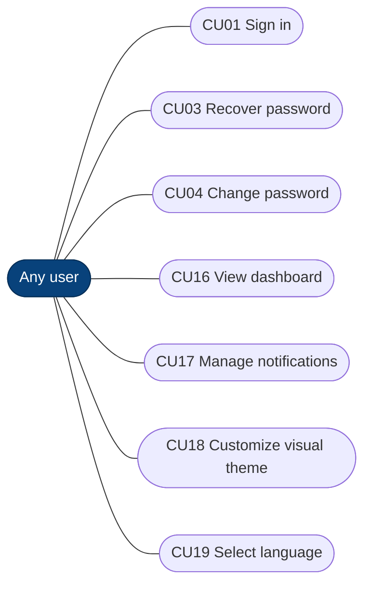

**Customer use cases**

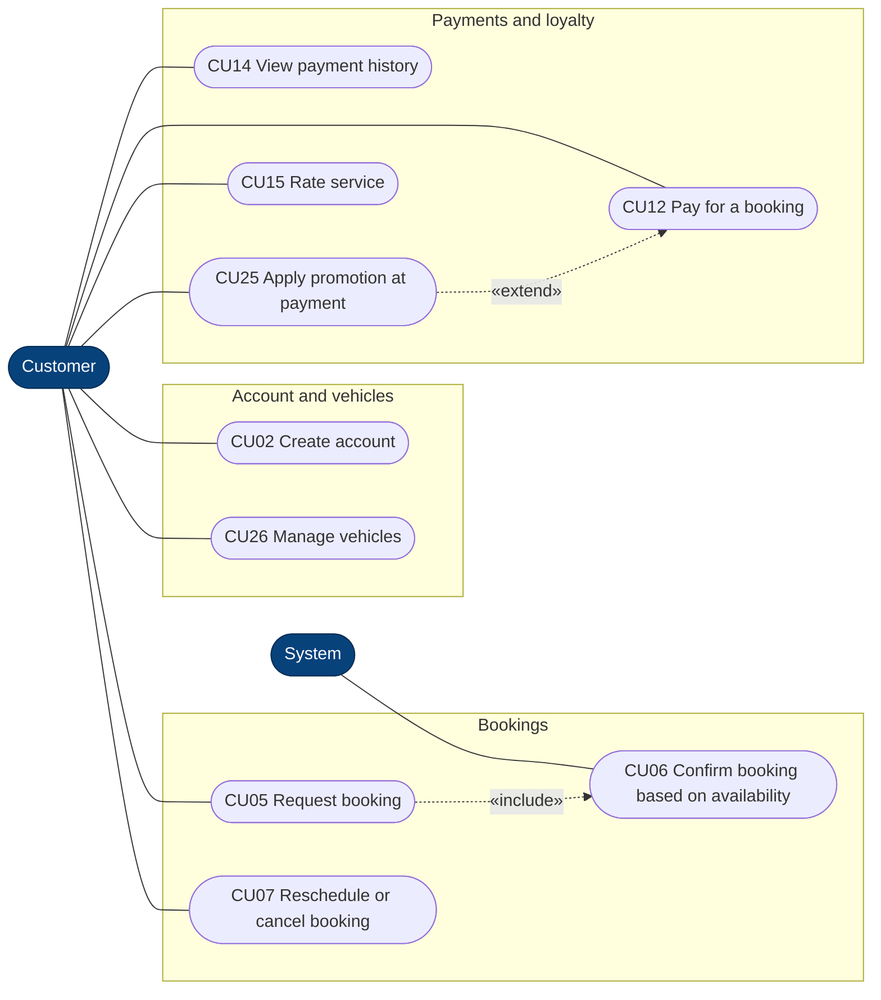

**Operator use cases**

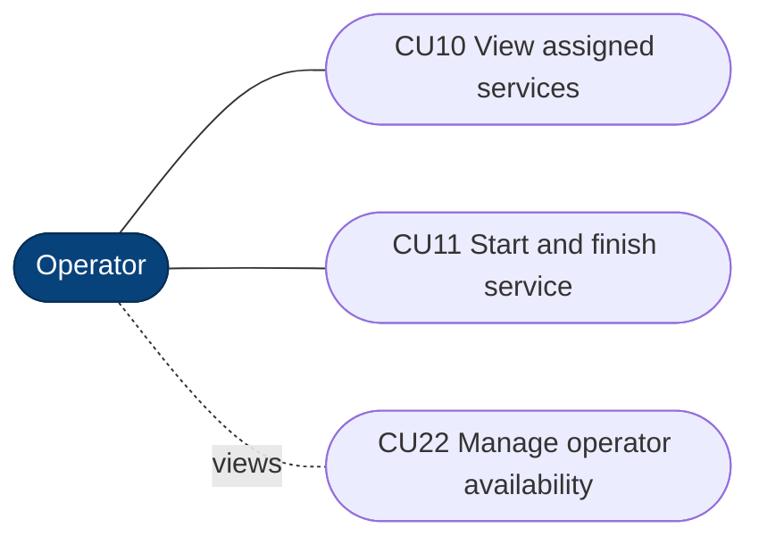

**Administrator and System use cases**

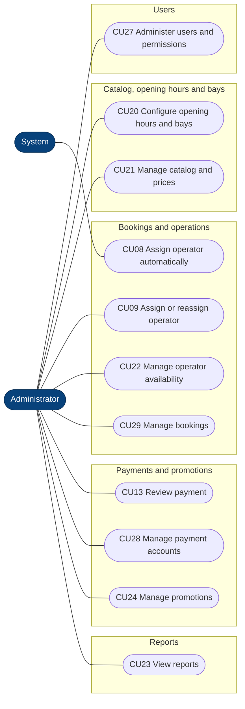

*Note.* `«include»` means that CU05 always runs CU06; `«extend»` means that CU25 optionally extends CU12. CU22 appears as view-only for the operator and as management for the administrator, who is the one recording shifts and absences (RF-022).

### 1.2 Actor and Use Case Matrix

| Actor | Use cases |
|---|---|
| All roles | CU01, CU03, CU04, CU16, CU17, CU18, CU19 |
| Customer | CU02, CU05, CU06, CU07, CU12, CU14, CU15, CU25, CU26 |
| Operator | CU10, CU11, CU22 (view only) |
| Administrator | CU09, CU13, CU20, CU21, CU22, CU23, CU24, CU27, CU28, CU29 |
| System | CU06 (included in CU05), CU08 |

The specification of each of the 29 use cases (precondition, main flow, alternative flows, postcondition, status) is in the *Software Requirements Specification*, Tables 23 to 51.

---

## 2. Sequence Diagrams

Each diagram follows the path of the request (screen, gateway, services, database and RabbitMQ) with the class and endpoint names from the code. The first five are based on the diagrams in `vehicle-w-docs/08-uml/diagrams/source/`; the last two cover loyalty and roles and permissions.

### 2.1 Registration and welcome (RF-001, RF-018)

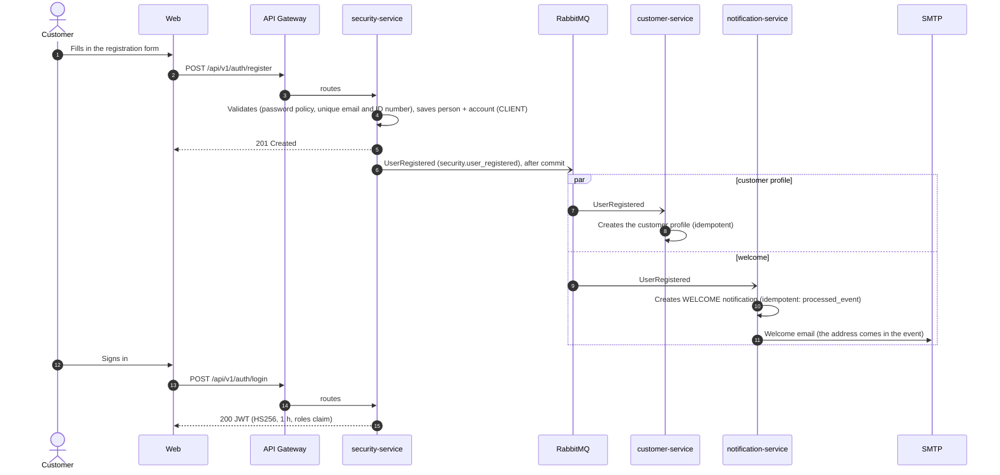

*Source:* `security-service` (`AccountRegistrationService`, `AuthenticationService`), event `security.user_registered`.

### 2.2 Booking a wash (RF-005, RF-006)

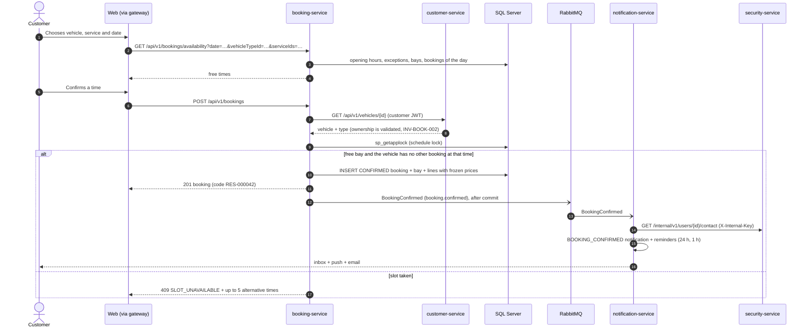

*Source:* `booking-service` (`BookingService.confirmNew`), contract in `07-api/contracts/openapi/booking-service.yaml`.

### 2.3 Booking reminder (ADR-011 §7)

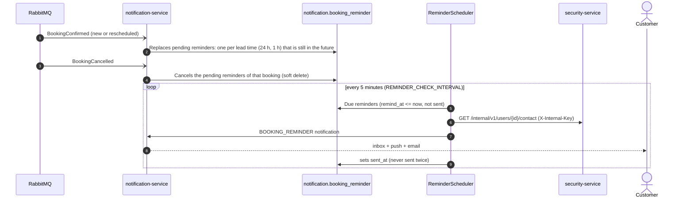

*Source:* `notification-service` (`BookingReminderService`, `ReminderScheduler`).

### 2.4 Operator assignment, execution and rating (RF-009, RF-011, RF-012, RF-012b)

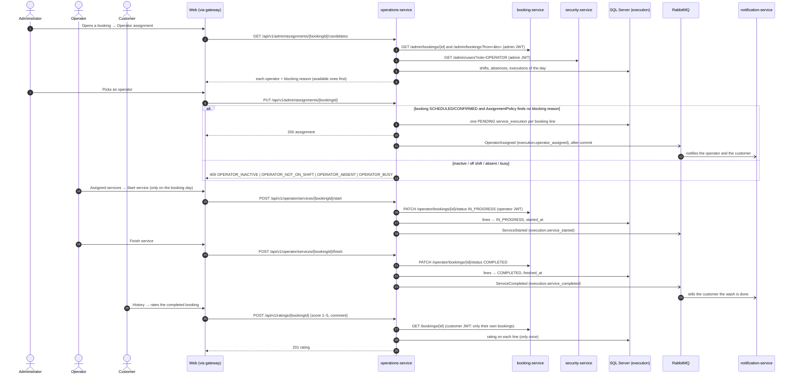

*Source:* `operations-service` (`OperationsService.candidates / assign / start / finish / rate`, `AssignmentPolicy`, ADR-014).

### 2.5 Payment by receipt and review (RF-013, RF-013b, RF-014)

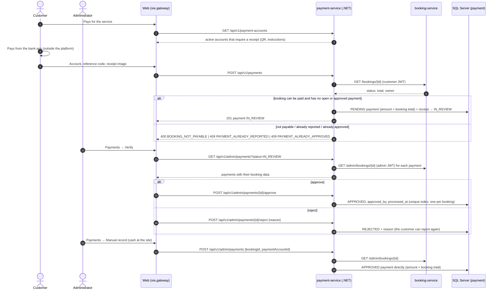

*Source:* `payment-service` (`PaymentApplicationService.ReportPaymentAsync / ApproveAsync / RejectAsync / RegisterManualAsync`, `Payment` aggregate, ADR-008, ADR-013).

### 2.6 Coupon redemption and loyalty points (RF-024, RF-025, RF-026)

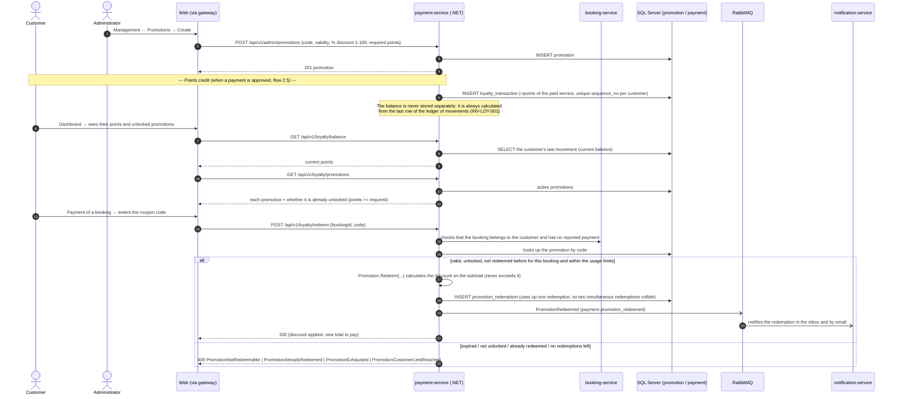

*Source:* `payment-service` (`LoyaltyController`, `CustomerPromotionService.RedeemAsync`, `Promotion.Redeem` aggregate, `LoyaltyLedgerRepository`), ADR-015.

### 2.7 Roles and permissions management (RF-029)

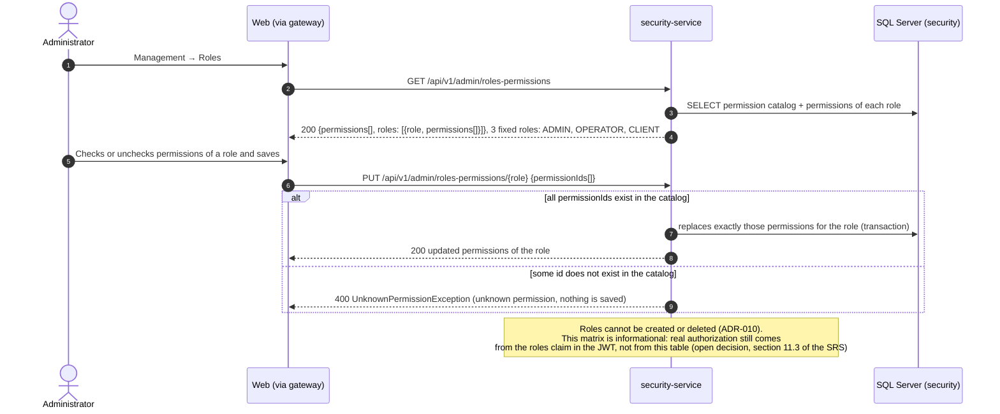

*Source:* `security-service` (`RolePermissionController`, `RolePermissionAdministrationService`, migration `026-security-role-permissions.sql`), ADR-015.

---

## 3. Activity Diagrams

The activity diagrams show the business processes as they work in the system. There is no payment gateway: the customer uploads a receipt and the administrator reviews it (ADR-008).

### 3.1 Authentication (RF-001 to RF-004)

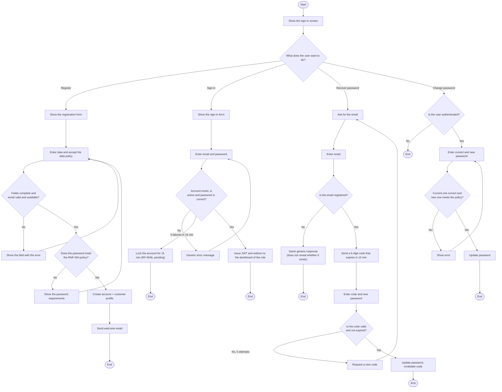

### 3.2 Booking a wash (RF-005, RF-006, RF-007)

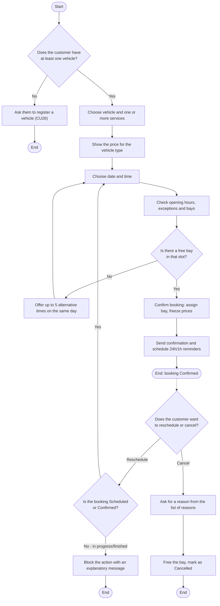

### 3.3 Operator assignment and service execution (RF-008, RF-009, RF-011, RF-012b)

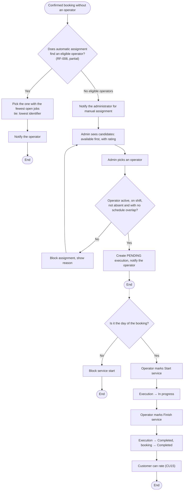

### 3.4 Paying for a booking (RF-013, RF-013b, RF-014, RF-016)

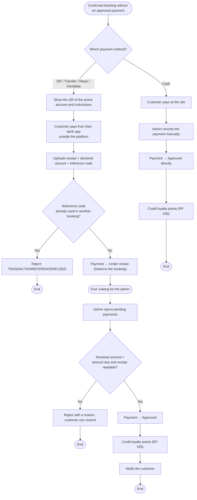

### 3.5 Redeeming a loyalty coupon (RF-024, RF-025, RF-026)

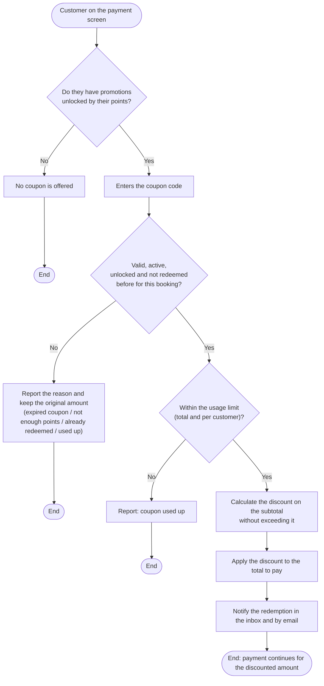

### 3.6 Managing roles and permissions (RF-029)

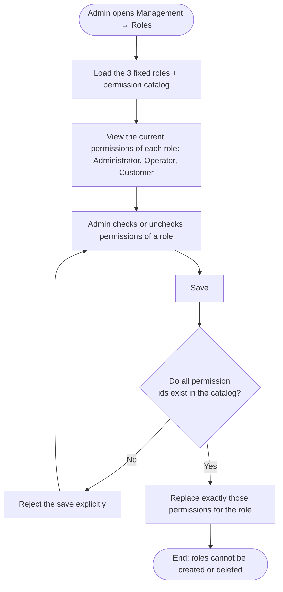

---

## 4. State Diagrams

### 4.1 Booking life cycle (RF-006, RF-007)

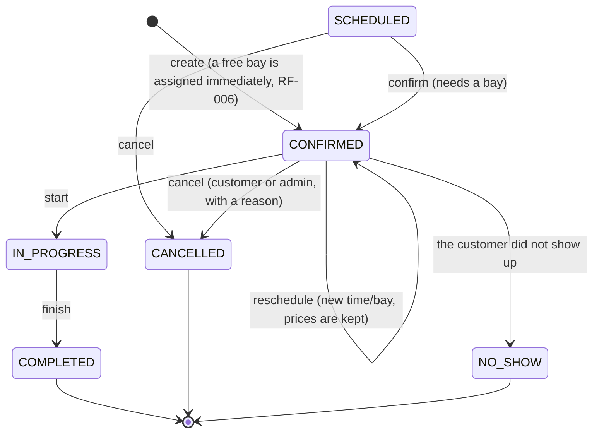

*Source:* `booking-service`, `Booking.moveTo`, `Booking.cancel`, `BookingStatus`. Only `SCHEDULED` and `CONFIRMED` can be rescheduled or cancelled (RF-007); `SCHEDULED` exists in the model, but the current flow always creates the booking directly as `CONFIRMED`.

### 4.2 Payment life cycle (RF-013b, RF-014, ADR-008)

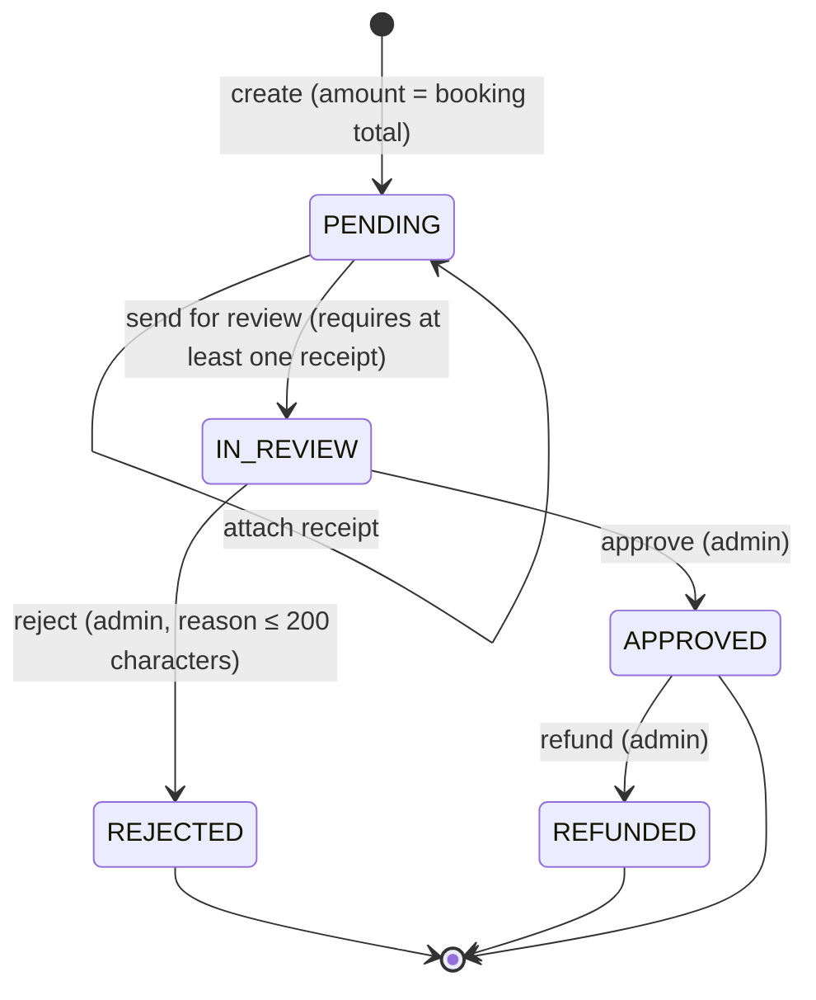

*Source:* `payment-service`, `Payment` aggregate. A booking allows only one approved payment and only one open payment at a time; after `REJECTED` the customer can report a new payment.

### 4.3 Service execution life cycle (RF-012b)

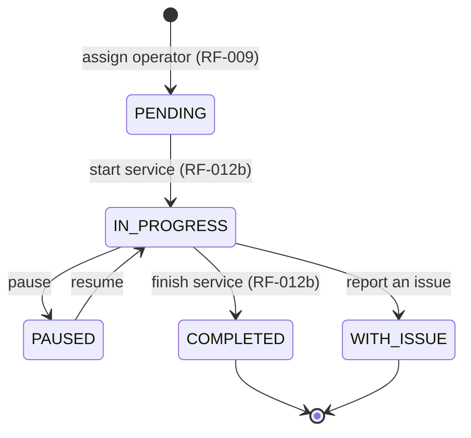

*Source:* `operations-service`. `COMPLETED` enables the customer's rating (RF-012).

### 4.4 Promotion life cycle (RF-024)

```mermaid
stateDiagram-v2
    [*] --> ACTIVE : create (code, validity, % discount, required points)
    ACTIVE --> INACTIVE : deactivate (admin)
    INACTIVE --> ACTIVE : reactivate (admin)
    ACTIVE --> EXPIRED : current date > end date
    INACTIVE --> EXPIRED : current date > end date
    EXPIRED --> [*]
    ACTIVE --> [*] : delete
    INACTIVE --> [*] : delete
```

*Source:* `payment-service`, `Promotion.IsAvailableOn` (active and within the validity period). An `INACTIVE` or `EXPIRED` promotion cannot be redeemed (RF-024, RN-PROMO-01).

---

## 5. Screen Inventory (mockup)

Screen by screen and by role, including the create and edit modals of each module. All screenshots are in the `assets/` folder of this document.

### 5.1 Common screens (no session)

| Screen | Evidence |
|---|---|
| Sign-in |  |
| Registration |  |
| Password recovery |  |

### 5.2 Administrator role

| Screen | Evidence |
|---|---|
| Dashboard |  |
| Management → Users |  |
| Modal: Create user |  |
| Management → Roles |  |
| Modal: Edit role permissions |  |
| Management → Services (catalog) |  |
| Modal: Add service |  |
| Management → Promotions |  |
| Modal: Create promotion |  |
| Opening hours and bays |  |
| Modal: Add opening-hours exception |  |
| Operators |  |
| Modal: New operator |  |
| Modal: Assign shift |  |
| Bookings |  |
| Modal: Assign an operator to a booking |  |
| Payments |  |
| Modal: Record manual payment |  |
| Reports |  |
| Settings → Payment accounts |  |
| Modal: Add payment account |  |
| Notifications |  |
| Profile |  |

### 5.3 Customer role

| Screen | Evidence |
|---|---|
| Dashboard |  |
| Modal: View details of the next service |  |
| My vehicles |  |
| Modal: Register vehicle |  |
| Book a wash |  |
| Booking history |  |
| Pay for a service |  |
| Modal: Confirm booking cancellation |  |
| Notifications |  |
| Settings (theme and language) |  |

### 5.4 Operator role

| Screen | Evidence |
|---|---|
| Main dashboard |  |
| Assigned services |  |
| My schedule (availability) |  |
| Service history |  |
| Ratings received |  |

---

## Correlation with the Software Requirements Specification

| Dynamic view in this document | Requirements it illustrates |
|---|---|
| §2.1 Registration and welcome | RF-001, RF-018 |
| §2.2 Booking a wash | RF-005, RF-006 |
| §2.3 Booking reminder | RF-018 |
| §2.4 Assignment and execution | RF-008, RF-009, RF-011, RF-012, RF-012b |
| §2.5 Payment by receipt | RF-013, RF-013b, RF-014, RF-016 |
| §2.6 Coupon redemption and points | RF-024, RF-025, RF-026 |
| §2.7 Roles and permissions | RF-029 |
| §3.1 to §3.6 Activities | The whole authentication, booking, operations, payment and promotion module |
| §4.1 to §4.4 States | RF-006, RF-007, RF-012b, RF-013b, RF-014, RF-024 |
