# Análisis del Software: Vistas Dinámicas del Sistema LavaRápido

Juan Camilo Guilombo Osorio, Brayan Estiven Patiño Cabrera y Merari Urbano Quintero

Centro de la Industria, la Empresa y los Servicios, Servicio Nacional de Aprendizaje (SENA), Regional Huila

Tecnólogo en Análisis y Desarrollo de Software (ADSO), ficha 3145556

Instructora: Karol Daniela Correa

Versión 2.4, 21 de octubre de 2026

---

## Introducción

Este documento muestra cómo se comporta LavaRápido cuando alguien lo usa: qué pasa, en qué orden y entre qué pantallas y servicios. Está organizado en cuatro partes:

1. **Casos de uso por actor**, con sus relaciones `«include»`/`«extend»`.
2. **Diagramas de secuencia** de los flujos principales: de la pantalla al gateway, del gateway al servicio, del servicio a la base de datos o a otro servicio.
3. **Diagramas de actividades** de los procesos de negocio.
4. **Diagramas de estados** de las entidades que cambian de estado (reserva, pago, ejecución del servicio, promoción e informe de inspección).

El 21 de octubre de 2026 se actualizaron, contra el código de ese día, el cierre de sesión que deja sin efecto el token (sección 2.8), el candado de la asignación de operarios (sección 2.4), el comprobante de máximo 2 MB y el efectivo que solo aparece si su cuenta está activa (secciones 2.5 y 3.4), y el cierre automático de las reservas que nadie inició (sección 4.1). El 20 de octubre de 2026 el contenido se revisó otra vez contra el código: el cliente solo cancela (la reprogramación la hace el administrador), se quitó el cambio de rol de las cuentas, se corrigieron las secuencias y los estados que no coincidían, y los casos de uso y diagramas se dibujaron de nuevo con líneas rectas y sin cruces. El 19 de octubre de 2026 se agregaron los casos de uso CU31 y CU32, la recuperación de la contraseña (sección 2.10) y el ciclo de vida de la cuenta (sección 4.6), y las capturas del inventario de pantallas se tomaron de nuevo con datos de demostración. El 17 de octubre de 2026 se agregaron el consentimiento de los documentos legales en el registro (sección 2.1) y el informe de inspección desde la aplicación móvil (sección 2.9). Los diagramas están hechos en Mermaid. Se revisaron contra el código y el sistema en ejecución el 9 de octubre de 2026, y se actualizaron contra el código el 15 de octubre de 2026 con el bloqueo de cuenta, la asignación automática, la elección de operario, la ventana de inicio del servicio, la alerta de reserva sin operario y el informe de inspección. Al final está el inventario de pantallas, con capturas por rol.

La especificación completa de cada requisito y caso de uso (actores, precondición, flujo normal, flujos alternos y postcondición) está en el *Informe de especificación de requisitos*, secciones 5 y 7.3; aquí se citan por su identificador (RF-XXX, CUXX).

---

## 1. Casos de Uso por Actor

### 1.1 Diagrama de Casos de Uso

Los 32 casos de uso se presentan en cuatro diagramas, uno por actor, agrupados por módulo.

**Casos de uso comunes a los tres roles**

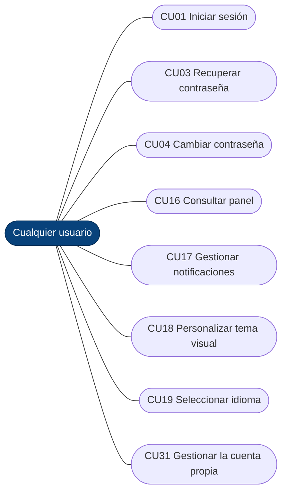

**Casos de uso del Cliente**

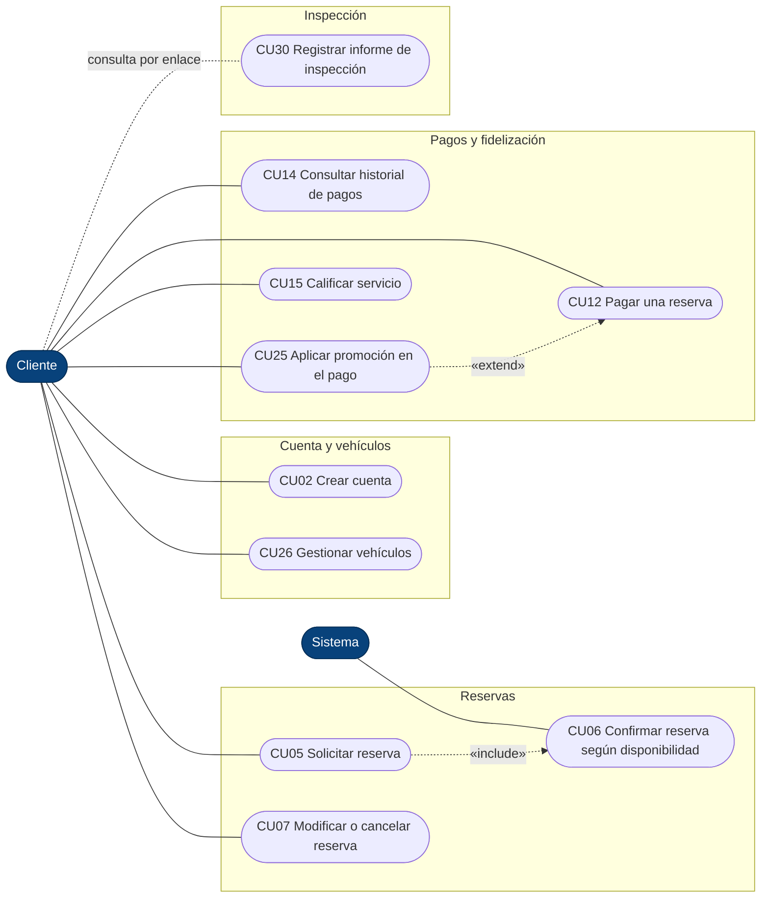

**Casos de uso del Operario**

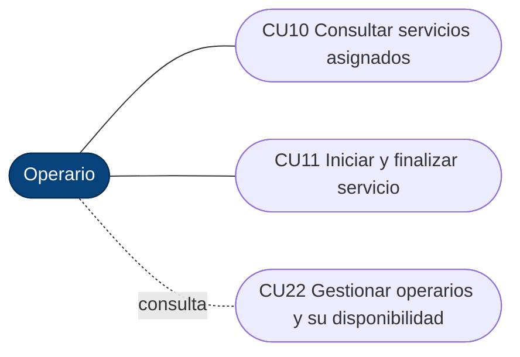

**Casos de uso del Administrador y del Sistema**

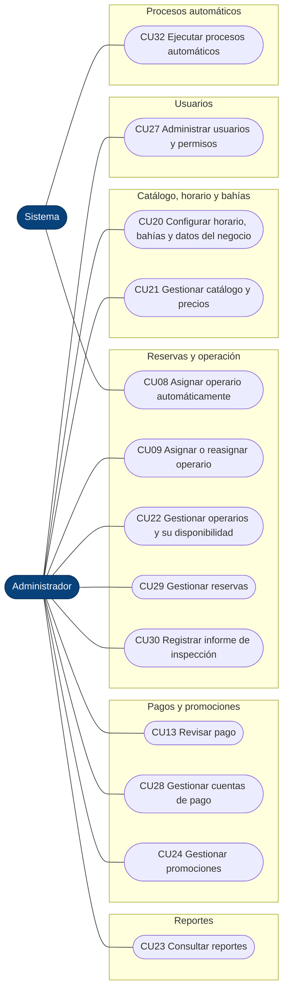

*Nota.* `«include»` indica que CU05 siempre ejecuta CU06; `«extend»` indica que CU25 amplía opcionalmente CU12. CU22 aparece como consulta para el operario y como gestión para el administrador, que es quien registra los turnos, las ausencias y la ficha del operario (RF-022, RF-038). El sistema ejecuta CU08 cada vez que se confirma una reserva, y CU32 agrupa los procesos que corren sin que nadie los pida (recordatorios, alertas, avisos y primer administrador). El cliente no registra el informe de inspección (CU30): lo consulta por el enlace que le comparte el administrador. En CU07 el cliente cancela desde el historial o la pantalla de pago; la nueva fecha u hora la fija el administrador desde Reservas (CU29), porque ni la web ni la app tienen una pantalla de reprogramación para el cliente. En CU27 el rol se elige al crear la cuenta; la lista de usuarios no lo cambia.

### 1.2 Matriz de Actores y Casos de Uso

| Actor | Casos de uso |
|---|---|
| Todos los roles | CU01, CU03, CU04, CU16, CU17, CU18, CU19, CU31 |
| Cliente | CU02, CU05, CU06, CU07, CU12, CU14, CU15, CU25, CU26, CU30 (consulta) |
| Operario | CU10, CU11, CU22 (consulta) |
| Administrador | CU09, CU13, CU20, CU21, CU22, CU23, CU24, CU27, CU28, CU29, CU30 |
| Sistema | CU06 (incluido en CU05), CU08, CU32 |

La especificación de cada uno de los 32 casos de uso (precondición, flujo normal, flujos alternos, postcondición, estado) está en el *Informe de especificación de requisitos*, Tablas 23 a 54.

---

## 2. Diagramas de Secuencia

Cada diagrama sigue el recorrido de la petición (pantalla, gateway, servicios, base de datos y RabbitMQ) con los nombres de clases y endpoints del código. Los cinco primeros parten de los diagramas de `vehicle-w-docs/08-uml/diagrams/source/`; los siguientes cubren la fidelización, los roles y permisos, el bloqueo de cuenta y el informe de inspección.

### 2.1 Registro y bienvenida (RF-001, RF-018)

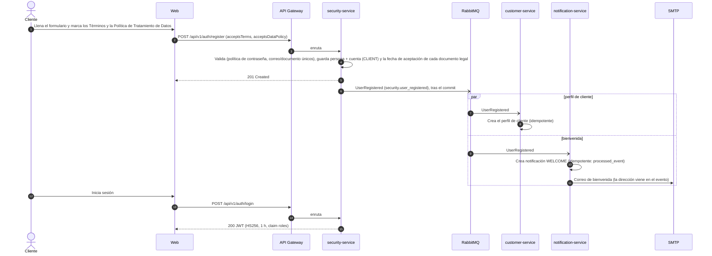

*Fuente:* `security-service` (`AccountRegistrationService`, `AuthenticationService`, migración `039-security-app-user-legal-consent.sql`), evento `security.user_registered`. La web y la app móvil no envían el formulario hasta que ambas casillas están marcadas; el servidor guarda las fechas solo si las dos llegan aceptadas.

### 2.2 Reservar un lavado (RF-005, RF-006, RF-010)

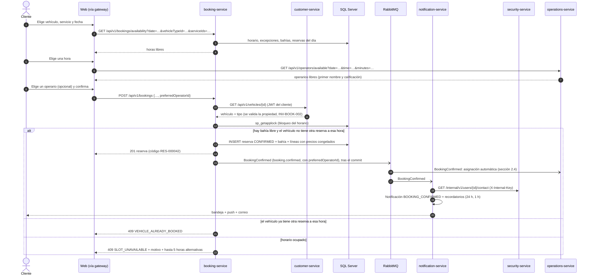

*Fuente:* `booking-service` (`BookingService.create`, `Booking.confirmNew`, `AvailabilityPolicy`), `operations-service` (`AvailableOperatorsController`), contratos en `07-api/contracts/openapi/`.

### 2.3 Recordatorios y alerta de reserva sin operario (ADR-011)

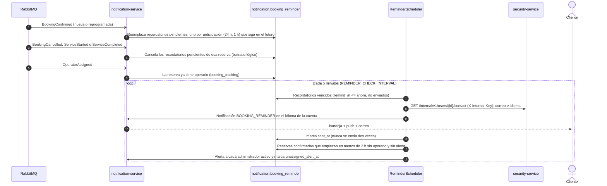

*Fuente:* `notification-service` (`BookingReminderService`, `ReminderScheduler`, `StaffNotificationService`, migración 031).

### 2.4 Asignación de operario, ejecución y calificación (RF-008, RF-009, RF-010, RF-011, RF-012, RF-012b)

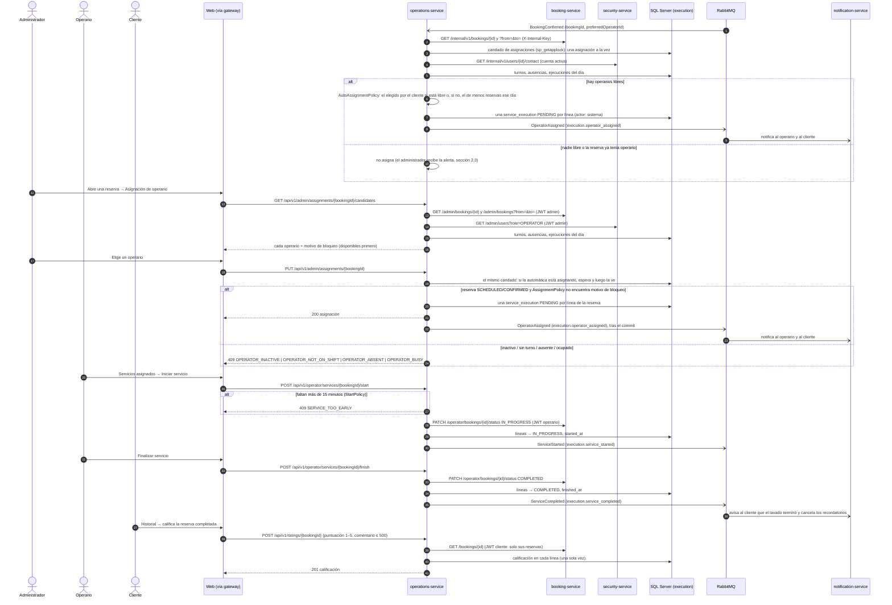

*Fuente:* `operations-service` (`BookingConfirmedListener`, `OperationsService.autoAssign / candidates / assign / start / finish / rate`, `ExecutionPersistenceAdapter.lockAssignments`, `AssignmentPolicy`, `AutoAssignmentPolicy`, `StartPolicy`, ADR-014). El candado evita que una asignación manual y una automática simultáneas le den al mismo operario dos servicios a la misma hora.

### 2.5 Pago por comprobante y revisión (RF-013, RF-013b, RF-014)

```mermaid
sequenceDiagram
    autonumber
    actor C as Cliente
    actor A as Administrador
    participant W as Web (vía gateway)
    participant P as payment-service (.NET)
    participant B as booking-service
    participant DB as SQL Server (payment)

    C->>W: Paga el servicio
    W->>P: GET /api/v1/payment-accounts
    P-->>W: cuentas activas (QR e instrucciones; la de efectivo solo si está activa)
    C->>C: Paga desde la app del banco (fuera de la plataforma)
    C->>W: Cuenta, código de referencia, imagen del comprobante
    W->>W: comprime la imagen a máximo 2 MB
    W->>P: POST /api/v1/payments
    P->>B: GET /bookings/{id} (JWT cliente)
    B-->>P: estado, total, dueño
    alt reserva pagable, sin pago abierto/aprobado y referencia no usada en otra reserva
        P->>DB: pago PENDING (monto = total de la reserva menos<br/>los cupones aplicados) + comprobante → IN_REVIEW
        P-->>W: 201 pago IN_REVIEW
    else no pagable / ya reportado / ya aprobado / referencia repetida
        P-->>W: 409 BOOKING_NOT_PAYABLE | PAYMENT_ALREADY_REPORTED | PAYMENT_ALREADY_APPROVED | TRANSACTION_REFERENCE_REUSED
    else comprobante de más de 2 MB
        P-->>W: 400 RECEIPT_TOO_LARGE
    end

    A->>W: Pagos → Verificar
    W->>P: GET /api/v1/admin/payments?status=IN_REVIEW
    P->>B: GET /admin/bookings/{id} (JWT admin) por cada pago
    P-->>W: pagos con los datos de su reserva
    alt aprobar
        W->>P: POST /api/v1/admin/payments/{id}/approve
        P->>DB: APPROVED, approved_by, processed_at (índice único: uno por reserva)
        P->>DB: loyalty_transaction EARNED (puntos de las líneas de la reserva)
        P-)P: payment.confirmed y payment.loyalty_points_earned a RabbitMQ
    else rechazar
        W->>P: POST /api/v1/admin/payments/{id}/reject {motivo}
        P->>DB: REJECTED + motivo (el cliente puede reportar de nuevo)
        P-)P: payment.rejected a RabbitMQ
    end

    A->>W: Pagos → Registro manual (efectivo en el local)
    W->>P: POST /api/v1/admin/payments {bookingId, paymentAccountId}
    P->>B: GET /admin/bookings/{id}
    P->>DB: pago APPROVED directamente (monto = valor pendiente) + puntos EARNED
    A->>W: Pagos → Reembolsar un pago aprobado
    W->>P: POST /api/v1/admin/payments/{id}/refund
    P->>DB: REFUNDED + loyalty_transaction REVERSED
```

*Fuente:* `payment-service` (`PaymentCommandService.ReportAsync / ApproveAsync / RejectAsync / RegisterInPersonAsync / RefundAsync`, `BookingPaymentGuard`, `LoyaltyRewardService`, agregado `Payment`, ADR-008, ADR-013). notification-service convierte cada evento `payment.*` en un aviso para el cliente.

### 2.6 Canje de cupón y puntos de fidelización (RF-024, RF-025, RF-026)

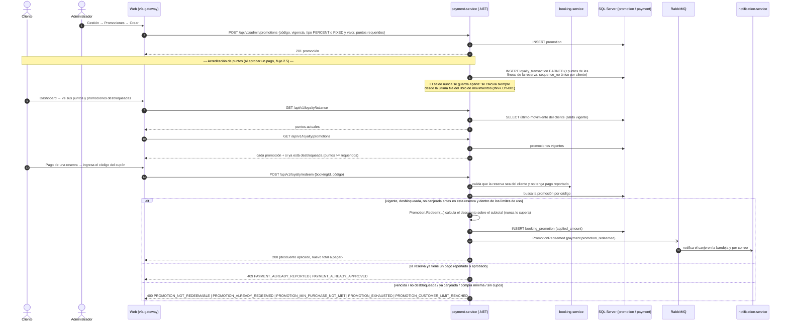

*Fuente:* `payment-service` (`LoyaltyController`, `CustomerPromotionService.RedeemAsync`, agregado `Promotion.Redeem`, `LoyaltyLedgerRepository`), ADR-015.

### 2.7 Gestión de roles y permisos (RF-029)

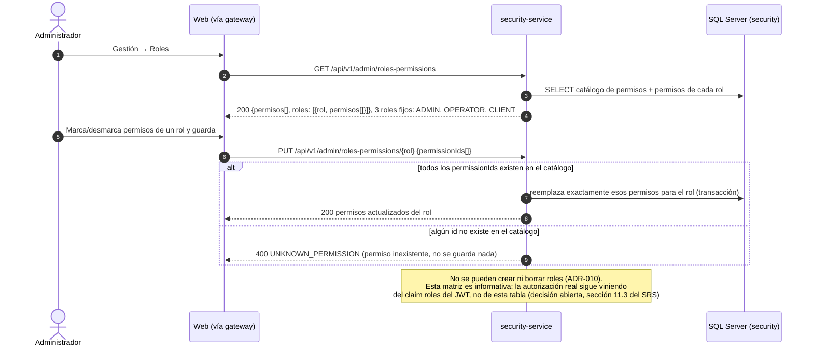

*Fuente:* `security-service` (`RolePermissionController`, `RolePermissionAdministrationService`, migración `026-security-role-permissions.sql`), ADR-015.

### 2.8 Inicio de sesión con bloqueo por intentos fallidos y cierre de sesión (RF-002, RF-004b, RF-027)

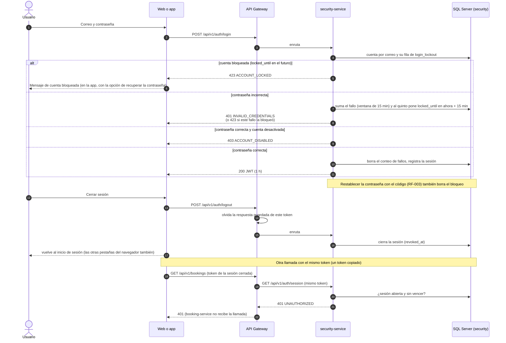

*Fuente:* `security-service` (`AuthenticationService.login / logout / isActive`, `ActiveSessionValidator`, `LoginLockout`, `PasswordRecoveryService`, migración `034-security-login-lockout.sql`) y gateway (`SessionCheckFilter`). El gateway guarda 30 segundos por token la respuesta de `/api/v1/auth/session`, así que una sesión abierta cuesta una llamada extra cada medio minuto y no una por petición. Una sesión también se cierra cuando el administrador desactiva la cuenta o el dueño la cierra; eso llega a los demás servicios en esos mismos 30 segundos.

### 2.9 Informe de inspección del vehículo (RF-036)

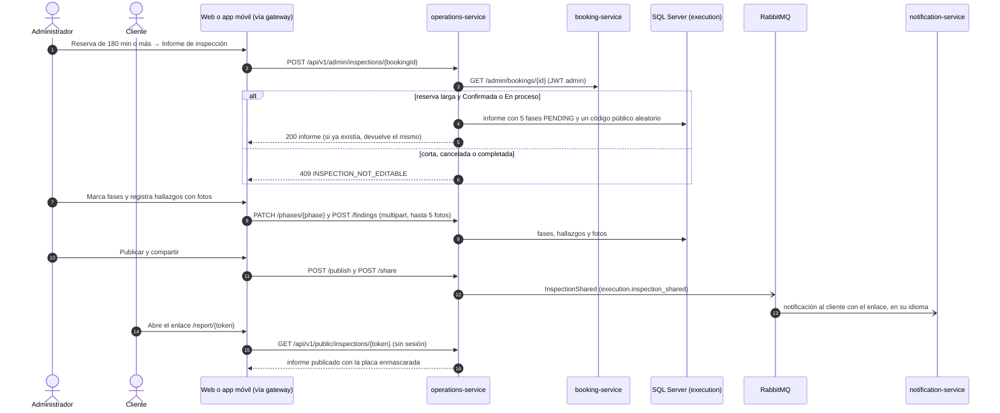

*Fuente:* `operations-service` (`InspectionReport`, migración `033-execution-inspection-report.sql`), `notification-service` (aviso del informe compartido), web (`features/admin/pages/inspection`) y app móvil (`AdminInspectionScreen`, `InspectionService`). En la app las fotos se toman con la cámara o se eligen de la galería y se reducen en el celular antes del `POST /findings`; el botón **Publicar y compartir enlace** abre el menú de compartir del teléfono.

### 2.10 Recuperación de la contraseña con un código de 6 dígitos (RF-003)

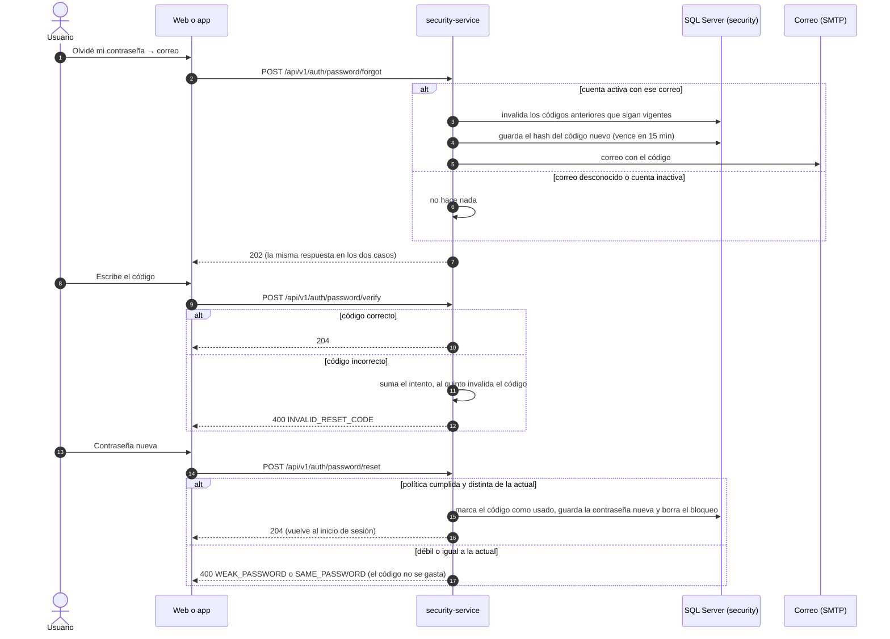

*Fuente:* `security-service` (`PasswordRecoveryService`, `PasswordResetToken`, `PasswordRecoveryPolicy` con `code-ttl: 15m` y `max-failed-attempts: 5`, `SecureRandomResetCodeGenerator`, `EmailResetCodeNotifier`). La respuesta de *forgot* no revela si el correo existe.

---

## 3. Diagramas de Actividades

Los diagramas de actividades muestran los procesos de negocio tal como funcionan en el sistema. En los pagos no hay pasarela: el cliente sube un comprobante y el administrador lo revisa (ADR-008).

### 3.1 Autenticación (RF-001 a RF-004)

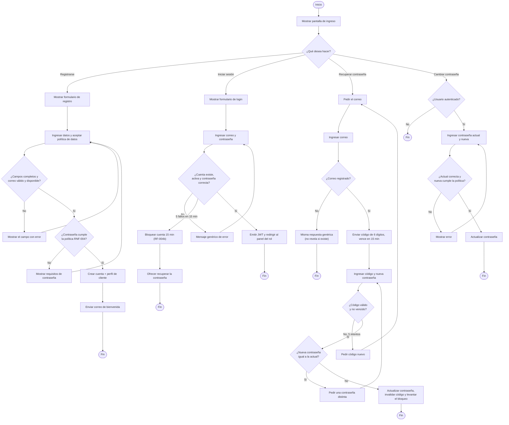

### 3.2 Reservar un lavado (RF-005, RF-006, RF-007, RF-010)

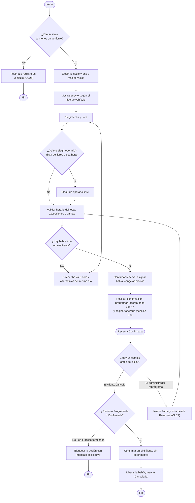

### 3.3 Asignación de operario y ejecución del servicio (RF-008, RF-009, RF-010, RF-011, RF-012b)

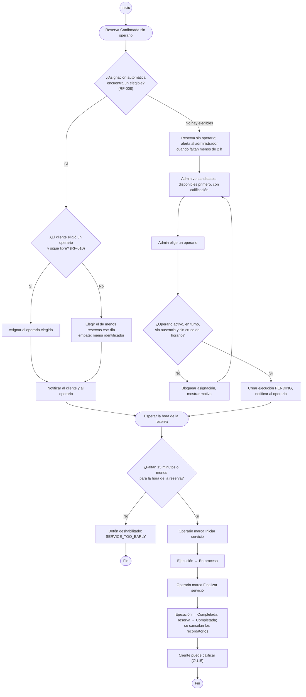

### 3.4 Pagar una reserva (RF-013, RF-013b, RF-014, RF-016)

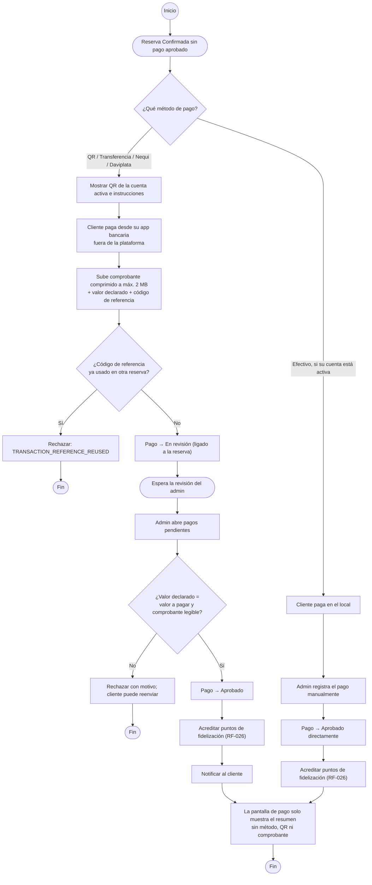

### 3.5 Canjear un cupón de fidelización (RF-024, RF-025, RF-026)

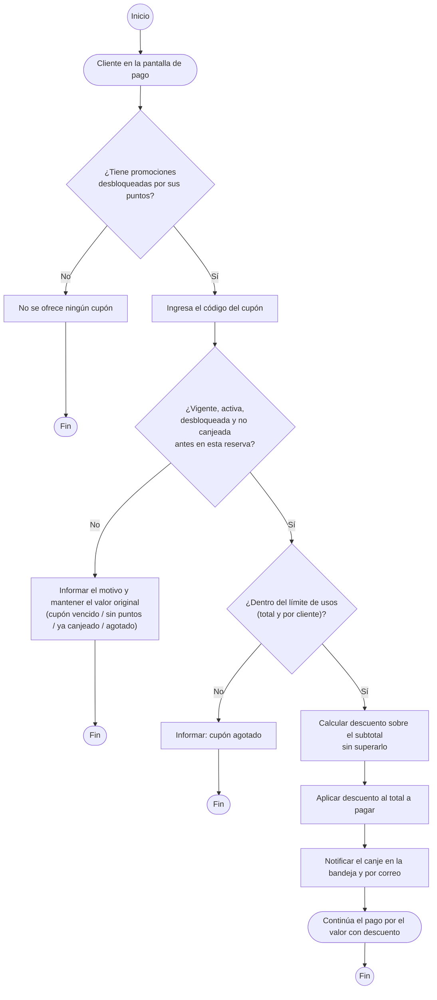

### 3.6 Gestionar roles y permisos (RF-029)

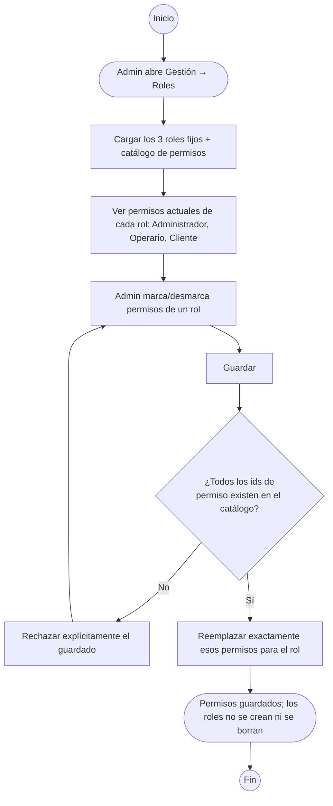

---

## 4. Diagramas de Estados

### 4.1 Ciclo de vida de la reserva (RF-006, RF-007)

```mermaid
stateDiagram-v2
    [*] --> CONFIRMED : crear (se asigna bahía libre de inmediato, RF-006)
    SCHEDULED --> CONFIRMED : confirmar (necesita bahía)
    SCHEDULED --> CANCELLED : cancelar o vencida
    CONFIRMED --> CONFIRMED : reprogramar (admin, nueva hora/bahía, se conservan precios)
    CONFIRMED --> IN_PROGRESS : iniciar
    CONFIRMED --> NO_SHOW : el cliente no llegó o vencida
    CONFIRMED --> CANCELLED : cancelar (cliente antes del inicio o admin)
    IN_PROGRESS --> COMPLETED : finalizar
    COMPLETED --> [*]
    CANCELLED --> [*]
    NO_SHOW --> [*]
```

*Fuente:* `booking-service`, `Booking.moveTo`, `Booking.cancel`, `Booking.expire`, `BookingStatus`, `ExpiredBookingsJob`. *Vencida:* cada 5 minutos una tarea cierra las reservas que siguen `SCHEDULED` o `CONFIRMED` una hora después de su hora de fin; la `CONFIRMED` pasa a `NO_SHOW` (pagada o no, nada se reembolsa solo) y la `SCHEDULED` se cancela con el motivo del sistema `EXPIRED`, que el administrador no puede elegir a mano. Así se liberan el operario y la bahía, y solo las canceladas publican `BookingCancelled`. Solo `SCHEDULED` y `CONFIRMED` se pueden reprogramar o cancelar (RF-007). El cliente solo cancela, antes de la hora de inicio y sin escribir motivo (la reserva guarda `CUSTOMER_REQUEST`); el administrador reprograma (CU29) y puede elegir el motivo de la cancelación. `SCHEDULED` existe en el modelo pero el flujo actual siempre crea la reserva directo en `CONFIRMED`.

### 4.2 Ciclo de vida del pago (RF-013b, RF-014, ADR-008)

```mermaid
stateDiagram-v2
    [*] --> PENDING : crear (monto = total de la reserva menos cupones)
    PENDING --> PENDING : adjuntar comprobante
    PENDING --> IN_REVIEW : enviar a revisión (requiere al menos un comprobante)
    IN_REVIEW --> APPROVED : aprobar (admin)
    IN_REVIEW --> REJECTED : rechazar (admin, motivo ≤ 200 caracteres)
    APPROVED --> REFUNDED : reembolsar (admin)
    REJECTED --> [*]
    REFUNDED --> [*]
    APPROVED --> [*]
```

*Fuente:* `payment-service`, agregado `Payment`. Una reserva admite un solo pago aprobado y un solo pago abierto a la vez; después de `REJECTED` el cliente puede reportar un pago nuevo. El pago del cliente pasa de `PENDING` a `IN_REVIEW` en la misma petición; el pago en efectivo que registra el administrador queda `APPROVED` de una vez.

### 4.3 Ciclo de vida de la ejecución del servicio (RF-012b)

```mermaid
stateDiagram-v2
    [*] --> PENDING : asignar operario (automático o admin, RF-008, RF-009)
    PENDING --> PENDING : reasignar (admin, antes de iniciar)
    PENDING --> IN_PROGRESS : iniciar servicio (desde 15 min antes, RF-012b)
    IN_PROGRESS --> COMPLETED : finalizar servicio (RF-012b)
    COMPLETED --> COMPLETED : calificar 1 a 5 (cliente, una vez)
    COMPLETED --> [*]
```

*Fuente:* `operations-service` (`ServiceExecution`, `StartPolicy`). `COMPLETED` habilita la calificación del cliente (RF-012). `PAUSED` y `WITH_ISSUE` existen en el catálogo `execution.execution_status`, pero ningún caso de uso los usa hoy.

### 4.4 Ciclo de vida de una promoción (RF-024)

```mermaid
stateDiagram-v2
    [*] --> ACTIVA : crear (código, vigencia, descuento, puntos requeridos)
    ACTIVA --> PAUSADA : pausar (admin)
    PAUSADA --> ACTIVA : reanudar (admin)
    ACTIVA --> [*] : eliminar (borrado lógico)
    PAUSADA --> [*] : eliminar (borrado lógico)
```

*Fuente:* `payment-service`, `Promotion.SetActive`, `Promotion.StatusFor`, `Promotion.IsAvailableOn`. Lo único que se guarda es si está activa o pausada; la pantalla del administrador muestra "programada" mientras no llega la fecha de inicio. Solo se puede canjear una promoción activa y dentro de su vigencia (RF-024, RN-PROMO-01): pasada la fecha de fin ya no se ofrece ni se canjea, aunque no tiene un estado "vencida" guardado.

### 4.5 Informe de inspección y sus fases (RF-036)

```mermaid
stateDiagram-v2
    [*] --> BORRADOR : crear (reserva de 180 min o más, Confirmada o En proceso)
    BORRADOR --> BORRADOR : marcar fases y registrar hallazgos
    BORRADOR --> PUBLICADO : publicar (el enlace empieza a mostrarlo)
    PUBLICADO --> PUBLICADO : editar o compartir (notifica al cliente)
    PUBLICADO --> [*] : la reserva se completa (fases y hallazgos de solo lectura)

    state "Cada fase" as fase {
        [*] --> PENDING
        PENDING --> IN_PROGRESS : marcar en curso o registrar un hallazgo
        IN_PROGRESS --> DONE : terminar
        DONE --> IN_PROGRESS : reabrir
        IN_PROGRESS --> PENDING : volver a pendiente
    }
```

*Fuente:* `operations-service`, `InspectionReport` (`publish`, `requirePublished`, `setPhaseStatus`, `addFinding`). Las fases son recepción, exterior, interior, motor y entrega; solo se puede compartir un informe publicado, y se edita mientras la reserva siga Confirmada o En proceso.

### 4.6 Cuenta de usuario (RF-002, RF-004b, RF-027, RF-028)

```mermaid
stateDiagram-v2
    [*] --> ACTIVA : registro (CLIENT) o creada por el administrador
    state ACTIVA {
        [*] --> DESBLOQUEADA
        DESBLOQUEADA --> BLOQUEADA : quinto intento fallido en 15 min
        BLOQUEADA --> DESBLOQUEADA : pasan 15 min o recupera la contraseña
    }
    ACTIVA --> INACTIVA : el administrador la desactiva o el usuario la cierra
    INACTIVA --> ACTIVA : el administrador la activa
```

*Fuente:* `security-service` (`UserAccount`, `LoginLockout`, `UserAdministrationService.changeStatus`, `AccountDeactivationService`). Un ingreso correcto antes del quinto intento borra el conteo de fallos. El usuario cierra su cuenta con la contraseña. Una cuenta bloqueada responde 423 aun con la contraseña correcta; una inactiva responde 403 después de validar la contraseña. Ninguna cuenta de administrador se puede desactivar (403 `ADMIN_CANNOT_BE_DISABLED`) y un administrador no puede desactivar ni cerrar su propia cuenta (403 `CANNOT_DISABLE_OWN_ACCOUNT`). Cada cuenta tiene un solo rol, fijado al crearla: no hay cambio de rol. Al pasar a inactiva se cierran todas sus sesiones y sus tokens dejan de servir en máximo 30 segundos (sección 2.8).

---

## 5. Inventario de Pantallas (mockup)

Pantalla por pantalla y por rol, incluyendo los modales de crear/editar de cada módulo. Todas las capturas están en `capturas/`, en esta misma carpeta. La captura de Gestión → Usuarios se tomó de nuevo el 20 de octubre de 2026: la tabla solo muestra el tipo de usuario y tiene los filtros Habilitados e Inhabilitados. Desde el 20 de octubre, al hacer clic en una notificación o en una reserva del historial se abre su detalle, con un botón para ir al apartado correspondiente (por ejemplo, **Ir al pago**).

### 5.1 Pantallas comunes (sin sesión)

| Pantalla | Evidencia |
|---|---|
| Inicio de sesión | 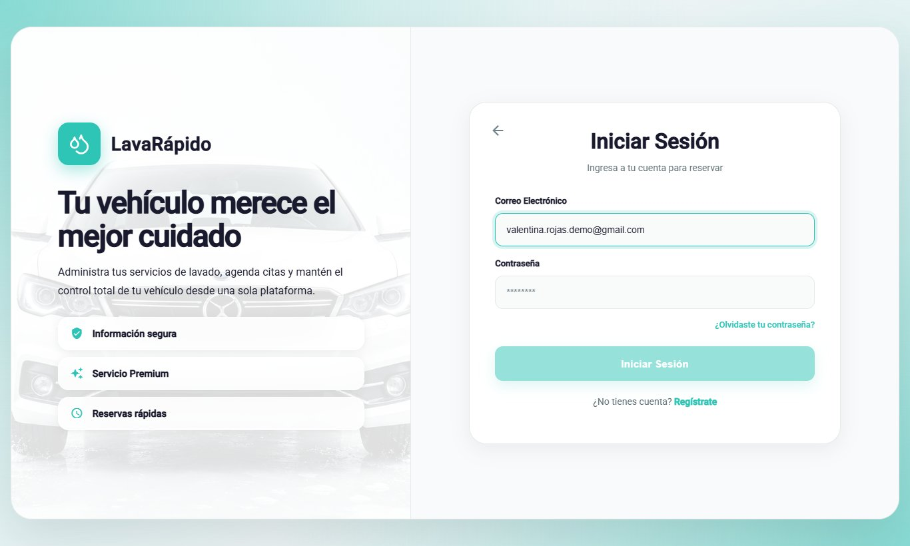 |
| Registro |  |
| Recuperar contraseña |  |

### 5.2 Rol Administrador

| Pantalla | Evidencia |
|---|---|
| Dashboard | 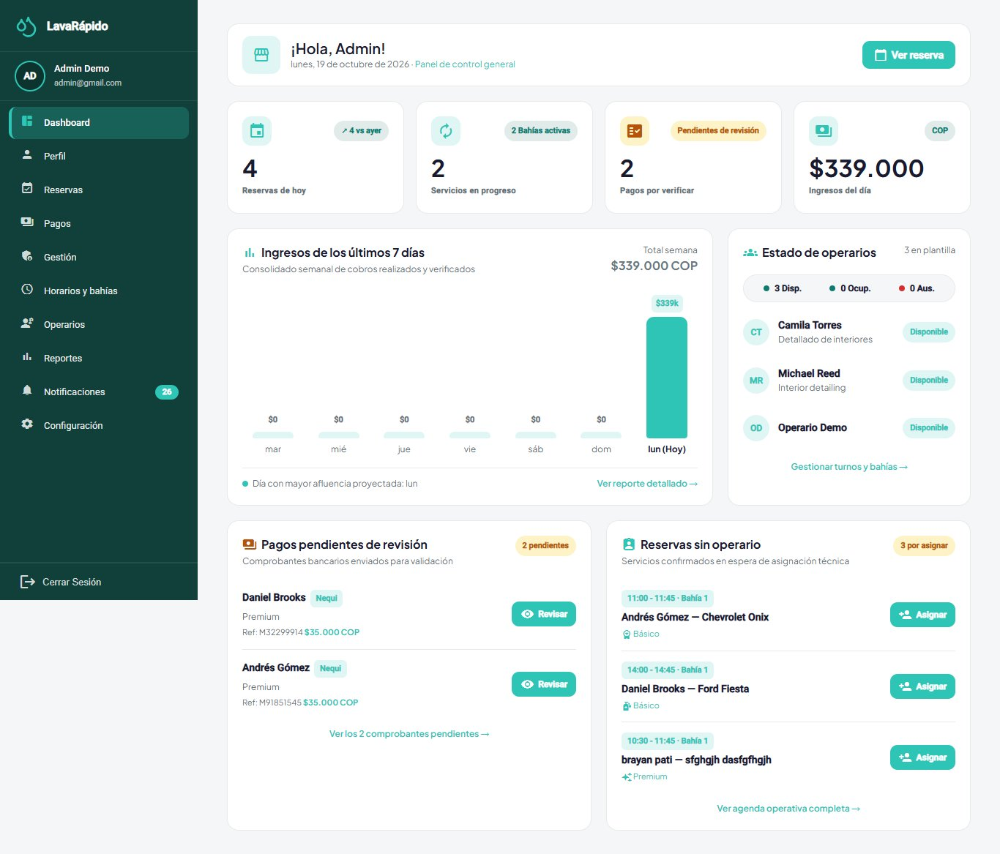 |
| Gestión → Usuarios |  |
| Modal: Crear usuario |  |
| Gestión → Roles |  |
| Modal: Editar permisos del rol |  |
| Gestión → Servicios (catálogo) |  |
| Modal: Agregar servicio | 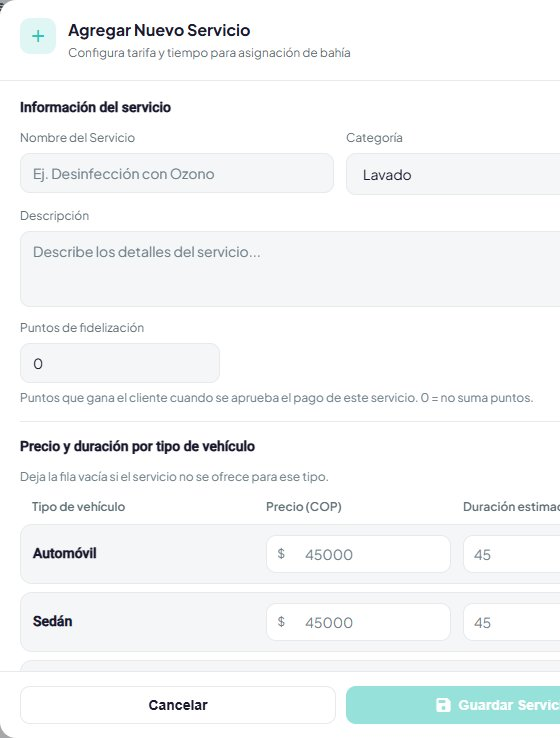 |
| Gestión → Promociones |  |
| Modal: Crear promoción |  |
| Horarios y bahías | 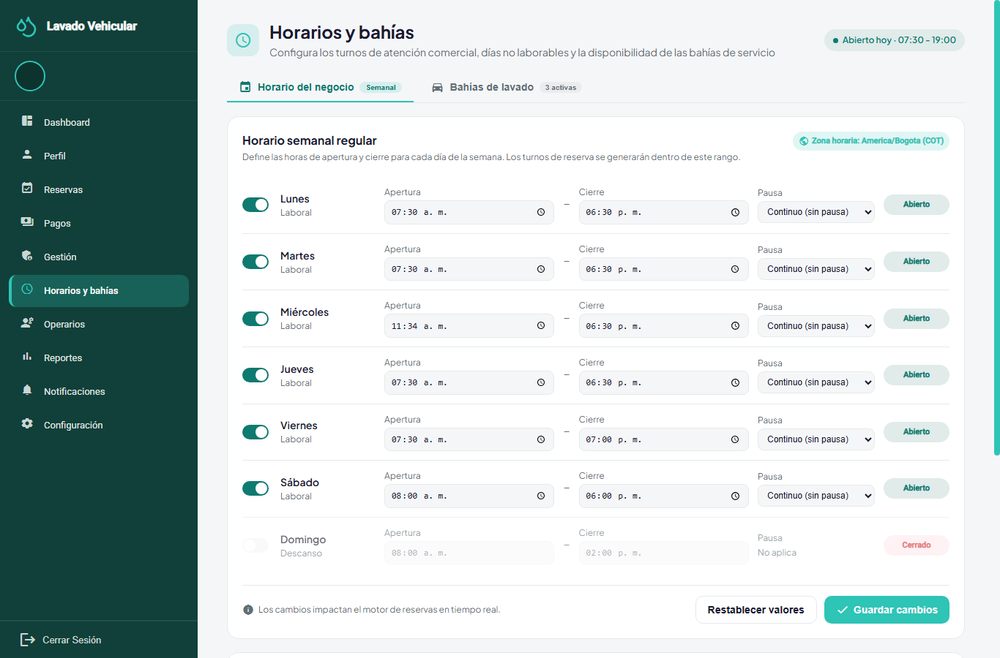 |
| Modal: Agregar excepción de horario |  |
| Operarios |  |
| Modal: Nuevo operario | 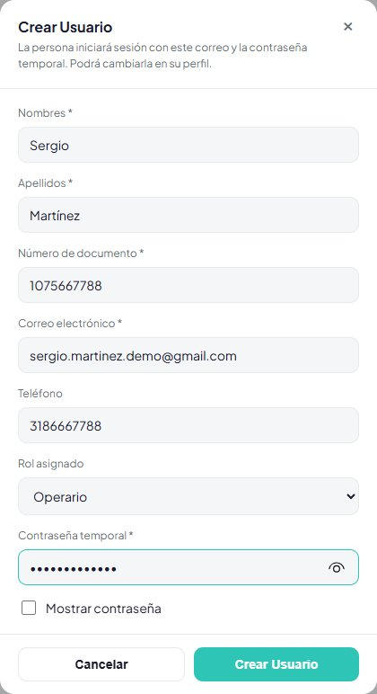 |
| Modal: Asignar turno |  |
| Reservas | 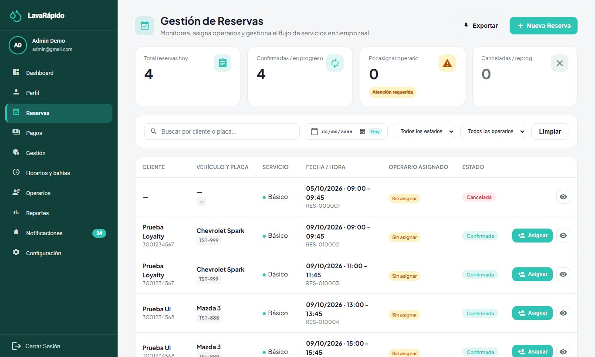 |
| Modal: Asignar operario a una reserva |  |
| Pagos | 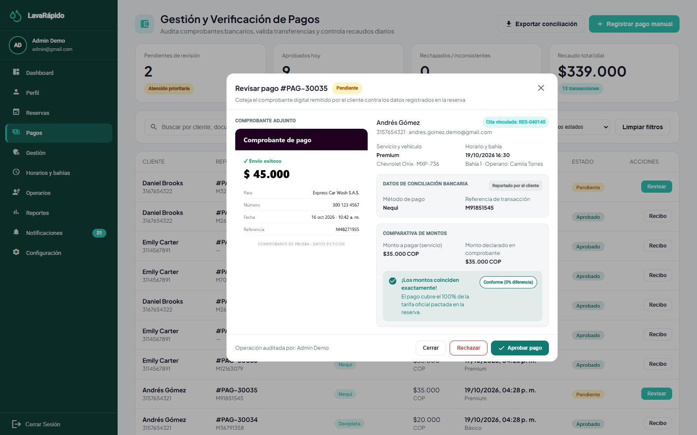 |
| Modal: Registrar pago manual |  |
| Reportes | 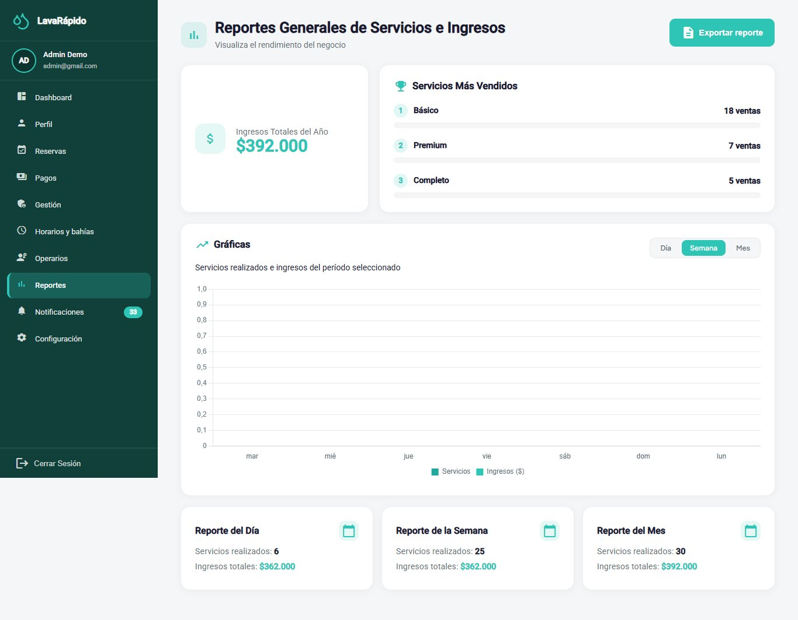 |
| Configuración → Cuentas de pago |  |
| Modal: Agregar cuenta de pago | 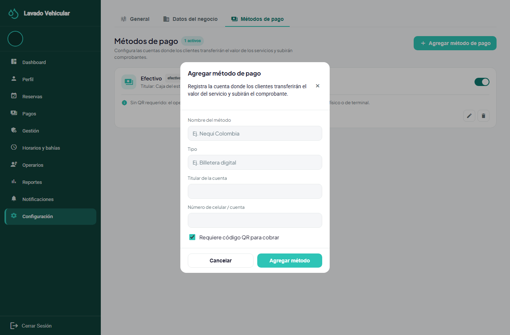 |
| Notificaciones |  |
| Perfil |  |

### 5.3 Rol Cliente

| Pantalla | Evidencia |
|---|---|
| Dashboard | 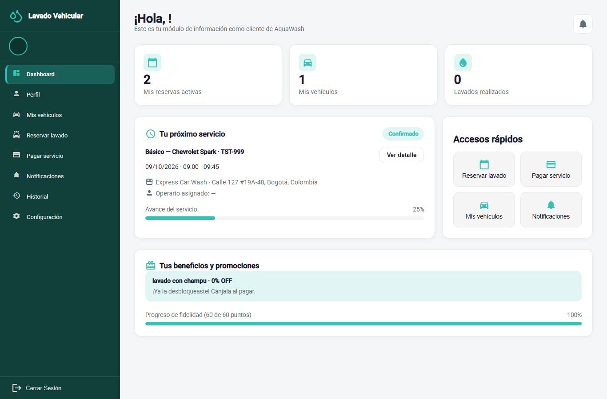 |
| Modal: Ver detalle del próximo servicio |  |
| Mis vehículos | 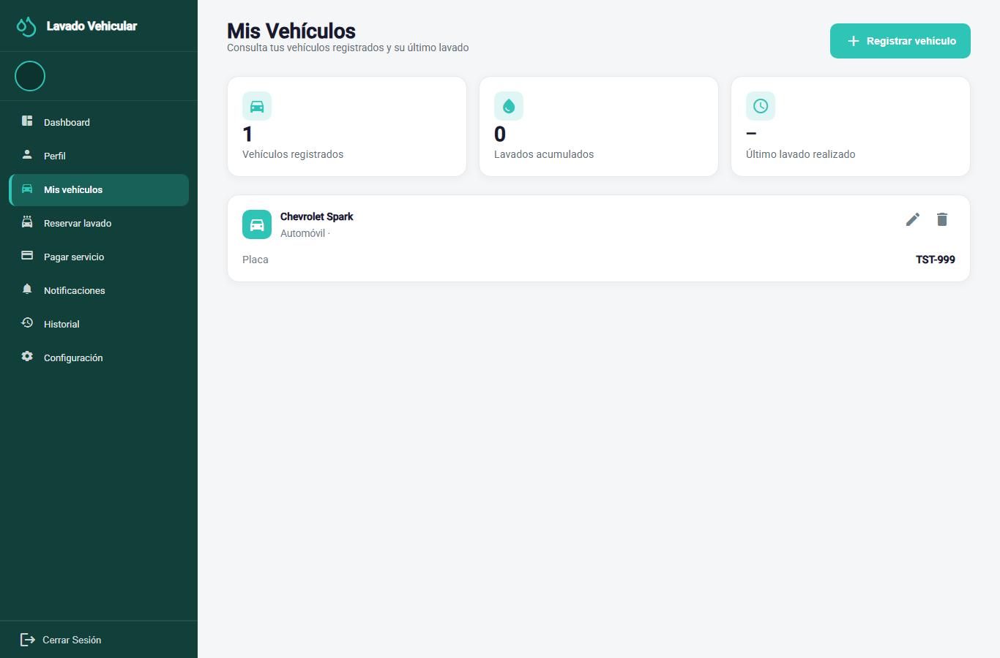 |
| Modal: Registrar vehículo |  |
| Reservar lavado | 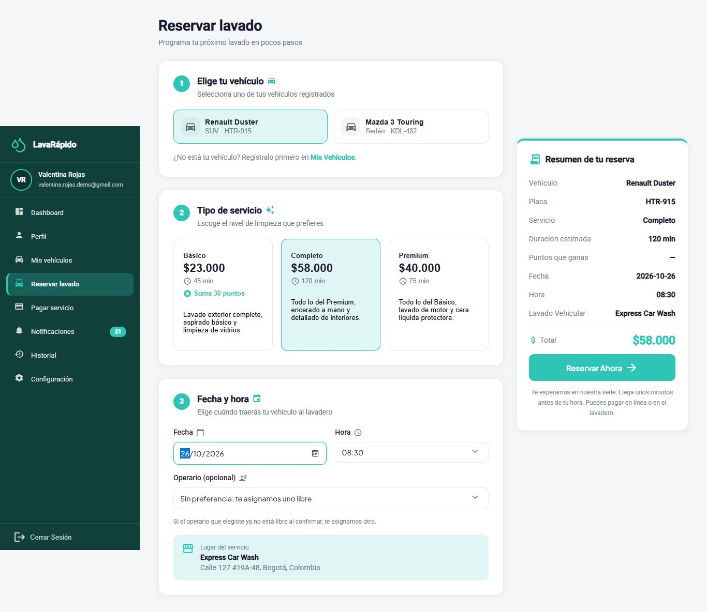 |
| Historial de reservas |  |
| Pagar servicio |  |
| Modal: Confirmar cancelación de reserva |  |
| Notificaciones |  |
| Configuración (tema e idioma) |  |

### 5.4 Rol Operario

| Pantalla | Evidencia |
|---|---|
| Panel principal | 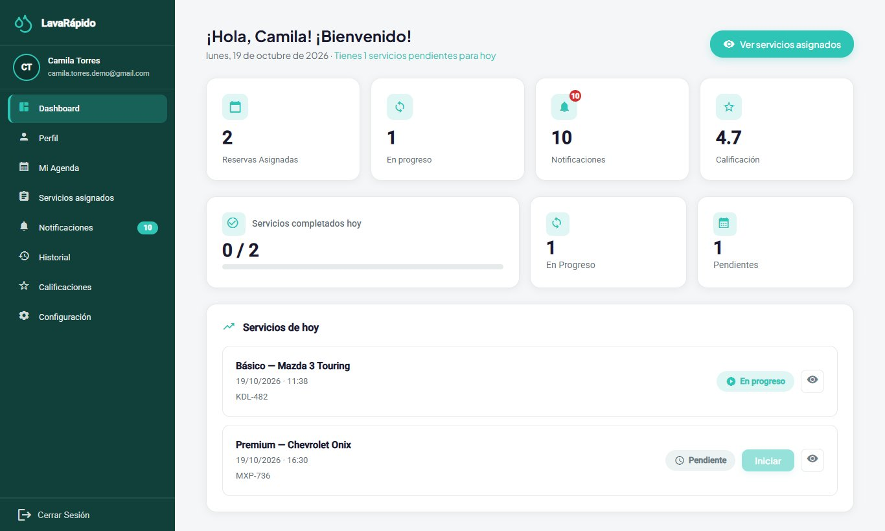 |
| Servicios asignados |  |
| Mi agenda (disponibilidad) |  |
| Historial de servicios |  |
| Calificaciones recibidas |  |

---

## Correlación con el Informe de Especificación de Requisitos

| Vista dinámica de este documento | Requisitos que ilustra |
|---|---|
| §2.1 Registro y bienvenida | RF-001, RF-018 |
| §2.2 Reservar un lavado | RF-005, RF-006, RF-010 |
| §2.3 Recordatorios y alerta | RF-018 |
| §2.4 Asignación y ejecución | RF-008, RF-009, RF-010, RF-011, RF-012, RF-012b |
| §2.5 Pago por comprobante | RF-013, RF-013b, RF-014, RF-016 |
| §2.6 Canje de cupón y puntos | RF-024, RF-025, RF-026 |
| §2.7 Roles y permisos | RF-029 |
| §2.8 Inicio de sesión con bloqueo | RF-002, RF-003, RF-004b |
| §2.9 Informe de inspección | RF-036, RF-018 |
| §3.1 a §3.6 Actividades | Todo el módulo de autenticación, reservas, operación, pagos y promociones |
| §4.1 a §4.5 Estados | RF-006, RF-007, RF-012b, RF-013b, RF-014, RF-024, RF-036 |
