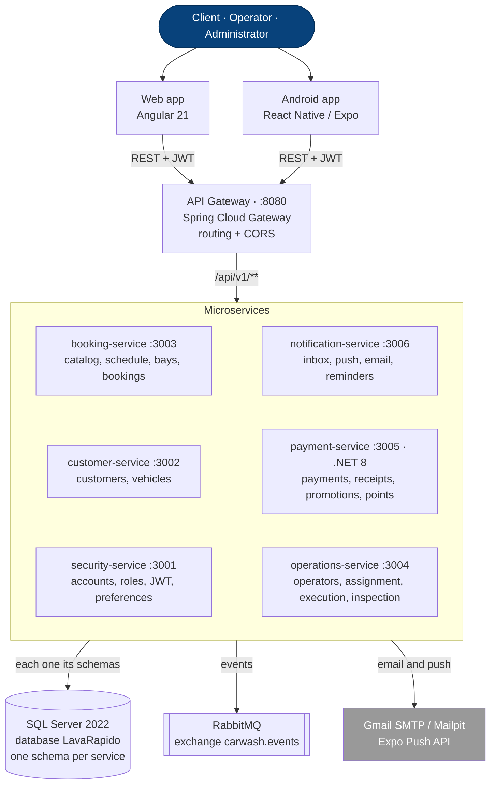

# Technical and Economic Proposal for the LavaRápido System

Juan Camilo Guilombo Osorio, Brayan Estiven Patiño Cabrera and Merari Urbano Quintero

Centro de la Industria, la Empresa y los Servicios, Servicio Nacional de Aprendizaje (SENA), Huila Regional

Software Analysis and Development Technologist program (ADSO), group (ficha) 3145556

Instructor: Karol Daniela Correa

Version 1.5, October 27, 2026

---

## Abstract

LavaRápido is a system to manage a car wash: bookings by time slot and bay, automatic operator assignment, vehicle inspection report, digital payments with a receipt, loyalty points and notifications, with a web application and an Android application, both for the three roles. This proposal covers the technical solution (architecture, technologies and alternatives evaluated), the requirements and resources, the effort-based schedule, the team, and the cost of carrying out the project under real conditions: 28 weeks of work with go-live in week 23, a total cost of **COP 212,925,240** and a monthly operating cost of **COP 2,391,070** after launch. The problem and the objectives are in the *Software Requirements Specification* (sections 1 and 2).

---

## 1. Proposed Solution

LavaRápido consists of **six microservices** behind an API Gateway, each one owning its own part of the domain (accounts, customers, bookings, operations, payments and notifications), plus an Angular web application and a React Native Android application that use the same API. Figure 1 shows how they connect.

**Figure 1**
*System Component Architecture*

The REST calls between services and the RabbitMQ events are detailed in section 3.3 of the *Software Design Documentation*.

Inside each service we follow **hexagonal architecture** (domain → application → infrastructure): the business rules do not depend on Spring, JPA or the database, so they can be tested on their own. `payment-service` follows the same idea in .NET (Clean Architecture with four projects), because it was built on a different stack; section 3 explains why.

The database is a single SQL Server instance, but each service owns its schemas and there are no foreign keys between schemas of different services: whatever a service needs from another one, it asks for through its API. That way a change in one service does not break another by accident, which is exactly the problem of a monolith with a shared database and no rules.

---

## 2. Technologies Used

**Table 1**
*Technologies and Their Rationale*

| Layer | Technology | Why it was chosen |
|---|---|---|
| Backend (5 services) | Java 21 + Spring Boot 4 | Booking needs strict transactional control: two customers cannot end up with the same slot and the same bay. Spring Boot already solves transaction handling, security and data access, and Java 21 brings strong typing and virtual threads to handle simultaneous bookings without blocking the server. |
| Backend (payment-service) | .NET 8 (ASP.NET Core, EF Core) | A separate decision, documented in ADR-013 (see section 3). |
| API Gateway | Spring Cloud Gateway | A single entry point on port 8080 simplifies CORS, hides the internal routes and lets us change a service internally without the web or the app noticing. |
| Web frontend | Angular 21 | It enforces a modular structure and static typing, which helps keep the logic of three roles with different permissions organized in a single application. |
| Mobile frontend | React Native 0.86 + Expo SDK 57 (with expo-image-picker and expo-image-manipulator for the inspection photos) | It shares the language and the component model with the web (both in TypeScript), so the team works with a single paradigm and both applications use the same API without duplicating business logic. |
| Database | SQL Server 2022 | The domain is highly relational (customer → vehicle → booking → operator → payment) and needs real referential integrity: a booking with two approved payments, or a receipt reused in two bookings, is not acceptable. In a document database this would have to be solved by hand in the application. |
| Messaging | RabbitMQ 4 | Telling an operator that a service was assigned to them, or telling the customer that their payment was reviewed, should not delay the booking or payment response. With a message queue, the main operation responds right away and, if sending the notice fails, the rest of the system keeps working. |
| Database migrations | Liquibase | Each schema change is versioned and can be reproduced on any machine; it avoids the classic "that column exists in my database". |
| Authentication | JWT (HS256) | A token signed with the user's roles lets each service validate the session on its own, without asking security-service on every request. |
| Passwords | BCrypt | A derivation function designed to be slow on purpose, which makes brute-force attacks harder even if the database leaks. |
| Infrastructure | Docker + Docker Compose | The backend, the database and the messaging run the same way on any team member's computer and on the server. |

---

## 3. Alternatives Considered

Every important decision was recorded as an ADR (Architecture Decision Record) in the technical documentation repository, with its context and consequences. Table 2 summarizes the alternatives that were evaluated and why they were discarded.

**Table 2**
*Architecture Decisions and Their Alternatives*

| Decision taken | Alternatives evaluated | Why they were discarded |
|---|---|---|
| One schema per service in a single SQL Server instance (ADR-003) | A separate physical database for each service; a single database with no owners | A physical database per service added too much infrastructure work. A single database without ownership rules makes the boundaries between services invisible over time. |
| Hexagonal architecture in each service (ADR-007) | Traditional controller-service-repository layers; hexagonal only in the "core" services; CQRS with separate read models | Traditional layers mix the business rules with the framework. Applying hexagonal to only part of the system forces the team to maintain two styles. CQRS solves a scale problem this project does not have yet. |
| Manual payment verified by receipt, without a gateway (ADR-008) | Integrating a payment gateway (Wompi); QR without receipt review; cash only | The gateway is not part of the current data model and requires a real merchant account. A QR without review leaves no evidence that the payment happened. Accepting only cash removes digital payment, which is exactly what we wanted to offer. |
| `payment-service` in .NET 8 with Clean Architecture (ADR-013) | Rewriting it in Spring Boot, like the others; a single .NET project with controllers and EF Core mixed together | Rewriting it meant redoing a service that already worked just to have a uniform stack. Mixing everything in one project makes it impossible to test the business rules without depending on Entity Framework and ASP.NET. |
| JWT authentication and role-based authorization (ADR-006) | Stateful sessions stored on the server | A stateless token lets any service validate the session without asking another service on every request, which is simpler with microservices. |
| Event-driven notifications with RabbitMQ (ADR-004) | Calling the notification service over REST from each service | With a direct call, confirming a booking would depend on notification-service being available at that very moment. With events, the booking is confirmed anyway, even if the notice arrives a little later. |

*Note.* `payment-service` is the only stack exception in the backend (.NET 8 instead of Java). It keeps the same external contract (same JWT, same error codes, same health format), so the web and the app do not notice the difference.

---

## 4. Hardware and Software Requirements

### 4.1 Development team hardware

**Table 3**
*Hardware per Team Member*

| Equipment | Recommended specification | What it is used for |
|---|---|---|
| Laptop | Intel Core i5/i7 or Ryzen 5/7, 16 GB of RAM (32 GB recommended), 512 GB SSD | Running the six services, the gateway, SQL Server and RabbitMQ in Docker at the same time, together with the editor and the browser |
| Additional monitor (optional) | 24", Full HD | Code on one screen, tests and documentation on the other |
| Android phone | Android 8.0 or later, with a camera | Testing the mobile app on a real device, including the photo of the receipt |
| Internet connection | Stable broadband | Downloading dependencies (Maven, npm, NuGet, Docker images) and working with GitHub |

### 4.2 Development team software

**Table 4**
*Development Team Software*

| Tool | Version | Use |
|---|---|---|
| Docker Desktop | Current | Running SQL Server, RabbitMQ, Mailpit and the backend services in containers |
| Java JDK | 21 | Building and running the five Java services and the API Gateway |
| .NET SDK | 8 | Building and running `payment-service` |
| Node.js | Current LTS | Building and running the web application (Angular) and the mobile application (Expo) |
| Visual Studio Code | Current | The team's main editor |
| Git | Current | Version control with GitHub |
| Postman | Current | Testing the API endpoints |
| Figma | Free plan | Wireframes and mockups |

### 4.3 Servers

**Table 5**
*Test and Production Servers*

| Environment | Specification | Software | Why this size |
|---|---|---|---|
| Testing (staging), W6 to W28 | AWS Lightsail Linux: 2 vCPU, 8 GB of RAM, 160 GB SSD | Ubuntu Server 24.04 LTS, Docker Engine and Docker Compose, Jenkins for continuous integration and the same containers as production | Only the team, QA and the car wash (during acceptance) use it; the services run with less memory assigned and Jenkins builds one repository at a time (assumption) |
| Production, from W18 | AWS Lightsail Linux: 4 vCPU, 16 GB of RAM, 320 GB SSD | Ubuntu Server 24.04 LTS, Docker Engine and Docker Compose, Nginx with HTTPS (Let's Encrypt), SQL Server 2022 Express, RabbitMQ 4, the six services, the gateway and the compiled web app | The six services, the gateway, SQL Server and RabbitMQ use between 8 and 10 GB of RAM under normal load (assumption); 16 GB leaves room for peaks and growth |

*Note.* Environments planned in the proposal; the costs of section 8.2 were calculated with these specifications.

**Follow-up as of October 27, 2026.** For the academic demonstration, the system was deployed on a Microsoft Azure virtual machine (*Azure for Students* subscription, B2as_v2 size: 2 vCPU, 7.7 GB of RAM, and a 64 GB SSD, Ubuntu 24.04 LTS), with the eleven containers, Caddy as the HTTPS entry point, and the Android app served under */app*. With every container running it uses about 3.3 GB of RAM, so the production size of Table 5 is still comfortable. The full procedure is in the Deployment Document (folder 07). In the academic project, continuous integration was not done with Jenkins but with GitHub Actions: the 10 code repositories build and run their tests on every change, and since October 26, 2026 continuous deployment is active: each approved merge into `main`, a protected branch in the 10 repositories, asks the "Desplegar en Azure" workflow of `lavarapido-infra` to update the server, which runs what is in `main`; that workflow can also be run by hand. Since October 20 and 21 the server backs up the database every day and before every update, checks each backup with a test restore and keeps the last 14; Caddy sends security headers and a content security policy; Docker checks the health of every container and caps the size of their logs. Since October 21 the API Gateway also cuts the tokens of closed sessions by asking security-service, with the answer kept 30 seconds per token, without changing the decision to use JWT.

### 4.4 End user

**Table 6**
*End-User Hardware and Software*

| Role | Minimum device | Software |
|---|---|---|
| Any role (mobile app) | Phone with Android 8.0 or later; the customer needs a camera or gallery for the payment receipt | The app installed from Google Play |
| Any role (web) | Computer or laptop with an up-to-date browser | Chrome, Firefox or Edge in their current stable version |
| Administrator | Computer with a browser, preferably with a good resolution for the management tables | The same browser as in the previous row |
| Everyone | Internet connection | The system does not work offline: checking availability, booking and paying require a connection |

The car wash does not need special hardware: there are no barcode readers, fiscal printers or proprietary devices. The only physical requirement is having the QR code of its digital payment accounts at hand, on screen or printed.

---

## 5. Resources: What We Already Have and What Must Be Acquired

**Table 7**
*Resources We Already Have*

| Resource | Detail | What for |
|---|---|---|
| Core team | Three apprentices: project lead, backend lead and frontend lead | They cover 3 of the 7 project roles (1,920 of the 3,546 hours) |
| Laptops | 3, one per member | Development and local testing |
| Internet connection | At each member's home | Remote work, dependencies and GitHub |
| Development tools | Visual Studio Code, JDK 21, .NET 8 SDK, Node.js, Docker Desktop, Git and Postman, installed on the three laptops | Coding, building and testing |
| Accounts | GitHub (project repositories) and Figma (mockups) | Code and design |
| Mailpit | Test mail server that runs in Docker | Testing emails without actually sending them |
| Knowledge of the stack | Java and Spring Boot, .NET, Angular, React Native, SQL Server, RabbitMQ and Docker | Starting construction without a learning curve |

**Table 8**
*Resources That Must Be Acquired*

| Resource | Quantity | What for | Estimated cost (COP) |
|---|---|---|---|
| Backend 2 (Java and .NET), hourly | 660 h | customer-service, booking-service catalog, payment-service and notification-service | 37,620,000 |
| Mobile development (React Native), hourly | 440 h | Android app for the three roles and its publication | 23,320,000 |
| QA, hourly | 376 h | Test plan, cases and execution | 12,220,000 |
| DevOps, hourly | 150 h | Continuous integration, servers, HTTPS, backups and monitoring | 10,950,000 |
| Test server (staging) | 1, for 5.3 months | Tests by the team and QA, and acceptance by the car wash | 915,800 |
| Production server | 1 | Real operation of the system | 824,700 during the project; 329,900 per month afterwards |
| Automatic backups | 60 GB | Recovering the server and the database after a failure | 29,500 during the project; 11,800 per month afterwards |
| .com.co domain | 1 | Web address of the system and the API | 81,300 per year |
| HTTPS certificate (Let's Encrypt) | 1 | Encrypting the connection of the web and the app | 0 |
| SQL Server 2022 Express | 1 instance | Production database; replaces the Developer edition of the local environment | 0 |
| Nginx | 1 | Reverse proxy with HTTPS and server for the compiled web app | 0 |
| Jenkins | 1, on the test server | Building and running the tests of each repository on every change | 0 |
| Google Play developer account | 1 | Publishing the Android app | 98,200 (one-time payment) |
| Expo account (EAS Build) | 1 | Building the production version of the app | 0 |
| Transactional email (Amazon SES) | 3,000 emails per month | Welcome, bookings, reminders and password recovery | 2,900 during the project; 1,200 per month afterwards |
| Uptime monitoring (UptimeRobot) | Up to 50 monitors | Alerting if the web, the gateway or any service goes down | 0 |
| Android test phone | 1 | Testing the app on a real entry-level device | 450,000 |
| Trips to the car wash | 8 visits | Requirements gathering, validations, acceptance, training and go-live | 240,000 |
| Printing | 1 batch | Payment QR code for the site and training material | 120,000 |

---

## 6. Schedule

**Table 9**
*Schedule by Phase*

| Phase | Depends on | Weeks | Timeline | Effort (h) | Milestone at the end |
|---|---|---|---|---|---|
| **Week** | | | `1···5····10···15···20···25··` | | |
| 1. Kickoff and requirements | — | W1–W3 | `███·························` | 180 | ◆ M1 Requirements approved (W3) |
| 2. Analysis and design | P1 | W4–W6 | `···███······················` | 344 | ◆ M2 Design approved (W6) |
| 3. Technical foundation | P2 | W5–W7 | `····███·····················` | 168 | — |
| 4. Backend construction | P3 | W7–W17 | `······███████████···········` | 824 | ◆ M3 Backend integrated (W17) |
| 5. Web app construction | P2, P3 | W7–W18 | `······█████████··█··········` | 352 | — |
| 6. Mobile app construction | P3, P5 | W10–W18 | `·········█████████··········` | 328 | — |
| 7. Testing | P2, P4, P5, P6 | W6–W23 | `·····██··██████████████·····` | 778 | ◆ M4 Client acceptance (W22) |
| 8. Deployment and go-live | P6, P7 | W18–W23 | `·················██████·····` | 170 | ◆ M5 System in production (W23) |
| 9. Stabilization and closure | P8 | W24–W28 | `·······················█████` | 228 | ◆ M6 Project closure (W28) |
| Weekly management and follow-up with the car wash | Cross-cutting | W4–W23 | `···████████████████████·····` | 174 | — |
| **Total** | | **28 weeks** | | **3,546** | |

*Note.* W = project week; week 1 is the week the contract is signed. Each week has 5 working days of 8 hours. █ = week with work in the phase; ◆ = milestone. The effort adds up the hours of everyone involved.

#### Phase 1. Kickoff and requirements (W1–W3)

**Table 10**
*Phase 1 Tasks: Kickoff and Requirements*

| ID | Task | Depends on | Duration (working days) | Weeks | Effort (h) | Responsible |
|---|---|---|---|---|---|---|
| 1.1 | Kickoff meeting with the car wash: scope, roles and work plan | — | 2 | W1 | 32 | Project lead, Backend lead, Frontend lead |
| 1.2 | Requirements gathering: interviews and observation of the car wash operation | 1.1 | 5 | W1–W2 | 60 | Project lead, Frontend lead |
| 1.3 | Requirements specification (41 RF, 12 RNF) and use cases | 1.2 | 6 | W2–W3 | 72 | Project lead, Backend lead |
| 1.4 | Review and approval of the requirements with the client | 1.3 | 2 | W3 | 16 | Project lead |
| ◆ M1 | **Requirements approved** | 1.4 | 0 | W3 | — | — |

#### Phase 2. Analysis and design (W4–W6)

**Table 11**
*Phase 2 Tasks: Analysis and Design*

| ID | Task | Depends on | Duration (working days) | Weeks | Effort (h) | Responsible |
|---|---|---|---|---|---|---|
| 2.1 | Solution architecture and technical decisions (ADR) | 1.4 | 5 | W4 | 70 | Backend lead, Project lead, DevOps |
| 2.2 | Data model of each service | 2.1 | 4 | W5 | 64 | Backend lead, Backend 2 |
| 2.3 | REST API and RabbitMQ event contracts | 2.2 | 4 | W5–W6 | 64 | Backend lead, Backend 2 |
| 2.4 | Wireframes and mockups in Figma (web and mobile, three roles) | 1.4 | 10 | W4–W5 | 100 | Frontend lead, Project lead |
| 2.5 | Mockup validation with the client | 2.4 | 1 | W6 | 16 | Frontend lead, Project lead |
| 2.6 | Test plan and acceptance criteria | 1.4 | 3 | W4 | 30 | QA, Project lead |
| ◆ M2 | **Design approved** | 2.3, 2.5, 2.6 | 0 | W6 | — | — |

#### Phase 3. Technical foundation (W5–W7)

**Table 12**
*Phase 3 Tasks: Technical Foundation*

| ID | Task | Depends on | Duration (working days) | Weeks | Effort (h) | Responsible |
|---|---|---|---|---|---|---|
| 3.1 | Repositories, branches and local environment with Docker Compose | 2.1 | 3 | W5 | 24 | DevOps |
| 3.2 | Continuous integration with Jenkins: build and automated tests on every change | 3.1 | 3 | W5–W6 | 24 | DevOps |
| 3.3 | Test server (staging) in the cloud | 3.2 | 2 | W6 | 16 | DevOps |
| 3.4 | Hexagonal skeleton of the services and base migrations with Liquibase | 2.3, 3.1 | 4 | W6–W7 | 64 | Backend lead, Backend 2 |
| 3.5 | Web app foundation: structure, session, role guards and shared components | 2.3, 2.5 | 5 | W6–W7 | 40 | Frontend lead |

#### Phase 4. Backend construction (W7–W17)

**Table 13**
*Phase 4 Tasks: Backend Construction*

| ID | Task | Depends on | Duration (working days) | Weeks | Effort (h) | Responsible |
|---|---|---|---|---|---|---|
| 4.1 | security-service: registration, sign-in and JWT issuing | 3.4 | 6 | W7–W8 | 48 | Backend lead |
| 4.2 | security-service: roles and permissions, lockout after failed attempts, password recovery, preferences, address and users | 4.1 | 10 | W8–W10 | 80 | Backend lead |
| 4.3 | customer-service: customers and vehicles, automatic customer creation on registration | 3.4 | 8 | W7–W8 | 64 | Backend 2 |
| 4.4 | booking-service: service catalog, opening hours, bays and business data | 4.3 | 8 | W9–W10 | 64 | Backend 2 |
| 4.5 | booking-service: bookings with slot control, statuses and cancellation | 4.2, 4.4 | 12 | W10–W12 | 96 | Backend lead |
| 4.6 | payment-service (.NET): payment accounts with QR, payments with receipt and review | 4.4 | 12 | W10–W12 | 96 | Backend 2 |
| 4.7 | payment-service (.NET): promotions and loyalty points | 4.6 | 8 | W13–W14 | 64 | Backend 2 |
| 4.8 | operations-service: operators and their profile, shifts, absences, automatic and manual assignment, execution, ratings, metrics and inspection report | 4.5 | 15 | W13–W15 | 120 | Backend lead |
| 4.9 | notification-service: inbox, email, push, reminders and alerts, in each account's language | 4.7 | 13 | W14–W17 | 104 | Backend 2 |
| 4.10 | API Gateway: routes, CORS and service health | 4.8 | 3 | W16 | 24 | Backend lead |
| 4.11 | Integration between services (REST and events) and integration tests | 4.9, 4.10 | 4 | W17 | 64 | Backend lead, Backend 2 |
| ◆ M3 | **Backend integrated** | 4.11 | 0 | W17 | — | — |

#### Phase 5. Web app construction (W7–W18)

**Table 14**
*Phase 5 Tasks: Web App Construction*

| ID | Task | Depends on | Duration (working days) | Weeks | Effort (h) | Responsible |
|---|---|---|---|---|---|---|
| 5.1 | Customer module: vehicles, bookings with operator choice, payments, history, ratings, points and profile | 3.5 | 15 | W7–W10 | 120 | Frontend lead |
| 5.2 | Administrator module: catalog, opening hours, bays, business data, operators, assignment, inspection report, payments, promotions, users and roles | 5.1 | 20 | W10–W14 | 160 | Frontend lead |
| 5.3 | Operator module: assigned services, service start and finish, ratings | 5.2 | 5 | W14–W15 | 40 | Frontend lead |
| 5.4 | Connection to the real API through the gateway, and adjustments | 5.3, 4.11 | 4 | W18 | 32 | Frontend lead |

#### Phase 6. Mobile app construction (W10–W18)

**Table 15**
*Phase 6 Tasks: Mobile App Construction*

| ID | Task | Depends on | Duration (working days) | Weeks | Effort (h) | Responsible |
|---|---|---|---|---|---|---|
| 6.1 | App foundation: navigation, secure session and push notification registration | 5.1 | 5 | W10–W11 | 40 | Mobile |
| 6.2 | Customer flows: vehicles, bookings with operator choice, payment with a photo of the receipt, notifications and points | 6.1 | 16 | W11–W14 | 128 | Mobile |
| 6.3 | Operator flows: assigned services, service start and finish | 6.2 | 5 | W14–W15 | 40 | Mobile |
| 6.4 | Administrator module: dashboard, bookings, payments, operators, opening hours, management, reports and profile | 6.3 | 11 | W15–W17 | 88 | Mobile |
| 6.5 | Connection to the real API, and adjustments | 6.4, 4.11 | 4 | W18 | 32 | Mobile |

#### Phase 7. Testing (W6–W23)

**Table 16**
*Phase 7 Tasks: Testing*

| ID | Task | Depends on | Duration (working days) | Weeks | Effort (h) | Responsible |
|---|---|---|---|---|---|---|
| 7.1 | Test cases traced to the requirements | 2.6, 2.5 | 5 | W6–W7 | 40 | QA |
| 7.2 | Functional tests per module on staging, as modules are finished | 7.1, 3.3, 4.3, 5.1 | 37 | W10–W17 | 148 | QA |
| 7.3 | Basic security and load tests (roles, tokens, simultaneous bookings) | 4.11 | 3 | W18 | 48 | QA, DevOps, Backend lead |
| 7.4 | End-to-end system tests (web, mobile and API) | 5.4, 6.5, 7.3 | 10 | W18–W20 | 240 | QA, Backend lead, Backend 2, Frontend lead, Mobile |
| 7.5 | Defect fixing | 7.4 | 5 | W20–W21 | 160 | Backend lead, Backend 2, Frontend lead, Mobile, QA |
| 7.6 | Acceptance tests with the car wash | 7.5 | 5 | W21–W22 | 100 | Project lead, QA, Frontend lead |
| ◆ M4 | **Client acceptance** | 7.6 | 0 | W22 | — | — |
| 7.7 | Adjustments requested during acceptance | 7.6 | 3 | W22–W23 | 42 | Backend lead, Backend 2, Frontend lead, Mobile |

#### Phase 8. Deployment and go-live (W18–W23)

**Table 17**
*Phase 8 Tasks: Deployment and Go-Live*

| ID | Task | Depends on | Duration (working days) | Weeks | Effort (h) | Responsible |
|---|---|---|---|---|---|---|
| 8.1 | Production server: installation, hardening, domain and HTTPS | 7.3 | 3 | W18–W19 | 24 | DevOps |
| 8.2 | Automatic backups, monitoring and transactional email | 8.1 | 2 | W19 | 16 | DevOps |
| 8.3 | Google Play account, app listing and closed test (14 days) | 6.5 | 10 | W18–W20 | 24 | Mobile, Project lead |
| 8.4 | Production version of the app and Google Play review | 8.3, 7.5 | 5 | W21–W22 | 10 | Mobile |
| 8.5 | Training for the administrator and the operators, user manuals | 7.6 | 3 | W22–W23 | 36 | Project lead, Frontend lead |
| 8.6 | Initial data load: catalog, opening hours, bays, operators and payment accounts | 7.7, 8.2 | 2 | W23 | 16 | Project lead, Backend lead |
| 8.7 | Go-live | 8.4, 8.5, 8.6 | 1 | W23 | 44 | Project lead, Backend lead, Backend 2, Frontend lead, DevOps, Mobile |
| ◆ M5 | **System in production** | 8.7 | 0 | W23 | — | — |

#### Phase 9. Stabilization and closure (W24–W28)

**Table 18**
*Phase 9 Tasks: Stabilization and Closure*

| ID | Task | Depends on | Duration (working days) | Weeks | Effort (h) | Responsible |
|---|---|---|---|---|---|---|
| 9.1 | Production support and incident fixing | 8.7 | 20 | W24–W27 | 192 | Backend lead, Backend 2, Frontend lead, Project lead, Mobile, DevOps |
| 9.2 | Handover of code and documentation, and project closure | 9.1 | 3 | W28 | 36 | Project lead, Backend lead, Frontend lead |
| ◆ M6 | **Project closure** | 9.2 | 0 | W28 | — | — |

---
## 7. Work Team

**Table 19**
*Roles, People and Dedication*

| Role | Who | Responsibilities | Engagement | Weeks with dedication | Hours |
|---|---|---|---|---|---|
| Project lead | Brayan Estiven Patiño Cabrera | Requirements, work plan, weekly follow-up with the car wash, acceptance, training and closure | Core team | 28 (W1–W28) | 500 |
| Backend lead | Merari Urbano Quintero | Architecture, security-service, booking-service bookings, operations-service, API Gateway and integration | Core team | 28 (W1–W28) | 734 |
| Backend 2 (Java and .NET) | To be hired | customer-service, booking-service catalog, payment-service and notification-service | Hourly contract | 23 (W5–W27) | 660 |
| Frontend lead | Juan Camilo Guilombo Osorio | Figma mockups, web app for the three roles and support during training | Core team | 25 (W1–W28) | 686 |
| Mobile (React Native) | To be hired | Android app for the three roles and its publication on Google Play | Hourly contract | 18 (W10–W27) | 440 |
| QA | To be hired | Test plan and cases, per-module, system and acceptance tests | Hourly contract | 16 (W4–W22) | 376 |
| DevOps | To be hired | Local environment, continuous integration with Jenkins, servers, HTTPS, backups and monitoring | Hourly contract | 10 (W4–W27) | 150 |
| **Total** | | | | | **3,546** |

---

## 8. Project Costs

**Table 20**
*Calculation Assumptions*

| Assumption | Value | Criterion |
|---|---|---|
| Working time | 8 h per day, 5 working days per week, 160 h per month | Standard working hours |
| Hourly rate | Monthly reference salary × 1.3 ÷ 160 h, rounded | The 1.3 covers the social security and benefits paid by whoever works under an independent services contract (assumption) |
| Reference salaries | Lower-middle value of each national salary range | Remote hiring based in Neiva, Huila (assumption) |
| Exchange rate | COP 3,300 per US dollar | October 2026 official exchange rate (TRM) with a margin for fluctuation (assumption) |
| VAT on foreign digital services | 19% | Applied to every charge in US dollars (assumption) |
| Contingency | 10% of the direct cost | Closed scope (41 validated RF); risk in integrating six services, hiring four roles and the Google Play review (assumption) |

### 8.1 Human resources

**Table 21**
*Human Resources Cost*

| Role | Hours | Weeks | Hourly rate (COP) | Cost (COP) | Criterion and source |
|---|---|---|---|---|---|
| Project lead | 500 | 28 | 57,000 | 28,500,000 | Reference of COP 7.0 M per month, the same level as a semi-senior backend developer (assumption) |
| Backend lead | 734 | 28 | 57,000 | 41,838,000 | Semi-senior backend in Colombia: COP 6.0–8.5 M per month (Coderhouse, 2025); 7.0 M is used |
| Backend 2 (Java and .NET) | 660 | 23 | 57,000 | 37,620,000 | Same range as the backend; 7.0 M is used |
| Frontend lead | 686 | 25 | 53,000 | 36,358,000 | Semi-senior frontend: COP 6.0–7.5 M per month (job postings on Indeed Colombia, 2026); 6.5 M is used |
| Mobile (React Native) | 440 | 18 | 53,000 | 23,320,000 | Remote semi-senior React Native: USD 1,600–2,750 per month (job postings on Próximo Trabajo, 2026); COP 6.5 M is used |
| QA | 376 | 16 | 32,500 | 12,220,000 | Semi-senior QA: COP 2.5–4.5 M per month (job postings on elempleo and Computrabajo, 2026); 4.0 M is used |
| DevOps | 150 | 10 | 73,000 | 10,950,000 | DevOps: COP 4.8–7 M per month in Colombia (KeepCoding, n.d.) and 8–14 M in Bogotá (Jobrise, 2026); 9.0 M is used |
| **Total** | **3,546** | | | **190,806,000** | |

### 8.2 Infrastructure and hosting

**Table 22**
*Infrastructure During the Project*

| Item | Quantity | Assumption | Unit price | Cost (COP) | Source or criterion |
|---|---|---|---|---|---|
| Test server (staging) | 1 × 5.3 months (W6–W28) | AWS Lightsail Linux: 2 vCPU, 8 GB of RAM, 160 GB SSD | USD 44 per month | 915,800 | AWS Lightsail pricing; billed per hour of use |
| Production server | 1 × 2.5 months (W18–W28) | AWS Lightsail Linux: 4 vCPU, 16 GB of RAM, 320 GB SSD | USD 84 per month | 824,700 | AWS Lightsail pricing; from W29 it moves to the monthly operation |
| Automatic backups | 60 GB × 2.5 months | Daily snapshots of the production server with 60 GB stored (assumption) | USD 0.05 per GB per month | 29,500 | AWS Lightsail snapshot pricing |
| .com.co domain | 1 year | Yearly registration | USD 20.70 | 81,300 | Registration price on Dynadot |
| HTTPS certificate | 1 | Let's Encrypt with automatic renewal | Free | 0 | Free Let's Encrypt certificates |
| **Subtotal** | | | | **1,851,300** | |

### 8.3 Licenses, tools and third-party services

**Table 23**
*Licenses, Tools and Third-Party Services*

| Item | Quantity | Assumption | Unit price | Cost (COP) | Source or criterion |
|---|---|---|---|---|---|
| SQL Server 2022 Express | 1 instance | Runs on the production server | Free | 0 | Free edition with a maximum of 10 GB per database (Microsoft); the Developer edition of the local environment cannot be used in production |
| Docker Engine (servers) and Docker Desktop (computers) | 2 servers and 7 seats | Company with fewer than 250 employees and less than USD 10 M in annual revenue | Free | 0 | Docker terms of use |
| Java 21 (OpenJDK), Spring Boot, .NET 8, Angular, React Native and Expo SDK | — | Open-source licenses | Free | 0 | License of each project |
| RabbitMQ, Liquibase Community, Nginx, Jenkins and Ubuntu Server | — | Open-source software; Jenkins runs on the test server | Free | 0 | License of each project |
| GitHub, Figma, Visual Studio Code, Git and Postman | — | Free plans, already in use | Free | 0 | We already use them |
| Google Play developer account | 1 | One-time payment | USD 25 | 98,200 | Play Console Help |
| App builds (Expo EAS) | Up to 15 Android builds per month | Free plan | Free | 0 | Expo plans |
| Push notifications (Expo Push) | — | Expo service with no per-message charge | Free | 0 | Expo plans |
| Transactional email (Amazon SES) | 3,000 emails per month × 2.5 months | Welcome, bookings, reminders and password recovery (assumed volume) | USD 0.10 per 1,000 emails | 2,900 | Amazon SES pricing |
| Uptime monitoring (UptimeRobot) | Up to 50 monitors, every 5 minutes | Free plan; commercial use allowed | Free | 0 | UptimeRobot terms |
| **Subtotal** | | | | **101,100** | |

### 8.4 Equipment and other expenses

**Table 24**
*Equipment and Other Expenses*

| Item | Quantity | Assumption | Unit price (COP) | Cost (COP) | Source or criterion |
|---|---|---|---|---|---|
| Development laptops | 3 | From the core team; contractors work with their own equipment (assumption) | — | 0 | We already have them |
| Android test phone | 1 | Entry-level, Samsung Galaxy A06 type | 450,000 | 450,000 | Launch price in Colombia (Samsung, 2024) |
| Trips to the car wash | 8 visits | Requirements gathering, validations, acceptance, training and go-live; local transport in Neiva (assumption) | 30,000 | 240,000 | Assumption |
| Printing | 1 batch | Payment QR code for the site and training material (assumption) | 120,000 | 120,000 | Assumption |
| **Subtotal** | | | | **810,000** | |

### 8.5 Budget summary

**Table 25**
*Total Project Budget*

| Item | Cost (COP) |
|---|---|
| Human resources (Table 21) | 190,806,000 |
| Infrastructure and hosting (Table 22) | 1,851,300 |
| Licenses, tools and third-party services (Table 23) | 101,100 |
| Equipment and other expenses (Table 24) | 810,000 |
| **Direct cost** | **193,568,400** |
| Contingency: 10% of the direct cost (Table 20) | 19,356,840 |
| **Total project cost** | **212,925,240** |

---

## 9. Monthly Operating Cost

**Table 26**
*Operation, Support and Maintenance After Closure (from W29)*

| Item | Quantity | Assumption | Unit price | Monthly cost (COP) | Source or criterion |
|---|---|---|---|---|---|
| Production server | 1 | AWS Lightsail Linux: 4 vCPU, 16 GB of RAM, 320 GB SSD | USD 84 per month | 329,900 | AWS Lightsail pricing |
| Automatic backups | 60 GB | Daily snapshots (assumption) | USD 0.05 per GB per month | 11,800 | AWS Lightsail pricing |
| Transactional email | 3,000 emails | Assumed volume | USD 0.10 per 1,000 emails | 1,200 | Amazon SES pricing |
| .com.co domain | 1/12 of the yearly registration | — | USD 20.70 per year | 6,800 | Registration price on Dynadot |
| HTTPS, push notifications, monitoring and builds | — | Free plans | Free | 0 | Tables 22 and 23 |
| Support and maintenance | 32 h | Activities in Table 27 | COP 57,000 per hour | 1,824,000 | Backend rate (Table 21) |
| Operating reserve | 10% | Support peaks or a larger server (assumption) | — | 217,370 | 10% of the items above |
| **Monthly total** | | | | **2,391,070** | |
| **Yearly total** | 12 months | | | **28,692,840** | |

---

## 10. License

The software developed in this project is licensed under an **open source with attribution** model, which allows the system to be freely distributed and modified, while keeping the obligation to acknowledge the intellectual property shared between the team and SENA.

**Terms of use**

1. The software may be used, copied, modified and distributed freely, as long as the authorship of the team and SENA is expressly acknowledged.
2. Any redistribution or publication of derived versions must keep the same license and attribution terms.
3. The license ensures that the software will remain open and that improvements will be available to the community under these same terms.
4. Using the software for purposes that break current law or harm the rights of the owners is prohibited.

**Usage fee.** Using the software for commercial or productive purposes is subject to a usage fee, whose amount is set by agreement between the team and SENA. This fee includes technical support, updates and maintenance; its reference value is the monthly operating cost in Table 26, and the payment scheme is in section 12.

**Rights and responsibilities**

- The team and SENA keep the ownership of the software and of their respective contributions.
- Users have the right to collaborate on and improve the system within the framework of this license.
- Any commercial or modifying use must respect these terms, ensuring attribution and the continuity of the license, as well as payment of the usage fee when applicable.

---

## 11. Maintenance Plan

**Table 27**
*Maintenance Activities Included in the Monthly Plan*

| Activity | Frequency | Hours per month |
|---|---|---|
| Review of monitoring alerts, CPU and memory use, and database size against the 10 GB limit of SQL Server Express (receipts and QR codes are stored in the database as images) | Weekly | 2 |
| Backup verification and restore test | Monthly | 2 |
| Security updates for the server and for the dependencies of the services, the web and the app | Monthly | 6 |
| Fixing reported errors | As reported | 12 |
| Support for the administrator and the operators during business hours | On request | 6 |
| Compatibility with new versions of Android, the browsers and Expo SDK | As released | 4 |
| **Total** | | **32** |

**Table 28**
*Incident Response Times (assumption)*

| Incident type | Example | First response | Expected resolution |
|---|---|---|---|
| Critical | The system does not load, or bookings and payments cannot be made | 4 business hours | 1 business day |
| Medium | A function fails without stopping the operation, for example an email that does not arrive | 1 business day | 3 business days |
| Low | Visual adjustment or usage question | 2 business days | In the next update |

---

## 12. Payment Schedule

**Table 29**
*Project Payments by Milestone*

| Payment | Milestone | Week | Percentage | Amount (COP) |
|---|---|---|---|---|
| 1 | Contract signing (advance payment) | W1 | 30% | 63,877,572 |
| 2 | ◆ M3 Backend integrated | W17 | 30% | 63,877,572 |
| 3 | ◆ M5 System in production | W23 | 30% | 63,877,572 |
| 4 | ◆ M6 Project closure | W28 | 10% | 21,292,524 |
| **Total** | | | **100%** | **212,925,240** |

**Table 30**
*Payments After Go-Live*

| Period | Monthly amount (COP) | What it covers |
|---|---|---|
| Month 1 (W24–W28) | 0 | Stabilization and closure, already included in the project cost (Phase 9) |
| From month 2 | 2,391,070 | Server, backups, email, domain, 32 hours of support and maintenance, and operating reserve (Table 26) |
| Warranty, months 1 to 3 | No additional cost | Fixing software errors does not use up plan hours; it is covered by the project contingency. It does not include new features |

---

## References

Amazon Web Services. (n.d.-a). *Amazon Lightsail pricing*. https://aws.amazon.com/lightsail/pricing/

Amazon Web Services. (n.d.-b). *Amazon SES pricing*. https://aws.amazon.com/ses/pricing/

Coderhouse. (2025). *Sueldo de desarrollador backend en Colombia* [Backend developer salary in Colombia]. https://www.coderhouse.com/co/sueldos/sueldo-desarrollador-backend-colombia-2025

Computrabajo. (2026). *Analista QA semi senior* [Job posting]. https://co.computrabajo.com/ofertas-de-trabajo/oferta-de-trabajo-de-analista-qa-semi-senior-en-bogota-dc-99727C40459CBF7B61373E686DCF3405

Docker. (n.d.). *Docker pricing FAQ*. https://www.docker.com/pricing/faq

Dynadot. (n.d.). *Dominio .com.co* [.com.co domain]. https://www.dynadot.com/es/dominio/com.co

elempleo. (2026). *Analista de pruebas QA tester* [Job posting]. https://www.elempleo.com/co/ofertas-trabajo/analista-de-pruebas-qa-tester-1886768138

Expo. (n.d.). *Plans and billing*. https://docs.expo.dev/billing/plans/

Google. (n.d.). *Cómo registrarse para obtener una cuenta de desarrollador de Google Play* [How to register for a Google Play developer account]. Play Console Help. https://support.google.com/googleplay/android-developer/answer/6112435

Guilombo Osorio, J. C., Patiño Cabrera, B. E., & Urbano Quintero, M. (2026). *Documentación técnica del proyecto LavaRápido* [LavaRápido project technical documentation; unpublished software documentation, vehicle-w-docs repository]. Servicio Nacional de Aprendizaje. Architecture decisions cited: ADR-003, ADR-004, ADR-006, ADR-007, ADR-008, ADR-013.

Indeed Colombia. (2026). *Empleos de frontend developer* [Frontend developer jobs]. https://co.indeed.com/q-frontend-developer-empleos.html

Jobrise. (2026). *Salario de un DevOps engineer en Bogotá 2026* [DevOps engineer salary in Bogotá 2026]. https://jobrise.io/es/blog/salario-devops-engineer-bogota-2026/

KeepCoding. (n.d.). *Salario de un DevOps engineer en Colombia* [DevOps engineer salary in Colombia]. https://keepcoding.io/blog/salario-devops-engineer-en-colombia/

Let's Encrypt. (n.d.). *Let's Encrypt*. https://letsencrypt.org/

Microsoft. (n.d.). *Editions and supported features of SQL Server 2022*. https://learn.microsoft.com/sql/sql-server/editions-and-components-of-sql-server-2022

Próximo Trabajo. (2026). *SSR React Native developer* [Job posting]. https://dev.proximotrabajo.com/empleos/ssr-react-native-developer-87126838-eca8-4425-8bd6-8a9f3d34482e

Samsung. (2024). *Samsung presenta el Galaxy A06 en Colombia* [Samsung launches the Galaxy A06 in Colombia]. Samsung Newsroom Colombia. https://news.samsung.com/co/samsung-presenta-el-galaxy-a06-en-colombia

UptimeRobot. (n.d.). *Terms of service*. https://uptimerobot.com/terms
