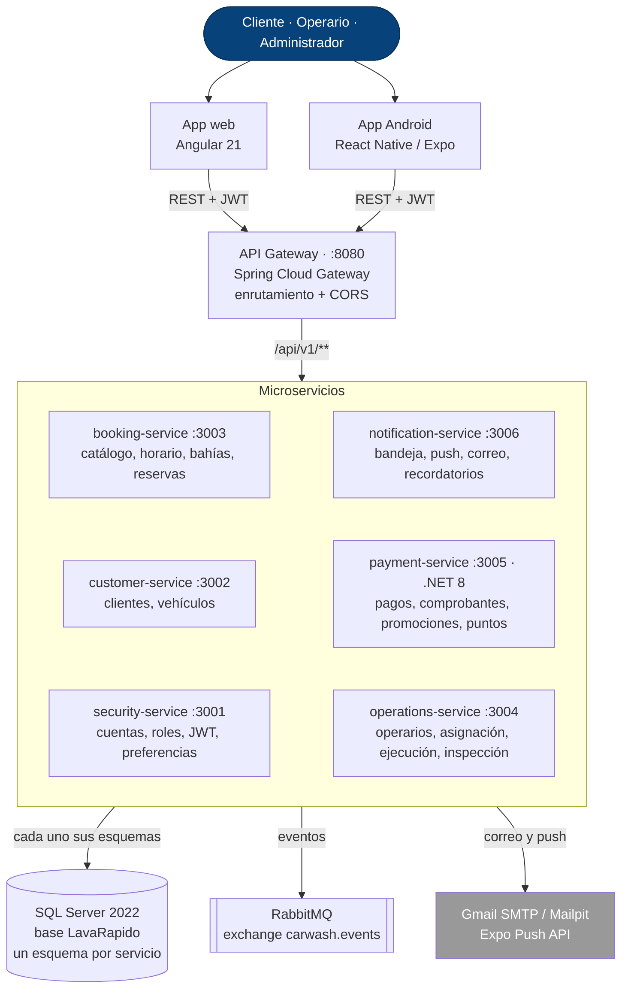

# Propuesta Técnica y Económica del Sistema LavaRápido

Juan Camilo Guilombo Osorio, Brayan Estiven Patiño Cabrera y Merari Urbano Quintero

Centro de la Industria, la Empresa y los Servicios, Servicio Nacional de Aprendizaje (SENA), Regional Huila

Tecnólogo en Análisis y Desarrollo de Software (ADSO), ficha 3145556

Instructora: Karol Daniela Correa

Versión 1.4, 21 de octubre de 2026

---

## Resumen

LavaRápido es un sistema para administrar un lavadero de vehículos: reservas por horario y bahía, asignación automática de operarios, informe de inspección del vehículo, pagos digitales con comprobante, puntos de fidelización y notificaciones, con una aplicación web y una aplicación Android, ambas para los tres roles. En esta propuesta están la solución técnica (arquitectura, tecnologías y alternativas evaluadas), los requerimientos y recursos, el cronograma por esfuerzo, el equipo y los costos de ejecutar el proyecto en condiciones reales: 28 semanas de trabajo con salida a producción en la semana 23, un costo total de **COP 212.925.240** y una operación mensual de **COP 2.391.070** después del lanzamiento. El problema y los objetivos están en el *Informe de especificación de requisitos* (secciones 1 y 2).

---

## 1. Solución Propuesta

LavaRápido está formado por **seis microservicios** detrás de un API Gateway, cada uno dueño de su propia parte del dominio (cuentas, clientes, reservas, operación, pagos y notificaciones), más una aplicación web en Angular y una aplicación Android en React Native que consumen la misma API. La Figura 1 muestra cómo se conectan.

**Figura 1**
*Arquitectura de Componentes del Sistema*

Las llamadas REST entre servicios y los eventos de RabbitMQ se detallan en la sección 3.3 del *Documento de diseño del software*.

Dentro de cada servicio se sigue **arquitectura hexagonal** (dominio → aplicación → infraestructura): las reglas de negocio no dependen de Spring, de JPA ni de la base de datos, así que se pueden probar solas. `payment-service` sigue la misma idea en .NET (Clean Architecture con cuatro proyectos), porque se construyó en un stack distinto; el porqué está en la sección 3.

La base de datos es una sola instancia de SQL Server, pero cada servicio es dueño de sus propios esquemas y no hay llaves foráneas entre esquemas de servicios distintos: lo que un servicio necesita de otro lo pide por su API. Así un cambio en un servicio no rompe a otro por accidente, que es justo el problema de un monolito con una base de datos compartida sin reglas.

---

## 2. Tecnologías Utilizadas

**Tabla 1**
*Tecnologías y su Justificación*

| Capa | Tecnología | Por qué se eligió |
|---|---|---|
| Backend (5 servicios) | Java 21 + Spring Boot 4 | La reserva necesita control transaccional estricto: dos clientes no pueden terminar con el mismo turno y la misma bahía. Spring Boot trae resueltos el manejo de transacciones, la seguridad y el acceso a datos, y Java 21 aporta tipado fuerte e hilos virtuales para atender reservas simultáneas sin bloquear el servidor. |
| Backend (payment-service) | .NET 8 (ASP.NET Core, EF Core) | Fue una decisión aparte, documentada en el ADR-013 (ver sección 3). |
| API Gateway | Spring Cloud Gateway | Un solo punto de entrada en el puerto 8080 simplifica el CORS, oculta las rutas internas y permite cambiar un servicio por dentro sin que la web ni la app lo noten. |
| Frontend web | Angular 21 | Obliga a una estructura modular y a tipado estático, lo que ayuda a mantener ordenada la lógica de tres roles con permisos distintos en una sola aplicación. |
| Frontend móvil | React Native 0.86 + Expo SDK 57 (con expo-image-picker y expo-image-manipulator para las fotos de la inspección) | Comparte lenguaje y modelo de componentes con la web (ambos en TypeScript), así que el equipo trabaja con un solo paradigma y las dos aplicaciones consumen la misma API sin duplicar lógica de negocio. |
| Base de datos | SQL Server 2022 | El dominio es muy relacional (cliente → vehículo → reserva → operario → pago) y necesita integridad referencial real: una reserva con dos pagos aprobados, o un comprobante reusado en dos reservas, no es aceptable. En una base de documentos eso habría que resolverlo a mano en la aplicación. |
| Mensajería | RabbitMQ 4 | Avisarle a un operario que le asignaron un servicio, o al cliente que su pago fue revisado, no debe demorar la respuesta de la reserva ni del pago. Con una cola de mensajes la operación principal responde de inmediato y, si falla el envío del aviso, el resto del sistema sigue funcionando. |
| Migraciones de base de datos | Liquibase | Cada cambio de esquema queda versionado y se puede reproducir en cualquier máquina; evita el clásico "en mi base sí existe esa columna". |
| Autenticación | JWT (HS256) | Un token firmado con los roles del usuario permite que cada servicio valide la sesión por su cuenta, sin preguntarle a security-service en cada petición. |
| Contraseñas | BCrypt | Función de derivación diseñada para ser lenta a propósito, lo que dificulta los ataques de fuerza bruta aunque la base de datos se filtre. |
| Infraestructura | Docker + Docker Compose | El backend, la base de datos y la mensajería corren igual en el computador de cualquier integrante y en el servidor. |

---

## 3. Alternativas Consideradas

Cada decisión importante quedó registrada como ADR (Architecture Decision Record) en el repositorio de documentación técnica, con su contexto y sus consecuencias. La Tabla 2 resume las alternativas que se evaluaron y por qué se descartaron.

**Tabla 2**
*Decisiones de Arquitectura y sus Alternativas*

| Decisión tomada | Alternativas evaluadas | Por qué se descartaron |
|---|---|---|
| Un esquema por servicio en una sola instancia de SQL Server (ADR-003) | Una base de datos física separada por cada servicio; una sola base sin separación de dueños | Una base física por servicio aumentaba demasiado la carga de infraestructura. Una sola base sin reglas de propiedad hace que los límites entre servicios se vuelvan invisibles con el tiempo. |
| Arquitectura hexagonal en cada servicio (ADR-007) | Capas tradicionales controlador-servicio-repositorio; hexagonal solo en los servicios "centrales"; CQRS con modelos de lectura separados | Las capas tradicionales mezclan las reglas de negocio con el framework. Aplicar hexagonal solo a una parte obliga a mantener dos estilos en el mismo equipo. CQRS resuelve un problema de escala que este proyecto todavía no tiene. |
| Pago manual verificado por comprobante, sin pasarela (ADR-008) | Integrar una pasarela de pago (Wompi); QR sin revisión de comprobante; solo efectivo | La pasarela no forma parte del modelo de datos actual y exige una cuenta comercial real. Un QR sin revisión no deja evidencia de que el pago ocurrió. Aceptar solo efectivo elimina el pago digital, que es justo lo que se quería ofrecer. |
| `payment-service` en .NET 8 con Clean Architecture (ADR-013) | Reescribirlo en Spring Boot, como los demás; un solo proyecto .NET con controladores y EF Core mezclados | Reescribirlo era rehacer un servicio que ya funcionaba solo para tener un stack uniforme. Mezclar todo en un proyecto impide probar las reglas de negocio sin depender de Entity Framework ni de ASP.NET. |
| Autenticación con JWT y autorización por rol (ADR-006) | Sesiones con estado guardadas en el servidor | Un token sin estado permite que cualquier servicio valide la sesión sin consultar a otro servicio en cada petición, lo que es más simple con microservicios. |
| Notificaciones por eventos con RabbitMQ (ADR-004) | Llamar al servicio de notificaciones por REST desde cada servicio | Con una llamada directa, confirmar una reserva dependería de que notification-service esté disponible en ese instante. Con eventos, la reserva se confirma igual aunque el aviso llegue un poco después. |

*Nota.* `payment-service` es la única excepción de stack del backend (.NET 8 en vez de Java). Mantiene el mismo contrato hacia afuera (mismo JWT, mismos códigos de error, mismo formato de salud), así que la web y la app no notan la diferencia.

---

## 4. Requerimientos de Hardware y Software

### 4.1 Hardware del equipo de desarrollo

**Tabla 3**
*Hardware por Integrante*

| Equipo | Especificación recomendada | Para qué se usa |
|---|---|---|
| Portátil | Intel Core i5/i7 o Ryzen 5/7, 16 GB de RAM (32 GB recomendado), SSD de 512 GB | Correr al tiempo los seis servicios, el gateway, SQL Server y RabbitMQ en Docker, junto con el editor y el navegador |
| Monitor adicional (opcional) | 24", Full HD | Código en una pantalla, pruebas y documentación en la otra |
| Teléfono Android | Android 8.0 o superior, con cámara | Probar la app móvil en un equipo real, incluida la foto del comprobante |
| Conexión a internet | Banda ancha estable | Descargar dependencias (Maven, npm, NuGet, imágenes de Docker) y trabajar con GitHub |

### 4.2 Software del equipo de desarrollo

**Tabla 4**
*Software del Equipo de Desarrollo*

| Herramienta | Versión | Uso |
|---|---|---|
| Docker Desktop | Vigente | Levantar SQL Server, RabbitMQ, Mailpit y los servicios backend en contenedores |
| Java JDK | 21 | Compilar y correr los cinco servicios Java y el API Gateway |
| .NET SDK | 8 | Compilar y correr `payment-service` |
| Node.js | LTS vigente | Compilar y correr la aplicación web (Angular) y la aplicación móvil (Expo) |
| Visual Studio Code | Vigente | Editor principal del equipo |
| Git | Vigente | Control de versiones con GitHub |
| Postman | Vigente | Probar los endpoints de la API |
| Figma | Plan gratuito | Wireframes y mockups |

### 4.3 Servidores

**Tabla 5**
*Servidores de Pruebas y de Producción*

| Ambiente | Especificación | Software | Por qué ese tamaño |
|---|---|---|---|
| Pruebas (staging), S6 a S28 | AWS Lightsail Linux: 2 vCPU, 8 GB de RAM, 160 GB SSD | Ubuntu Server 24.04 LTS, Docker Engine y Docker Compose, Jenkins para la integración continua y los mismos contenedores de producción | Lo usan solo el equipo, el QA y el lavadero en la aceptación; los servicios corren con menos memoria asignada y Jenkins compila un repositorio a la vez (supuesto) |
| Producción, desde S18 | AWS Lightsail Linux: 4 vCPU, 16 GB de RAM, 320 GB SSD | Ubuntu Server 24.04 LTS, Docker Engine y Docker Compose, Nginx con HTTPS (Let's Encrypt), SQL Server 2022 Express, RabbitMQ 4, los seis servicios, el gateway y la app web compilada | Los seis servicios, el gateway, SQL Server y RabbitMQ usan entre 8 y 10 GB de RAM con carga normal (supuesto); 16 GB dejan margen para picos y para crecer |

*Nota.* Ambientes previstos en la propuesta; los costos de la sección 8.2 se calcularon con estas especificaciones.

**Seguimiento al 21 de octubre de 2026.** Para la demostración académica, el sistema se desplegó en una máquina virtual de Microsoft Azure (suscripción *Azure for Students*, tamaño B2as_v2: 2 vCPU, 7,7 GB de RAM y 64 GB de disco SSD, Ubuntu 24.04 LTS), con los once contenedores, Caddy como entrada HTTPS y la aplicación Android servida en */app*. Con todos los contenedores activos usa unos 3,3 GB de RAM, por lo que el tamaño de producción de la Tabla 5 sigue siendo holgado. El procedimiento completo está en el Documento de Despliegue (carpeta 07). En el proyecto académico la integración continua no se hizo con Jenkins sino con GitHub Actions: los 10 repositorios de código compilan y corren sus pruebas en cada cambio, y `lavarapido-infra` tiene además un flujo manual que actualiza el servidor. Desde el 20 y el 21 de octubre el servidor respalda la base todos los días y antes de cada actualización, verifica cada respaldo con una restauración de prueba y guarda los últimos 14; Caddy envía encabezados de seguridad y una política de contenido; Docker revisa la salud de todos los contenedores y limita el tamaño de sus registros. Desde el 21 de octubre el API Gateway también corta los tokens de las sesiones cerradas preguntando a security-service, con la respuesta guardada 30 segundos por token, sin cambiar la decisión de usar JWT.

### 4.4 Usuario final

**Tabla 6**
*Hardware y Software del Usuario Final*

| Rol | Dispositivo mínimo | Software |
|---|---|---|
| Cualquier rol (app móvil) | Teléfono Android 8.0 o superior; el cliente necesita cámara o galería para el comprobante de pago | La app instalada desde Google Play |
| Cualquier rol (web) | Computador o portátil con navegador actualizado | Chrome, Firefox o Edge en su versión estable vigente |
| Administrador | Computador con navegador, de preferencia con buena resolución para las tablas de gestión | El mismo navegador de la fila anterior |
| Todos | Conexión a internet | El sistema no funciona sin conexión: consultar disponibilidad, reservar y pagar requieren red |

El lavadero no necesita hardware especial: no hay lectores de código de barras, impresoras fiscales ni dispositivos propietarios. Lo único físico es tener a la mano el código QR de sus cuentas de pago digital, en pantalla o impreso.

---

## 5. Recursos: Lo que Ya Tenemos y lo que Hay que Adquirir

**Tabla 7**
*Recursos con los que Ya Contamos*

| Recurso | Detalle | Para qué |
|---|---|---|
| Equipo base | Tres aprendices: líder de proyecto, líder de backend y líder de frontend | Cubren 3 de los 7 roles del proyecto (1.920 de las 3.546 horas) |
| Portátiles | 3, uno por integrante | Desarrollo y pruebas locales |
| Conexión a internet | En la casa de cada integrante | Trabajo remoto, dependencias y GitHub |
| Herramientas de desarrollo | Visual Studio Code, JDK 21, .NET 8 SDK, Node.js, Docker Desktop, Git y Postman, instaladas en los tres portátiles | Programar, compilar y probar |
| Cuentas | GitHub (repositorios del proyecto) y Figma (mockups) | Código y diseño |
| Mailpit | Servidor de correo de prueba que corre en Docker | Probar los correos sin enviarlos de verdad |
| Conocimiento del stack | Java y Spring Boot, .NET, Angular, React Native, SQL Server, RabbitMQ y Docker | Arrancar la construcción sin curva de aprendizaje |

**Tabla 8**
*Recursos que Hay que Adquirir*

| Recurso | Cantidad | Para qué | Costo estimado (COP) |
|---|---|---|---|
| Backend 2 (Java y .NET), por horas | 660 h | customer-service, catálogo de booking-service, payment-service y notification-service | 37.620.000 |
| Desarrollo móvil (React Native), por horas | 440 h | App Android de los tres roles y su publicación | 23.320.000 |
| QA, por horas | 376 h | Plan, casos y ejecución de pruebas | 12.220.000 |
| DevOps, por horas | 150 h | Integración continua, servidores, HTTPS, respaldos y monitoreo | 10.950.000 |
| Servidor de pruebas (staging) | 1, durante 5,3 meses | Pruebas del equipo, del QA y aceptación del lavadero | 915.800 |
| Servidor de producción | 1 | Operación real del sistema | 824.700 en el proyecto; 329.900 al mes después |
| Respaldos automáticos | 60 GB | Recuperar el servidor y la base de datos ante una falla | 29.500 en el proyecto; 11.800 al mes después |
| Dominio .com.co | 1 | Dirección web del sistema y de la API | 81.300 al año |
| Certificado HTTPS (Let's Encrypt) | 1 | Cifrar la conexión de la web y la app | 0 |
| SQL Server 2022 Express | 1 instancia | Base de datos de producción; reemplaza la edición Developer del entorno local | 0 |
| Nginx | 1 | Proxy inverso con HTTPS y servidor de la app web compilada | 0 |
| Jenkins | 1, en el servidor de pruebas | Compilar y correr las pruebas de cada repositorio en cada cambio | 0 |
| Cuenta de desarrollador de Google Play | 1 | Publicar la app Android | 98.200 (pago único) |
| Cuenta de Expo (EAS Build) | 1 | Compilar la versión de producción de la app | 0 |
| Correo transaccional (Amazon SES) | 3.000 correos al mes | Bienvenida, reservas, recordatorios y recuperación de contraseña | 2.900 en el proyecto; 1.200 al mes después |
| Monitoreo de disponibilidad (UptimeRobot) | Hasta 50 monitores | Avisar si la web, el gateway o algún servicio se cae | 0 |
| Teléfono Android de pruebas | 1 | Probar la app en un equipo real de gama de entrada | 450.000 |
| Desplazamientos al lavadero | 8 visitas | Levantamiento, validaciones, aceptación, capacitación y salida a producción | 240.000 |
| Impresión | 1 lote | Código QR de pago para el local y material de capacitación | 120.000 |

---

## 6. Cronograma

**Tabla 9**
*Cronograma por Fases*

| Fase | Depende de | Semanas | Línea de tiempo | Esfuerzo (h) | Hito al cerrar |
|---|---|---|---|---|---|
| **Semana** | | | `1···5····10···15···20···25··` | | |
| 1. Inicio y requisitos | — | S1–S3 | `███·························` | 180 | ◆ H1 Requisitos aprobados (S3) |
| 2. Análisis y diseño | F1 | S4–S6 | `···███······················` | 344 | ◆ H2 Diseño aprobado (S6) |
| 3. Base técnica | F2 | S5–S7 | `····███·····················` | 168 | — |
| 4. Construcción del backend | F3 | S7–S17 | `······███████████···········` | 824 | ◆ H3 Backend integrado (S17) |
| 5. Construcción de la app web | F2, F3 | S7–S18 | `······█████████··█··········` | 352 | — |
| 6. Construcción de la app móvil | F3, F5 | S10–S18 | `·········█████████··········` | 328 | — |
| 7. Pruebas | F2, F4, F5, F6 | S6–S23 | `·····██··██████████████·····` | 778 | ◆ H4 Aceptación del cliente (S22) |
| 8. Despliegue y salida a producción | F6, F7 | S18–S23 | `·················██████·····` | 170 | ◆ H5 Sistema en producción (S23) |
| 9. Estabilización y cierre | F8 | S24–S28 | `·······················█████` | 228 | ◆ H6 Cierre del proyecto (S28) |
| Gestión y seguimiento semanal con el lavadero | Transversal | S4–S23 | `···████████████████████·····` | 174 | — |
| **Total** | | **28 semanas** | | **3.546** | |

*Nota.* S = semana del proyecto; la semana 1 es la de firma del contrato. Cada semana tiene 5 días hábiles de 8 horas. █ = semana con trabajo en la fase; ◆ = hito. El esfuerzo suma las horas de todas las personas que participan.

#### Fase 1. Inicio y requisitos (S1–S3)

**Tabla 10**
*Tareas de la Fase 1: Inicio y Requisitos*

| ID | Tarea | Depende de | Duración (días hábiles) | Semanas | Esfuerzo (h) | Responsables |
|---|---|---|---|---|---|---|
| 1.1 | Reunión de arranque con el lavadero: alcance, roles y plan de trabajo | — | 2 | S1 | 32 | Líder de proyecto, Líder de backend, Líder de frontend |
| 1.2 | Levantamiento de requisitos: entrevistas y observación de la operación del lavadero | 1.1 | 5 | S1–S2 | 60 | Líder de proyecto, Líder de frontend |
| 1.3 | Especificación de requisitos (41 RF, 12 RNF) y casos de uso | 1.2 | 6 | S2–S3 | 72 | Líder de proyecto, Líder de backend |
| 1.4 | Revisión y aprobación de los requisitos con el cliente | 1.3 | 2 | S3 | 16 | Líder de proyecto |
| ◆ H1 | **Requisitos aprobados** | 1.4 | 0 | S3 | — | — |

#### Fase 2. Análisis y diseño (S4–S6)

**Tabla 11**
*Tareas de la Fase 2: Análisis y Diseño*

| ID | Tarea | Depende de | Duración (días hábiles) | Semanas | Esfuerzo (h) | Responsables |
|---|---|---|---|---|---|---|
| 2.1 | Arquitectura de la solución y decisiones técnicas (ADR) | 1.4 | 5 | S4 | 70 | Líder de backend, Líder de proyecto, DevOps |
| 2.2 | Modelo de datos de cada servicio | 2.1 | 4 | S5 | 64 | Líder de backend, Backend 2 |
| 2.3 | Contratos de la API REST y de los eventos de RabbitMQ | 2.2 | 4 | S5–S6 | 64 | Líder de backend, Backend 2 |
| 2.4 | Wireframes y mockups en Figma (web y móvil, tres roles) | 1.4 | 10 | S4–S5 | 100 | Líder de frontend, Líder de proyecto |
| 2.5 | Validación de los mockups con el cliente | 2.4 | 1 | S6 | 16 | Líder de frontend, Líder de proyecto |
| 2.6 | Plan de pruebas y criterios de aceptación | 1.4 | 3 | S4 | 30 | QA, Líder de proyecto |
| ◆ H2 | **Diseño aprobado** | 2.3, 2.5, 2.6 | 0 | S6 | — | — |

#### Fase 3. Base técnica (S5–S7)

**Tabla 12**
*Tareas de la Fase 3: Base Técnica*

| ID | Tarea | Depende de | Duración (días hábiles) | Semanas | Esfuerzo (h) | Responsables |
|---|---|---|---|---|---|---|
| 3.1 | Repositorios, ramas y entorno local con Docker Compose | 2.1 | 3 | S5 | 24 | DevOps |
| 3.2 | Integración continua con Jenkins: compilación y pruebas automáticas en cada cambio | 3.1 | 3 | S5–S6 | 24 | DevOps |
| 3.3 | Servidor de pruebas (staging) en la nube | 3.2 | 2 | S6 | 16 | DevOps |
| 3.4 | Esqueleto hexagonal de los servicios y migraciones base con Liquibase | 2.3, 3.1 | 4 | S6–S7 | 64 | Líder de backend, Backend 2 |
| 3.5 | Base de la app web: estructura, sesión, guardas por rol y componentes compartidos | 2.3, 2.5 | 5 | S6–S7 | 40 | Líder de frontend |

#### Fase 4. Construcción del backend (S7–S17)

**Tabla 13**
*Tareas de la Fase 4: Construcción del Backend*

| ID | Tarea | Depende de | Duración (días hábiles) | Semanas | Esfuerzo (h) | Responsables |
|---|---|---|---|---|---|---|
| 4.1 | security-service: registro, inicio de sesión y emisión de JWT | 3.4 | 6 | S7–S8 | 48 | Líder de backend |
| 4.2 | security-service: roles y permisos, bloqueo por intentos fallidos, recuperación de contraseña, preferencias, dirección y usuarios | 4.1 | 10 | S8–S10 | 80 | Líder de backend |
| 4.3 | customer-service: clientes y vehículos, alta automática del cliente al registrarse | 3.4 | 8 | S7–S8 | 64 | Backend 2 |
| 4.4 | booking-service: catálogo de servicios, horario de atención, bahías y datos del negocio | 4.3 | 8 | S9–S10 | 64 | Backend 2 |
| 4.5 | booking-service: reservas con control de cupos, estados y cancelación | 4.2, 4.4 | 12 | S10–S12 | 96 | Líder de backend |
| 4.6 | payment-service (.NET): cuentas de pago con QR, pagos con comprobante y revisión | 4.4 | 12 | S10–S12 | 96 | Backend 2 |
| 4.7 | payment-service (.NET): promociones y puntos de fidelización | 4.6 | 8 | S13–S14 | 64 | Backend 2 |
| 4.8 | operations-service: operarios y su ficha, turnos, ausencias, asignación automática y manual, ejecución, calificaciones, métricas e informe de inspección | 4.5 | 15 | S13–S15 | 120 | Líder de backend |
| 4.9 | notification-service: bandeja, correo, push, recordatorios y alertas, en el idioma de cada cuenta | 4.7 | 13 | S14–S17 | 104 | Backend 2 |
| 4.10 | API Gateway: rutas, CORS y salud de los servicios | 4.8 | 3 | S16 | 24 | Líder de backend |
| 4.11 | Integración entre servicios (REST y eventos) y pruebas de integración | 4.9, 4.10 | 4 | S17 | 64 | Líder de backend, Backend 2 |
| ◆ H3 | **Backend integrado** | 4.11 | 0 | S17 | — | — |

#### Fase 5. Construcción de la app web (S7–S18)

**Tabla 14**
*Tareas de la Fase 5: Construcción de la App Web*

| ID | Tarea | Depende de | Duración (días hábiles) | Semanas | Esfuerzo (h) | Responsables |
|---|---|---|---|---|---|---|
| 5.1 | Módulo del cliente: vehículos, reservas con elección de operario, pagos, historial, calificaciones, puntos y perfil | 3.5 | 15 | S7–S10 | 120 | Líder de frontend |
| 5.2 | Módulo del administrador: catálogo, horario, bahías, datos del negocio, operarios, asignación, informe de inspección, pagos, promociones, usuarios y roles | 5.1 | 20 | S10–S14 | 160 | Líder de frontend |
| 5.3 | Módulo del operario: servicios asignados, inicio y fin del servicio, calificaciones | 5.2 | 5 | S14–S15 | 40 | Líder de frontend |
| 5.4 | Conexión con la API real a través del gateway y ajustes | 5.3, 4.11 | 4 | S18 | 32 | Líder de frontend |

#### Fase 6. Construcción de la app móvil (S10–S18)

**Tabla 15**
*Tareas de la Fase 6: Construcción de la App Móvil*

| ID | Tarea | Depende de | Duración (días hábiles) | Semanas | Esfuerzo (h) | Responsables |
|---|---|---|---|---|---|---|
| 6.1 | Base de la app: navegación, sesión segura y registro para notificaciones push | 5.1 | 5 | S10–S11 | 40 | Móvil |
| 6.2 | Flujos del cliente: vehículos, reservas con elección de operario, pago con foto del comprobante, notificaciones y puntos | 6.1 | 16 | S11–S14 | 128 | Móvil |
| 6.3 | Flujos del operario: servicios asignados, inicio y fin del servicio | 6.2 | 5 | S14–S15 | 40 | Móvil |
| 6.4 | Módulo del administrador: panel, reservas, pagos, operarios, horario, gestión, reportes y perfil | 6.3 | 11 | S15–S17 | 88 | Móvil |
| 6.5 | Conexión con la API real y ajustes | 6.4, 4.11 | 4 | S18 | 32 | Móvil |

#### Fase 7. Pruebas (S6–S23)

**Tabla 16**
*Tareas de la Fase 7: Pruebas*

| ID | Tarea | Depende de | Duración (días hábiles) | Semanas | Esfuerzo (h) | Responsables |
|---|---|---|---|---|---|---|
| 7.1 | Casos de prueba trazados a los requisitos | 2.5, 2.6 | 5 | S6–S7 | 40 | QA |
| 7.2 | Pruebas funcionales por módulo en staging, a medida que se terminan | 3.3, 4.3, 5.1, 7.1 | 37 | S10–S17 | 148 | QA |
| 7.3 | Pruebas de seguridad y de carga básicas (roles, tokens, reservas simultáneas) | 4.11 | 3 | S18 | 48 | QA, DevOps, Líder de backend |
| 7.4 | Pruebas de sistema de punta a punta (web, móvil y API) | 5.4, 6.5, 7.3 | 10 | S18–S20 | 240 | QA, Líder de backend, Backend 2, Líder de frontend, Móvil |
| 7.5 | Corrección de defectos | 7.4 | 5 | S20–S21 | 160 | Líder de backend, Backend 2, Líder de frontend, Móvil, QA |
| 7.6 | Pruebas de aceptación con el lavadero | 7.5 | 5 | S21–S22 | 100 | Líder de proyecto, QA, Líder de frontend |
| ◆ H4 | **Aceptación del cliente** | 7.6 | 0 | S22 | — | — |
| 7.7 | Ajustes pedidos en la aceptación | 7.6 | 3 | S22–S23 | 42 | Líder de backend, Backend 2, Líder de frontend, Móvil |

#### Fase 8. Despliegue y salida a producción (S18–S23)

**Tabla 17**
*Tareas de la Fase 8: Despliegue y Salida a Producción*

| ID | Tarea | Depende de | Duración (días hábiles) | Semanas | Esfuerzo (h) | Responsables |
|---|---|---|---|---|---|---|
| 8.1 | Servidor de producción: instalación, seguridad, dominio y HTTPS | 7.3 | 3 | S18–S19 | 24 | DevOps |
| 8.2 | Respaldos automáticos, monitoreo y correo transaccional | 8.1 | 2 | S19 | 16 | DevOps |
| 8.3 | Cuenta de Google Play, ficha de la app y prueba cerrada (14 días) | 6.5 | 10 | S18–S20 | 24 | Móvil, Líder de proyecto |
| 8.4 | Versión de producción de la app y revisión de Google Play | 7.5, 8.3 | 5 | S21–S22 | 10 | Móvil |
| 8.5 | Capacitación del administrador y de los operarios, manuales de usuario | 7.6 | 3 | S22–S23 | 36 | Líder de proyecto, Líder de frontend |
| 8.6 | Carga de datos iniciales: catálogo, horario, bahías, operarios y cuentas de pago | 7.7, 8.2 | 2 | S23 | 16 | Líder de proyecto, Líder de backend |
| 8.7 | Salida a producción | 8.4, 8.5, 8.6 | 1 | S23 | 44 | Líder de proyecto, Líder de backend, Backend 2, Líder de frontend, DevOps, Móvil |
| ◆ H5 | **Sistema en producción** | 8.7 | 0 | S23 | — | — |

#### Fase 9. Estabilización y cierre (S24–S28)

**Tabla 18**
*Tareas de la Fase 9: Estabilización y Cierre*

| ID | Tarea | Depende de | Duración (días hábiles) | Semanas | Esfuerzo (h) | Responsables |
|---|---|---|---|---|---|---|
| 9.1 | Acompañamiento en producción y corrección de incidencias | 8.7 | 20 | S24–S27 | 192 | Líder de backend, Backend 2, Líder de frontend, Líder de proyecto, Móvil, DevOps |
| 9.2 | Entrega de código, documentación y cierre del proyecto | 9.1 | 3 | S28 | 36 | Líder de proyecto, Líder de backend, Líder de frontend |
| ◆ H6 | **Cierre del proyecto** | 9.2 | 0 | S28 | — | — |

---

## 7. Equipo de Trabajo

**Tabla 19**
*Roles, Responsables y Dedicación*

| Rol | Quién | Responsabilidades | Vinculación | Semanas con dedicación | Horas |
|---|---|---|---|---|---|
| Líder de proyecto | Brayan Estiven Patiño Cabrera | Requisitos, plan de trabajo, seguimiento semanal con el lavadero, aceptación, capacitación y cierre | Equipo base | 28 (S1–S28) | 500 |
| Líder de backend | Merari Urbano Quintero | Arquitectura, security-service, reservas de booking-service, operations-service, API Gateway e integración | Equipo base | 28 (S1–S28) | 734 |
| Backend 2 (Java y .NET) | Por contratar | customer-service, catálogo de booking-service, payment-service y notification-service | Contrato por horas | 23 (S5–S27) | 660 |
| Líder de frontend | Juan Camilo Guilombo Osorio | Mockups en Figma, app web de los tres roles y apoyo en la capacitación | Equipo base | 25 (S1–S28) | 686 |
| Móvil (React Native) | Por contratar | App Android de los tres roles y su publicación en Google Play | Contrato por horas | 18 (S10–S27) | 440 |
| QA | Por contratar | Plan y casos de prueba, pruebas por módulo, de sistema y de aceptación | Contrato por horas | 16 (S4–S22) | 376 |
| DevOps | Por contratar | Entorno local, integración continua con Jenkins, servidores, HTTPS, respaldos y monitoreo | Contrato por horas | 10 (S4–S27) | 150 |
| **Total** | | | | | **3.546** |

---

## 8. Costos del Proyecto

**Tabla 20**
*Supuestos de Cálculo*

| Supuesto | Valor | Criterio |
|---|---|---|
| Jornada | 8 h al día, 5 días hábiles por semana, 160 h al mes | Jornada laboral estándar |
| Tarifa por hora | Salario mensual de referencia × 1,3 ÷ 160 h, redondeada | El 1,3 cubre la seguridad social y las prestaciones que asume quien trabaja por prestación de servicios (supuesto) |
| Salarios de referencia | Valor medio-bajo de cada rango salarial del país | Contratación remota con base en Neiva, Huila (supuesto) |
| Tasa de cambio | COP 3.300 por dólar | TRM de octubre de 2026 con margen por variación (supuesto) |
| IVA de servicios digitales del exterior | 19 % | Se aplica a todos los cobros en dólares (supuesto) |
| Contingencia | 10 % del costo directo | Alcance cerrado (41 RF validados); riesgo en la integración de seis servicios, en la contratación de cuatro roles y en la revisión de Google Play (supuesto) |

### 8.1 Recursos humanos

**Tabla 21**
*Costo de Recursos Humanos*

| Rol | Horas | Semanas | Tarifa por hora (COP) | Costo (COP) | Criterio y fuente |
|---|---|---|---|---|---|
| Líder de proyecto | 500 | 28 | 57.000 | 28.500.000 | Referencia de COP 7,0 M al mes, mismo nivel del backend semi-senior (supuesto) |
| Líder de backend | 734 | 28 | 57.000 | 41.838.000 | Backend semi-senior en Colombia: COP 6,0–8,5 M al mes (Coderhouse, 2025); se toma 7,0 M |
| Backend 2 (Java y .NET) | 660 | 23 | 57.000 | 37.620.000 | Mismo rango del backend; se toma 7,0 M |
| Líder de frontend | 686 | 25 | 53.000 | 36.358.000 | Frontend semi-senior: COP 6,0–7,5 M al mes (ofertas en Indeed Colombia, 2026); se toma 6,5 M |
| Móvil (React Native) | 440 | 18 | 53.000 | 23.320.000 | React Native semi-senior remoto: USD 1.600–2.750 al mes (ofertas en Próximo Trabajo, 2026); se toma COP 6,5 M |
| QA | 376 | 16 | 32.500 | 12.220.000 | QA semi-senior: COP 2,5–4,5 M al mes (ofertas en elempleo y Computrabajo, 2026); se toma 4,0 M |
| DevOps | 150 | 10 | 73.000 | 10.950.000 | DevOps: COP 4,8–7 M al mes en Colombia (KeepCoding, s. f.) y 8–14 M en Bogotá (Jobrise, 2026); se toma 9,0 M |
| **Total** | **3.546** | | | **190.806.000** | |

### 8.2 Infraestructura y hosting

**Tabla 22**
*Infraestructura Durante el Proyecto*

| Rubro | Cantidad | Supuesto | Valor unitario | Costo (COP) | Fuente o criterio |
|---|---|---|---|---|---|
| Servidor de pruebas (staging) | 1 × 5,3 meses (S6–S28) | AWS Lightsail Linux: 2 vCPU, 8 GB de RAM, 160 GB SSD | USD 44 al mes | 915.800 | Precios de AWS Lightsail; se cobra por hora de uso |
| Servidor de producción | 1 × 2,5 meses (S18–S28) | AWS Lightsail Linux: 4 vCPU, 16 GB de RAM, 320 GB SSD | USD 84 al mes | 824.700 | Precios de AWS Lightsail; desde S29 pasa a la operación mensual |
| Respaldos automáticos | 60 GB × 2,5 meses | Instantáneas diarias del servidor de producción con 60 GB almacenados (supuesto) | USD 0,05 por GB al mes | 29.500 | Precios de instantáneas de AWS Lightsail |
| Dominio .com.co | 1 año | Registro anual | USD 20,70 | 81.300 | Precio de registro en Dynadot |
| Certificado HTTPS | 1 | Let's Encrypt con renovación automática | Gratis | 0 | Certificados gratuitos de Let's Encrypt |
| **Subtotal** | | | | **1.851.300** | |

### 8.3 Licencias, herramientas y servicios de terceros

**Tabla 23**
*Licencias, Herramientas y Servicios de Terceros*

| Rubro | Cantidad | Supuesto | Valor unitario | Costo (COP) | Fuente o criterio |
|---|---|---|---|---|---|
| SQL Server 2022 Express | 1 instancia | Corre en el servidor de producción | Gratis | 0 | Edición gratuita con máximo 10 GB por base de datos (Microsoft); la edición Developer del entorno local no se puede usar en producción |
| Docker Engine (servidores) y Docker Desktop (equipos) | 2 servidores y 7 puestos | Empresa con menos de 250 empleados y menos de USD 10 M de ingresos anuales | Gratis | 0 | Términos de uso de Docker |
| Java 21 (OpenJDK), Spring Boot, .NET 8, Angular, React Native y Expo SDK | — | Licencias de código abierto | Gratis | 0 | Licencia de cada proyecto |
| RabbitMQ, Liquibase Community, Nginx, Jenkins y Ubuntu Server | — | Software de código abierto; Jenkins corre en el servidor de pruebas | Gratis | 0 | Licencia de cada proyecto |
| GitHub, Figma, Visual Studio Code, Git y Postman | — | Planes gratuitos, ya en uso | Gratis | 0 | Ya los usamos |
| Cuenta de desarrollador de Google Play | 1 | Pago único | USD 25 | 98.200 | Ayuda de Play Console |
| Compilación de la app (Expo EAS) | Hasta 15 compilaciones Android al mes | Plan Free | Gratis | 0 | Planes de Expo |
| Notificaciones push (Expo Push) | — | Servicio de Expo sin cobro por mensaje | Gratis | 0 | Planes de Expo |
| Correo transaccional (Amazon SES) | 3.000 correos al mes × 2,5 meses | Bienvenida, reservas, recordatorios y recuperación de contraseña (volumen supuesto) | USD 0,10 por 1.000 correos | 2.900 | Precios de Amazon SES |
| Monitoreo de disponibilidad (UptimeRobot) | Hasta 50 monitores, cada 5 minutos | Plan gratuito; permite uso comercial | Gratis | 0 | Términos de UptimeRobot |
| **Subtotal** | | | | **101.100** | |

### 8.4 Equipos y otros gastos

**Tabla 24**
*Equipos y Otros Gastos*

| Rubro | Cantidad | Supuesto | Valor unitario (COP) | Costo (COP) | Fuente o criterio |
|---|---|---|---|---|---|
| Portátiles de desarrollo | 3 | Del equipo base; los contratistas trabajan con su propio equipo (supuesto) | — | 0 | Ya los tenemos |
| Teléfono Android de pruebas | 1 | Gama de entrada, tipo Samsung Galaxy A06 | 450.000 | 450.000 | Precio de lanzamiento en Colombia (Samsung, 2024) |
| Desplazamientos al lavadero | 8 visitas | Levantamiento, validaciones, aceptación, capacitación y salida a producción; transporte local en Neiva (supuesto) | 30.000 | 240.000 | Supuesto |
| Impresión | 1 lote | Código QR de pago para el local y material de capacitación (supuesto) | 120.000 | 120.000 | Supuesto |
| **Subtotal** | | | | **810.000** | |

### 8.5 Resumen del presupuesto

**Tabla 25**
*Presupuesto Total del Proyecto*

| Rubro | Costo (COP) |
|---|---|
| Recursos humanos (Tabla 21) | 190.806.000 |
| Infraestructura y hosting (Tabla 22) | 1.851.300 |
| Licencias, herramientas y servicios de terceros (Tabla 23) | 101.100 |
| Equipos y otros gastos (Tabla 24) | 810.000 |
| **Costo directo** | **193.568.400** |
| Contingencia: 10 % del costo directo (Tabla 20) | 19.356.840 |
| **Total del proyecto** | **212.925.240** |

---

## 9. Costo Mensual de Operación

**Tabla 26**
*Operación, Soporte y Mantenimiento Después del Cierre (desde S29)*

| Rubro | Cantidad | Supuesto | Valor unitario | Costo mensual (COP) | Fuente o criterio |
|---|---|---|---|---|---|
| Servidor de producción | 1 | AWS Lightsail Linux: 4 vCPU, 16 GB de RAM, 320 GB SSD | USD 84 al mes | 329.900 | Precios de AWS Lightsail |
| Respaldos automáticos | 60 GB | Instantáneas diarias (supuesto) | USD 0,05 por GB al mes | 11.800 | Precios de AWS Lightsail |
| Correo transaccional | 3.000 correos | Volumen supuesto | USD 0,10 por 1.000 correos | 1.200 | Precios de Amazon SES |
| Dominio .com.co | 1/12 del registro anual | — | USD 20,70 al año | 6.800 | Precio de registro en Dynadot |
| HTTPS, notificaciones push, monitoreo y compilaciones | — | Planes gratuitos | Gratis | 0 | Tablas 22 y 23 |
| Soporte y mantenimiento | 32 h | Actividades de la Tabla 27 | COP 57.000 por hora | 1.824.000 | Tarifa del backend (Tabla 21) |
| Reserva de operación | 10 % | Picos de soporte o un servidor más grande (supuesto) | — | 217.370 | 10 % de los rubros anteriores |
| **Total mensual** | | | | **2.391.070** | |
| **Total anual** | 12 meses | | | **28.692.840** | |

---

## 10. Licencia

El software desarrollado en este proyecto se licencia bajo una modalidad **Open Source con atribución**, que permite la libre distribución y modificación del sistema, manteniendo la obligación de reconocer la propiedad intelectual compartida entre el equipo y el SENA.

**Condiciones de uso**

1. El software puede ser utilizado, copiado, modificado y distribuido libremente, siempre que se reconozca expresamente la autoría del equipo y el SENA.
2. Cualquier redistribución o publicación de versiones derivadas debe mantener la misma licencia y condiciones de atribución.
3. La licencia asegura que el software permanecerá abierto y que las mejoras sean accesibles a la comunidad bajo estos mismos términos.
4. Queda prohibido el uso del software para fines que violen las normativas legales vigentes o que perjudiquen los derechos de los propietarios.

**Tarifa de uso.** El uso del software para fines comerciales o productivos está sujeto al pago de una tarifa de uso, cuyo monto se determina mediante acuerdo entre el equipo y el SENA. Esta tarifa incluye soporte técnico, actualizaciones y mantenimiento; su valor de referencia es el costo mensual de operación de la Tabla 26 y el esquema de pagos está en la sección 12.

**Derechos y responsabilidades**

- El equipo y el SENA mantienen la titularidad del software y sus respectivas contribuciones.
- Los usuarios tienen derecho a colaborar y mejorar el sistema dentro del marco de esta licencia.
- Cualquier uso comercial o modificatorio debe respetar las condiciones expresadas, asegurando la atribución y la continuidad de la licencia, así como el pago de la tarifa de uso cuando corresponda.

---

## 11. Plan de Mantenimiento

**Tabla 27**
*Actividades de Mantenimiento Incluidas en el Plan Mensual*

| Actividad | Frecuencia | Horas al mes |
|---|---|---|
| Revisión de alertas de monitoreo, uso de CPU y memoria, y tamaño de la base de datos frente al límite de 10 GB de SQL Server Express (los comprobantes y los QR se guardan en la base como imagen) | Semanal | 2 |
| Verificación de respaldos y prueba de restauración | Mensual | 2 |
| Actualizaciones de seguridad del servidor y de las dependencias de los servicios, la web y la app | Mensual | 6 |
| Corrección de errores reportados | Según reporte | 12 |
| Soporte al administrador y a los operarios en horario laboral | Según solicitud | 6 |
| Compatibilidad con nuevas versiones de Android, de los navegadores y de Expo SDK | Según publicación | 4 |
| **Total** | | **32** |

**Tabla 28**
*Tiempos de Atención de Incidentes (supuesto)*

| Tipo de incidente | Ejemplo | Primera respuesta | Solución esperada |
|---|---|---|---|
| Crítico | El sistema no carga o no se pueden hacer reservas ni pagos | 4 horas hábiles | 1 día hábil |
| Medio | Falla una función sin detener la operación, por ejemplo un correo que no llega | 1 día hábil | 3 días hábiles |
| Bajo | Ajuste visual o consulta de uso | 2 días hábiles | En la siguiente actualización |

---

## 12. Cronograma de Pagos

**Tabla 29**
*Pagos del Proyecto por Hito*

| Pago | Hito | Semana | Porcentaje | Valor (COP) |
|---|---|---|---|---|
| 1 | Firma del contrato (anticipo) | S1 | 30 % | 63.877.572 |
| 2 | ◆ H3 Backend integrado | S17 | 30 % | 63.877.572 |
| 3 | ◆ H5 Sistema en producción | S23 | 30 % | 63.877.572 |
| 4 | ◆ H6 Cierre del proyecto | S28 | 10 % | 21.292.524 |
| **Total** | | | **100 %** | **212.925.240** |

**Tabla 30**
*Pagos Después de la Salida a Producción*

| Periodo | Valor mensual (COP) | Qué cubre |
|---|---|---|
| Mes 1 (S24–S28) | 0 | Estabilización y cierre, ya incluidos en el costo del proyecto (Fase 9) |
| Desde el mes 2 | 2.391.070 | Servidor, respaldos, correo, dominio, 32 horas de soporte y mantenimiento, y reserva de operación (Tabla 26) |
| Garantía, meses 1 a 3 | Sin costo adicional | La corrección de errores del software no consume horas del plan; se cubre con la contingencia del proyecto. No incluye funciones nuevas |

---

## Referencias

Amazon Web Services. (s. f.-a). *Amazon Lightsail pricing*. https://aws.amazon.com/lightsail/pricing/

Amazon Web Services. (s. f.-b). *Amazon SES pricing*. https://aws.amazon.com/ses/pricing/

Coderhouse. (2025). *Sueldo de desarrollador backend en Colombia*. https://www.coderhouse.com/co/sueldos/sueldo-desarrollador-backend-colombia-2025

Computrabajo. (2026). *Analista QA semi senior* [Oferta de empleo]. https://co.computrabajo.com/ofertas-de-trabajo/oferta-de-trabajo-de-analista-qa-semi-senior-en-bogota-dc-99727C40459CBF7B61373E686DCF3405

Docker. (s. f.). *Docker pricing FAQ*. https://www.docker.com/pricing/faq

Dynadot. (s. f.). *Dominio .com.co*. https://www.dynadot.com/es/dominio/com.co

elempleo. (2026). *Analista de pruebas QA tester* [Oferta de empleo]. https://www.elempleo.com/co/ofertas-trabajo/analista-de-pruebas-qa-tester-1886768138

Expo. (s. f.). *Plans and billing*. https://docs.expo.dev/billing/plans/

Google. (s. f.). *Cómo registrarse para obtener una cuenta de desarrollador de Google Play*. Ayuda de Play Console. https://support.google.com/googleplay/android-developer/answer/6112435

Guilombo Osorio, J. C., Patiño Cabrera, B. E. y Urbano Quintero, M. (2026). *Documentación técnica del proyecto LavaRápido* [Documentación de software no publicada, repositorio vehicle-w-docs]. Servicio Nacional de Aprendizaje. Decisiones de arquitectura citadas: ADR-003, ADR-004, ADR-006, ADR-007, ADR-008, ADR-013.

Indeed Colombia. (2026). *Empleos de frontend developer*. https://co.indeed.com/q-frontend-developer-empleos.html

Jobrise. (2026). *Salario de un DevOps engineer en Bogotá 2026*. https://jobrise.io/es/blog/salario-devops-engineer-bogota-2026/

KeepCoding. (s. f.). *Salario de un DevOps engineer en Colombia*. https://keepcoding.io/blog/salario-devops-engineer-en-colombia/

Let's Encrypt. (s. f.). *Let's Encrypt*. https://letsencrypt.org/

Microsoft. (s. f.). *Editions and supported features of SQL Server 2022*. https://learn.microsoft.com/sql/sql-server/editions-and-components-of-sql-server-2022

Próximo Trabajo. (2026). *SSR React Native developer* [Oferta de empleo]. https://dev.proximotrabajo.com/empleos/ssr-react-native-developer-87126838-eca8-4425-8bd6-8a9f3d34482e

Samsung. (2024). *Samsung presenta el Galaxy A06 en Colombia*. Samsung Newsroom Colombia. https://news.samsung.com/co/samsung-presenta-el-galaxy-a06-en-colombia

UptimeRobot. (s. f.). *Terms of service*. https://uptimerobot.com/terms
