# Software Design — Vehicle Washing Management System

## Cover Page

**Table 1**

*Document identification data*

| Field | Value |
| --- | --- |
| Project | Vehicle Washing Management System (Vehicle Washing / LavaRápido) |
| Deliverable | Software design documentation (section 2.5.4) |
| Program | Software Analysis and Development Technologist (ADSO) |
| Group (ficha) | 3145556 |
| Apprentices | Brayan Estiven Patiño Cabrera (project lead), Juan Camilo Guilombo Osorio (frontend lead), Merari Urbano (backend lead) |
| Instructor | Karol Daniela Correa |
| Training center | Industria |
| Date | October 26, 2026 |
| Version | 1.10 |

> *Note.* Cover data was taken from the project's Technical Manual v2.0. All design content was derived from the source code in the `Sistema Lavado Vehicular` repository (Backend, Web, and LavadoVehicular-Movil) and must be validated with the instructor.

## 1. Introduction and Scope

The system consists of seven backend services behind an API Gateway, a web application in Angular 21, and a mobile application in React Native (Expo 57); both clients serve three roles: customer, operator, and administrator.

This document describes the design as built: user interfaces, architectural model, design patterns, data model, and main classes. Every statement cites the file where it can be verified. Diagrams are written in Mermaid (Mermaid, n.d.) using UML notation. File paths are relative to the `Sistema Lavado Vehicular/` folder.

**Table 2**

*System components and technology*

| Component | Technology | Port | Folder |
| --- | --- | --- | --- |
| API Gateway | Spring Boot 4.0.8, Spring Cloud Gateway (WebMVC), Java 21 | 8080 | `Backend/lavarapido-api-gateway` |
| security-service | Spring Boot 4.0.8, Spring Security, JWT, Java 21 | 3001 | `Backend/security-service` |
| customer-service | Spring Boot 4.0.8, JPA, Java 21 | 3002 | `Backend/lavarapido-customer-service` |
| booking-service | Spring Boot 4.0.8, JPA, Java 21 | 3003 | `Backend/lavarapido-booking-service` |
| operations-service | Spring Boot 4.0.8, JPA, Java 21 | 3004 | `Backend/lavarapido-operations-service` |
| payment-service | ASP.NET Core 8, Entity Framework Core 8 | 3005 | `Backend/lavarapido-payment-service` |
| notification-service | Spring Boot 4.0.8, Spring Mail, Java 21 | 3006 | `Backend/lavarapido-notification-service` |
| Database | SQL Server 2022 (one database, one schema per service) | 1433 | `Backend/lavarapido-infra/docker-compose.yml` |
| Messaging | RabbitMQ 4 (exchange `carwash.events`) | 5672 | `Backend/lavarapido-infra/docker-compose.yml` |
| Web application | Angular 21.2.25, Angular Material, ngx-translate, Chart.js | 4200 | `Web` |
| Mobile application | React Native 0.86.3, Expo ~57, React Navigation 7, i18next | 8081 (Expo) | `LavadoVehicular-Movil` |

> *Note.* Versions taken from `pom.xml`, `Directory.Build.props`, and `package.json`. Official documentation: Spring (n.d.), Microsoft (n.d.-a, n.d.-b), RabbitMQ (n.d.), Liquibase (n.d.), Angular (n.d.), React Native (n.d.), and Expo (n.d.).

Out of scope: requirements (see SRS v7, `lavarapido-docs/01_INFORME_DE_ESPECIFICACION_DE_REQUISITOS`), dynamic diagrams (analysis deliverable), and costs.

## 2. User Interfaces

The web client has 35 routed screens and the mobile app has 31; both split the areas by role and only let each user into their own. On the web this is done by `authGuard` with `data.roles` (`Web/src/app/app.routes.ts:19-49`). On mobile, `RootNavigator` registers only the screens of the logged-in role (`LavadoVehicular-Movil/src/core/navigation/RootNavigator.tsx:63-110`).

### 2.1 Web Application Screen Inventory

**Table 3**

*Web application screens (Angular)*

| Route | Screen | Role | Purpose | Services / endpoints consumed |
| --- | --- | --- | --- | --- |
| `/` | Landing | Public | Presents the car wash, its services, the app download, contact info, and frequently asked questions | `GET /establishment` (business email and phone) |
| `/auth` | Login | Public | Authenticate with email and password | `POST /auth/login` |
| `/auth/register` | Sign-up | Public | Create a customer account | `POST /auth/register` |
| `/auth/forgot-password` | Password recovery (3 steps) | Public | Email → code → new password | `POST /auth/password/forgot`, `/verify`, `/reset` |
| `/report/:token` | Inspection report | Public | View the report shared by the admin | `GET /public/inspections/{token}` and its photos |
| `**` | Page not found | Public | Tell that the address does not exist and go back home | None |
| `/client` | Customer home | CLIENT | Summary, next booking with its operator, and points | `GET /bookings/me`, `/vehicles`, `/loyalty/balance`, `/operators/my-bookings` |
| `/client/reserve` | Book | CLIENT | Choose vehicle, service, date, and time | `GET /catalog/services`, `/bookings/availability`, `/operators/available`; `POST /bookings` |
| `/client/payment` | Payments | CLIENT | Pay for a booking and upload a receipt (compressed to at most 2 MB before sending; the QR can be enlarged with a magnifier); Cash only appears while its account is active; once the payment is approved only the summary is left | `GET /payment-accounts`, `/payments/me/bookings`; `POST /payments`; `/loyalty/*` |
| `/client/history` | History | CLIENT | Bookings from newest to oldest, payments, cancellation, and rating; clicking one opens its detail with **Go to payment** | `/bookings/me`, `POST /bookings/{id}/cancel`, `/payments/me`, `POST /ratings/{bookingId}` |
| `/client/vehicles` | My vehicles | CLIENT | Vehicle CRUD | `GET/POST/PUT/DELETE /vehicles`, `GET /vehicle-types` |
| `/client/notifications` | Notifications | CLIENT | Notification inbox; clicking one opens its detail with **Go to...** | `/notifications/*` |
| `/client/profile` | Profile | CLIENT | Personal data, address, email, and password | `/users/me`, `/users/me/address`, `/users/me/password`, `/users/me/email` |
| `/client/configuration` | Settings | CLIENT | Theme, language, and notification channels | `/users/me/preferences` |
| `/admin` | Dashboard | ADMIN | Daily indicators and alerts, bookings without an operator, and the "To close" card (only when something is pending) | `GET /admin/bookings/day-summary`, `GET /admin/assignments/unassigned`, `GET /admin/assignments/to-close`, `POST /admin/assignments/{bookingId}/attended`, and booking, payment, operator, and schedule stores |
| `/admin/reservations` | Bookings | ADMIN | Create, reschedule, change status, and assign an operator | `/admin/bookings/*`, `/admin/assignments/*` |
| `/admin/reservations/:id/inspection` | Inspection | ADMIN | Go through the phases, record findings with photos, publish and share | `/admin/inspections/{bookingId}/**` |
| `/admin/payments` | Payments | ADMIN | Review, approve, reject, and refund | `/admin/payments/*` |
| `/admin/management` | Management | ADMIN | Users (create, activate or deactivate; Enabled and Disabled filters), fixed roles and permission matrix (for reference and read-only since October 24, 2026: the role decides the access), services, promotions | `/admin/users`, `/admin/roles-permissions`, `/admin/catalog/services`, `/admin/promotions` |
| `/admin/schedule` | Schedule and bays | ADMIN | Weekly hours, exceptions, and bays | `/admin/schedule/*`, `/admin/bays/*` |
| `/admin/operators` | Operators | ADMIN | Operator list, team summary, and creation | `/admin/operators`, `/admin/operators/summary`, `POST /admin/users` |
| `/admin/operators/:id` | Operator detail | ADMIN | Availability, absences, profile, and weekly metrics | `/admin/operators/{id}/availability`, `/absences`, `/metrics`, `/admin/operators/profiles`, `PUT /admin/operators/{id}/profile` |
| `/admin/operators/:id/calendar` | Operator calendar | ADMIN | Operator agenda | `/admin/assignments` |
| `/admin/reports` | Reports | ADMIN | Revenue and services done (only completed bookings count); export PDF/Excel | Payment and booking stores (jsPDF, xlsx) |
| `/admin/notifications` | Notifications | ADMIN | Notification inbox; the detail goes to Bookings or home | `/notifications/*` |
| `/admin/profile` | Profile | ADMIN | Account data | `/users/me` |
| `/admin/settings` | Settings | ADMIN | Business data and payment methods | `/admin/payment-accounts`, `GET/PUT /admin/establishment` |
| `/operator` | Operator home | OPERATOR | Pending services and statistics | `/operator/services`, `/notifications` |
| `/operator/assigned-services` | Assigned services | OPERATOR | Start and finish services | `POST /operator/services/{id}/start`, `/finish` |
| `/operator/schedule` | Agenda | OPERATOR | Service calendar | `GET /operator/services` |
| `/operator/service-history` | History | OPERATOR | Completed services, newest first; the detail goes to Ratings if the service was rated | `GET /operator/services` |
| `/operator/qualifications` | Ratings | OPERATOR | Scores and comments received | `GET /operator/ratings` |
| `/operator/notifications`, `/profile`, `/settings` | Shared | OPERATOR | Notices, profile, and preferences | `/notifications/*`, `/users/me/*` |

> *Note.* Every API route has the `/api/v1` prefix and goes through the gateway (`Web/proxy.conf.json`). Source: `Web/src/app/core/services/*.ts` and routes in `features/*/*-routing-module.ts`.

### 2.2 Mobile Application Screen Inventory

The mobile app mirrors the web areas with its own React Native screens. It has no landing page or public report; the administrator's inspection report is available since October 17, 2026 (`AdminInspection`, opened from the booking detail).

**Table 4**

*Mobile application screens (React Native / Expo)*

| Role | Screens (`src/modules/<role>/screens`) | Web equivalent |
| --- | --- | --- |
| Logged out | `LoginScreen`, `RegisterScreen`, `ForgotPasswordScreen` | `/auth/*` |
| CLIENT | `ClientHome`, `ClientReserve`, `ClientPayment`, `ClientHistory`, `ClientVehicles`, `ClientNotifications`, `ClientProfile`, `ClientSettings` | `/client/*` |
| OPERATOR | `OperatorHome`, `OperatorAssigned`, `OperatorSchedule`, `OperatorHistory`, `OperatorRatings`, `OperatorNotifications`, `OperatorProfile`, `OperatorSettings` | `/operator/*` |
| ADMIN | `AdminDashboard`, `AdminReservations`, `AdminPayments`, `AdminManagement`, `AdminSchedule`, `AdminOperators`, `AdminOperatorCalendar`, `AdminReports`, `AdminNotifications`, `AdminProfile`, `AdminSettings`, `AdminInspection` | `/admin/*` (`AdminInspection` = `/admin/reservations/:id/inspection`) |

> *Note.* If a user has several roles, the mobile app opens the most privileged one: ADMIN, then OPERATOR, then CLIENT (`RootNavigator.tsx:42-46`). The session is stored in the system keychain with `expo-secure-store` (`src/core/storage/sessionStorage.ts:15-20`). Since October 21, 2026, when the installed APK opens, `AppUpdatesCheck` reads `/app/version.json` from the server; if it has a higher `versionCode` than the installed one, it shows a screen on top of everything that cannot be closed and only lets the user download the new APK. If the server does not answer, the app goes on as usual (`src/app/providers/AppUpdatesCheck.tsx`). It is not a routed screen, so the count of 31 does not change.

### 2.3 Navigation Diagram

**Figure 1**

*Web application navigation by role*

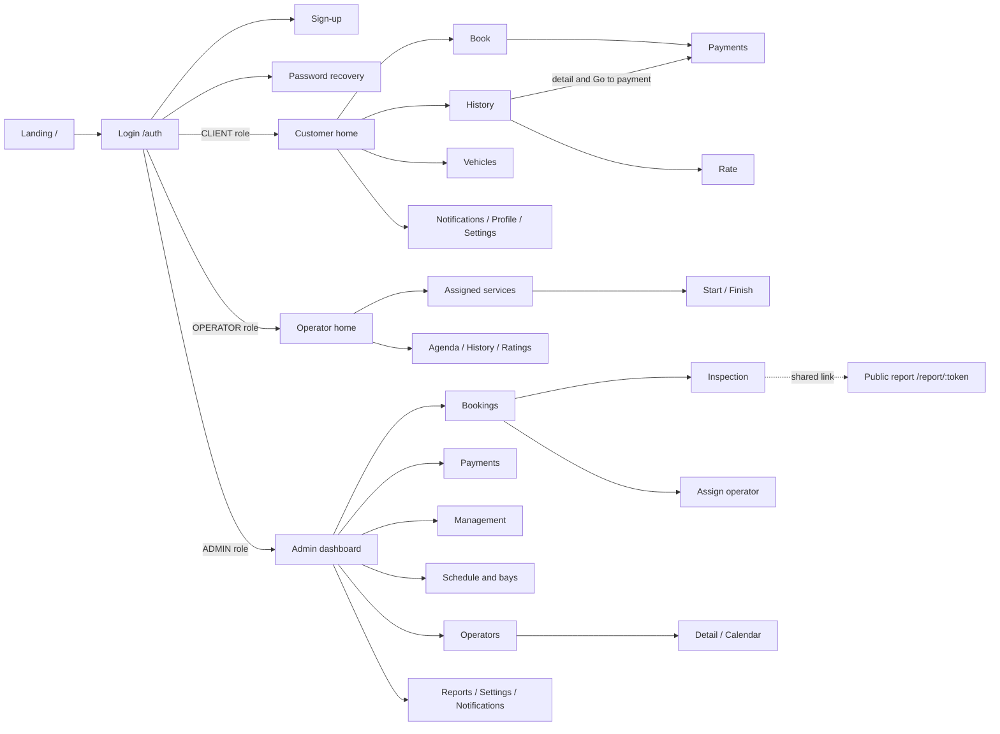

The diagram shows web navigation; the mobile app follows the same path per role, without the landing page or the public report (the inspection opens from the booking detail).

### 2.4 Screenshots

Screenshots were taken again on October 19, 2026, with the full system running: the web client in Chrome at 1366 × 768 and the mobile app in its web build (Expo) at phone size (390 × 844). The data shown are demo accounts and bookings. Figure 12 was taken again on October 20, after the user type change and the Registered filter were removed.

**Figure 2**

*Public landing page (web)*

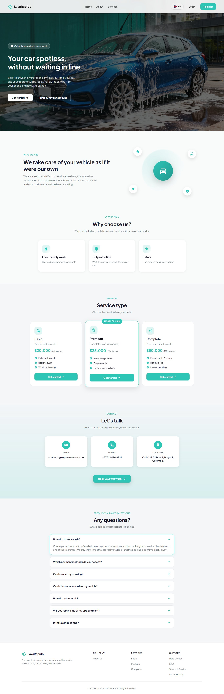

**Figure 3**

*Login (web)*

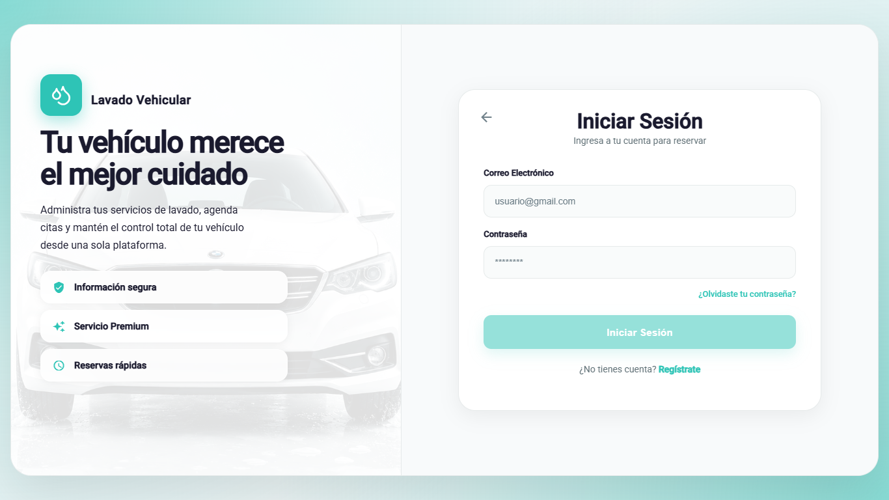

**Figure 4**

*Login (mobile app)*

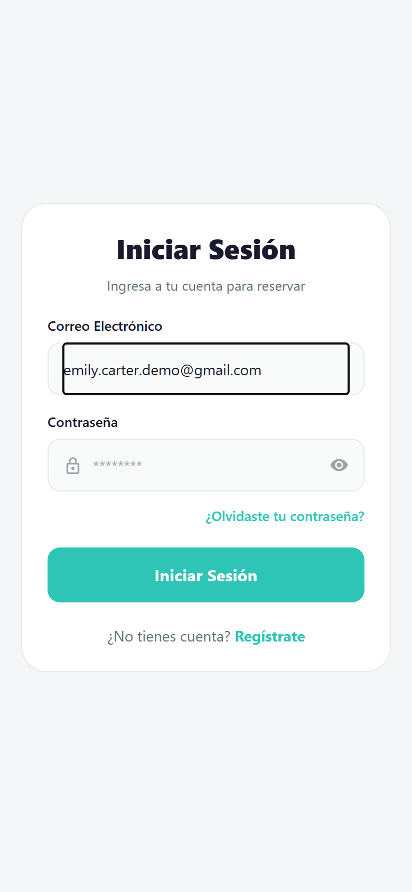

**Figure 5**

*Book a wash — customer (web)*


**Figure 6**

*Payments with QR and receipt — customer (web)*


**Figure 7**

*Customer home (mobile app)*

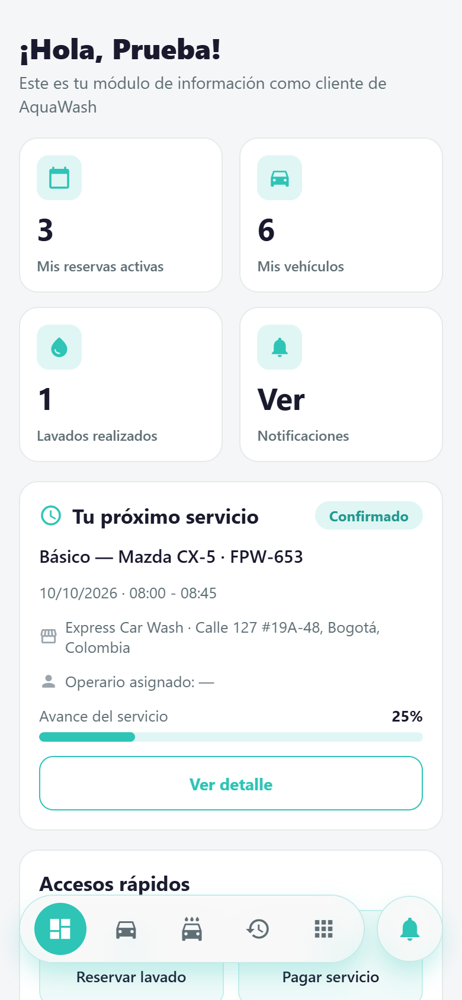

**Figure 8**

*Assigned services — operator (web)*

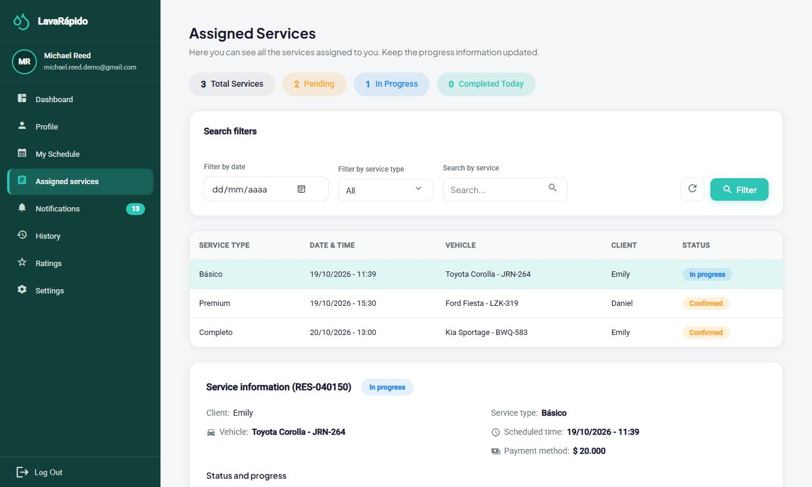

**Figure 9**

*Operator home (mobile app)*

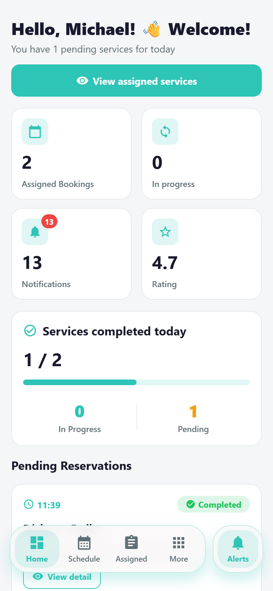

**Figure 10**

*Dashboard — administrator (web)*

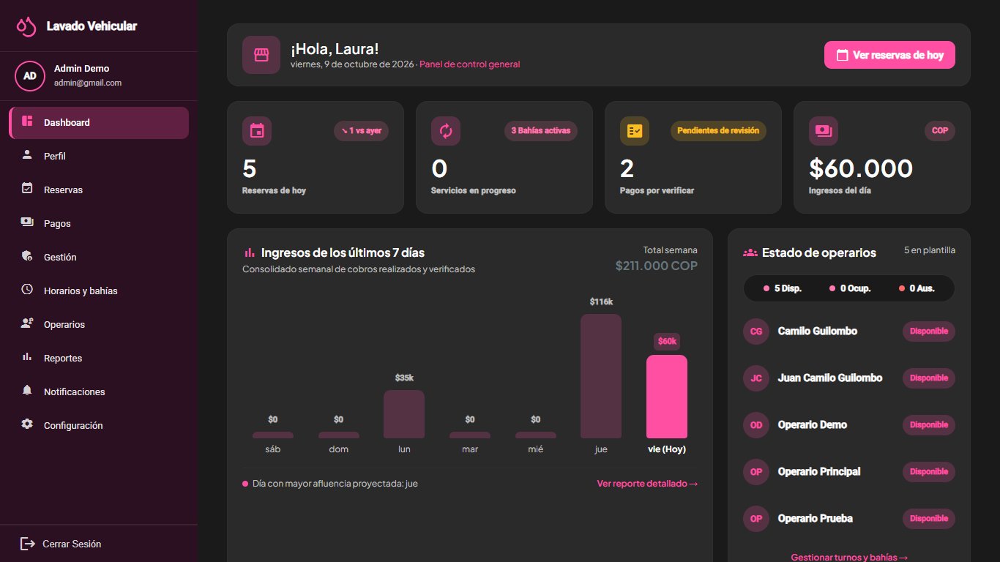

**Figure 11**

*Booking management — administrator (web)*


**Figure 12**

*User, role, service, and promotion management — administrator (web)*

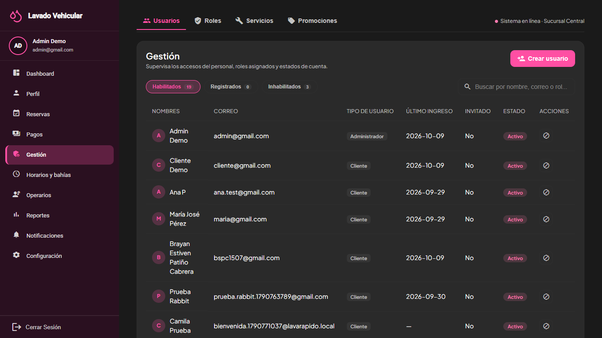

> *Note.* Original screenshots taken with headless Chrome. The mobile app screenshots come from its web build; on Android the UI is the same, rendered with native components.

### 2.5 Responsive Design

Both applications are used from a width of 360 pixels (RNF-008), the narrowest Android phone the project supports, without horizontal scrolling.

- **Web.** The breakpoints are in `src/styles/_breakpoints.scss` and are applied with the `mobile` (up to 768 px) and `tablet` (up to 1024 px) mixins of `_mixins.scss`. From 768 px the side menu opens with the ☰ button, and the content of pages with a menu leaves 72 px at the top for that button (global rule in `styles.scss`). Headings use a relative line height of 1.25, because the Material theme sets 20 px on the `body` and a larger heading overlapped itself when it wrapped into two lines. Wide tables scroll inside their card; the operator's assigned services table is shown as cards from 600 px. On a phone, the customer dashboard places the stats and quick access two per row, the authentication screens use the full width, and the landing bar keeps only the language and **Login** from 420 px.
- **Mobile.** Screens are built with Flexbox: stat cards go two per row (`StatGrid`), button rows wrap, and filter inputs grow in width without losing their 46 px height.
- **Verification.** On October 17, 2026, 60 web screens (30 at 360 px and 30 at 768 px) and 26 mobile app screens at 360 px, in their web version, were measured with Playwright: none scrolls sideways or clips content. The team test `e2e/width-360.js` (lavarapido-infra) covers the same rule for the web.

## 3. Architectural Model

The system follows a microservices architecture (Newman, 2021): an API Gateway as the single entry point, six domain services with hexagonal architecture, a SQL Server database split by schema, and RabbitMQ for asynchronous events.

### 3.1 Container Diagram (C4 Level 2)

**Figure 13**

*System container diagram (C4, level 2)*

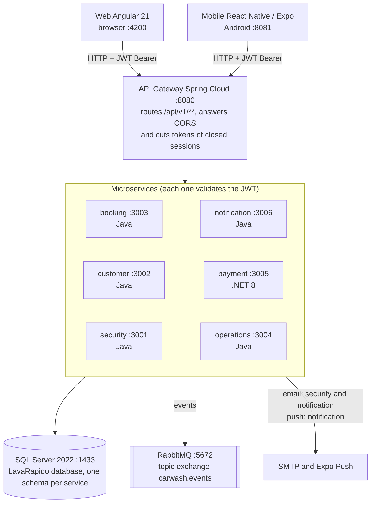

> *Note.* Notation based on the C4 model (Brown, n.d.). Clients talk only to the gateway; each service validates the JWT and stores data in its own schema. Since October 21, 2026 the gateway also rejects the tokens of closed sessions.

The web and mobile clients only call port 8080. The gateway does not check the JWT signature: it forwards the `Authorization` header and each service validates the token on its own (`Backend/lavarapido-api-gateway/src/main/resources/application.yml`, route comments, ADR-006). Since October 21, 2026 it does confirm that the session of the token is still open: `SessionCheckFilter`, which runs right after CORS, asks security-service with `GET /api/v1/auth/session` (204 if the session is still open, 401 if it was closed by a logout or because the account was deactivated) and keeps the answer for 30 seconds per SHA-256 fingerprint of the token, so an open session costs one extra call every half minute. If security-service does not answer within 3 seconds, the request goes through, and on logout the kept answer of that token is dropped. security-service makes the same check with the `sid` claim of the token (`ActiveSessionValidator`). It is configured with `SESSION_CHECK_ENABLED`, `SESSION_CHECK_CACHE_TTL`, and `SESSION_CHECK_TIMEOUT`, which `docker-compose.yml` passes to the container since October 22, 2026 (`SessionCheckFilter.java`, `SessionCheckConfig.java`). If security-service does not answer within 3 seconds, the gateway lets the request through (*fail-open*). Since October 24, 2026 the filter checks every request with `Authorization`, with any scheme (`bearer`, `Bearer`, `BEARER`) and on any route, and the cache uses only the token, so logout clears it in all its variants (SEC-01, api-gateway `2e20204`). That same day `AuthRateLimitFilter` (60 requests per minute per IP on `/api/v1/auth/**`, 429 `RATE_LIMITED` with `Retry-After`; `AUTH_RATE_LIMIT_*`), `ClientIpResolver` (it only trusts the `X-Forwarded-For` coming from `TRUSTED_PROXIES`, and forwards it to the services), and per-route timeouts (`ROUTE_CONNECT_TIMEOUT` 5 s and `ROUTE_READ_TIMEOUT` 60 s) were added. The service-to-service `/internal/**` routes have no gateway route and return 404 from outside.

### 3.2 Responsibility of Each Container

**Table 5**

*Containers, responsibility, and owned data*

| Container | Responsibility | Owned schemas | Public routes (gateway) |
| --- | --- | --- | --- |
| security-service | Sign-up, JWT login with lockout after failed attempts, password recovery, profile and address, preferences, users, roles, and permissions | `security`, `audit` | `/auth/**`, `/users/**`, `/admin/users/**`, `/admin/roles-permissions/**` |
| customer-service | Customers, vehicles, and vehicle types | `customer` | `/vehicles/**`, `/vehicle-types/**`, `/admin/vehicles/**` |
| booking-service | Catalog and prices, business hours, bays, availability, bookings, day summary, and business data | `catalog`, `booking` | `/catalog/**`, `/schedule/**`, `/establishment`, `/bookings/**`, `/admin/bookings/**`, `/admin/catalog/**`, `/admin/schedule/**`, `/admin/bays/**`, `/admin/establishment`, `/operator/bookings/**` |
| operations-service | Operators and their profile, availability, absences, automatic and manual assignment, execution, ratings, metrics, and inspection report | `execution` | `/admin/operators/**`, `/operators/**`, `/admin/inspections/**`, `/public/inspections/**`, `/admin/assignments/**`, `/operator/services/**`, `/operator/ratings`, `/ratings/**` |
| payment-service (.NET) | Payments with receipts, payment accounts, promotions, and loyalty points | `payment`, `promotion` | `/payments/**`, `/payment-accounts`, `/admin/payments/**`, `/admin/payment-accounts/**`, `/admin/payment-methods`, `/admin/promotions/**`, `/loyalty/**` |
| notification-service | Notification inbox, email, push (Expo), scheduled reminders, and alerts for bookings without an operator, in each account's language | `notification` | `/notifications/**`, `/admin/notifications/**` |

> *Note.* Source: routes in `Backend/lavarapido-api-gateway/src/main/resources/application.yml` and each service's Liquibase changelogs.

### 3.3 Service-to-Service Communication

There are two styles. Queries that need an immediate answer use synchronous REST; notices that something happened travel as events through RabbitMQ.

**Table 6**

*Synchronous REST calls between services*

| Source | Target | Purpose | Environment variable |
| --- | --- | --- | --- |
| booking | customer | Check that the vehicle belongs to the customer | `CUSTOMER_SERVICE_URL` |
| customer | security | Get the `person_id` if the sign-up event did not arrive | `SECURITY_SERVICE_URL` |
| operations | booking | Read, start, and finish bookings with the user's token; read bookings without a user for automatic assignment, free operators, and the follow-up job, and set to NO_SHOW a confirmed booking that ended without an operator (`/internal/v1/bookings`, `POST /internal/v1/bookings/{id}/no-show`) | `BOOKING_SERVICE_URL`, `BOOKING_INTERNAL_URL`, `INTERNAL_API_KEY` |
| operations | security | Operator and customer names, and whether the account is still active (internal route with a shared key) | `SECURITY_SERVICE_URL`, `SECURITY_INTERNAL_URL`, `INTERNAL_API_KEY` |
| payment | booking | Look up the booking and the amount due | `BOOKING_SERVICE_URL` |
| booking | payment | Before cancelling for lack of payment, find out whether the booking already has a payment in review or approved (`GET /internal/v1/payments/bookings/{bookingId}/reported`, answer `{"bookingId":123,"reported":true}`, 3 s timeout; since October 26, 2026). Without a key or with a wrong one, 401; a user's JWT does not work and the gateway does not route this path | `PAYMENT_SERVICE_URL` (`http://payment-service:3005`), `INTERNAL_API_KEY` (also in payment) |
| customer | booking | Know whether a vehicle has active bookings before removing it (`GET /internal/v1/bookings/active-count?customerVehicleId=`, since October 24, 2026) | `BOOKING_SERVICE_URL` (service root, without `/api/v1`), `INTERNAL_API_KEY` |
| notification | security | Email and language of each account and administrator list (`/internal/v1/users`) | `SECURITY_SERVICE_URL`, `INTERNAL_API_KEY` |
| gateway | security | Confirm that the session of the token is still open (`GET /api/v1/auth/session`; the answer is kept 30 seconds per token) | `ROUTE_SECURITY_URL` |

> *Note.* Source: `Backend/lavarapido-infra/docker-compose.yml` and, for the gateway, `SessionCheckConfig.java`.

**Table 7**

*Events published on the `carwash.events` exchange*

| Routing key | Publisher | Consumer |
| --- | --- | --- |
| `security.user_registered` | security | customer (creates the customer profile), notification (welcome) |
| `customer.provisioned` | customer (only written to the log) | None |
| `security.user.email-changed`, `security.user.password-changed`, `security.user.deactivated` | security (only written to the log) | None |
| `booking.confirmed` | booking | notification (notice and reminders), operations (automatic assignment, with the operator the customer chose) |
| `booking.cancelled` | booking (it carries `reason` and, since October 24, 2026, `reasonCode`) | notification |
| `booking.status_changed` | booking (when the administrator changes the status) | notification (notice to the customer; with IN\_PROGRESS, COMPLETED, or NO\_SHOW it cancels the reminders, and NO\_SHOW uses the `BOOKING_NO_SHOW` type) |
| `execution.operator_assigned`, `execution.operator_unassigned` (since October 24, 2026), `execution.service_started`, `execution.service_completed`, `execution.inspection_shared`, `execution.service_not_started`, `execution.service_not_finished` | operations | notification |
| `payment.reported` (since October 26, 2026: the customer reported a payment with a receipt, also when reporting it again after a rejection; payload `paymentId`, `bookingId`, `customerUserId`, `amount`) | payment | booking (sets `payment_reported_at`, and the booking with digital payment no longer expires) |
| `payment.confirmed` | payment | notification; booking since October 26, 2026 (sets `payment_reported_at`) |
| `payment.rejected`, `payment.refunded`, `payment.promotion_redeemed`, `payment.loyalty_points_earned` | payment | notification |

> *Note.* Source: `BookingEvent.java:17-18`, `ExecutionEvent.java:14-19`, `InspectionSharedEvent.java:15`, `PaymentIntegrationEvents.cs`, `CustomerProvisioned.java:15`, and the `ROUTING_KEYS` list in `notification-service/.../RabbitMessagingConfig.java`. Since October 24, 2026 notification no longer listens to `booking.created`, which nobody published (H-12). Closing as NO_SHOW a confirmed booking that ended without an operator publishes no event, and neither does closing a booking as "Attended" from "To close": `ServiceCompleted` is not published, so the customer does not receive "ready for pickup" hours later. `ServiceNotStarted` and `ServiceNotFinished` become the `OPERATOR_SERVICE_NOT_REGISTERED` notice for the operator and `ADMIN_SERVICE_NOT_REGISTERED` for each active administrator (inbox and push, never email).

The notification and customer queues have their own dead-letter queue. Since October 21, 2026, a `null` field in an event payload no longer sends the whole message to notification's dead-letter queue: that field is ignored (`DomainEventEnvelope.java`). Since October 24, 2026 so does operations': it consumes from `operations-service.booking-confirmed` (only `booking.confirmed`), retries transient failures 3 times, and then sends the message to `operations-service.booking-confirmed.dlq`; the old `operations-service.events` queue is drained and deleted on its own at startup (`LegacyQueueMigration.java`), and operations publishes with broker confirmation. notification writes to the `pending_delivery` table (changelog `047`; since changelog `048`, of October 24, 2026, `channel` and `language` are `NVARCHAR` like the rest of the text, because Hibernate reads it as `NCHAR` and the SQL Server driver does not convert `VARCHAR`), in the same transaction, the email and push it sends after the commit, and retries them (1, 2, 4… minutes, at most 1 hour, up to 5 attempts). notification stores the `event_id` of each event in `notification.processed_event` to ignore duplicates, because delivery is "at least once" (`DomainEventConsumerService.java:61-72`). Messaging is enabled with `MESSAGING_ENABLED`; when it is off, the Java services use a publisher that only writes to the log (`LoggingDomainEventPublisher.java:16`).

Since October 26, 2026 booking-service also consumes events (payment at booking, AC-88 and AC-89). Its queue `booking.payment-events` is bound to `carwash.events` with the keys `payment.reported` and `payment.confirmed`; a message that keeps failing after the retries goes to `booking.payment-events.dlq` through the `carwash.events.dlx` exchange, as in operations and notification (`RabbitConsumerConfig.java`). `PaymentEventsListener` reads `payload.bookingId` from the usual envelope (`{eventId, eventType, aggregateId, occurredAt, version, payload}`) and sets `payment_reported_at` (`Booking.markPaymentReported`, idempotent). `PaymentDeadlineJob` runs every `BOOKING_PAYMENT_EXPIRY_INTERVAL` (60 s) and is turned off with `BOOKING_PAYMENT_EXPIRY_ENABLED=false`: it looks for `DIGITAL` bookings without a report whose `payment_deadline` has passed and, **before cancelling** each one, asks payment-service through the internal path of Table 6 (outbound port `PaymentStatusDirectory`, adapter `PaymentServiceDirectory`). If `reported` is true, it marks the booking and does not cancel it (`PAYMENT_REPORTED`); if it is false, it cancels it through the usual path, with the reason `PAYMENT_TIMEOUT`, and publishes `BookingCancelled` (`CANCELLED`); if payment does not answer or returns an error, it does not cancel it in that round and checks it again in the next one (`PaymentTimeoutOutcome`). That query exists because there is no Outbox: in the live test of October 26 the event was lost and the job cancelled a paid booking (AC-89). The variables are `BOOKING_CASH_ACTIVE_LIMIT` (1), `BOOKING_PAYMENT_WINDOW` (30m), `BOOKING_PAYMENT_EXPIRY_ENABLED` (true), `BOOKING_PAYMENT_EXPIRY_INTERVAL` (60s), and `PAYMENT_SERVICE_URL`; payment-service now needs `INTERNAL_API_KEY`.

A scheduled job handles the bookings that ended and nobody closed, and the system only decides on its own when there is no doubt. Until October 23, 2026 booking-service also had `ExpiredBookingsJob`, which cancelled expired scheduled bookings; it was removed on October 24 (B-07) because every booking is created and rescheduled as confirmed and it never acted. In operations-service, `FollowUpJob` applies `FollowUpPolicy` every 5 minutes: a confirmed booking that never had an operator and ended more than an hour ago is set to NO_SHOW through booking's internal route, which checks the expiry again (409 `BOOKING_NOT_EXPIRED`); a confirmed booking with an operator that nobody started (`NOT_STARTED`) or an in-progress one that nobody finished one hour after its end (`NOT_FINISHED`) never changes on its own: it goes to the administrator's "To close" list (`GET /api/v1/admin/assignments/to-close`), who closes it as "Attended" (`POST /api/v1/admin/assignments/{bookingId}/attended`, 409 `BOOKING_NOT_TO_CLOSE` if it is not pending) or as "No-show" with the booking status change. To notify only once, `execution.service_execution.follow_up_notice_at` is stored (changelog `040`) and cleared when the service starts. This avoids recording as a no-show a service that was done and not registered. The variables are `BOOKING_EXPIRY_GRACE_MINUTES` (60, used by booking and operations), `BOOKING_EXPIRY_CHECK_ENABLED` and `BOOKING_EXPIRY_CHECK_INTERVAL` (booking, `true` and `PT5M`), and `FOLLOW_UP_ENABLED` and `FOLLOW_UP_INTERVAL` (operations, `true` and `PT5M`, it needs `INTERNAL_API_KEY`). The compose file passes them to the containers since October 22, 2026, including `FOLLOW_UP_LOOK_BACK_DAYS` (28 days back, because the machine can stay off for weeks) (`FollowUpJob.java`, `FollowUpService.java`).

### 3.4 Internal Layers of Each Service (Hexagonal)

**Figure 14**

*Layers of a service with hexagonal architecture*

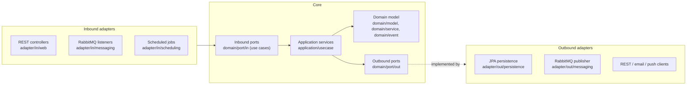

Hexagonal architecture separates the domain core from infrastructure through ports and adapters (Cockburn, 2005); domain modeling follows Evans (2004). The Java services use the `domain`, `application`, and `infrastructure` packages (for example, `security-service/src/main/java/com/lavarapido/security/`). payment-service applies the same idea with four .NET projects: `PaymentService.Domain`, `.Application` (with `Ports/In` and `Ports/Out`), `.Infrastructure`, and `.Api`.

### 3.5 Deployment

**Figure 15**

*Deployment diagram with Docker Compose*

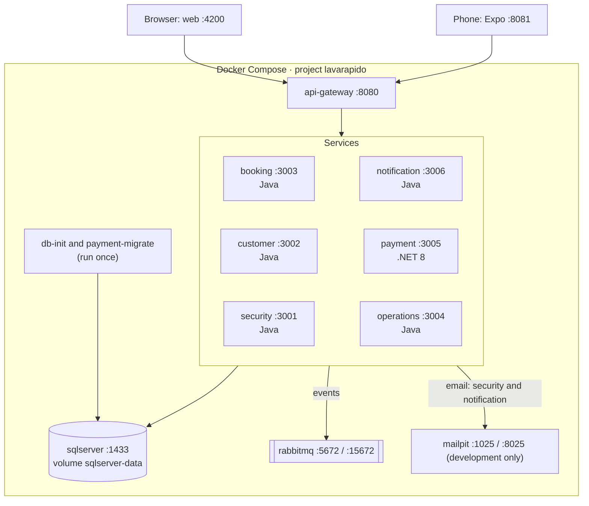

`docker compose up -d` starts only SQL Server, Mailpit, and RabbitMQ, and the services run from the IDE. `docker compose --profile app up -d --build` also starts the seven services in containers (`Backend/lavarapido-infra/docker-compose.yml:1-6`). The Java services create their tables with Liquibase on startup; payment-service creates them with the `payment-migrate` container.

In production the same compose file runs on an Azure virtual machine with `docker-compose.prod.yml` on top: two more containers are added, `web` (nginx with the Angular build) and `caddy`, which is the only one with published ports (80 and 443, HTTPS certificate managed by Caddy). Caddy sends `/api/*` to the gateway, `/app/*` to the APK download and its `version.json`, and everything else to the web. No service publishes ports on the host, Mailpit is not started (emails go out through Gmail SMTP), and the server is updated with `deploy/update-server.sh`, which deploys the `main` branch of every repository since infra *v1.1.1* (October 26, 2026; before, it deployed `develop` with the `BRANCH` variable), from the GitHub Actions workflow "Desplegar en Azure" (`deploy/ci-deploy.sh`) or by a team member over SSH. Since October 24 `update-server.sh` keeps the running version as `:prev` before rebuilding and waits for every container to be healthy, `rollback.sh` goes back to `:prev` without building, and `setup-server.sh` never downgrades. The `web` container runs `nginx-unprivileged`, without `root`, on port 8080, and Caddy points to `web:8080`. Continuous deployment (every approved merge into `main` deploys on its own, and when the machine is turned on `deploy/boot-update.sh` deploys what came in while it was off) runs on its own since October 26, 2026, with the "Pedir despliegue" job in 8 repositories and the mobile OTA (`cd.yml`), which only publishes if the native fingerprint matches the published APK's (Deployment Document, sections 1.3.12 and 4.3.4). Since October 20 and 21, 2026: Caddy sends security headers and a content security policy (CSP); every container has a health check every 30 seconds and its logs are capped at 3 files of 10 MB; the database is backed up every day and before every update (`deploy/backup-db.sh`), each backup is checked by restoring it under another name (`deploy/verify-backup.sh`), and the last 14 are kept (`deploy/restore-db.sh` restores one). Source: `lavarapido-infra/docker-compose.prod.yml`, `deploy/Caddyfile`, `deploy/backup-db.sh`, `.github/workflows/deploy.yml`; diagram in `vehicle-w-docs/08-uml/diagrams/source/deployment-production.md`.

## 4. Design Patterns

The code applies 18 verifiable patterns: 5 architectural, 8 backend design patterns, and 5 in the clients. The code itself names some of them in its comments (Strategy, Factory, Unit of Work). Pattern names follow the catalogs of Gamma et al. (1994), Fowler (2002), and Hohpe and Woolf (2003).

**Table 8**

*Design patterns identified*

| # | Pattern | Where it is used | Problem it solves |
| --- | --- | --- | --- |
| 1 | Microservices + API Gateway | `Backend/lavarapido-api-gateway/.../application.yml` | A single entry point for web and mobile; each domain is deployed separately |
| 2 | Hexagonal architecture (ports and adapters) | `domain/port/in`, `domain/port/out`, `infrastructure/adapter` packages in each Java service; `Ports/In`, `Ports/Out` in payment | The domain does not depend on Spring, JPA, or RabbitMQ; infrastructure can change without touching the rules |
| 3 | Schema per service in a single database (a variant of "database per service") | A single `LavaRapido` database with one schema per service; Liquibase changelogs per service; no FKs across schemas. All services connect with the same `sa` account, so the separation is by convention and not by permissions (H-10) | No service reads another's tables; cross references are validated through the API |
| 4 | Publish / subscribe (distributed Observer) | `RabbitDomainEventPublisher.java`, `DomainEventListener.java:38`, `UserRegisteredListener.java:38` | Notify other services without coupling them or waiting for a reply |
| 5 | Idempotent consumer | `DomainEventConsumerService.java:61-72` + table `notification.processed_event` | RabbitMQ delivers "at least once"; a repeated event does not create two notifications |
| 6 | Repository | `UserAccountRepository` (port) → `UserAccountPersistenceAdapter.java:33` → `AppUserJpaRepository.java:12` | Hide data access behind a domain interface |
| 7 | Adapter | `BCryptPasswordHasher.java:10` implements `PasswordHasher`; `HttpAuthService` implements `IAuthService` on mobile | Adapt an external library (BCrypt, fetch) to the contract the domain expects |
| 8 | Strategy | `IDiscountStrategy.cs`, `PercentageDiscountStrategy.cs`, `FixedAmountDiscountStrategy.cs` | Each discount type computes in its own way, with no `switch` inside `Promotion` |
| 9 | Factory | `DiscountStrategyFactory.cs:9-21` | A single place decides which strategy matches each `DiscountType` |
| 10 | Unit of Work | `IUnitOfWork.cs:8-15`, `EfUnitOfWork.cs` | Approving a payment and crediting points are saved together or not at all |
| 11 | Value Object | `EmailAddress.java:12` (record validated on construction), `DocumentNumber`, `PersonName`, `HashedPassword` | Invalid data cannot exist inside the domain |
| 12 | Aggregate Root + domain events | `AggregateRoot.cs:24-39` (payment), `domain/event/*` (Java) | The root entity protects its rules and records what happened |
| 13 | DTO | `LoginRequest.java:6-8` (record with validation), `dto/*` in each service; `Contracts/*` in payment | Separate the HTTP contract from the domain model |
| 14 | Dependency injection | `DomainConfig.java` (`@Bean`), `DependencyInjection.cs` (.NET), `inject()` in Angular, `AuthServiceProvider` on mobile | Objects receive their dependencies; tests pass in doubles |
| 15 | Null Object / alternate implementation by configuration | `LoggingDomainEventPublisher.java:16` and `NullIntegrationEventPublisher.cs` | With `MESSAGING_ENABLED=false` the system works without RabbitMQ |
| 16 | Guard + Interceptor (chain of responsibility) | `Web/src/app/core/guards/auth-guard.ts:10-34`, `core/interceptors/auth-interceptor.ts:14-38` | Control access by role and attach the token only to the system's own API |
| 17 | Domain policy (Specification) | `AssignmentPolicy.java`, `AutoAssignmentPolicy.java`, `StartPolicy.java` (operations); `LoginLockout.java` (security) | Each business rule (who can take a booking, who gets it automatically, when it can start, when an account is locked) lives in a pure domain class that is tested without a database |
| 18 | MVVM (Model-View-ViewModel) | Web: `features/*/viewmodels/*.viewmodel.ts` and `shared/viewmodels/*.viewmodel.ts` (36 `@Injectable` ViewModels with signals, for example `payment.viewmodel.ts` and `reservations.viewmodel.ts`); mobile: `modules/*/viewmodels/use*.ts` hooks (20, for example `useInspection.ts` and `useSettings.ts`) | The page or screen only displays and forwards events; the state, validations, and service calls live in the ViewModel, which is tested without the view |

> *Note.* Other mechanisms present: the `X-Correlation-Id` correlation filter (`CorrelationIdFilter.java:23-39`), the gateway session filter with the answer kept 30 seconds per token (`SessionCheckFilter.java`), the scheduled follow-up job for bookings nobody closed (`FollowUpJob.java`; `ExpiredBookingsJob.java` was removed on October 24, 2026), the gateway request limit (`AuthRateLimitFilter.java`), the web's automatic refresh (`LiveRefresh`/`keepFresh`, since October 24, 2026), Angular signal-based stores for admin state (`features/admin/services/*-store.ts`), and lazy loading of modules per role (`loadChildren` in `app.routes.ts`).

**Client architecture.** The web follows MVVM: each page in `features/<area>/pages` (the view, a *standalone* Angular component) injects its ViewModel from `features/<area>/viewmodels` or, if several areas share it (profile, settings, create user, sidebar), from `shared/viewmodels`; the ViewModel exposes signals (`signal`, `computed`) and methods, and calls the HTTP services in `core/services` (the Model). This way each screen's rules can be tested with Vitest without mounting the view; as of October 23, 2026, 9 of the 36 ViewModels have their `*.viewmodel.spec.ts`. The mobile app applies the same idea with React hooks and is organized by layers: `modules/<role>/screens` (view), `modules/<role>/viewmodels/use*.ts` (state and actions), `core/services` (HTTP clients for the gateway), `core/api` (`fetch` client and error translation), `core/navigation` (each role only registers its screens) and `core/storage` (session in secure storage), `shared` (components, validators, and i18n), and `app` (theme, providers, and configuration). Ten mobile screens or components still call the services without a ViewModel (for example `ClientPaymentScreen.tsx`). App updates use two paths (`app/providers/AppUpdatesCheck.tsx`): a new APK, mandatory when something native changes, and EAS Update (`expo-updates`, `runtimeVersion` with the *fingerprint* policy, *preview* channel, check when the app opens) for changes to screens and logic only (`npm run publish:update`).

### 4.1 Representative Snippets

**Strategy + Factory** (`Backend/lavarapido-payment-service/src/PaymentService.Domain/Promotions/Discounts/DiscountStrategyFactory.cs:9-21`):

```csharp
public static class DiscountStrategyFactory
{
    private static readonly IDiscountStrategy Percentage = new PercentageDiscountStrategy();
    private static readonly IDiscountStrategy FixedAmount = new FixedAmountDiscountStrategy();

    public static IDiscountStrategy For(DiscountType type) => type switch
    {
        DiscountType.Percentage => Percentage,
        DiscountType.FixedAmount => FixedAmount,
        _ => throw new DomainException(DomainErrorCodes.PromotionDiscountUnsupported, "...")
    };
}
```

**Outbound port + Adapter** (`security-service/.../domain/port/out/PasswordHasher.java` and `BCryptPasswordHasher.java`):

```java
public interface PasswordHasher {
    HashedPassword hash(String raw);
    boolean matches(String raw, HashedPassword hash);
}

class BCryptPasswordHasher implements PasswordHasher {
    private final PasswordEncoder encoder;
    public boolean matches(String raw, HashedPassword hash) {
        return raw != null && encoder.matches(raw, hash.value());
    }
}
```

**Alternate implementation by configuration** (`LoggingDomainEventPublisher.java:16-17`):

```java
@ConditionalOnProperty(prefix = "app.messaging", name = "enabled", havingValue = "false", matchIfMissing = true)
class LoggingDomainEventPublisher implements DomainEventPublisher { ... }
```

**HTTP interceptor** (`Web/src/app/core/interceptors/auth-interceptor.ts:14-25`):

```typescript
export const authInterceptor: HttpInterceptorFn = (req, next) => {
  if (!req.url.startsWith(API_BASE_URL)) {
    return next(req);
  }
  const token = inject(AuthService).accessToken();
  const request = token
    ? req.clone({ setHeaders: { Authorization: `Bearer ${token}` } })
    : req;
  ...
};
```

## 5. Data Model

The `LavaRapido` database (SQL Server 2022) has 57 tables in 9 schemas, created by each service's Liquibase changelogs. Foreign keys only exist within a single schema; references to another service are indexed columns without an FK, validated through the API.

**Table 9**

*Schemas, owner, and number of tables*

| Schema | Owning service | Tables | Changelog |
| --- | --- | --- | --- |
| `security` | security-service | 11 | `001`–`039` in `security-service/src/main/resources/db/changelog` |
| `audit` | security-service | 1 | `002-create-security-and-audit-core.sql` |
| `customer` | customer-service | 3 | `004`, `014`, `015` |
| `catalog` | booking-service | 3 | `005`, `022` |
| `booking` | booking-service | 10 | `005`, `018`, `021`, `024`, `032` |
| `execution` | operations-service | 11 | `007`, `033`, `037` |
| `payment` | payment-service | 7 | `lavarapido-payment-service/db/changelog/changes/008`–`020` |
| `promotion` | payment-service | 5 | `003`–`007`, `017`, `018` |
| `notification` | notification-service | 6 | `010`–`038` |

> *Note.* The `security.custom_role` table was created in `023` and dropped in `026`; it is not counted. Earlier documents (`MODELO-DE-DATOS.md`) mention 43 tables: the changelogs later added `bay_status`, `schedule_history`, `device_token`, `processed_event`, `booking_reminder`, and `booking_tracking`.

### 5.1 Common Conventions

- **Audit block.** Almost every domain table ends with `created_at`, `created_by`, `updated_at`, `updated_by`, `deleted_at`, `deleted_by`, and `row_version`. It is absent from the base `security` tables (`person`, `app_user`, `role`, `permission`, `role_permission`, `user_role`, `user_session`, `password_reset_token`), `audit.audit_log`, `booking.schedule_history`, and `notification.booking_tracking`. The tables added in October (`security.login_lockout`, `security.person_address`, `execution.operator_profile`, `execution.operator_skill`, and the four inspection report tables) do not have the full block either: they only keep the date and author columns they use.
- **Soft delete.** A non-null `deleted_at` marks a deleted row; several unique indexes are filtered with `WHERE deleted_at IS NULL`.
- **Optimistic concurrency.** A `tr_touch_<table>` trigger updates `updated_at` and adds 1 to `row_version` on every UPDATE of the tables that are edited (16 triggers); in payment, `EfUnitOfWork` does it before saving. Only payment-service compares `row_version` when updating (EF Core concurrency token); the Java services do not check it yet.
- **Application locks.** Where two operations at the same time could clash, the Java services take a SQL Server lock (`sp_getapplock`) that is released when the transaction ends: security-service uses `login-lockout-{userId}` at sign-in, so that two simultaneous failed attempts on the same account do not overwrite each other's lockout count (`LoginLockoutPersistenceAdapter.lock`); booking-service uses `booking-schedule` when it creates or reschedules a booking and when it closes the expired ones, and operations-service uses `operations-assignment` (since October 21, 2026) in manual and automatic assignment, so an operator does not end up with two services at the same time (`BookingPersistenceAdapter.lockSchedule`, `ExecutionPersistenceAdapter.lockAssignments`).
- **UTC dates.** All default values use `SYSUTCDATETIME()`.
- **Coded catalogs.** States and types are tables with a unique `code` (`booking_status`, `payment_status`, `execution_status`, etc.) loaded by seed changelogs.

### 5.2 Entity-Relationship Model

Solid lines are real FKs; dashed lines are logical references to another service (no FK). Only key attributes are shown; full detail is in the data dictionary (5.4).

**Figure 16**

*Security and customers (`security`, `audit`, `customer`)*

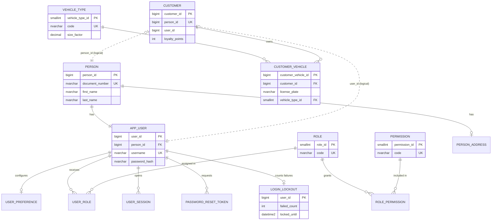

**Figure 17**

*Catalog and bookings (`catalog`, `booking`)*

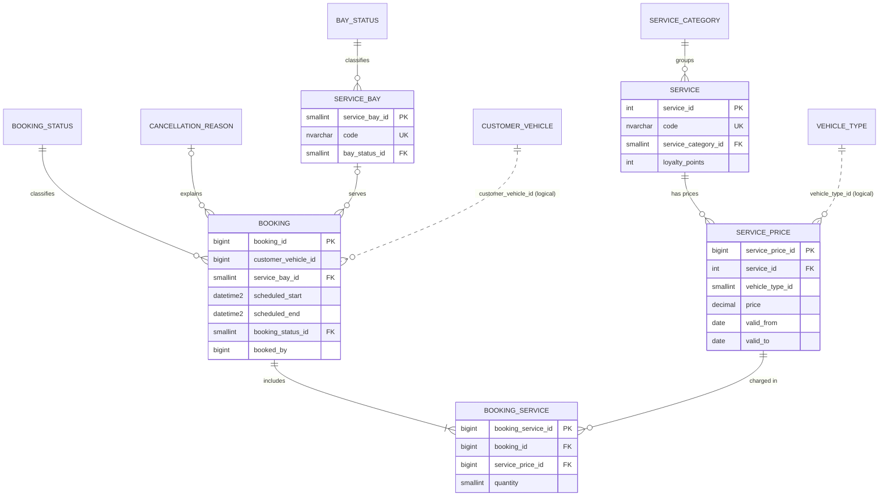

Standalone tables in the `booking` schema (no relationships): `establishment` (single row, `singleton = 1`), `business_hour` (one row per day), `business_hour_exception` (one per date), and `schedule_history`.

**Figure 18**

*Execution and notifications (`execution`, `notification`)*

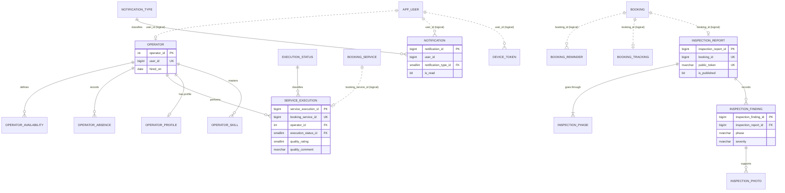

`notification.processed_event` has no relationships: it stores the `event_id` of each event already handled.

**Figure 19**

*Payments, promotions, and loyalty (`payment`, `promotion`)*

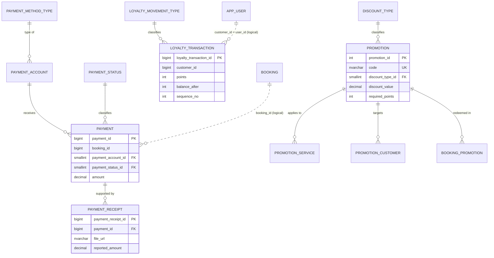

### 5.3 Relational Model

Notation: PK = primary key, UK = unique value, → = foreign key, ⇢ = logical reference to another service (no FK). The audit block is omitted.

- `security.person(person_id PK, document_number UK, first_name, last_name, phone, email)`
- `security.app_user(user_id PK, person_id → person UK, username UK, password_hash, is_active, last_login, created_at, terms_accepted_at, data_policy_accepted_at)`
- `security.login_lockout(user_id PK → app_user, failed_count, first_failed_at, locked_until, updated_at)` · `security.person_address(person_id PK → person, address, updated_at)`
- `security.role(role_id PK, code UK, name)` · `security.permission(permission_id PK, code UK, name, resource, action)`
- `security.role_permission(role_permission_id PK, role_id → role, permission_id → permission)` · `security.user_role(user_role_id PK, user_id → app_user, role_id → role)`
- `security.user_session(user_session_id PK, user_id → app_user, refresh_token_hash, started_at, expires_at, revoked_at, ip_address, user_agent)`
- `security.password_reset_token(password_reset_token_id PK, user_id → app_user, token_hash UK, requested_at, expires_at, used_at, ip_address)`
- `security.user_preference(user_preference_id PK, user_id → app_user UK, theme, language, notifications_enabled, email_reminders_enabled, promotions_enabled)`
- `audit.audit_log(audit_log_id PK, entity, entity_id, action, previous_data, new_data, changed_by, changed_at)`
- `customer.vehicle_type(vehicle_type_id PK, code UK, name, size_factor, display_order, is_active)`
- `customer.customer(customer_id PK, person_id ⇢ security.person UK, user_id ⇢ security.app_user, loyalty_points, customer_since)`
- `customer.customer_vehicle(customer_vehicle_id PK, customer_id → customer, license_plate, vehicle_type_id → vehicle_type, brand, model, color)`
- `catalog.service_category(service_category_id PK, code UK, name, description, display_order, is_active)`
- `catalog.service(service_id PK, code UK, name, description, service_category_id → service_category, loyalty_points, is_active)`
- `catalog.service_price(service_price_id PK, service_id → service, vehicle_type_id ⇢ customer.vehicle_type, price, estimated_minutes, valid_from, valid_to)`
- `booking.establishment(establishment_id PK, legal_name, trade_name, tax_id, address, phone, email, logo_url, singleton UK, business_type, founded_on, legal_representative, legal_representative_document, website, tax_regime, ciiu_activity, dian_resolution, invoice_prefix, invoice_range, instagram, facebook, support_line, service_hours_note)`
- `booking.business_hour(business_hour_id PK, day_of_week UK, opens_at, closes_at, break_starts_at, break_ends_at, is_active)`
- `booking.business_hour_exception(business_hour_exception_id PK, exception_date UK, is_closed, opens_at, closes_at, reason)`
- `booking.bay_status(bay_status_id PK, code UK, name, accepts_bookings, display_order)` · `booking.service_bay(service_bay_id PK, code UK, name, bay_status_id → bay_status)`
- `booking.booking_status(booking_status_id PK, code UK, name, is_final, display_order, is_active)` · `booking.cancellation_reason(cancellation_reason_id PK, code UK, name, is_customer_fault, display_order, is_active)`
- `booking.booking(booking_id PK, customer_vehicle_id ⇢ customer.customer_vehicle, service_bay_id → service_bay, scheduled_start, scheduled_end, booking_status_id → booking_status, booked_by ⇢ security.app_user, cancellation_reason_id → cancellation_reason, points_redeemed, points_discount_amount, notes, payment_mode, payment_deadline, payment_reported_at)`
- `booking.booking_service(booking_service_id PK, booking_id → booking, service_price_id → catalog.service_price, quantity)`
- `booking.schedule_history(schedule_history_id PK, entity_type, title, detail, changed_at, changed_by)`
- `execution.execution_status(execution_status_id PK, code UK, name, is_final, display_order, is_active)`
- `execution.operator(operator_id PK, user_id ⇢ security.app_user UK, hired_on, is_active)`
- `execution.operator_availability(operator_availability_id PK, operator_id → operator, day_of_week, starts_at, ends_at, is_active)`
- `execution.operator_absence(operator_absence_id PK, operator_id → operator, starts_at, ends_at, reason)`
- `execution.service_execution(service_execution_id PK, booking_service_id ⇢ booking.booking_service UK, operator_id → operator, execution_status_id → execution_status, started_at, finished_at, quality_rating, quality_comment, rated_at, is_comment_visible, follow_up_notice_at)`
- `execution.operator_profile(operator_id PK → operator, specialty, updated_at, updated_by)` · `execution.operator_skill(operator_skill_id PK, operator_id → operator, name, skill_level, display_order)`
- `execution.inspection_report(inspection_report_id PK, booking_id ⇢ booking.booking UK, booking_code, vehicle, plate, services, booking_date, booking_time, duration_minutes, public_token UK, is_published, published_at)`
- `execution.inspection_phase(inspection_phase_id PK, inspection_report_id → inspection_report, phase, status, started_at, finished_at)` · `execution.inspection_finding(inspection_finding_id PK, inspection_report_id → inspection_report, phase, area, severity, note)` · `execution.inspection_photo(inspection_photo_id PK, inspection_finding_id → inspection_finding, content_type, content, size_bytes)`
- `payment.payment_method_type(payment_method_type_id PK, code UK, name, requires_account, requires_receipt, display_order, is_active)`
- `payment.payment_account(payment_account_id PK, payment_method_type_id → payment_method_type, account_holder, account_number, qr_image_url, instructions, is_active)`
- `payment.payment_status(payment_status_id PK, code UK, name, is_final, display_order, is_active)`
- `payment.payment(payment_id PK, booking_id ⇢ booking.booking, payment_account_id → payment_account, payment_status_id → payment_status, amount, processed_at, approved_by, rejection_reason)`
- `payment.payment_receipt(payment_receipt_id PK, payment_id → payment, file_url, transaction_reference, reported_amount, uploaded_at, uploaded_by, reviewed_at, reviewed_by, review_comment)`
- `payment.loyalty_movement_type(loyalty_movement_type_id PK, code UK, name, sign, display_order, is_active)`
- `payment.loyalty_transaction(loyalty_transaction_id PK, customer_id ⇢ security.app_user (holds the customer's user_id, ADR-015), loyalty_movement_type_id → loyalty_movement_type, booking_id ⇢ booking.booking, points, balance_after, sequence_no, expires_on, description)`
- `promotion.discount_type(discount_type_id PK, code UK, name, display_order, is_active)`
- `promotion.promotion(promotion_id PK, code UK, name, description, discount_type_id → discount_type, discount_value, max_discount_amount, min_purchase_amount, is_public, min_completed_booking, valid_from, valid_to, max_redemptions, max_redemptions_per_customer, is_active, price, duration_minutes, icon, featured, benefits, required_points)`
- `promotion.promotion_service(promotion_service_id PK, promotion_id → promotion, service_id ⇢ catalog.service)`
- `promotion.promotion_customer(promotion_customer_id PK, promotion_id → promotion, customer_id ⇢ customer.customer, assigned_at, assigned_by)`
- `promotion.booking_promotion(booking_promotion_id PK, booking_id ⇢ booking.booking, promotion_id → promotion, applied_amount)`
- `notification.notification_type(notification_type_id PK, code UK, name, display_order, is_active)`
- `notification.notification(notification_id PK, user_id ⇢ security.app_user, notification_type_id → notification_type, title, message, reference_entity, reference_id, is_read, read_at, sent_at)`
- `notification.device_token(device_token_id PK, user_id ⇢ security.app_user, token UK, platform, is_active, last_seen_at)`
- `notification.processed_event(processed_event_id PK, event_id UK, event_type, processed_at)`
- `notification.booking_reminder(booking_reminder_id PK, booking_id ⇢ booking.booking, user_id ⇢ security.app_user, booking_code, scheduled_start, lead_minutes, remind_at, sent_at)`
- `notification.booking_tracking(booking_id PK ⇢ booking.booking, booking_code, customer_user_id, operator_user_id, scheduled_start, is_cancelled, unassigned_alert_at, updated_at)`

### 5.4 Data Dictionary

There is one dictionary for each of the 57 tables, grouped by schema. The "Null" column shows whether the field accepts NULL; PK = primary key, FK = foreign key, UK = unique value, and ⇢ = logical reference to another service (no FK). Tables that carry the audit block (section 5.1) show it as a single row at the end.

#### Schema `security`

Accounts, roles, permissions, sessions, and preferences. Owner: security-service.

**Table 10**

*Data dictionary of `security.person` — personal data*

| Field | Type | Null | Key | Description |
| --- | --- | --- | --- | --- |
| person_id | BIGINT IDENTITY | No | PK | Person identifier |
| document_number | NVARCHAR(20) | No | UK | ID document number |
| first_name | NVARCHAR(60) | No |  | First names |
| last_name | NVARCHAR(60) | No |  | Last names |
| phone | NVARCHAR(20) | Yes |  | Phone |
| email | NVARCHAR(120) | Yes |  | Contact email |

**Table 11**

*Data dictionary of `security.app_user` — login account*

| Field | Type | Null | Key | Description |
| --- | --- | --- | --- | --- |
| user_id | BIGINT IDENTITY | No | PK | User identifier |
| person_id | BIGINT | No | FK → person, UK | Person who owns the account (1 to 1) |
| username | NVARCHAR(60) | No | UK | Email used to log in |
| password_hash | NVARCHAR(255) | No |  | BCrypt password hash |
| is_active | BIT | No |  | Account enabled (default 1) |
| last_login | DATETIME2(3) | Yes |  | Last login |
| created_at | DATETIME2(3) | No |  | Account registration date (migration `036`) |
| terms_accepted_at | DATETIME2(3) | Yes |  | When the person accepted the Terms at sign-up (migration `039`) |
| data_policy_accepted_at | DATETIME2(3) | Yes |  | When the person accepted the Data Processing Policy at sign-up (migration `039`, Law 1581 of 2012) |

**Table 12**

*Data dictionary of `security.role` — system roles*

| Field | Type | Null | Key | Description |
| --- | --- | --- | --- | --- |
| role_id | SMALLINT IDENTITY | No | PK | Role identifier |
| code | NVARCHAR(30) | No | UK | `ADMIN`, `OPERATOR`, or `CLIENT` (seed `101`) |
| name | NVARCHAR(60) | No |  | Display name |

**Table 13**

*Data dictionary of `security.permission` — permissions*

| Field | Type | Null | Key | Description |
| --- | --- | --- | --- | --- |
| permission_id | SMALLINT IDENTITY | No | PK | Permission identifier |
| code | NVARCHAR(60) | No | UK | `VIEW_PANELS`, `CREATE_RECORDS`, `EDIT_DATA`, or `DELETE` (changelog `026`) |
| name | NVARCHAR(80) | No |  | Display name |
| resource | NVARCHAR(60) | No |  | Resource it applies to |
| action | NVARCHAR(30) | No |  | Allowed action |

**Table 14**

*Data dictionary of `security.role_permission` — permissions of each role*

| Field | Type | Null | Key | Description |
| --- | --- | --- | --- | --- |
| role_permission_id | BIGINT IDENTITY | No | PK | Assignment identifier |
| role_id | SMALLINT | No | FK → role; UK con permission_id | Role |
| permission_id | SMALLINT | No | FK → permission | Granted permission |

**Table 15**

*Data dictionary of `security.user_role` — roles of each user*

| Field | Type | Null | Key | Description |
| --- | --- | --- | --- | --- |
| user_role_id | BIGINT IDENTITY | No | PK | Assignment identifier |
| user_id | BIGINT | No | FK → app_user; UK con role_id | User |
| role_id | SMALLINT | No | FK → role | Assigned role |

**Table 16**

*Data dictionary of `security.user_session` — open sessions*

| Field | Type | Null | Key | Description |
| --- | --- | --- | --- | --- |
| user_session_id | BIGINT IDENTITY | No | PK | Session identifier |
| user_id | BIGINT | No | FK → app_user | User |
| refresh_token_hash | NVARCHAR(255) | Yes |  | Refresh token hash |
| started_at | DATETIME2(3) | No |  | Session start (UTC) |
| expires_at | DATETIME2(3) | No |  | Expiry |
| revoked_at | DATETIME2(3) | Yes |  | Logout time |
| ip_address | NVARCHAR(45) | Yes |  | Source IP |
| user_agent | NVARCHAR(300) | Yes |  | Source browser or app |

**Table 17**

*Data dictionary of `security.password_reset_token` — password recovery codes*

| Field | Type | Null | Key | Description |
| --- | --- | --- | --- | --- |
| password_reset_token_id | BIGINT IDENTITY | No | PK | Request identifier |
| user_id | BIGINT | No | FK → app_user | User who requested the code |
| token_hash | NVARCHAR(255) | No | UK | Hash of the 6-digit code |
| requested_at | DATETIME2(3) | No |  | Request date |
| expires_at | DATETIME2(3) | No |  | Expiry; CHECK `expires_at > requested_at` |
| used_at | DATETIME2(3) | Yes |  | When it was used |
| ip_address | NVARCHAR(45) | Yes |  | Request IP |

**Table 18**

*Data dictionary of `security.user_preference` — UI and notification preferences*

| Field | Type | Null | Key | Description |
| --- | --- | --- | --- | --- |
| user_preference_id | BIGINT IDENTITY | No | PK | Preference identifier |
| user_id | BIGINT | No | FK → app_user, UK | User (one row per user) |
| theme | NVARCHAR(20) | No |  | `green-light`, `green-dark`, `pink`, or `pink-dark` |
| language | NVARCHAR(5) | No |  | `es`, `en`, `fr`, or `pt` |
| notifications_enabled | BIT | No |  | In-app notifications |
| email_reminders_enabled | BIT | No |  | Email reminders |
| promotions_enabled | BIT | No |  | Promotion notices |
| created_at, created_by, updated_at, updated_by, deleted_at, deleted_by, row_version | — | — | | Audit block (section 5.1) |

**Table 19**

*Data dictionary for `security.login_lockout` — lockout after failed attempts*

| Field | Type | Null | Key | Description |
| --- | --- | --- | --- | --- |
| user_id | BIGINT | No | PK, FK → app_user | Account with recent failures or locked |
| failed_count | INT | No |  | Failures within the current window, 0 to 4 (default 0) |
| first_failed_at | DATETIME2(3) | Yes |  | Start of the 15-minute window |
| locked_until | DATETIME2(3) | Yes |  | Locked until this time; NULL if not locked |
| updated_at | DATETIME2(3) | No |  | Last change |

**Table 20**

*Data dictionary for `security.person_address` — contact address*

| Field | Type | Null | Key | Description |
| --- | --- | --- | --- | --- |
| person_id | BIGINT | No | PK, FK → person | Person who owns the address |
| address | NVARCHAR(200) | No |  | Profile contact address; cannot be blank |
| updated_at | DATETIME2(3) | No |  | Last change |

#### Schema `audit`

Change log. Owner: security-service.

**Table 21**

*Data dictionary of `audit.audit_log` — change log*

| Field | Type | Null | Key | Description |
| --- | --- | --- | --- | --- |
| audit_log_id | BIGINT IDENTITY | No | PK | Record identifier |
| entity | NVARCHAR(60) | No |  | Affected entity |
| entity_id | BIGINT | No |  | Affected row |
| action | NVARCHAR(20) | No |  | Action performed |
| previous_data | NVARCHAR(MAX) | Yes |  | Previous state |
| new_data | NVARCHAR(MAX) | Yes |  | New state |
| changed_by | BIGINT | Yes |  | User who made the change |
| changed_at | DATETIME2(3) | No |  | Change date (UTC) |

> *Note.* The table exists, but no trigger or service writes to it yet; who changed each row and when is kept by the audit block of each table (section 5.1).

#### Schema `customer`

Customers and vehicles. Owner: customer-service.

**Table 22**

*Data dictionary of `customer.vehicle_type` — vehicle types*

| Field | Type | Null | Key | Description |
| --- | --- | --- | --- | --- |
| vehicle_type_id | SMALLINT IDENTITY | No | PK | Type identifier |
| code | NVARCHAR(30) | No | UK | `CAR`, `SEDAN`, `SUV`, `PICKUP`, `TRUCK`, or `MOTO` |
| name | NVARCHAR(60) | No |  | Display name |
| size_factor | DECIMAL(4,2) | No |  | Size factor (> 0) |
| display_order | SMALLINT | No |  | Display order |
| is_active | BIT | No |  | Type in use |
| created_at, created_by, updated_at, updated_by, deleted_at, deleted_by, row_version | — | — | | Audit block (section 5.1) |

**Table 23**

*Data dictionary of `customer.customer` — customers*

| Field | Type | Null | Key | Description |
| --- | --- | --- | --- | --- |
| customer_id | BIGINT IDENTITY | No | PK | Customer identifier |
| person_id | BIGINT | No | UK, ⇢ security.person | Customer's person |
| user_id | BIGINT | Yes | UK filtrada, ⇢ security.app_user | Customer's account |
| loyalty_points | INT | No |  | Planned display copy of the points balance (≥ 0); no flow updates it, the balance is read from `payment.loyalty_transaction` |
| customer_since | DATE | No |  | Sign-up date |
| created_at, created_by, updated_at, updated_by, deleted_at, deleted_by, row_version | — | — | | Audit block (section 5.1) |

**Table 24**

*Data dictionary of `customer.customer_vehicle` — customers' vehicles*

| Field | Type | Null | Key | Description |
| --- | --- | --- | --- | --- |
| customer_vehicle_id | BIGINT IDENTITY | No | PK | Vehicle identifier |
| customer_id | BIGINT | No | FK → customer | Owner |
| license_plate | NVARCHAR(10) | No | UK filtrada (activos) | License plate |
| vehicle_type_id | SMALLINT | No | FK → vehicle_type | Vehicle type |
| brand | NVARCHAR(50) | Yes |  | Make |
| model | NVARCHAR(50) | Yes |  | Model |
| color | NVARCHAR(30) | Yes |  | Color |
| created_at, created_by, updated_at, updated_by, deleted_at, deleted_by, row_version | — | — | | Audit block (section 5.1) |

#### Schema `catalog`

Service catalog and prices. Owner: booking-service.

**Table 25**

*Data dictionary of `catalog.service_category` — service categories*

| Field | Type | Null | Key | Description |
| --- | --- | --- | --- | --- |
| service_category_id | SMALLINT IDENTITY | No | PK | Category identifier |
| code | NVARCHAR(30) | No | UK | `LAVADO`, `POLICHADO`, `DETALLADO`, `INTERIOR`, or `PAQUETES` |
| name | NVARCHAR(60) | No |  | Display name |
| description | NVARCHAR(200) | Yes |  | Description |
| display_order | SMALLINT | No |  | Display order |
| is_active | BIT | No |  | Category in use |
| created_at, created_by, updated_at, updated_by, deleted_at, deleted_by, row_version | — | — | | Audit block (section 5.1) |

**Table 26**

*Data dictionary of `catalog.service` — wash services*

| Field | Type | Null | Key | Description |
| --- | --- | --- | --- | --- |
| service_id | INT IDENTITY | No | PK | Service identifier |
| code | NVARCHAR(30) | No | UK | Code (`BASIC`, `PREMIUM`, `FULL` in the seed) |
| name | NVARCHAR(100) | No |  | Display name |
| description | NVARCHAR(MAX) | Yes |  | Description |
| service_category_id | SMALLINT | No | FK → service_category | Category |
| is_active | BIT | No |  | Available for booking |
| loyalty_points | INT | No |  | Points the service gives when the booking's payment is approved (changelog `022`) |
| created_at, created_by, updated_at, updated_by, deleted_at, deleted_by, row_version | — | — | | Audit block (section 5.1) |

**Table 27**

*Data dictionary of `catalog.service_price` — prices per vehicle type*

| Field | Type | Null | Key | Description |
| --- | --- | --- | --- | --- |
| service_price_id | BIGINT IDENTITY | No | PK | Price identifier |
| service_id | INT | No | FK → service | Service |
| vehicle_type_id | SMALLINT | No | ⇢ customer.vehicle_type | Vehicle type |
| price | DECIMAL(12,2) | No |  | Price (≥ 0) |
| estimated_minutes | SMALLINT | No |  | Estimated duration (> 0) |
| valid_from | DATE | No |  | Valid from |
| valid_to | DATE | Yes |  | Valid to; only one open price per service and type (filtered index); rows are immutable by trigger |
| created_at, created_by, updated_at, updated_by, deleted_at, deleted_by, row_version | — | — | | Audit block (section 5.1) |

#### Schema `booking`

Establishment, business hours, bays, and bookings. Owner: booking-service.

**Table 28**

*Data dictionary of `booking.establishment` — car wash data*

| Field | Type | Null | Key | Description |
| --- | --- | --- | --- | --- |
| establishment_id | SMALLINT IDENTITY | No | PK | Identifier |
| legal_name | NVARCHAR(150) | No |  | Legal name |
| trade_name | NVARCHAR(150) | No |  | Trade name |
| tax_id | NVARCHAR(30) | No |  | Tax ID (NIT) |
| address | NVARCHAR(200) | No |  | Address |
| phone | NVARCHAR(20) | Yes |  | Phone |
| email | NVARCHAR(120) | Yes |  | Email |
| logo_url | NVARCHAR(500) | Yes |  | Logo |
| business_type | NVARCHAR(100) | Yes |  | Business type (migration `032`) |
| founded_on | DATE | Yes |  | Foundation date; cannot be in the future (migration `032`) |
| legal_representative | NVARCHAR(150) | Yes |  | Legal representative (migration `032`) |
| legal_representative_document | NVARCHAR(30) | Yes |  | Legal representative ID (migration `032`) |
| website | NVARCHAR(200) | Yes |  | Website (migration `032`) |
| tax_regime | NVARCHAR(150) | Yes |  | Tax regime (migration `032`) |
| ciiu_activity | NVARCHAR(150) | Yes |  | CIIU economic activity (migration `032`) |
| dian_resolution | NVARCHAR(60) | Yes |  | DIAN invoicing resolution (migration `032`) |
| invoice_prefix | NVARCHAR(10) | Yes |  | Invoice prefix (migration `032`) |
| invoice_range | NVARCHAR(30) | Yes |  | Invoice range (migration `032`) |
| instagram | NVARCHAR(100) | Yes |  | Instagram (migration `032`) |
| facebook | NVARCHAR(150) | Yes |  | Facebook (migration `032`) |
| support_line | NVARCHAR(30) | Yes |  | Support line (migration `032`) |
| service_hours_note | NVARCHAR(150) | Yes |  | Service hours shown to the customer (migration `032`) |
| singleton | BIT | No | UK | Always 1: prevents a second row |
| created_at, created_by, updated_at, updated_by, deleted_at, deleted_by, row_version | — | — | | Audit block (section 5.1) |

**Table 29**

*Data dictionary of `booking.business_hour` — weekly hours*

| Field | Type | Null | Key | Description |
| --- | --- | --- | --- | --- |
| business_hour_id | SMALLINT IDENTITY | No | PK | Identifier |
| day_of_week | SMALLINT | No | UK | Day of week (1 to 7) |
| opens_at | TIME(0) | No |  | Opening time |
| closes_at | TIME(0) | No |  | Closing time (after opening) |
| is_active | BIT | No |  | Working day |
| break_starts_at | TIME(0) | Yes |  | Break start (changelog `018`) |
| break_ends_at | TIME(0) | Yes |  | Break end |
| created_at, created_by, updated_at, updated_by, deleted_at, deleted_by, row_version | — | — | | Audit block (section 5.1) |

**Table 30**

*Data dictionary of `booking.business_hour_exception` — schedule exceptions*

| Field | Type | Null | Key | Description |
| --- | --- | --- | --- | --- |
| business_hour_exception_id | INT IDENTITY | No | PK | Identifier |
| exception_date | DATE | No | UK | Special date |
| is_closed | BIT | No |  | Closed all day |
| opens_at | TIME(0) | Yes |  | Special opening (if open) |
| closes_at | TIME(0) | Yes |  | Special closing (if open) |
| reason | NVARCHAR(120) | No |  | Reason |
| created_at, created_by, updated_at, updated_by, deleted_at, deleted_by, row_version | — | — | | Audit block (section 5.1) |

**Table 31**

*Data dictionary of `booking.bay_status` — bay statuses*

| Field | Type | Null | Key | Description |
| --- | --- | --- | --- | --- |
| bay_status_id | SMALLINT IDENTITY | No | PK | Identifier |
| code | NVARCHAR(30) | No | UK | `ACTIVE`, `MAINTENANCE`, or `INACTIVE` |
| name | NVARCHAR(60) | No |  | Display name |
| accepts_bookings | BIT | No |  | Whether it accepts bookings |
| display_order | SMALLINT | No |  | Display order |
| created_at, created_by, updated_at, updated_by, deleted_at, deleted_by, row_version | — | — | | Audit block (section 5.1) |

**Table 32**

*Data dictionary of `booking.service_bay` — wash bays*

| Field | Type | Null | Key | Description |
| --- | --- | --- | --- | --- |
| service_bay_id | SMALLINT IDENTITY | No | PK | Bay identifier |
| code | NVARCHAR(20) | No | UK | Code (`BAY-01`…) |
| name | NVARCHAR(60) | No |  | Display name |
| bay_status_id | SMALLINT | No | FK → bay_status | Status (default 1, active) |
| created_at, created_by, updated_at, updated_by, deleted_at, deleted_by, row_version | — | — | | Audit block (section 5.1) |

**Table 33**

*Data dictionary of `booking.booking_status` — booking statuses*

| Field | Type | Null | Key | Description |
| --- | --- | --- | --- | --- |
| booking_status_id | SMALLINT IDENTITY | No | PK | 1 `SCHEDULED`, 2 `CONFIRMED`, 3 `IN_PROGRESS`, 4 `COMPLETED`, 5 `CANCELLED`, 6 `NO_SHOW` |
| code | NVARCHAR(30) | No | UK | Status code |
| name | NVARCHAR(60) | No |  | Display name |
| is_final | BIT | No |  | Whether the status is final |
| display_order | SMALLINT | No |  | Display order |
| is_active | BIT | No |  | Status in use |
| created_at, created_by, updated_at, updated_by, deleted_at, deleted_by, row_version | — | — | | Audit block (section 5.1) |

**Table 34**

*Data dictionary of `booking.cancellation_reason` — cancellation reasons*

| Field | Type | Null | Key | Description |
| --- | --- | --- | --- | --- |
| cancellation_reason_id | SMALLINT IDENTITY | No | PK | Identifier |
| code | NVARCHAR(30) | No | UK | Code (eight seed reasons; `EXPIRED`, from seed `112`, is only used by the system when it cancels an expired scheduled booking, and `PAYMENT_TIMEOUT` (*The payment receipt was not uploaded in time*), from seed `117` of October 26, 2026, is only used by the system when it cancels an overdue booking with digital payment; neither is offered when cancelling by hand) |
| name | NVARCHAR(60) | No |  | Display name |
| is_customer_fault | BIT | No |  | Whether the customer is at fault |
| display_order | SMALLINT | No |  | Display order |
| is_active | BIT | No |  | Reason in use |
| created_at, created_by, updated_at, updated_by, deleted_at, deleted_by, row_version | — | — | | Audit block (section 5.1) |

**Table 35**

*Data dictionary of `booking.booking` — bookings*

| Field | Type | Null | Key | Description |
| --- | --- | --- | --- | --- |
| booking_id | BIGINT IDENTITY | No | PK | Booking identifier |
| customer_vehicle_id | BIGINT | No | ⇢ customer.customer_vehicle | Vehicle to wash |
| service_bay_id | SMALLINT | Yes | FK → service_bay | Assigned bay; a trigger prevents overlapping times |
| scheduled_start | DATETIME2(3) | No |  | Scheduled start |
| scheduled_end | DATETIME2(3) | No |  | Scheduled end (after start) |
| booking_status_id | SMALLINT | No | FK → booking_status | Status |
| booked_by | BIGINT | No | ⇢ security.app_user | User who created the booking |
| cancellation_reason_id | SMALLINT | Yes | FK → cancellation_reason | Only when the status is `CANCELLED` |
| points_redeemed | INT | No |  | Points redeemed |
| points_discount_amount | DECIMAL(12,2) | No |  | Points discount (both 0 or both > 0) |
| notes | NVARCHAR(300) | Yes |  | Notes |
| payment_mode | NVARCHAR(10) | Yes |  | How the customer will pay: `DIGITAL` (QR code and receipt) or `CASH` (cash at the car wash), with CHECK `ck_booking_payment_mode`. NULL in bookings made before the change and in the administrator's bookings without a mode (migration `049`; NVARCHAR because of `use_nationalized_character_data`, the lesson of `048`) |
| payment_deadline | DATETIME2(3) | Yes |  | Deadline to upload the receipt of a `DIGITAL` booking: the earlier of creation plus `BOOKING_PAYMENT_WINDOW` (30 min) and `scheduled_start`. NULL if it has no deadline (migration `049`) |
| payment_reported_at | DATETIME2(3) | Yes |  | When the receipt or the approved payment arrived from payment-service (`payment.reported`, `payment.confirmed`, or the internal query). The filtered index `ix_booking_payment_pending` (`payment_deadline`, only `DIGITAL` without a report) serves `PaymentDeadlineJob` (migration `049`) |
| created_at, created_by, updated_at, updated_by, deleted_at, deleted_by, row_version | — | — | | Audit block (section 5.1) |

**Table 36**

*Data dictionary of `booking.booking_service` — service lines of each booking*

| Field | Type | Null | Key | Description |
| --- | --- | --- | --- | --- |
| booking_service_id | BIGINT IDENTITY | No | PK | Line identifier |
| booking_id | BIGINT | No | FK → booking; UK con service_price_id | Booking |
| service_price_id | BIGINT | No | FK → catalog.service_price | Price applied when booking |
| quantity | SMALLINT | No |  | Quantity (> 0) |
| created_at, created_by, updated_at, updated_by, deleted_at, deleted_by, row_version | — | — | | Audit block (section 5.1) |

**Table 37**

*Data dictionary of `booking.schedule_history` — schedule change history*

| Field | Type | Null | Key | Description |
| --- | --- | --- | --- | --- |
| schedule_history_id | BIGINT IDENTITY | No | PK | Identifier |
| entity_type | NVARCHAR(20) | No |  | `WEEK`, `EXCEPTION`, or `BAY` |
| title | NVARCHAR(200) | No |  | Change summary |
| detail | NVARCHAR(300) | Yes |  | Change detail |
| changed_at | DATETIME2(3) | No |  | Change date (UTC) |
| changed_by | BIGINT | Yes |  | User who made the change |

#### Schema `execution`

Operators and service execution. Owner: operations-service.

**Table 38**

*Data dictionary of `execution.execution_status` — execution statuses*

| Field | Type | Null | Key | Description |
| --- | --- | --- | --- | --- |
| execution_status_id | SMALLINT IDENTITY | No | PK | 1 `PENDING`, 2 `IN_PROGRESS`, 3 `PAUSED`, 4 `COMPLETED`, 5 `WITH_ISSUE` |
| code | NVARCHAR(30) | No | UK | Status code |
| name | NVARCHAR(60) | No |  | Display name |
| is_final | BIT | No |  | Whether the status is final |
| display_order | SMALLINT | No |  | Display order |
| is_active | BIT | No |  | Status in use |
| created_at, created_by, updated_at, updated_by, deleted_at, deleted_by, row_version | — | — | | Audit block (section 5.1) |

**Table 39**

*Data dictionary of `execution.operator` — operators*

| Field | Type | Null | Key | Description |
| --- | --- | --- | --- | --- |
| operator_id | INT IDENTITY | No | PK | Operator identifier |
| user_id | BIGINT | No | UK, ⇢ security.app_user | Operator's account |
| hired_on | DATE | No |  | Hire date |
| is_active | BIT | No |  | Eligible for assignments |
| created_at, created_by, updated_at, updated_by, deleted_at, deleted_by, row_version | — | — | | Audit block (section 5.1) |

**Table 40**

*Data dictionary of `execution.operator_availability` — operator weekly shift*

| Field | Type | Null | Key | Description |
| --- | --- | --- | --- | --- |
| operator_availability_id | INT IDENTITY | No | PK | Identifier |
| operator_id | INT | No | FK → operator; UK con day_of_week | Operator |
| day_of_week | SMALLINT | No |  | Day of week (1 to 7) |
| starts_at | TIME(0) | No |  | Shift start |
| ends_at | TIME(0) | No |  | Shift end (after start) |
| is_active | BIT | No |  | Shift in use |
| created_at, created_by, updated_at, updated_by, deleted_at, deleted_by, row_version | — | — | | Audit block (section 5.1) |

**Table 41**

*Data dictionary of `execution.operator_absence` — operator absences*

| Field | Type | Null | Key | Description |
| --- | --- | --- | --- | --- |
| operator_absence_id | INT IDENTITY | No | PK | Identifier |
| operator_id | INT | No | FK → operator | Operator |
| starts_at | DATETIME2(3) | No |  | Absence start |
| ends_at | DATETIME2(3) | No |  | Absence end; a trigger prevents overlapping absences |
| reason | NVARCHAR(120) | No |  | Reason |
| created_at, created_by, updated_at, updated_by, deleted_at, deleted_by, row_version | — | — | | Audit block (section 5.1) |

**Table 42**

*Data dictionary of `execution.service_execution` — execution of each service line*

| Field | Type | Null | Key | Description |
| --- | --- | --- | --- | --- |
| service_execution_id | BIGINT IDENTITY | No | PK | Execution identifier |
| booking_service_id | BIGINT | No | UK, ⇢ booking.booking_service | Booking line |
| operator_id | INT | No | FK → operator | Assigned operator |
| execution_status_id | SMALLINT | No | FK → execution_status | Execution status |
| started_at | DATETIME2(3) | Yes |  | Actual start |
| finished_at | DATETIME2(3) | Yes |  | Actual finish |
| quality_rating | SMALLINT | Yes |  | Rating from 1 to 5 |
| quality_comment | NVARCHAR(500) | Yes |  | Comment; only with a rating |
| rated_at | DATETIME2(3) | Yes |  | Rating date |
| is_comment_visible | BIT | No |  | Whether the comment is shown |
| follow_up_notice_at | DATETIME2(3) | Yes |  | When the operator and the administrators were told that the service ended without being registered; cleared when the service starts (changelog `040`) |
| created_at, created_by, updated_at, updated_by, deleted_at, deleted_by, row_version | — | — | | Audit block (section 5.1) |

**Table 43**

*Data dictionary for `execution.operator_profile` — operator specialty*

| Field | Type | Null | Key | Description |
| --- | --- | --- | --- | --- |
| operator_id | INT | No | PK, FK → operator | Operator |
| specialty | NVARCHAR(80) | Yes |  | Specialty |
| updated_at | DATETIME2(3) | No |  | Last change |
| updated_by | BIGINT | Yes |  | Administrator who changed it ⇢ security.app_user |

**Table 44**

*Data dictionary for `execution.operator_skill` — operator skills*

| Field | Type | Null | Key | Description |
| --- | --- | --- | --- | --- |
| operator_skill_id | INT IDENTITY | No | PK | Identifier |
| operator_id | INT | No | FK → operator | Operator |
| name | NVARCHAR(60) | No | UK with operator_id | Skill name |
| skill_level | NVARCHAR(12) | No |  | `CERTIFIED`, `EXPERT` or `ADVANCED` |
| display_order | SMALLINT | No |  | Order in the profile |

**Table 45**

*Data dictionary for `execution.inspection_report` — vehicle inspection report*

| Field | Type | Null | Key | Description |
| --- | --- | --- | --- | --- |
| inspection_report_id | BIGINT IDENTITY | No | PK | Identifier |
| booking_id | BIGINT | No | UK, ⇢ booking.booking | Inspected booking (one report per booking) |
| booking_code, vehicle, plate, services | NVARCHAR | Yes |  | Copy of the booking data when the report is created |
| booking_date, booking_time, duration_minutes | DATE, TIME(0), INT | No |  | Booking date, time, and duration |
| public_token | NVARCHAR(64) | No | UK | Random code of the public link |
| is_published | BIT | No |  | The link shows the report (default 0) |
| published_at | DATETIME2(3) | Yes |  | Publication date; required when published |
| created_at, created_by, updated_at, updated_by, row_version | — | — |  | Audit |

**Table 46**

*Data dictionary for `execution.inspection_phase` — report phases*

| Field | Type | Null | Key | Description |
| --- | --- | --- | --- | --- |
| inspection_phase_id | BIGINT IDENTITY | No | PK | Identifier |
| inspection_report_id | BIGINT | No | FK → inspection_report; UK with phase | Report |
| phase | NVARCHAR(20) | No |  | `RECEPTION`, `EXTERIOR`, `INTERIOR`, `ENGINE` or `DELIVERY` |
| status | NVARCHAR(20) | No |  | `PENDING`, `IN_PROGRESS` or `DONE` |
| started_at, finished_at | DATETIME2(3) | Yes |  | Phase start and end |

**Table 47**

*Data dictionary for `execution.inspection_finding` — report findings*

| Field | Type | Null | Key | Description |
| --- | --- | --- | --- | --- |
| inspection_finding_id | BIGINT IDENTITY | No | PK | Identifier |
| inspection_report_id | BIGINT | No | FK → inspection_report | Report |
| phase | NVARCHAR(20) | No |  | Phase where it was found |
| area | NVARCHAR(120) | No |  | Vehicle area |
| severity | NVARCHAR(10) | No |  | `INFO`, `MINOR` or `MAJOR` |
| note | NVARCHAR(500) | Yes |  | Note |
| created_at, created_by, deleted_at, deleted_by | — | — |  | Creation and soft delete |

**Table 48**

*Data dictionary for `execution.inspection_photo` — finding photos*

| Field | Type | Null | Key | Description |
| --- | --- | --- | --- | --- |
| inspection_photo_id | BIGINT IDENTITY | No | PK | Identifier |
| inspection_finding_id | BIGINT | No | FK → inspection_finding | Finding (up to 5 photos each) |
| content_type | NVARCHAR(30) | No |  | `image/jpeg` or `image/png` |
| content | VARBINARY(MAX) | No |  | Image |
| size_bytes | INT | No |  | Size, up to 2 MB |
| created_at, created_by | — | — |  | Creation |

#### Schema `payment`

Payments, payment accounts, and points. Owner: payment-service.

**Table 49**

*Data dictionary of `payment.payment_method_type` — payment methods*

| Field | Type | Null | Key | Description |
| --- | --- | --- | --- | --- |
| payment_method_type_id | SMALLINT IDENTITY | No | PK | Identifier |
| code | NVARCHAR(30) | No | UK | `EFECTIVO`, `NEQUI`, `DAVIPLATA`, or `TRANSFERENCIA` |
| name | NVARCHAR(60) | No |  | Display name |
| requires_account | BIT | No |  | Whether it requires an account |
| requires_receipt | BIT | No |  | Whether it requires a receipt |
| display_order | SMALLINT | No |  | Display order |
| is_active | BIT | No |  | Method in use |
| created_at, created_by, updated_at, updated_by, deleted_at, deleted_by, row_version | — | — | | Audit block (section 5.1) |

**Table 50**

*Data dictionary of `payment.payment_account` — car wash receiving accounts*

| Field | Type | Null | Key | Description |
| --- | --- | --- | --- | --- |
| payment_account_id | SMALLINT IDENTITY | No | PK | Account identifier |
| payment_method_type_id | SMALLINT | No | FK → payment_method_type | Payment method |
| account_holder | NVARCHAR(120) | No |  | Holder |
| account_number | NVARCHAR(50) | Yes |  | Number or key |
| qr_image_url | NVARCHAR(MAX) | Yes |  | QR image stored as data (changelog `016`) |
| instructions | NVARCHAR(300) | Yes |  | Instructions for the customer |
| is_active | BIT | No |  | Account visible to the customer |
| created_at, created_by, updated_at, updated_by, deleted_at, deleted_by, row_version | — | — | | Audit block (section 5.1) |

**Table 51**

*Data dictionary of `payment.payment_status` — payment statuses*

| Field | Type | Null | Key | Description |
| --- | --- | --- | --- | --- |
| payment_status_id | SMALLINT IDENTITY | No | PK | Identifier |
| code | NVARCHAR(30) | No | UK | `PENDING`, `IN_REVIEW`, `APPROVED`, `REJECTED`, or `REFUNDED` |
| name | NVARCHAR(60) | No |  | Display name |
| is_final | BIT | No |  | Whether the status is final |
| display_order | SMALLINT | No |  | Display order |
| is_active | BIT | No |  | Status in use |
| created_at, created_by, updated_at, updated_by, deleted_at, deleted_by, row_version | — | — | | Audit block (section 5.1) |

**Table 52**

*Data dictionary of `payment.payment` — payments*

| Field | Type | Null | Key | Description |
| --- | --- | --- | --- | --- |
| payment_id | BIGINT IDENTITY | No | PK | Payment identifier |
| booking_id | BIGINT | No | ⇢ booking.booking | Booking paid; one approved payment per booking (filtered index) |
| payment_account_id | SMALLINT | No | FK → payment_account | Account paid into |
| payment_status_id | SMALLINT | No | FK → payment_status | Status |
| amount | DECIMAL(12,2) | No |  | Amount (> 0) |
| processed_at | DATETIME2(3) | Yes |  | Review date |
| approved_by | BIGINT | Yes |  | Approving administrator |
| rejection_reason | NVARCHAR(200) | Yes |  | Rejection reason |
| created_at, created_by, updated_at, updated_by, deleted_at, deleted_by, row_version | — | — | | Audit block (section 5.1) |

**Table 53**

*Data dictionary of `payment.payment_receipt` — payment receipts*

| Field | Type | Null | Key | Description |
| --- | --- | --- | --- | --- |
| payment_receipt_id | BIGINT IDENTITY | No | PK | Receipt identifier |
| payment_id | BIGINT | No | FK → payment | Payment |
| file_url | NVARCHAR(MAX) | No |  | Receipt image |
| transaction_reference | NVARCHAR(100) | Yes |  | Transaction reference |
| reported_amount | DECIMAL(12,2) | Yes |  | Amount declared by the customer (> 0) |
| uploaded_at | DATETIME2(3) | No |  | Upload date |
| uploaded_by | BIGINT | No |  | User who uploaded it |
| reviewed_at | DATETIME2(3) | Yes |  | Review date |
| reviewed_by | BIGINT | Yes |  | Reviewer (together with reviewed_at) |
| review_comment | NVARCHAR(300) | Yes |  | Review comment |
| created_at, created_by, updated_at, updated_by, deleted_at, deleted_by, row_version | — | — | | Audit block (section 5.1) |

**Table 54**

*Data dictionary of `payment.loyalty_movement_type` — points movement types*

| Field | Type | Null | Key | Description |
| --- | --- | --- | --- | --- |
| loyalty_movement_type_id | SMALLINT IDENTITY | No | PK | Identifier |
| code | NVARCHAR(30) | No | UK | `EARNED`, `REDEEMED`, `EXPIRED`, `ADJUSTED`, or `REVERSED` |
| name | NVARCHAR(60) | No |  | Display name |
| sign | SMALLINT | No |  | +1 or -1 |
| display_order | SMALLINT | No |  | Display order |
| is_active | BIT | No |  | Type in use |
| created_at, created_by, updated_at, updated_by, deleted_at, deleted_by, row_version | — | — | | Audit block (section 5.1) |

**Table 55**

*Data dictionary of `payment.loyalty_transaction` — points ledger*

| Field | Type | Null | Key | Description |
| --- | --- | --- | --- | --- |
| loyalty_transaction_id | BIGINT IDENTITY | No | PK | Movement identifier |
| customer_id | BIGINT | No | ⇢ security.app_user; UK with sequence_no | Customer's user id (the name comes from the first migration, ADR-015) |
| loyalty_movement_type_id | SMALLINT | No | FK → loyalty_movement_type | Movement type |
| booking_id | BIGINT | Yes | ⇢ booking.booking | Booking that caused the movement |
| points | INT | No |  | Movement points (≠ 0) |
| balance_after | INT | No |  | Resulting balance (≥ 0); source of truth for the balance |
| expires_on | DATE | Yes |  | Points expiry |
| description | NVARCHAR(200) | Yes |  | Detail |
| sequence_no | INT | No |  | Per-customer sequence number (changelog `020`) |
| created_at, created_by, updated_at, updated_by, deleted_at, deleted_by, row_version | — | — | | Audit block (section 5.1) |

#### Schema `promotion`

Promotions and coupons. Owner: payment-service.

**Table 56**

*Data dictionary of `promotion.discount_type` — discount types*

| Field | Type | Null | Key | Description |
| --- | --- | --- | --- | --- |
| discount_type_id | SMALLINT IDENTITY | No | PK | Identifier |
| code | NVARCHAR(30) | No | UK | `PERCENT`, `FIXED`, or `PACKAGE` |
| name | NVARCHAR(60) | No |  | Display name |
| display_order | SMALLINT | No |  | Display order |
| is_active | BIT | No |  | Type in use |
| created_at, created_by, updated_at, updated_by, deleted_at, deleted_by, row_version | — | — | | Audit block (section 5.1) |

**Table 57**

*Data dictionary of `promotion.promotion` — promotions*

| Field | Type | Null | Key | Description |
| --- | --- | --- | --- | --- |
| promotion_id | INT IDENTITY | No | PK | Promotion identifier |
| code | NVARCHAR(30) | No | UK | Coupon code |
| name | NVARCHAR(100) | No |  | Display name |
| description | NVARCHAR(300) | Yes |  | Description |
| discount_type_id | SMALLINT | No | FK → discount_type | Discount type |
| discount_value | DECIMAL(12,2) | No |  | Discount value (> 0) |
| max_discount_amount | DECIMAL(12,2) | Yes |  | Discount cap |
| min_purchase_amount | DECIMAL(12,2) | No |  | Minimum purchase |
| is_public | BIT | No |  | Visible to all customers (the code does not read it yet: every active promotion is offered) |
| min_completed_booking | INT | No |  | Completed bookings required (≥ 0) |
| valid_from | DATE | No |  | Valid from |
| valid_to | DATE | No |  | Valid to |
| max_redemptions | INT | Yes |  | Total redemption limit |
| max_redemptions_per_customer | INT | Yes |  | Per-customer limit (≤ total) |
| is_active | BIT | No |  | Promotion active |
| price | DECIMAL(12,2) | Yes |  | Package price (changelog `017`) |
| duration_minutes | INT | Yes |  | Package duration |
| icon | NVARCHAR(40) | Yes |  | Icon |
| featured | BIT | No |  | Featured |
| benefits | NVARCHAR(600) | Yes |  | Package benefits |
| required_points | INT | No |  | Points needed to redeem (≥ 0; changelog `018`) |
| created_at, created_by, updated_at, updated_by, deleted_at, deleted_by, row_version | — | — | | Audit block (section 5.1) |

**Table 58**

*Data dictionary of `promotion.promotion_service` — services each promotion applies to*

| Field | Type | Null | Key | Description |
| --- | --- | --- | --- | --- |
| promotion_service_id | INT IDENTITY | No | PK | Identifier |
| promotion_id | INT | No | FK → promotion; UK con service_id | Promotion |
| service_id | INT | No | ⇢ catalog.service | Service |
| created_at, created_by, updated_at, updated_by, deleted_at, deleted_by, row_version | — | — | | Audit block (section 5.1) |

**Table 59**

*Data dictionary of `promotion.promotion_customer` — target customers of each promotion*

| Field | Type | Null | Key | Description |
| --- | --- | --- | --- | --- |
| promotion_customer_id | BIGINT IDENTITY | No | PK | Identifier |
| promotion_id | INT | No | FK → promotion; UK con customer_id | Promotion |
| customer_id | BIGINT | No | ⇢ customer.customer | Target customer |
| assigned_at | DATETIME2(3) | No |  | Assignment date |
| assigned_by | BIGINT | Yes |  | Assigning user |
| created_at, created_by, updated_at, updated_by, deleted_at, deleted_by, row_version | — | — | | Audit block (section 5.1) |

**Table 60**

*Data dictionary of `promotion.booking_promotion` — promotion redemptions on bookings*

| Field | Type | Null | Key | Description |
| --- | --- | --- | --- | --- |
| booking_promotion_id | BIGINT IDENTITY | No | PK | Redemption identifier |
| booking_id | BIGINT | No | ⇢ booking.booking; UK con promotion_id | Booking |
| promotion_id | INT | No | FK → promotion | Redeemed promotion |
| applied_amount | DECIMAL(12,2) | No |  | Discount applied (> 0) |
| created_at, created_by, updated_at, updated_by, deleted_at, deleted_by, row_version | — | — | | Audit block (section 5.1) |

#### Schema `notification`

Notifications, devices, and reminders. Owner: notification-service.

**Table 61**

*Data dictionary of `notification.notification_type` — notification types*

| Field | Type | Null | Key | Description |
| --- | --- | --- | --- | --- |
| notification_type_id | SMALLINT IDENTITY | No | PK | Identifier |
| code | NVARCHAR(40) | No | UK | One of the 26 codes, from `USER_WELCOME` to `ADMIN_SERVICE_NOT_REGISTERED` (changelogs `038` and `041`) |
| name | NVARCHAR(80) | No |  | Display name |
| display_order | SMALLINT | No |  | Display order |
| is_active | BIT | No |  | Type in use |
| created_at, created_by, updated_at, updated_by, deleted_at, deleted_by, row_version | — | — | | Audit block (section 5.1) |

**Table 62**

*Data dictionary of `notification.notification` — notifications*

| Field | Type | Null | Key | Description |
| --- | --- | --- | --- | --- |
| notification_id | BIGINT IDENTITY | No | PK | Notification identifier |
| user_id | BIGINT | No | ⇢ security.app_user | Recipient |
| notification_type_id | SMALLINT | No | FK → notification_type | Type |
| title | NVARCHAR(120) | No |  | Title |
| message | NVARCHAR(500) | No |  | Message |
| reference_entity | NVARCHAR(40) | Yes |  | Related entity (for example, booking) |
| reference_id | BIGINT | Yes |  | Related entity identifier |
| is_read | BIT | No |  | Read (kept consistent with read_at by a CHECK) |
| read_at | DATETIME2(3) | Yes |  | Read date |
| sent_at | DATETIME2(3) | No |  | Send date |
| created_at, created_by, updated_at, updated_by, deleted_at, deleted_by, row_version | — | — | | Audit block (section 5.1) |

**Table 63**

*Data dictionary of `notification.device_token` — push notification devices*

| Field | Type | Null | Key | Description |
| --- | --- | --- | --- | --- |
| device_token_id | BIGINT IDENTITY | No | PK | Device identifier |
| user_id | BIGINT | No | ⇢ security.app_user | Owner |
| token | NVARCHAR(200) | No | UK | Expo Push token |
| platform | NVARCHAR(10) | No |  | Platform; the CHECK accepts `ANDROID` or `IOS` |
| is_active | BIT | No |  | Device in use |
| last_seen_at | DATETIME2(3) | No |  | Last device registration |
| created_at, created_by, updated_at, updated_by, deleted_at, deleted_by, row_version | — | — | | Audit block (section 5.1) |

**Table 64**

*Data dictionary of `notification.processed_event` — already handled events*

| Field | Type | Null | Key | Description |
| --- | --- | --- | --- | --- |
| processed_event_id | BIGINT IDENTITY | No | PK | Identifier |
| event_id | NVARCHAR(64) | No | UK | RabbitMQ event ID |
| event_type | NVARCHAR(60) | No |  | Event type |
| processed_at | DATETIME2(3) | No |  | Processing date |
| created_at, created_by, updated_at, updated_by, deleted_at, deleted_by, row_version | — | — | | Audit block (section 5.1) |

**Table 65**

*Data dictionary of `notification.booking_reminder` — booking reminders*

| Field | Type | Null | Key | Description |
| --- | --- | --- | --- | --- |
| booking_reminder_id | BIGINT IDENTITY | No | PK | Reminder identifier |
| booking_id | BIGINT | No | ⇢ booking.booking; UK con lead_minutes | Booking |
| user_id | BIGINT | No | ⇢ security.app_user | Customer |
| booking_code | NVARCHAR(20) | Yes |  | Booking code |
| scheduled_start | DATETIME2(3) | No |  | Appointment time |
| lead_minutes | INT | No |  | Minutes of notice (`REMINDER_LEADS`, default 24 h and 1 h) |
| remind_at | DATETIME2(3) | No |  | When to notify |
| sent_at | DATETIME2(3) | Yes |  | When it was sent |
| created_at, created_by, updated_at, updated_by, deleted_at, deleted_by, row_version | — | — | | Audit block (section 5.1) |

**Table 66**

*Data dictionary of `notification.booking_tracking` — local copy of booking state*

| Field | Type | Null | Key | Description |
| --- | --- | --- | --- | --- |
| booking_id | BIGINT | No | PK, ⇢ booking.booking | Booking |
| booking_code | NVARCHAR(20) | Yes |  | Booking code |
| customer_user_id | BIGINT | Yes |  | Customer user |
| operator_user_id | BIGINT | Yes |  | Assigned operator user |
| scheduled_start | DATETIME2(3) | Yes |  | Appointment time |
| is_cancelled | BIT | No |  | Booking cancelled |
| updated_at | DATETIME2(3) | No |  | Last update |
| unassigned_alert_at | DATETIME2(3) | Yes |  | When the "no operator" alert was sent (changelog `031`) |

> *Note.* Source of types and constraints: `.sql` files in `*/src/main/resources/db/changelog/` (Java services) and `lavarapido-payment-service/db/changelog/changes/`, including the `ALTER` statements made after each table was created.

## 6. Class Diagrams

There is at least one class diagram for each of the six services; the four largest have two: one for the domain model and one for the application layer with its ports. Business rules live in the domain entities, not in the controllers: for example, `Booking.moveTo()` decides which status changes are valid, and `ServiceExecution.rate()` allows rating only once and only for a completed service.

Diagram conventions:

- UML stereotypes: `aggregate root`, `entity`, `value object`, `enumeration`, `domain service`, `application service`, `interface` (outbound port), `event`, `factory`, and `abstract`.
- The `implements …` line in an application service lists the inbound ports (use cases) it implements.
- A solid arrow (`-->`) is a constructor-injected dependency; a dashed arrow (`..>`) is a usage or a reference by ID.
- Getters, constructors, exceptions, response DTOs (`*View`, `*Dto`), and input commands (`*Command`, `*Request`) are omitted.

### 6.1 security-service

**Figure 20**

*security-service domain model*

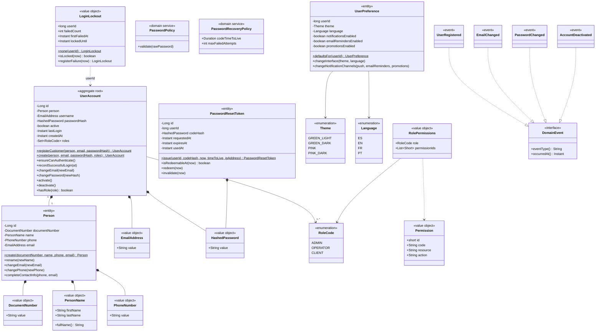

**Figure 21**

*security-service application services and ports*

```mermaid
classDiagram
  %% grid: 2+3
  direction LR
  class AuthenticationService {
    <<application service>>
    implements AuthenticateUserUseCase, LogoutUseCase, SessionStatusUseCase
    +login(command) AuthenticationResult
    +logout(userId, sessionId)
    +isActive(userId, sessionId) boolean
  }
  class AccountRegistrationService {
    <<application service>>
    implements RegisterUserUseCase, CreateUserAccountUseCase
    +register(command) UserAccountView
    +createAccount(command) UserAccountView
  }
  class PasswordRecoveryService {
    <<application service>>
    implements RequestPasswordResetUseCase, VerifyPasswordResetCodeUseCase, ResetPasswordUseCase
    +requestReset(command)
    +verifyCode(command)
    +resetPassword(command)
  }
  class UserProfileService {
    <<application service>>
    implements GetUserProfileUseCase, UpdateUserProfileUseCase, ChangePasswordUseCase
    +getProfile(userId) UserAccountView
    +updateProfile(command) UserAccountView
    +changePassword(command)
  }
  class EmailChangeService {
    <<application service>>
    implements ChangeEmailUseCase
    +changeEmail(command) UserAccountView
  }
  class AccountDeactivationService {
    <<application service>>
    implements DeactivateOwnAccountUseCase
    +deactivateOwnAccount(command)
  }
  class UserAdministrationService {
    <<application service>>
    implements ListUserAccountsUseCase, ChangeAccountStatusUseCase
    +listAccounts(query) PageResult~UserAccountView~
    +changeStatus(targetUserId, active, actingUserId) UserAccountView
  }
  class UserPreferenceService {
    <<application service>>
    implements GetUserPreferencesUseCase, UpdateUserPreferencesUseCase
    +getPreferences(userId) PreferenceView
    +updatePreferences(command) PreferenceView
  }
  class RolePermissionAdministrationService {
    <<application service>>
    implements ListRolePermissionsUseCase, UpdateRolePermissionsUseCase
    +listPermissions() List~Permission~
    +listRolePermissions() List~RolePermissions~
    +updateRolePermissions(role, permissionIds) RolePermissions
  }
  class UserAccountRepository {
    <<interface>>
    +findById(userId) Optional~UserAccount~
    +findByUsername(username) Optional~UserAccount~
    +existsByUsername(username) boolean
    +findPersonByDocument(documentNumber) Optional~Person~
    +save(account) UserAccount
    +findAll(role, page, size) PageResult~UserAccount~
  }
  class UserSessionRepository {
    <<interface>>
    +open(userId, startedAt, expiresAt, ipAddress, userAgent) long
    +revoke(sessionId, userId, revokedAt)
    +revokeAll(userId, revokedAt)
    +revokeAllExcept(userId, keptSessionId, revokedAt)
    +isActive(sessionId, userId, now) boolean
  }
  class PasswordResetTokenRepository {
    <<interface>>
    +save(token) PasswordResetToken
    +findLatestRedeemableByUserId(userId, now) Optional~PasswordResetToken~
  }
  class UserPreferenceRepository {
    <<interface>>
    +findByUserId(userId) Optional~UserPreference~
    +save(preference) UserPreference
  }
  class RolePermissionRepository {
    <<interface>>
    +findPermissions() List~Permission~
    +findRolePermissions() List~RolePermissions~
    +replacePermissions(role, permissionIds) RolePermissions
  }
  class PasswordHasher {
    <<interface>>
    +hash(raw) HashedPassword
    +matches(raw, hash) boolean
  }
  class TokenIssuer {
    <<interface>>
    +issue(account, sessionId, issuedAt) IssuedToken
    +timeToLive() Duration
  }
  class ResetCodeGenerator {
    <<interface>>
    +generate() String
  }
  class ResetCodeNotifier {
    <<interface>>
    +send(to, name, code, expiresAt)
  }
  class ResetAttemptCounter {
    <<interface>>
    +recordFailure(tokenId) int
    +clear(tokenId)
  }
  class DomainEventPublisher {
    <<interface>>
    +publish(event)
  }
  class PersonAddressService {
    <<application service>>
    implements PersonAddressUseCase
    +getAddress(userId) String
    +updateAddress(userId, address) String
  }
  class LoginLockoutRepository {
    <<interface>>
    +lock(userId)
    +findByUserId(userId) Optional~LoginLockout~
    +save(lockout)
    +clear(userId)
  }
  class PersonAddressRepository {
    <<interface>>
    +findByPersonId(personId) Optional~String~
    +save(personId, address)
    +delete(personId)
  }
```

> *Note.* Outbound adapters: `UserAccountPersistenceAdapter`, `UserSessionPersistenceAdapter`, `PasswordResetTokenPersistenceAdapter`, `UserPreferencePersistenceAdapter`, `RolePermissionPersistenceAdapter`, `LoginLockoutPersistenceAdapter`, and `PersonAddressPersistenceAdapter` (JPA); `BCryptPasswordHasher`; `JwtTokenIssuer`; `SecureRandomResetCodeGenerator`; `EmailResetCodeNotifier`, `LoggingResetCodeNotifier`, and `UndeliveredResetCodeNotifier`; `InMemoryResetAttemptCounter`; `RabbitDomainEventPublisher` and `LoggingDomainEventPublisher`. Inbound adapters: `AuthController` (includes `GET /auth/session` for the gateway), `ActiveSessionValidator` (rejects the JWT of a closed session), `UserProfileController`, `UserAdministrationController`, `RolePermissionController`, `UserAddressController`, and `InternalUserController`. Source: `security-service/src/main/java/com/lavarapido/security/`.

*Ports used by each service.*

- `AuthenticationService`: `UserAccountRepository`, `LoginLockoutRepository`, `UserSessionRepository`, `PasswordHasher`, `TokenIssuer`.
- `AccountRegistrationService`: `UserAccountRepository`, `PasswordHasher`, `DomainEventPublisher`.
- `PasswordRecoveryService`: `LoginLockoutRepository`, `UserAccountRepository`, `PasswordResetTokenRepository`, `ResetCodeGenerator`, `ResetCodeNotifier`, `ResetAttemptCounter`, `PasswordHasher`.
- `UserProfileService`: `UserAccountRepository`, `PasswordHasher`.
- `EmailChangeService`: `UserAccountRepository`, `DomainEventPublisher`.
- `AccountDeactivationService`: `UserAccountRepository`, `UserSessionRepository`, `PasswordHasher`, `DomainEventPublisher`.
- `UserAdministrationService`: `UserAccountRepository`, `UserSessionRepository`, `DomainEventPublisher`.
- `UserPreferenceService`: `UserPreferenceRepository`.
- `RolePermissionAdministrationService`: `RolePermissionRepository`.
- `PersonAddressService`: `UserAccountRepository`, `PersonAddressRepository`.

### 6.2 customer-service

**Figure 22**

*customer-service classes*

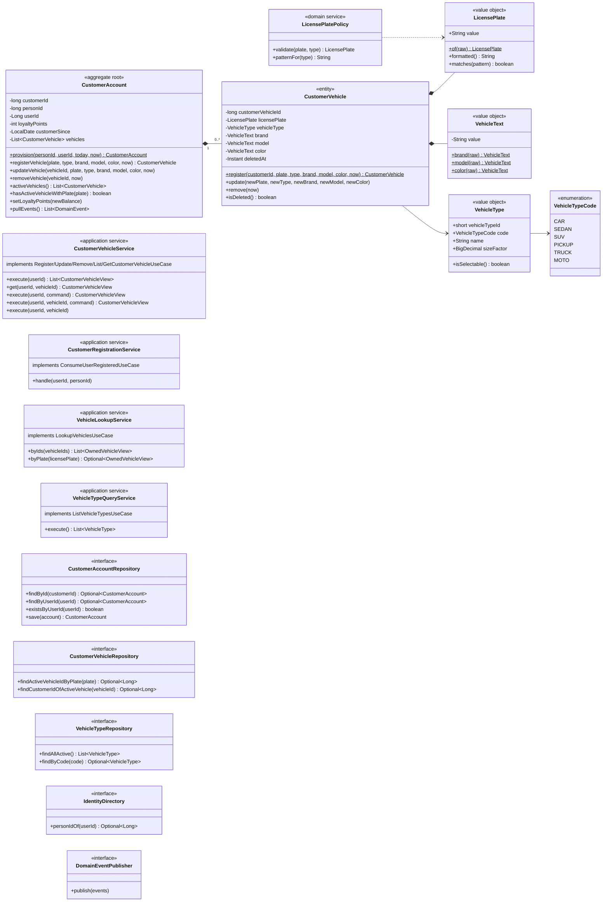

> *Note.* `Register/Update/Remove/List/GetCustomerVehicleUseCase` abbreviates the five vehicle inbound ports. Outbound adapters: `CustomerAccountPersistenceAdapter`, `CustomerVehiclePersistenceAdapter`, and `VehicleTypePersistenceAdapter` (JPA); `SecurityServiceIdentityDirectory` (REST to security-service); `LoggingDomainEventPublisher`, which only writes events to the log. Inbound adapters: `CustomerVehicleController`, `AdminVehicleController`, `VehicleTypeController`, and `UserRegisteredListener` (RabbitMQ). Source: `lavarapido-customer-service/src/main/java/com/lavarapido/customer/`.

*What each application service uses.*

- `CustomerVehicleService`: `CustomerAccount`, `CustomerAccountRepository`, `CustomerVehicleRepository`, `VehicleTypeRepository`, `IdentityDirectory`, `LicensePlatePolicy`, `DomainEventPublisher`.
- `CustomerRegistrationService`: `CustomerAccountRepository`, `DomainEventPublisher`.
- `VehicleLookupService`: `CustomerAccountRepository`, `CustomerVehicleRepository`.
- `VehicleTypeQueryService`: `VehicleTypeRepository`.

### 6.3 booking-service

**Figure 23**

*booking-service domain model*

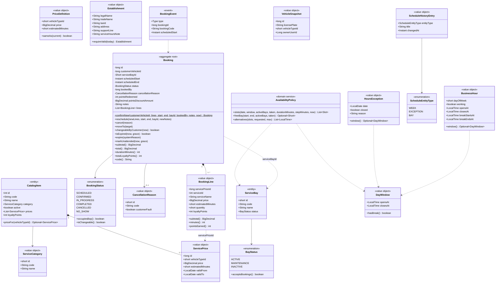

**Figure 24**

*booking-service application services and ports*

```mermaid
classDiagram
  %% grid: 1+2
  direction LR
  class BookingService {
    <<application service>>
    implements BookingUseCase
    +availability(date, vehicleTypeId, serviceIds, excludeBookingId) DayAvailability
    +create(request, caller) BookingView
    +reschedule(bookingId, request, caller) BookingView
    +cancel(bookingId, reasonCode, caller) BookingView
    +changeStatus(bookingId, status, reasonCode, caller) BookingView
    +mine(caller) List~BookingView~
    +list(from, to, status, caller) List~BookingView~
    +operatorDay(date, to, caller) List~BookingView~
    +operatorAdvance(bookingId, status, caller) BookingView
    +cancellationReasons() List~CancellationReason~
    +daySummary(date, caller) DaySummary
    +getForService(bookingId) BookingView
    +listForService(from, to) List~BookingView~
    +closeExpired() int
    +markUnattended(bookingId) BookingView
  }
  class CatalogService {
    <<application service>>
    implements CatalogUseCase
    +categories() List~ServiceCategory~
    +services(includeInactive, vehicleTypeId) List~CatalogItem~
    +create(command, actor) CatalogItem
    +update(serviceId, command, actor) CatalogItem
    +setActive(serviceId, active, actor) CatalogItem
    +delete(serviceId, actor)
  }
  class ScheduleService {
    <<application service>>
    implements ScheduleUseCase
    +businessHours() List~BusinessHour~
    +updateBusinessHours(hours, actor) List~BusinessHour~
    +exceptions(from) List~HoursException~
    +createException(exception, actor) HoursException
    +bays() List~ServiceBay~
    +createBay(name, status, actor) ServiceBay
    +deleteBay(bayId, actor)
    +establishment() Establishment
    +updateEstablishment(establishment, actor) Establishment
    +history() List~ScheduleHistoryEntry~
  }
  class BookingSettings {
    <<value object>>
    +ZoneId zone
    +int slotMinutes
    +int maxDaysAhead
    +int alternatives
    +Duration expiryGrace
  }
  class BookingRepository {
    <<interface>>
    +lockSchedule()
    +findOccupying(from, to) List~Booking~
    +save(booking, actor) Booking
    +findById(bookingId) Optional~Booking~
    +findForCustomer(userId, vehicleIds) List~Booking~
    +findStartingBetween(from, to, status) List~Booking~
    +findNotStartedEndingBefore(before) List~Booking~
    +findCancellationReason(code) Optional~CancellationReason~
  }
  class CatalogRepository {
    <<interface>>
    +findServices(includeInactive) List~CatalogItem~
    +findServicesByIds(serviceIds) List~CatalogItem~
    +insertService(code, name, description, categoryId, loyaltyPoints, actor) int
    +replacePrices(serviceId, prices, today, actor, now)
  }
  class ScheduleRepository {
    <<interface>>
    +findBusinessHours() List~BusinessHour~
    +saveBusinessHours(hours, actor)
    +findExceptionByDate(date) Optional~HoursException~
    +recordHistory(entityType, title, detail, actor)
  }
  class BayRepository {
    <<interface>>
    +findAll() List~ServiceBay~
    +insert(name, status, actor) ServiceBay
    +softDelete(bayId, actor, now)
  }
  class CustomerDirectory {
    <<interface>>
    +ownVehicle(vehicleId) Optional~VehicleSnapshot~
    +ownVehicles() List~VehicleSnapshot~
    +vehiclesByIds(vehicleIds) Map
  }
  class DomainEventPublisher {
    <<interface>>
    +publish(event)
  }
  class AvailabilityPolicy {
    <<domain service>>
  }
```

> *Note.* Outbound adapters: `BookingPersistenceAdapter`, `CatalogPersistenceAdapter`, `SchedulePersistenceAdapter`, and `BayPersistenceAdapter` (JPA); `CustomerServiceDirectory` (REST to customer-service); `RabbitDomainEventPublisher` and `LoggingDomainEventPublisher`. Inbound adapters: `BookingController`, `AdminBookingController`, `OperatorBookingController`, `CatalogController`, `ScheduleController`, and `InternalBookingController` (`/internal/v1/bookings`, with `X-Internal-Key`, including `POST /internal/v1/bookings/{id}/no-show`, which calls `markUnattended`); `PaymentEventsListener` (queue `booking.payment-events`) and `PaymentDeadlineJob` (scheduled job that calls `paymentOverdueBookings` and `cancelForPaymentTimeout`), since October 26, 2026; `PaymentServiceDirectory` (REST to payment-service, with `X-Internal-Key`) implements the outbound port `PaymentStatusDirectory`. `ExpiredBookingsJob` was removed on October 24, 2026 (B-07). Source: `lavarapido-booking-service/src/main/java/com/lavarapido/booking/`.

*Ports used by each service.*

- `BookingService`: `BookingRepository`, `CatalogRepository`, `ScheduleRepository`, `BayRepository`, `CustomerDirectory`, `DomainEventPublisher`, `BookingSettings`, and, since October 26, 2026, `PaymentStatusDirectory`. It also uses the domain policies `AvailabilityPolicy` and `PaymentPolicy` (cash limit and digital payment deadline; the mode is the `PaymentMode` value).
- `CatalogService`: `CatalogRepository`, `BookingSettings`.
- `ScheduleService`: `ScheduleRepository`, `BayRepository`, `BookingRepository`.

### 6.4 operations-service

**Figure 25**

*operations-service classes*

```mermaid
classDiagram
  %% grid: 1+2 ports
  direction LR
  class Operator {
    <<aggregate root>>
    -Integer id
    -long userId
    -LocalDate hiredOn
    -boolean active
    +provision(userId, today) Operator$
    +setActive(value)
  }
  class WeeklyAvailability {
    <<value object>>
    +short dayOfWeek
    +LocalTime startsAt
    +LocalTime endsAt
    +covers(start, end) boolean
  }
  class Absence {
    <<value object>>
    +Integer id
    +Instant startsAt
    +Instant endsAt
    +String reason
    +overlaps(start, end) boolean
  }
  class ServiceExecution {
    <<aggregate root>>
    -Long id
    -long bookingServiceId
    -int operatorId
    -ExecutionStatus status
    -Instant startedAt
    -Instant finishedAt
    -Short rating
    -String comment
    -Instant ratedAt
    -boolean commentVisible
    -Instant followUpNoticeAt
    +assign(bookingServiceId, operatorId) ServiceExecution$
    +reassign(newOperatorId)
    +start(now)
    +finish(now)
    +closeAsAttended()
    +followUpNoticeSent(now)
    +rate(stars, text, now)
  }
  class ExecutionStatus {
    <<enumeration>>
    PENDING
    IN_PROGRESS
    PAUSED
    COMPLETED
    WITH_ISSUE
  }
  class BookingSnapshot {
    <<value object>>
    +long id
    +String code
    +String status
    +Instant scheduledStart
    +Instant scheduledEnd
    +Long ownerUserId
    +lineIds() List~Long~
    +overlaps(other) boolean
  }
  class AssignmentPolicy {
    <<domain service>>
    +check(operator, week, absences, booking, busyWith)
    +blockingReason(operator, week, absences, booking, busyWith) String
  }
  class StartPolicy {
    <<domain service>>
    +startableAt(booking) Instant
    +check(booking, now)
  }
  class FollowUpPolicy {
    <<domain service>>
    +of(booking, lines, now, grace) Optional~Reason~$
  }
  class ExecutionEvent {
    <<event>>
    +Type type
    +long bookingId
    +Long operatorUserId
  }
  class OperationsService {
    <<application service>>
    implements OperationsUseCase
    +operators() List~OperatorView~
    +setActive(operatorId, active, adminId) OperatorView
    +setAvailability(operatorId, week, adminId) OperatorView
    +addAbsence(operatorId, startsAt, endsAt, reason, adminId) Absence
    +removeAbsence(operatorId, absenceId, adminId)
    +assign(bookingId, operatorId, adminId) AssignmentView
    +candidates(bookingId) List~CandidateView~
    +myServices(from, to, operatorUserId) List~OperatorServiceView~
    +start(bookingId, operatorUserId) OperatorServiceView
    +finish(bookingId, operatorUserId) OperatorServiceView
    +rate(bookingId, rating, comment, customerUserId) RatingView
    +myRatings(operatorUserId) List~RatingView~
    +autoAssign(bookingId, customerUserId, preferredOperatorId) Optional~AssignmentView~
    +availableOperators(date, time, minutes) List~AvailableOperatorView~
    +metrics(operatorId, weekOf) OperatorWeekMetrics
    +teamSummary(weekOf) TeamSummary
    +myBookingOperators() List~BookingOperatorView~
    +unassigned(from, to) UnassignedView
  }
  class FollowUpService {
    <<application service>>
    implements FollowUpUseCase
    +toClose(from, to) List~ToCloseView~
    +closeAsAttended(bookingId, adminId)
    +followUp() FollowUpRun
  }
  class AutoAssignmentPolicy {
    <<domain service>>
    +choose(available, preferredOperatorId) Optional~Integer~$
  }
  class OperatorProfile {
    <<value object>>
    +String specialty
    +List~Skill~ skills
    +of(specialty, skills) OperatorProfile$
  }
  class OperatorProfileService {
    <<application service>>
    implements OperatorProfileUseCase
    +profiles() List~OperatorProfileView~
    +updateProfile(operatorId, specialty, skills, adminId) OperatorProfileView
  }
  class OperatorProfileRepository {
    <<interface>>
    +findAll() Map~Integer, OperatorProfile~
    +replace(operatorId, profile, actor)
  }
  class OperatorRepository {
    <<interface>>
    +findAll() List~Operator~
    +findByUserId(userId) Optional~Operator~
    +save(operator, actor) Operator
    +availability(operatorId) List~WeeklyAvailability~
    +replaceAvailability(operatorId, week, actor)
    +absences(operatorId, from, to) List~Absence~
    +addAbsence(operatorId, absence, actor) Absence
  }
  class ExecutionRepository {
    <<interface>>
    +lockAssignments()
    +findByLineIds(bookingServiceIds) List~ServiceExecution~
    +findByOperator(operatorId) List~ServiceExecution~
    +findRated(operatorId) List~ServiceExecution~
    +saveAll(executions, actor) List~ServiceExecution~
  }
  class BookingDirectory {
    <<interface>>
    +forAdmin(bookingId) Optional~BookingSnapshot~
    +forOperator(from, to) List~BookingSnapshot~
    +forCustomer(bookingId) Optional~BookingSnapshot~
    +forService(bookingId) Optional~BookingSnapshot~
    +forService(from, to) List~BookingSnapshot~
    +advance(bookingId, status)
    +markUnattended(bookingId)
  }
  class UserDirectory {
    <<interface>>
    +operators() List~UserSnapshot~
    +firstNameOf(userId) String
    +contactOf(userId) Optional~ContactSnapshot~
  }
  class DomainEventPublisher {
    <<interface>>
    +publish(event)
  }
  Operator "1" -- "0..7" WeeklyAvailability
  Operator "1" -- "0..*" Absence
  ServiceExecution --> ExecutionStatus
  ServiceExecution ..> Operator : operatorId
  AssignmentPolicy ..> Operator
  AssignmentPolicy ..> BookingSnapshot
  StartPolicy ..> BookingSnapshot
  OperatorProfileRepository ..> OperatorProfile
```

> *Note.* Outbound adapters: `OperatorPersistenceAdapter`, `ExecutionPersistenceAdapter`, `OperatorProfilePersistenceAdapter`, and `InspectionPersistenceAdapter` (JPA); `BookingServiceDirectory` (REST to booking-service, with the user's token or the internal key); `SecurityUserDirectory` (REST to security-service); `RabbitDomainEventPublisher` and `LoggingDomainEventPublisher`. Inbound adapters: `OperationsControllers` (administrator, operator, and rating routes), `AvailableOperatorsController`, `OperatorProfileController`, `InspectionControllers`, `FollowUpController` (`/admin/assignments/to-close` and `/admin/assignments/{bookingId}/attended`), `BookingConfirmedListener` (RabbitMQ, automatic assignment), and `FollowUpJob` (scheduled job that calls `followUp`). Source: `lavarapido-operations-service/src/main/java/com/lavarapido/operations/`.

*What each application service uses.*

- `OperationsService`: `OperatorRepository`, `ExecutionRepository`, `BookingDirectory`, `UserDirectory`, `DomainEventPublisher`, `AssignmentPolicy`, `StartPolicy`, `AutoAssignmentPolicy`, `ExecutionEvent`.
- `OperatorProfileService`: `OperatorProfileRepository`, `OperatorRepository`.
- `FollowUpService`: `ExecutionRepository`, `BookingDirectory`, `OperatorRepository`, `DomainEventPublisher`, `FollowUpPolicy`, `ExecutionEvent`.

**Figure 26**

*Inspection report in operations-service*

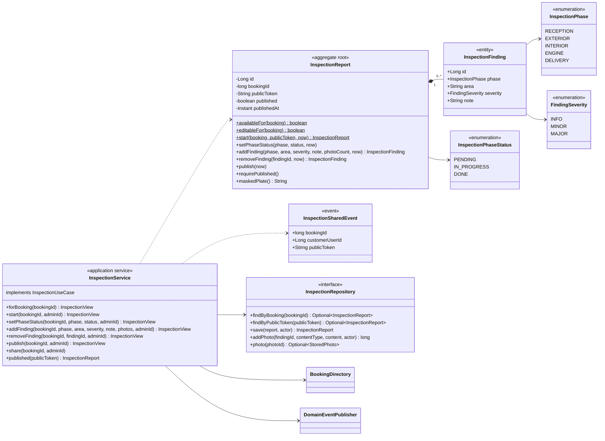

> *Note.* The report only exists for bookings of 180 minutes or more, can be edited while the booking is Confirmed or In progress, and can only be shared once published; the public link uses `publicToken` and shows a masked license plate. Adapters: `InspectionPersistenceAdapter` (JPA) and `InspectionControllers` (`/admin/inspections/**` and `/public/inspections/**` routes).

### 6.5 payment-service (.NET)

**Figure 27**

*payment-service domain model*

*a) Payments*

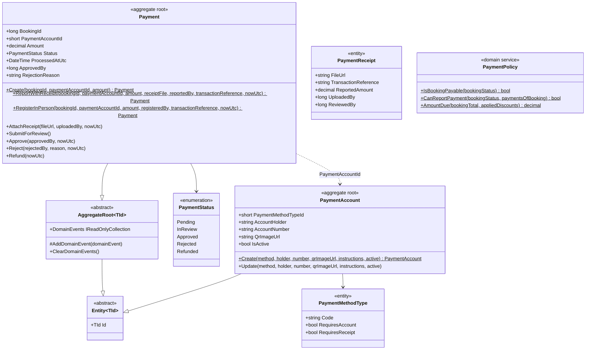

*b) Promotions and loyalty (Promotion also inherits from `AggregateRoot<TId>`)*

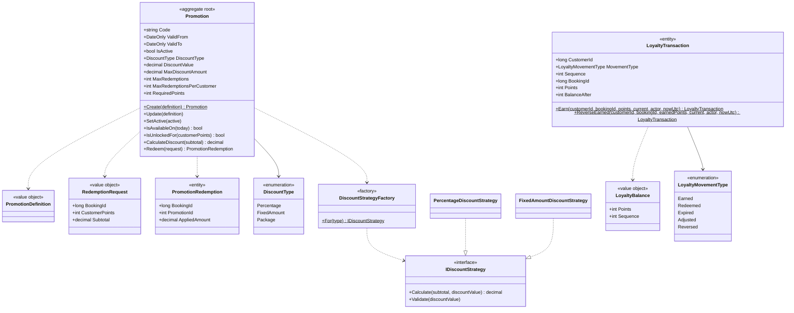

**Figure 28**

*payment-service application services and ports*

```mermaid
classDiagram
  %% grid: 2+3
  direction LR
  class PaymentCommandService {
    <<application service>>
    implements IPaymentCommandUseCases
    +ReportAsync(command, caller, ct) PaymentDto
    +RegisterInPersonAsync(command, admin, ct) PaymentDto
    +ApproveAsync(paymentId, admin, ct) PaymentDto
    +RejectAsync(paymentId, reason, admin, ct) PaymentDto
    +RefundAsync(paymentId, admin, ct) PaymentDto
  }
  class PaymentQueryService {
    <<application service>>
    implements IPaymentQueryUseCases
    +MineAsync(ct)
    +MyBookingsAsync(ct)
    +ListAsync(status, ct)
    +GetAsync(paymentId, ct)
    +AmountDueAsync(bookingId, ct)
  }
  class PaymentAccountService {
    <<application service>>
    implements IPaymentAccountUseCases
    +ListForCustomersAsync(ct)
    +ListAllAsync(ct)
    +ListMethodsAsync(ct)
    +CreateAsync(command, ct)
    +UpdateAsync(id, command, ct)
  }
  class PromotionAdminService {
    <<application service>>
    implements IPromotionAdminUseCases
    +ListAsync(ct)
    +MetricsAsync(ct)
    +CreateAsync(command, ct)
    +UpdateAsync(id, command, ct)
    +SetActiveAsync(id, active, ct)
    +DeleteAsync(id, admin, ct)
  }
  class CustomerPromotionService {
    <<application service>>
    implements ICustomerPromotionUseCases
    +ListAvailableAsync(caller, ct)
    +RedeemAsync(command, caller, ct) RedeemPromotionResultDto
  }
  class LoyaltyService {
    <<application service>>
    implements ILoyaltyUseCases
    +BalanceAsync(caller, ct) LoyaltyBalanceDto
  }
  class LoyaltyRewardService {
    <<application service>>
    +CreditForBookingAsync(booking, actor, nowUtc, ct)
    +RevokeForBookingAsync(bookingId, actor, nowUtc, ct)
  }
  class BookingPaymentGuard {
    <<application service>>
    +EnsureBookingIsUnpaidAsync(booking, allowOpenPayment, ct)
    +EnsureNoApprovedPaymentAsync(bookingId, ct)
    +EnsureReferenceNotReusedAsync(transactionReference, bookingId, ct)
  }
  class AmountDueCalculator {
    <<application service>>
    +ForAsync(booking, ct) decimal
    +BreakdownAsync(booking, ct) AmountDueDto
  }
  class IPaymentRepository {
    <<interface>>
    +GetByIdAsync(id, ct)
    +HasApprovedPaymentAsync(bookingId, ct)
    +IsTransactionReferenceUsedElsewhereAsync(reference, bookingId, ct)
    +ListAsync(status, ct)
  }
  class IPaymentAccountRepository {
    <<interface>>
    +ListAsync(ct)
    +GetByIdAsync(id, ct)
    +ListMethodTypesAsync(ct)
  }
  class IPromotionRepository {
    <<interface>>
    +ListAsync(ct)
    +GetByCodeAsync(code, ct)
    +ExistsCodeAsync(code, ct)
  }
  class IPromotionRedemptionRepository {
    <<interface>>
    +ExistsAsync(bookingId, promotionId, ct)
    +CountByCustomerAsync(promotionId, customerUserId, ct)
    +AppliedDiscountTotalAsync(bookingId, ct)
  }
  class ILoyaltyLedgerRepository {
    <<interface>>
    +CurrentBalanceAsync(customerId, ct) LoyaltyBalance
    +NetPointsByCustomerForBookingAsync(bookingId, ct)
  }
  class IBookingDirectory {
    <<interface>>
    +GetForCustomerAsync(bookingId, ct) BookingInfo
    +GetForAdminAsync(bookingId, ct) BookingInfo
    +MineAsync(ct)
  }
  class IIntegrationEventPublisher {
    <<interface>>
    +PublishAsync(integrationEvent, ct)
  }
  class IUnitOfWork {
    <<interface>>
    +CommitAsync(ct)
  }
```

> *Note.* In .NET, attributes are public read-only properties and application methods are asynchronous (`Async`) and take a `CancellationToken ct`. Outbound adapters: `PaymentRepository`, `PaymentAccountRepository`, `PromotionRepository`, `PromotionRedemptionRepository`, `LoyaltyLedgerRepository`, and `EfUnitOfWork` (Entity Framework Core); `BookingServiceDirectory` (REST to booking-service); `RabbitMqIntegrationEventPublisher` and `NullIntegrationEventPublisher`. Inbound adapters: `PaymentsController`, `AdminPaymentsController`, `AdminPaymentAccountsController`, `PromotionsController`, and `LoyaltyController`; since October 26, 2026, `InternalPaymentsController` (`GET /internal/v1/payments/bookings/{bookingId}/reported`), protected by `InternalApiKeyAuthenticationHandler` (`X-Internal-Key` = `INTERNAL_API_KEY`). `Payment.ReportWithReceipt` raises the domain event `PaymentReported`, which goes out as `payment.reported`. Source: `lavarapido-payment-service/src/PaymentService.Domain` and `PaymentService.Application`.

*Ports used by each service.*

- `PaymentCommandService`: `IPaymentRepository`, `IBookingDirectory`, `IIntegrationEventPublisher`, `IUnitOfWork`, `BookingPaymentGuard`, `AmountDueCalculator`, `LoyaltyRewardService`.
- `PaymentQueryService`: `IPaymentRepository`, `IBookingDirectory`, `AmountDueCalculator`.
- `PaymentAccountService`: `IPaymentAccountRepository`, `IUnitOfWork`.
- `PromotionAdminService`: `IPromotionRepository`, `IPromotionRedemptionRepository`, `IUnitOfWork`.
- `CustomerPromotionService`: `IPromotionRepository`, `IPromotionRedemptionRepository`, `ILoyaltyLedgerRepository`, `IBookingDirectory`, `BookingPaymentGuard`, `AmountDueCalculator`, `IUnitOfWork`, `IIntegrationEventPublisher`.
- `LoyaltyService`: `ILoyaltyLedgerRepository`.
- `LoyaltyRewardService`: `ILoyaltyLedgerRepository`, `IPromotionRepository`.
- `BookingPaymentGuard`: `IPaymentRepository`, `IPaymentAccountRepository`.
- `AmountDueCalculator`: `IPromotionRedemptionRepository`.

### 6.6 notification-service

**Figure 29**

*notification-service domain model*

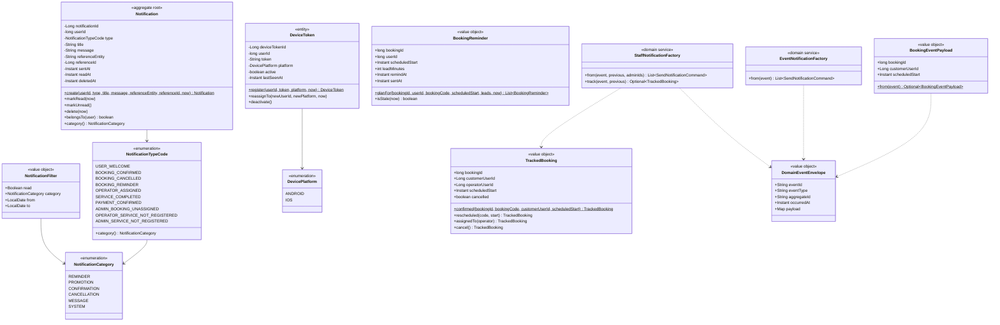

**Figure 30**

*notification-service application services and ports*

```mermaid
classDiagram
  %% grid: 2+3
  direction LR
  class DomainEventConsumerService {
    <<application service>>
    implements ConsumeDomainEventUseCase
    +handle(event)
  }
  class NotificationSendingService {
    <<application service>>
    implements SendNotificationUseCase
    +send(command) Notification
    +sendAll(commands) List~Notification~
  }
  class NotificationInboxService {
    <<application service>>
    implements NotificationInboxUseCase
    +list(userId, filter, page, size) PageResult~Notification~
    +countUnread(userId) long
    +markRead(userId, notificationId) Notification
    +markUnread(userId, notificationId) Notification
    +markAllRead(userId) int
    +delete(userId, notificationId)
  }
  class BookingReminderService {
    <<application service>>
    implements BookingReminderUseCase
    +schedule(bookingId, userId, bookingCode, scheduledStart)
    +cancel(bookingId)
    +sendDue() int
  }
  class StaffNotificationService {
    <<application service>>
    +handle(event) int
  }
  class UnassignedBookingAlertService {
    <<application service>>
    implements UnassignedBookingAlertUseCase
    +alertDue() int
  }
  class DeviceRegistrationService {
    <<application service>>
    implements DeviceRegistrationUseCase
    +register(userId, token, platform) DeviceToken
    +unregister(userId, token)
  }
  class EmailRecipients {
    <<application service>>
    +withEmail(command) SendNotificationCommand
  }
  class NotificationRepository {
    <<interface>>
    +save(notification) Notification
    +findActive(notificationId) Optional~Notification~
    +findActiveByUser(userId, filter, page, size) PageResult~Notification~
    +countUnread(userId) long
    +markAllRead(userId, readAt) int
  }
  class ProcessedEventRepository {
    <<interface>>
    +exists(eventId) boolean
    +record(eventId, eventType)
  }
  class BookingReminderRepository {
    <<interface>>
    +replaceForBooking(bookingId, reminders, now)
    +cancelForBooking(bookingId, now)
    +findDue(now, limit) List~BookingReminder~
    +markSent(reminderId, sentAt)
  }
  class BookingTrackingRepository {
    <<interface>>
    +find(bookingId) Optional~TrackedBooking~
    +save(booking)
    +findUnassignedStartingBetween(from, to) List~TrackedBooking~
    +markUnassignedAlertSent(bookingId, at)
  }
  class DeviceTokenRepository {
    <<interface>>
    +save(device) DeviceToken
    +findByToken(token) Optional~DeviceToken~
    +findActiveByUser(userId) List~DeviceToken~
  }
  class UserContactDirectory {
    <<interface>>
    +contactOf(userId) Optional~UserContact~
    +activeAdminIds() List~Long~
  }
  class EmailSender {
    <<interface>>
    +send(notification, toAddress, recipientName)
  }
  class PushSender {
    <<interface>>
    +send(notification, devices)
  }
  class EventNotificationFactory {
    <<domain service>>
  }
  class StaffNotificationFactory {
    <<domain service>>
  }
```

> *Note.* Between application services the real dependency is the inbound port: for example, `DomainEventConsumerService` receives a `SendNotificationUseCase`, implemented by `NotificationSendingService`. `NotificationTypeCode` has 26 codes; the diagram shows only some. Outbound adapters: `NotificationPersistenceAdapter`, `DeviceTokenPersistenceAdapter`, `BookingReminderPersistenceAdapter`, `BookingTrackingPersistenceAdapter`, and `ProcessedEventPersistenceAdapter` (JPA); `SmtpEmailSender` and `LoggingEmailSender`; `ExpoPushSender` and `LoggingPushSender`; `SecurityServiceUserContactDirectory` (internal REST to security-service). Inbound adapters: `NotificationController`, `AdminNotificationController`, `DeviceController`, `DomainEventListener` (RabbitMQ), and `ReminderScheduler` (scheduled job). Source: `lavarapido-notification-service/src/main/java/com/lavarapido/notification/`.

*What each application service uses.*

- `DomainEventConsumerService`: `ProcessedEventRepository`, `NotificationSendingService`, `EventNotificationFactory`, `BookingReminderService`, `StaffNotificationService`, `EmailRecipients`.
- `NotificationSendingService`: `NotificationRepository`, `DeviceTokenRepository`, `PushSender`, `EmailSender`, `UserContactDirectory`.
- `NotificationInboxService`: `NotificationRepository`.
- `BookingReminderService`: `BookingReminderRepository`, `NotificationSendingService`.
- `StaffNotificationService`: `BookingTrackingRepository`, `UserContactDirectory`, `StaffNotificationFactory`, `NotificationSendingService`.
- `UnassignedBookingAlertService`: `BookingTrackingRepository`, `UserContactDirectory`, `NotificationSendingService`.
- `DeviceRegistrationService`: `DeviceTokenRepository`.
- `EmailRecipients`: `UserContactDirectory`.

### 6.7 States of the Main Entities

**Table 67**

*State transitions allowed by the domain*

| Entity | Transition | Condition (code) |
| --- | --- | --- |
| Booking | SCHEDULED → CONFIRMED | Has a bay assigned (`Booking.java:111`) |
| Booking | CONFIRMED → IN_PROGRESS or NO_SHOW | `Booking.java:112` |
| Booking | IN_PROGRESS → COMPLETED | `Booking.java:113` |
| Booking | → CANCELLED | Only through `cancel(reason)`, not `moveTo` (`Booking.java:96, 114`) |
| Booking | Concurrent change | Since October 24, 2026 the booking has optimistic locking (`@Version` on `row_version`, changelog `045`): an old version answers 409 `CONFLICT`. A customer who reschedules only changes the date and time (409 `BOOKING_SERVICES_LOCKED`) |
| Booking | Ended without an operator: CONFIRMED → NO_SHOW | One hour after its end time and only if no line ever had an operator; operations asks for it and booking checks the expiry again (`Booking.java:141-147`, `FollowUpPolicy.java`) |
| Booking | Overdue digital payment: CONFIRMED → CANCELLED | `DIGITAL` booking without `payment_reported_at` whose `payment_deadline` has passed, and payment-service answers that it has no payment in review or approved; reason `PAYMENT_TIMEOUT` (`Booking.paymentOverdue`, `PaymentDeadlineJob.java`, since October 26, 2026) |
| Booking | Confirmed with an operator, not started or not finished | Never changes on its own: it goes to "To close" and the administrator resolves it (`FollowUpPolicy.java`, `FollowUpService.closeAsAttended`) |
| Execution | PENDING → IN_PROGRESS → COMPLETED | `start()` and `finish()` (`ServiceExecution.java:75-91`) |
| Execution | PENDING or IN_PROGRESS → COMPLETED ("Attended") | Only from "To close"; no made-up times (`ServiceExecution.java:98-103`) |
| Execution | Rating | Only when COMPLETED and only once (`ServiceExecution.java:111-129`) |
| Payment | Created → in review → approved, rejected, or refunded | Methods `SubmitForReview`, `Approve`, `Reject`, `Refund` (`Payment.cs:121-162`) |
| Execution | Start | From 15 minutes before the booking time and up to 4 hours after its end time (`START_LATE_LIMIT`, since October 24, 2026; 409 `SERVICE_TOO_LATE`) (`StartPolicy.java`) |
| Payment | Approval | Since October 24, 2026, if the amount does not match what is owed today, 409 `AMOUNT_CHANGED`; a single open payment per booking and a unique reference among live payments (migration 023) |
| Account | Locked for 15 minutes | On the fifth failure within 15 minutes; a correct sign-in or a password reset clears it (`LoginLockout.java`) |
| Inspection report | Draft → published | `publish()`; only a published report can be shared (`InspectionReport.java`) |
| Inspection phase | PENDING ↔ IN\_PROGRESS ↔ DONE | `setPhaseStatus()`; a finding in a pending phase moves it to IN\_PROGRESS (`InspectionReport.java`) |

## 7. Design Findings and Open Items

**Table 68**

*Inconsistencies found when comparing the code with earlier documentation*

| # | Finding | Evidence |
| --- | --- | --- |
| 1 | Technical Manual v2.0 says all six microservices are in Java 21; payment-service is in .NET 8 | `lavarapido-payment-service/Directory.Build.props` (`net8.0`) |
| 2 | `MODELO-DE-DATOS.md` documented 43 tables and SRS v4 (Table 6) said 47; the changelogs create 57 as of October 15, 2026 | Table 9 of this document |
| 3 | notification subscribed to `booking.created`, but booking does not publish that key. Fixed on October 24, 2026: the binding was removed (notification `8fde2ee`) | notification's `ROUTING_KEYS` |
| 4 | customer defines the `customer.provisioned`, `VehicleRegistered`, `VehicleUpdated`, `VehicleRemoved`, and `LoyaltyPointsChanged` events, but its only publisher writes them to the log: they never reach RabbitMQ and have no consumer | `CustomerProvisioned.java:15`, `customer/.../adapter/out/messaging/LoggingDomainEventPublisher.java` |
| 5 | Vehicle inspection, its public report, and the business data in Settings are simulated: they are stored in the browser, not in the backend | `Web/src/app/core/services/inspection-store.ts:20`, `features/admin/services/business-store.ts:52`; on mobile `scheduleMock.ts`, `settingsMock.ts` |
| 6 | In `docker-compose.yml`, the security and operations builds point to `../lavarapido-security-service` and `../lavarapido-operation-service`, which are the real repository names. In this local copy the folders are named `security-service` and `lavarapido-operations-service`, so `--profile app` fails unless they are cloned with their original names. | `Backend/lavarapido-infra/docker-compose.yml` (security-service and operations-service) |
| 7 | booking-service contains a `bin/src/main/java` folder in addition to `src/main/java` (an IDE-generated copy) | `Backend/lavarapido-booking-service/bin` |
| 8 | The cash account is not returned by `GET /payment-accounts` (only accounts that require a receipt); the web and mobile clients add it themselves. It is intentional, but the contract does not document it | `PaymentAccountService.cs:24-25`, `Web/.../client/pages/payment/payment.ts:44-57` |
| 9 | Hard-coded test text in the UI: "¡Hola, Laura!" on the administrator dashboard and "Laura Méndez" in payment review | `admin/pages/dashboard/dashboard.ts:73`, `payment-review-modal.html:167` |
| 10 | In the operator's "Assigned services" (web), the Customer column shows the license plate | `operator/pages/assigned-services/assigned-services.ts:141` |
| 11 | The brand name is inconsistent across clients ("AquaWash", "Car Wash", "Lavado Vehicular", "Express Car Wash") and the landing page advertises a "mobile service… wherever you are", although SRS v4 defines a single location | Figures 2 and 7 |

> *Note.* Code review of October 15, 2026: finding 5 is fixed (the inspection report, its public link, and the business data are stored in operations-service and booking-service; on mobile, `settingsMock.ts` only keeps the initial notification preferences) and so is finding 7 (`bin/` is now in booking-service's `.gitignore`). Findings 3, 4, 8, 9, 10, and 11 are still in the code. Review of October 20, 2026: finding 6 no longer applies (the local folders have the real repository names), finding 9 is no longer in the code, and finding 10 is fixed (the Customer column shows `clientName`); findings 3, 4, and 8 are unchanged. Review of October 21, 2026: finding 8 is fixed (`GET /payment-accounts` also returns the cash account while it is active, `PaymentAccountService.cs:27`, and the web and mobile apps show Cash only if it comes in that list); findings 3 and 4 are unchanged.

## References

Angular. (n.d.). *Angular documentation*. Google. Retrieved October 9, 2026, from https://angular.dev/

Brown, S. (n.d.). *The C4 model for visualising software architecture*. Retrieved October 9, 2026, from https://c4model.com/

Cockburn, A. (2005). *Hexagonal architecture*. https://alistair.cockburn.us/hexagonal-architecture/

Evans, E. (2004). *Domain-driven design: Tackling complexity in the heart of software*. Addison-Wesley.

Expo. (n.d.). *Expo documentation*. Retrieved October 9, 2026, from https://docs.expo.dev/

Fowler, M. (2002). *Patterns of enterprise application architecture*. Addison-Wesley.

Gamma, E., Helm, R., Johnson, R., & Vlissides, J. (1994). *Design patterns: Elements of reusable object-oriented software*. Addison-Wesley.

Hohpe, G., & Woolf, B. (2003). *Enterprise integration patterns: Designing, building, and deploying messaging solutions*. Addison-Wesley.

Liquibase. (n.d.). *Liquibase documentation*. Retrieved October 9, 2026, from https://docs.liquibase.com/

Mermaid. (n.d.). *Mermaid: Diagramming and charting tool*. Retrieved October 9, 2026, from https://mermaid.js.org/

Microsoft. (n.d.-a). *.NET documentation*. Retrieved October 9, 2026, from https://learn.microsoft.com/dotnet/

Microsoft. (n.d.-b). *SQL Server technical documentation*. Retrieved October 9, 2026, from https://learn.microsoft.com/sql/sql-server/

Newman, S. (2021). *Building microservices: Designing fine-grained systems* (2nd ed.). O'Reilly Media.

RabbitMQ. (n.d.). *RabbitMQ documentation*. Broadcom. Retrieved October 9, 2026, from https://www.rabbitmq.com/docs

React Native. (n.d.). *React Native documentation*. Meta Platforms. Retrieved October 9, 2026, from https://reactnative.dev/docs/getting-started

Spring. (n.d.). *Spring Boot reference documentation*. Broadcom. Retrieved October 9, 2026, from https://docs.spring.io/spring-boot/
