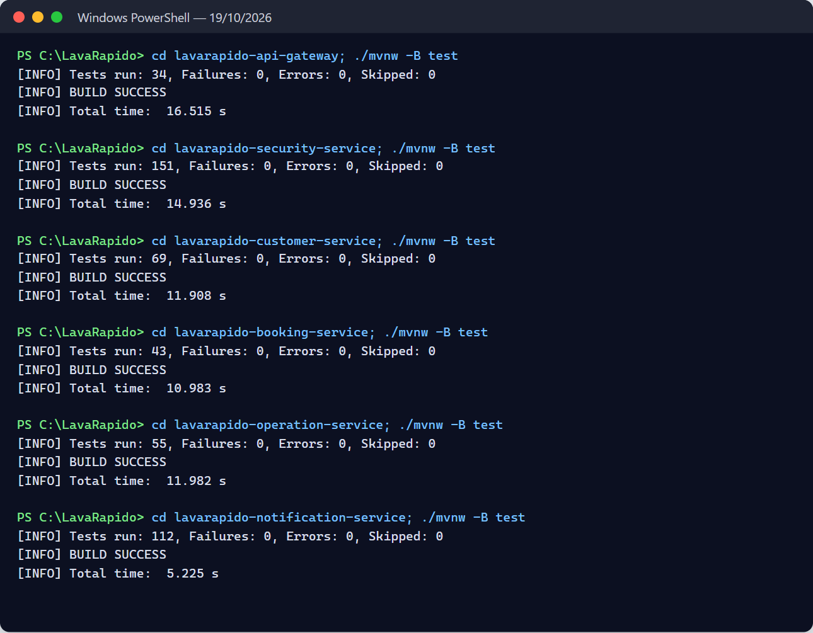
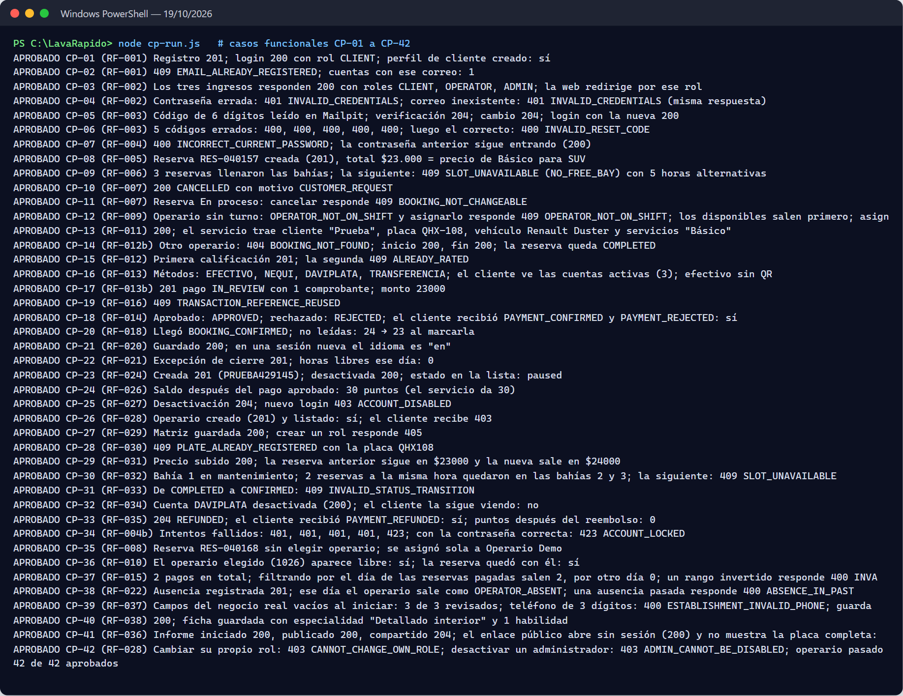

# Test Documentation — Vehicle Washing Management System

## Cover Page

**Table 1**

*Document identification data*

| Field | Value |
| --- | --- |
| Project | Vehicle Washing Management System (Vehicle Washing / LavaRápido) |
| Deliverable | Test documentation (section 2.5.4) |
| Program | Software Analysis and Development Technologist (ADSO) |
| Group (ficha) | 3145556 |
| Apprentices | Brayan Estiven Patiño Cabrera, Juan Camilo Guilombo Osorio, Merari Urbano Quintero |
| Instructor | Karol Daniela Correa |
| Training center | Industria |
| Date | October 26, 2026 |

This document gathers the test plan, the inventory of automated tests in the repositories, their actual results when run on October 19, 2026 (including the end-to-end, performance, and responsive design tests against the complete system) and again on October 21, and the 42 functional test cases, run on October 19, traced to the SRS v8.0 requirements (`lavarapido-docs/01_INFORME_DE_ESPECIFICACION_DE_REQUISITOS`, the current SRS; *SRS_V4.docx* is the previous version of October 8). On October 24, 2026, after merging 128 fix branches into *develop* and deploying them to the public server, the inventory (Table 4), the results of the latest CI (section 3.3, Table 5d), the traceability matrix (eight requirements move to Implemented), and the gaps (Table 8) were updated again; the same day, notification migration 048, which fixed what the live test found in 047, was added to gap 9. On October 26, 2026 the live tests of payment at booking were added, locally and in production, with the two simulated failures (section 3.4, Table 5e), the new test count of booking, payment, the web, and the mobile app (Table 5f), defect 13 (Table 9), and gaps 9 and 10 (Table 8). On October 23, 2026 the inventory (Table 2), the results of the latest *develop* CI (section 3.3, Table 5d), and the traceability matrix were updated; the matrix now marks as partial the requirements that the review of that day found incomplete. On October 20, 2026, the inventory, case CP-42 and the traceability matrix were adjusted because the role change of an account was reverted in the code that day, and the wording of CP-10 because the customer cancels without writing a reason. On October 21, 2026, two runs of the automated tests and of the 19 end-to-end tests were recorded: the early-morning run (689 tests, all passed) and the evening run (707, all passed), which is the latest. They include the changes of that day: the token of a closed session stops working, operator assignment uses a lock, the receipt has a 2 MB maximum, and, for bookings that ended and nobody closed, the system only cancels a scheduled booking that expired without confirmation and sets to "No-show" a confirmed one that never had an operator; one that had an operator goes to the administrator's "To close" list. Its structure follows the ISO/IEC/IEEE 29119-3 standard for test documentation (International Organization for Standardization [ISO], 2021). No result in this document is assumed.

## 1. Test Plan

### 1.1 Scope

The web application, the mobile application, and the seven backend services on their `develop` branch are tested. Offensive security testing is out of scope; load is only checked through the RNF-001 response time measurement.

### 1.2 Test Types and Tools

**Table 2**

*Test types, actual tool, and where each applies*

| Type | What it verifies | Tool | Where |
| --- | --- | --- | --- |
| Domain unit tests | Rules of entities and value objects (states, validations) | JUnit 5 (`spring-boot-starter-test`); xUnit 2 | `src/test/.../domain` in Java; `tests/PaymentService.Domain.UnitTests` |
| Application unit tests | Use cases with in-memory repositories (test doubles) | JUnit 5 with fakes (`Fakes.java`, `InMemory*Repository`); xUnit with `InMemoryPorts.cs` | `application/usecase` and `PaymentService.Application.UnitTests` |
| Web integration (controller + security) | Routes, HTTP status codes, JWT, and roles with MockMvc | `spring-boot-starter-webmvc-test`, `spring-security-test` | `*ApiWebTest.java`, `ApiSecurityWebTest.java`, `AdminNotificationControllerTest.java` |
| Gateway integration | Each public route reaches its service and the token of a closed session does not get through | Spring Boot Test; for the session, a security-service simulated with the JDK HTTP server | `GatewayRoutesTest.java`, `SessionCheckFilterTest.java` |
| Persistence integration | EF Core mapping against a real SQL Server | xUnit + `DatabaseFixture` | `PaymentService.Infrastructure.IntegrationTests` (requires a database) |
| Web UI unit tests | Angular components, guards, and services | Vitest 4 + jsdom (`@angular/build:unit-test`) | `Web/src/**/*.spec.ts` |
| Functional / acceptance | End-to-end flows per role against the deployed system | Manual, with Postman or Swagger UI for the API and a browser / Expo Go for the UI | Cases CP-01 to CP-42 (section 4) |
| Cross-service (end-to-end) and RNF | Booking with operator choice and automatic assignment, complete flow of the three roles, inspection report, access rules per role; 95th percentile response time (RNF-001); web screens at 360 px (RNF-008) | Node 24 (`node:test` and `fetch`) and Playwright Core with headless Edge | `lavarapido-infra/e2e` |

> *Note.* Tools documented in JUnit (n.d.), xUnit.net (n.d.), and Vitest (n.d.).

### 1.3 Environment

**Table 3**

*Execution environment for the tests (October 19, 2026)*

| Item | Version |
| --- | --- |
| Operating system | Windows 11 Home Single Language 10.0.26300 |
| Node.js / npm | 24.14.0 / 11.9.0 |
| JDK | Java 25.0.4 (the projects compile for Java 21) with each service's Maven Wrapper |
| .NET SDK | 9.0.306; the project targets `net8.0` and the tests were run with `DOTNET_ROLL_FORWARD=Major` |
| Database and messaging | SQL Server 2022, RabbitMQ 4.3, and Mailpit on Docker 28.4 (Docker Desktop). The unit tests do not need them; the 7 payment persistence tests used an isolated database, `LavaRapidoPaymentIT`, created with the same changelogs |
| Services | The six services and the gateway running on the machine (`./mvnw spring-boot:run` and `dotnet run`) against that infrastructure; email went to Mailpit so no real person was written to. The web with `ng serve` and the mobile app with `npx expo start --web` |

### 1.4 Criteria

- **Passed:** the actual result matches the expected one.
- **Failed:** the result differs; the error is recorded.
- **Blocked:** could not run because a dependency was missing (for example, the database).
- **Exit:** the release is accepted when the automated suites pass and the high-priority functional cases are passed.

## 2. Automated Test Inventory

As of October 24, 2026 (*develop* branch), the repositories have 1,036 test methods: 759 in the backend, 204 in the web (212 cases when run, because some repeat with several data sets), and 73 in the mobile app (on October 23 there were 735: 576, 146, and 13; on October 21, 602). The mobile app has tests with *jest-expo* since October 23; it is also checked with the TypeScript build and the screen walk-through (section 3.2).

**Table 4**

*Tests per artifact (count of `@Test`/`@ParameterizedTest`, `[Fact]`/`[Theory]`/`[IntegrationFact]`, and `it()`)*

| Artifact | Files | Methods | What they cover |
| --- | --- | --- | --- |
| api-gateway | 6 | 38 | Routing of each `/api/v1/**` prefix to its service, and that `/internal/**` is not exposed by the gateway (`GatewayRoutesTest`); session check with any scheme (*bearer*, *Bearer*, *BEARER*, *Basic*), the answer is kept per token and logout drops it in all its variants (`SessionCheckFilterTest`); a limit of 60 requests per minute on `/auth` with the real IP (`AuthRateLimitFilterTest`, `ClientIpResolverTest`, `GatewayAuthRateLimitTest`) and route timeouts (`GatewayRouteTimeoutTest`) |
| security-service | 19 | 168 | Registration with mandatory consent (`CONSENT_REQUIRED`), sign-in with lockout after failed attempts, a cap on the attempts for the recovery code and the current password (`TOO_MANY_ATTEMPTS`), passwords of up to 72 bytes, the client IP behind the proxy (`ClientIpBehindGatewayTest`), password recovery, profile and address, user administration (including the rule that an administrator account cannot be deactivated), roles and permissions, preferences, value objects, password policy, JWT issuing, open and closed sessions (the token of a closed session answers 401), and HTTP security by role (`ApiSecurityWebTest`) |
| customer-service | 8 | 61 | Customer account, license plates (strict when creating and tolerated when reading stored ones), vehicle CRUD, vehicle with active bookings (`VEHICLE_HAS_ACTIVE_BOOKINGS`), customer-only routes, `security.user_registered` listener and web API |
| booking-service | 14 | 95 | Customer rescheduling without changing services (`BOOKING_SERVICES_LOCKED`), price greater than 0, optimistic locking, frozen rate per vehicle type, schedule changes that clash with bookings (`ScheduleServiceTest`), forwarded customer errors, active bookings count per vehicle, booking life cycle, cancellation of scheduled bookings that expired without confirmation, "No-show" only for an expired confirmed booking that operations requests through the internal route, availability and the reason a time is not available, bays (`ServiceBayTest`), catalog, business data (`EstablishmentTest`), preferred operator in the event and web API |
| operations-service | 20 | 109 | Starting and finishing without leaving the operator blocked if booking fails (OPS-01), row locks, start window up to 4 hours after the end (`SERVICE_TOO_LATE`), notes for the operator, listener retries and dead-letter queue, sharing the inspection without a broker (503), database errors, manual and automatic assignment (with the assignment lock), a single rule for bookings without an operator, bookings that ended and nobody closed and the "To close" list (`FollowUpPolicyTest`, `FollowUpServiceTest`), free operators, start window, execution, rating, absences, operator metrics, team summary, operator profile, inspection report and web API |
| notification-service | 18 | 127 | Pending deliveries with retries (`pending_delivery`), reminders cancelled by IN_PROGRESS, COMPLETED, or NO_SHOW, released-operator notice, administrator lookup with retries, bindings and dead-letter queue, notification use cases, message factory per event, notices in the account's language, reminders, alerts for bookings without an operator, unregistered service notice, `null` fields in the event (`DomainEventEnvelopeTest`), new version notice, device tokens and admin controller |
| payment-service (.NET) | 14 | 161 | The customer's amount and coupon (`GET /loyalty/redemptions/{bookingId}`), `AMOUNT_CHANGED` when approving, a percentage coupon with the current total, a single open payment and a unique reference, the administrator's paged queue, cancelled-booking notice, inactive cash for the administrator, API tests by role (`PaymentService.Api.UnitTests`), payment and receipt (2 MB maximum), reused reference, history with filters, promotions, loyalty points, payment policy, command and query services, and 11 persistence tests against SQL Server |
| Web (Angular) | 66 | 204 | Real guard and interceptor with `app.routes` (role × area, expired token, 401 and 403), payment with the server's amount and the coupon that survives a reload, automatic refresh (`LiveRefresh`), the 4 languages with the same keys and translated error codes, field errors, the operator's notes and start window, `BOOKING_NO_SHOW`, the sign-up, payment, and dashboard ViewModels; creation of components, guards and services (`should create` smoke tests), API error messages, payment account selection, session across tabs, bookings without an operator and filters, "To close" list, accounts and fixed roles, reports, and loyalty bar |
| Mobile | 25 | 73 | With *jest-expo*: validators (`authValidators.test.ts`), the customer's payment with the server's amount (`useClientPayment.test.tsx`), refresh on return and on each push (`useRefreshOnFocus.test.tsx`), error codes (`apiError.test.ts`), the operator contract (`opsContract.test.ts`), the paged payment queue (`paymentQueue.test.tsx`), fixed discount (`promotionDiscount.test.ts`), production URL (`config.test.ts`), recovery with "Request another code" (`useForgotPasswordFlow.test.tsx`), session and push unregistration (`AuthServiceContext.test.tsx`), accessibility of icon buttons, and pagination |

> *Note.* Support files (`Fakes.java`, `InMemory*.java`, `InMemoryPorts.cs`, `DatabaseFixture.cs`) are not counted as tests. The 11 payment persistence tests skip themselves when the `PAYMENT_INTEGRATION_DB` variable is not set (`DatabaseFixture.cs:16-21`).

Backend tests are domain and application tests with in-memory doubles, plus controller tests with MockMvc. Many web tests only check that each component is created; `api-error.spec.ts`, `payment.spec.ts` and, since October 21, 2026, `auth.spec.ts`, `reservations-store.spec.ts`, `reservations.spec.ts`, `management.spec.ts`, `reports.spec.ts`, and `dashboard.spec.ts` test real rules.

## 3. Execution Results

On the evening of October 21, 2026, with the *develop* branch of the ten repositories updated that day, the team ran the eight automated suites again: 707 tests, all passed and none skipped, including the 7 payment persistence tests against the isolated `LavaRapidoPaymentIT` database. It is the final run of the day and includes the change to bookings that ended and nobody closed, made after the team review, and the fix for `null` fields in notification-service events. Table 5 shows each suite and what changed from the early-morning run.

**Table 5**

*Actual results per artifact (October 21, 2026, evening run)*

| Artifact | Command | Run | Passed | Failed | Skipped | Compared with the early-morning run of October 21 (689) |
| --- | --- | --- | --- | --- | --- | --- |
| Web (Angular) | `npx ng test --watch=false` | 62 | 62 | 0 | 0 | +2: "To close" list in the bookings store (`reservations-store.spec.ts`) |
| api-gateway | `./mvnw test` | 40 | 40 | 0 | 0 | No change |
| security-service | `./mvnw test` | 155 | 155 | 0 | 0 | No change |
| customer-service | `./mvnw test` | 69 | 69 | 0 | 0 | No change |
| booking-service | `./mvnw test` | 50 | 50 | 0 | 0 | +3: only a scheduled booking expires by itself, and a confirmed one becomes No-show only when operations asks for it through the internal route and it has already expired (`BookingTest`, `BookingServiceTest`, `BookingApiWebTest`) |
| operations-service | `./mvnw test` | 67 | 67 | 0 | 0 | +11: what to do with a booking that ended and nobody closed (`FollowUpPolicyTest`), closing the ones that never had an operator, a single notice, the "To close" list, and closing as "Attended" without made-up times (`FollowUpServiceTest`, `ServiceExecutionTest`, `OperationsApiWebTest`) |
| notification-service | `./mvnw test` | 114 | 114 | 0 | 0 | +2: notice to the operator and the administrator about an unregistered service (`StaffNotificationsTest`) and a `null` field in the event that no longer goes to the dead-letter queue (`DomainEventEnvelopeTest`) |
| payment-service: domain | `dotnet test PaymentService.sln` | 115 | 115 | 0 | 0 | No change |
| payment-service: application | (same command) | 28 | 28 | 0 | 0 | No change |
| payment-service: integration | (same command, with `PAYMENT_INTEGRATION_DB`) | 7 | 7 | 0 | 0 | No change |
| **Total** | | **707** | **707** | **0** | **0** | **+18** |

> *Note.* Sources: records of the team runs of October 21, 2026 (`vehicle-w-docs/11-quality/testing-strategy.md`), Vitest and `dotnet test` output, and the `./mvnw test` summary (`Tests run:`) with the surefire reports. More tests run than there are methods in Table 4 because parameterized tests (`@ParameterizedTest`, `[Theory]`) run once per data item. In customer-service the `tests` attribute of the surefire XML says 68 because of a nested test class; Maven runs and counts 69, which is the right number.

The early-morning run of October 21, 2026 had 689 tests, all passed: web 60, api-gateway 40, security-service 155, customer-service 69, booking-service 47, operations-service 56, notification-service 112, and payment-service 150 (115 domain, 28 application, and 7 persistence). Compared with October 19 it added 34: session across tabs, bookings without an operator and filters, accounts and fixed roles, reports, and loyalty bar in the web (+17); session check in the gateway (+6); sessions in security-service (+4, after removing 2 for the reverted role change); expired bookings in booking-service (+4); assignment lock in operations-service (+1); and the 2 MB receipt maximum in payment-service (+2). That same early morning, the suites that had changed were repeated separately, with the same result.

The run of October 19, 2026 had 655 tests, all passed: web 43, api-gateway 34, security-service 151, customer-service 69, booking-service 43, operations-service 55, notification-service 112, and payment-service 148 (113 domain, 28 application, and 7 persistence). Figures 1 to 3 are from that run.

Besides the automated tests, the "To close" list was checked live on October 21, 2026: a booking without an operator became No-show by itself; one with an operator that was never started and one started but never finished were left to close, with one notice to the operator and another to the administrator that was not repeated; closing them as "Attended" left them completed without made-up times, and closing them again answered 409. It looked the same on the web and in the mobile app (390 px).

**Figure 1**

*Result of the Java service tests (October 19, 2026)*

**Figure 2**

*Result of the payment-service tests, including the persistence ones (October 19, 2026)*

**Figure 3**

*Web tests and production build, and TypeScript build of the mobile app (October 19, 2026)*

Execution remarks:

- The line `ERROR ... Could not send the password recovery email: SMTP down` in the security-service log is caused on purpose by `EmailResetCodeNotifierTest`, which simulates a down SMTP server. It is not a failure.
- Vitest shows a build warning: `src/test-providers.ts` is not in the `tsconfig`. It does not affect the results.
- The October 19 run used JDK 25 and .NET SDK 9 on projects for Java 21 and .NET 8. GitHub Actions runs the same tests with Temurin 21 and .NET 8 on every change (Deployment Document).

### 3.1 End-to-End Tests

On October 19, 2026, `node --test "e2e/*.test.js"` was run from `lavarapido-infra`, with the complete system running and `E2E_OPERATOR_ID=2` (the test operator of the local database). The 19 tests passed in 11.2 s. Each test deletes what it creates and leaves the customer's points as they were. On October 21, 2026, the team ran them again, early in the morning and in the evening, with the gateway session check on, and all 19 passed both times; the files in Table 5a have not changed since October 18.

**Table 5a**

*End-to-end tests (October 19, 2026)*

| File | Tests | What it walks through | Result |
| --- | --- | --- | --- |
| `access-rules.test.js` | 7 | Permissions by role and internal routes, profile address, payment history filters, tax data only for the administrator, operator profile, time outside opening hours (`reason: OUTSIDE_HOURS`), and the token of an account that does not exist | 7 passed |
| `booking-flow.test.js` | 5 (1 + 4 subtests) | Booking choosing an operator, automatic assignment through RabbitMQ, customer notices, day summary, and internal routes outside the gateway | 5 passed |
| `full-flow.test.js` | 6 (1 + 5 subtests) | Booking → reported payment → approval with points → service start and finish → rating, checking each notice | 6 passed |
| `inspection-flow.test.js` | 1 | Inspection report with findings and photos, publishing, customer notice, and public link | 1 passed |
| **Total** | **19** | | **19 passed** |

**Figure 4**

*Output of the end-to-end tests*

### 3.2 Performance and Responsive Design

The same day, the response time of the most used reads (NFR-001) was measured with `node e2e/performance.js`: 30 requests per endpoint through the gateway. All of them were far below the 2 s limit at the 95th percentile.

**Table 5b**

*Response time per endpoint (NFR-001, October 19, 2026)*

| Endpoint | p50 | p95 | Maximum |
| --- | --- | --- | --- |
| Public catalog | 16 ms | 19 ms | 19 ms |
| Public opening hours | 9 ms | 10 ms | 11 ms |
| My bookings (customer) | 39 ms | 49 ms | 55 ms |
| My payments (customer) | 40 ms | 46 ms | 46 ms |
| My notices (customer) | 14 ms | 17 ms | 18 ms |
| Day bookings (administrator) | 15 ms | 19 ms | 20 ms |
| Day summary (administrator) | 18 ms | 39 ms | 41 ms |
| Operators (administrator) | 27 ms | 43 ms | 43 ms |

**Figure 5**

*Response time measurement*

For responsive design (NFR-008), Playwright (headless Edge) went through the screens of the four web groups (public, customer, operator, and administrator) at 360 and 768 px, with the suite's `width-360.js` script and a check that also looks for elements past the right edge outside a container with its own scrolling.

**Table 5c**

*Responsive design check (October 19, 2026)*

| Test | Scope | Result |
| --- | --- | --- |
| Web at 360 px (`e2e/width-360.js`) | 12 screens: public, customer, and administrator | None goes beyond 360 px |
| Web at 360 px | 33 screens: 4 public, 8 customer, 9 operator, and 12 administrator | None scrolls sideways or cuts content; no page errors or 5xx responses |
| Web at 768 px | The same 33 screens | None scrolls sideways or cuts content |
| Mobile app at 360 px (`npx expo start --web`) | 15 screens: the five of the bottom menu of each role (customer, operator, and administrator), with temporary accounts deleted at the end | None scrolls sideways; no page errors |
| Build | `npx ng build --configuration production` (web) and `npx tsc --noEmit` (app) | No errors |

**Figure 6**

*Check of the web screens at 360 px*

*Note.* Taking or picking photos with the phone camera and gallery cannot be automated in this test; it remains to be tested on an Android device.

### 3.3 Latest CI of October 24, 2026

On October 23, 2026 *v1.0.0* was tagged in 8 repositories (757 tests), and on October 24 the 128 fix branches of the 10 repositories were merged into *develop*. Before pushing each repository, its branches were merged onto *develop* in a separate copy, the full suite was run, and it was checked that what was pushed was identical to what was tested. Table 5d takes the latest GitHub Actions CI of *develop* in each repository on October 24, all green; that same day this code was deployed to the public server. The 19 local end-to-end tests and the 42 functional cases were not run that day; the new remote battery (44 cases, *e2e.yml*) has only been tested against a simulator.

**Table 5d**

*Results of the latest develop CI per artifact (October 24, 2026)*

| Artifact | Command in the CI | Run | Passed | Failed | Skipped | Compared with October 23 (838) |
| --- | --- | --- | --- | --- | --- | --- |
| Web (Angular) | `ng test` | 212 | 212 | 0 | 0 | +66: server amount, automatic refresh, translations of the 4 languages, field errors, real guard and interceptor, read-only permissions, operator (66 files) |
| api-gateway | `./mvnw verify` | 62 | 62 | 0 | 0 | +23: session with any scheme (SEC-01), `/auth` limit and real IP (SEC-04, SEC-11), and timeouts (SEC-16) |
| security-service | `./mvnw verify` | 200 | 200 | 0 | 0 | +29: consent (SEC-07), attempt caps (SEC-05, SEC-12), 72 bytes (SEC-11), IP behind the proxy, 403 tests by role (F-04, SEC-09) |
| customer-service | `./mvnw verify` | 82 | 82 | 0 | 0 | +11: vehicle with active bookings (BIZ-08), customer-only routes (BIZ-12), stored plates (E-16), and Merari's tests (F-05) |
| booking-service | `./mvnw verify` | 95 | 95 | 0 | 0 | +35: BIZ-01, BIZ-04, BIZ-06, BIZ-08, BIZ-09, BIZ-10, BIZ-12, BIZ-13, `reasonCode`, and F-05 |
| operations-service | `./mvnw verify` | 110 | 110 | 0 | 0 | +38: OPS-01, OPS-03, OPS-04, OPS-08, OPS-11, OPS-12, A-12, A-13, B-01, E-12, and F-05 |
| notification-service | `./mvnw verify` | 133 | 133 | 0 | 0 | +18: pending deliveries (OPS-05), reminders (A-11), administrators with retries (OPS-06), released operator (E-12) |
| payment-service: domain | `dotnet test` | 134 | 134 | 0 | 0 | +15: `AMOUNT_CHANGED`, percentage coupon, cancelled-booking notice |
| payment-service: application | (same command) | 52 | 52 | 0 | 0 | +20: customer redemption (BIZ-02), paged queue (E-10), inactive cash (C-04), discount type (D-01) |
| payment-service: API | (same command) | 34 | 34 | 0 | 0 | +34: new project with the tests by role (F-04) and the required identifiers (BIZ-13) |
| payment-service: infrastructure | (same command, without `PAYMENT_INTEGRATION_DB`) | 5 | 5 | 0 | 11 | +5 without a database; the 11 persistence tests used to be skipped in the CI (since October 27, 2026 they run in the "Pruebas de integración" job, against SQL Server with the Liquibase migrations) |
| Mobile app | `npm test -- --ci` | 73 | 73 | 0 | 0 | +60: payment, refresh, errors, operator, paged queue, fixed discount (25 suites) |
| **Total** | | **1,192** | **1,192** | **0** | **11** | **+354** |

> *Note.* Source: log of the *develop* GitHub Actions runs of October 24, 2026 (*gh run view --log*): Maven `Tests run:` lines, *dotnet test* `Passed!`, the Vitest summary, and the Jest summary. Without the mobile app, the total is 1,119. The reasons for each difference are inferred from the branches merged that day. The October 23 table (838 tests) remains in the document's history.

### 3.4 Live tests of payment at booking (October 26, 2026)

On October 26, 2026 the team tested payment at booking live (payment mode at booking, cash with a limit, and expiry of the digital payment; AC-88), first locally, with all the services running, and then in production. Locally, booking-service ran with the payment window reduced to 1 minute and the expiry job every 15 seconds, so as not to wait 30 minutes. The tests were run through the API and on the web screen. Table 5e shows each test and its result.

**Table 5e**

*Local live tests of payment at booking (October 26, 2026)*

| # | Test | Expected result | Actual result |
| --- | --- | --- | --- |
| 1 | Book as a customer without `paymentMode` | 400 `INVALID_PAYMENT_MODE` | 400 `INVALID_PAYMENT_MODE` |
| 2 | First cash booking (`CASH`) | 201 | 201 |
| 3 | Second cash booking while the first is active | 409 `CASH_BOOKING_LIMIT` | 409 `CASH_BOOKING_LIMIT` |
| 4 | `DIGITAL` booking without uploading the receipt | Cancelled automatically when the deadline passes, with the reason `PAYMENT_TIMEOUT` | Cancelled automatically after ~70 s with `PAYMENT_TIMEOUT` |
| 5 | `DIGITAL` booking paid on time | Stays `CONFIRMED` and the booking gets `paymentReported=true` | Stayed `CONFIRMED`; `paymentReported=true` arrived in ~5 s through `payment.reported` |
| 6 | Pay for a booking already cancelled | 409 `BOOKING_NOT_PAYABLE` | 409 `BOOKING_NOT_PAYABLE` |
| 7 | Choose `PAYMENT_TIMEOUT` when cancelling by hand | The reason cannot be chosen | It cannot be chosen |
| 8 | Cancel the cash booking and book in cash again | 201: the cash slot is freed | 201 |
| 9 | **Simulated failure 1:** payment-service without RabbitMQ (the `payment.reported` event is lost) and the paid `DIGITAL` booking reaches its deadline | Not cancelled | Not cancelled: the job asked payment-service, which answered `reported=true`, and marked the booking as reported |
| 10 | **Simulated failure 2:** payment-service down when an unpaid `DIGITAL` booking expires | Not cancelled while payment does not answer; cancelled when it comes back | Not cancelled ("not cancelled this round: PAYMENT_SERVICE_UNAVAILABLE"); when payment-service came back, the job cancelled it |
| 11 | Web screen: step 4 "How will you pay?", cash modal, error of the second cash booking, redirect to pay with the deadline and without the cash option, and "Pay before HH:mm" badge in the history | Each element appears as in the User Manual | Passed |

> *Note.* Prepared by the authors from the live test of October 26, 2026 against *develop* of booking-service, payment-service, and the web. The loss of the event was detected in this same test: before the query to payment-service, the `payment.reported` event was lost and the job cancelled a booking that had in fact been paid. It was fixed with the synchronous query before cancelling (AC-89), and failures 1 and 2 were tested with that fix. **Environment finding:** on Windows, .NET resolved `localhost` over IPv6 and Docker Desktop cut payment-service's AMQP connection; with `RABBITMQ_HOST=127.0.0.1` it works. It does not apply in production, because the host is `rabbitmq`.

**In production (Azure), on October 26, 2026 around 12:02 (Colombia time),** booking-service, payment-service, and the web were deployed from *develop* (Deployment Document, section 1.3.11). All services were healthy and there were no errors in the logs. It was verified that the new columns of `booking.booking` are `NVARCHAR`, that the `PAYMENT_TIMEOUT` reason exists, that the `booking.payment-events` queue has a consumer, that payment's internal path answers 401 without a key and 200 `reported:true` with a key for a booking with an approved payment, and that there were no publishing failures. The team made a cash booking (#12) and a digital payment booking (#13, with its deadline at 13:06).

**Table 5f**

*Automated tests that changed with payment at booking (develop, October 26, 2026)*

| Artifact | Tests | Before the change | What they add |
| --- | --- | --- | --- |
| booking-service | 133 | 103 (95 in the CI of October 24) | `PaymentPolicyTest` (limit and deadline), `PaymentEventsListenerTest`, `PaymentDeadlineJobTest`, `PaymentServiceDirectoryTest` (answer, error, and internal key), new rules in `BookingServiceTest`, `BookingTest`, and `CancellationReasonTest`, and `BookingApiWebTest` |
| payment-service | 247: domain 142, application 61, API 44 | 220: domain 134, application 52, API 34 | `PaymentReported` event (also when reporting again), `reported` query (IN_REVIEW or APPROVED), `InternalApiKeyTests` (401 without a key or with a wrong one, a JWT does not work), and the test of reporting a cancelled booking (`BOOKING_NOT_PAYABLE`). It does not count the integration tests, which are skipped without SQL Server |
| Web (Angular) | 239 | 212 | Payment method step, deadline badge and cash label in the history, payment screen according to the mode, error codes, and Terms and Conditions |
| Mobile app | 100 | 73 | Payment method step (`useReservePaymentStep`), badge, cash label, payment screen according to the mode, and texts (Jest) |

> *Note.* Prepared by the authors from the *develop* suites of each repository on October 26, 2026. With the counts of Table 5d for the other artifacts, the total is 1,306 without the tests of payment's infrastructure project (on October 24 it was 1,187 with the same criterion). The mobile app got the change with the *v1.1.1* OTA on October 26, 2026. On October 27, 2026 booking-service went up to 137 tests (alternatives that respect the vehicle's other bookings, at most 10 services, and 400 for an invalid business hours week) and customer-service to 83 (owners of many vehicles in one query), and the end-to-end tests send the payment method.

## 4. Functional Test Cases

Cases CP-01 to CP-33 were defined on SRS v4 and first run on October 9, 2026; cases CP-34 to CP-42 cover the requirements implemented afterwards (RF-004b, RF-008, RF-010, RF-015, RF-022, RF-036, RF-037, and RF-038) and the administrator accounts of RF-028. All 42 were run on October 19, 2026, against the full system through the API Gateway (the same calls the web and mobile clients make), with a script that creates its own accounts and data and deletes them at the end. All 42 passed (Figure 7). The changes of October 21, 2026 (the token of a closed session, the close of expired bookings, and the receipt of at most 2 MB) do not have a functional case of their own yet; the automated tests in Table 5 cover them (gap 7 in Table 8).

**Table 6**

*Functional test cases*

| ID | RF | Case | Precondition | Steps | Data | Expected result | Actual result | Status |
| --- | --- | --- | --- | --- | --- | --- | --- | --- |
| CP-01 | RF-001 | Successful customer sign-up | Email not registered | Sign up and log in | ID, name, phone, new email, and valid password | Account created with the CLIENT role; the profile is created in customer-service | Sign-up 201; sign-in 200 with the CLIENT role; customer profile created in customer-service | Passed |
| CP-02 | RF-001 | Sign-up with a duplicate email | The email already exists | Sign up with the same email | Email from CP-01 | "Email already registered" message; no account is created | 409 `EMAIL_ALREADY_REGISTERED`; there is still one account with that email | Passed |
| CP-03 | RF-002 | Login by role | CLIENT, OPERATOR, and ADMIN users | Log in with each one | Valid credentials | Redirects to `/client`, `/operator`, or `/admin` by role | The three sign-ins return 200 with the CLIENT, OPERATOR, and ADMIN roles; the web redirects by that role | Passed |
| CP-04 | RF-002 | Wrong credentials | — | Log in with a wrong password, then with a nonexistent email | Two attempts | Same generic message in both; it does not reveal whether the email exists | Both: 401 `INVALID_CREDENTIALS` (same response) | Passed |
| CP-05 | RF-003 | Recover password | Registered user; Mailpit running | Request a code, read it in Mailpit, verify it, and set a new password | 6-digit code | Password changed; login with the new one works | 6-digit code read in Mailpit; verification 204; change 204; sign-in with the new password 200 | Passed |
| CP-06 | RF-003 | Code locked after attempts | Code requested | Enter 5 wrong codes, then the right one | 5 invalid codes | The right code is no longer accepted | The 5 wrong codes: 400; then the right one too: 400 `INVALID_RESET_CODE` | Passed |
| CP-07 | RF-004 | Password change with a wrong current password | Logged in | Change the password with the wrong current one | Wrong current password | "Incorrect current password" error; nothing changes | 400 `INCORRECT_CURRENT_PASSWORD`; the previous password still works | Passed |
| CP-08 | RF-005 | Create a booking | Customer with an SUV | Choose vehicle, Basic service, a free date and time | SUV, Basic | Booking created; price COP 23,000 (seed price of Basic for SUV) | Booking created (201) with a total of $23,000, the seed price of Basic for SUV | Passed |
| CP-09 | RF-006 | Time slot taken | Active bays of a slot booked | Book the same slot until it is full | Several customer vehicles | The booking is not saved; up to five alternative times on the same day are offered | Three bookings took the three active bays; the fourth: 409 `SLOT_UNAVAILABLE` (`NO_FREE_BAY`) with 5 alternative times | Passed |
| CP-10 | RF-007 | Cancel a booking before it starts | Booking CONFIRMED | Cancel as the customer (the customer writes no reason) | — | Booking is CANCELLED with the reason `CUSTOMER_REQUEST` set by the system | 200, booking CANCELLED with the reason `CUSTOMER_REQUEST` stored | Passed |
| CP-11 | RF-007 | Change a booking in progress | Booking IN_PROGRESS | Try to cancel | — | Action blocked with a message | 409 `BOOKING_NOT_CHANGEABLE` | Passed |
| CP-12 | RF-009 | Assign an unavailable operator | Operator with an absence at the booking time | Check candidates and try to assign them; then assign an available one | Absent operator | The operator is not allowed; available operators are listed first | The operator without a shift shows `OPERATOR_NOT_ON_SHIFT` and assigning them returns 409; the available ones come first; assigning the available one: 200 | Passed |
| CP-13 | RF-011 | Operator sees their services | Booking assigned to the operator | Check assigned services | — | List with customer and vehicle data | 200; the service carries the customer name, plate, vehicle, and services | Passed |
| CP-14 | RF-012b | Start and finish a service | Assigned service PENDING, 15 min before its time | Another operator tries to start; the assigned one starts and finishes | — | States IN_PROGRESS and COMPLETED; the other operator gets an error | Another operator: 404 `BOOKING_NOT_FOUND`; the assigned one starts (200) and finishes (200); the booking ends COMPLETED | Passed |
| CP-15 | RF-012 | Rate a service once | Booking COMPLETED | Rate 5 stars; try to rate again | 5, comment | First rating saved; the second is rejected | First rating 201; the second 409 `ALREADY_RATED` | Passed |
| CP-16 | RF-013 | Payment methods | Payment accounts configured | Check methods (admin) and accounts (customer) | — | Cash, Nequi, Daviplata, and bank transfer; cash shows no QR | Methods: Cash, Nequi, Daviplata, and Transfer; the customer sees the active accounts; cash without QR | Passed |
| CP-17 | RF-013b | Upload a receipt | Booking awaiting payment | Pay with Nequi attaching image, amount, and reference | PNG < 10 MB | Payment created in review with its receipt | 201; payment IN_REVIEW with its receipt and the amount computed by the server | Passed |
| CP-18 | RF-014 | Approve and reject payments | Payments in review | Approve one and reject another with a reason | Rejection reason | States APPROVED and REJECTED; the customer gets a notification | APPROVED and REJECTED; the customer got PAYMENT_CONFIRMED and PAYMENT_REJECTED | Passed |
| CP-19 | RF-016 | Duplicate reference | Approved payment with reference R1 | Upload another receipt with R1 on another booking | Reference R1 | Receipt rejected | 409 `TRANSACTION_REFERENCE_REUSED` | Passed |
| CP-20 | RF-018 | Booking notification | `MESSAGING_ENABLED=true` | Confirm a booking; open notifications; mark as read | — | The notification arrives; the unread counter goes down | BOOKING_CONFIRMED arrived; the unread counter dropped by 1 when it was marked | Passed |
| CP-21 | RF-020 | Language saved on the account | Logged in | Switch to English; start a new session | `en` | The UI opens in English | Saved 200; in a new session the account language is English | Passed |
| CP-22 | RF-021 | Schedule exception | — | Create a "closed" exception and check availability that day | 10/20/2026 | No times available that day | Exception created (201); there are no free times that day | Passed |
| CP-23 | RF-024 | Create and deactivate a promotion | Admin session | Create a 10% promotion and deactivate it | 10% discount | Promotion visible, then inactive | Created (201) and deactivated (200); the list shows it paused | Passed |
| CP-24 | RF-026 | Earn points | Service with 10 points configured | Approve the booking payment; check the balance | — | The balance grows by the service points | The balance goes up 30 points, those of the service | Passed |
| CP-25 | RF-027 | Deactivate one's own account | Customer session | Deactivate the account with the current password and try to log in | Current password | The session is revoked and login is rejected | Deactivation 204; the new sign-in returns 403 `ACCOUNT_DISABLED` | Passed |
| CP-26 | RF-028 | Create an operator and restrict by role | Admin and customer sessions | Admin creates an operator; the customer calls `GET /admin/users` | Operator data | OPERATOR account created; the customer gets 403 | OPERATOR account created (201) and listed; the customer gets 403 | Passed |
| CP-27 | RF-029 | Edit the permission matrix | Admin session | Remove `EDIT_DATA` from OPERATOR; try to create a role | Permission `EDIT_DATA` | The matrix is saved; roles cannot be created | Matrix saved (200); creating a role returns 405 (roles are fixed) | Passed |
| CP-28 | RF-030 | Register a vehicle with a duplicate plate | Customer with a registered vehicle | Register another vehicle with the same plate | Plate FPW653 | Registration is rejected | 409 `PLATE_ALREADY_REGISTERED` | Passed |
| CP-29 | RF-031 | Price change without affecting bookings | Confirmed booking with Basic | Admin raises the Basic/SUV price; check the existing booking and create a new one | COP 23,000 → 24,000 | The existing one keeps its price; the new one uses the new price | The existing booking keeps $23,000; the new one costs $24,000 | Passed |
| CP-30 | RF-032 | Bay under maintenance | BAY-04 under maintenance (seed) | Fill a slot and check which bays were used | — | The bay under maintenance is not used for new bookings | With Bay 1 under maintenance, two bookings at the same time went to bays 2 and 3 and the third got 409 | Passed |
| CP-31 | RF-033 | Disallowed status transition | Booking CANCELLED | Admin tries to change it to CONFIRMED | — | Rejected | 409 `INVALID_STATUS_TRANSITION` | Passed |
| CP-32 | RF-034 | Deactivated payment account | Active Daviplata account | Admin deactivates it; the customer checks accounts | — | The account is no longer shown to the customer | Account deactivated (200); the customer no longer sees it | Passed |
| CP-33 | RF-035 | Refund an approved payment | Payment APPROVED | Admin refunds | — | Status REFUNDED; `payment.refunded` is published and the customer is notified | Status REFUNDED; the customer got PAYMENT_REFUNDED and the booking points were reversed | Passed |
| CP-34 | RF-004b | Lockout after failed attempts | Active account | Sign in 5 times with a wrong password and then with the right one | Email of a new account | At the fifth failure the account is locked for 15 minutes; the right password does not work either | Attempts: 401, 401, 401, 401, and 423; with the right password: 423 `ACCOUNT_LOCKED` | Passed |
| CP-35 | RF-008 | Automatic operator assignment | Operators with a shift that day | Book without choosing an operator | Basic service, SUV | The booking is assigned to a free operator without the administrator | The booking was assigned to a free operator without the administrator | Passed |
| CP-36 | RF-010 | The customer chooses the operator | The operator has a shift and is free | List the free operators and book choosing one | `preferredOperatorId` | The booking stays with the chosen operator | The chosen operator shows as free and the booking stayed with them | Passed |
| CP-37 | RF-015 | Payment history with filters | The customer has two payments | Query the history with the day of the paid bookings, with another day, and with an inverted range | Dates | Only that day's payments come out; the inverted range is rejected | With the day of the paid bookings, their 2 payments come out; with another day, none; the inverted range returns 400 `INVALID_DATE_RANGE` | Passed |
| CP-38 | RF-022 | Operator absence | Operator with a shift | Record an absence that day, list the candidates for a booking that day, and record a past absence | Whole-day absence | The operator shows as absent; the past absence is rejected | Absence recorded (201); that day the operator shows `OPERATOR_ABSENT`; the past absence returns 400 `ABSENCE_IN_PAST` | Passed |
| CP-39 | RF-037 | Business data to be completed | System with migration 111 applied | Read the data, save an invalid phone, and then a valid support line | 3-digit phone | The real business data is empty; the invalid phone is rejected; the valid change shows on the public page | The tax data and channels were empty; the invalid phone returns 400 `ESTABLISHMENT_INVALID_PHONE`; the valid change (200) shows on the public page | Passed |
| CP-40 | RF-038 | Operator profile | Operator created | Save a specialty and a skill | EXPERT skill | The profile is saved | 200; profile saved with its specialty and one skill | Passed |
| CP-41 | RF-036 | Inspection report | Confirmed booking of a 200-minute service | Start the report, finish a phase, publish, share, and open the public link | Temporary 200-minute service | The customer gets the notice and the link opens without a session with the plate masked | Report started (200), published (200), and shared (204); the customer got INSPECTION_REPORT and the link opens without a session and without the full plate | Passed |
| CP-42 | RF-028 | An administrator account cannot be deactivated | Administrator session | Try to deactivate an administrator account | — | Rejected: an administrator account cannot be deactivated | 403 `ADMIN_CANNOT_BE_DISABLED` | Passed |

> *Note.* On October 19, CP-42 also tested the role change of an account (403 `CANNOT_CHANGE_OWN_ROLE` when changing one's own role, and an operator turned into a customer with 200). That part was removed from the case on October 20, 2026, when the feature was reverted in the backend, the web and the app.

> *Note.* The prices in the test data come from the seed changelogs (`103-seed-catalog.sql`, `104-seed-booking-catalogs.sql`). The script creates a test customer, two operators, and an administrator, with emails of the `prueba.lavarapido.test` domain, and its own vehicles and bookings. At the end it deletes everything it created and restores the Basic price, the permission matrix, the bay, the payment account, and the business data; the database was checked to have nothing left. The recovery emails were read in Mailpit. Evidence: execution log with the HTTP code and the error code of each step (Figure 7).

**Figure 7**

*Run of the 42 functional cases (October 19, 2026)*

## 5. Traceability Matrix

Of the 41 requirements in SRS v8.0 (3 of them partial as of October 24, 2026: RF-005, RF-015, and RF-023, with the reason in the SRS; on October 23 there were 11), 38 have a functional case and 39 a related automated test; RF-032 and RF-034 only have a functional case, and RF-017, RF-023, and RF-025 only an automated test.

**Table 7**

*RF → status → endpoint / screen → test case*

| RF | Status (SRS v8.0) | Endpoint (prefix `/api/v1`) | Web screen | Functional case | Related automated test |
| --- | --- | --- | --- | --- | --- |
| RF-001 | Implemented | `POST /auth/register` | `/auth/register` | CP-01, CP-02 | `AccountRegistrationServiceTest`, `UserRegisteredListenerTest` |
| RF-002 | Implemented | `POST /auth/login` | `/auth` | CP-03, CP-04 | `AuthenticationServiceTest`, `JwtTokenIssuerTest`, `ApiSecurityWebTest` |
| RF-003 | Implemented | `POST /auth/password/forgot`, `/verify`, `/reset` | `/auth/forgot-password` | CP-05, CP-06 | `PasswordRecoveryServiceTest`, `PasswordResetTokenTest` |
| RF-004 | Implemented | `PUT /users/me/password` | `/client/profile` | CP-07 | `UserProfileAndAdministrationTest`, `PasswordPolicyTest` |
| RF-004b | Implemented | `POST /auth/login` (423 `ACCOUNT_LOCKED`) | `/auth` | CP-34 | `AuthenticationServiceTest` (lockout and window), `PasswordRecoveryServiceTest` (a reset lifts it), `ApiSecurityWebTest` (423) |
| RF-027 | Implemented | `GET/PATCH /users/me`, `GET/PUT /users/me/address`, `PUT /users/me/email`, `POST /auth/logout`, `POST /users/me/deactivate`, `GET /auth/session` (gateway) | `/client/profile` | CP-25 | `UserProfileAndAdministrationTest`, `PersonAddressServiceTest`, `AuthenticationServiceTest`, `ApiSecurityWebTest` and `SessionCheckFilterTest` (token of a closed session), `auth.spec.ts` (tabs) |
| RF-028 | Implemented | `GET/POST /admin/users`, `PATCH /admin/users/{id}/status` | `/admin/management`, `/admin/operators` | CP-26, CP-42 | `UserProfileAndAdministrationTest`, `ApiSecurityWebTest` |
| RF-029 | Implemented | `GET /admin/roles-permissions`, `PUT /admin/roles-permissions/{role}` | `/admin/management` | CP-27 | `RolePermissionAdministrationServiceTest`, `management.spec.ts` (fixed roles) |
| RF-030 | Implemented | `/vehicles`, `GET /vehicle-types`, `GET /admin/vehicles` | `/client/vehicles` | CP-28 | `CustomerVehicleServiceTest`, `LicensePlateTest`, `CustomerApiWebTest` |
| RF-031 | Implemented | `GET /catalog/services`, `/admin/catalog/services` | `/admin/management` | CP-29 | `CatalogServiceTest` |
| RF-021 | Implemented | `PUT /admin/schedule/business-hours`, `POST /admin/schedule/exceptions` | `/admin/schedule` | CP-22 | `AvailabilityPolicyTest` |
| RF-032 | Implemented | `/admin/bays` | `/admin/schedule` | CP-30 | — |
| RF-037 | Implemented | `GET/PUT /admin/establishment`, `GET /establishment` | `/admin/settings` | CP-39 | `EstablishmentTest`, `BookingApiWebTest` |
| RF-005 | Partial | `POST /bookings`, `GET /catalog/services` | `/client/reserve` | CP-08; live test of October 26 (Table 5e) | `BookingServiceTest`, `BookingTest`, `PaymentPolicyTest`, `PaymentDeadlineJobTest`, `PaymentEventsListenerTest`, `PaymentServiceDirectoryTest`, `car-wash-form.spec.ts` |
| RF-006 | Implemented | `GET /bookings/availability` | `/client/reserve` | CP-09 | `AvailabilityPolicyTest` |
| RF-007 | Implemented | `PUT /bookings/{id}`, `POST /bookings/{id}/cancel` | `/client/history` | CP-10, CP-11 | `BookingTest`, `BookingApiWebTest` |
| RF-033 | Implemented | `GET /admin/bookings`, `PATCH /admin/bookings/{id}/status`, `GET /admin/assignments/to-close`, `POST /admin/assignments/{bookingId}/attended` | `/admin/reservations`, `/admin` ("To close") | CP-31 | `BookingTest`, `BookingServiceTest` (including the cancellation of expired scheduled bookings and the internal no-show route), `BookingApiWebTest`, `FollowUpPolicyTest`, `FollowUpServiceTest`, `reservations-store.spec.ts` |
| RF-008 | Implemented | `booking.confirmed` event, `GET /internal/v1/bookings` | `/admin/reservations` | CP-35 | `AutoAssignmentPolicyTest`, `OperationsServiceTest` (automatic assignment, deactivated account), `booking-flow.test.js` |
| RF-009 | Implemented | `GET /admin/assignments/{id}/candidates`, `PUT /admin/assignments/{id}` | `/admin/reservations` | CP-12 | `AssignmentPolicyTest`, `OperationsServiceTest` (assignment lock and rule for bookings without an operator), `reservations-store.spec.ts` |
| RF-010 | Implemented | `GET /operators/available`, `POST /bookings` (`preferredOperatorId`) | `/client/reserve` | CP-36 | `OperationsServiceTest` (free operators), `OperationsApiWebTest`, `booking-flow.test.js` |
| RF-011 | Implemented | `GET /operator/services` | `/operator/assigned-services` | CP-13 | `OperationsServiceTest` |
| RF-012b | Implemented | `POST /operator/services/{id}/start`, `/finish` | `/operator/assigned-services` | CP-14 | `StartPolicyTest`, `ServiceExecutionTest` |
| RF-012 | Implemented | `POST /ratings/{bookingId}` | `/client/history` | CP-15 | `ServiceExecutionTest` |
| RF-022 | Implemented | `PUT /admin/operators/{id}/availability`, `/absences`, `GET /admin/operators/summary` | `/admin/operators/:id` | CP-38 | `AssignmentPolicyTest`, `TeamSummaryCalculatorTest` |
| RF-036 | Implemented | `/admin/inspections/{bookingId}/**`, `GET /public/inspections/{token}` | `/admin/reservations/:id/inspection`, `/report/:token` | CP-41 | `InspectionReportTest`, `OperationsApiWebTest` |
| RF-038 | Implemented | `GET /admin/operators/profiles`, `PUT /admin/operators/{id}/profile` | `/admin/operators/:id` | CP-40 | `OperatorProfileServiceTest` |
| RF-034 | Implemented | `/admin/payment-accounts`, `GET /payment-accounts` | `/admin/settings` | CP-32 | — |
| RF-013 | Implemented | `GET /payment-accounts` | `/client/payment` | CP-16 | `PaymentQueryServiceTests` |
| RF-013b | Implemented | `POST /payments` | `/client/payment` | CP-17 | `PaymentTests` (receipt of at most 2 MB), `PaymentCommandServiceTests` |
| RF-014 | Implemented | `POST /admin/payments/{id}/approve`, `/reject` | `/admin/payments` | CP-18 | `PaymentTests`, `PaymentCommandServiceTests` |
| RF-015 | Partial | `GET /payments/me?from=&to=&service=` | `/client/history` | CP-37 | `PaymentQueryServiceTests` (order and filters) |
| RF-016 | Implemented | `POST /payments` | `/client/payment` | CP-19 | `PaymentPolicyTests`, `PaymentCommandServiceTests` (reused reference) |
| RF-035 | Implemented | `POST /admin/payments/{id}/refund` | `/admin/payments` | CP-33 | `PaymentTests`, `PaymentCommandServiceTests` |
| RF-017 | Implemented | `GET /admin/bookings/day-summary`, `GET /operators/my-bookings` and dashboard stores | `/client`, `/operator`, `/admin` | — | `BookingServiceTest` (day summary), web smoke tests (`dashboard.spec.ts`) |
| RF-018 | Implemented | `/notifications/*` + RabbitMQ events | `/*/notifications` | CP-20 | `NotificationUseCasesTest`, `NotificationFactoryTest`, `BookingReminderServiceTest`, `LocalizedNotificationsTest`, `UnassignedBookingAlertTest`, `StaffNotificationsTest` |
| RF-019 | Implemented | `PUT /users/me/preferences` | `/*/configuration` | Covered by CP-21 | `UserPreferenceServiceTest` |
| RF-020 | Implemented | `PUT /users/me/preferences` | `/*/configuration` | CP-21 | `UserPreferenceServiceTest`, `UserPreferenceTest` |
| RF-023 | Partial | `GET /admin/operators/{id}/metrics`, `GET /admin/operators/summary`, payment and booking stores | `/admin/reports`, `/admin/operators/:id` | — | `OperatorMetricsCalculatorTest`, `TeamSummaryCalculatorTest`, `reports.spec.ts` (only completed bookings count) |
| RF-024 | Implemented | `/admin/promotions` | `/admin/management` | CP-23 | `PromotionTests` |
| RF-025 | Implemented | `POST /loyalty/redeem` | `/client/payment` | — | `CustomerPromotionServiceTests` |
| RF-026 | Implemented | `GET /loyalty/balance` | `/client` | CP-24 | `LoyaltyTransactionTests` |

> *Note.* The automated test column points to the file whose name and methods match the requirement; code coverage was not measured. `booking-flow.test.js` is in `lavarapido-infra/e2e` and needs the system running.

## 6. Findings and Open Items

**Table 8**

*Testing gaps found*

| # | Gap | Recommendation |
| --- | --- | --- |
| 1 | The mobile app had no automated tests | Closed: 73 tests in 25 suites with *jest-expo* in the CI as of October 24, 2026; coverage is not measured yet |
| 2 | Many of the web tests only checked that the component is created | As of October 24, 2026 there are 212 tests in 66 files, with the real guard and interceptor, the coupon payment, the refresh, and the translations, and coverage in the CI; the booking form is still missing |
| 3 | The 11 payment persistence tests (7 until October 23) need a migrated database and skip without it; the first 7 were run on October 19 and 21 against `LavaRapidoPaymentIT` and passed; those for the indexes of migration 023 have not been run | Document in the README how to create the test database and set `PAYMENT_INTEGRATION_DB`, and run them in GitHub Actions with a SQL Server service |
| 4 | For RF-023 (reports) the operator metrics, the team summary and, since October 21, 2026, that only completed bookings count (`reports.spec.ts`) are tested; the PDF/Excel export has no test | Add a functional case for reports and the PDF/Excel export |
| 5 | RF-032 (bays) and RF-034 (payment accounts) have no dedicated automated tests: `ScheduleService` and `PaymentAccountService` have no test class | Add unit tests for those two services |
| 6 | The requirements implemented after October 9 (RF-004b, RF-008, RF-010, RF-015, RF-022, RF-036, RF-037, and RF-038) had no functional case of their own | Closed on October 19, 2026, with cases CP-34 to CP-41 |
| 7 | The changes of October 21, 2026 (the token of a closed session stops working, bookings that ended and nobody closed with the "To close" list, the receipt over 2 MB, and the cash option that only appears with its account active) have no functional case of their own; automated tests cover them, except the cash option, the 19 end-to-end tests were run with the session check on, and "To close" was checked live on the web and in the mobile app | Add those functional cases and run them against the complete system; add a `PaymentAccountService` test for the cash account |
| 8 | The changes of October 24, 2026 (server amount and `AMOUNT_CHANGED`, `BOOKING_SERVICES_LOCKED`, `VEHICLE_HAS_ACTIVE_BOOKINGS`, consent, `/auth` limit, `TOO_MANY_ATTEMPTS`, 4-hour window to start, operator notes) have no functional case of their own; the automated tests and the remote battery of `lavarapido-infra/e2e/remote` (44 cases) cover them, but the battery has not been run against the public server yet | Create the three test accounts and the `E2E_*` secrets, run *e2e.yml* without flags and then with `allow_writes`, and add the corresponding functional cases |
| 9 | Migrations 044, 045, and 113 (booking), 047, 116, and 048 (notification), and 022 and 023 (payment) were only tested when applied on the public server on October 24, 2026. 047 was applied without error, but notification could not read `channel` or `language` (VARCHAR read as NCHAR because of `use_nationalized_character_data`) and stopped sending push notifications and emails; the unit tests, which run without SQL Server, did not catch it, and the live test found it. 048 (NVARCHAR) was first tested in `tempdb` with the data kept and deployed that day at 17:12 UTC (AC-87) | Integration tests against SQL Server in the CI (RNF-003): the 047 failure shows they are needed; meanwhile, a live test after each deployment. Booking migration 049 and seed 117 (October 26, 2026) were tested this way, locally and in production: columns in `NVARCHAR` and the `PAYMENT_TIMEOUT` reason present |
| 10 | The loss of an event between services was only detected in the live test of October 26, 2026 (the paid booking that was cancelled, Table 9, defect 13): there is no Outbox nor an automated test that simulates it between services | Keep the query to payment-service before cancelling (AC-89), covered by `PaymentDeadlineJobTest` and `PaymentServiceDirectoryTest`; add payment at booking to the end-to-end battery, and the Outbox (AP-02) |

**Table 9**

*Defects found while running the system*

| # | Defect | Evidence | Severity |
| --- | --- | --- | --- |
| 1 | The administrator dashboard always says "¡Hola, Laura!" regardless of who logs in | `Web/src/app/features/admin/pages/dashboard/dashboard.ts:73` (`adminName = 'Laura'`); "Laura Méndez" is also hard-coded in `payment-review-modal.html:167` | Low |
| 2 | In the operator's "Assigned services" (web), the Customer column shows the license plate | `Web/src/app/features/operator/pages/assigned-services/assigned-services.ts:141` | Medium |
| 3 | On the customer home (mobile), "Assigned operator" is empty even though the booking has an operator | Booking RES-060003, assigned in CP-12; mobile screenshot | Medium |
| 4 | The brand name is inconsistent: "AquaWash" (mobile), "Car Wash" and "Lavado Vehicular" (web), "Express Car Wash" (establishment) | Web and mobile screenshots | Low |
| 5 | The landing page advertises a "mobile wash service" and "wherever you are", but SRS v4 defines a single-location car wash | Landing screenshot; SRS v4, section 1 | Low |
| 6 | If there are two accounts of the same method (two Nequi), the payment screen shows both selected at once | Customer Payments screenshot | Low |
| 7 | When logging out, the web and the app showed "Your session expired", because a 401 that arrived after the token was deleted was taken as an expired session | `auth-interceptor.ts` (web) and `AuthServiceContext.tsx` (mobile) | Medium |
| 8 | On a phone (360 px) there were buttons off the screen in the landing bar, overlapping titles, the ☰ button over the titles, Assigned services badges off the screen, Management filters outside their card, and Settings switches over their text | Responsive design check of October 17, 2026 (Table 5c) | Medium |
| 9 | In the mobile app, the date and search inputs were squashed when placed in a column (History and Ratings) | `shared/components/screen/FilterInputs.tsx` | Low |
| 10 | The customer's next service progress showed 10% or 25% although the wash had not started | `features/client/pages/dashboard/dashboard.ts` (web) and `modules/client/models/client.ts` (mobile) | Low |
| 11 | The first version of the automatic close (October 21) set to No-show every confirmed booking nobody started one hour after its end; if the operator washed the car and forgot to press "Start", the history, reports, and metrics recorded that the customer did not come, and No-show is final | Team review of October 21, 2026; `ExpiredBookingsJob` and `Booking.expire` in booking-service | High |
| 12 | A `null` field in an event payload sent the whole message to notification-service's dead-letter queue (DLQ), and the notice was not created | `DomainEventEnvelope.java` in notification-service | Medium |
| 13 | When the `payment.reported` event was lost, the expiry job cancelled with `PAYMENT_TIMEOUT` a booking with digital payment that had in fact been paid | Live test of October 26, 2026 (Table 5e); `PaymentDeadlineJob` in booking-service | High |

> *Note.* Defects 7 to 10 were fixed between October 16 and 17, 2026, on the *develop* branch of the web and the app; 8 and 9 were measured again with no overflow (Table 5c). Defects 11 and 12 were fixed on the evening of October 21, 2026: the system now only cancels a scheduled booking that expired without confirmation and sets to No-show a confirmed one that never had an operator; one that had an operator goes to "To close" so the administrator decides (11, `FollowUpPolicyTest`, `FollowUpServiceTest`); and the `null` field is ignored (12, `DomainEventEnvelopeTest`). Defect 13 was fixed on October 26, 2026, before deploying: the job asks payment-service before cancelling and, if payment does not answer, it does not cancel in that round (AC-89, `PaymentDeadlineJobTest`, `PaymentServiceDirectoryTest`; simulated failures 1 and 2 of Table 5e).

> *Note.* Code review of October 16, 2026: the six defects are fixed. The dashboard greets with the session name and the payment review shows the reviewer (1); the Client column shows the customer name (2); the customer home shows the assigned operator on the web and on mobile (3); the brand is LavaRápido on the web and on mobile (4); the home page describes the service at the car wash (5); and the payment screen selects by account and shows the holder when two accounts share a method (6, `payment.spec.ts`).

## References

International Organization for Standardization. (2021). *Software and systems engineering — Software testing — Part 3: Test documentation* (ISO/IEC/IEEE 29119-3:2021). https://www.iso.org/standard/79429.html

JUnit. (n.d.). *JUnit 5 user guide*. Retrieved October 9, 2026, from https://junit.org/junit5/docs/current/user-guide/

Vitest. (n.d.). *Vitest documentation*. Retrieved October 9, 2026, from https://vitest.dev/

xUnit.net. (n.d.). *xUnit.net documentation*. Retrieved October 9, 2026, from https://xunit.net/
