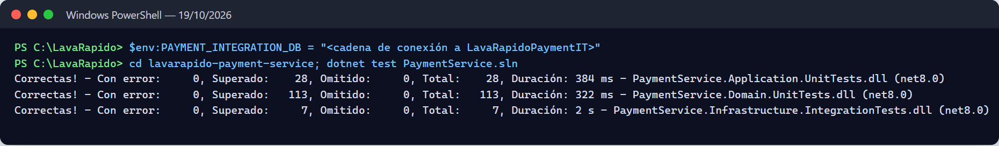
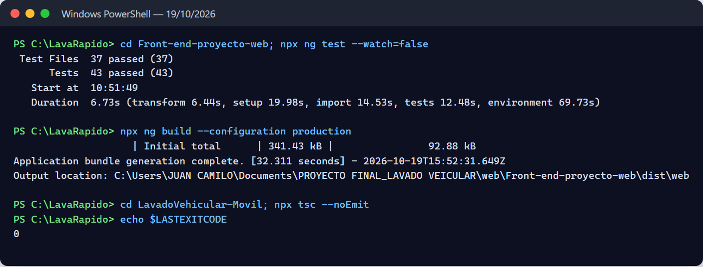
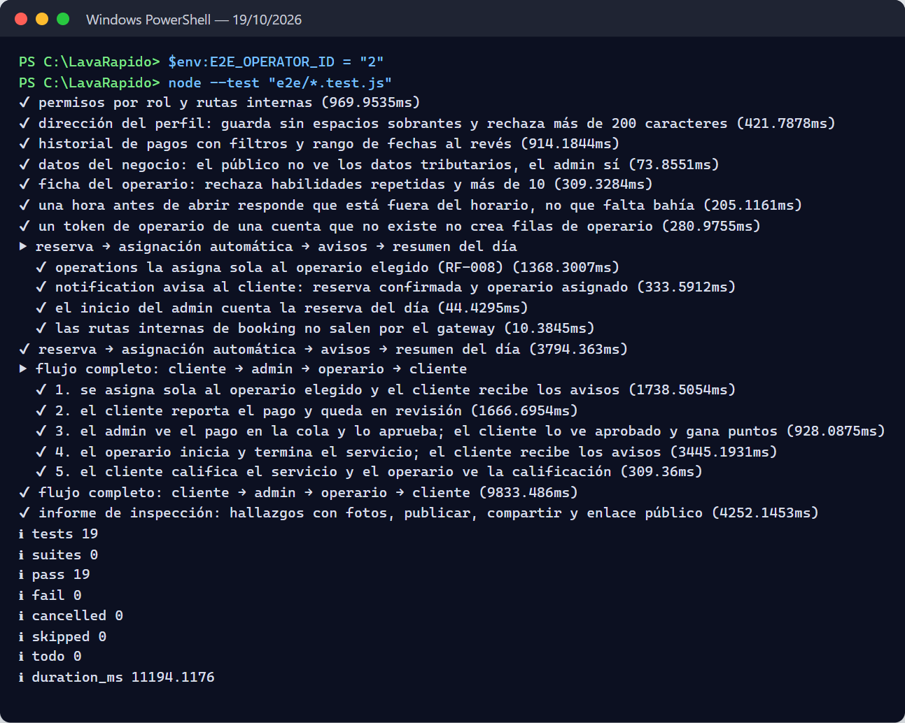
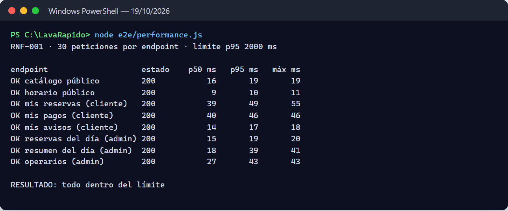
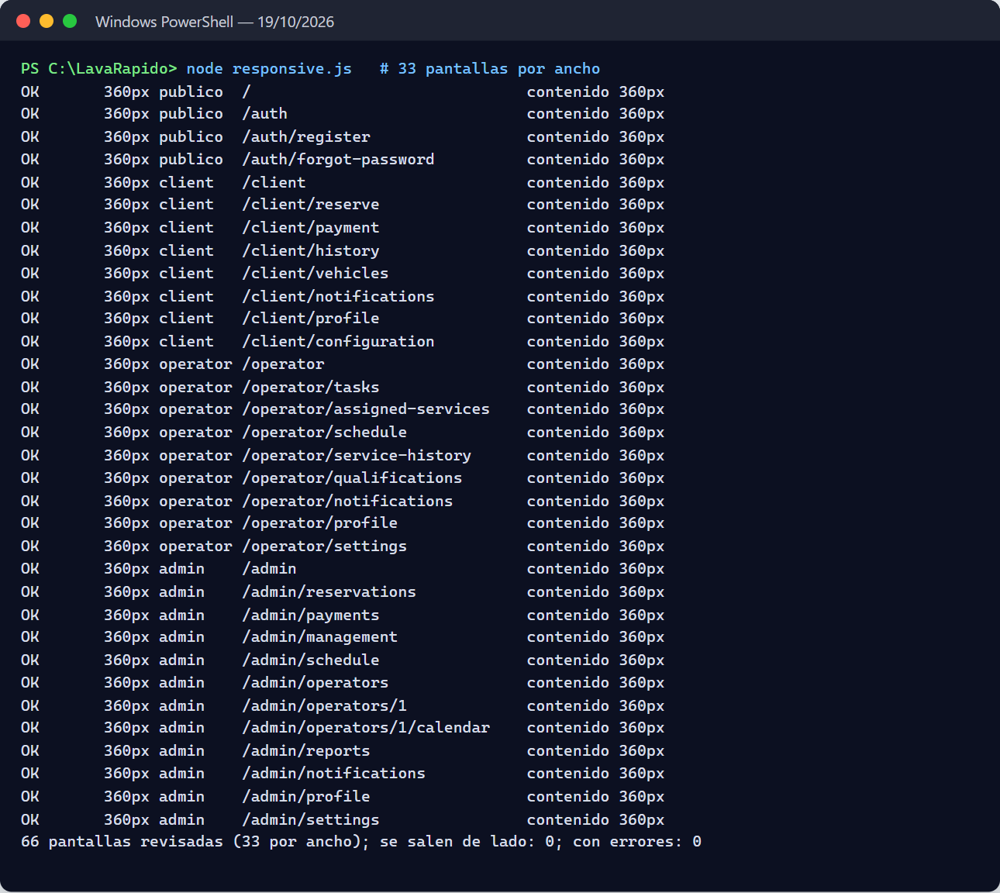

# Documentación de Pruebas — Sistema de Lavado Vehicular

## Portada

**Tabla 1**

*Datos de identificación del documento*

| Campo | Valor |
| --- | --- |
| Proyecto | Sistema de Gestión de Lavado Vehicular (Vehicle Washing / LavaRápido) |
| Producto | Documentación de pruebas (sección 2.5.4) |
| Programa | Tecnólogo en Análisis y Desarrollo de Software (ADSO) |
| Ficha | 3145556 |
| Aprendices | Brayan Estiven Patiño Cabrera, Juan Camilo Guilombo Osorio, Merari Urbano Quintero |
| Instructora | Karol Daniela Correa |
| Centro de formación | Industria |
| Fecha | 21 de octubre de 2026 |

Este documento reúne el plan de pruebas, el inventario de pruebas automatizadas que existen en los repositorios, sus resultados reales al ejecutarlas el 19 de octubre de 2026 (incluidas las pruebas de punta a punta, de rendimiento y de diseño adaptable contra el sistema completo) y otra vez el 21 de octubre, y los 42 casos de prueba funcionales, ejecutados el 19 de octubre, trazados a los requisitos del SRS v7.7 (`lavarapido-docs/01_INFORME_DE_ESPECIFICACION_DE_REQUISITOS`). El 20 de octubre de 2026 se ajustaron el inventario, el caso CP-42 y la matriz de trazabilidad porque el cambio de rol de una cuenta se revirtió en el código ese día, y la redacción de CP-10 porque el cliente cancela sin escribir motivo. El 21 de octubre de 2026 se registraron dos ejecuciones de las pruebas automatizadas y de las 19 de punta a punta: la de la madrugada (689 pruebas, todas aprobadas) y la de la noche (707, todas aprobadas), que es la más reciente. Recogen los cambios de ese día: el token de una sesión cerrada deja de servir, la asignación de operarios usa un candado, el comprobante tiene un máximo de 2 MB y, para las reservas que terminaron y nadie cerró, el sistema solo cancela la programada que venció sin confirmarse y deja en "No asistió" la confirmada que nunca tuvo operario; la que tenía operario pasa a la lista "Por cerrar" del administrador. La estructura sigue la norma ISO/IEC/IEEE 29119-3 de documentación de pruebas (International Organization for Standardization [ISO], 2021). Ningún resultado de este documento es supuesto.

## 1. Plan de pruebas

### 1.1 Alcance

Se prueban la aplicación web, la aplicación móvil y los siete servicios de backend en su rama `develop`. Quedan fuera las pruebas de seguridad ofensiva; la carga se revisa solo con la medición de tiempos de respuesta de RNF-001.

### 1.2 Tipos de prueba y herramientas

**Tabla 2**

*Tipos de prueba, herramienta real y dónde se aplica*

| Tipo | Qué verifica | Herramienta | Dónde |
| --- | --- | --- | --- |
| Unitarias de dominio | Reglas de entidades y objetos valor (estados, validaciones) | JUnit 5 (`spring-boot-starter-test`); xUnit 2 | `src/test/.../domain` en Java; `tests/PaymentService.Domain.UnitTests` |
| Unitarias de aplicación | Casos de uso con repositorios en memoria (dobles de prueba) | JUnit 5 con fakes (`Fakes.java`, `InMemory*Repository`); xUnit con `InMemoryPorts.cs` | `application/usecase` y `PaymentService.Application.UnitTests` |
| Integración web (controlador + seguridad) | Rutas, códigos HTTP, JWT y roles con MockMvc | `spring-boot-starter-webmvc-test`, `spring-security-test` | `*ApiWebTest.java`, `ApiSecurityWebTest.java`, `AdminNotificationControllerTest.java` |
| Integración del gateway | Que cada ruta pública llegue a su servicio y que el token de una sesión cerrada no pase | Spring Boot Test; para la sesión, un security-service simulado con el servidor HTTP del JDK | `GatewayRoutesTest.java`, `SessionCheckFilterTest.java` |
| Integración de persistencia | Mapeo EF Core contra SQL Server real | xUnit + `DatabaseFixture` | `PaymentService.Infrastructure.IntegrationTests` (requiere base de datos) |
| Unitarias de interfaz web | Componentes, guards y servicios de Angular | Vitest 4 + jsdom (`@angular/build:unit-test`) | `Web/src/**/*.spec.ts` |
| Funcionales / aceptación | Recorridos completos por rol contra el sistema desplegado | Manual, con Postman o Swagger UI para la API y navegador / Expo Go para la interfaz | Casos CP-01 a CP-42 (sección 4) |
| Entre servicios (punta a punta) y RNF | Reserva con elección de operario y asignación automática, flujo completo de los tres roles, informe de inspección, reglas de acceso por rol; percentil 95 del tiempo de respuesta (RNF-001); pantallas web a 360 px (RNF-008) | Node 24 (`node:test` y `fetch`) y Playwright Core con Edge sin ventana | `lavarapido-infra/e2e` |

> *Nota.* Herramientas documentadas en JUnit (s.f.), xUnit.net (s.f.) y Vitest (s.f.).

### 1.3 Entorno

**Tabla 3**

*Entorno de ejecución de las pruebas (19 de octubre de 2026)*

| Elemento | Versión |
| --- | --- |
| Sistema operativo | Windows 11 Home Single Language 10.0.26300 |
| Node.js / npm | 24.14.0 / 11.9.0 |
| JDK | Java 25.0.4 (los proyectos compilan para Java 21) con el Maven Wrapper de cada servicio |
| .NET SDK | 9.0.306; el proyecto apunta a `net8.0` y las pruebas se corrieron con `DOTNET_ROLL_FORWARD=Major` |
| Base de datos y mensajería | SQL Server 2022, RabbitMQ 4.3 y Mailpit en Docker 28.4 (Docker Desktop). Las pruebas unitarias no los necesitan; las 7 de persistencia de payment usaron una base aislada, `LavaRapidoPaymentIT`, creada con los mismos changelogs |
| Servicios | Los seis servicios y el gateway corriendo en el equipo (`./mvnw spring-boot:run` y `dotnet run`) contra esa infraestructura; el correo se envió a Mailpit para no escribirle a nadie de verdad. La web con `ng serve` y la app móvil con `npx expo start --web` |

### 1.4 Criterios

- **Aprobado:** el resultado obtenido coincide con el esperado.
- **Fallido:** el resultado difiere; se registra el error.
- **Bloqueado:** no se pudo ejecutar por una dependencia ausente (por ejemplo la base de datos).
- **Salida:** se acepta la versión si las suites automatizadas pasan y los casos funcionales de prioridad alta están aprobados.

## 2. Inventario de pruebas automatizadas

Al 21 de octubre de 2026 (noche) los repositorios tienen 602 métodos de prueba: 540 en el backend y 62 en la web. La app móvil no tiene pruebas automatizadas; se revisa con la compilación de TypeScript y el recorrido de pantallas (sección 3.2).

**Tabla 4**

*Pruebas por artefacto (conteo de `@Test`/`@ParameterizedTest`, `[Fact]`/`[Theory]`/`[IntegrationFact]` e `it()`)*

| Artefacto | Archivos | Métodos | Qué cubren |
| --- | --- | --- | --- |
| api-gateway | 2 | 14 | Ruteo de cada prefijo `/api/v1/**` a su servicio y que `/internal/**` no salga por el gateway (`GatewayRoutesTest`); chequeo de sesión: el token de una sesión cerrada no pasa, la respuesta se guarda por token, el logout la borra, si security-service falla la petición sigue y las rutas públicas no se revisan (`SessionCheckFilterTest`) |
| security-service | 17 | 139 | Registro, login con bloqueo por intentos fallidos, recuperación de contraseña, perfil y dirección, administración de usuarios (incluida la regla de que una cuenta de administrador no se desactiva), roles y permisos, preferencias, objetos valor, política de contraseñas, emisión de JWT, sesiones abiertas y cerradas (el token de una sesión cerrada responde 401) y seguridad HTTP por rol (`ApiSecurityWebTest`) |
| customer-service | 6 | 50 | Cuenta del cliente, placas, CRUD de vehículos, listener de `security.user_registered` y API web |
| booking-service | 7 | 50 | Ciclo de vida de la reserva, cancelación de las programadas que vencieron sin confirmarse, "No asistió" solo para la confirmada vencida que pide operations por la ruta interna, disponibilidad y motivo de una hora no disponible, bahías (`ServiceBayTest`), catálogo, datos del negocio (`EstablishmentTest`), operario preferido en el evento y API web |
| operations-service | 13 | 67 | Asignación manual y automática (con el candado de asignaciones), una sola regla para las reservas sin operario, reservas que terminaron y nadie cerró y lista "Por cerrar" (`FollowUpPolicyTest`, `FollowUpServiceTest`), operarios libres, ventana de inicio, ejecución, calificación, ausencias, métricas del operario, resumen del equipo, ficha del operario, informe de inspección y API web |
| notification-service | 13 | 108 | Casos de uso de notificaciones, fábrica de mensajes por evento, avisos en el idioma de la cuenta, recordatorios, alertas de reservas sin operario, aviso de servicio sin registrar, campos `null` en el evento (`DomainEventEnvelopeTest`), aviso de versión nueva, tokens de dispositivo y controlador admin |
| payment-service (.NET) | 9 | 112 | Pago y comprobante (máximo 2 MB), referencia reutilizada, historial con filtros, promociones, puntos de fidelización, política de pagos, servicios de comandos y consultas, y 7 pruebas de persistencia contra SQL Server |
| Web (Angular) | 41 | 62 | Creación de componentes, guards y servicios (pruebas de humo `should create`), mensajes de error de la API, selección de la cuenta de pago, sesión entre pestañas, reservas sin operario y filtros, lista "Por cerrar", cuentas y roles fijos, reportes y barra de fidelización |
| Móvil | 0 | 0 | Sin pruebas automatizadas |

> *Nota.* Los archivos de apoyo (`Fakes.java`, `InMemory*.java`, `InMemoryPorts.cs`, `DatabaseFixture.cs`) no se cuentan como pruebas. Las 7 pruebas de persistencia de payment se omiten solas si no está definida la variable `PAYMENT_INTEGRATION_DB` (`DatabaseFixture.cs:16-21`).

Las pruebas del backend son de dominio y de aplicación con dobles en memoria, más pruebas de controladores con MockMvc. Muchas de las de la web solo comprueban que cada componente se crea; `api-error.spec.ts`, `payment.spec.ts` y, desde el 21 de octubre de 2026, `auth.spec.ts`, `reservations-store.spec.ts`, `reservations.spec.ts`, `management.spec.ts`, `reports.spec.ts` y `dashboard.spec.ts` prueban reglas reales.

## 3. Resultados de ejecución

En la noche del 21 de octubre de 2026, con la rama *develop* de los diez repositorios actualizada ese día, el equipo ejecutó otra vez las ocho suites automatizadas: 707 pruebas, todas aprobadas y ninguna omitida, incluidas las 7 de persistencia de payment contra la base aislada `LavaRapidoPaymentIT`. Es la ejecución final del día y recoge el cambio de las reservas que terminaron y nadie cerró, hecho después de la revisión del equipo, y el arreglo de los campos `null` en los eventos de notification-service. La Tabla 5 muestra cada suite y lo que cambió frente a la ejecución de la madrugada.

**Tabla 5**

*Resultados reales por artefacto (21 de octubre de 2026, ejecución de la noche)*

| Artefacto | Comando | Ejecutadas | Aprobadas | Fallidas | Omitidas | Frente a la madrugada del 21 de octubre (689) |
| --- | --- | --- | --- | --- | --- | --- |
| Web (Angular) | `npx ng test --watch=false` | 62 | 62 | 0 | 0 | +2: lista "Por cerrar" en el store de reservas (`reservations-store.spec.ts`) |
| api-gateway | `./mvnw test` | 40 | 40 | 0 | 0 | Sin cambios |
| security-service | `./mvnw test` | 155 | 155 | 0 | 0 | Sin cambios |
| customer-service | `./mvnw test` | 69 | 69 | 0 | 0 | Sin cambios |
| booking-service | `./mvnw test` | 50 | 50 | 0 | 0 | +3: solo la programada vence sola, y la confirmada pasa a No asistió únicamente cuando operations lo pide por la ruta interna y ya venció (`BookingTest`, `BookingServiceTest`, `BookingApiWebTest`) |
| operations-service | `./mvnw test` | 67 | 67 | 0 | 0 | +11: qué hacer con una reserva que terminó y nadie cerró (`FollowUpPolicyTest`), cierre de las que no tuvieron operario, aviso una sola vez, lista "Por cerrar" y cierre como "Se atendió" sin inventar horas (`FollowUpServiceTest`, `ServiceExecutionTest`, `OperationsApiWebTest`) |
| notification-service | `./mvnw test` | 114 | 114 | 0 | 0 | +2: aviso al operario y al administrador de un servicio sin registrar (`StaffNotificationsTest`) y campo `null` en el evento sin pasar a la cola de errores (`DomainEventEnvelopeTest`) |
| payment-service: dominio | `dotnet test PaymentService.sln` | 115 | 115 | 0 | 0 | Sin cambios |
| payment-service: aplicación | (mismo comando) | 28 | 28 | 0 | 0 | Sin cambios |
| payment-service: integración | (mismo comando, con `PAYMENT_INTEGRATION_DB`) | 7 | 7 | 0 | 0 | Sin cambios |
| **Total** | | **707** | **707** | **0** | **0** | **+18** |

> *Nota.* Fuentes: registro de las ejecuciones del equipo del 21 de octubre de 2026 (`vehicle-w-docs/11-quality/testing-strategy.md`), salida de Vitest y de `dotnet test`, y resumen de `./mvnw test` (`Tests run:`) con los reportes de surefire. Hay más pruebas ejecutadas que métodos en la Tabla 4 porque las pruebas parametrizadas (`@ParameterizedTest`, `[Theory]`) corren una vez por cada dato. En customer-service el atributo `tests` del XML de surefire dice 68 por una clase de prueba anidada; Maven ejecuta y cuenta 69, y ese es el número correcto.

La ejecución de la madrugada del 21 de octubre de 2026 tuvo 689 pruebas, todas aprobadas: web 60, api-gateway 40, security-service 155, customer-service 69, booking-service 47, operations-service 56, notification-service 112 y payment-service 150 (115 de dominio, 28 de aplicación y 7 de persistencia). Frente al 19 de octubre sumó 34: sesión entre pestañas, reservas sin operario y filtros, cuentas y roles fijos, reportes y barra de fidelización en la web (+17); chequeo de sesión en el gateway (+6); sesiones en security-service (+4, después de quitar 2 del cambio de rol revertido); reservas vencidas en booking-service (+4); candado de asignaciones en operations-service (+1); y comprobante de máximo 2 MB en payment-service (+2). Esa misma madrugada se repitieron por separado las suites que habían cambiado, con el mismo resultado.

La ejecución del 19 de octubre de 2026 tuvo 655 pruebas, todas aprobadas: web 43, api-gateway 34, security-service 151, customer-service 69, booking-service 43, operations-service 55, notification-service 112 y payment-service 148 (113 de dominio, 28 de aplicación y 7 de persistencia). Las Figuras 1 a 3 son de esa ejecución.

Además de las pruebas automatizadas, el 21 de octubre de 2026 se comprobó en vivo la lista "Por cerrar": una reserva sin operario pasó sola a No asistió; una con operario sin iniciar y una iniciada sin finalizar quedaron por cerrar, con un aviso al operario y otro al administrador que no se repitió; al cerrarlas como "Se atendió" quedaron completadas sin horas inventadas, y cerrarlas otra vez respondió 409. Se vio igual en la web y en la app móvil (390 px).

**Figura 1**

*Resultado de las pruebas de los servicios Java (19 de octubre de 2026)*

**Figura 2**

*Resultado de las pruebas de payment-service con las de persistencia (19 de octubre de 2026)*

**Figura 3**

*Pruebas y compilación de producción de la web, y compilación de TypeScript de la app móvil (19 de octubre de 2026)*

Observaciones de la ejecución:

- La línea `ERROR ... Could not send the password recovery email: SMTP down` del log de security-service la provoca a propósito `EmailResetCodeNotifierTest`, que simula un SMTP caído. No es una falla.
- Vitest muestra un aviso de compilación: `src/test-providers.ts` no está en el `tsconfig`. No afecta los resultados.
- La ejecución del 19 de octubre usó JDK 25 y .NET SDK 9 sobre proyectos para Java 21 y .NET 8. GitHub Actions corre las mismas pruebas con Temurin 21 y .NET 8 en cada cambio (Documento de Despliegue).

### 3.1 Pruebas de punta a punta

El 19 de octubre de 2026 se ejecutó `node --test "e2e/*.test.js"` desde `lavarapido-infra`, con el sistema completo en marcha y `E2E_OPERATOR_ID=2` (el operario de prueba de la base local). Pasaron las 19 pruebas en 11,2 s. Cada prueba borra lo que crea y deja los puntos del cliente como estaban. El 21 de octubre de 2026 el equipo las ejecutó otra vez, en la madrugada y en la noche, ya con el chequeo de sesión del gateway activo, y en las dos pasaron las 19; los archivos de la Tabla 5a no cambiaron desde el 18 de octubre.

**Tabla 5a**

*Pruebas de punta a punta (19 de octubre de 2026)*

| Archivo | Pruebas | Qué recorre | Resultado |
| --- | --- | --- | --- |
| `access-rules.test.js` | 7 | Permisos por rol y rutas internas, dirección del perfil, filtros del historial de pagos, datos tributarios solo para el administrador, ficha del operario, hora fuera del horario (`reason: OUTSIDE_HOURS`) y token de una cuenta inexistente | 7 aprobadas |
| `booking-flow.test.js` | 5 (1 + 4 subpruebas) | Reserva eligiendo operario, asignación automática por RabbitMQ, avisos al cliente, resumen del día y rutas internas fuera del gateway | 5 aprobadas |
| `full-flow.test.js` | 6 (1 + 5 subpruebas) | Reserva → pago reportado → aprobación con puntos → inicio y fin del servicio → calificación, revisando cada aviso | 6 aprobadas |
| `inspection-flow.test.js` | 1 | Informe de inspección con hallazgos y fotos, publicación, aviso al cliente y enlace público | 1 aprobada |
| **Total** | **19** | | **19 aprobadas** |

**Figura 4**

*Salida de las pruebas de punta a punta*

### 3.2 Rendimiento y diseño adaptable

El mismo día se midió el tiempo de respuesta de las lecturas más usadas (RNF-001) con `node e2e/performance.js`: 30 peticiones por endpoint a través del gateway. Todas quedaron muy por debajo del límite de 2 s en el percentil 95.

**Tabla 5b**

*Tiempo de respuesta por endpoint (RNF-001, 19 de octubre de 2026)*

| Endpoint | p50 | p95 | Máximo |
| --- | --- | --- | --- |
| Catálogo público | 16 ms | 19 ms | 19 ms |
| Horario público | 9 ms | 10 ms | 11 ms |
| Mis reservas (cliente) | 39 ms | 49 ms | 55 ms |
| Mis pagos (cliente) | 40 ms | 46 ms | 46 ms |
| Mis avisos (cliente) | 14 ms | 17 ms | 18 ms |
| Reservas del día (administrador) | 15 ms | 19 ms | 20 ms |
| Resumen del día (administrador) | 18 ms | 39 ms | 41 ms |
| Operarios (administrador) | 27 ms | 43 ms | 43 ms |

**Figura 5**

*Medición del tiempo de respuesta*

Para el diseño adaptable (RNF-008) se recorrieron con Playwright (Edge sin ventana) las pantallas de los cuatro grupos de la web (público, cliente, operario y administrador) a 360 y 768 px, con el script `width-360.js` de la suite y una revisión que además busca elementos que pasen el borde derecho fuera de un contenedor con desplazamiento propio.

**Tabla 5c**

*Verificación de diseño adaptable (19 de octubre de 2026)*

| Prueba | Alcance | Resultado |
| --- | --- | --- |
| Web a 360 px (`e2e/width-360.js`) | 12 pantallas: públicas, cliente y administrador | Ninguna se sale de 360 px |
| Web a 360 px | 33 pantallas: 4 públicas, 8 del cliente, 9 del operario y 12 del administrador | Ninguna se sale de lado ni recorta contenido; sin errores de la página ni respuestas 5xx |
| Web a 768 px | Las mismas 33 pantallas | Ninguna se sale de lado ni recorta contenido |
| App móvil a 360 px (`npx expo start --web`) | 15 pantallas: las cinco del menú inferior de cada rol (cliente, operario y administrador), con cuentas temporales que se borran al final | Ninguna se sale de lado; sin errores de la página |
| Compilación | `npx ng build --configuration production` (web) y `npx tsc --noEmit` (app) | Sin errores |

**Figura 6**

*Revisión de las pantallas web a 360 px*

*Nota.* Tomar o elegir fotos con la cámara y la galería del celular no se puede automatizar en esta prueba; queda pendiente probarlo en un dispositivo Android.

## 4. Casos de prueba funcionales

Los casos CP-01 a CP-33 se definieron sobre el SRS v4 y se ejecutaron por primera vez el 9 de octubre de 2026; los casos CP-34 a CP-42 cubren los requisitos implementados después (RF-004b, RF-008, RF-010, RF-015, RF-022, RF-036, RF-037 y RF-038) y las cuentas de administrador de RF-028. Los 42 se ejecutaron el 19 de octubre de 2026 contra el sistema completo, a través del API Gateway (las mismas llamadas que hacen la web y el móvil), con un script que crea sus propias cuentas y datos y los borra al terminar. Los 42 resultaron aprobados (Figura 7). Los requisitos que quedaron implementados después (RF-004b, RF-008, RF-010, RF-015, RF-022, RF-036, RF-037 y RF-038) están cubiertos por pruebas automatizadas (sección 5), y el flujo de reserva con elección de operario y asignación automática lo recorre además `lavarapido-infra/e2e/booking-flow.test.js`. Los cambios del 21 de octubre de 2026 (el token de una sesión cerrada, el cierre de reservas vencidas y el comprobante de máximo 2 MB) todavía no tienen caso funcional propio; los cubren las pruebas automatizadas de la Tabla 5 (brecha 7 de la Tabla 8).

**Tabla 6**

*Casos de prueba funcionales*

| ID | RF | Caso | Precondición | Pasos | Datos | Resultado esperado | Resultado obtenido | Estado |
| --- | --- | --- | --- | --- | --- | --- | --- | --- |
| CP-01 | RF-001 | Registro de cliente exitoso | Correo no registrado | Registrar la cuenta e iniciar sesión | Documento, nombre, teléfono, correo nuevo y contraseña válida | Cuenta creada con rol CLIENT; se crea el perfil en customer-service | Registro 201; login 200 con rol CLIENT; perfil de cliente creado en customer-service | Aprobado |
| CP-02 | RF-001 | Registro con correo repetido | El correo ya existe | Registrar con el mismo correo | Correo de CP-01 | Mensaje de correo ya registrado; no se crea la cuenta | 409 `EMAIL_ALREADY_REGISTERED`; sigue habiendo una sola cuenta con ese correo | Aprobado |
| CP-03 | RF-002 | Inicio de sesión por rol | Usuarios CLIENT, OPERATOR y ADMIN | Iniciar sesión con cada uno | Credenciales válidas | Redirige a `/client`, `/operator` o `/admin` según el rol | Los tres ingresos responden 200 con los roles CLIENT, OPERATOR y ADMIN; la web redirige por ese rol | Aprobado |
| CP-04 | RF-002 | Credenciales incorrectas | — | Iniciar sesión con contraseña errónea y luego con correo inexistente | Dos intentos | Mismo mensaje genérico en ambos; no revela si el correo existe | Ambos: 401 `INVALID_CREDENTIALS` (misma respuesta) | Aprobado |
| CP-05 | RF-003 | Recuperar contraseña | Usuario registrado; Mailpit activo | Pedir código, leerlo en Mailpit, verificarlo y fijar nueva contraseña | Código de 6 dígitos | Contraseña cambiada; el login con la nueva funciona | Código de 6 dígitos leído en Mailpit; verificación 204; cambio 204; login con la nueva contraseña 200 | Aprobado |
| CP-06 | RF-003 | Código bloqueado por intentos | Código solicitado | Ingresar 5 códigos erróneos y luego el correcto | 5 códigos inválidos | El código correcto ya no es aceptado | Los 5 códigos errados: 400; después el correcto también: 400 `INVALID_RESET_CODE` | Aprobado |
| CP-07 | RF-004 | Cambio de contraseña con actual incorrecta | Sesión iniciada | Cambiar contraseña con la actual equivocada | Contraseña actual errónea | Error de contraseña actual incorrecta; no cambia | 400 `INCORRECT_CURRENT_PASSWORD`; la contraseña anterior sigue funcionando | Aprobado |
| CP-08 | RF-005 | Crear reserva | Cliente con vehículo SUV | Elegir vehículo, servicio Básico, fecha y hora libre | SUV, Básico | Reserva creada; precio $23.000 (precio semilla de Básico para SUV) | Reserva creada (201) con total $23.000, el precio semilla de Básico para SUV | Aprobado |
| CP-09 | RF-006 | Horario ocupado | Bahías activas de una franja ocupadas | Reservar en la misma franja hasta llenarla | Varios vehículos del cliente | No se guarda la reserva; se ofrecen hasta cinco horas alternativas del mismo día | Tres reservas ocuparon las tres bahías activas; la cuarta: 409 `SLOT_UNAVAILABLE` (`NO_FREE_BAY`) con 5 horas alternativas | Aprobado |
| CP-10 | RF-007 | Cancelar reserva antes de iniciar | Reserva CONFIRMED | Cancelar como cliente (el cliente no escribe motivo) | — | Reserva en CANCELLED con el motivo `CUSTOMER_REQUEST` que pone el sistema | 200, reserva en CANCELLED con el motivo `CUSTOMER_REQUEST` guardado | Aprobado |
| CP-11 | RF-007 | Modificar reserva en proceso | Reserva IN_PROGRESS | Intentar cancelar | — | Acción bloqueada con mensaje | 409 `BOOKING_NOT_CHANGEABLE` | Aprobado |
| CP-12 | RF-009 | Asignar operario no disponible | Operario con ausencia a la hora de la reserva | Consultar candidatos e intentar asignarlo; luego asignar uno disponible | Operario ausente | El operario no se permite; los disponibles aparecen primero | El operario sin turno aparece con `OPERATOR_NOT_ON_SHIFT` y asignarlo responde 409; los disponibles salen primero; asignar al disponible: 200 | Aprobado |
| CP-13 | RF-011 | Operario ve sus servicios | Reserva asignada al operario | Consultar servicios asignados | — | Lista con datos del cliente y del vehículo | 200; el servicio trae nombre del cliente, placa, vehículo y servicios | Aprobado |
| CP-14 | RF-012b | Iniciar y finalizar servicio | Servicio asignado PENDING, a 15 min de su hora | Otro operario intenta iniciar; el asignado inicia y finaliza | — | Estados IN_PROGRESS y COMPLETED; el otro operario recibe error | Otro operario: 404 `BOOKING_NOT_FOUND`; el asignado inicia (200) y finaliza (200); la reserva queda COMPLETED | Aprobado |
| CP-15 | RF-012 | Calificar servicio una vez | Reserva COMPLETED | Calificar 5 estrellas; intentar calificar de nuevo | 5, comentario | Primera calificación guardada; la segunda es rechazada | Primera calificación 201; la segunda 409 `ALREADY_RATED` | Aprobado |
| CP-16 | RF-013 | Métodos de pago | Cuentas de pago configuradas | Consultar métodos (admin) y cuentas (cliente) | — | Efectivo, Nequi, Daviplata y Transferencia; el efectivo sin QR | Métodos: Efectivo, Nequi, Daviplata y Transferencia; el cliente ve las cuentas activas; el efectivo sin QR | Aprobado |
| CP-17 | RF-013b | Subir comprobante | Reserva por pagar | Pagar con Nequi adjuntando imagen, valor y referencia | PNG < 10 MB | Pago creado en revisión con su comprobante | 201; pago IN_REVIEW con su comprobante y el monto calculado por el servidor | Aprobado |
| CP-18 | RF-014 | Aprobar y rechazar pago | Pagos en revisión | Aprobar uno y rechazar otro con motivo | Motivo de rechazo | Estados APPROVED y REJECTED; el cliente recibe notificación | APPROVED y REJECTED; el cliente recibió PAYMENT_CONFIRMED y PAYMENT_REJECTED | Aprobado |
| CP-19 | RF-016 | Referencia repetida | Pago aprobado con referencia R1 | Subir otro comprobante con R1 en otra reserva | Referencia R1 | Comprobante rechazado | 409 `TRANSACTION_REFERENCE_REUSED` | Aprobado |
| CP-20 | RF-018 | Notificación de reserva | `MESSAGING_ENABLED=true` | Confirmar una reserva; abrir notificaciones; marcar como leída | — | Llega la notificación; el contador de no leídas baja | Llegó BOOKING_CONFIRMED; el contador de no leídas bajó en 1 al marcarla | Aprobado |
| CP-21 | RF-020 | Idioma guardado en la cuenta | Sesión iniciada | Cambiar a inglés; iniciar una sesión nueva | `en` | La interfaz abre en inglés | Guardado 200; en una sesión nueva el idioma de la cuenta es inglés | Aprobado |
| CP-22 | RF-021 | Excepción de horario | — | Crear excepción "cerrado" y consultar disponibilidad ese día | 20/10/2026 | No hay horas disponibles ese día | Excepción creada (201); ese día no hay horas libres | Aprobado |
| CP-23 | RF-024 | Crear y desactivar promoción | Sesión de admin | Crear promoción de 10 % y desactivarla | Descuento 10 % | Promoción visible y luego inactiva | Creada (201) y desactivada (200); en la lista queda pausada | Aprobado |
| CP-24 | RF-026 | Acumular puntos | Servicio con 10 puntos configurados | Aprobar el pago de la reserva; ver saldo | — | El saldo aumenta en los puntos del servicio | El saldo sube 30 puntos, los del servicio | Aprobado |
| CP-25 | RF-027 | Desactivar la cuenta propia | Sesión de cliente | Desactivar la cuenta con la contraseña actual e intentar iniciar sesión | Contraseña actual | La sesión se revoca y el login se rechaza | Desactivación 204; el nuevo login responde 403 `ACCOUNT_DISABLED` | Aprobado |
| CP-26 | RF-028 | Crear operario y restringir por rol | Sesiones de admin y de cliente | Admin crea operario; el cliente llama `GET /admin/users` | Datos del operario | Cuenta OPERATOR creada; el cliente recibe 403 | Cuenta OPERATOR creada (201) y listada; el cliente recibe 403 | Aprobado |
| CP-27 | RF-029 | Editar la matriz de permisos | Sesión de admin | Quitar `EDIT_DATA` a OPERATOR; intentar crear un rol | Permiso `EDIT_DATA` | La matriz se guarda; no se pueden crear roles | Matriz guardada (200); crear un rol responde 405 (los roles son fijos) | Aprobado |
| CP-28 | RF-030 | Registrar vehículo con placa repetida | Cliente con un vehículo registrado | Registrar otro vehículo con la misma placa | Placa FPW653 | El registro se rechaza | 409 `PLATE_ALREADY_REGISTERED` | Aprobado |
| CP-29 | RF-031 | Cambio de precio sin afectar reservas | Reserva confirmada con Básico | Admin sube el precio de Básico/SUV; consultar la reserva existente y crear una nueva | $23.000 → $24.000 | La existente conserva su precio; la nueva usa el nuevo | La reserva existente conserva $23.000; la nueva sale en $24.000 | Aprobado |
| CP-30 | RF-032 | Bahía en mantenimiento | BAY-04 en mantenimiento (semilla) | Llenar una franja y revisar qué bahías se usaron | — | La bahía en mantenimiento no se usa para reservas nuevas | Con la Bahía 1 en mantenimiento, dos reservas a la misma hora quedaron en las bahías 2 y 3 y la tercera recibió 409 | Aprobado |
| CP-31 | RF-033 | Transición de estado no permitida | Reserva CANCELLED | Admin intenta cambiarla a CONFIRMED | — | Se rechaza | 409 `INVALID_STATUS_TRANSITION` | Aprobado |
| CP-32 | RF-034 | Cuenta de pago desactivada | Cuenta Daviplata activa | Admin la desactiva; el cliente consulta cuentas | — | La cuenta ya no se muestra al cliente | Cuenta desactivada (200); el cliente ya no la ve | Aprobado |
| CP-33 | RF-035 | Reembolsar un pago aprobado | Pago APPROVED | Admin reembolsa | — | Estado REFUNDED; se publica `payment.refunded` y el cliente es notificado | Estado REFUNDED; el cliente recibió PAYMENT_REFUNDED y los puntos de la reserva se revirtieron | Aprobado |
| CP-34 | RF-004b | Bloqueo por intentos fallidos | Cuenta activa | Iniciar sesión 5 veces con una contraseña errada y luego con la correcta | Correo de una cuenta nueva | Al quinto fallo la cuenta se bloquea 15 minutos; la contraseña correcta tampoco entra | Intentos: 401, 401, 401, 401 y 423; con la contraseña correcta: 423 `ACCOUNT_LOCKED` | Aprobado |
| CP-35 | RF-008 | Asignación automática del operario | Operarios con turno ese día | Reservar sin elegir operario | Servicio Básico, SUV | La reserva queda asignada a un operario libre sin intervención del administrador | La reserva quedó asignada a un operario libre sin intervención del administrador | Aprobado |
| CP-36 | RF-010 | El cliente elige el operario | El operario tiene turno y está libre | Consultar los operarios libres y reservar eligiendo uno | `preferredOperatorId` | La reserva queda con el operario elegido | El operario elegido aparece libre y la reserva quedó con él | Aprobado |
| CP-37 | RF-015 | Historial de pagos con filtros | El cliente tiene dos pagos | Consultar el historial con el día de las reservas pagadas, con otro día y con un rango invertido | Fechas | Solo salen los pagos de ese día; el rango invertido se rechaza | Con el día de las reservas pagadas salen sus 2 pagos; con otro día, ninguno; el rango invertido responde 400 `INVALID_DATE_RANGE` | Aprobado |
| CP-38 | RF-022 | Ausencia del operario | Operario con turno | Registrar una ausencia ese día, consultar los candidatos de una reserva de ese día y registrar una ausencia pasada | Ausencia de día completo | El operario sale como ausente; la ausencia pasada se rechaza | Ausencia registrada (201); ese día el operario sale como `OPERATOR_ABSENT`; la ausencia pasada responde 400 `ABSENCE_IN_PAST` | Aprobado |
| CP-39 | RF-037 | Datos del negocio por completar | Sistema con la migración 111 aplicada | Consultar los datos, guardar un teléfono inválido y luego una línea de atención válida | Teléfono de 3 dígitos | Los datos del negocio real están vacíos; el teléfono inválido se rechaza; el cambio válido se ve en la página pública | Los datos tributarios y los canales estaban vacíos; el teléfono inválido responde 400 `ESTABLISHMENT_INVALID_PHONE`; el cambio válido (200) se ve en la página pública | Aprobado |
| CP-40 | RF-038 | Ficha del operario | Operario creado | Guardar una especialidad y una habilidad | Habilidad de nivel EXPERT | La ficha queda guardada | 200; ficha guardada con su especialidad y una habilidad | Aprobado |
| CP-41 | RF-036 | Informe de inspección | Reserva confirmada de un servicio de 200 minutos | Iniciar el informe, terminar una fase, publicar, compartir y abrir el enlace público | Servicio temporal de 200 minutos | El cliente recibe el aviso y el enlace abre sin sesión con la placa enmascarada | Informe iniciado (200), publicado (200) y compartido (204); el cliente recibió INSPECTION_REPORT y el enlace abre sin sesión sin mostrar la placa completa | Aprobado |
| CP-42 | RF-028 | Una cuenta de administrador no se desactiva | Sesión de administrador | Intentar desactivar una cuenta de administrador | — | Se rechaza: una cuenta de administrador no se desactiva | 403 `ADMIN_CANNOT_BE_DISABLED` | Aprobado |

> *Nota.* El 19 de octubre CP-42 también probó el cambio de rol de una cuenta (403 `CANNOT_CHANGE_OWN_ROLE` al cambiar el propio rol y un operario pasado a cliente con 200). Esa parte se retiró del caso el 20 de octubre de 2026, cuando la función se revirtió en el backend, la web y la app.

> *Nota.* Los precios de los datos de prueba salen de los changelogs semilla (`103-seed-catalog.sql`, `104-seed-booking-catalogs.sql`). El script crea un cliente, dos operarios y un administrador de prueba, con correos del dominio `prueba.lavarapido.test`, y sus propios vehículos y reservas. Al terminar borra todo lo que creó y restaura el precio de Básico, la matriz de permisos, la bahía, la cuenta de pago y los datos del negocio; se comprobó en la base que no quedó nada. Los correos de recuperación se leyeron en Mailpit. Evidencia: registro de ejecución con el código HTTP y el código de error de cada paso (Figura 7).

**Figura 7**

*Ejecución de los 42 casos funcionales (19 de octubre de 2026)*

## 5. Matriz de trazabilidad

De los 41 requisitos del SRS v7.7, 38 tienen caso funcional y 39 una prueba automatizada relacionada; RF-032 y RF-034 solo tienen caso funcional, y RF-017, RF-023 y RF-025 solo prueba automatizada.

**Tabla 7**

*RF → estado → endpoint / pantalla → caso de prueba*

| RF | Estado (SRS v7) | Endpoint (prefijo `/api/v1`) | Pantalla web | Caso funcional | Prueba automatizada relacionada |
| --- | --- | --- | --- | --- | --- |
| RF-001 | Implementado | `POST /auth/register` | `/auth/register` | CP-01, CP-02 | `AccountRegistrationServiceTest`, `UserRegisteredListenerTest` |
| RF-002 | Implementado | `POST /auth/login` | `/auth` | CP-03, CP-04 | `AuthenticationServiceTest`, `JwtTokenIssuerTest`, `ApiSecurityWebTest` |
| RF-003 | Implementado | `POST /auth/password/forgot`, `/verify`, `/reset` | `/auth/forgot-password` | CP-05, CP-06 | `PasswordRecoveryServiceTest`, `PasswordResetTokenTest` |
| RF-004 | Implementado | `PUT /users/me/password` | `/client/profile` | CP-07 | `UserProfileAndAdministrationTest`, `PasswordPolicyTest` |
| RF-004b | Implementado | `POST /auth/login` (423 `ACCOUNT_LOCKED`) | `/auth` | CP-34 | `AuthenticationServiceTest` (bloqueo y ventana), `PasswordRecoveryServiceTest` (el restablecimiento lo levanta), `ApiSecurityWebTest` (423) |
| RF-027 | Implementado | `GET/PATCH /users/me`, `GET/PUT /users/me/address`, `PUT /users/me/email`, `POST /auth/logout`, `POST /users/me/deactivate`, `GET /auth/session` (gateway) | `/client/profile` | CP-25 | `UserProfileAndAdministrationTest`, `PersonAddressServiceTest`, `AuthenticationServiceTest`, `ApiSecurityWebTest` y `SessionCheckFilterTest` (token de una sesión cerrada), `auth.spec.ts` (pestañas) |
| RF-028 | Implementado | `GET/POST /admin/users`, `PATCH /admin/users/{id}/status` | `/admin/management`, `/admin/operators` | CP-26, CP-42 | `UserProfileAndAdministrationTest`, `ApiSecurityWebTest` |
| RF-029 | Implementado | `GET /admin/roles-permissions`, `PUT /admin/roles-permissions/{role}` | `/admin/management` | CP-27 | `RolePermissionAdministrationServiceTest`, `management.spec.ts` (roles fijos) |
| RF-030 | Implementado | `/vehicles`, `GET /vehicle-types`, `GET /admin/vehicles` | `/client/vehicles` | CP-28 | `CustomerVehicleServiceTest`, `LicensePlateTest`, `CustomerApiWebTest` |
| RF-031 | Implementado | `GET /catalog/services`, `/admin/catalog/services` | `/admin/management` | CP-29 | `CatalogServiceTest` |
| RF-021 | Implementado | `PUT /admin/schedule/business-hours`, `POST /admin/schedule/exceptions` | `/admin/schedule` | CP-22 | `AvailabilityPolicyTest` |
| RF-032 | Implementado | `/admin/bays` | `/admin/schedule` | CP-30 | — |
| RF-037 | Implementado | `GET/PUT /admin/establishment`, `GET /establishment` | `/admin/settings` | CP-39 | `EstablishmentTest`, `BookingApiWebTest` |
| RF-005 | Implementado | `POST /bookings`, `GET /catalog/services` | `/client/reserve` | CP-08 | `BookingServiceTest`, `BookingTest` |
| RF-006 | Implementado | `GET /bookings/availability` | `/client/reserve` | CP-09 | `AvailabilityPolicyTest` |
| RF-007 | Implementado | `PUT /bookings/{id}`, `POST /bookings/{id}/cancel` | `/client/history` | CP-10, CP-11 | `BookingTest`, `BookingApiWebTest` |
| RF-033 | Implementado | `GET /admin/bookings`, `PATCH /admin/bookings/{id}/status`, `GET /admin/assignments/to-close`, `POST /admin/assignments/{bookingId}/attended` | `/admin/reservations`, `/admin` ("Por cerrar") | CP-31 | `BookingTest`, `BookingServiceTest` (incluidas la cancelación de las programadas vencidas y la ruta interna de no asistió), `BookingApiWebTest`, `FollowUpPolicyTest`, `FollowUpServiceTest`, `reservations-store.spec.ts` |
| RF-008 | Implementado | Evento `booking.confirmed`, `GET /internal/v1/bookings` | `/admin/reservations` | CP-35 | `AutoAssignmentPolicyTest`, `OperationsServiceTest` (asignación automática, cuenta desactivada), `booking-flow.test.js` |
| RF-009 | Implementado | `GET /admin/assignments/{id}/candidates`, `PUT /admin/assignments/{id}` | `/admin/reservations` | CP-12 | `AssignmentPolicyTest`, `OperationsServiceTest` (candado de asignaciones y regla de reservas sin operario), `reservations-store.spec.ts` |
| RF-010 | Implementado | `GET /operators/available`, `POST /bookings` (`preferredOperatorId`) | `/client/reserve` | CP-36 | `OperationsServiceTest` (operarios libres), `OperationsApiWebTest`, `booking-flow.test.js` |
| RF-011 | Implementado | `GET /operator/services` | `/operator/assigned-services` | CP-13 | `OperationsServiceTest` |
| RF-012b | Implementado | `POST /operator/services/{id}/start`, `/finish` | `/operator/assigned-services` | CP-14 | `StartPolicyTest`, `ServiceExecutionTest` |
| RF-012 | Implementado | `POST /ratings/{bookingId}` | `/client/history` | CP-15 | `ServiceExecutionTest` |
| RF-022 | Implementado | `PUT /admin/operators/{id}/availability`, `/absences`, `GET /admin/operators/summary` | `/admin/operators/:id` | CP-38 | `AssignmentPolicyTest`, `TeamSummaryCalculatorTest` |
| RF-036 | Implementado | `/admin/inspections/{bookingId}/**`, `GET /public/inspections/{token}` | `/admin/reservations/:id/inspection`, `/report/:token` | CP-41 | `InspectionReportTest`, `OperationsApiWebTest` |
| RF-038 | Implementado | `GET /admin/operators/profiles`, `PUT /admin/operators/{id}/profile` | `/admin/operators/:id` | CP-40 | `OperatorProfileServiceTest` |
| RF-034 | Implementado | `/admin/payment-accounts`, `GET /payment-accounts` | `/admin/settings` | CP-32 | — |
| RF-013 | Implementado | `GET /payment-accounts` | `/client/payment` | CP-16 | `PaymentQueryServiceTests` |
| RF-013b | Implementado | `POST /payments` | `/client/payment` | CP-17 | `PaymentTests` (comprobante de máximo 2 MB), `PaymentCommandServiceTests` |
| RF-014 | Implementado | `POST /admin/payments/{id}/approve`, `/reject` | `/admin/payments` | CP-18 | `PaymentTests`, `PaymentCommandServiceTests` |
| RF-015 | Implementado | `GET /payments/me?from=&to=&service=` | `/client/history` | CP-37 | `PaymentQueryServiceTests` (orden y filtros) |
| RF-016 | Implementado | `POST /payments` | `/client/payment` | CP-19 | `PaymentPolicyTests`, `PaymentCommandServiceTests` (referencia reutilizada) |
| RF-035 | Implementado | `POST /admin/payments/{id}/refund` | `/admin/payments` | CP-33 | `PaymentTests`, `PaymentCommandServiceTests` |
| RF-017 | Implementado | `GET /admin/bookings/day-summary`, `GET /operators/my-bookings` y stores del dashboard | `/client`, `/operator`, `/admin` | — | `BookingServiceTest` (resumen del día), pruebas de humo de la web (`dashboard.spec.ts`) |
| RF-018 | Implementado | `/notifications/*` + eventos RabbitMQ | `/*/notifications` | CP-20 | `NotificationUseCasesTest`, `NotificationFactoryTest`, `BookingReminderServiceTest`, `LocalizedNotificationsTest`, `UnassignedBookingAlertTest`, `StaffNotificationsTest` |
| RF-019 | Implementado | `PUT /users/me/preferences` | `/*/configuration` | Cubierto por CP-21 | `UserPreferenceServiceTest` |
| RF-020 | Implementado | `PUT /users/me/preferences` | `/*/configuration` | CP-21 | `UserPreferenceServiceTest`, `UserPreferenceTest` |
| RF-023 | Parcial | `GET /admin/operators/{id}/metrics`, `GET /admin/operators/summary`, stores de pagos y reservas | `/admin/reports`, `/admin/operators/:id` | — | `OperatorMetricsCalculatorTest`, `TeamSummaryCalculatorTest`, `reports.spec.ts` (solo cuentan las reservas completadas) |
| RF-024 | Implementado | `/admin/promotions` | `/admin/management` | CP-23 | `PromotionTests` |
| RF-025 | Implementado | `POST /loyalty/redeem` | `/client/payment` | — | `CustomerPromotionServiceTests` |
| RF-026 | Implementado | `GET /loyalty/balance` | `/client` | CP-24 | `LoyaltyTransactionTests` |

> *Nota.* La columna de prueba automatizada señala el archivo cuyo nombre y métodos corresponden al requisito; no se midió cobertura de código. `booking-flow.test.js` está en `lavarapido-infra/e2e` y necesita el sistema levantado.

## 6. Hallazgos y pendientes

**Tabla 8**

*Brechas de prueba encontradas*

| # | Brecha | Recomendación |
| --- | --- | --- |
| 1 | La app móvil no tiene pruebas automatizadas | Agregar Jest con `jest-expo` al menos para validadores (`shared/validators`) y servicios (`core/services`) |
| 2 | Muchas de las 62 pruebas de la web solo verifican que el componente se crea; las 19 agregadas el 21 de octubre de 2026 ya prueban reglas reales (sesión entre pestañas, reservas sin operario, "Por cerrar", roles fijos y reportes) | Probar más reglas reales: `authGuard` por rol, `authInterceptor` ante 401, formulario de reserva |
| 3 | Las 7 pruebas de persistencia de payment necesitan una base migrada y se omiten sin ella; el 19 y el 21 de octubre se corrieron contra `LavaRapidoPaymentIT` y pasaron | Documentar en el README cómo crear la base de pruebas y definir `PAYMENT_INTEGRATION_DB`, y correrlas en GitHub Actions con un SQL Server de servicio |
| 4 | De RF-023 (reportes) se prueban las métricas del operario, el resumen del equipo y, desde el 21 de octubre de 2026, que solo cuenten las reservas completadas (`reports.spec.ts`); la exportación PDF/Excel no tiene prueba | Agregar un caso funcional de reportes y exportación PDF/Excel |
| 5 | RF-032 (bahías) y RF-034 (cuentas de pago) no tienen pruebas automatizadas propias: `ScheduleService` y `PaymentAccountService` no tienen clase de prueba | Agregar pruebas unitarias de esos dos servicios |
| 6 | Los requisitos implementados después del 9 de octubre (RF-004b, RF-008, RF-010, RF-015, RF-022, RF-036, RF-037 y RF-038) no tenían caso funcional propio | Cerrada el 19 de octubre de 2026 con los casos CP-34 a CP-41 |
| 7 | Los cambios del 21 de octubre de 2026 (el token de una sesión cerrada deja de servir, las reservas que terminaron y nadie cerró con la lista "Por cerrar", el comprobante de más de 2 MB y el efectivo que solo aparece con su cuenta activa) no tienen caso funcional propio; los cubren pruebas automatizadas, salvo el efectivo, las 19 de punta a punta se ejecutaron con el chequeo de sesión activo y "Por cerrar" se comprobó en vivo en la web y en la app móvil | Agregar esos casos funcionales y ejecutarlos con el sistema completo; agregar una prueba de `PaymentAccountService` para la cuenta de efectivo |

**Tabla 9**

*Defectos encontrados al ejecutar el sistema*

| # | Defecto | Evidencia | Severidad |
| --- | --- | --- | --- |
| 1 | El dashboard del administrador saluda siempre "¡Hola, Laura!", sin importar quién inicia sesión | `Web/src/app/features/admin/pages/dashboard/dashboard.ts:73` (`adminName = 'Laura'`); también "Laura Méndez" fijo en `payment-review-modal.html:167` | Baja |
| 2 | En "Servicios asignados" del operario (web) la columna Cliente muestra la placa | `Web/src/app/features/operator/pages/assigned-services/assigned-services.ts:141` | Media |
| 3 | En el inicio del cliente (móvil) "Operario asignado" aparece vacío aunque la reserva tiene operario | Reserva RES-060003, asignada en CP-12; captura del móvil | Media |
| 4 | El nombre de la marca no es uniforme: "AquaWash" (móvil), "Car Wash" y "Lavado Vehicular" (web), "Express Car Wash" (establecimiento) | Capturas de la web y del móvil | Baja |
| 5 | La landing anuncia "Servicio móvil de lavado" y "donde estés", pero el SRS v4 define un lavadero de un único local | Captura de la landing; SRS v4, sección 1 | Baja |
| 6 | Si hay dos cuentas del mismo método (dos Nequi), la pantalla de pagos las muestra marcadas a la vez | Captura de Pagos del cliente | Baja |
| 7 | Al cerrar sesión, la web y la app mostraban "Tu sesión expiró", porque una respuesta 401 que llegaba después de borrar el token se tomaba como sesión vencida | `auth-interceptor.ts` (web) y `AuthServiceContext.tsx` (móvil) | Media |
| 8 | En el celular (360 px) había botones fuera de la pantalla en la barra de la landing, títulos encimados, el botón ☰ sobre los títulos, etiquetas de Servicios asignados fuera de la pantalla, filtros de Gestión fuera de su tarjeta e interruptores de Configuración sobre su texto | Revisión de diseño adaptable del 17 de octubre de 2026 (Tabla 5c) | Media |
| 9 | En la app móvil, los campos de fecha y búsqueda se aplastaban cuando iban en columna (Historial y Calificaciones) | `shared/components/screen/FilterInputs.tsx` | Baja |
| 10 | El avance del próximo servicio del cliente mostraba 10 % o 25 % aunque el lavado no había empezado | `features/client/pages/dashboard/dashboard.ts` (web) y `modules/client/models/client.ts` (móvil) | Baja |
| 11 | La primera versión del cierre automático (21 de octubre) dejaba en No asistió toda reserva confirmada que nadie inició una hora después de su fin; si el operario lavó el carro y olvidó darle "Iniciar", el historial, los reportes y las métricas registraban que el cliente no vino, y No asistió es definitivo | Revisión del equipo del 21 de octubre de 2026; `ExpiredBookingsJob` y `Booking.expire` de booking-service | Alta |
| 12 | Un campo `null` en el payload de un evento mandaba el mensaje completo a la cola de errores (DLQ) de notification-service y el aviso no se creaba | `DomainEventEnvelope.java` de notification-service | Media |

> *Nota.* Los defectos 7 a 10 se corrigieron entre el 16 y el 17 de octubre de 2026 en la rama *develop* de la web y de la app; el 8 y el 9 se volvieron a medir sin desbordes (Tabla 5c). Los defectos 11 y 12 se corrigieron la noche del 21 de octubre de 2026: el sistema ya solo cancela la reserva programada que venció sin confirmarse y deja en No asistió la confirmada que nunca tuvo operario; la que tenía operario pasa a "Por cerrar" para que el administrador decida (11, `FollowUpPolicyTest`, `FollowUpServiceTest`); y el campo `null` se ignora (12, `DomainEventEnvelopeTest`).

> *Nota.* Revisión del código del 16 de octubre de 2026: los seis defectos están corregidos. El panel saluda con el nombre de la sesión y la revisión de pagos muestra a quien revisa (1); la columna Cliente muestra el nombre del cliente (2); el inicio del cliente muestra el operario asignado en la web y en el móvil (3); la marca es LavaRápido en la web y en el móvil (4); la página de inicio describe el servicio en el lavadero (5); y la pantalla de pagos selecciona por cuenta y muestra el titular cuando dos cuentas comparten medio (6, `payment.spec.ts`).

## Referencias

International Organization for Standardization. (2021). *Software and systems engineering — Software testing — Part 3: Test documentation* (ISO/IEC/IEEE 29119-3:2021). https://www.iso.org/standard/79429.html

JUnit. (s.f.). *JUnit 5 user guide*. Recuperado el 9 de octubre de 2026, de https://junit.org/junit5/docs/current/user-guide/

Vitest. (s.f.). *Vitest documentation*. Recuperado el 9 de octubre de 2026, de https://vitest.dev/

xUnit.net. (s.f.). *xUnit.net documentation*. Recuperado el 9 de octubre de 2026, de https://xunit.net/
