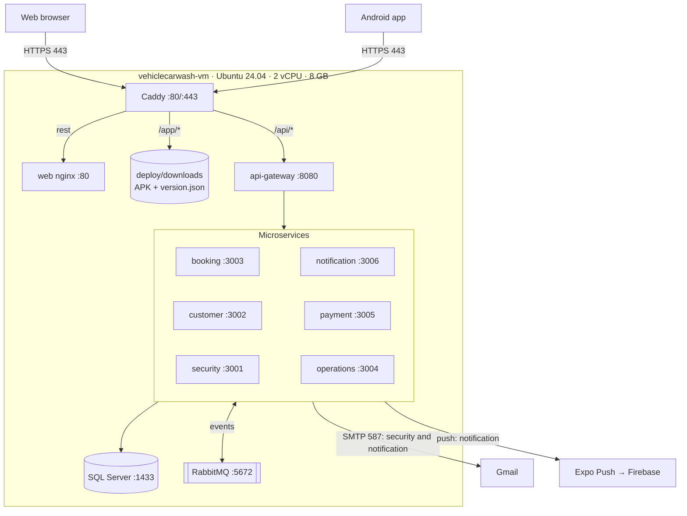
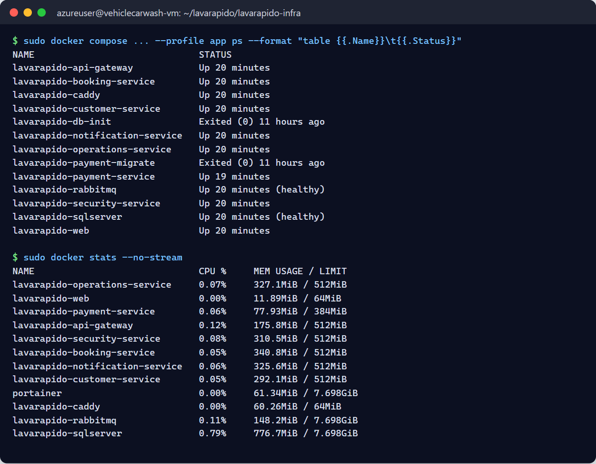
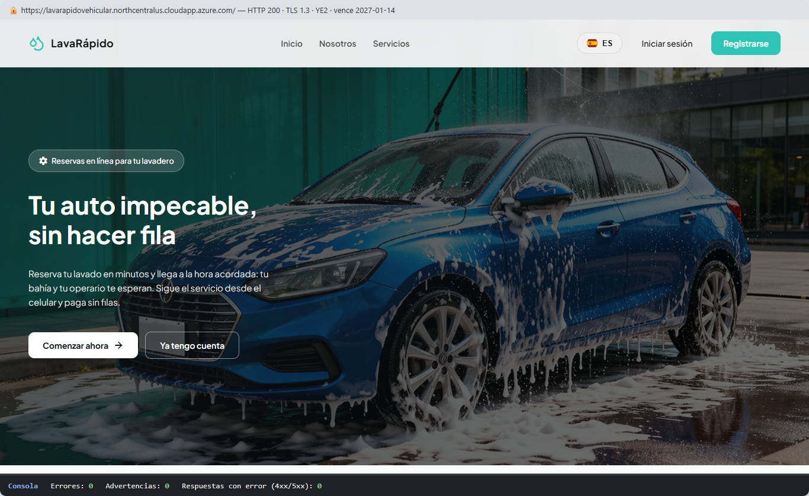
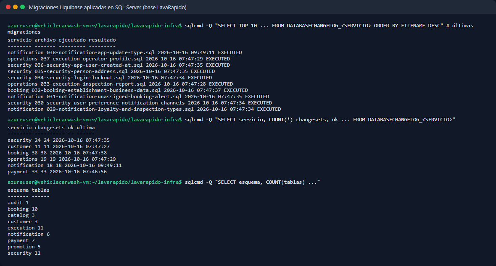

# Deployment Document — LavaRápido Vehicular

> Vehicle wash management system · ADSO training project (SENA)
> Software implementation procedure on the production server.

---

## Table of Contents

1. [General Information and Version Control](#1-general-information-and-version-control)
2. [Scope, Topology and Architecture](#2-scope-topology-and-architecture)
3. [Prerequisites and Preparation (Pre-deployment)](#3-prerequisites-and-preparation-pre-deployment)
4. [Step-by-Step Deployment Procedure (Runbook)](#4-step-by-step-deployment-procedure-runbook)
5. [Verification, Testing and Evidence Plan (Smoke Tests)](#5-verification-testing-and-evidence-plan-smoke-tests)

---

## 1. General Information and Version Control

### 1.1 Deployment Fact Sheet

#### 1.1.1 System identification and version (Release Tag)

| Field | Value |
|---|---|
| System | LavaRápido Vehicular — bookings, payments and operations management for a car wash |
| Components | 6 backend microservices, API Gateway, web application, Android mobile app |
| Version (Release Tag) | `v1.0.0`, created on 2026-10-23 in 8 repositories (web, api-gateway, security, customer, booking, operations, notification, and infra), where `main` was made equal to `develop` at that moment. **Pending:** payment-service (PR #2 `develop` → `main` open; its `main` is the skeleton of 2026-09-30) and the mobile app (no PR; its `main` dates from 2026-07-06). After the tag, `develop` moved ahead again with the fixes of 2026-10-23 (1.3.8), which will ship in `v1.1.0` |
| Deployed branch | `develop` on the server (the latest deployment is `develop` of 2026-10-21, deployed on 2026-10-22). With continuous deployment (4.3.4) the server will move to `main`, except payment-service, which stays on `develop` until its first release |
| Mobile app version | **1.1.0** (versionCode **5**), APK published on 2026-10-19 + over-the-air updates (EAS Update) |
| Repositories | `lavarapido-infra`, `lavarapido-api-gateway`, `lavarapido-security-service`, `lavarapido-customer-service`, `lavarapido-booking-service`, `lavarapido-operation-service`, `lavarapido-notification-service`, `lavarapido-payment-service`, `Front-end-proyecto-web`, `LavadoVehicular-Movil` |
| Public address | https://lavarapidovehicular.northcentralus.cloudapp.azure.com |

#### 1.1.2 Scheduled date, time and maintenance window

| Field | Value |
|---|---|
| Initial deployment date | October 16, 2026 |
| Maintenance window | 02:30 – 05:30 (Colombia time, UTC-5) |
| Actual duration | ~2 h 30 min (provisioning, image builds, HTTPS setup and testing) |
| User downtime | Not applicable: first deployment (no users in production yet) |
| Window for future updates | Outside the car wash's business hours (before 07:00 or after 18:00) |
| Latest update | 2026-10-22: the code changes of October 21 (1.3.7) were deployed with `update-server.sh`; seed 112 and migrations 040 (operations-service) and 041 (notification-service) were applied, with backups `LavaRapido-20261022-081543.bak.gz` and `LavaRapido-20261022-173855.bak.gz`. The previous update (2026-10-21, 05:21) is in 1.3.6. Version `v1.0.0` and the fixes of 2026-10-23 are not on the server yet (1.3.8) |

#### 1.1.3 Target environment (VPS / Staging / Production)

| Field | Value |
|---|---|
| Environment | **Academic production** (also used as staging for the team's tests) |
| Provider | Microsoft Azure (*Azure for Students* subscription) |
| Type | Linux virtual machine (IaaS), equivalent to a VPS |
| Region | North Central US |
| Alternate environment | None: the Hostinger VPS was dropped on 2026-10-21 because the payment was not approved; production stays on Azure only |

#### 1.1.4 Roles and responsibilities matrix (DevOps, Tech Lead, QA, DBA)

> Responsibilities according to the services each member maintains on GitHub (owner of each repository). The QA and DBA roles have no fixed person: the project leader assigns them and, meanwhile, they are covered as shown.

| Role | Owner | Deployment responsibilities |
|---|---|---|
| DevOps | Brayan Cabrera | Server, Docker Compose, Caddy/HTTPS, deployment and update scripts |
| Tech Lead | Brayan Cabrera | Release approval, change review, team coordination |
| QA | No fixed person (assigned by Brayan Cabrera); meanwhile, each owner tests their part and DevOps runs section 5 | Smoke tests and functional validation per role (client, operator, administrator) |
| DBA | No fixed person (assigned by Brayan Cabrera); meanwhile, DevOps with the scripts of section 3.2 | Migrations, backups and database verification |
| booking-service and customer-service owner | Camilo Guilombo | Changes and verification of their services |
| payment-service and mobile app owner | Merari Urbano Quintero | Changes and verification of payments and the app |

### 1.2 Document Version History

| Version | Date | Author | Description |
|---|---|---|---|
| 1.0 | 2026-10-16 | Brayan Cabrera | Initial version: deployment on Azure |
| 1.1 | 2026-10-16 | Brayan Cabrera | Portainer CE installed, real evidence (5.4) and correction of Liquibase schemas and tables |
| 1.2 | 2026-10-16 | Juan Camilo Guilombo | Table count corrected (57) and first administrator created with the environment variables |
| 1.3 | 2026-10-19 | Juan Camilo Guilombo | Update of 2026-10-19 (migration 039 and app 1.1.0), SSH access with a personal key per member, deployment from GitHub Actions, continuous integration in the 10 repositories, and new terminal and web evidence |
| 1.4 | 2026-10-20 | Development team | Topology diagram: customer-service also connects to RabbitMQ (it consumes `security.user_registered` to create the customer profile) |
| 1.5 | 2026-10-21 | Brayan Cabrera | Verified automatic backups (3.2), security headers and CSP (2.2.3 and 5.2.4), health checks and capped logs in every container, `SIMPLE` recovery model, update of 2026-10-21 (1.3.6), code changes of 2026-10-21 pending deployment (1.3.7), and removal of the Hostinger VPS |
| 1.6 | 2026-10-21 | Development team | Evening changes of 2026-10-21 in 1.3.7: confirmed bookings with an operator that nobody registered are no longer closed as "No-show" on their own and go to "To close", migrations 040 (operations) and 041 (notification), `FOLLOW_UP_*` variables, fix for `null` fields in notification-service events, and mobile app adjustments |
| 1.7 | 2026-10-23 | Development team | Version `v1.0.0` in 8 repositories and what is pending for payment and mobile (1.1.1); deployment of 2026-10-22 (1.3.7); fixes of 2026-10-23 in `develop` for `v1.1.0` (1.3.8); the variables the compose file already passes, `FOLLOW_UP_LOOK_BACK_DAYS` and `ALLOWED_EMAIL_DOMAINS` (3.3.2); a rollback that works (3.4); `setup-server.sh` from `main` (4.3.1); continuous deployment prepared and not yet tested live (4.3.4); QA and DBA owners (1.1.4). Includes the content of Merari Urbano's `fix/A-06`, `fix/A-07`, and `fix/A-08` branches |

### 1.3 Change Summary (Release Notes)

#### 1.3.1 New features

**Platform and deployment**
- Full deployment with Docker Compose and a production file (`docker-compose.prod.yml`).
- Automatic HTTPS with Caddy and a Let's Encrypt certificate (automatic renewal).
- Creation of the first administrator when installing on an empty database (`ADMIN_EMAIL` / `ADMIN_PASSWORD`).
- Server installation script (`setup-server.sh`) and one-step update script (`update-server.sh`).
- Android app download from the web (button and QR code) at the fixed address `/app/LavaRapidoVehicular.apk`.

**Notifications**
- Push notifications in the mobile app (Expo + Firebase) implemented with the Command pattern.
- Delivery through channels (push and email) with failure isolation.
- Notices in the account's language (Spanish, English, French and Portuguese).
- Notice to administrators about upcoming bookings without an operator.
- New app version notice by push and in the inbox.
- The web bell refreshes by itself and shows a floating notice with new notifications.

**Bookings and operations**
- Automatic operator assignment when a booking is confirmed (RF-008).
- The client can choose the operator among the available ones (RF-010).
- The operator can only start the service from 15 minutes before the booking.
- Vehicle inspection report with phases, findings and photos, shared with the client.
- Daily summary and operator team metrics for the administrator.

**Payments and accounts**
- Payment history sorted and filterable by date and service (RF-015/016).
- Account lockout for 15 minutes after 5 failed login attempts (RF-004b).
- Business data editable by the administrator and profile address stored in the backend.

**Mobile app**
- New version notice and over-the-internet updates (EAS Update) without reinstalling.
- Icon with the project logo and the name "LavaRapidoVehicular".

#### 1.3.2 Bug fixes

- An approved payment was shown as "under verification" on the payments screen (web and mobile).
- The deployed web received 403 on every call because of the services' CORS configuration.
- security-service did not start when an administrator already existed (query outside a transaction).
- The app's operator list did not show a newly created operator until logging out.
- A late 401 after logging out showed the "session expired" notice.
- The new APK announcement could not read the inter-service key because of file permissions.
- Pending reminders kept being sent after the service was started or finished.
- No operator is assigned to bookings whose time has already passed, and cancelled bookings are no longer listed as pending.
- The web requested a non-existent `favicon.ico` (404 error in the console) and used deprecated translation options (console warning).

#### 1.3.3 Infrastructure and dependency changes

| Change | Detail |
|---|---|
| Docker images | Java: `eclipse-temurin:21-jdk` (build) and `21-jre` (runtime) · .NET: `dotnet/sdk:8.0` and `aspnet:8.0` · Web: `node:22-alpine` and `nginx:1.27-alpine` |
| Infrastructure services | `mcr.microsoft.com/mssql/server:2022-latest` (Express), `rabbitmq:4-management`, `caddy:2-alpine`, `liquibase/liquibase:4.29` |
| New migrations | 032 (business data), 033 (inspection report), 034 (login lockout), 035 (address), 036 (registration date), 037 (operator profile), 038 (new-version notice type), and 039 (acceptance of the legal documents, applied on 2026-10-19) |
| Web dependencies | `qrcode` 1.5.4 |
| Mobile dependencies | `expo-notifications`, `expo-device`, `expo-build-properties`, `expo-updates`, `expo-application` |
| External services | Expo Push + Firebase Cloud Messaging (push), Gmail SMTP (email), EAS (app builds and updates) |
| Server operation (2026-10-20 and 21) | Automatic backups with verification (`backup-db.sh`, `verify-backup.sh`, `restore-db.sh`), database in the `SIMPLE` recovery model, health check every 30 s in the 11 containers, logs of each container capped at 3 files of 10 MB, and security headers with a CSP in Caddy |

#### 1.3.4 Breaking changes

- **New mandatory variables** on the server. Without them, Docker Compose does not start:
  - `INTERNAL_API_KEY`, `PUBLIC_URL`, `RABBITMQ_USERNAME` and `RABBITMQ_PASSWORD`;
  - `RABBITMQ_*` cannot be `guest/guest`.
- **First administrator:** the demo accounts (`admin@gmail.com`, etc.) **only exist in development**. In production the administrator is created with `ADMIN_EMAIL` / `ADMIN_PASSWORD`.
- **Mobile app:** the Android package changed to `com.vehiclecarwash.app`. Previous versions must be uninstalled once; later ones install on top.
- **CORS:** each service only accepts the origin defined in `PUBLIC_URL`.

#### 1.3.5 Update of 2026-10-19

On 2026-10-19 at 03:20 (server time), `update-server.sh` was run. The `develop` changes up to October 17 and 18 were deployed:

- **Database:** migration 039, which stores the date and time each person accepts the Terms and the Data Processing Policy.
- **Backend:** the payment-service health check queries the database, payment-service handles the correlation identifier, the schedule error carries the reason (`reason`), two simultaneous requests no longer fail when creating the same operator, and a bay cannot be created in maintenance.
- **Web:** the payment screen selects by account, the profile option is called "Deactivate my account", Angular is on 21.2.25 and xlsx on 0.20.3, and there are layout fixes for phones.
- **Mobile app:** version 1.1.0 (versionCode 5), published on 2026-10-19 at 05:03, with the version shown in Settings.

The changes pushed afterwards are left for the next update: the error messages with `spring.web.error` in the Java services and the latest web and app fixes.

#### 1.3.6 Update of 2026-10-21

On 2026-10-21 at 05:21 (server time), the images were rebuilt with the `develop` code of October 20 and the new `lavarapido-infra` infrastructure. A database backup was taken first.

- **Infrastructure:** verified automatic backups (3.2); database in the `SIMPLE` recovery model; health check every 30 seconds in the 11 containers, Caddy included (`docker compose ps` shows them `healthy`); logs capped at 3 files of 10 MB per container; security headers and a content security policy (CSP) in Caddy (5.2.4).
- **Backend and web:** the changes left pending on 2026-10-19 (error messages with `spring.web.error` and web fixes) and those of October 19 and 20: the role change of an account was removed, the example business data is cleared so the real business fills it in (booking-service seed 111), and the web opens the detail of each booking and notification.

#### 1.3.7 Changes of 2026-10-21 (deployed on 2026-10-22)

They were in `develop` since 2026-10-21 and reached the server on 2026-10-22 with `update-server.sh`; seed 112 and migrations 040 and 041 were applied, and backups `LavaRapido-20261022-081543.bak.gz` and `LavaRapido-20261022-173855.bak.gz` were taken that day (the latter when operations-service was deployed again at 12:38):

- **security-service and api-gateway:** the token of a closed session (logout, disabled or deactivated account) stops working; the gateway confirms it with `GET /api/v1/auth/session` and keeps the answer 30 seconds per token.
- **booking-service:** every 5 minutes, a scheduled booking still unconfirmed one hour after its end is cancelled with the system reason `EXPIRED` ("Expired without confirmation"); seed 112 adds that reason, and booking-service applies it on startup. The internal route `POST /internal/v1/bookings/{id}/no-show` sets an expired confirmed booking to "No-show", only when operations-service asks for it (409 `BOOKING_NOT_EXPIRED` if it has not expired yet).
- **operations-service:** manual and automatic assignment use the same lock, and `GET /api/v1/admin/assignments/unassigned` gives the single count of bookings without an operator, now used by the web and the mobile app. Every 5 minutes, `FollowUpJob` sets to "No-show" a confirmed booking that never had an operator and ended more than an hour ago; one that had an operator and that nobody started or finished is never marked on its own: it goes to the administrator's "To close" list (`GET /api/v1/admin/assignments/to-close` and `POST /api/v1/admin/assignments/{bookingId}/attended`), with a single notice to the operator and the administrators. Migration 040 adds `execution.service_execution.follow_up_notice_at`.
- **notification-service:** `OPERATOR_SERVICE_NOT_REGISTERED` and `ADMIN_SERVICE_NOT_REGISTERED` notices (inbox and push, migration 041), and a `null` field in an event payload no longer sends the message to the dead-letter queue (DLQ).
- **payment-service:** receipts of at most 2 MB (`RECEIPT_TOO_LARGE`) and the cash account in the customer list only while it is active.
- **Web:** session in step across tabs, compressed receipt, QR magnifier, reports that count only completed bookings, the roles tab texts, and the "To close" card on the administrator's home.
- **Mobile app:** compressed receipt, QR magnifier, mandatory APK update screen, "To close" card, and count of unassigned bookings with the operations-service rule; the administrator's booking form saves the chosen operator and status, the customer's points bar is full when nothing is left to unlock and does not show "0% OFF", the operator sees "—" when there are no ratings, the roles tab says the 3 roles are fixed, and the new notices open the operator's services screen or the administrator's home. They add no native dependencies, so they arrive with `npm run publish:update`.

The new variables (`SESSION_CHECK_*`, `BOOKING_EXPIRY_*`, and `FOLLOW_UP_*`, nine in total, including `FOLLOW_UP_LOOK_BACK_DAYS`) have defaults, are commented out in `.env.example` and `.env.production.example`, and `docker-compose.yml` passes them to the containers since 2026-10-22 (commit `70b990c` of `lavarapido-infra`): they are only written in `.env.production` to change their value. `FOLLOW_UP_*` needs `INTERNAL_API_KEY`, which is already in `.env.production`.

#### 1.3.8 Version v1.0.0 and fixes of 2026-10-23 (pending deployment)

On 2026-10-23 `develop` was merged into `main` and tagged `v1.0.0` in 8 repositories. payment-service and the mobile app do not have that version yet: payment's PR #2 is open, without review and with the SonarCloud quality gate failing on four false positives, and the app has no PR. That same day, after the tag, these fixes from the audit of 2026-10-22 entered `develop` and will ship in `v1.1.0` (CI green in the 10 repositories):

- **api-gateway:** stops publishing `/api/v1/operator/bookings/**` (E-01).
- **booking-service:** the operator routes only accept operations-service with the internal key and apply the 15-minute rule (E-01); the administrator chooses the cancellation reason (A-20); a status change made by the administrator publishes an event for the customer (A-11); loyalty points are frozen on each booking line (A-09).
- **operations-service:** sends the internal key to booking-service (E-01), stores the assignment notes (B-01), and checks that the operator's account is still active when assigning and rescheduling (A-13, E-12).
- **security-service:** validates the allowed email domains on the server (`ALLOWED_EMAIL_DOMAINS`, `gmail.com` by default, A-01); a token that still carries a role the account no longer has stops working and its sessions are revoked (E-02); it no longer starts in the `dev` profile by default nor keeps demo passwords in the code (E-05).
- **customer-service:** rejects plates longer than 6 characters instead of cutting them (E-16).
- **notification-service:** notifies the customer when the administrator changes the status of their booking (A-11).
- **payment-service:** the percentage discount goes from 1 to 99 % and there is always an amount left to pay (E-07); removing the coupon cancels the redemption on the server (`DELETE /api/v1/loyalty/redemptions/{bookingId}/{promotionId}`) and only one promotion per booking is allowed (migration 021, E-08 and E-09); no default password for its isolated database (E-05).
- **Web:** E-07, E-08, and A-01 as above; reassigning the operator (A-02), notes when assigning (B-01), cancellation reason (A-20), real data in the operator's history and services (A-18), revenue by approval date and the "In service" status (A-17, A-19), message for a deactivated operator account (A-13), and tests for the guard, the interceptor, and several ViewModels (F-02).
- **Mobile app:** E-07, E-08, A-01, and A-13, and the first automated tests with `jest-expo` in the CI (F-01). They are JavaScript changes: they reach the installed APKs with `npm run publish:update`.
- **lavarapido-infra:** `ALLOWED_EMAIL_DOMAINS` and `DEMO_ADMIN_PASSWORD`, `DEMO_OPERATOR_PASSWORD`, and `DEMO_CLIENT_PASSWORD` (`dev` profile only) in the compose file and in `.env.example`, with no real passwords committed (E-05), and `INTERNAL_API_KEY` documented as required for the operator to start and finish services (E-01).

**Before deploying them:** `INTERNAL_API_KEY` is already in `.env.production`, so change E-01 needs nothing new; the demo accounts do not exist in production; and payment's migration 021 has the precondition `onFail: CONTINUE`: if the database already has a booking with two redeemed coupons, the unique index is not created and there is no warning, so it is worth checking the database before updating. Still open, among others: SEC-01 (the gateway does not check the session if the header says `bearer` in lowercase), BIZ-01 and BIZ-02 (amount of a paid booking that is rescheduled and amount the customer sees), and OPS-01 (finishing a service is not atomic); they are in the Corrective Actions document, Table 7.

---

## 2. Scope, Topology and Architecture

### 2.1 Components and Artifacts in Scope

#### 2.1.1 Administration panel (Portainer CE)

> **Status: installed on 2026-10-16.** Panel to view the containers' status, logs and resource usage and restart them. Deployment and updates are still done with the scripts (section 4.3).

| Artifact | Image | Access |
|---|---|---|
| Portainer CE | `portainer/portainer-ce:2.21.5` (~11 MB of RAM) | Only through an SSH tunnel (`https://localhost:9443`); listens on `127.0.0.1`, not exposed to the internet |
| Environment | `local` (socket `/var/run/docker.sock`) | Stack `lavarapido` visible as *Compose · Limited* (created outside Portainer) |

#### 2.1.2 Web Frontend Layer (SPA / Nginx Web Server)

| Artifact | Technology | Image / container |
|---|---|---|
| Web application | **Angular 21** (SPA), i18n in 4 languages | `lavarapido/web:local` → `lavarapido-web` |
| Web server | nginx 1.27: serves the build and forwards `/api` to the gateway | inside `lavarapido-web` |
| Reverse proxy and HTTPS | Caddy 2 (Let's Encrypt) | `lavarapido-caddy` |
| Android mobile app | Expo / React Native, APK built with EAS | Served at `/app/LavaRapidoVehicular.apk` |

#### 2.1.3 Backend API Layer (Java Spring Boot / C# .NET Core)

| Service | Technology | Internal port | Responsibility |
|---|---|---|---|
| api-gateway | Spring Cloud Gateway (Java 21) | 8080 | Single entry point for `/api/v1` |
| security-service | Spring Boot (Java 21) | 3001 | Accounts, login, JWT, roles, preferences |
| customer-service | Spring Boot (Java 21) | 3002 | Clients and vehicles |
| booking-service | Spring Boot (Java 21) | 3003 | Catalog, schedule, bookings |
| operations-service | Spring Boot (Java 21) | 3004 | Operators, assignment, execution, ratings, inspection |
| payment-service | ASP.NET Core 8 (C#) | 3005 | Payments, receipts, loyalty and promotions |
| notification-service | Spring Boot (Java 21) | 3006 | Inbox, email, push, reminders |
| rabbitmq | RabbitMQ 4 | 5672 | Events between services (exchange `carwash.events`) |

#### 2.1.4 Persistence Layer (SQL Server)

| Artifact | Detail |
|---|---|
| Engine | **Microsoft SQL Server 2022, Express edition** (container `lavarapido-sqlserver`) |
| Database | `LavaRapido`: 9 schemas and 57 tables — `security` (11), `customer` (3), `booking` (10), `catalog` (3), `execution` (11), `notification` (6), `payment` (7), `promotion` (5), `audit` (1) |
| Migrations | **Liquibase**: the Java services apply them on startup; payment-service applies them with the `payment-migrate` container. Each service keeps its history in `dbo.DATABASECHANGELOG_<SERVICE>` |
| Persistent volumes | `sqlserver-data` (database), `rabbitmq-data` (queues), `caddy-data` (certificates) |
| Backups | `~/lavarapido/backups/` on the VM disk, outside Docker: the last 14 and the `backup.log` record (3.2) |

### 2.2 Network and Infrastructure Architecture Diagram

#### 2.2.1 VPS server topology



#### 2.2.2 Internal container network (Docker Bridge Network)

- All containers are on the bridge network **`lavarapido_default`**, created by Docker Compose.
- They call each other by **service name**: `sqlserver`, `rabbitmq`, `security-service`, `api-gateway`, `web`, etc. Docker's internal DNS is `127.0.0.11`.
- The `/internal/**` routes (calls between services) are protected with the `X-Internal-Key` header (`INTERNAL_API_KEY`). **The gateway does not publish them.**
- No port of the internal network is published on the machine, except Caddy's.

#### 2.2.3 Routing and Reverse Proxy with TLS/HTTPS certificates

| Public route | Destination | Notes |
|---|---|---|
| `https://<domain>/api/*` | `api-gateway:8080` | REST API v1 for the web and the app |
| `https://<domain>/app/*` | `deploy/downloads` folder | APK and `version.json` (no cache) |
| `https://<domain>/*` | `web:80` | Angular SPA (routes → `index.html`) |
| `http://<domain>/*` | 308 redirect to HTTPS | Automatic (Caddy) |

- **Certificate:** Let's Encrypt, issued and renewed automatically by Caddy (expires on 2027-01-14 and is renewed before). It is stored in the `caddy-data` volume.
- **Domain:** Azure DNS label on the public IP: `lavarapidovehicular.northcentralus.cloudapp.azure.com`.
- **Security headers:** since 2026-10-20 Caddy adds HSTS, `nosniff`, `X-Frame-Options`, `Referrer-Policy`, and `Permissions-Policy` to every response, removes the `Server` header, and sends a content security policy (CSP) with the web (5.2.4).
- **Configuration:** `lavarapido-infra/deploy/Caddyfile`.

### 2.3 Environments, IP Addressing and Ports Matrix

| Environment | Host | IP / URL | Use |
|---|---|---|---|
| Development | Each member's PC | `localhost` (web 4200, mobile 8081, gateway 8080) | Programming and local testing (Mailpit catches the emails) |
| Academic production | Azure VM `vehiclecarwash-vm` | Static IP `64.236.160.129` · https://lavarapidovehicular.northcentralus.cloudapp.azure.com | Presentation, team testing, installed app |

| Port | Service | Exposed to the internet? |
|---|---|---|
| 22 | SSH (key only) | Yes (administration) |
| 80 / 443 | Caddy | Yes |
| 8080 | api-gateway | No (internal network only) |
| 3001–3006 | Microservices | No |
| 1433 | SQL Server | No |
| 5672 / 15672 | RabbitMQ / panel | No |
| 9443 | Portainer CE | No (only `127.0.0.1`, through an SSH tunnel) |

---

## 3. Prerequisites and Preparation (Pre-deployment)

### 3.1 Operating System and VPS Prerequisites Checklist

#### 3.1.1 Available hardware resources (CPU, RAM, disk)

| Resource | Minimum required | Available (Azure B2as_v2) | Measured in operation | ✓ |
|---|---|---|---|---|
| CPU | 2 x86-64 vCPU (SQL Server does not run on ARM) | 2 AMD x64 vCPU | Peaks only while building images | ✅ |
| RAM | 8 GB | 7.7 GB + 4 GB of swap | **3.3 GB** used with the 12 containers, Portainer included (2026-10-19) | ✅ |
| Disk | 30 GB | 64 GB standard SSD | 26 GB used of 61 GB (42%), mostly images and build cache (2026-10-19) | ✅ |
| Operating system | Ubuntu 24.04 or 26.04 LTS | Ubuntu 24.04.4 LTS | — | ✅ |
| Network | Ports 22, 80 and 443 open | Azure security group | Verified from the internet | ✅ |

#### 3.1.2 Docker engine status and local socket

```bash
docker --version            # Docker version 29.x
docker compose version      # Docker Compose v5.x
sudo systemctl is-enabled docker   # enabled  → starts with the machine
sudo systemctl is-active docker    # active
ls -l /var/run/docker.sock         # local engine socket
```

`deploy/setup-server.sh` installs Docker (official `get.docker.com` script) if missing, enables it on boot and creates 4 GB of swap.

### 3.2 Backup Strategy and Execution

> **Status: automated since 2026-10-21.** Backups, their check and restoring were tested in production (see 3.2.4).

#### 3.2.1 Logical database backup (Dump / Snapshot)

`deploy/backup-db.sh` takes a full backup of `LavaRapido` (`BACKUP DATABASE … WITH CHECKSUM`), checks that it can be restored (`RESTORE VERIFYONLY`), copies it out of the container and compresses it with gzip, because SQL Server Express does not compress its backups. It is stored as `~/lavarapido/backups/LavaRapido-YYYYMMDD-HHMMSS.bak.gz`, with `600` permissions, and the **last 14** are kept.

| When it runs | Triggered by |
|---|---|
| Before every update | `update-server.sh` (if the backup fails, **nothing is updated**) |
| 5 minutes after the VM starts | `azureuser` crontab (`@reboot`) |
| Every day at 23:00 UTC (6 p.m. in Colombia), if the VM is on | `azureuser` crontab |
| Manually | `bash ~/lavarapido/lavarapido-infra/deploy/backup-db.sh` |

The VM is started on demand; that is why, besides the daily job, a backup is taken at start-up and before updating. The database uses the **`SIMPLE`** recovery model (set by `db-init`): with full backups no transaction log backups are needed, and the log does not grow without limit.

Measured on 2026-10-21: the database takes 72 MB and the compressed backup **1.4 MB**; it takes **under 2 seconds**.

Infrastructure-level complement: **disk snapshot** of the VM from the Azure portal (Disks → Create snapshot). Backups live on the VM's own disk: they protect against a human error or a bad migration, not against losing the VM. To keep a copy elsewhere, download them to a PC:

```bash
scp -i ~/.ssh/lavarapido_azure "azureuser@64.236.160.129:~/lavarapido/backups/*.bak.gz" .
```

#### 3.2.2 Backup of Docker persistent volumes

```bash
mkdir -p ~/backups
for v in lavarapido_sqlserver-data lavarapido_rabbitmq-data lavarapido_caddy-data; do
  sudo docker run --rm -v "$v":/data:ro -v ~/backups:/backup alpine \
    tar czf "/backup/${v}_$(date +%F).tar.gz" -C /data .
done
```

> For a consistent backup of `sqlserver-data`, the `BACKUP DATABASE` from 3.2.1 is preferred, because it can be done while the database is running.

#### 3.2.3 Backup of Stack configurations and previous variables

```bash
cd ~/lavarapido/lavarapido-infra
cp .env.production ~/backups/env.production_$(date +%F)       # contains secrets: chmod 600
chmod 600 ~/backups/env.production_*
git -C ~/lavarapido/lavarapido-infra rev-parse HEAD > ~/backups/infra-commit_$(date +%F).txt
```

The stack configuration (`docker-compose.yml`, `docker-compose.prod.yml`, `deploy/Caddyfile`) is versioned on GitHub (`lavarapido-infra`). To go back, a `git checkout <commit>` and a new `up -d` are enough.

#### 3.2.4 Automatic check and restore

**Automatic check.** After every scheduled backup, `deploy/verify-backup.sh` runs: it restores the latest backup under another name (`LavaRapido_verificacion`), checks that it has the tables of the real database and can be read, and drops it. This proves every day that the backups work, **without touching the real database**.

**Restore.** It is never automatic: going back to a backup erases what happened afterwards, so a person always decides it.

```bash
bash ~/lavarapido/lavarapido-infra/deploy/restore-db.sh <file.bak.gz> --as LavaRapido_prueba   # inspect a backup without touching the database
bash ~/lavarapido/lavarapido-infra/deploy/restore-db.sh <file.bak.gz>     # roll the database back to that backup
```

In the second case the script asks to type `RESTAURAR`, first backs up the current database, stops the 7 services, restores and starts them again (2 to 3 minutes of downtime). If the restore fails, the database stays open as it was and the services start again.

**Log.** Every backup, check and restore, including cancelled or failed ones, is written to `~/lavarapido/backups/backup.log`:

```
2026-10-21 06:11:16 UTC | RESTAURACIÓN | CANCELADA | LavaRapido-20261021-061111.bak.gz -> LavaRapido | azureuser
2026-10-21 06:12:05 UTC | RESPALDO | OK | LavaRapido-20261021-061204.bak.gz (1.4M) | azureuser
2026-10-21 06:12:08 UTC | VERIFICACIÓN | OK | LavaRapido-20261021-061204.bak.gz: 69 tablas, 4 usuarios, 2 reservas | azureuser
```

Read it with `tail -20 ~/lavarapido/backups/backup.log`; only problems with `grep FALLÓ ~/lavarapido/backups/backup.log`.

**Tests run in production (2026-10-21):**

| Test | Result |
|---|---|
| Manual backup and backup before updating | ✅ 1.4 MB, verified |
| Restore under another name and compare with the real database | ✅ Same records in users, bookings, payments, notifications and operators; 69 tables |
| Restore over the real database | ✅ Identical data; the 11 containers went back to `healthy`; database `MULTI_USER / ONLINE / SIMPLE` |
| Check with a deliberately corrupted backup | ✅ Detected and logged as `FALLÓ`, leaving no test database or temporary files |
| Cancelled restore | ✅ Logged as `CANCELADA` |

### 3.3 Environment Variables and Secrets Management

- Secrets live **only** in `~/lavarapido/lavarapido-infra/.env.production` (permissions `600`), which is in `.gitignore`.
- The template without values is `.env.production.example`.
- **Key generation:** the keys were generated **on the server** with `openssl rand -base64 48` and were never copied or displayed.
- **First administrator:** the owner wrote `ADMIN_EMAIL` and `ADMIN_PASSWORD` directly in `.env.production` on the server; security-service created the account at startup because there was no administrator yet (`AdministratorBootstrapRunner`). The password is not in any repository.

#### 3.3.1 Database connection parameters

| Variable | Description |
|---|---|
| `DB_PASSWORD` | `sa` password (8+ characters, uppercase, lowercase, number and symbol) |
| `DB_NAME` | `LavaRapido` |
| `DB_USERNAME` | `sa` *(pending improvement: a user with limited permissions)* |
| `DB_URL` (compose) | `jdbc:sqlserver://sqlserver:1433;databaseName=LavaRapido;encrypt=true;trustServerCertificate=true` |

#### 3.3.2 Token signing keys (JWT Secret Keys)

| Variable | Description |
|---|---|
| `JWT_SECRET` | HS256 key shared by the services that validate tokens (≥ 32 bytes). Tokens last **1 hour** |
| `INTERNAL_API_KEY` | Key for the `/internal/**` routes between services (`X-Internal-Key` header) |
| `RABBITMQ_USERNAME` / `RABBITMQ_PASSWORD` | Dedicated RabbitMQ user (not `guest`) |
| `MAIL_USERNAME` / `MAIL_PASSWORD` / `MAIL_FROM` | Gmail account with an app password |
| `ADMIN_EMAIL` / `ADMIN_PASSWORD` | First administrator (only used if the database has none) |
| `PUBLIC_URL` / `SITE_ADDRESS` | Public address (CORS, email links) and Caddy domain |
| `PUSH_ENABLED` / `MESSAGING_ENABLED` | `true`: push with Expo and events with RabbitMQ |

The variables of 2026-10-21 are not required in `.env.production`: `SESSION_CHECK_ENABLED`, `SESSION_CHECK_CACHE_TTL`, and `SESSION_CHECK_TIMEOUT` (gateway session check: on, 30 s, and 3 s), `BOOKING_EXPIRY_CHECK_ENABLED` and `BOOKING_EXPIRY_CHECK_INTERVAL` (cancellation of scheduled bookings that expired without confirmation: on and every 5 minutes), `BOOKING_EXPIRY_GRACE_MINUTES` (60-minute grace, used by booking-service and operations-service), and `FOLLOW_UP_ENABLED`, `FOLLOW_UP_INTERVAL`, and `FOLLOW_UP_LOOK_BACK_DAYS` (follow-up of bookings that ended and nobody closed: on, every 5 minutes, and looking back 28 days, because the machine can stay off for weeks) keep their defaults if they are not written; `docker-compose.yml` does pass them to the containers, so they can be changed in `.env.production`. The same applies to `ALLOWED_EMAIL_DOMAINS` (email domains security-service accepts, `gmail.com` by default; it ships with `v1.1.0`). `ADMIN_DOCUMENT` and `ADMIN_PHONE` complete the ID number and mobile phone of the first administrator, next to `ADMIN_EMAIL` and `ADMIN_PASSWORD`. The `DEMO_*_PASSWORD` variables are not used in production: they only exist in the `dev` profile.

#### 3.3.3 Memory and runtime limits (JVM -Xmx, ASPNETCORE_ENVIRONMENT)

| Container | Limit (`mem_limit`) | Runtime |
|---|---|---|
| 5 Java services + gateway | 512 MB each | `java -XX:MaxRAMPercentage=75` → maximum heap ≈ 384 MB · `prod` profile (no Swagger) |
| payment-service | 384 MB | `ASPNETCORE_ENVIRONMENT=Production` |
| SQL Server | `MSSQL_MEMORY_LIMIT_MB=1536` | `MSSQL_PID=Express` |
| web / caddy | 64 MB each | nginx / Caddy |
| All | `restart: unless-stopped` | They restart by themselves on failure and when the machine boots |
| All (since 2026-10-20) | Logs: 3 files of 10 MB (`json-file`) · health check every 30 s | The Java services get 150 s to start before failures count. Docker does not restart an `unhealthy` container by itself: the status shows in `docker compose ps`, Portainer, and `update-server.sh` |

### 3.4 Communication Protocol and Maintenance Window

1. **Advance notice (24 h):** the DevOps informs the team through the project group about the date, the window and the changes (release notes).
2. **Freeze:** nothing is merged into the branch being deployed during the window. With continuous deployment (4.3.4) each merge into `main` deploys on its own and recreates containers for 1 or 2 minutes, so `main` is also frozen on the day of the presentation (2026-10-27).
3. **Start:** "deployment started" is announced. `update-server.sh` backs up the database before updating (section 3.2).
4. **Execution:** runbook in section 4.
5. **Verification:** smoke tests in section 5. QA confirms each role.
6. **Closing:** "deployment finished" is announced with the version and the evidence. If it fails, **rollback**. `update-server.sh` pulls the tip of each repository's branch again (it calls `setup-server.sh`), so a `git checkout` made by hand on the server is lost on the next update. Therefore:
   - **On GitHub (the normal way):** revert the change on the branch being deployed (`git revert` of the commit, or `git revert -m 1` of the merge, in a `fix/…` branch with its PR) and deploy again: with continuous deployment, merging the revert into `main` is enough.
   - **Emergency on the server:** before updating, keep the image that works (`sudo docker tag lavarapido/<service>:local lavarapido/<service>:prev`); to go back, `sudo docker tag lavarapido/<service>:prev lavarapido/<service>:local` and `sudo docker compose -f docker-compose.yml -f docker-compose.prod.yml --env-file .env.production --profile app up -d --no-build <service>`, without `update-server.sh`. Then revert on GitHub, because the next update goes back to the tip of the branch. This step is manual: the scripts do not keep the previous image yet (action CD-11).
   - **Data:** if the migration damaged data, restore the backup taken before the update with `restore-db.sh` (section 3.2.4); it returns the **whole** database to that moment and does not run `payment-migrate`.
7. **Standard window:** outside the car wash's business hours (before 07:00 or after 18:00, Colombia time).

---

## 4. Step-by-Step Deployment Procedure (Runbook)

### 4.1 Verification and Access to the Base Platform (Portainer CE)

**Server access:**

```bash
ssh -i ~/.ssh/lavarapido_azure azureuser@64.236.160.129
```

**Access of each member with their own key:** each person creates their key on their computer and only shares the public part (`.pub`). The private one is never sent or pushed to a repository.

```powershell
ssh-keygen -t ed25519 -f $HOME\.ssh\lavarapido_azure      # on the person's PC
Get-Content $HOME\.ssh\lavarapido_azure.pub                # this line is the one to share
```

The DevOps owner adds it once, from the portal (*vehiclecarwash-vm → Reset password → Reset SSH public key*, user `azureuser`) or from the server with `echo "<public key>" >> ~/.ssh/authorized_keys`. As of 2026-10-19, the keys with access are the DevOps owner's, Juan Camilo's, and GitHub Actions' (restricted, see 4.3.3). To remove an access, delete its line from `authorized_keys`.

**Portainer CE installation** *(done on 2026-10-16; listens only inside the server)*:

```bash
sudo docker volume create portainer_data
sudo docker run -d --name portainer --restart unless-stopped \
  -p 127.0.0.1:9443:9443 \
  -v /var/run/docker.sock:/var/run/docker.sock \
  -v portainer_data:/data portainer/portainer-ce:2.21.5
```

**Access from the administrator's PC** (SSH tunnel, without opening ports):

```bash
ssh -i ~/.ssh/lavarapido_azure -L 9443:localhost:9443 azureuser@64.236.160.129
# then open https://localhost:9443 → user "admin"
```

- **Password of the `admin` user:** it was generated during installation and is on the server, in `~/portainer-admin-password` (permissions `600`). It is read with `cat ~/portainer-admin-password` and can be changed from Portainer (*My account*).
- **`local` environment:** registered on the Docker socket. `lavarapido` appears under *Containers* and *Stacks*.

### 4.2 Database Deployment and Migration

#### 4.2.1 Running DDL/DML scripts or migration tools (Liquibase)

Migrations are **automatic**:

1. The `db-init` container creates the `LavaRapido` database if it does not exist and sets it to the `SIMPLE` recovery model.
2. The `payment-migrate` container (Liquibase 4.29) applies the payment-service changelogs (`db/changelog/db.changelog-master.yaml`) and exits.
3. Each Java service applies its own changelogs on startup. Numbering is global: 001–041 plus the 1xx catalog seeds (040 of operations-service and 041 of notification-service are from 2026-10-21 and were applied on the server on 2026-10-22). The next free migration is 042; payment-service's 021 (one promotion per booking) ships with `v1.1.0`.
4. Hibernate only validates that the model matches the tables (`ddl-auto: validate`); it never alters tables.

Production **does not load test data**: only catalogs (roles, services, statuses, schedule and business data).

#### 4.2.2 Verification of schema, index and user integrity

```bash
P=$(grep '^DB_PASSWORD=' .env.production | cut -d= -f2-)
q(){ sudo docker exec -e SQLCMDPASSWORD="$P" lavarapido-sqlserver /opt/mssql-tools18/bin/sqlcmd \
     -S localhost -U sa -C -d LavaRapido -Q "SET NOCOUNT ON; $1"; }
q "SELECT s.name AS esquema, COUNT(t.name) AS tablas FROM sys.schemas s JOIN sys.tables t ON t.schema_id=s.schema_id GROUP BY s.name"
for s in SECURITY CUSTOMER BOOKING OPERATIONS NOTIFICATION PAYMENT; do
  q "SELECT '$s' AS servicio, COUNT(*) AS changesets, SUM(CASE WHEN EXECTYPE IN ('EXECUTED','MARK_RAN') THEN 1 ELSE 0 END) AS ok FROM DATABASECHANGELOG_$s"
done
q "SELECT COUNT(*) AS indices FROM sys.indexes WHERE object_id IN (SELECT object_id FROM sys.tables)"
q "SELECT u.username, r.code FROM security.app_user u JOIN security.user_role ur ON ur.user_id=u.user_id JOIN security.role r ON r.role_id=ur.role_id WHERE r.code='ADMIN'"
```

Expected result:
- the 9 schemas with their tables;
- in each service, `ok` equal to `changesets` (2026-10-16: 143 of 143; 2026-10-19: 144 of 144, with 039); since 2026-10-22, 040 also appears in `DATABASECHANGELOG_OPERATIONS` and 041 in `DATABASECHANGELOG_NOTIFICATION`;
- the initial administrator created (security log: `First administrator created`).

### 4.3 Application Stack Deployment and Orchestration

#### 4.3.1 Loading the docker-compose.yml file in Portainer

The stack is defined with two files versioned in `lavarapido-infra`:
- **`docker-compose.yml`:** the base, the same as in development.
- **`docker-compose.prod.yml`:** overrides the production settings: no internal ports, `prod` profile, memory limits, Caddy, web and CORS.

**Current deployment (CLI):**

```bash
# 1. Download the 9 repositories (and prepare Docker and swap the first time)
curl -fsSL https://raw.githubusercontent.com/BrayanCABRERA123/lavarapido-infra/main/deploy/setup-server.sh -o setup-server.sh
bash setup-server.sh
```

The script is downloaded from `main` (version `v1.0.0`). In that version it clones and updates the `develop` branch of each repository (variable `BRANCH`); with the continuous deployment of section 4.3.4 it clones `main` instead, except the repositories in `DEVELOP_ONLY` (today payment-service, which has no release in `main` yet). To choose another branch: `BRANCH=develop bash setup-server.sh`.

**With Portainer:** Stacks → Add stack → *Repository*. The images are built from 9 sibling repositories, so the recommended flow is:
1. build the images with the CLI (step 4.3.3);
2. use Portainer to **view, restart, check logs and resource usage** of the containers of the `lavarapido` stack, which appears as a "limited" stack because it was created outside Portainer.

#### 4.3.2 Injecting the Stack's environment variables

```bash
cd ~/lavarapido/lavarapido-infra
cp .env.production.example .env.production
chmod 600 .env.production
nano .env.production        # fill in the values from section 3.3 (keys generated with openssl)
```

In Portainer, the same variables are loaded in *Environment variables → Load variables from .env file*.

#### 4.3.3 Service deployment and container image updates

**First deployment:**

```bash
cd ~/lavarapido/lavarapido-infra
sudo docker compose -f docker-compose.yml -f docker-compose.prod.yml \
  --env-file .env.production --profile app up -d --build
```

**Later updates**: first push the changes to GitHub and then (the script backs up the database before touching anything and, if the backup fails, does not update):

```bash
bash ~/lavarapido/lavarapido-infra/deploy/update-server.sh                 # everything
bash ~/lavarapido/lavarapido-infra/deploy/update-server.sh web             # only the web
bash ~/lavarapido/lavarapido-infra/deploy/update-server.sh security-service notification-service
```

**From GitHub, without SSH:** with the machine on, in the `lavarapido-infra` repository → *Actions → Desplegar en Azure → Run workflow*. The button exists since 2026-10-23, when `deploy.yml` reached `main` (the default branch) with version `v1.0.0`; in that version the workflow calls `update-server.sh`, which deploys `develop`. In *Servicios*, leave it empty to update everything or write the names (`web payment-service`). At the end, the workflow checks that the web and the API answer 200. It uses its own GitHub key (secret `AZURE_SSH_KEY`) that on the server can only run `deploy/ci-deploy.sh`, which validates the names and does not let two updates run at the same time. **As of 2026-10-23 the workflow has never run** (0 runs) and the repository has no secrets, so it would fail until `AZURE_SSH_KEY` is created and its line installed in the server's `authorized_keys`; meanwhile, the SSH option above is used.

**Continuous integration:** since 2026-10-19 the 10 repositories have `.github/workflows/ci.yml`, which runs on every push or pull request to `develop` and `main`, and the result appears as ✓ or ✗ next to each commit. As of 2026-10-23 (night), the latest `develop` run is green in all 10:

| Repository | What it checks |
|---|---|
| Java services and api-gateway | `./mvnw verify`: builds and runs the tests (Java 21) |
| payment-service | `dotnet build` and `dotnet test` (.NET 8; integration tests are skipped without SQL Server) |
| Front-end-proyecto-web | Production build and `ng test` |
| LavadoVehicular-Movil | `tsc --noEmit` and, since 2026-10-23, `jest` (`jest-expo`, 3 files and 13 tests). The APK is still built with EAS |
| lavarapido-infra | Syntax and `shellcheck` of `deploy/*.sh`, `docker compose config`, and `e2e/` syntax (the end-to-end tests run only locally) |

#### 4.3.4 Continuous deployment (prepared, not yet tested live)

On 2026-10-23 continuous deployment was prepared, so that an approved version reaches the server without anyone logging in over SSH. **It is not active yet:** the changes are in the local branch `ci/continuous-deployment` of `lavarapido-infra` and in the local `ci/request-deploy` branches of the web, api-gateway, security, operations, and notification, not merged, and they have never run against the virtual machine. This is how it will work once they are merged:

1. When an approved PR enters `main`, the repository's `ci.yml` runs the CI and, if it passes, its **Pedir despliegue** (request deployment) job launches the **Desplegar en Azure** workflow of `lavarapido-infra` with `automatic=true` (secret `DEPLOY_DISPATCH_TOKEN`: a fine-grained token with access only to `lavarapido-infra` and the *Actions: Read and write* permission). A merge into `main` of `lavarapido-infra` also deploys.
2. The workflow logs in over SSH (`AZURE_SSH_KEY`), backs up the database, pulls `main` of every repository (payment-service stays on `develop` through `DEVELOP_ONLY`), and rebuilds what changed. If another update is already running, for example the one at machine start-up, it waits up to 20 minutes and then updates. Then it waits up to 8 minutes for **all** containers to become healthy: if one does not start, the workflow ends red and says which one. If the `Caddyfile` changed, it restarts Caddy. At the end it checks that the web and the API answer 200.
3. If the machine is **off**, the automatic workflow leaves a notice and does not fail. When it is turned on, `deploy/boot-update.sh` (an `@reboot` task installed by `setup-server.sh`) pulls what is new in `main` and updates if something is not deployed, comparing with `~/lavarapido/backups/deployed-heads`, which is only written when a full update ends well. The result is in `~/lavarapido/backups/deploy.log`.
4. customer-service, booking-service, and payment-service do not have the **Pedir despliegue** job yet: their changes arrive with the next deployment of any repository or by hand. To add it, the owner copies the job from the web's `ci.yml` and creates the secret in their repository.

**To activate it (pending, action CD-01 of the Corrective Actions document):** merge `lavarapido-infra` first (the new workflow accepts the `automatic` input; if the web arrives earlier, its request fails with *422 Unexpected inputs*), create `AZURE_SSH_KEY` and `DEPLOY_DISPATCH_TOKEN`, install the line `restrict,command="bash …/deploy/ci-deploy.sh"` in the server's `~/.ssh/authorized_keys` and, with the machine on, run the workflow by hand **twice**: the first run uses the server's old scripts (they pull `develop`); the second already uses the new ones, moves the server to `main`, and installs the start-up task. Check it with `crontab -l | grep boot-update` and `git -C ~/lavarapido/Front-end-proyecto-web branch --show-current` (it must say `main`). If `DEPLOY_DISPATCH_TOKEN` is missing, the repository's **Pedir despliegue** job ends red.

**Publishing the mobile app**, from the PC, in the app folder:

```bash
eas build -p android --profile preview          # new APK (native changes)
npm run publish:apk -- "what changed"           # publishes it in /app/ and notifies by push
npm run publish:update -- "what changed"        # screen-only changes: over-the-internet update
```

### 4.4 Routing, Domain and SSL/TLS Certificate Configuration

1. **Domain:** Azure → public IP `vehiclecarwash-vm-ip` → Configuration → *DNS name label* = `lavarapidovehicular`. The result is `lavarapidovehicular.northcentralus.cloudapp.azure.com`.
2. **Variables:** `.env.production`:
   ```
   SITE_ADDRESS=lavarapidovehicular.northcentralus.cloudapp.azure.com
   PUBLIC_URL=https://lavarapidovehicular.northcentralus.cloudapp.azure.com
   ```
3. **Apply:** `update-server.sh caddy security-service notification-service api-gateway`. Caddy requests the certificate from Let's Encrypt through HTTP-01; port 80 must be open.
4. **Verify the certificate:**
   ```bash
   echo | openssl s_client -connect lavarapidovehicular.northcentralus.cloudapp.azure.com:443 \
     -servername lavarapidovehicular.northcentralus.cloudapp.azure.com 2>/dev/null | openssl x509 -noout -issuer -enddate
   # issuer=C=US, O=Let's Encrypt · notAfter=Jan 14 2027
   ```
5. **Mobile app:** `EXPO_PUBLIC_API_URL` in `eas.json` = `https://lavarapidovehicular.northcentralus.cloudapp.azure.com/api/v1`, and the APK is built.

---

## 5. Verification, Testing and Evidence Plan (Smoke Tests)

### 5.1 Service Verification Links and Endpoints Matrix

#### 5.1.1 Access to the administration panel (Portainer)

| Link | Expected | Status |
|---|---|---|
| `https://localhost:9443` (through SSH tunnel) | Stack `lavarapido`: 11 containers *running*/*healthy* and 2 init containers in *exited (0)* | ✅ (see 5.4.1) |
| `https://64.236.160.129:9443` (from the internet) | No connection | ✅ closed |

#### 5.1.2 Public web interface (Angular SPA)

| Link | Expected | Result (2026-10-19) |
|---|---|---|
| `https://<domain>/` | Home page with the "Download app" section | ✅ 200 |
| `https://<domain>/client`, `/admin` | Angular routes (load `index.html`) | ✅ 200 |
| `http://<domain>/` | Redirect to HTTPS | ✅ 308 |
| `https://<domain>/app/version.json` | Published app version | ✅ 200 (`versionCode 5`, version 1.1.0) |
| `https://<domain>/app/LavaRapidoVehicular.apk` | APK download (`application/vnd.android.package-archive`) | ✅ 200 |

#### 5.1.3 Backend health endpoints (/actuator/health)

The health endpoints **are not published to the internet**: `/actuator` is not under `/api`. They are checked inside the server:

```bash
for s in security-service:3001 customer-service:3002 booking-service:3003 operations-service:3004 notification-service:3006 api-gateway:8080; do
  sudo docker run --rm --network lavarapido_default curlimages/curl:8.10.1 -s "http://$s/actuator/health"; echo "  ← $s"
done
sudo docker compose -f docker-compose.yml -f docker-compose.prod.yml --env-file .env.production --profile app ps
```

Expected: `{"status":"UP"}` in each Java service, and every container `Up (healthy)`. `db-init` and `payment-migrate` must end in `Exited (0)`.

#### 5.1.4 Interactive API documentation (Swagger UI / OpenAPI)

- **In production it is disabled on purpose** (`prod` profile): the API structure is not exposed.
- It is consulted in **development**, with each service in the `dev` profile: `http://localhost:3001/swagger-ui.html`, and likewise for each port.
- The OpenAPI specification is versioned in `vehicle-w-docs`.

#### 5.1.5 Direct TCP connectivity to the database engine

SQL Server **does not have port 1433 published**. Connectivity is tested from the internal network:

```bash
P=$(grep '^DB_PASSWORD=' .env.production | cut -d= -f2-)
sudo docker exec -e SQLCMDPASSWORD="$P" lavarapido-sqlserver /opt/mssql-tools18/bin/sqlcmd \
  -S localhost -U sa -C -Q "SELECT @@VERSION, DB_NAME(DB_ID('LavaRapido'))"
nc -zv 64.236.160.129 1433    # from outside: must FAIL (port closed)
```

### 5.2 Functional Smoke Tests

#### 5.2.1 Authentication flow and token issuance

| Test | Expected | Result |
|---|---|---|
| `POST /api/v1/auth/login` with an empty body | 400 (validation) | ✅ 400 |
| Login with invalid credentials | 401 `INVALID_CREDENTIALS` | ✅ 401 |
| Login of the initial administrator from the web | JWT token with the `ADMIN` role and access to `/admin` | ✅ |
| Request from a foreign origin (CORS) | 403 | ✅ 403 |
| Internal route without key (`/internal/...`) | 401; unreachable from the internet | ✅ 401 / 405 |

#### 5.2.2 Data read and query tests

| Test | Result |
|---|---|
| `GET /api/v1/catalog/services` (public catalog) | ✅ 200 with the services |
| `GET /api/v1/schedule/business-hours` | ✅ 200 |
| `GET /api/v1/establishment` | ✅ 200 |

#### 5.2.3 Write and transactional persistence tests

**Automated end-to-end test:** `lavarapido-infra/e2e/full-flow.test.js` (`npm run flow`). It runs only locally, against the containers of `docker compose --profile app` (it reads the local `.env` and uses `docker exec`); the GitHub CI only checks its syntax (`node --check`) and does not run it against the server. It goes through the three roles via the gateway:

| # | Step | Result |
|---|---|---|
| 1 | The client books choosing an operator → automatic assignment → notices | ✅ |
| 2 | The client reports the payment with a receipt → it stays under review | ✅ |
| 3 | The administrator approves the payment → the client sees it approved and earns points | ✅ |
| 4 | The operator starts and finishes the service → notices to the client | ✅ |
| 5 | The client rates → the operator sees the rating | ✅ |

- **When it ends:** the test deletes everything it created and restores the client's points.
- **Also verified in production:**
  - real email delivery (recovery code through Gmail);
  - real push to the phone;
  - the push switch (off → inbox only; on → push).

#### 5.2.4 Security headers check

Since 2026-10-20 Caddy adds the security headers to every response (web, API and downloads), and to the web a content security policy (CSP) that only allows the project's own code plus Google Fonts and the jsDelivr flags.

```bash
curl -s -I https://lavarapidovehicular.northcentralus.cloudapp.azure.com/ | grep -iE "strict|content-security|x-frame|x-content|referrer|permissions|server"
```

| Test | Expected | Result (2026-10-20) |
|---|---|---|
| Headers on the web, `/api` and `/app` | HSTS, `nosniff`, `X-Frame-Options: SAMEORIGIN`, `Referrer-Policy`, `Permissions-Policy`; CSP on the web | ✅ No duplicated headers |
| `Server` header | Not present (it used to show `nginx/1.27.5`) | ✅ |
| Web with the CSP on (home, login, sign-up, password recovery) | Loads fully: styles, fonts, flags, QR | ✅ 0 blocks and 0 console errors |
| Load an external script from the browser console (simulated attack) | The browser blocks it: *Refused to load the script … Content Security Policy* | ✅ Blocked |

### 5.3 Log Inspection and Resource Monitoring

#### 5.3.1 Review of startup traces without critical exceptions

```bash
C="sudo docker compose -f docker-compose.yml -f docker-compose.prod.yml --env-file .env.production --profile app"
$C logs --since 10m | grep -iE "ERROR|Exception|APPLICATION FAILED" | head
for s in security-service customer-service booking-service operations-service notification-service api-gateway; do
  sudo docker logs lavarapido-$s 2>&1 | grep -oE "Started [A-Za-z]+ in [0-9.]+ seconds" | tail -1
done
sudo docker logs lavarapido-payment-service 2>&1 | grep "Now listening"
```

Expected:
- each service with its `Started ... in N seconds`;
- payment with `Now listening on: http://0.0.0.0:3005`;
- no `APPLICATION FAILED TO START`.

#### 5.3.2 CPU and RAM usage monitoring in containers

```bash
sudo docker stats --no-stream --format "table {{.Name}}\t{{.CPUPerc}}\t{{.MemUsage}}"
free -h
```

Measurement on 2026-10-19, with the system idle and the machine just started:

| Container | Memory |
|---|---|
| security-service | 311 MB / 512 MB |
| notification-service | 326 MB / 512 MB |
| operations-service | 327 MB / 512 MB |
| booking-service | 341 MB / 512 MB |
| customer-service | 292 MB / 512 MB |
| api-gateway | 176 MB / 512 MB |
| payment-service | 78 MB / 384 MB |
| sqlserver | 777 MB |
| rabbitmq | 148 MB |
| web / caddy | 12 MB / 60 MB |
| portainer | 61 MB |
| **Machine total** | **3.3 GB of 7.7 GB · swap unused** |

### 5.4 Visual Evidence Record (Screenshots)

> The terminal and web screenshots were taken on 2026-10-19 on the production server, with the version deployed that day at 03:20; the terminal ones show the real output of the commands. The Portainer ones (5.4.1) are from 2026-10-16, because the panel requires logging in and only the DevOps owner uses it.

#### 5.4.1 Screenshot of the Portainer panel with containers in Running state


*The 11 services in* running */* healthy*; `db-init` and `payment-migrate` end in* exited - code 0 *because they run only once (create the database and apply the payment migrations).*




*Status taken from the terminal on 2026-10-19: the 11 containers of the system Up (SQL Server and RabbitMQ* healthy*), `db-init` and `payment-migrate` in* Exited (0)*, and the memory usage of each container.*

#### 5.4.2 Screenshot of the Backend services log viewer


*Each Java service shows* Started … in N seconds *(between 45 and 91 seconds with the machine just started) and payment* Now listening on :3005*. There are 0 error traces in the last 15 minutes.*

#### 5.4.3 Screenshot of the HTTP 200 response of the Health Checks


*`/actuator/health` answers `UP` (HTTP 200) in the 6 Java services from the internal network, and payment-service answers `ok`. From the internet, the web, the API, and `/app/version.json` answer 200, and HTTP redirects to HTTPS with 308.*

#### 5.4.4 Screenshot of the web interface with a clean DevTools console



*Home page in production over HTTPS (TLS 1.3, Let's Encrypt certificate valid until 2027-01-14). On load: 0 errors and 0 warnings in the console, and 0 error responses.*

#### 5.4.5 Screenshot of the successful migration record in the database



*Migration 039 (acceptance of the legal documents) was applied on 2026-10-19; there are 144 `EXECUTED` changesets in the 6 histories and 57 tables in the 9 schemas.*

---

**Related documents:**
- `lavarapido-infra/DEPLOY.md`: short deployment and update guide.
- `lavarapido-infra/e2e/README.md`: tests between services.
- `vehicle-w-docs`: architecture (ADR), OpenAPI and events.
