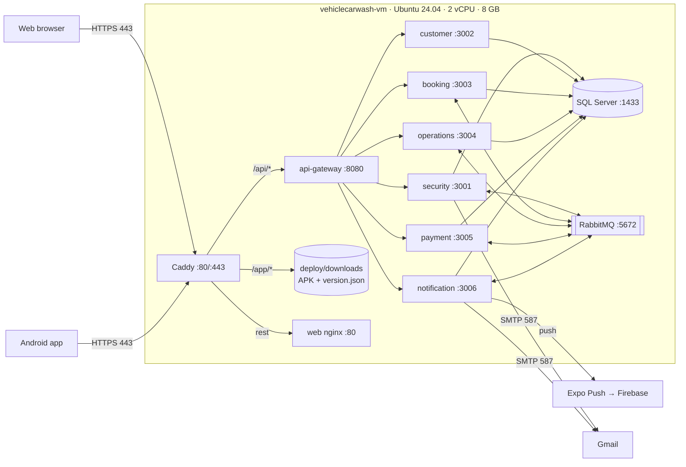

# Deployment Document — LavaRápido Vehicular

> Vehicle wash management system · ADSO training project (SENA)
> Software implementation procedure on the production server.

---

## Table of Contents

1. [General Information and Version Control](#1-general-information-and-version-control)
2. [Scope, Topology and Architecture](#2-scope-topology-and-architecture)
3. [Prerequisites and Preparation (Pre-deployment)](#3-prerequisites-and-preparation-pre-deployment)
4. [Step-by-Step Deployment Procedure (Runbook)](#4-step-by-step-deployment-procedure-runbook)
5. [Verification, Testing and Evidence Plan (Smoke Tests)](#5-verification-testing-and-evidence-plan-smoke-tests)

---

## 1. General Information and Version Control

### 1.1 Deployment Fact Sheet

#### 1.1.1 System identification and version (Release Tag)

| Field | Value |
|---|---|
| System | LavaRápido Vehicular — bookings, payments and operations management for a car wash |
| Components | 6 backend microservices, API Gateway, web application, Android mobile app |
| Version (Release Tag) | `v1.0.0` *(pending: create the tag when `develop` is merged into `main`)* |
| Deployed branch | `develop` (in every repository) |
| Mobile app version | **1.1.0** (versionCode **5**), APK published on 2026-10-19 + over-the-air updates (EAS Update) |
| Repositories | `lavarapido-infra`, `lavarapido-api-gateway`, `lavarapido-security-service`, `lavarapido-customer-service`, `lavarapido-booking-service`, `lavarapido-operation-service`, `lavarapido-notification-service`, `lavarapido-payment-service`, `Front-end-proyecto-web`, `LavadoVehicular-Movil` |
| Public address | https://lavarapidovehicular.northcentralus.cloudapp.azure.com |

#### 1.1.2 Scheduled date, time and maintenance window

| Field | Value |
|---|---|
| Initial deployment date | October 16, 2026 |
| Maintenance window | 02:30 – 05:30 (Colombia time, UTC-5) |
| Actual duration | ~2 h 30 min (provisioning, image builds, HTTPS setup and testing) |
| User downtime | Not applicable: first deployment (no users in production yet) |
| Window for future updates | Outside the car wash's business hours (before 07:00 or after 18:00) |
| Latest update | 2026-10-19, 03:20 (server time), with `update-server.sh`: `develop` code up to October 17 and 18 and migration 039 |

#### 1.1.3 Target environment (VPS / Staging / Production)

| Field | Value |
|---|---|
| Environment | **Academic production** (also used as staging for the team's tests) |
| Provider | Microsoft Azure (*Azure for Students* subscription) |
| Type | Linux virtual machine (IaaS), equivalent to a VPS |
| Region | North Central US |
| Alternate environment | Hostinger KVM 2 VPS (purchased, pending payment activation) |

#### 1.1.4 Roles and responsibilities matrix (DevOps, Tech Lead, QA, DBA)

> Responsibilities according to the services each member maintains on GitHub. **To be confirmed with the team.**

| Role | Owner | Deployment responsibilities |
|---|---|---|
| DevOps | Brayan Cabrera | Server, Docker Compose, Caddy/HTTPS, deployment and update scripts |
| Tech Lead | Brayan Cabrera | Release approval, change review, team coordination |
| QA | *(to be assigned)* | Smoke tests and functional validation per role (client, operator, administrator) |
| DBA | *(to be assigned)* | Migrations, backups and database verification |
| booking-service and customer-service owner | Camilo Guilombo | Changes and verification of their services |
| payment-service and mobile app owner | Merari Urbano Quintero | Changes and verification of payments and the app |

### 1.2 Document Version History

| Version | Date | Author | Description |
|---|---|---|---|
| 1.0 | 2026-10-16 | Brayan Cabrera | Initial version: deployment on Azure |
| 1.1 | 2026-10-16 | Brayan Cabrera | Portainer CE installed, real evidence (5.4) and correction of Liquibase schemas and tables |
| 1.2 | 2026-10-16 | Juan Camilo Guilombo | Table count corrected (57) and first administrator created with the environment variables |
| 1.3 | 2026-10-19 | Juan Camilo Guilombo | Update of 2026-10-19 (migration 039 and app 1.1.0), SSH access with a personal key per member, deployment from GitHub Actions, continuous integration in the 10 repositories, and new terminal and web evidence |

### 1.3 Change Summary (Release Notes)

#### 1.3.1 New features

**Platform and deployment**
- Full deployment with Docker Compose and a production file (`docker-compose.prod.yml`).
- Automatic HTTPS with Caddy and a Let's Encrypt certificate (automatic renewal).
- Creation of the first administrator when installing on an empty database (`ADMIN_EMAIL` / `ADMIN_PASSWORD`).
- Server installation script (`setup-server.sh`) and one-step update script (`update-server.sh`).
- Android app download from the web (button and QR code) at the fixed address `/app/LavaRapidoVehicular.apk`.

**Notifications**
- Push notifications in the mobile app (Expo + Firebase) implemented with the Command pattern.
- Delivery through channels (push and email) with failure isolation.
- Notices in the account's language (Spanish, English, French and Portuguese).
- Notice to administrators about upcoming bookings without an operator.
- New app version notice by push and in the inbox.
- The web bell refreshes by itself and shows a floating notice with new notifications.

**Bookings and operations**
- Automatic operator assignment when a booking is confirmed (RF-008).
- The client can choose the operator among the available ones (RF-010).
- The operator can only start the service from 15 minutes before the booking.
- Vehicle inspection report with phases, findings and photos, shared with the client.
- Daily summary and operator team metrics for the administrator.

**Payments and accounts**
- Payment history sorted and filterable by date and service (RF-015/016).
- Account lockout for 15 minutes after 5 failed login attempts (RF-004b).
- Business data editable by the administrator and profile address stored in the backend.

**Mobile app**
- New version notice and over-the-internet updates (EAS Update) without reinstalling.
- Icon with the project logo and the name "LavaRapidoVehicular".

#### 1.3.2 Bug fixes

- An approved payment was shown as "under verification" on the payments screen (web and mobile).
- The deployed web received 403 on every call because of the services' CORS configuration.
- security-service did not start when an administrator already existed (query outside a transaction).
- The app's operator list did not show a newly created operator until logging out.
- A late 401 after logging out showed the "session expired" notice.
- The new APK announcement could not read the inter-service key because of file permissions.
- Pending reminders kept being sent after the service was started or finished.
- No operator is assigned to bookings whose time has already passed, and cancelled bookings are no longer listed as pending.
- The web requested a non-existent `favicon.ico` (404 error in the console) and used deprecated translation options (console warning).

#### 1.3.3 Infrastructure and dependency changes

| Change | Detail |
|---|---|
| Docker images | Java: `eclipse-temurin:21-jdk` (build) and `21-jre` (runtime) · .NET: `dotnet/sdk:8.0` and `aspnet:8.0` · Web: `node:22-alpine` and `nginx:1.27-alpine` |
| Infrastructure services | `mcr.microsoft.com/mssql/server:2022-latest` (Express), `rabbitmq:4-management`, `caddy:2-alpine`, `liquibase/liquibase:4.29` |
| New migrations | 032 (business data), 033 (inspection report), 034 (login lockout), 035 (address), 036 (registration date), 037 (operator profile), 038 (new-version notice type), and 039 (acceptance of the legal documents, applied on 2026-10-19) |
| Web dependencies | `qrcode` 1.5.4 |
| Mobile dependencies | `expo-notifications`, `expo-device`, `expo-build-properties`, `expo-updates`, `expo-application` |
| External services | Expo Push + Firebase Cloud Messaging (push), Gmail SMTP (email), EAS (app builds and updates) |

#### 1.3.4 Breaking changes

- **New mandatory variables** on the server. Without them, Docker Compose does not start:
  - `INTERNAL_API_KEY`, `PUBLIC_URL`, `RABBITMQ_USERNAME` and `RABBITMQ_PASSWORD`;
  - `RABBITMQ_*` cannot be `guest/guest`.
- **First administrator:** the demo accounts (`admin@gmail.com`, etc.) **only exist in development**. In production the administrator is created with `ADMIN_EMAIL` / `ADMIN_PASSWORD`.
- **Mobile app:** the Android package changed to `com.vehiclecarwash.app`. Previous versions must be uninstalled once; later ones install on top.
- **CORS:** each service only accepts the origin defined in `PUBLIC_URL`.

#### 1.3.5 Update of 2026-10-19

On 2026-10-19 at 03:20 (server time), `update-server.sh` was run. The `develop` changes up to October 17 and 18 were deployed:

- **Database:** migration 039, which stores the date and time each person accepts the Terms and the Data Processing Policy.
- **Backend:** the payment-service health check queries the database, payment-service handles the correlation identifier, the schedule error carries the reason (`reason`), two simultaneous requests no longer fail when creating the same operator, and a bay cannot be created in maintenance.
- **Web:** the payment screen selects by account, the profile option is called "Deactivate my account", Angular is on 21.2.25 and xlsx on 0.20.3, and there are layout fixes for phones.
- **Mobile app:** version 1.1.0 (versionCode 5), published on 2026-10-19 at 05:03, with the version shown in Settings.

The changes pushed afterwards are left for the next update: the error messages with `spring.web.error` in the Java services and the latest web and app fixes.

---

## 2. Scope, Topology and Architecture

### 2.1 Components and Artifacts in Scope

#### 2.1.1 Administration panel (Portainer CE)

> **Status: installed on 2026-10-16.** Panel to view the containers' status, logs and resource usage and restart them. Deployment and updates are still done with the scripts (section 4.3).

| Artifact | Image | Access |
|---|---|---|
| Portainer CE | `portainer/portainer-ce:2.21.5` (~11 MB of RAM) | Only through an SSH tunnel (`https://localhost:9443`); listens on `127.0.0.1`, not exposed to the internet |
| Environment | `local` (socket `/var/run/docker.sock`) | Stack `lavarapido` visible as *Compose · Limited* (created outside Portainer) |

#### 2.1.2 Web Frontend Layer (SPA / Nginx Web Server)

| Artifact | Technology | Image / container |
|---|---|---|
| Web application | **Angular 21** (SPA), i18n in 4 languages | `lavarapido/web:local` → `lavarapido-web` |
| Web server | nginx 1.27: serves the build and forwards `/api` to the gateway | inside `lavarapido-web` |
| Reverse proxy and HTTPS | Caddy 2 (Let's Encrypt) | `lavarapido-caddy` |
| Android mobile app | Expo / React Native, APK built with EAS | Served at `/app/LavaRapidoVehicular.apk` |

#### 2.1.3 Backend API Layer (Java Spring Boot / C# .NET Core)

| Service | Technology | Internal port | Responsibility |
|---|---|---|---|
| api-gateway | Spring Cloud Gateway (Java 21) | 8080 | Single entry point for `/api/v1` |
| security-service | Spring Boot (Java 21) | 3001 | Accounts, login, JWT, roles, preferences |
| customer-service | Spring Boot (Java 21) | 3002 | Clients and vehicles |
| booking-service | Spring Boot (Java 21) | 3003 | Catalog, schedule, bookings |
| operations-service | Spring Boot (Java 21) | 3004 | Operators, assignment, execution, ratings, inspection |
| payment-service | ASP.NET Core 8 (C#) | 3005 | Payments, receipts, loyalty and promotions |
| notification-service | Spring Boot (Java 21) | 3006 | Inbox, email, push, reminders |
| rabbitmq | RabbitMQ 4 | 5672 | Events between services (exchange `carwash.events`) |

#### 2.1.4 Persistence Layer (SQL Server)

| Artifact | Detail |
|---|---|
| Engine | **Microsoft SQL Server 2022, Express edition** (container `lavarapido-sqlserver`) |
| Database | `LavaRapido`: 9 schemas and 57 tables — `security` (11), `customer` (3), `booking` (10), `catalog` (3), `execution` (11), `notification` (6), `payment` (7), `promotion` (5), `audit` (1) |
| Migrations | **Liquibase**: the Java services apply them on startup; payment-service applies them with the `payment-migrate` container. Each service keeps its history in `dbo.DATABASECHANGELOG_<SERVICE>` |
| Persistent volumes | `sqlserver-data` (database), `rabbitmq-data` (queues), `caddy-data` (certificates) |

### 2.2 Network and Infrastructure Architecture Diagram

#### 2.2.1 VPS server topology



#### 2.2.2 Internal container network (Docker Bridge Network)

- All containers are on the bridge network **`lavarapido_default`**, created by Docker Compose.
- They call each other by **service name**: `sqlserver`, `rabbitmq`, `security-service`, `api-gateway`, `web`, etc. Docker's internal DNS is `127.0.0.11`.
- The `/internal/**` routes (calls between services) are protected with the `X-Internal-Key` header (`INTERNAL_API_KEY`). **The gateway does not publish them.**
- No port of the internal network is published on the machine, except Caddy's.

#### 2.2.3 Routing and Reverse Proxy with TLS/HTTPS certificates

| Public route | Destination | Notes |
|---|---|---|
| `https://<domain>/api/*` | `api-gateway:8080` | REST API v1 for the web and the app |
| `https://<domain>/app/*` | `deploy/downloads` folder | APK and `version.json` (no cache) |
| `https://<domain>/*` | `web:80` | Angular SPA (routes → `index.html`) |
| `http://<domain>/*` | 308 redirect to HTTPS | Automatic (Caddy) |

- **Certificate:** Let's Encrypt, issued and renewed automatically by Caddy (expires on 2027-01-14 and is renewed before). It is stored in the `caddy-data` volume.
- **Domain:** Azure DNS label on the public IP: `lavarapidovehicular.northcentralus.cloudapp.azure.com`.
- **Configuration:** `lavarapido-infra/deploy/Caddyfile`.

### 2.3 Environments, IP Addressing and Ports Matrix

| Environment | Host | IP / URL | Use |
|---|---|---|---|
| Development | Each member's PC | `localhost` (web 4200, mobile 8081, gateway 8080) | Programming and local testing (Mailpit catches the emails) |
| Academic production | Azure VM `vehiclecarwash-vm` | Static IP `64.236.160.129` · https://lavarapidovehicular.northcentralus.cloudapp.azure.com | Presentation, team testing, installed app |
| Alternate production (pending) | Hostinger KVM 2 VPS | To be assigned | Migration once the payment is activated |

| Port | Service | Exposed to the internet? |
|---|---|---|
| 22 | SSH (key only) | Yes (administration) |
| 80 / 443 | Caddy | Yes |
| 8080 | api-gateway | No (internal network only) |
| 3001–3006 | Microservices | No |
| 1433 | SQL Server | No |
| 5672 / 15672 | RabbitMQ / panel | No |
| 9443 | Portainer CE | No (only `127.0.0.1`, through an SSH tunnel) |

---

## 3. Prerequisites and Preparation (Pre-deployment)

### 3.1 Operating System and VPS Prerequisites Checklist

#### 3.1.1 Available hardware resources (CPU, RAM, disk)

| Resource | Minimum required | Available (Azure B2as_v2) | Measured in operation | ✓ |
|---|---|---|---|---|
| CPU | 2 x86-64 vCPU (SQL Server does not run on ARM) | 2 AMD x64 vCPU | Peaks only while building images | ✅ |
| RAM | 8 GB | 7.7 GB + 4 GB of swap | **3.3 GB** used with the 12 containers, Portainer included (2026-10-19) | ✅ |
| Disk | 30 GB | 64 GB standard SSD | 26 GB used of 61 GB (42%), mostly images and build cache (2026-10-19) | ✅ |
| Operating system | Ubuntu 24.04 or 26.04 LTS | Ubuntu 24.04.4 LTS | — | ✅ |
| Network | Ports 22, 80 and 443 open | Azure security group | Verified from the internet | ✅ |

#### 3.1.2 Docker engine status and local socket

```bash
docker --version            # Docker version 29.x
docker compose version      # Docker Compose v5.x
sudo systemctl is-enabled docker   # enabled  → starts with the machine
sudo systemctl is-active docker    # active
ls -l /var/run/docker.sock         # local engine socket
```

`deploy/setup-server.sh` installs Docker (official `get.docker.com` script) if missing, enables it on boot and creates 4 GB of swap.

### 3.2 Backup Strategy and Execution

> **Status:** procedure defined; **periodic automation is pending**. It is run manually before every deployment that includes migrations.

#### 3.2.1 Logical database backup (Dump / Snapshot)

```bash
cd ~/lavarapido/lavarapido-infra
P=$(grep '^DB_PASSWORD=' .env.production | cut -d= -f2-)
sudo docker exec -e SQLCMDPASSWORD="$P" lavarapido-sqlserver /opt/mssql-tools18/bin/sqlcmd \
  -S localhost -U sa -C -Q "BACKUP DATABASE [LavaRapido] TO DISK = N'/var/opt/mssql/backup/LavaRapido_$(date +%F).bak' WITH COMPRESSION, INIT"
sudo docker cp lavarapido-sqlserver:/var/opt/mssql/backup/LavaRapido_$(date +%F).bak ~/backups/
```

Infrastructure-level complement: **disk snapshot** of the VM from the Azure portal (Disks → Create snapshot).

#### 3.2.2 Backup of Docker persistent volumes

```bash
mkdir -p ~/backups
for v in lavarapido_sqlserver-data lavarapido_rabbitmq-data lavarapido_caddy-data; do
  sudo docker run --rm -v "$v":/data:ro -v ~/backups:/backup alpine \
    tar czf "/backup/${v}_$(date +%F).tar.gz" -C /data .
done
```

> For a consistent backup of `sqlserver-data`, the `BACKUP DATABASE` from 3.2.1 is preferred, because it can be done while the database is running.

#### 3.2.3 Backup of Stack configurations and previous variables

```bash
cd ~/lavarapido/lavarapido-infra
cp .env.production ~/backups/env.production_$(date +%F)       # contains secrets: chmod 600
chmod 600 ~/backups/env.production_*
git -C ~/lavarapido/lavarapido-infra rev-parse HEAD > ~/backups/infra-commit_$(date +%F).txt
```

The stack configuration (`docker-compose.yml`, `docker-compose.prod.yml`, `deploy/Caddyfile`) is versioned on GitHub (`lavarapido-infra`). To go back, a `git checkout <commit>` and a new `up -d` are enough.

### 3.3 Environment Variables and Secrets Management

- Secrets live **only** in `~/lavarapido/lavarapido-infra/.env.production` (permissions `600`), which is in `.gitignore`.
- The template without values is `.env.production.example`.
- **Key generation:** the keys were generated **on the server** with `openssl rand -base64 48` and were never copied or displayed.
- **First administrator:** the owner wrote `ADMIN_EMAIL` and `ADMIN_PASSWORD` directly in `.env.production` on the server; security-service created the account at startup because there was no administrator yet (`AdministratorBootstrapRunner`). The password is not in any repository.

#### 3.3.1 Database connection parameters

| Variable | Description |
|---|---|
| `DB_PASSWORD` | `sa` password (8+ characters, uppercase, lowercase, number and symbol) |
| `DB_NAME` | `LavaRapido` |
| `DB_USERNAME` | `sa` *(pending improvement: a user with limited permissions)* |
| `DB_URL` (compose) | `jdbc:sqlserver://sqlserver:1433;databaseName=LavaRapido;encrypt=true;trustServerCertificate=true` |

#### 3.3.2 Token signing keys (JWT Secret Keys)

| Variable | Description |
|---|---|
| `JWT_SECRET` | HS256 key shared by the services that validate tokens (≥ 32 bytes). Tokens last **1 hour** |
| `INTERNAL_API_KEY` | Key for the `/internal/**` routes between services (`X-Internal-Key` header) |
| `RABBITMQ_USERNAME` / `RABBITMQ_PASSWORD` | Dedicated RabbitMQ user (not `guest`) |
| `MAIL_USERNAME` / `MAIL_PASSWORD` / `MAIL_FROM` | Gmail account with an app password |
| `ADMIN_EMAIL` / `ADMIN_PASSWORD` | First administrator (only used if the database has none) |
| `PUBLIC_URL` / `SITE_ADDRESS` | Public address (CORS, email links) and Caddy domain |
| `PUSH_ENABLED` / `MESSAGING_ENABLED` | `true`: push with Expo and events with RabbitMQ |

#### 3.3.3 Memory and runtime limits (JVM -Xmx, ASPNETCORE_ENVIRONMENT)

| Container | Limit (`mem_limit`) | Runtime |
|---|---|---|
| 5 Java services + gateway | 512 MB each | `java -XX:MaxRAMPercentage=75` → maximum heap ≈ 384 MB · `prod` profile (no Swagger) |
| payment-service | 384 MB | `ASPNETCORE_ENVIRONMENT=Production` |
| SQL Server | `MSSQL_MEMORY_LIMIT_MB=1536` | `MSSQL_PID=Express` |
| web / caddy | 64 MB each | nginx / Caddy |
| All | `restart: unless-stopped` | They restart by themselves on failure and when the machine boots |

### 3.4 Communication Protocol and Maintenance Window

1. **Advance notice (24 h):** the DevOps informs the team through the project group about the date, the window and the changes (release notes).
2. **Freeze:** no changes are pushed to the branch being deployed during the window.
3. **Start:** "deployment started" is announced and the backup is taken (section 3.2).
4. **Execution:** runbook in section 4.
5. **Verification:** smoke tests in section 5. QA confirms each role.
6. **Closing:** "deployment finished" is announced with the version and the evidence. If it fails, **rollback**: `git checkout` of the previous commit in `lavarapido-infra` and in the services, `update-server.sh`, and if the migration damaged data, restore the `.bak`.
7. **Standard window:** outside the car wash's business hours (before 07:00 or after 18:00, Colombia time).

---

## 4. Step-by-Step Deployment Procedure (Runbook)

### 4.1 Verification and Access to the Base Platform (Portainer CE)

**Server access:**

```bash
ssh -i ~/.ssh/lavarapido_azure azureuser@64.236.160.129
```

**Access of each member with their own key:** each person creates their key on their computer and only shares the public part (`.pub`). The private one is never sent or pushed to a repository.

```powershell
ssh-keygen -t ed25519 -f $HOME\.ssh\lavarapido_azure      # on the person's PC
Get-Content $HOME\.ssh\lavarapido_azure.pub                # this line is the one to share
```

The DevOps owner adds it once, from the portal (*vehiclecarwash-vm → Reset password → Reset SSH public key*, user `azureuser`) or from the server with `echo "<public key>" >> ~/.ssh/authorized_keys`. As of 2026-10-19, the keys with access are the DevOps owner's, Juan Camilo's, and GitHub Actions' (restricted, see 4.3.3). To remove an access, delete its line from `authorized_keys`.

**Portainer CE installation** *(done on 2026-10-16; listens only inside the server)*:

```bash
sudo docker volume create portainer_data
sudo docker run -d --name portainer --restart unless-stopped \
  -p 127.0.0.1:9443:9443 \
  -v /var/run/docker.sock:/var/run/docker.sock \
  -v portainer_data:/data portainer/portainer-ce:2.21.5
```

**Access from the administrator's PC** (SSH tunnel, without opening ports):

```bash
ssh -i ~/.ssh/lavarapido_azure -L 9443:localhost:9443 azureuser@64.236.160.129
# then open https://localhost:9443 → user "admin"
```

- **Password of the `admin` user:** it was generated during installation and is on the server, in `~/portainer-admin-password` (permissions `600`). It is read with `cat ~/portainer-admin-password` and can be changed from Portainer (*My account*).
- **`local` environment:** registered on the Docker socket. `lavarapido` appears under *Containers* and *Stacks*.

### 4.2 Database Deployment and Migration

#### 4.2.1 Running DDL/DML scripts or migration tools (Liquibase)

Migrations are **automatic**:

1. The `db-init` container creates the `LavaRapido` database if it does not exist.
2. The `payment-migrate` container (Liquibase 4.29) applies the payment-service changelogs (`db/changelog/db.changelog-master.yaml`) and exits.
3. Each Java service applies its own changelogs on startup. Numbering is global: 001–039 plus the 1xx catalog seeds.
4. Hibernate only validates that the model matches the tables (`ddl-auto: validate`); it never alters tables.

Production **does not load test data**: only catalogs (roles, services, statuses, schedule and business data).

#### 4.2.2 Verification of schema, index and user integrity

```bash
P=$(grep '^DB_PASSWORD=' .env.production | cut -d= -f2-)
q(){ sudo docker exec -e SQLCMDPASSWORD="$P" lavarapido-sqlserver /opt/mssql-tools18/bin/sqlcmd \
     -S localhost -U sa -C -d LavaRapido -Q "SET NOCOUNT ON; $1"; }
q "SELECT s.name AS esquema, COUNT(t.name) AS tablas FROM sys.schemas s JOIN sys.tables t ON t.schema_id=s.schema_id GROUP BY s.name"
for s in SECURITY CUSTOMER BOOKING OPERATIONS NOTIFICATION PAYMENT; do
  q "SELECT '$s' AS servicio, COUNT(*) AS changesets, SUM(CASE WHEN EXECTYPE IN ('EXECUTED','MARK_RAN') THEN 1 ELSE 0 END) AS ok FROM DATABASECHANGELOG_$s"
done
q "SELECT COUNT(*) AS indices FROM sys.indexes WHERE object_id IN (SELECT object_id FROM sys.tables)"
q "SELECT u.username, r.code FROM security.app_user u JOIN security.user_role ur ON ur.user_id=u.user_id JOIN security.role r ON r.role_id=ur.role_id WHERE r.code='ADMIN'"
```

Expected result:
- the 9 schemas with their tables;
- in each service, `ok` equal to `changesets` (2026-10-16: 143 of 143; 2026-10-19: 144 of 144, with 039);
- the initial administrator created (security log: `First administrator created`).

### 4.3 Application Stack Deployment and Orchestration

#### 4.3.1 Loading the docker-compose.yml file in Portainer

The stack is defined with two files versioned in `lavarapido-infra`:
- **`docker-compose.yml`:** the base, the same as in development.
- **`docker-compose.prod.yml`:** overrides the production settings: no internal ports, `prod` profile, memory limits, Caddy, web and CORS.

**Current deployment (CLI):**

```bash
# 1. Download the 9 repositories (and prepare Docker and swap the first time)
curl -fsSL https://raw.githubusercontent.com/BrayanCABRERA123/lavarapido-infra/develop/deploy/setup-server.sh -o setup-server.sh
bash setup-server.sh
```

**With Portainer:** Stacks → Add stack → *Repository*. The images are built from 9 sibling repositories, so the recommended flow is:
1. build the images with the CLI (step 4.3.3);
2. use Portainer to **view, restart, check logs and resource usage** of the containers of the `lavarapido` stack, which appears as a "limited" stack because it was created outside Portainer.

#### 4.3.2 Injecting the Stack's environment variables

```bash
cd ~/lavarapido/lavarapido-infra
cp .env.production.example .env.production
chmod 600 .env.production
nano .env.production        # fill in the values from section 3.3 (keys generated with openssl)
```

In Portainer, the same variables are loaded in *Environment variables → Load variables from .env file*.

#### 4.3.3 Service deployment and container image updates

**First deployment:**

```bash
cd ~/lavarapido/lavarapido-infra
sudo docker compose -f docker-compose.yml -f docker-compose.prod.yml \
  --env-file .env.production --profile app up -d --build
```

**Later updates**: first push the changes to GitHub and then:

```bash
bash ~/lavarapido/lavarapido-infra/deploy/update-server.sh                 # everything
bash ~/lavarapido/lavarapido-infra/deploy/update-server.sh web             # only the web
bash ~/lavarapido/lavarapido-infra/deploy/update-server.sh security-service notification-service
```

**From GitHub, without SSH:** with the machine on, in the `lavarapido-infra` repository → *Actions → Desplegar en Azure → Run workflow*. In *Servicios*, leave it empty to update everything or write the names (`web payment-service`). At the end, the workflow checks that the web and the API answer 200. It uses its own GitHub key (secret `AZURE_SSH_KEY`) that on the server can only run `deploy/ci-deploy.sh`, which validates the names and does not let two updates run at the same time.

**Continuous integration:** since 2026-10-19 the 10 repositories have `.github/workflows/ci.yml`, which runs on every push or pull request to `develop` and `main`, and the result appears as ✓ or ✗ next to each commit:

| Repository | What it checks |
|---|---|
| Java services and api-gateway | `./mvnw verify`: builds and runs the tests (Java 21) |
| payment-service | `dotnet build` and `dotnet test` (.NET 8; integration tests are skipped without SQL Server) |
| Front-end-proyecto-web | Production build and `ng test` |
| LavadoVehicular-Movil | `tsc --noEmit` (the APK is still built with EAS) |
| lavarapido-infra | Syntax and `shellcheck` of `deploy/*.sh`, `docker compose config`, and `e2e/` syntax |

**Publishing the mobile app**, from the PC, in the app folder:

```bash
eas build -p android --profile preview          # new APK (native changes)
npm run publish:apk -- "what changed"           # publishes it in /app/ and notifies by push
npm run publish:update -- "what changed"        # screen-only changes: over-the-internet update
```

### 4.4 Routing, Domain and SSL/TLS Certificate Configuration

1. **Domain:** Azure → public IP `vehiclecarwash-vm-ip` → Configuration → *DNS name label* = `lavarapidovehicular`. The result is `lavarapidovehicular.northcentralus.cloudapp.azure.com`.
2. **Variables:** `.env.production`:
   ```
   SITE_ADDRESS=lavarapidovehicular.northcentralus.cloudapp.azure.com
   PUBLIC_URL=https://lavarapidovehicular.northcentralus.cloudapp.azure.com
   ```
3. **Apply:** `update-server.sh caddy security-service notification-service api-gateway`. Caddy requests the certificate from Let's Encrypt through HTTP-01; port 80 must be open.
4. **Verify the certificate:**
   ```bash
   echo | openssl s_client -connect lavarapidovehicular.northcentralus.cloudapp.azure.com:443 \
     -servername lavarapidovehicular.northcentralus.cloudapp.azure.com 2>/dev/null | openssl x509 -noout -issuer -enddate
   # issuer=C=US, O=Let's Encrypt · notAfter=Jan 14 2027
   ```
5. **Mobile app:** `EXPO_PUBLIC_API_URL` in `eas.json` = `https://lavarapidovehicular.northcentralus.cloudapp.azure.com/api/v1`, and the APK is built.

---

## 5. Verification, Testing and Evidence Plan (Smoke Tests)

### 5.1 Service Verification Links and Endpoints Matrix

#### 5.1.1 Access to the administration panel (Portainer)

| Link | Expected | Status |
|---|---|---|
| `https://localhost:9443` (through SSH tunnel) | Stack `lavarapido`: 11 containers *running*/*healthy* and 2 init containers in *exited (0)* | ✅ (see 5.4.1) |
| `https://64.236.160.129:9443` (from the internet) | No connection | ✅ closed |

#### 5.1.2 Public web interface (Angular SPA)

| Link | Expected | Result (2026-10-19) |
|---|---|---|
| `https://<domain>/` | Home page with the "Download app" section | ✅ 200 |
| `https://<domain>/client`, `/admin` | Angular routes (load `index.html`) | ✅ 200 |
| `http://<domain>/` | Redirect to HTTPS | ✅ 308 |
| `https://<domain>/app/version.json` | Published app version | ✅ 200 (`versionCode 5`, version 1.1.0) |
| `https://<domain>/app/LavaRapidoVehicular.apk` | APK download (`application/vnd.android.package-archive`) | ✅ 200 |

#### 5.1.3 Backend health endpoints (/actuator/health)

The health endpoints **are not published to the internet**: `/actuator` is not under `/api`. They are checked inside the server:

```bash
for s in security-service:3001 customer-service:3002 booking-service:3003 operations-service:3004 notification-service:3006 api-gateway:8080; do
  sudo docker run --rm --network lavarapido_default curlimages/curl:8.10.1 -s "http://$s/actuator/health"; echo "  ← $s"
done
sudo docker compose -f docker-compose.yml -f docker-compose.prod.yml --env-file .env.production --profile app ps
```

Expected: `{"status":"UP"}` in each Java service, and every container `Up`. `db-init` and `payment-migrate` must end in `Exited (0)`.

#### 5.1.4 Interactive API documentation (Swagger UI / OpenAPI)

- **In production it is disabled on purpose** (`prod` profile): the API structure is not exposed.
- It is consulted in **development**, with each service in the `dev` profile: `http://localhost:3001/swagger-ui.html`, and likewise for each port.
- The OpenAPI specification is versioned in `vehicle-w-docs`.

#### 5.1.5 Direct TCP connectivity to the database engine

SQL Server **does not have port 1433 published**. Connectivity is tested from the internal network:

```bash
P=$(grep '^DB_PASSWORD=' .env.production | cut -d= -f2-)
sudo docker exec -e SQLCMDPASSWORD="$P" lavarapido-sqlserver /opt/mssql-tools18/bin/sqlcmd \
  -S localhost -U sa -C -Q "SELECT @@VERSION, DB_NAME(DB_ID('LavaRapido'))"
nc -zv 64.236.160.129 1433    # from outside: must FAIL (port closed)
```

### 5.2 Functional Smoke Tests

#### 5.2.1 Authentication flow and token issuance

| Test | Expected | Result |
|---|---|---|
| `POST /api/v1/auth/login` with an empty body | 400 (validation) | ✅ 400 |
| Login with invalid credentials | 401 `INVALID_CREDENTIALS` | ✅ 401 |
| Login of the initial administrator from the web | JWT token with the `ADMIN` role and access to `/admin` | ✅ |
| Request from a foreign origin (CORS) | 403 | ✅ 403 |
| Internal route without key (`/internal/...`) | 401; unreachable from the internet | ✅ 401 / 405 |

#### 5.2.2 Data read and query tests

| Test | Result |
|---|---|
| `GET /api/v1/catalog/services` (public catalog) | ✅ 200 with the services |
| `GET /api/v1/schedule/business-hours` | ✅ 200 |
| `GET /api/v1/establishment` | ✅ 200 |

#### 5.2.3 Write and transactional persistence tests

**Automated end-to-end test:** `lavarapido-infra/e2e/full-flow.test.js` (`npm run flow`). It goes through the three roles via the gateway:

| # | Step | Result |
|---|---|---|
| 1 | The client books choosing an operator → automatic assignment → notices | ✅ |
| 2 | The client reports the payment with a receipt → it stays under review | ✅ |
| 3 | The administrator approves the payment → the client sees it approved and earns points | ✅ |
| 4 | The operator starts and finishes the service → notices to the client | ✅ |
| 5 | The client rates → the operator sees the rating | ✅ |

- **When it ends:** the test deletes everything it created and restores the client's points.
- **Also verified in production:**
  - real email delivery (recovery code through Gmail);
  - real push to the phone;
  - the push switch (off → inbox only; on → push).

### 5.3 Log Inspection and Resource Monitoring

#### 5.3.1 Review of startup traces without critical exceptions

```bash
C="sudo docker compose -f docker-compose.yml -f docker-compose.prod.yml --env-file .env.production --profile app"
$C logs --since 10m | grep -iE "ERROR|Exception|APPLICATION FAILED" | head
for s in security-service customer-service booking-service operations-service notification-service api-gateway; do
  sudo docker logs lavarapido-$s 2>&1 | grep -oE "Started [A-Za-z]+ in [0-9.]+ seconds" | tail -1
done
sudo docker logs lavarapido-payment-service 2>&1 | grep "Now listening"
```

Expected:
- each service with its `Started ... in N seconds`;
- payment with `Now listening on: http://0.0.0.0:3005`;
- no `APPLICATION FAILED TO START`.

#### 5.3.2 CPU and RAM usage monitoring in containers

```bash
sudo docker stats --no-stream --format "table {{.Name}}\t{{.CPUPerc}}\t{{.MemUsage}}"
free -h
```

Measurement on 2026-10-19, with the system idle and the machine just started:

| Container | Memory |
|---|---|
| security-service | 311 MB / 512 MB |
| notification-service | 326 MB / 512 MB |
| operations-service | 327 MB / 512 MB |
| booking-service | 341 MB / 512 MB |
| customer-service | 292 MB / 512 MB |
| api-gateway | 176 MB / 512 MB |
| payment-service | 78 MB / 384 MB |
| sqlserver | 777 MB |
| rabbitmq | 148 MB |
| web / caddy | 12 MB / 60 MB |
| portainer | 61 MB |
| **Machine total** | **3.3 GB of 7.7 GB · swap unused** |

### 5.4 Visual Evidence Record (Screenshots)

> The terminal and web screenshots were taken on 2026-10-19 on the production server, with the version deployed that day at 03:20; the terminal ones show the real output of the commands. The Portainer ones (5.4.1) are from 2026-10-16, because the panel requires logging in and only the DevOps owner uses it.

#### 5.4.1 Screenshot of the Portainer panel with containers in Running state


*The 11 services in* running */* healthy*; `db-init` and `payment-migrate` end in* exited - code 0 *because they run only once (create the database and apply the payment migrations).*


*Status taken from the terminal on 2026-10-19: the 11 containers of the system Up (SQL Server and RabbitMQ* healthy*), `db-init` and `payment-migrate` in* Exited (0)*, and the memory usage of each container.*

#### 5.4.2 Screenshot of the Backend services log viewer


*Each Java service shows* Started … in N seconds *(between 45 and 91 seconds with the machine just started) and payment* Now listening on :3005*. There are 0 error traces in the last 15 minutes.*

#### 5.4.3 Screenshot of the HTTP 200 response of the Health Checks


*`/actuator/health` answers `UP` (HTTP 200) in the 6 Java services from the internal network, and payment-service answers `ok`. From the internet, the web, the API, and `/app/version.json` answer 200, and HTTP redirects to HTTPS with 308.*

#### 5.4.4 Screenshot of the web interface with a clean DevTools console


*Home page in production over HTTPS (TLS 1.3, Let's Encrypt certificate valid until 2027-01-14). On load: 0 errors and 0 warnings in the console, and 0 error responses.*

#### 5.4.5 Screenshot of the successful migration record in the database


*Migration 039 (acceptance of the legal documents) was applied on 2026-10-19; there are 144 `EXECUTED` changesets in the 6 histories and 57 tables in the 9 schemas.*

---

**Related documents:**
- `lavarapido-infra/DEPLOY.md`: short deployment and update guide.
- `lavarapido-infra/e2e/README.md`: tests between services.
- `vehicle-w-docs`: architecture (ADR), OpenAPI and events.
