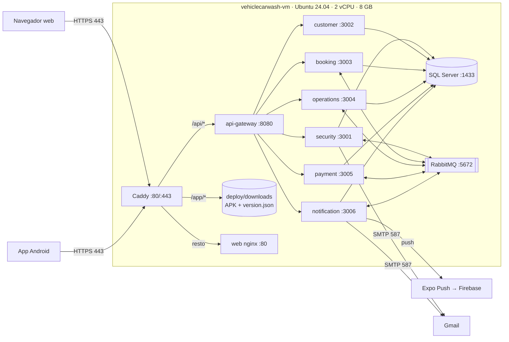
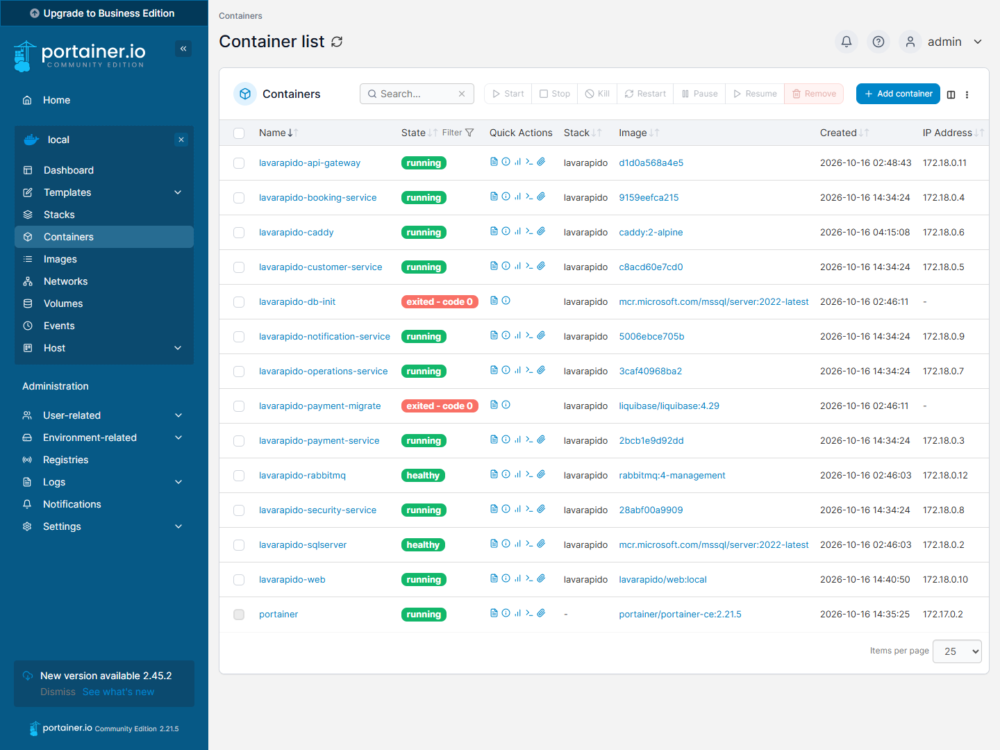
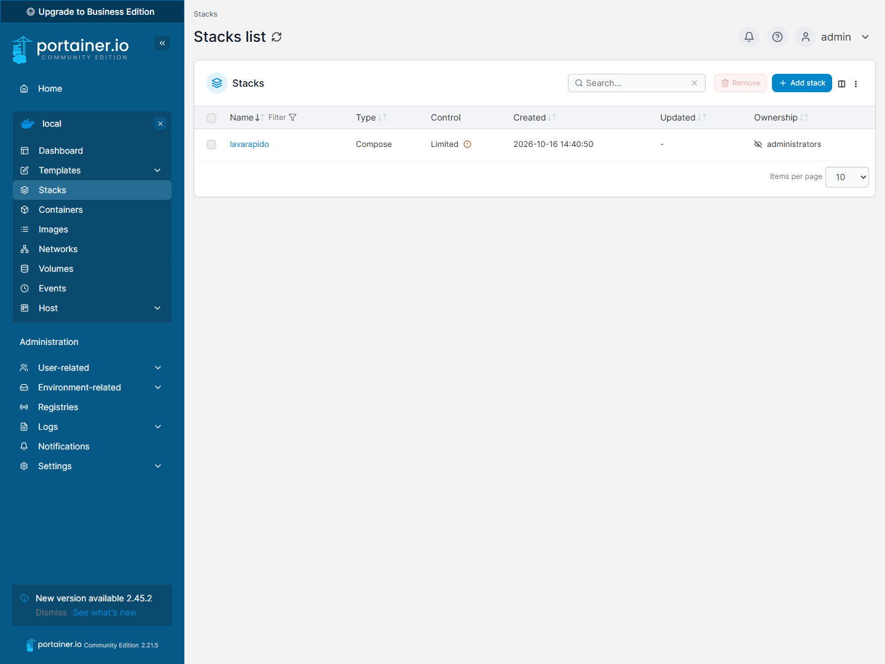
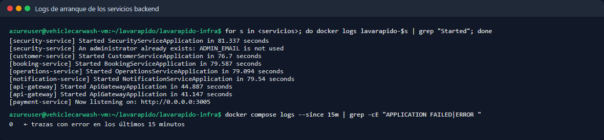
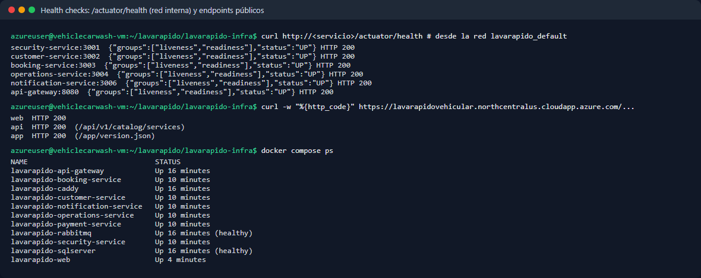

# Documento de Despliegue — LavaRápido Vehicular

> Sistema de gestión de lavado vehicular · Proyecto formativo ADSO (SENA)
> Procedimiento de implementación del software en el servidor de producción.

---

## Tabla de Contenido

1. [Información General y Control de Versiones](#1-información-general-y-control-de-versiones)
2. [Alcance, Topología y Arquitectura](#2-alcance-topología-y-arquitectura)
3. [Requisitos Previos y Preparación (Pre-deployment)](#3-requisitos-previos-y-preparación-pre-deployment)
4. [Procedimiento de Despliegue Paso a Paso (Runbook)](#4-procedimiento-de-despliegue-paso-a-paso-runbook)
5. [Plan de Verificación, Pruebas y Evidencias (Smoke Tests)](#5-plan-de-verificación-pruebas-y-evidencias-smoke-tests)

---

## 1. Información General y Control de Versiones

### 1.1 Ficha Técnica del Despliegue

#### 1.1.1 Identificación del sistema y versión (Release Tag)

| Campo | Valor |
|---|---|
| Sistema | LavaRápido Vehicular — gestión de reservas, pagos y operación de un lavadero |
| Componentes | 6 microservicios backend, API Gateway, aplicación web, aplicación móvil Android |
| Versión (Release Tag) | `v1.0.0` *(pendiente: crear la etiqueta al pasar `develop` a `main`)* |
| Rama desplegada | `develop` (en todos los repositorios) |
| Versión de la app móvil | versionCode **2** (APK) + actualización OTA "Tocar el aviso de versión nueva abre la descarga" |
| Repositorios | `lavarapido-infra`, `lavarapido-api-gateway`, `lavarapido-security-service`, `lavarapido-customer-service`, `lavarapido-booking-service`, `lavarapido-operation-service`, `lavarapido-notification-service`, `lavarapido-payment-service`, `Front-end-proyecto-web`, `LavadoVehicular-Movil` |
| Dirección pública | https://lavarapidovehicular.northcentralus.cloudapp.azure.com |

#### 1.1.2 Fecha, hora y ventana operativa programada

| Campo | Valor |
|---|---|
| Fecha del despliegue inicial | 16 de octubre de 2026 |
| Ventana operativa | 02:30 – 05:30 (hora de Colombia, UTC-5) |
| Duración real | ~2 h 30 min (aprovisionamiento, compilación de imágenes, configuración de HTTPS y pruebas) |
| Interrupción a usuarios | No aplica: primer despliegue (no había usuarios en producción) |
| Ventana para próximas actualizaciones | Fuera de horario de atención del lavadero (antes de las 07:00 o después de las 18:00) |

#### 1.1.3 Entorno de destino (VPS / Staging / Producción)

| Campo | Valor |
|---|---|
| Entorno | **Producción académica** (también usado como staging para las pruebas del equipo) |
| Proveedor | Microsoft Azure (suscripción *Azure for Students*) |
| Tipo | Máquina virtual Linux (IaaS) equivalente a un VPS |
| Región | North Central US |
| Entorno alterno | VPS Hostinger KVM 2 (contratado, pendiente de activación del pago) |

#### 1.1.4 Matriz de roles y responsables (DevOps, Tech Lead, QA, DBA)

> Responsables según los servicios que cada integrante mantiene en GitHub. **Por confirmar con el equipo.**

| Rol | Responsable | Responsabilidades en el despliegue |
|---|---|---|
| DevOps | Brayan Cabrera | Servidor, Docker Compose, Caddy/HTTPS, scripts de despliegue y actualización |
| Tech Lead | Brayan Cabrera | Aprobación del release, revisión de cambios, coordinación del equipo |
| QA | *(por asignar)* | Pruebas de humo y validación funcional por rol (cliente, operario, administrador) |
| DBA | *(por asignar)* | Migraciones, respaldos y verificación de la base de datos |
| Responsable booking-service y customer-service | Camilo Guilombo | Cambios y verificación de sus servicios |
| Responsable payment-service y app móvil | Merari Urbano Quintero | Cambios y verificación de pagos y de la app |

### 1.2 Historial de Versiones del Documento

| Versión | Fecha | Autor | Descripción |
|---|---|---|---|
| 1.0 | 2026-10-16 | Brayan Cabrera | Versión inicial: despliegue en Azure |
| 1.1 | 2026-10-16 | Brayan Cabrera | Portainer CE instalado, evidencias reales (5.4) y corrección de esquemas y tablas de Liquibase |

### 1.3 Resumen de Cambios (Release Notes)

#### 1.3.1 Nuevas funcionalidades

**Plataforma y despliegue**
- Despliegue completo con Docker Compose y archivo de producción (`docker-compose.prod.yml`).
- HTTPS automático con Caddy y certificado de Let's Encrypt (renovación automática).
- Creación del primer administrador al instalar sobre una base vacía (`ADMIN_EMAIL` / `ADMIN_PASSWORD`).
- Script de instalación del servidor (`setup-server.sh`) y de actualización en un paso (`update-server.sh`).
- Descarga de la app Android desde la web (botón y código QR) con dirección fija `/app/LavaRapidoVehicular.apk`.

**Notificaciones**
- Notificaciones push en la app móvil (Expo + Firebase) implementadas con el patrón Command.
- Entrega por canales (push y correo) con aislamiento de fallos.
- Avisos en el idioma de la cuenta (español, inglés, francés y portugués).
- Aviso a los administradores de reservas próximas sin operario.
- Aviso de versión nueva de la app por push y por bandeja.
- La campanita de la web se actualiza sola y muestra un aviso flotante con las notificaciones nuevas.

**Reservas y operación**
- Asignación automática de operario al confirmarse una reserva (RF-008).
- El cliente puede elegir el operario entre los disponibles (RF-010).
- El operario solo puede iniciar el servicio desde 15 minutos antes de la reserva.
- Reporte de inspección del vehículo con fases, hallazgos y fotos, compartido con el cliente.
- Resumen del día y métricas del equipo de operarios para el administrador.

**Pagos y cuentas**
- Historial de pagos ordenado y filtrable por fecha y servicio (RF-015/016).
- Bloqueo de la cuenta por 15 minutos tras 5 intentos de inicio de sesión fallidos (RF-004b).
- Datos del negocio editables por el administrador y dirección del perfil guardada en el backend.

**App móvil**
- Aviso de versión nueva y actualizaciones por internet (EAS Update) sin reinstalar.
- Ícono con el logo del proyecto y nombre "LavaRapidoVehicular".

#### 1.3.2 Correcciones de errores (Bug fixes)

- Un pago aprobado se mostraba como "en verificación" en la pantalla de pagos (web y móvil).
- La web desplegada recibía 403 en todas las llamadas por la configuración de CORS de los servicios.
- security-service no arrancaba cuando ya existía un administrador (consulta fuera de transacción).
- La lista de operarios de la app no mostraba un operario recién creado hasta cerrar sesión.
- Un 401 tardío después de cerrar sesión mostraba el aviso de "sesión vencida".
- El anuncio de un APK nuevo no podía leer la llave entre servicios por permisos de archivo.
- Los recordatorios pendientes se seguían enviando después de iniciar o terminar el servicio.
- No se asigna operario a reservas cuya hora ya pasó, ni se listan reservas canceladas como pendientes.
- La web pedía un `favicon.ico` inexistente (error 404 en consola) y usaba opciones obsoletas de traducción (advertencia en consola).

#### 1.3.3 Cambios de infraestructura y dependencias

| Cambio | Detalle |
|---|---|
| Imágenes Docker | Java: `eclipse-temurin:21-jdk` (compilación) y `21-jre` (ejecución) · .NET: `dotnet/sdk:8.0` y `aspnet:8.0` · Web: `node:22-alpine` y `nginx:1.27-alpine` |
| Servicios de infraestructura | `mcr.microsoft.com/mssql/server:2022-latest` (Express), `rabbitmq:4-management`, `caddy:2-alpine`, `liquibase/liquibase:4.29` |
| Migraciones nuevas | 032 (datos del negocio), 033 (reporte de inspección), 034 (bloqueo de login), 035 (dirección), 036 (fecha de registro), 037 (perfil del operario), 038 (tipo de aviso de versión nueva) |
| Dependencias web | `qrcode` 1.5.4 |
| Dependencias móviles | `expo-notifications`, `expo-device`, `expo-build-properties`, `expo-updates`, `expo-application` |
| Servicios externos | Expo Push + Firebase Cloud Messaging (push), Gmail SMTP (correo), EAS (compilación y actualizaciones de la app) |

#### 1.3.4 Cambios incompatibles (Breaking changes)

- **Variables obligatorias nuevas** en el servidor. Sin ellas, Docker Compose no arranca:
  - `INTERNAL_API_KEY`, `PUBLIC_URL`, `RABBITMQ_USERNAME` y `RABBITMQ_PASSWORD`;
  - `RABBITMQ_*` no puede ser `guest/guest`.
- **Primer administrador:** las cuentas demo (`admin@gmail.com`, etc.) **solo existen en desarrollo**. En producción el administrador se crea con `ADMIN_EMAIL` / `ADMIN_PASSWORD`.
- **App móvil:** el paquete Android cambió a `com.vehiclecarwash.app`. Las versiones anteriores se deben desinstalar una vez; las siguientes se instalan encima.
- **CORS:** cada servicio solo acepta el origen definido en `PUBLIC_URL`.

---

## 2. Alcance, Topología y Arquitectura

### 2.1 Componentes y Artefactos en Alcance

#### 2.1.1 Panel de administración (Portainer CE)

> **Estado: instalado el 16-10-2026.** Panel para ver estado, logs y consumo de los contenedores y reiniciarlos. El despliegue y las actualizaciones se siguen haciendo con los scripts (sección 4.3).

| Artefacto | Imagen | Acceso |
|---|---|---|
| Portainer CE | `portainer/portainer-ce:2.21.5` (~11 MB de RAM) | Solo por túnel SSH (`https://localhost:9443`); escucha en `127.0.0.1`, sin exponer a internet |
| Entorno | `local` (socket `/var/run/docker.sock`) | Stack `lavarapido` visible como *Compose · Limited* (creado fuera de Portainer) |

#### 2.1.2 Capa Frontend Web (SPA / Servidor Web Nginx)

| Artefacto | Tecnología | Imagen / contenedor |
|---|---|---|
| Aplicación web | **Angular 21** (SPA), i18n en 4 idiomas | `lavarapido/web:local` → `lavarapido-web` |
| Servidor web | nginx 1.27: sirve el build y pasa `/api` al gateway | dentro de `lavarapido-web` |
| Proxy inverso y HTTPS | Caddy 2 (Let's Encrypt) | `lavarapido-caddy` |
| App móvil Android | Expo / React Native, APK compilado con EAS | Servido en `/app/LavaRapidoVehicular.apk` |

#### 2.1.3 Capa Backend API (Java Spring Boot / C# .NET Core)

| Servicio | Tecnología | Puerto interno | Responsabilidad |
|---|---|---|---|
| api-gateway | Spring Cloud Gateway (Java 21) | 8080 | Punto de entrada único de `/api/v1` |
| security-service | Spring Boot (Java 21) | 3001 | Cuentas, login, JWT, roles, preferencias |
| customer-service | Spring Boot (Java 21) | 3002 | Clientes y vehículos |
| booking-service | Spring Boot (Java 21) | 3003 | Catálogo, horario, reservas |
| operations-service | Spring Boot (Java 21) | 3004 | Operarios, asignación, ejecución, calificaciones, inspección |
| payment-service | ASP.NET Core 8 (C#) | 3005 | Pagos, comprobantes, fidelización y promociones |
| notification-service | Spring Boot (Java 21) | 3006 | Bandeja, correo, push, recordatorios |
| rabbitmq | RabbitMQ 4 | 5672 | Eventos entre servicios (exchange `carwash.events`) |

#### 2.1.4 Capa de Persistencia (SQL Server)

| Artefacto | Detalle |
|---|---|
| Motor | **Microsoft SQL Server 2022, edición Express** (contenedor `lavarapido-sqlserver`) |
| Base de datos | `LavaRapido`: 9 esquemas y 59 tablas — `security` (11), `customer` (3), `booking` (10), `catalog` (3), `execution` (11), `notification` (6), `payment` (7), `promotion` (5), `audit` (1) |
| Migraciones | **Liquibase**: los servicios Java las aplican al arrancar; payment-service las aplica con el contenedor `payment-migrate`. Cada servicio lleva su historial en `dbo.DATABASECHANGELOG_<SERVICIO>` |
| Volúmenes persistentes | `sqlserver-data` (base), `rabbitmq-data` (colas), `caddy-data` (certificados) |

### 2.2 Diagrama de Arquitectura de Red e Infraestructura

#### 2.2.1 Topología del servidor VPS



#### 2.2.2 Red interna de contenedores (Docker Bridge Network)

- Todos los contenedores están en la red bridge **`lavarapido_default`**, creada por Docker Compose.
- Entre ellos se llaman por **nombre de servicio**: `sqlserver`, `rabbitmq`, `security-service`, `api-gateway`, `web`, etc. El DNS interno de Docker es `127.0.0.11`.
- Las rutas `/internal/**` (llamadas entre servicios) se protegen con la cabecera `X-Internal-Key` (`INTERNAL_API_KEY`). **El gateway no las publica.**
- Ningún puerto de la red interna se publica en la máquina, salvo los de Caddy.

#### 2.2.3 Enrutamiento y Reverse Proxy con certificados TLS/HTTPS

| Ruta pública | Destino | Notas |
|---|---|---|
| `https://<dominio>/api/*` | `api-gateway:8080` | API REST v1 de la web y la app |
| `https://<dominio>/app/*` | Carpeta `deploy/downloads` | APK y `version.json` (sin caché) |
| `https://<dominio>/*` | `web:80` | SPA de Angular (rutas → `index.html`) |
| `http://<dominio>/*` | Redirección 308 a HTTPS | Automática (Caddy) |

- **Certificado:** Let's Encrypt, emitido y renovado automáticamente por Caddy (vence el 14-01-2027 y se renueva antes). Se guarda en el volumen `caddy-data`.
- **Dominio:** etiqueta DNS de Azure en la IP pública: `lavarapidovehicular.northcentralus.cloudapp.azure.com`.
- **Configuración:** `lavarapido-infra/deploy/Caddyfile`.

### 2.3 Matriz de Ambientes, Direccionamiento IP y Puertos

| Ambiente | Host | IP / URL | Uso |
|---|---|---|---|
| Desarrollo | PC de cada integrante | `localhost` (web 4200, móvil 8081, gateway 8080) | Programación y pruebas locales (Mailpit atrapa los correos) |
| Producción académica | Azure VM `vehiclecarwash-vm` | IP estática `64.236.160.129` · https://lavarapidovehicular.northcentralus.cloudapp.azure.com | Exposición, pruebas del equipo, app instalada |
| Producción alterna (pendiente) | VPS Hostinger KVM 2 | Por asignar | Migración cuando se active el pago |

| Puerto | Servicio | ¿Expuesto a internet? |
|---|---|---|
| 22 | SSH (solo con llave) | Sí (administración) |
| 80 / 443 | Caddy | Sí |
| 8080 | api-gateway | No (solo red interna) |
| 3001–3006 | Microservicios | No |
| 1433 | SQL Server | No |
| 5672 / 15672 | RabbitMQ / panel | No |
| 9443 | Portainer CE | No (solo `127.0.0.1`, por túnel SSH) |

---

## 3. Requisitos Previos y Preparación (Pre-deployment)

### 3.1 Checklist de Prerrequisitos del Sistema Operativo y VPS

#### 3.1.1 Recursos de hardware disponibles (CPU, RAM, disco)

| Recurso | Mínimo requerido | Disponible (Azure B2as_v2) | Medido en operación | ✓ |
|---|---|---|---|---|
| CPU | 2 vCPU x86-64 (SQL Server no corre en ARM) | 2 vCPU AMD x64 | Picos solo al compilar imágenes | ✅ |
| RAM | 8 GB | 7,7 GB + 4 GB de swap | **3,3 GB** usados con los 11 contenedores | ✅ |
| Disco | 30 GB | 64 GB SSD estándar | ~8 GB (sistema, imágenes y datos) | ✅ |
| Sistema operativo | Ubuntu 24.04 o 26.04 LTS | Ubuntu 24.04.4 LTS | — | ✅ |
| Red | Puertos 22, 80 y 443 abiertos | Grupo de seguridad de Azure | Verificado desde internet | ✅ |

#### 3.1.2 Estado del motor Docker y socket local

```bash
docker --version            # Docker version 29.x
docker compose version      # Docker Compose v5.x
sudo systemctl is-enabled docker   # enabled  → arranca con la máquina
sudo systemctl is-active docker    # active
ls -l /var/run/docker.sock         # socket local del motor
```

`deploy/setup-server.sh` instala Docker (script oficial `get.docker.com`) si falta, lo habilita al arranque y crea 4 GB de swap.

### 3.2 Estrategia y Ejecución de Respaldos (Backups)

> **Estado:** procedimiento definido; **la automatización periódica está pendiente**. Se ejecuta a mano antes de cada despliegue que incluya migraciones.

#### 3.2.1 Respaldo lógico de base de datos (Dump / Snapshot)

```bash
cd ~/lavarapido/lavarapido-infra
P=$(grep '^DB_PASSWORD=' .env.production | cut -d= -f2-)
sudo docker exec -e SQLCMDPASSWORD="$P" lavarapido-sqlserver /opt/mssql-tools18/bin/sqlcmd \
  -S localhost -U sa -C -Q "BACKUP DATABASE [LavaRapido] TO DISK = N'/var/opt/mssql/backup/LavaRapido_$(date +%F).bak' WITH COMPRESSION, INIT"
sudo docker cp lavarapido-sqlserver:/var/opt/mssql/backup/LavaRapido_$(date +%F).bak ~/backups/
```

Complemento a nivel de infraestructura: **snapshot del disco** de la VM desde el portal de Azure (Discos → Crear instantánea).

#### 3.2.2 Respaldo de volúmenes persistentes de Docker

```bash
mkdir -p ~/backups
for v in lavarapido_sqlserver-data lavarapido_rabbitmq-data lavarapido_caddy-data; do
  sudo docker run --rm -v "$v":/data:ro -v ~/backups:/backup alpine \
    tar czf "/backup/${v}_$(date +%F).tar.gz" -C /data .
done
```

> Para un respaldo consistente de `sqlserver-data` se prefiere el `BACKUP DATABASE` de 3.2.1, porque se puede hacer en caliente.

#### 3.2.3 Respaldo de configuraciones de Stacks y variables anteriores

```bash
cd ~/lavarapido/lavarapido-infra
cp .env.production ~/backups/env.production_$(date +%F)       # contiene secretos: chmod 600
chmod 600 ~/backups/env.production_*
git -C ~/lavarapido/lavarapido-infra rev-parse HEAD > ~/backups/infra-commit_$(date +%F).txt
```

La configuración del stack (`docker-compose.yml`, `docker-compose.prod.yml`, `deploy/Caddyfile`) está versionada en GitHub (`lavarapido-infra`). Para volver atrás basta un `git checkout <commit>` y un nuevo `up -d`.

### 3.3 Gestión de Variables de Entorno y Secretos

- Los secretos viven **solo** en `~/lavarapido/lavarapido-infra/.env.production` (permisos `600`), que está en `.gitignore`.
- La plantilla sin valores es `.env.production.example`.
- **Generación de llaves:** las llaves se generaron **en el servidor** con `openssl rand -base64 48` y nunca se copiaron ni se mostraron.
- **Primer administrador:** su contraseña la escribió el responsable directamente en el servidor (`set-admin-password.sh`).

#### 3.3.1 Parámetros de conexión a base de datos

| Variable | Descripción |
|---|---|
| `DB_PASSWORD` | Contraseña de `sa` (8+ caracteres, mayúscula, minúscula, número y símbolo) |
| `DB_NAME` | `LavaRapido` |
| `DB_USERNAME` | `sa` *(mejora pendiente: usuario con permisos limitados)* |
| `DB_URL` (compose) | `jdbc:sqlserver://sqlserver:1433;databaseName=LavaRapido;encrypt=true;trustServerCertificate=true` |

#### 3.3.2 Claves de firmado de tokens (JWT Secret Keys)

| Variable | Descripción |
|---|---|
| `JWT_SECRET` | Llave HS256 compartida por los servicios que validan tokens (≥ 32 bytes). Los tokens duran **1 hora** |
| `INTERNAL_API_KEY` | Llave de las rutas `/internal/**` entre servicios (cabecera `X-Internal-Key`) |
| `RABBITMQ_USERNAME` / `RABBITMQ_PASSWORD` | Usuario propio de RabbitMQ (no `guest`) |
| `MAIL_USERNAME` / `MAIL_PASSWORD` / `MAIL_FROM` | Cuenta Gmail con contraseña de aplicación |
| `ADMIN_EMAIL` / `ADMIN_PASSWORD` | Primer administrador (solo se usa si la base no tiene ninguno) |
| `PUBLIC_URL` / `SITE_ADDRESS` | Dirección pública (CORS, enlaces de correo) y dominio de Caddy |
| `PUSH_ENABLED` / `MESSAGING_ENABLED` | `true`: push con Expo y eventos con RabbitMQ |

#### 3.3.3 Límites de memoria y runtime (JVM -Xmx, ASPNETCORE_ENVIRONMENT)

| Contenedor | Límite (`mem_limit`) | Runtime |
|---|---|---|
| 5 servicios Java + gateway | 512 MB c/u | `java -XX:MaxRAMPercentage=75` → heap máximo ≈ 384 MB · perfil `prod` (sin Swagger) |
| payment-service | 384 MB | `ASPNETCORE_ENVIRONMENT=Production` |
| SQL Server | `MSSQL_MEMORY_LIMIT_MB=1536` | `MSSQL_PID=Express` |
| web / caddy | 64 MB c/u | nginx / Caddy |
| Todos | `restart: unless-stopped` | Se reinician solos ante fallos y al arrancar la máquina |

### 3.4 Protocolo de Comunicación y Ventana de Mantenimiento

1. **Aviso previo (24 h):** el DevOps informa al equipo por el grupo del proyecto la fecha, la ventana y los cambios (release notes).
2. **Congelamiento:** no se suben cambios a la rama a desplegar durante la ventana.
3. **Inicio:** se informa "inicio de despliegue" y se toma el respaldo (sección 3.2).
4. **Ejecución:** runbook de la sección 4.
5. **Verificación:** pruebas de humo de la sección 5. El QA confirma cada rol.
6. **Cierre:** se informa "despliegue terminado" con la versión y las evidencias. Si falla, **rollback**: `git checkout` del commit anterior en `lavarapido-infra` y en los servicios, `update-server.sh`, y si la migración dañó datos, restaurar el `.bak`.
7. **Ventana estándar:** fuera del horario de atención del lavadero (antes de las 07:00 o después de las 18:00, hora de Colombia).

---

## 4. Procedimiento de Despliegue Paso a Paso (Runbook)

### 4.1 Verificación y Acceso a la Plataforma Base (Portainer CE)

**Acceso al servidor:**

```bash
ssh -i ~/.ssh/lavarapido_azure azureuser@64.236.160.129
```

**Instalación de Portainer CE** *(realizada el 16-10-2026; escucha solo dentro del servidor)*:

```bash
sudo docker volume create portainer_data
sudo docker run -d --name portainer --restart unless-stopped \
  -p 127.0.0.1:9443:9443 \
  -v /var/run/docker.sock:/var/run/docker.sock \
  -v portainer_data:/data portainer/portainer-ce:2.21.5
```

**Acceso desde el PC del administrador** (túnel SSH, sin abrir puertos):

```bash
ssh -i ~/.ssh/lavarapido_azure -L 9443:localhost:9443 azureuser@64.236.160.129
# luego abrir https://localhost:9443 → usuario "admin"
```

- **Contraseña del usuario `admin`:** se generó al instalar y está en el servidor, en `~/portainer-admin-password` (permisos `600`). Se consulta con `cat ~/portainer-admin-password` y se puede cambiar desde Portainer (*My account*).
- **Entorno `local`:** registrado sobre el socket de Docker. En *Containers* y *Stacks* aparece `lavarapido`.

### 4.2 Despliegue y Migración de Base de Datos

#### 4.2.1 Ejecución de scripts DDL/DML o herramientas de migración (Liquibase)

Las migraciones son **automáticas**:

1. El contenedor `db-init` crea la base `LavaRapido` si no existe.
2. El contenedor `payment-migrate` (Liquibase 4.29) aplica los changelogs de payment-service (`db/changelog/db.changelog-master.yaml`) y termina.
3. Cada servicio Java aplica sus propios changelogs al arrancar. La numeración es global: 001–038 más las semillas 1xx de catálogos.
4. Hibernate solo valida que el modelo coincida con las tablas (`ddl-auto: validate`); nunca altera tablas.

Producción **no carga datos de prueba**: solo catálogos (roles, servicios, estados, horario y datos del negocio).

#### 4.2.2 Verificación de integridad de esquemas, índices y usuarios

```bash
P=$(grep '^DB_PASSWORD=' .env.production | cut -d= -f2-)
q(){ sudo docker exec -e SQLCMDPASSWORD="$P" lavarapido-sqlserver /opt/mssql-tools18/bin/sqlcmd \
     -S localhost -U sa -C -d LavaRapido -Q "SET NOCOUNT ON; $1"; }
q "SELECT s.name AS esquema, COUNT(t.name) AS tablas FROM sys.schemas s JOIN sys.tables t ON t.schema_id=s.schema_id GROUP BY s.name"
for s in SECURITY CUSTOMER BOOKING OPERATIONS NOTIFICATION PAYMENT; do
  q "SELECT '$s' AS servicio, COUNT(*) AS changesets, SUM(CASE WHEN EXECTYPE IN ('EXECUTED','MARK_RAN') THEN 1 ELSE 0 END) AS ok FROM DATABASECHANGELOG_$s"
done
q "SELECT COUNT(*) AS indices FROM sys.indexes WHERE object_id IN (SELECT object_id FROM sys.tables)"
q "SELECT u.username, r.code FROM security.app_user u JOIN security.user_role ur ON ur.user_id=u.user_id JOIN security.role r ON r.role_id=ur.role_id WHERE r.code='ADMIN'"
```

Resultado esperado:
- los 9 esquemas con sus tablas;
- en cada servicio, `ok` igual a `changesets` (16-10-2026: 143 de 143);
- el administrador inicial creado (log de security: `First administrator created`).

### 4.3 Despliegue y Orquestación del Stack de Aplicación

#### 4.3.1 Carga del archivo docker-compose.yml en Portainer

El stack se define con dos archivos versionados en `lavarapido-infra`:
- **`docker-compose.yml`:** base, la misma que en desarrollo.
- **`docker-compose.prod.yml`:** sobrescribe lo de producción: sin puertos internos, perfil `prod`, límites de memoria, Caddy, web y CORS.

**Despliegue actual (CLI):**

```bash
# 1. Bajar los 9 repositorios (y preparar Docker y swap la primera vez)
curl -fsSL https://raw.githubusercontent.com/BrayanCABRERA123/lavarapido-infra/develop/deploy/setup-server.sh -o setup-server.sh
bash setup-server.sh
```

**Con Portainer:** Stacks → Add stack → *Repository*. Las imágenes se construyen desde 9 repositorios hermanos, así que el flujo recomendado es:
1. compilar las imágenes con el CLI (paso 4.3.3);
2. usar Portainer para **ver, reiniciar, revisar logs y consumo** de los contenedores del stack `lavarapido`, que aparece como stack "limitado" porque fue creado fuera de Portainer.

#### 4.3.2 Inyección de variables de entorno del Stack

```bash
cd ~/lavarapido/lavarapido-infra
cp .env.production.example .env.production
chmod 600 .env.production
nano .env.production        # completar los valores de la sección 3.3 (llaves generadas con openssl)
```

En Portainer, las mismas variables se cargan en *Environment variables → Load variables from .env file*.

#### 4.3.3 Despliegue de servicios y actualización de imágenes de contenedor

**Primer despliegue:**

```bash
cd ~/lavarapido/lavarapido-infra
sudo docker compose -f docker-compose.yml -f docker-compose.prod.yml \
  --env-file .env.production --profile app up -d --build
```

**Actualizaciones posteriores**: suben primero los cambios a GitHub y luego:

```bash
bash ~/lavarapido/lavarapido-infra/deploy/update-server.sh                 # todo
bash ~/lavarapido/lavarapido-infra/deploy/update-server.sh web             # solo la web
bash ~/lavarapido/lavarapido-infra/deploy/update-server.sh security-service notification-service
```

**Publicación de la app móvil**, desde el PC, en la carpeta de la app:

```bash
eas build -p android --profile preview          # APK nuevo (cambios nativos)
npm run publish:apk -- "qué cambió"             # lo publica en /app/ y avisa por push
npm run publish:update -- "qué cambió"          # cambios solo de pantallas: actualización por internet
```

### 4.4 Configuración de Enrutamiento, Dominio y Certificados SSL/TLS

1. **Dominio:** Azure → IP pública `vehiclecarwash-vm-ip` → Configuración → *Etiqueta de nombre DNS* = `lavarapidovehicular`. Queda `lavarapidovehicular.northcentralus.cloudapp.azure.com`.
2. **Variables:** `.env.production`:
   ```
   SITE_ADDRESS=lavarapidovehicular.northcentralus.cloudapp.azure.com
   PUBLIC_URL=https://lavarapidovehicular.northcentralus.cloudapp.azure.com
   ```
3. **Aplicar:** `update-server.sh caddy security-service notification-service api-gateway`. Caddy pide el certificado a Let's Encrypt por HTTP-01; el puerto 80 debe estar abierto.
4. **Verificar el certificado:**
   ```bash
   echo | openssl s_client -connect lavarapidovehicular.northcentralus.cloudapp.azure.com:443 \
     -servername lavarapidovehicular.northcentralus.cloudapp.azure.com 2>/dev/null | openssl x509 -noout -issuer -enddate
   # issuer=C=US, O=Let's Encrypt · notAfter=Jan 14 2027
   ```
5. **App móvil:** `EXPO_PUBLIC_API_URL` en `eas.json` = `https://lavarapidovehicular.northcentralus.cloudapp.azure.com/api/v1`, y se compila el APK.

---

## 5. Plan de Verificación, Pruebas y Evidencias (Smoke Tests)

### 5.1 Matriz de Enlaces y Endpoints de Verificación de Servicios

#### 5.1.1 Acceso al panel administrativo (Portainer)

| Enlace | Esperado | Estado |
|---|---|---|
| `https://localhost:9443` (por túnel SSH) | Stack `lavarapido`: 11 contenedores *running*/*healthy* y 2 de inicialización en *exited (0)* | ✅ (ver 5.4.1) |
| `https://64.236.160.129:9443` (desde internet) | Sin conexión | ✅ cerrado |

#### 5.1.2 Interfaz web pública (SPA Angular)

| Enlace | Esperado | Resultado (16-10-2026) |
|---|---|---|
| `https://<dominio>/` | Página de inicio con la sección "Descargar app" | ✅ 200 |
| `https://<dominio>/client`, `/admin` | Rutas de Angular (cargan `index.html`) | ✅ 200 |
| `http://<dominio>/` | Redirección a HTTPS | ✅ 308 |
| `https://<dominio>/app/version.json` | Versión publicada de la app | ✅ 200 (`versionCode 2`) |
| `https://<dominio>/app/LavaRapidoVehicular.apk` | Descarga del APK (`application/vnd.android.package-archive`) | ✅ 200 |

#### 5.1.3 Endpoints de salud del Backend (/actuator/health)

Los endpoints de salud **no se publican a internet**: `/actuator` no está bajo `/api`. Se revisan dentro del servidor:

```bash
for s in security-service:3001 customer-service:3002 booking-service:3003 operations-service:3004 notification-service:3006 api-gateway:8080; do
  sudo docker run --rm --network lavarapido_default curlimages/curl:8.10.1 -s "http://$s/actuator/health"; echo "  ← $s"
done
sudo docker compose -f docker-compose.yml -f docker-compose.prod.yml --env-file .env.production --profile app ps
```

Esperado: `{"status":"UP"}` en cada servicio Java, y todos los contenedores `Up`. `db-init` y `payment-migrate` deben quedar en `Exited (0)`.

#### 5.1.4 Documentación interactiva de la API (Swagger UI / OpenAPI)

- **En producción está deshabilitada a propósito** (perfil `prod`): no se expone la estructura de la API.
- Se consulta en **desarrollo**, con cada servicio en perfil `dev`: `http://localhost:3001/swagger-ui.html`, y así para cada puerto.
- La especificación OpenAPI está versionada en `vehicle-w-docs`.

#### 5.1.5 Conectividad TCP directa a motor de base de datos

SQL Server **no tiene el puerto 1433 publicado**. La conectividad se prueba desde la red interna:

```bash
P=$(grep '^DB_PASSWORD=' .env.production | cut -d= -f2-)
sudo docker exec -e SQLCMDPASSWORD="$P" lavarapido-sqlserver /opt/mssql-tools18/bin/sqlcmd \
  -S localhost -U sa -C -Q "SELECT @@VERSION, DB_NAME(DB_ID('LavaRapido'))"
nc -zv 64.236.160.129 1433    # desde afuera: debe FALLAR (puerto cerrado)
```

### 5.2 Pruebas de Humo Funcionales (Smoke Tests)

#### 5.2.1 Flujo de autenticación y emisión de tokens

| Prueba | Esperado | Resultado |
|---|---|---|
| `POST /api/v1/auth/login` con cuerpo vacío | 400 (validación) | ✅ 400 |
| Login con credenciales inválidas | 401 `INVALID_CREDENTIALS` | ✅ 401 |
| Login del administrador inicial desde la web | Token JWT con rol `ADMIN` y acceso a `/admin` | ✅ |
| Petición desde un origen ajeno (CORS) | 403 | ✅ 403 |
| Ruta interna sin llave (`/internal/...`) | 401; desde internet, inaccesible | ✅ 401 / 405 |

#### 5.2.2 Pruebas de lectura y consulta de datos

| Prueba | Resultado |
|---|---|
| `GET /api/v1/catalog/services` (catálogo público) | ✅ 200 con los servicios |
| `GET /api/v1/schedule/business-hours` | ✅ 200 |
| `GET /api/v1/establishment` | ✅ 200 |

#### 5.2.3 Pruebas de escritura y persistencia transaccional

**Prueba automatizada de punta a punta:** `lavarapido-infra/e2e/full-flow.test.js` (`npm run flow`). Recorre los tres roles por el gateway:

| # | Paso | Resultado |
|---|---|---|
| 1 | El cliente reserva eligiendo operario → asignación automática → avisos | ✅ |
| 2 | El cliente reporta el pago con comprobante → queda en revisión | ✅ |
| 3 | El administrador aprueba el pago → el cliente lo ve aprobado y gana puntos | ✅ |
| 4 | El operario inicia y termina el servicio → avisos al cliente | ✅ |
| 5 | El cliente califica → el operario ve la calificación | ✅ |

- **Al terminar:** la prueba borra todo lo que creó y restaura los puntos del cliente.
- **En producción también se verificó:**
  - envío real de correo (código de recuperación por Gmail);
  - push real al celular;
  - el interruptor de push (apagado → solo bandeja; encendido → push).

### 5.3 Inspección de Logs y Monitoreo de Recursos

#### 5.3.1 Revisión de trazas de inicio sin excepciones críticas

```bash
C="sudo docker compose -f docker-compose.yml -f docker-compose.prod.yml --env-file .env.production --profile app"
$C logs --since 10m | grep -iE "ERROR|Exception|APPLICATION FAILED" | head
for s in security-service customer-service booking-service operations-service notification-service api-gateway; do
  sudo docker logs lavarapido-$s 2>&1 | grep -oE "Started [A-Za-z]+ in [0-9.]+ seconds" | tail -1
done
sudo docker logs lavarapido-payment-service 2>&1 | grep "Now listening"
```

Esperado:
- cada servicio con su `Started ... in N seconds`;
- payment con `Now listening on: http://0.0.0.0:3005`;
- sin `APPLICATION FAILED TO START`.

#### 5.3.2 Monitoreo de consumo de CPU y memoria RAM en contenedores

```bash
sudo docker stats --no-stream --format "table {{.Name}}\t{{.CPUPerc}}\t{{.MemUsage}}"
free -h
```

Medición del 16-10-2026, con el sistema en reposo:

| Contenedor | Memoria |
|---|---|
| security-service | 341 MB / 512 MB |
| notification-service | 319 MB / 512 MB |
| operations-service | 313 MB / 512 MB |
| booking-service | 304 MB / 512 MB |
| customer-service | 300 MB / 512 MB |
| api-gateway | 157 MB / 512 MB |
| payment-service | 62 MB / 384 MB |
| sqlserver | 644 MB |
| rabbitmq | 124 MB |
| web / caddy | 6 MB / 12 MB |
| **Total de la máquina** | **3,3 GB de 7,7 GB · swap sin uso** |

### 5.4 Registro de Evidencias Visuales (Screenshots)

> Capturas tomadas el 16-10-2026 sobre el servidor de producción, después de actualizarlo a la última versión de `develop`. Las de terminal muestran la salida real de los comandos.

#### 5.4.1 Captura del panel de Portainer con contenedores en estado Running



*Los 11 servicios en* running */* healthy*; `db-init` y `payment-migrate` terminan en* exited - code 0 *porque son de una sola ejecución (crear la base y aplicar las migraciones de payment).*



#### 5.4.2 Captura de visor de logs de los servicios Backend



*Cada servicio Java muestra* Started … in N seconds *, payment* Now listening on :3005 *, y security confirma que el administrador ya existe. Hay 0 trazas con error en los últimos 15 minutos.*

#### 5.4.3 Captura de respuesta HTTP 200 de los Health Checks



*`/actuator/health` responde `UP` (HTTP 200) en los 6 servicios Java desde la red interna; la web, la API y `/app/version.json` responden 200 desde internet.*

#### 5.4.4 Captura de interfaz web con consola DevTools limpia


*Portada en producción por HTTPS. Consola: 0 errores y 0 advertencias al cargar.*

#### 5.4.5 Captura de registro de migración exitosa en base de datos


*Últimas migraciones (hasta la 038), 143 changesets `EXECUTED` en los 6 historiales y las tablas por esquema.*

---

**Documentos relacionados:**
- `lavarapido-infra/DEPLOY.md`: guía corta de despliegue y actualización.
- `lavarapido-infra/e2e/README.md`: pruebas entre servicios.
- `vehicle-w-docs`: arquitectura (ADR), OpenAPI y eventos.
