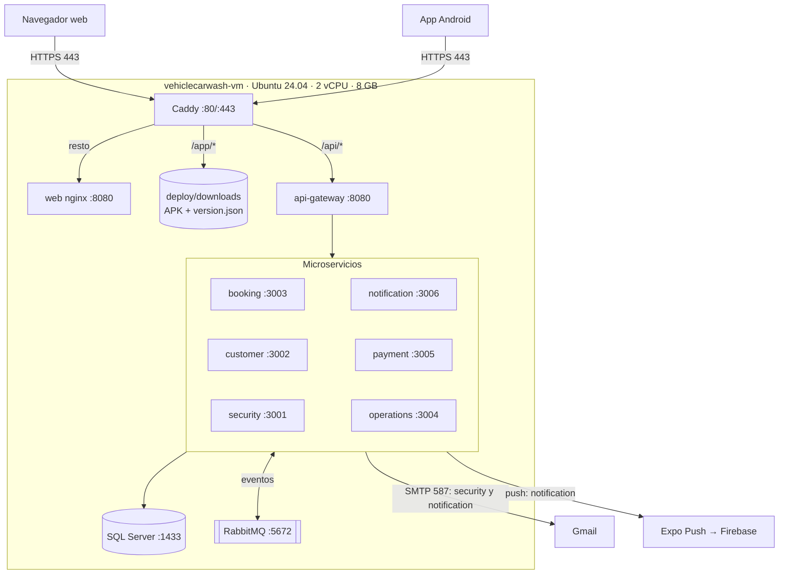

# Documento de Despliegue — LavaRápido Vehicular

> Sistema de gestión de lavado vehicular · Proyecto formativo ADSO (SENA)
> Procedimiento de implementación del software en el servidor de producción.

---

## Tabla de Contenido

1. [Información General y Control de Versiones](#1-información-general-y-control-de-versiones)
2. [Alcance, Topología y Arquitectura](#2-alcance-topología-y-arquitectura)
3. [Requisitos Previos y Preparación (Pre-deployment)](#3-requisitos-previos-y-preparación-pre-deployment)
4. [Procedimiento de Despliegue Paso a Paso (Runbook)](#4-procedimiento-de-despliegue-paso-a-paso-runbook)
5. [Plan de Verificación, Pruebas y Evidencias (Smoke Tests)](#5-plan-de-verificación-pruebas-y-evidencias-smoke-tests)

---

## 1. Información General y Control de Versiones

### 1.1 Ficha Técnica del Despliegue

#### 1.1.1 Identificación del sistema y versión (Release Tag)

| Campo | Valor |
|---|---|
| Sistema | LavaRápido Vehicular — gestión de reservas, pagos y operación de un lavadero |
| Componentes | 6 microservicios backend, API Gateway, aplicación web, aplicación móvil Android |
| Versión (Release Tag) | `v1.0.0`, creada el 23-10-2026 en 8 repositorios (web, api-gateway, security, customer, booking, operations, notification e infra), donde `main` quedó igual a `develop` en ese momento. payment-service tiene `v1.0.0` desde el 24-10-2026: ese día se fusionó su PR #2 `develop` → `main` y la etiqueta quedó sobre ese `main` (`2deac9e`), que incluye todo su `develop`. **Pendiente:** la app móvil (PR #1 «Release v1.1.0» abierto; su `main` es del 06-07-2026). Después de la etiqueta, `develop` volvió a avanzar con los arreglos del 23-10-2026 (1.3.8) y las 128 ramas del 24-10-2026 (1.3.9), que saldrán en `v1.1.0`. El PR #2 de payment se fusionó el 24-10-2026, con el CI y SonarCloud en verde |
| Rama desplegada | `develop` del 24-10-2026 en los 9 repositorios del servidor, desplegado ese día (1.3.9). Hasta liberar `v1.1.0` cada actualización se lanza con `BRANCH=develop`: con `main`, la protección de `setup-server.sh` se detiene sin tocar nada, porque `main` no contiene lo desplegado. Con `v1.1.0` el servidor pasa a `main`, salvo payment-service mientras siga en `DEVELOP_ONLY` |
| Versión de la app móvil | **1.1.0** (versionCode **5**), APK publicado el 19-10-2026 + actualizaciones por internet (EAS Update) |
| Repositorios | `lavarapido-infra`, `lavarapido-api-gateway`, `lavarapido-security-service`, `lavarapido-customer-service`, `lavarapido-booking-service`, `lavarapido-operation-service`, `lavarapido-notification-service`, `lavarapido-payment-service`, `Front-end-proyecto-web`, `LavadoVehicular-Movil` |
| Dirección pública | https://lavarapidovehicular.northcentralus.cloudapp.azure.com |

#### 1.1.2 Fecha, hora y ventana operativa programada

| Campo | Valor |
|---|---|
| Fecha del despliegue inicial | 16 de octubre de 2026 |
| Ventana operativa | 02:30 – 05:30 (hora de Colombia, UTC-5) |
| Duración real | ~2 h 30 min (aprovisionamiento, compilación de imágenes, configuración de HTTPS y pruebas) |
| Interrupción a usuarios | No aplica: primer despliegue (no había usuarios en producción) |
| Ventana para próximas actualizaciones | Fuera de horario de atención del lavadero (antes de las 07:00 o después de las 18:00) |
| Última actualización | 24-10-2026, hacia las 15:10: `develop` completo de los 10 repositorios (arreglos del 23-10 y del 24-10, 1.3.8 y 1.3.9), en dos corridas por SSH; 11 contenedores sanos, migraciones 044, 045 y semilla 113 (booking), 047 y semilla 116 (notification) y 022 y 023 (payment) aplicadas, y 0 errores en los registros. La actualización anterior (22-10-2026) está en 1.3.7 |

#### 1.1.3 Entorno de destino (VPS / Staging / Producción)

| Campo | Valor |
|---|---|
| Entorno | **Producción académica** (también usado como staging para las pruebas del equipo) |
| Proveedor | Microsoft Azure (suscripción *Azure for Students*) |
| Tipo | Máquina virtual Linux (IaaS) equivalente a un VPS |
| Región | North Central US |
| Entorno alterno | Ninguno: el VPS de Hostinger se descartó el 21-10-2026 porque el pago no se aprobó; la producción queda solo en Azure |

#### 1.1.4 Matriz de roles y responsables (DevOps, Tech Lead, QA, DBA)

> Responsables según los servicios que cada integrante mantiene en GitHub (dueño de cada repositorio). Los roles QA y DBA no tienen una persona fija: los asigna el líder de proyecto y, mientras tanto, los cubre quien se indica.

| Rol | Responsable | Responsabilidades en el despliegue |
|---|---|---|
| DevOps | Brayan Cabrera | Servidor, Docker Compose, Caddy/HTTPS, scripts de despliegue y actualización |
| Tech Lead | Brayan Cabrera | Aprobación del release, revisión de cambios, coordinación del equipo |
| QA | Sin persona fija (la asigna Brayan Cabrera); mientras tanto, cada dueño prueba lo suyo y el DevOps corre la sección 5 | Pruebas de humo y validación funcional por rol (cliente, operario, administrador) |
| DBA | Sin persona fija (la asigna Brayan Cabrera); mientras tanto, el DevOps con los scripts de la sección 3.2 | Migraciones, respaldos y verificación de la base de datos |
| Responsable booking-service y customer-service | Camilo Guilombo | Cambios y verificación de sus servicios |
| Responsable payment-service y app móvil | Merari Urbano Quintero | Cambios y verificación de pagos y de la app |

### 1.2 Historial de Versiones del Documento

| Versión | Fecha | Autor | Descripción |
|---|---|---|---|
| 1.0 | 2026-10-16 | Brayan Cabrera | Versión inicial: despliegue en Azure |
| 1.1 | 2026-10-16 | Brayan Cabrera | Portainer CE instalado, evidencias reales (5.4) y corrección de esquemas y tablas de Liquibase |
| 1.2 | 2026-10-16 | Juan Camilo Guilombo | Conteo de tablas corregido (57) y creación del primer administrador con las variables de entorno |
| 1.3 | 2026-10-19 | Juan Camilo Guilombo | Actualización del 19-10-2026 (migración 039 y app 1.1.0), acceso SSH con llave propia por integrante, despliegue desde GitHub Actions, integración continua en los 10 repositorios y evidencias nuevas de terminal y de la web |
| 1.4 | 2026-10-20 | Equipo de desarrollo | Diagrama de topología: customer-service también se conecta a RabbitMQ (consume `security.user_registered` para crear el perfil del cliente) |
| 1.5 | 2026-10-21 | Brayan Cabrera | Respaldos automáticos verificados (3.2), encabezados de seguridad y CSP (2.2.3 y 5.2.4), chequeos de salud y registros limitados en todos los contenedores, modelo de recuperación `SIMPLE`, actualización del 21-10-2026 (1.3.6), cambios del código del 21-10-2026 pendientes de desplegar (1.3.7) y retiro del VPS de Hostinger |
| 1.6 | 2026-10-21 | Equipo de desarrollo | Cambios de la noche del 21-10-2026 en 1.3.7: las reservas confirmadas con operario que nadie registró ya no se cierran solas como "No asistió" y pasan a "Por cerrar", migraciones 040 (operations) y 041 (notification), variables `FOLLOW_UP_*`, arreglo de los campos `null` en los eventos de notification-service y ajustes de la app móvil |
| 1.8 | 2026-10-24 | Equipo de desarrollo | Despliegue del 24-10-2026 con `develop` (1.1.1, 1.1.2 y 1.3.9): dos corridas, espera de salud, imágenes `:prev`, `rollback.sh` y la protección que impide bajar de versión; la web en el puerto 8080 (2.2.3); variables nuevas `AUTH_RATE_LIMIT_*`, `TRUSTED_PROXIES`, `ROUTE_*_TIMEOUT`, `START_LATE_LIMIT`, e `INTERNAL_API_KEY` y `BOOKING_SERVICE_URL` en customer-service (3.3.2); reversión con `rollback.sh` y restauración con `payment-migrate` (3.2.4 y 3.4); despliegue continuo fusionado en `develop`, sin secretos (4.3.4); OTA del móvil con `cd.yml`; CI del 24-10-2026 (4.3.3) |
| 1.7 | 2026-10-23 | Equipo de desarrollo | Versión `v1.0.0` en 8 repositorios y pendientes de payment y móvil (1.1.1); despliegue del 22-10-2026 (1.3.7); arreglos del 23-10-2026 en `develop` para `v1.1.0` (1.3.8); las variables que el compose ya pasa, `FOLLOW_UP_LOOK_BACK_DAYS` y `ALLOWED_EMAIL_DOMAINS` (3.3.2); reversión que funciona (3.4); `setup-server.sh` desde `main` (4.3.1); despliegue continuo preparado y todavía sin probar en vivo (4.3.4); responsables de QA y DBA (1.1.4). Incluye el contenido de las ramas `fix/A-06`, `fix/A-07` y `fix/A-08` de Merari Urbano |

### 1.3 Resumen de Cambios (Release Notes)

#### 1.3.1 Nuevas funcionalidades

**Plataforma y despliegue**
- Despliegue completo con Docker Compose y archivo de producción (`docker-compose.prod.yml`).
- HTTPS automático con Caddy y certificado de Let's Encrypt (renovación automática).
- Creación del primer administrador al instalar sobre una base vacía (`ADMIN_EMAIL` / `ADMIN_PASSWORD`).
- Script de instalación del servidor (`setup-server.sh`) y de actualización en un paso (`update-server.sh`).
- Descarga de la app Android desde la web (botón y código QR) con dirección fija `/app/LavaRapidoVehicular.apk`.

**Notificaciones**
- Notificaciones push en la app móvil (Expo + Firebase) implementadas con el patrón Command.
- Entrega por canales (push y correo) con aislamiento de fallos.
- Avisos en el idioma de la cuenta (español, inglés, francés y portugués).
- Aviso a los administradores de reservas próximas sin operario.
- Aviso de versión nueva de la app por push y por bandeja.
- La campanita de la web se actualiza sola y muestra un aviso flotante con las notificaciones nuevas.

**Reservas y operación**
- Asignación automática de operario al confirmarse una reserva (RF-008).
- El cliente puede elegir el operario entre los disponibles (RF-010).
- El operario solo puede iniciar el servicio desde 15 minutos antes de la reserva.
- Reporte de inspección del vehículo con fases, hallazgos y fotos, compartido con el cliente.
- Resumen del día y métricas del equipo de operarios para el administrador.

**Pagos y cuentas**
- Historial de pagos ordenado y filtrable por fecha y servicio (RF-015/016).
- Bloqueo de la cuenta por 15 minutos tras 5 intentos de inicio de sesión fallidos (RF-004b).
- Datos del negocio editables por el administrador y dirección del perfil guardada en el backend.

**App móvil**
- Aviso de versión nueva y actualizaciones por internet (EAS Update) sin reinstalar.
- Ícono con el logo del proyecto y nombre "LavaRapidoVehicular".

#### 1.3.2 Correcciones de errores (Bug fixes)

- Un pago aprobado se mostraba como "en verificación" en la pantalla de pagos (web y móvil).
- La web desplegada recibía 403 en todas las llamadas por la configuración de CORS de los servicios.
- security-service no arrancaba cuando ya existía un administrador (consulta fuera de transacción).
- La lista de operarios de la app no mostraba un operario recién creado hasta cerrar sesión.
- Un 401 tardío después de cerrar sesión mostraba el aviso de "sesión vencida".
- El anuncio de un APK nuevo no podía leer la llave entre servicios por permisos de archivo.
- Los recordatorios pendientes se seguían enviando después de iniciar o terminar el servicio.
- No se asigna operario a reservas cuya hora ya pasó, ni se listan reservas canceladas como pendientes.
- La web pedía un `favicon.ico` inexistente (error 404 en consola) y usaba opciones obsoletas de traducción (advertencia en consola).

#### 1.3.3 Cambios de infraestructura y dependencias

| Cambio | Detalle |
|---|---|
| Imágenes Docker | Java: `eclipse-temurin:21-jdk` (compilación) y `21-jre` (ejecución) · .NET: `dotnet/sdk:8.0` y `aspnet:8.0` · Web: `node:22-alpine` y `nginx:1.27-alpine` |
| Servicios de infraestructura | `mcr.microsoft.com/mssql/server:2022-latest` (Express), `rabbitmq:4-management`, `caddy:2-alpine`, `liquibase/liquibase:4.29` |
| Migraciones nuevas | 032 (datos del negocio), 033 (reporte de inspección), 034 (bloqueo de login), 035 (dirección), 036 (fecha de registro), 037 (perfil del operario), 038 (tipo de aviso de versión nueva) y 039 (aceptación de los documentos legales, aplicada el 19-10-2026) |
| Dependencias web | `qrcode` 1.5.4 |
| Dependencias móviles | `expo-notifications`, `expo-device`, `expo-build-properties`, `expo-updates`, `expo-application` |
| Servicios externos | Expo Push + Firebase Cloud Messaging (push), Gmail SMTP (correo), EAS (compilación y actualizaciones de la app) |
| Operación del servidor (20 y 21-10-2026) | Respaldos automáticos con verificación (`backup-db.sh`, `verify-backup.sh`, `restore-db.sh`), base en modelo de recuperación `SIMPLE`, chequeo de salud cada 30 s en los 11 contenedores, registros de cada contenedor limitados a 3 archivos de 10 MB, y encabezados de seguridad con CSP en Caddy |

#### 1.3.4 Cambios incompatibles (Breaking changes)

- **Variables obligatorias nuevas** en el servidor. Sin ellas, Docker Compose no arranca:
  - `INTERNAL_API_KEY`, `PUBLIC_URL`, `RABBITMQ_USERNAME` y `RABBITMQ_PASSWORD`;
  - `RABBITMQ_*` no puede ser `guest/guest`.
- **Primer administrador:** las cuentas demo (`admin@gmail.com`, etc.) **solo existen en desarrollo**. En producción el administrador se crea con `ADMIN_EMAIL` / `ADMIN_PASSWORD`.
- **App móvil:** el paquete Android cambió a `com.vehiclecarwash.app`. Las versiones anteriores se deben desinstalar una vez; las siguientes se instalan encima.
- **CORS:** cada servicio solo acepta el origen definido en `PUBLIC_URL`.

#### 1.3.5 Actualización del 19-10-2026

El 19-10-2026 a las 03:20 (hora del servidor) se corrió `update-server.sh`. Quedaron desplegados los cambios de `develop` hasta el 17 y 18 de octubre:

- **Base de datos:** migración 039, que guarda la fecha y la hora en que cada persona acepta los Términos y la Política de Tratamiento de Datos.
- **Backend:** la salud de payment-service consulta la base de datos, payment-service maneja el identificador de correlación, el error de horario trae el motivo (`reason`), dos solicitudes simultáneas ya no fallan al crear el mismo operario y no se puede crear una bahía en mantenimiento.
- **Web:** la pantalla de pagos selecciona por cuenta, la opción del perfil se llama "Desactivar mi cuenta", Angular quedó en 21.2.25 y xlsx en 0.20.3, y hay ajustes de diseño para celular.
- **App móvil:** versión 1.1.0 (versionCode 5), publicada el 19-10-2026 a las 05:03, con la versión visible en Configuración.

Quedan para la próxima actualización los cambios subidos después: los mensajes de error con `spring.web.error` en los servicios Java y los últimos ajustes de la web y de la app.

#### 1.3.6 Actualización del 21-10-2026

El 21-10-2026 a las 05:21 (hora del servidor) se reconstruyeron las imágenes con el código de `develop` del 20 de octubre y la infraestructura nueva de `lavarapido-infra`. Antes se tomó un respaldo de la base.

- **Infraestructura:** respaldos automáticos verificados (3.2); base en modelo de recuperación `SIMPLE`; chequeo de salud cada 30 segundos en los 11 contenedores, incluido Caddy (`docker compose ps` los muestra `healthy`); registros limitados a 3 archivos de 10 MB por contenedor; encabezados de seguridad y política de contenido (CSP) en Caddy (5.2.4).
- **Backend y web:** los cambios que quedaron pendientes el 19-10 (mensajes de error con `spring.web.error` y ajustes de la web) y los del 19 y 20 de octubre: se retiró el cambio de rol de una cuenta, los datos de ejemplo del negocio se borran para que el negocio real los complete (semilla 111 de booking-service) y la web abre el detalle de cada reserva y aviso.

#### 1.3.7 Cambios del 21-10-2026 (desplegados el 22-10-2026)

Estaban en `develop` desde el 21-10-2026 y entraron al servidor el 22-10-2026 con `update-server.sh`; quedaron aplicadas la semilla 112 y las migraciones 040 y 041, y ese día se generaron los respaldos `LavaRapido-20261022-081543.bak.gz` y `LavaRapido-20261022-173855.bak.gz` (este último, al volver a desplegar operations-service a las 12:38):

- **security-service y api-gateway:** el token de una sesión cerrada (logout, cuenta inhabilitada o desactivada) deja de servir; el gateway lo confirma con `GET /api/v1/auth/session` y guarda la respuesta 30 segundos por token.
- **booking-service:** cada 5 minutos se cancela, con el motivo del sistema `EXPIRED` ("Venció sin confirmarse"), la reserva programada que siguió sin confirmarse una hora después de su fin; la semilla 112 agrega ese motivo, y booking-service la aplica al arrancar. La ruta interna `POST /internal/v1/bookings/{id}/no-show` deja en "No asistió" una reserva confirmada vencida, solo cuando la pide operations-service (409 `BOOKING_NOT_EXPIRED` si todavía no vence).
- **operations-service:** la asignación manual y la automática usan el mismo candado, y `GET /api/v1/admin/assignments/unassigned` da el conteo único de reservas sin operario, que ahora usan la web y la app móvil. Cada 5 minutos, `FollowUpJob` deja en "No asistió" la reserva confirmada que nunca tuvo operario y terminó hace más de una hora; la que tenía operario y nadie inició o finalizó nunca se marca sola: pasa a la lista "Por cerrar" del administrador (`GET /api/v1/admin/assignments/to-close` y `POST /api/v1/admin/assignments/{bookingId}/attended`), con un solo aviso al operario y a los administradores. La migración 040 agrega `execution.service_execution.follow_up_notice_at`.
- **notification-service:** avisos `OPERATOR_SERVICE_NOT_REGISTERED` y `ADMIN_SERVICE_NOT_REGISTERED` (bandeja y push, migración 041), y un campo `null` en el payload de un evento ya no manda el mensaje a la cola de errores (DLQ).
- **payment-service:** comprobantes de máximo 2 MB (`RECEIPT_TOO_LARGE`) y la cuenta de efectivo en la lista del cliente solo mientras está activa.
- **Web:** sesión sincronizada entre pestañas, comprobante comprimido, lupa para el QR, reportes que cuentan solo reservas completadas, textos de la pestaña de roles y tarjeta "Por cerrar" en el inicio del administrador.
- **App móvil:** comprobante comprimido, lupa para el QR, pantalla de actualización obligatoria del APK, tarjeta "Por cerrar" y conteo de reservas sin asignar con la regla de operations-service; el formulario de reserva del administrador guarda el operario y el estado elegidos, la barra de puntos del cliente queda completa cuando no queda nada por desbloquear y no muestra "0% OFF", el operario ve "—" cuando no tiene calificaciones, la pestaña de roles indica que los 3 roles son fijos y los avisos nuevos abren la pantalla de servicios del operario o el inicio del administrador. No agregan dependencias nativas, así que llegan con `npm run publish:update`.

Las variables nuevas (`SESSION_CHECK_*`, `BOOKING_EXPIRY_*` y `FOLLOW_UP_*`, nueve en total, incluida `FOLLOW_UP_LOOK_BACK_DAYS`) tienen valor por defecto, están comentadas en `.env.example` y `.env.production.example`, y `docker-compose.yml` las pasa a los contenedores desde el 22-10-2026 (commit `70b990c` de `lavarapido-infra`): solo se escriben en `.env.production` para cambiar su valor. `FOLLOW_UP_*` necesita `INTERNAL_API_KEY`, que ya está en `.env.production`.

#### 1.3.8 Versión v1.0.0 y arreglos del 23-10-2026 (desplegados el 24-10-2026)

El 23-10-2026 se pasó `develop` a `main` y se etiquetó `v1.0.0` en 8 repositorios. payment-service y la app móvil no tienen todavía esa versión: el PR #2 de payment está abierto, sin revisión y con el *quality gate* de SonarCloud en error por cuatro falsos positivos, y la app no tiene PR. Ese mismo día, después de la etiqueta, entraron a `develop` estos arreglos de la auditoría del 22-10-2026, que saldrán en `v1.1.0` (CI verde en los 10 repositorios):

- **api-gateway:** deja de publicar `/api/v1/operator/bookings/**` (E-01).
- **booking-service:** las rutas del operario solo aceptan a operations-service con la llave interna y aplican la regla de los 15 minutos (E-01); el administrador elige el motivo de la cancelación (A-20); un cambio de estado hecho por el administrador publica un evento para el cliente (A-11); los puntos de fidelización quedan congelados en cada línea de la reserva (A-09, migración 043).
- **operations-service:** envía la llave interna a booking-service (E-01), guarda las notas de la asignación (B-01, migración 042) y revisa que la cuenta del operario siga activa al asignar y al reprogramar (A-13, E-12).
- **security-service:** valida en el servidor los dominios de correo permitidos (`ALLOWED_EMAIL_DOMAINS`, por defecto `gmail.com`, A-01); el token que todavía dice un rol que la cuenta ya no tiene deja de servir y sus sesiones se revocan (E-02); ya no arranca en perfil `dev` por defecto ni guarda contraseñas demo en el código (E-05).
- **customer-service:** rechaza las placas de más de 6 caracteres en lugar de recortarlas (E-16).
- **notification-service:** avisa al cliente cuando el administrador cambia el estado de su reserva (A-11).
- **payment-service:** el descuento porcentual va de 1 a 99 % y siempre queda un monto por pagar (E-07); quitar el cupón anula el canje en el servidor (`DELETE /api/v1/loyalty/redemptions/{bookingId}/{promotionId}`) y solo se permite una promoción por reserva (migración 021, E-08 y E-09); sin contraseña por defecto en su base aislada (E-05).
- **Web:** E-07, E-08 y A-01 como arriba; reasignar el operario (A-02), notas al asignar (B-01), motivo de cancelación (A-20), datos reales en el historial y los servicios del operario (A-18), ingresos por fecha de aprobación y estado "En servicio" (A-17, A-19), mensaje de cuenta de operario desactivada (A-13) y pruebas del guard, el interceptor y varios ViewModels (F-02).
- **App móvil:** E-07, E-08, A-01 y A-13, y las primeras pruebas automáticas con `jest-expo` en el CI (F-01). Son cambios de JavaScript: llegan a los APK instalados con `npm run publish:update`.
- **lavarapido-infra:** `ALLOWED_EMAIL_DOMAINS` y `DEMO_ADMIN_PASSWORD`, `DEMO_OPERATOR_PASSWORD` y `DEMO_CLIENT_PASSWORD` (solo perfil `dev`) en el compose y en `.env.example`, sin contraseñas reales versionadas (E-05), e `INTERNAL_API_KEY` documentada como obligatoria para que el operario inicie y termine servicios (E-01).

**Antes de desplegarlos:** `INTERNAL_API_KEY` ya está en `.env.production`, así que el cambio E-01 no pide nada nuevo; las cuentas demo no existen en producción; y la migración 021 de payment tiene la precondición `onFail: CONTINUE`: si la base ya tiene una reserva con dos cupones canjeados, el índice único no se crea y no avisa, así que conviene revisarlo en la base antes de actualizar. También conviene consultar si hay cuentas con un correo que no sea @gmail.com (la web y la app ya no las dejan iniciar sesión) y placas de más de 6 caracteres en `customer.customer_vehicle` (customer-service ya no puede leer ese vehículo). SEC-01, BIZ-01, BIZ-02 y OPS-01, que seguían abiertos ese día, se corrigieron el 24-10-2026 (1.3.9). Desde que el inicio de sesión acepta cualquier dominio (A-01, 1.3.9), la consulta de cuentas con otro dominio ya no hace falta.

#### 1.3.9 Correcciones del 24-10-2026 (desplegadas ese día)

El 24-10-2026 se fusionaron a `develop` 128 ramas de correcciones de los 10 repositorios (autor brayan, sin coautores, `--no-ff`). Antes de subir cada repositorio, sus ramas se fusionaron sobre `develop` en una copia aparte, se corrió la suite completa y se comprobó que lo subido fuera idéntico a lo probado. El CI de `develop` quedó en verde en los 10 (1 192 pruebas). Lo principal:

- **api-gateway:** revisa la sesión con cualquier esquema del encabezado (SEC-01); 60 peticiones por minuto por IP en `/api/v1/auth/**`, con 429 `RATE_LIMITED` y `Retry-After`, tomando la IP real del cliente solo de los proxies de confianza (SEC-04, SEC-11); 5 s para conectar y 60 s para leer en cada ruta (SEC-16).
- **security-service:** consentimiento obligatorio al registrar (SEC-07); 5 intentos para el código de recuperación y para la contraseña actual (423 `TOO_MANY_ATTEMPTS`, SEC-05, SEC-12); tiempo parejo con correos que no existen (SEC-04); contraseñas de hasta 72 bytes (SEC-11).
- **booking-service:** el cliente solo cambia la fecha y la hora (BIZ-01); precio mayor que 0 (BIZ-04, migración 044); bloqueo optimista de la reserva (BIZ-09, migración 045); cambios de horario o de bahías que chocan con reservas responden 409 (BIZ-10); rutas `/bookings/**` solo para clientes (BIZ-12); se quitó la tarea que vencía reservas (B-07); la semilla 113 borra los datos de ejemplo de la sede (E-19).
- **customer-service:** no deja retirar un vehículo con reservas activas (BIZ-08; llama a booking-service con `BOOKING_SERVICE_URL` e `INTERNAL_API_KEY`); rutas `/vehicles/**` solo para clientes (BIZ-12); lee las placas largas ya guardadas (E-16).
- **operations-service:** iniciar y terminar no dejan bloqueado al operario (OPS-01, OPS-03, OPS-11); reintentos y cola de errores `operations-service.booking-confirmed.dlq` (OPS-04; la cola vieja `operations-service.events` se vacía y se borra sola al arrancar); se puede iniciar hasta 4 horas después de la hora de fin (A-12, `START_LATE_LIMIT`); el operario ve las notas (B-01).
- **notification-service:** entregas pendientes con reintento (OPS-05, migración 047); los cambios de estado del administrador cancelan los recordatorios y el NO_SHOW tiene su aviso (A-11, semilla 116); aviso al operario y a los administradores cuando una reserva queda sin operario (E-12).
- **payment-service:** monto y cupón del cliente (`GET /loyalty/redemptions/{bookingId}`, BIZ-02); 409 `AMOUNT_CHANGED` al aprobar un monto viejo (BIZ-01); cupón de porcentaje con el total vigente (BIZ-05, migración 022); un solo pago abierto y referencia única (A-16, migración 023); cola paginada del administrador (E-10); aviso de reserva cancelada (BIZ-07); efectivo inactivo para el administrador (C-04); SonarCloud en verde.
- **Web:** monto del servidor y cupón que sobrevive a una recarga; datos frescos sin recargar (al entrar, al volver a la pestaña, con cada notificación y cada 45 s en las pantallas que esperan a otra persona); los 216 códigos de error traducidos; matriz de permisos de solo lectura (H-05); login con cualquier dominio y registro solo con gmail.com (A-01); notas y ventana de inicio del operario; nginx sin `root` en el puerto **8080** (H-19).
- **App móvil:** lo mismo que la web en el pago, el refresco (al volver a la pantalla y con cada push), los errores y el operario, más la URL HTTPS en el perfil `production` (MOV-08), la cola de pagos paginada y `cd.yml` para publicar la actualización por internet (OTA) al llegar a `main`.
- **lavarapido-infra:** despliegue continuo (4.3.4), imágenes `:prev` y `rollback.sh`, limpieza de imágenes y retención de respaldos, `restore-db.sh` con candado y `payment-migrate`, arreglo del usuario del `cron` de respaldos, Caddy apuntando a `web:8080`, la batería e2e remota (`e2e.yml`) y la protección que impide bajar de versión (`setup-server.sh`, commit `d5d6909`).

**Cómo se desplegó (24-10-2026, hacia las 15:10).** Por SSH, en dos corridas seguidas:

1. **Primera corrida**, con los scripts que tenía el servidor: bajó `develop`, respaldó la base, reconstruyó y aplicó las migraciones. Como esos scripts viejos no reinician Caddy, la web nueva (que ya escucha en 8080) habría quedado detrás de un Caddy que todavía apuntaba a `web:80`; por eso se lanzó enseguida la segunda.
2. **Segunda corrida**, con `BRANCH=develop` y los scripts nuevos que trajo la primera: guardó la versión que corría como `:prev` (8 imágenes), reinició Caddy porque el `Caddyfile` cambió, esperó hasta 8 minutos a que los 11 contenedores quedaran sanos, escribió `backups/deployed-heads` e instaló la tarea `@reboot` de `boot-update.sh`.

Resultado: 11 contenedores `healthy`; migraciones y semillas 044, 045, 113, 047, 116, 022 y 023 aplicadas; colas `operations-service.booking-confirmed` y su `.dlq` creadas; 8 imágenes `:prev`; 0 errores en los registros y las rutas de la web y la API respondiendo. **Hasta liberar `v1.1.0`**, toda actualización a mano se hace con `BRANCH=develop bash ~/lavarapido/lavarapido-infra/deploy/update-server.sh`. Al encender la máquina, `boot-update.sh` baja `main` por defecto y la protección lo detiene sin tocar nada (queda anotado en `backups/deploy.log`): el servidor sigue con lo que tenía.

**Antes de liberar `v1.1.0`**, en la base de producción: buscar los pagos abiertos duplicados que rechazó la migración 023 (`rejection_reason LIKE 'Pago duplicado%'`) y contar las reservas COMPLETED con líneas abiertas (generan avisos falsos de "no se inició", ACO-35). Quedan abiertas en el documento de Acciones Correctivas, Tabla 7, ACO-33 a ACO-40, entre ellas la cola de pagos de la web sin paginar (ACO-33).

---

## 2. Alcance, Topología y Arquitectura

### 2.1 Componentes y Artefactos en Alcance

#### 2.1.1 Panel de administración (Portainer CE)

> **Estado: instalado el 16-10-2026.** Panel para ver estado, logs y consumo de los contenedores y reiniciarlos. El despliegue y las actualizaciones se siguen haciendo con los scripts (sección 4.3).

| Artefacto | Imagen | Acceso |
|---|---|---|
| Portainer CE | `portainer/portainer-ce:2.21.5` (~11 MB de RAM) | Solo por túnel SSH (`https://localhost:9443`); escucha en `127.0.0.1`, sin exponer a internet |
| Entorno | `local` (socket `/var/run/docker.sock`) | Stack `lavarapido` visible como *Compose · Limited* (creado fuera de Portainer) |

#### 2.1.2 Capa Frontend Web (SPA / Servidor Web Nginx)

| Artefacto | Tecnología | Imagen / contenedor |
|---|---|---|
| Aplicación web | **Angular 21** (SPA), i18n en 4 idiomas | `lavarapido/web:local` → `lavarapido-web` |
| Servidor web | nginx 1.27: sirve el build y pasa `/api` al gateway | dentro de `lavarapido-web` |
| Proxy inverso y HTTPS | Caddy 2 (Let's Encrypt) | `lavarapido-caddy` |
| App móvil Android | Expo / React Native, APK compilado con EAS | Servido en `/app/LavaRapidoVehicular.apk` |

#### 2.1.3 Capa Backend API (Java Spring Boot / C# .NET Core)

| Servicio | Tecnología | Puerto interno | Responsabilidad |
|---|---|---|---|
| api-gateway | Spring Cloud Gateway (Java 21) | 8080 | Punto de entrada único de `/api/v1` |
| security-service | Spring Boot (Java 21) | 3001 | Cuentas, login, JWT, roles, preferencias |
| customer-service | Spring Boot (Java 21) | 3002 | Clientes y vehículos |
| booking-service | Spring Boot (Java 21) | 3003 | Catálogo, horario, reservas |
| operations-service | Spring Boot (Java 21) | 3004 | Operarios, asignación, ejecución, calificaciones, inspección |
| payment-service | ASP.NET Core 8 (C#) | 3005 | Pagos, comprobantes, fidelización y promociones |
| notification-service | Spring Boot (Java 21) | 3006 | Bandeja, correo, push, recordatorios |
| rabbitmq | RabbitMQ 4 | 5672 | Eventos entre servicios (exchange `carwash.events`) |

#### 2.1.4 Capa de Persistencia (SQL Server)

| Artefacto | Detalle |
|---|---|
| Motor | **Microsoft SQL Server 2022, edición Express** (contenedor `lavarapido-sqlserver`) |
| Base de datos | `LavaRapido`: 9 esquemas y 57 tablas — `security` (11), `customer` (3), `booking` (10), `catalog` (3), `execution` (11), `notification` (6), `payment` (7), `promotion` (5), `audit` (1) |
| Migraciones | **Liquibase**: los servicios Java las aplican al arrancar; payment-service las aplica con el contenedor `payment-migrate`. Cada servicio lleva su historial en `dbo.DATABASECHANGELOG_<SERVICIO>` |
| Volúmenes persistentes | `sqlserver-data` (base), `rabbitmq-data` (colas), `caddy-data` (certificados) |
| Respaldos | `~/lavarapido/backups/` en el disco de la VM, fuera de Docker: los últimos 14 y la bitácora `backup.log` (3.2) |

### 2.2 Diagrama de Arquitectura de Red e Infraestructura

#### 2.2.1 Topología del servidor VPS



#### 2.2.2 Red interna de contenedores (Docker Bridge Network)

- Todos los contenedores están en la red bridge **`lavarapido_default`**, creada por Docker Compose.
- Entre ellos se llaman por **nombre de servicio**: `sqlserver`, `rabbitmq`, `security-service`, `api-gateway`, `web`, etc. El DNS interno de Docker es `127.0.0.11`.
- Las rutas `/internal/**` (llamadas entre servicios) se protegen con la cabecera `X-Internal-Key` (`INTERNAL_API_KEY`). **El gateway no las publica.**
- Ningún puerto de la red interna se publica en la máquina, salvo los de Caddy.

#### 2.2.3 Enrutamiento y Reverse Proxy con certificados TLS/HTTPS

| Ruta pública | Destino | Notas |
|---|---|---|
| `https://<dominio>/api/*` | `api-gateway:8080` | API REST v1 de la web y la app |
| `https://<dominio>/app/*` | Carpeta `deploy/downloads` | APK y `version.json` (sin caché) |
| `https://<dominio>/*` | `web:8080` | SPA de Angular (rutas → `index.html`). Desde el 24-10-2026 la web corre `nginx-unprivileged`, sin `root`, en el puerto 8080; su chequeo de salud también usa 8080 |
| `http://<dominio>/*` | Redirección 308 a HTTPS | Automática (Caddy) |

- **Certificado:** Let's Encrypt, emitido y renovado automáticamente por Caddy (vence el 14-01-2027 y se renueva antes). Se guarda en el volumen `caddy-data`.
- **Dominio:** etiqueta DNS de Azure en la IP pública: `lavarapidovehicular.northcentralus.cloudapp.azure.com`.
- **Encabezados de seguridad:** desde el 20-10-2026 Caddy agrega HSTS, `nosniff`, `X-Frame-Options`, `Referrer-Policy` y `Permissions-Policy` a todas las respuestas, quita el encabezado `Server` y envía una política de contenido (CSP) con la web (5.2.4).
- **Configuración:** `lavarapido-infra/deploy/Caddyfile`.

### 2.3 Matriz de Ambientes, Direccionamiento IP y Puertos

| Ambiente | Host | IP / URL | Uso |
|---|---|---|---|
| Desarrollo | PC de cada integrante | `localhost` (web 4200, móvil 8081, gateway 8080) | Programación y pruebas locales (Mailpit atrapa los correos) |
| Producción académica | Azure VM `vehiclecarwash-vm` | IP estática `64.236.160.129` · https://lavarapidovehicular.northcentralus.cloudapp.azure.com | Exposición, pruebas del equipo, app instalada |

| Puerto | Servicio | ¿Expuesto a internet? |
|---|---|---|
| 22 | SSH (solo con llave) | Sí (administración) |
| 80 / 443 | Caddy | Sí |
| 8080 | api-gateway | No (solo red interna) |
| 3001–3006 | Microservicios | No |
| 1433 | SQL Server | No |
| 5672 / 15672 | RabbitMQ / panel | No |
| 9443 | Portainer CE | No (solo `127.0.0.1`, por túnel SSH) |

---

## 3. Requisitos Previos y Preparación (Pre-deployment)

### 3.1 Checklist de Prerrequisitos del Sistema Operativo y VPS

#### 3.1.1 Recursos de hardware disponibles (CPU, RAM, disco)

| Recurso | Mínimo requerido | Disponible (Azure B2as_v2) | Medido en operación | ✓ |
|---|---|---|---|---|
| CPU | 2 vCPU x86-64 (SQL Server no corre en ARM) | 2 vCPU AMD x64 | Picos solo al compilar imágenes | ✅ |
| RAM | 8 GB | 7,7 GB + 4 GB de swap | **3,3 GB** usados con los 12 contenedores, incluido Portainer (19-10-2026) | ✅ |
| Disco | 30 GB | 64 GB SSD estándar | 26 GB usados de 61 GB (42 %), sobre todo imágenes y caché de compilación (19-10-2026) | ✅ |
| Sistema operativo | Ubuntu 24.04 o 26.04 LTS | Ubuntu 24.04.4 LTS | — | ✅ |
| Red | Puertos 22, 80 y 443 abiertos | Grupo de seguridad de Azure | Verificado desde internet | ✅ |

#### 3.1.2 Estado del motor Docker y socket local

```bash
docker --version            # Docker version 29.x
docker compose version      # Docker Compose v5.x
sudo systemctl is-enabled docker   # enabled  → arranca con la máquina
sudo systemctl is-active docker    # active
ls -l /var/run/docker.sock         # socket local del motor
```

`deploy/setup-server.sh` instala Docker (script oficial `get.docker.com`) si falta, lo habilita al arranque y crea 4 GB de swap.

### 3.2 Estrategia y Ejecución de Respaldos (Backups)

> **Estado: automatizado desde el 21-10-2026.** Los respaldos, su verificación y la restauración se probaron en producción (ver 3.2.4).

#### 3.2.1 Respaldo lógico de base de datos (Dump / Snapshot)

`deploy/backup-db.sh` hace un respaldo completo de `LavaRapido` (`BACKUP DATABASE … WITH CHECKSUM`), comprueba que se puede restaurar (`RESTORE VERIFYONLY`), lo saca del contenedor y lo comprime con gzip, porque SQL Server Express no comprime sus respaldos. Queda en `~/lavarapido/backups/LavaRapido-AAAAMMDD-HHMMSS.bak.gz`, con permisos `600`, y se conservan los **últimos 14**.

| Cuándo corre | Quién lo dispara |
|---|---|
| Antes de cada actualización | `update-server.sh` (si el respaldo falla, **no actualiza**) |
| 5 minutos después de encender la VM | `crontab` de `azureuser` (`@reboot`) |
| Todos los días a las 23:00 UTC (6 p. m. en Colombia), si la VM está encendida | `crontab` de `azureuser` |
| A mano | `bash ~/lavarapido/lavarapido-infra/deploy/backup-db.sh` |

La VM se enciende a demanda; por eso, además del diario, se respalda al arrancar y antes de actualizar. La base usa el modelo de recuperación **`SIMPLE`** (lo aplica `db-init`): con respaldos completos no hacen falta respaldos del registro de transacciones, y el registro no crece sin límite.

Medición del 21-10-2026: la base ocupa 72 MB y el respaldo comprimido **1,4 MB**; tarda **menos de 2 segundos**.

Complemento a nivel de infraestructura: **snapshot del disco** de la VM desde el portal de Azure (Discos → Crear instantánea). Los respaldos viven en el mismo disco de la VM: protegen de un error humano o de una migración mala, no de perder la VM. Para tener una copia afuera, se bajan al PC:

```bash
scp -i ~/.ssh/lavarapido_azure "azureuser@64.236.160.129:~/lavarapido/backups/*.bak.gz" .
```

#### 3.2.2 Respaldo de volúmenes persistentes de Docker

```bash
mkdir -p ~/backups
for v in lavarapido_sqlserver-data lavarapido_rabbitmq-data lavarapido_caddy-data; do
  sudo docker run --rm -v "$v":/data:ro -v ~/backups:/backup alpine \
    tar czf "/backup/${v}_$(date +%F).tar.gz" -C /data .
done
```

> Para un respaldo consistente de `sqlserver-data` se prefiere el `BACKUP DATABASE` de 3.2.1, porque se puede hacer en caliente.

#### 3.2.3 Respaldo de configuraciones de Stacks y variables anteriores

```bash
cd ~/lavarapido/lavarapido-infra
cp .env.production ~/backups/env.production_$(date +%F)       # contiene secretos: chmod 600
chmod 600 ~/backups/env.production_*
git -C ~/lavarapido/lavarapido-infra rev-parse HEAD > ~/backups/infra-commit_$(date +%F).txt
```

La configuración del stack (`docker-compose.yml`, `docker-compose.prod.yml`, `deploy/Caddyfile`) está versionada en GitHub (`lavarapido-infra`). Para volver atrás basta un `git checkout <commit>` y un nuevo `up -d`.

#### 3.2.4 Verificación automática y restauración

**Verificación automática.** Después de cada respaldo programado corre `deploy/verify-backup.sh`: restaura el último respaldo con otro nombre (`LavaRapido_verificacion`), revisa que tenga las tablas de la base real y que se pueda leer, y la borra. Así se sabe cada día que los respaldos sirven, **sin tocar la base real**.

**Restauración.** Nunca es automática: volver a un respaldo borra lo que pasó después, así que siempre la decide una persona. Desde el 24-10-2026 `restore-db.sh` toma el mismo candado que el despliegue, exige una terminal, muestra la fecha del respaldo y los pasos antes de pedir la confirmación, corre `payment-migrate` al final y nunca deja los servicios detenidos. Los respaldos `LavaRapido-pre-update-*` que hace cada actualización se guardan aparte (los últimos 10), además de los 14 normales. *Riesgo abierto (ACO-37):* el respaldo de seguridad que hace antes de restaurar aplica la retención de 14 y podría borrar el archivo que se va a restaurar si es el más viejo; conviene restaurar un respaldo reciente o copiarlo antes a otra carpeta.

```bash
bash ~/lavarapido/lavarapido-infra/deploy/restore-db.sh <archivo.bak.gz> --as LavaRapido_prueba   # revisar un respaldo sin tocar la base
bash ~/lavarapido/lavarapido-infra/deploy/restore-db.sh <archivo.bak.gz>     # volver la base a ese respaldo
```

En el segundo caso el script pide escribir `RESTAURAR`, guarda primero un respaldo de cómo estaba la base, detiene los 7 servicios, restaura y los vuelve a levantar (2 a 3 minutos sin servicio). Si la restauración falla, la base queda abierta como estaba y los servicios vuelven a arrancar.

**Bitácora.** Cada respaldo, verificación y restauración, también las canceladas o fallidas, queda en `~/lavarapido/backups/backup.log`:

```
2026-10-21 06:11:16 UTC | RESTAURACIÓN | CANCELADA | LavaRapido-20261021-061111.bak.gz -> LavaRapido | azureuser
2026-10-21 06:12:05 UTC | RESPALDO | OK | LavaRapido-20261021-061204.bak.gz (1.4M) | azureuser
2026-10-21 06:12:08 UTC | VERIFICACIÓN | OK | LavaRapido-20261021-061204.bak.gz: 69 tablas, 4 usuarios, 2 reservas | azureuser
```

Se consulta con `tail -20 ~/lavarapido/backups/backup.log`; solo los problemas, con `grep FALLÓ ~/lavarapido/backups/backup.log`.

**Pruebas realizadas en producción (21-10-2026):**

| Prueba | Resultado |
|---|---|
| Respaldo manual y antes de actualizar | ✅ 1,4 MB, verificado |
| Restaurar con otro nombre y comparar con la base real | ✅ Mismos registros en usuarios, reservas, pagos, avisos y operarios; 69 tablas |
| Restaurar encima de la base real | ✅ Datos idénticos; los 11 contenedores volvieron a `healthy`; base `MULTI_USER / ONLINE / SIMPLE` |
| Verificación con un respaldo dañado a propósito | ✅ Detectado y anotado como `FALLÓ`, sin dejar bases de prueba ni archivos temporales |
| Restauración cancelada | ✅ Anotada como `CANCELADA` |

### 3.3 Gestión de Variables de Entorno y Secretos

- Los secretos viven **solo** en `~/lavarapido/lavarapido-infra/.env.production` (permisos `600`), que está en `.gitignore`.
- La plantilla sin valores es `.env.production.example`.
- **Generación de llaves:** las llaves se generaron **en el servidor** con `openssl rand -base64 48` y nunca se copiaron ni se mostraron.
- **Primer administrador:** el responsable escribió `ADMIN_EMAIL` y `ADMIN_PASSWORD` directamente en `.env.production` del servidor; security-service creó la cuenta al arrancar porque no existía ningún administrador (`AdministratorBootstrapRunner`). La contraseña no está en ningún repositorio.

#### 3.3.1 Parámetros de conexión a base de datos

| Variable | Descripción |
|---|---|
| `DB_PASSWORD` | Contraseña de `sa` (8+ caracteres, mayúscula, minúscula, número y símbolo) |
| `DB_NAME` | `LavaRapido` |
| `DB_USERNAME` | `sa` *(mejora pendiente: usuario con permisos limitados)* |
| `DB_URL` (compose) | `jdbc:sqlserver://sqlserver:1433;databaseName=LavaRapido;encrypt=true;trustServerCertificate=true` |

#### 3.3.2 Claves de firmado de tokens (JWT Secret Keys)

| Variable | Descripción |
|---|---|
| `JWT_SECRET` | Llave HS256 compartida por los servicios que validan tokens (≥ 32 bytes). Los tokens duran **1 hora** |
| `INTERNAL_API_KEY` | Llave de las rutas `/internal/**` entre servicios (cabecera `X-Internal-Key`) |
| `RABBITMQ_USERNAME` / `RABBITMQ_PASSWORD` | Usuario propio de RabbitMQ (no `guest`) |
| `MAIL_USERNAME` / `MAIL_PASSWORD` / `MAIL_FROM` | Cuenta Gmail con contraseña de aplicación |
| `ADMIN_EMAIL` / `ADMIN_PASSWORD` | Primer administrador (solo se usa si la base no tiene ninguno) |
| `PUBLIC_URL` / `SITE_ADDRESS` | Dirección pública (CORS, enlaces de correo) y dominio de Caddy |
| `PUSH_ENABLED` / `MESSAGING_ENABLED` | `true`: push con Expo y eventos con RabbitMQ |

Las variables del 21-10-2026 no son obligatorias en `.env.production`: `SESSION_CHECK_ENABLED`, `SESSION_CHECK_CACHE_TTL` y `SESSION_CHECK_TIMEOUT` (chequeo de sesión del gateway: activo, 30 s y 3 s), `BOOKING_EXPIRY_CHECK_ENABLED` y `BOOKING_EXPIRY_CHECK_INTERVAL` (cancelación de las reservas programadas que vencieron sin confirmarse: activa y cada 5 minutos), `BOOKING_EXPIRY_GRACE_MINUTES` (60 minutos de margen, que usan booking-service y operations-service) y `FOLLOW_UP_ENABLED`, `FOLLOW_UP_INTERVAL` y `FOLLOW_UP_LOOK_BACK_DAYS` (seguimiento de las reservas que terminaron y nadie cerró: activo, cada 5 minutos y revisando los últimos 28 días, porque la máquina puede pasar semanas apagada) quedan con su valor por defecto si no se escriben; `docker-compose.yml` sí las pasa a los contenedores, así que se pueden cambiar en `.env.production`. Lo mismo vale para `ALLOWED_EMAIL_DOMAINS` (dominios de correo que acepta security-service en el registro, al crear usuarios y al cambiar el correo, por defecto `gmail.com`; en producción desde el 24-10-2026).

Variables del 24-10-2026, todas con valor por defecto en el servicio; el compose no las pasa, así que para cambiarlas hay que agregarlas al bloque `environment` del servicio en `docker-compose.yml`:

| Variable | Servicio | Valor por defecto | Para qué |
|---|---|---|---|
| `AUTH_RATE_LIMIT_ENABLED`, `AUTH_RATE_LIMIT_REQUESTS`, `AUTH_RATE_LIMIT_WINDOW` | api-gateway | `true`, `60`, `1m` | Límite de peticiones por IP en `/api/v1/auth/**` (429 `RATE_LIMITED`). Si el registro del gateway muestra que todas las peticiones vienen de una IP `172.x`, todos los usuarios comparten la misma cubeta: hay que revisar cómo llega `X-Forwarded-For` |
| `TRUSTED_PROXIES` | api-gateway | Redes privadas y locales (`127.0.0.0/8`, `10.0.0.0/8`, `172.16.0.0/12`, `192.168.0.0/16`, `::1`, `fc00::/7`) | Solo se cree el `X-Forwarded-For` que llega desde estas redes (Caddy) |
| `ROUTE_CONNECT_TIMEOUT`, `ROUTE_READ_TIMEOUT` | api-gateway | `5s`, `60s` | Tiempo para conectar y para leer la respuesta de cada servicio; si se pasa, responde 500 |
| `START_LATE_LIMIT` | operations-service | `PT4H` | Hasta cuánto después de la hora de fin el operario puede iniciar (409 `SERVICE_TOO_LATE`) |

Además, **customer-service** recibe desde el 24-10-2026 `BOOKING_SERVICE_URL` (fija en el compose: `http://booking-service:3003`, la raíz del servicio, sin `/api/v1`) e `INTERNAL_API_KEY` (la misma de los demás; en producción es obligatoria y, sin ella, el compose no arranca), para preguntar a booking-service si un vehículo tiene reservas activas antes de retirarlo. Opcional: `BOOKING_SERVICE_TIMEOUT` (3 s). En booking-service ya no existen `BOOKING_EXPIRY_CHECK_ENABLED` ni `BOOKING_EXPIRY_CHECK_INTERVAL` (la tarea se quitó, B-07); el compose todavía las pasa sin efecto (ACO-40). `ADMIN_DOCUMENT` y `ADMIN_PHONE` completan la cédula y el celular del primer administrador junto a `ADMIN_EMAIL` y `ADMIN_PASSWORD`. Las variables `DEMO_*_PASSWORD` no se usan en producción: solo existen en el perfil `dev`.

#### 3.3.3 Límites de memoria y runtime (JVM -Xmx, ASPNETCORE_ENVIRONMENT)

| Contenedor | Límite (`mem_limit`) | Runtime |
|---|---|---|
| 5 servicios Java + gateway | 512 MB c/u | `java -XX:MaxRAMPercentage=75` → heap máximo ≈ 384 MB · perfil `prod` (sin Swagger) |
| payment-service | 384 MB | `ASPNETCORE_ENVIRONMENT=Production` |
| SQL Server | `MSSQL_MEMORY_LIMIT_MB=1536` | `MSSQL_PID=Express` |
| web / caddy | 64 MB c/u | nginx / Caddy |
| Todos | `restart: unless-stopped` | Se reinician solos ante fallos y al arrancar la máquina |
| Todos (desde el 20-10-2026) | Registros: 3 archivos de 10 MB (`json-file`) · chequeo de salud cada 30 s | Los servicios Java tienen 150 s para arrancar antes de contar fallos. Docker no reinicia solo un contenedor `unhealthy`: el estado se ve en `docker compose ps`, Portainer y `update-server.sh` |

### 3.4 Protocolo de Comunicación y Ventana de Mantenimiento

1. **Aviso previo (24 h):** el DevOps informa al equipo por el grupo del proyecto la fecha, la ventana y los cambios (release notes).
2. **Congelamiento:** no se fusiona nada a la rama que se despliega durante la ventana. Con el despliegue continuo (4.3.4) cada fusión a `main` despliega sola y recrea contenedores durante 1 o 2 minutos, así que `main` también se congela el día de la exposición (27-10-2026).
3. **Inicio:** se informa "inicio de despliegue". `update-server.sh` toma el respaldo de la base antes de actualizar (sección 3.2).
4. **Ejecución:** runbook de la sección 4.
5. **Verificación:** pruebas de humo de la sección 5. El QA confirma cada rol.
6. **Cierre:** se informa "despliegue terminado" con la versión y las evidencias. Si falla, **rollback**. `update-server.sh` vuelve a bajar la punta de la rama de cada repositorio (llama a `setup-server.sh`), así que un `git checkout` hecho a mano en el servidor se pierde en la siguiente actualización. Desde el 24-10-2026 `setup-server.sh` nunca baja de versión: si lo desplegado no está contenido en la rama pedida, se detiene sin tocar nada (`ALLOW_DOWNGRADE=1` lo permite a propósito). Por eso:
   - **En GitHub (lo normal):** revertir el cambio en la rama que se despliega (`git revert` del commit, o `git revert -m 1` de la fusión, en una rama `fix/…` con su PR) y volver a desplegar: con el despliegue continuo basta con fusionar la reversión a `main`.
   - **De urgencia en el servidor:** `update-server.sh` guarda solo, antes de reconstruir, la versión que corre como `:prev` (si la última actualización falló, no la pisa). Para volver: `ssh -t` al servidor y `bash ~/lavarapido/lavarapido-infra/deploy/rollback.sh` (todos) o `rollback.sh web` (algunos). Muestra de qué fecha es la versión anterior de cada servicio, pide escribir `VOLVER`, espera si hay otra actualización corriendo (mismo candado), recrea esos contenedores sin compilar, espera hasta 8 minutos a que queden sanos y lo anota en `backups/deploy.log`. No toca la base ni los repositorios: después se revierte en GitHub. *Riesgo abierto (ACO-37):* `rollback.sh` usa el compose y el `Caddyfile` actuales; si entre las dos versiones cambió un contrato (como el puerto 80 → 8080 de la web), la vuelta atrás puede dejar ese servicio caído, y `update-server.sh` corrido a mano no toma el candado.
   - **Datos:** si la migración dañó datos, restaurar el respaldo `LavaRapido-pre-update-…` tomado antes de actualizar con `restore-db.sh` (sección 3.2.4); devuelve **toda** la base a ese momento y, desde el 24-10-2026, corre `payment-migrate` al final.
7. **Ventana estándar:** fuera del horario de atención del lavadero (antes de las 07:00 o después de las 18:00, hora de Colombia).

---

## 4. Procedimiento de Despliegue Paso a Paso (Runbook)

### 4.1 Verificación y Acceso a la Plataforma Base (Portainer CE)

**Acceso al servidor:**

```bash
ssh -i ~/.ssh/lavarapido_azure azureuser@64.236.160.129
```

**Acceso de cada integrante con su propia llave:** cada persona crea su llave en su computador y solo comparte la parte pública (`.pub`). La privada nunca se envía ni se sube a un repositorio.

```powershell
ssh-keygen -t ed25519 -f $HOME\.ssh\lavarapido_azure      # en el PC de la persona
Get-Content $HOME\.ssh\lavarapido_azure.pub                # esta línea es la que se comparte
```

El responsable de DevOps la agrega una sola vez, desde el portal (*vehiclecarwash-vm → Restablecer contraseña → Restablecer clave pública SSH*, usuario `azureuser`) o desde el servidor con `echo "<llave pública>" >> ~/.ssh/authorized_keys`. Al 19-10-2026 tienen acceso la llave del responsable de DevOps, la de Juan Camilo y la de GitHub Actions (restringida, ver 4.3.3). Para quitar un acceso basta con borrar su línea de `authorized_keys`.

**Instalación de Portainer CE** *(realizada el 16-10-2026; escucha solo dentro del servidor)*:

```bash
sudo docker volume create portainer_data
sudo docker run -d --name portainer --restart unless-stopped \
  -p 127.0.0.1:9443:9443 \
  -v /var/run/docker.sock:/var/run/docker.sock \
  -v portainer_data:/data portainer/portainer-ce:2.21.5
```

**Acceso desde el PC del administrador** (túnel SSH, sin abrir puertos):

```bash
ssh -i ~/.ssh/lavarapido_azure -L 9443:localhost:9443 azureuser@64.236.160.129
# luego abrir https://localhost:9443 → usuario "admin"
```

- **Contraseña del usuario `admin`:** se generó al instalar y está en el servidor, en `~/portainer-admin-password` (permisos `600`). Se consulta con `cat ~/portainer-admin-password` y se puede cambiar desde Portainer (*My account*).
- **Entorno `local`:** registrado sobre el socket de Docker. En *Containers* y *Stacks* aparece `lavarapido`.

### 4.2 Despliegue y Migración de Base de Datos

#### 4.2.1 Ejecución de scripts DDL/DML o herramientas de migración (Liquibase)

Las migraciones son **automáticas**:

1. El contenedor `db-init` crea la base `LavaRapido` si no existe y la deja en modelo de recuperación `SIMPLE`.
2. El contenedor `payment-migrate` (Liquibase 4.29) aplica los changelogs de payment-service (`db/changelog/db.changelog-master.yaml`) y termina.
3. Cada servicio Java aplica sus propios changelogs al arrancar. La numeración es global: 001–041 más las semillas 1xx de catálogos (la 040 de operations-service y la 041 de notification-service son del 21-10-2026 y se aplicaron en el servidor el 22-10-2026). En `develop` del 23-10-2026 se agregaron la 042 (operations-service, notas de la asignación) y la 043 (booking-service, puntos de fidelización por línea de reserva), que entran con `v1.1.0` junto con la 021 de payment-service (una promoción por reserva); la siguiente libre es la 044.
4. Hibernate solo valida que el modelo coincida con las tablas (`ddl-auto: validate`); nunca altera tablas.

Producción **no carga datos de prueba**: solo catálogos (roles, servicios, estados, horario y datos del negocio).

#### 4.2.2 Verificación de integridad de esquemas, índices y usuarios

```bash
P=$(grep '^DB_PASSWORD=' .env.production | cut -d= -f2-)
q(){ sudo docker exec -e SQLCMDPASSWORD="$P" lavarapido-sqlserver /opt/mssql-tools18/bin/sqlcmd \
     -S localhost -U sa -C -d LavaRapido -Q "SET NOCOUNT ON; $1"; }
q "SELECT s.name AS esquema, COUNT(t.name) AS tablas FROM sys.schemas s JOIN sys.tables t ON t.schema_id=s.schema_id GROUP BY s.name"
for s in SECURITY CUSTOMER BOOKING OPERATIONS NOTIFICATION PAYMENT; do
  q "SELECT '$s' AS servicio, COUNT(*) AS changesets, SUM(CASE WHEN EXECTYPE IN ('EXECUTED','MARK_RAN') THEN 1 ELSE 0 END) AS ok FROM DATABASECHANGELOG_$s"
done
q "SELECT COUNT(*) AS indices FROM sys.indexes WHERE object_id IN (SELECT object_id FROM sys.tables)"
q "SELECT u.username, r.code FROM security.app_user u JOIN security.user_role ur ON ur.user_id=u.user_id JOIN security.role r ON r.role_id=ur.role_id WHERE r.code='ADMIN'"
```

Resultado esperado:
- los 9 esquemas con sus tablas;
- en cada servicio, `ok` igual a `changesets` (16-10-2026: 143 de 143; 19-10-2026: 144 de 144, con la 039); desde el 22-10-2026 aparecen también la 040 en `DATABASECHANGELOG_OPERATIONS` y la 041 en `DATABASECHANGELOG_NOTIFICATION`;
- el administrador inicial creado (log de security: `First administrator created`).

### 4.3 Despliegue y Orquestación del Stack de Aplicación

#### 4.3.1 Carga del archivo docker-compose.yml en Portainer

El stack se define con dos archivos versionados en `lavarapido-infra`:
- **`docker-compose.yml`:** base, la misma que en desarrollo.
- **`docker-compose.prod.yml`:** sobrescribe lo de producción: sin puertos internos, perfil `prod`, límites de memoria, Caddy, web y CORS.

**Despliegue actual (CLI):**

```bash
# 1. Bajar los 9 repositorios (y preparar Docker y swap la primera vez)
curl -fsSL https://raw.githubusercontent.com/BrayanCABRERA123/lavarapido-infra/main/deploy/setup-server.sh -o setup-server.sh
bash setup-server.sh
```

El script se baja de `main` (versión `v1.0.0`). En esa versión clona y actualiza la rama `develop` de cada repositorio (variable `BRANCH`). El de `develop` (el que corre en el servidor desde el 24-10-2026) clona `main` por defecto, salvo los repositorios de `DEVELOP_ONLY` (hoy payment-service; desde el 24-10-2026 su `main` ya tiene `v1.0.0` con todo su `develop`, así que se puede quitar de la lista), y nunca baja de versión: si un repositorio ya bajado tiene algo que la rama pedida no contiene, se detiene sin tocarlo. Hasta liberar `v1.1.0` hay que usar `BRANCH=develop bash setup-server.sh`.

**Con Portainer:** Stacks → Add stack → *Repository*. Las imágenes se construyen desde 9 repositorios hermanos, así que el flujo recomendado es:
1. compilar las imágenes con el CLI (paso 4.3.3);
2. usar Portainer para **ver, reiniciar, revisar logs y consumo** de los contenedores del stack `lavarapido`, que aparece como stack "limitado" porque fue creado fuera de Portainer.

#### 4.3.2 Inyección de variables de entorno del Stack

```bash
cd ~/lavarapido/lavarapido-infra
cp .env.production.example .env.production
chmod 600 .env.production
nano .env.production        # completar los valores de la sección 3.3 (llaves generadas con openssl)
```

En Portainer, las mismas variables se cargan en *Environment variables → Load variables from .env file*.

#### 4.3.3 Despliegue de servicios y actualización de imágenes de contenedor

**Primer despliegue:**

```bash
cd ~/lavarapido/lavarapido-infra
sudo docker compose -f docker-compose.yml -f docker-compose.prod.yml \
  --env-file .env.production --profile app up -d --build
```

**Actualizaciones posteriores**: suben primero los cambios a GitHub y luego (el script respalda la base antes de tocar nada y, si el respaldo falla, no actualiza):

```bash
bash ~/lavarapido/lavarapido-infra/deploy/update-server.sh                 # todo
bash ~/lavarapido/lavarapido-infra/deploy/update-server.sh web             # solo la web
bash ~/lavarapido/lavarapido-infra/deploy/update-server.sh security-service notification-service
```

**Hasta liberar `v1.1.0`**, las actualizaciones a mano llevan `BRANCH=develop` delante (`BRANCH=develop bash …/update-server.sh`); sin ella, la protección de `setup-server.sh` se detiene. Si todo queda sano, el script borra las imágenes sin uso (se conservan la actual y `:prev`) y la caché de compilación de más de 7 días.

**Desde GitHub, sin SSH:** con la máquina encendida, en el repositorio `lavarapido-infra` → *Actions → Desplegar en Azure → Run workflow*. El botón existe desde el 23-10-2026, cuando `deploy.yml` llegó a `main` (la rama por defecto) con la versión `v1.0.0`; en esa versión el flujo llama a `update-server.sh`, que despliega `develop`. En *Servicios* se deja vacío para actualizar todo o se escriben los nombres (`web payment-service`). Al terminar, el flujo comprueba que la web y la API respondan 200. Usa una llave propia de GitHub (secreto `AZURE_SSH_KEY`) que en el servidor solo puede ejecutar `deploy/ci-deploy.sh`, que valida los nombres y no deja correr dos actualizaciones a la vez. **Al 24-10-2026 el flujo no se ha ejecutado nunca** (el despliegue de ese día se hizo por SSH) y el repositorio no tiene ningún secreto, así que fallaría hasta crear `AZURE_SSH_KEY` e instalar su línea en `authorized_keys` del servidor; mientras tanto se usa la opción por SSH de arriba.

**Integración continua:** desde el 19-10-2026 los 10 repositorios tienen `.github/workflows/ci.yml`, que corre en cada push o pull request a `develop` y `main`, y el resultado aparece como ✓ o ✗ junto a cada commit. Al 24-10-2026 la última corrida de `develop` está en verde en los 10 (1 192 pruebas):

| Repositorio | Qué revisa |
|---|---|
| Servicios Java y api-gateway | `./mvnw verify`: compila y corre las pruebas (Java 21) |
| payment-service | `dotnet build` y `dotnet test` (.NET 8; las de integración se omiten sin SQL Server) |
| Front-end-proyecto-web | Compilación de producción y `ng test` |
| LavadoVehicular-Movil | `tsc --noEmit` y `jest` (`jest-expo`, 25 suites y 73 pruebas). El APK se sigue generando con EAS; `cd.yml` publica la actualización por internet al llegar a `main` (4.3.4) |
| lavarapido-infra | Sintaxis y `shellcheck` de `deploy/*.sh`, `docker compose config`, `actionlint` de los flujos y sintaxis de `e2e/` y `e2e/remote/`. La batería remota se corre a mano con `e2e.yml` (sin correr todavía contra el servidor) |

#### 4.3.4 Despliegue continuo (fusionado en develop, falta crear los secretos)

El despliegue continuo está fusionado en `develop` desde el 24-10-2026: `lavarapido-infra` (`006b5b0`) y el job **Pedir despliegue** en los 8 repositorios que se despliegan en Azure (web, api-gateway, security, customer, booking, operations, notification y payment), más `cd.yml` en la app móvil. **Todavía no ha corrido solo:** faltan los secretos y llega a `main` con `v1.1.0`. Así funciona:

1. Cuando un PR aprobado entra a `main`, el `ci.yml` del repositorio corre el CI y, si pasa, su job **Pedir despliegue** lanza el flujo **Desplegar en Azure** de `lavarapido-infra` con `automatic=true` (secreto `DEPLOY_DISPATCH_TOKEN`: un token *fine-grained* con acceso solo a `lavarapido-infra` y permiso *Actions: Read and write*). Una fusión a `main` de `lavarapido-infra` también despliega. El ✓ de **Pedir despliegue** solo dice que el pedido llegó; el resultado está en *Actions → Desplegar en Azure* de `lavarapido-infra`.
2. El flujo entra por SSH (`AZURE_SSH_KEY`), respalda la base, baja `main` de todos los repositorios (payment-service sigue en `develop` por `DEVELOP_ONLY`) y reconstruye lo que cambió, guardando antes la versión que corre como `:prev`. Si ya hay otra actualización corriendo, por ejemplo la del arranque de la máquina, espera hasta 20 minutos y después actualiza. Luego espera hasta 8 minutos a que **todos** los contenedores queden sanos: si alguno no arranca, el flujo termina en rojo y dice cuál. Si cambió el `Caddyfile`, reinicia Caddy. Al final comprueba que la web y la API respondan 200 y, si no, muestra lo que respondió la API.
3. Si la máquina está **apagada** (no responden ni el SSH ni el sitio), el flujo automático deja un aviso y no falla; si el sitio responde pero el SSH no, sale en rojo. Al encenderla, `deploy/boot-update.sh` (tarea `@reboot`, instalada en el servidor desde el 24-10-2026) baja lo nuevo de `main` y actualiza si hay algo sin desplegar, comparando con `~/lavarapido/backups/deployed-heads`, que solo se escribe cuando una actualización completa termina bien. Mientras el servidor esté en `develop` (hasta `v1.1.0`), la protección contra bajar de versión detiene esa actualización sin tocar nada. El resultado queda en `~/lavarapido/backups/deploy.log`.
4. **App móvil (OTA):** no se despliega en Azure. Su `cd.yml` corre con cada push a `main` (no con cambios de solo `.md` o `docs/`) o a mano, pero solo publica desde `main`: repite el CI (`tsc` y `jest`), compara la huella nativa del código con la del APK publicado y, si coincide, corre `eas update --channel preview`; si cambió, falla pidiendo un APK nuevo (`eas build` y `publish:apk`, que siguen siendo a mano). Usa el secreto `EXPO_TOKEN`. Como MOV-08 cambió `eas.json`, el primer paso del móvil a `main` pedirá un APK nuevo.

**Para activarlo (acción ACO-19 del documento de Acciones Correctivas):**

| Repositorio | Secreto | Lo crea |
|---|---|---|
| `lavarapido-infra` | `AZURE_SSH_KEY` (y su línea `restrict,command="bash …/deploy/ci-deploy.sh"` en `~/.ssh/authorized_keys` del servidor) | Brayan Patiño |
| web, api-gateway, security, operations y notification | `DEPLOY_DISPATCH_TOKEN` | Brayan Patiño |
| customer y booking | `DEPLOY_DISPATCH_TOKEN` (el mismo token) | Juan Camilo Guilombo o alguien con rol Admin |
| payment | `DEPLOY_DISPATCH_TOKEN` | Merari Urbano o alguien con rol Admin |
| LavadoVehicular-Movil | `EXPO_TOKEN` (cuenta de Expo del proyecto) | Merari Urbano o alguien con rol Admin |

Si falta `DEPLOY_DISPATCH_TOKEN`, el job **Pedir despliegue** de ese repositorio sale en rojo aunque el CI pase. **Orden del release `v1.1.0`:** primero la web, los servicios y payment (su pedido de despliegue falla con *422* mientras `deploy.yml` de `main` de infra no acepte `automatic`, sin hacer daño) y `lavarapido-infra` al final; después se quita payment de `DEVELOP_ONLY`. Se revisa con `crontab -l | grep boot-update` y `git -C ~/lavarapido/Front-end-proyecto-web branch --show-current` (debe decir `main`).

**Publicación de la app móvil**, desde el PC, en la carpeta de la app:

```bash
eas build -p android --profile preview          # APK nuevo (cambios nativos)
npm run publish:apk -- "qué cambió"             # lo publica en /app/ y avisa por push
npm run publish:update -- "qué cambió"          # cambios solo de pantallas: actualización por internet
```

### 4.4 Configuración de Enrutamiento, Dominio y Certificados SSL/TLS

1. **Dominio:** Azure → IP pública `vehiclecarwash-vm-ip` → Configuración → *Etiqueta de nombre DNS* = `lavarapidovehicular`. Queda `lavarapidovehicular.northcentralus.cloudapp.azure.com`.
2. **Variables:** `.env.production`:
   ```
   SITE_ADDRESS=lavarapidovehicular.northcentralus.cloudapp.azure.com
   PUBLIC_URL=https://lavarapidovehicular.northcentralus.cloudapp.azure.com
   ```
3. **Aplicar:** `update-server.sh caddy security-service notification-service api-gateway`. Caddy pide el certificado a Let's Encrypt por HTTP-01; el puerto 80 debe estar abierto.
4. **Verificar el certificado:**
   ```bash
   echo | openssl s_client -connect lavarapidovehicular.northcentralus.cloudapp.azure.com:443 \
     -servername lavarapidovehicular.northcentralus.cloudapp.azure.com 2>/dev/null | openssl x509 -noout -issuer -enddate
   # issuer=C=US, O=Let's Encrypt · notAfter=Jan 14 2027
   ```
5. **App móvil:** `EXPO_PUBLIC_API_URL` en `eas.json` = `https://lavarapidovehicular.northcentralus.cloudapp.azure.com/api/v1`, y se compila el APK.

---

## 5. Plan de Verificación, Pruebas y Evidencias (Smoke Tests)

### 5.1 Matriz de Enlaces y Endpoints de Verificación de Servicios

#### 5.1.1 Acceso al panel administrativo (Portainer)

| Enlace | Esperado | Estado |
|---|---|---|
| `https://localhost:9443` (por túnel SSH) | Stack `lavarapido`: 11 contenedores *running*/*healthy* y 2 de inicialización en *exited (0)* | ✅ (ver 5.4.1) |
| `https://64.236.160.129:9443` (desde internet) | Sin conexión | ✅ cerrado |

#### 5.1.2 Interfaz web pública (SPA Angular)

| Enlace | Esperado | Resultado (19-10-2026) |
|---|---|---|
| `https://<dominio>/` | Página de inicio con la sección "Descargar app" | ✅ 200 |
| `https://<dominio>/client`, `/admin` | Rutas de Angular (cargan `index.html`) | ✅ 200 |
| `http://<dominio>/` | Redirección a HTTPS | ✅ 308 |
| `https://<dominio>/app/version.json` | Versión publicada de la app | ✅ 200 (`versionCode 5`, versión 1.1.0) |
| `https://<dominio>/app/LavaRapidoVehicular.apk` | Descarga del APK (`application/vnd.android.package-archive`) | ✅ 200 |

#### 5.1.3 Endpoints de salud del Backend (/actuator/health)

Los endpoints de salud **no se publican a internet**: `/actuator` no está bajo `/api`. Se revisan dentro del servidor:

```bash
for s in security-service:3001 customer-service:3002 booking-service:3003 operations-service:3004 notification-service:3006 api-gateway:8080; do
  sudo docker run --rm --network lavarapido_default curlimages/curl:8.10.1 -s "http://$s/actuator/health"; echo "  ← $s"
done
sudo docker compose -f docker-compose.yml -f docker-compose.prod.yml --env-file .env.production --profile app ps
```

Esperado: `{"status":"UP"}` en cada servicio Java, y todos los contenedores `Up (healthy)`. `db-init` y `payment-migrate` deben quedar en `Exited (0)`.

#### 5.1.4 Documentación interactiva de la API (Swagger UI / OpenAPI)

- **En producción está deshabilitada a propósito** (perfil `prod`): no se expone la estructura de la API.
- Se consulta en **desarrollo**, con cada servicio en perfil `dev`: `http://localhost:3001/swagger-ui.html`, y así para cada puerto.
- La especificación OpenAPI está versionada en `vehicle-w-docs`.

#### 5.1.5 Conectividad TCP directa a motor de base de datos

SQL Server **no tiene el puerto 1433 publicado**. La conectividad se prueba desde la red interna:

```bash
P=$(grep '^DB_PASSWORD=' .env.production | cut -d= -f2-)
sudo docker exec -e SQLCMDPASSWORD="$P" lavarapido-sqlserver /opt/mssql-tools18/bin/sqlcmd \
  -S localhost -U sa -C -Q "SELECT @@VERSION, DB_NAME(DB_ID('LavaRapido'))"
nc -zv 64.236.160.129 1433    # desde afuera: debe FALLAR (puerto cerrado)
```

### 5.2 Pruebas de Humo Funcionales (Smoke Tests)

#### 5.2.1 Flujo de autenticación y emisión de tokens

| Prueba | Esperado | Resultado |
|---|---|---|
| `POST /api/v1/auth/login` con cuerpo vacío | 400 (validación) | ✅ 400 |
| Login con credenciales inválidas | 401 `INVALID_CREDENTIALS` | ✅ 401 |
| Login del administrador inicial desde la web | Token JWT con rol `ADMIN` y acceso a `/admin` | ✅ |
| Petición desde un origen ajeno (CORS) | 403 | ✅ 403 |
| Ruta interna sin llave (`/internal/...`) | 401; desde internet, inaccesible | ✅ 401 / 405 |

#### 5.2.2 Pruebas de lectura y consulta de datos

| Prueba | Resultado |
|---|---|
| `GET /api/v1/catalog/services` (catálogo público) | ✅ 200 con los servicios |
| `GET /api/v1/schedule/business-hours` | ✅ 200 |
| `GET /api/v1/establishment` | ✅ 200 |

#### 5.2.3 Pruebas de escritura y persistencia transaccional

**Prueba automatizada de punta a punta:** `lavarapido-infra/e2e/full-flow.test.js` (`npm run flow`). Corre solo en local, contra los contenedores de `docker compose --profile app` (lee el `.env` local y usa `docker exec`); el CI de GitHub solo revisa su sintaxis (`node --check`) y no la ejecuta contra el servidor. Recorre los tres roles por el gateway:

| # | Paso | Resultado |
|---|---|---|
| 1 | El cliente reserva eligiendo operario → asignación automática → avisos | ✅ |
| 2 | El cliente reporta el pago con comprobante → queda en revisión | ✅ |
| 3 | El administrador aprueba el pago → el cliente lo ve aprobado y gana puntos | ✅ |
| 4 | El operario inicia y termina el servicio → avisos al cliente | ✅ |
| 5 | El cliente califica → el operario ve la calificación | ✅ |

- **Al terminar:** la prueba borra todo lo que creó y restaura los puntos del cliente.
- **En producción también se verificó:**
  - envío real de correo (código de recuperación por Gmail);
  - push real al celular;
  - el interruptor de push (apagado → solo bandeja; encendido → push).

#### 5.2.4 Verificación de encabezados de seguridad

Desde el 20-10-2026 Caddy agrega a todas las respuestas (web, API y descargas) los encabezados de seguridad, y a la web una política de contenido (CSP) que solo permite código propio más Google Fonts y las banderas de jsDelivr.

```bash
curl -s -I https://lavarapidovehicular.northcentralus.cloudapp.azure.com/ | grep -iE "strict|content-security|x-frame|x-content|referrer|permissions|server"
```

| Prueba | Esperado | Resultado (20-10-2026) |
|---|---|---|
| Encabezados en la web, `/api` y `/app` | HSTS, `nosniff`, `X-Frame-Options: SAMEORIGIN`, `Referrer-Policy`, `Permissions-Policy`; CSP en la web | ✅ Sin encabezados repetidos |
| Encabezado `Server` | No aparece (antes mostraba `nginx/1.27.5`) | ✅ |
| Web con el CSP activo (portada, login, registro, recuperar contraseña) | Carga completa: estilos, fuentes, banderas, QR | ✅ 0 bloqueos y 0 errores en consola |
| Cargar un script externo desde la consola del navegador (simula un ataque) | El navegador lo bloquea: *Refused to load the script … Content Security Policy* | ✅ Bloqueado |

### 5.3 Inspección de Logs y Monitoreo de Recursos

#### 5.3.1 Revisión de trazas de inicio sin excepciones críticas

```bash
C="sudo docker compose -f docker-compose.yml -f docker-compose.prod.yml --env-file .env.production --profile app"
$C logs --since 10m | grep -iE "ERROR|Exception|APPLICATION FAILED" | head
for s in security-service customer-service booking-service operations-service notification-service api-gateway; do
  sudo docker logs lavarapido-$s 2>&1 | grep -oE "Started [A-Za-z]+ in [0-9.]+ seconds" | tail -1
done
sudo docker logs lavarapido-payment-service 2>&1 | grep "Now listening"
```

Esperado:
- cada servicio con su `Started ... in N seconds`;
- payment con `Now listening on: http://0.0.0.0:3005`;
- sin `APPLICATION FAILED TO START`.

#### 5.3.2 Monitoreo de consumo de CPU y memoria RAM en contenedores

```bash
sudo docker stats --no-stream --format "table {{.Name}}\t{{.CPUPerc}}\t{{.MemUsage}}"
free -h
```

Medición del 19-10-2026, con el sistema en reposo y la máquina recién encendida:

| Contenedor | Memoria |
|---|---|
| security-service | 311 MB / 512 MB |
| notification-service | 326 MB / 512 MB |
| operations-service | 327 MB / 512 MB |
| booking-service | 341 MB / 512 MB |
| customer-service | 292 MB / 512 MB |
| api-gateway | 176 MB / 512 MB |
| payment-service | 78 MB / 384 MB |
| sqlserver | 777 MB |
| rabbitmq | 148 MB |
| web / caddy | 12 MB / 60 MB |
| portainer | 61 MB |
| **Total de la máquina** | **3,3 GB de 7,7 GB · swap sin uso** |

### 5.4 Registro de Evidencias Visuales (Screenshots)

> Las capturas de terminal y de la web se tomaron el 19-10-2026 sobre el servidor de producción, con la versión desplegada ese día a las 03:20; las de terminal muestran la salida real de los comandos. Las de Portainer (5.4.1) son del 16-10-2026, porque el panel pide iniciar sesión y solo lo usa el responsable de DevOps.

#### 5.4.1 Captura del panel de Portainer con contenedores en estado Running


*Los 11 servicios en* running */* healthy*; `db-init` y `payment-migrate` terminan en* exited - code 0 *porque son de una sola ejecución (crear la base y aplicar las migraciones de payment).*


*Estado tomado desde la terminal el 19-10-2026: los 11 contenedores del sistema en Up (SQL Server y RabbitMQ en* healthy*), `db-init` y `payment-migrate` en* Exited (0)*, y el consumo de memoria de cada contenedor.*

#### 5.4.2 Captura de visor de logs de los servicios Backend


*Cada servicio Java muestra* Started … in N seconds *(entre 45 y 91 segundos con la máquina recién encendida) y payment* Now listening on :3005*. Hay 0 trazas con error en los últimos 15 minutos.*

#### 5.4.3 Captura de respuesta HTTP 200 de los Health Checks


*`/actuator/health` responde `UP` (HTTP 200) en los 6 servicios Java desde la red interna y payment-service responde `ok`. Desde internet, la web, la API y `/app/version.json` responden 200, y HTTP redirige a HTTPS con 308.*

#### 5.4.4 Captura de interfaz web con consola DevTools limpia


*Portada en producción por HTTPS (TLS 1.3, certificado de Let's Encrypt vigente hasta el 14-01-2027). Al cargar: 0 errores y 0 advertencias en la consola, y 0 respuestas con error.*

#### 5.4.5 Captura de registro de migración exitosa en base de datos


*La 039 (aceptación de los documentos legales) quedó aplicada el 19-10-2026; hay 144 changesets `EXECUTED` en los 6 historiales y 57 tablas en los 9 esquemas.*

---

**Documentos relacionados:**
- `lavarapido-infra/DEPLOY.md`: guía corta de despliegue y actualización.
- `lavarapido-infra/e2e/README.md`: pruebas entre servicios.
- `vehicle-w-docs`: arquitectura (ADR), OpenAPI y eventos.
