<!-- running-head: ADMINISTRATOR MANUAL: VEHICLE WASHING SYSTEM -->

# Administrator Manual

Vehicle Washing Management System (Vehicle Washing)

User and Role Management, Configuration, Bookings, Payments, Reports, Backups, Auditing, Maintenance, and Incident Resolution

Brayan Estiven Patiño Cabrera (Project Leader), Juan Camilo Guilombo Osorio (Frontend Leader), and Merari Urbano (Backend Leader)

Technologist in Software Analysis and Development (ADSO), Servicio Nacional de Aprendizaje (SENA), Training Center: Industria

Ficha 3145556

Instructor: Karol Daniela Correa

October 17, 2026

Manual Type: Administrator Manual (Business Administrators and IT Administrators) · Version 4.1

## Version Control

Table 1 records the change history of this document. Each time an administrative function, an operating procedure, or the implementation status of a module changes, a row must be added with the version, the date, the description, and the person responsible.

**Table 1**

*Version History of the Administrator Manual*

| Version | Date | Description of the change | Responsible |
|---|---|---|---|
| 2.0 | 2026-10-06 | Creation of the administrator manual (in Spanish) from the project documentation, within version 2.0 of the manual set. | Development team |
| 3.0 | 2026-10-07 | Translation into English, APA Style (7th ed.) formatting, and verification against the source code. The administration module of the web application is now documented screen by screen (it was described as nonexistent). Corrected: implementation status of each function, creation of accounts from the panel, absence of account lockout, manual operator assignment, payment review and manual payments, functions saved only in the browser (business data, roles, and promotions), real names of containers and database, and the state of the audit trail. | Development team |
| 3.1 | 2026-10-09 | Update against the code of October 9, 2026 (ADR-011 sections 9 to 12 and ADR-015), and creation of the Spanish version (Manual_administrador_LavadoVehicular_3145556_ES.md). Updated: implementation status table; permission matrix of the three fixed roles saved on the server (informative, not enforced); loyalty points per service; promotions as real percentage coupons unlocked with points; refunds from the interface with reversal of points; comparison of the declared amount; validation of reused references; customer notices of payment results; staff notifications for administrators; inspection report notified to the customer instead of WhatsApp; payment-service in Docker; new notification types and dead-letter checks. | Development team |
| 4.0 | 2026-10-16 | Review against the code of October 16, 2026. The figures changed from placeholders to real screenshots. Updated: account lockout after failed attempts, automatic operator assignment with the optional choice of the customer, business data and inspection reports saved on the server, consent to the legal documents stored at registration, automatic creation of the first administrator with ADMIN_EMAIL and ADMIN_PASSWORD, translated refund texts, new traces in Table 15, risks in Table 16, and Annex B items that were resolved. | Development team |
| 4.1 | 2026-10-17 | Review against the code of October 17, 2026. Added the inspection report from the mobile app (section 12.5): it opens from the booking detail, takes the photos with the camera or the gallery, shrinks them on the phone before uploading them, and shares the link with the phone menu. | Development team |

*Note.* Dates are written in the ISO 8601 format (year-month-day). Prepared by the development team.

## Table of Contents

<!-- toc -->

- [Version Control](#version-control)
- [4. Introduction](#4-introduction)
  - [4.1 Sources and State of the Documentation](#41-sources-and-state-of-the-documentation)
- [5. Objective](#5-objective)
  - [5.1 General Objective](#51-general-objective)
  - [5.2 Specific Objectives](#52-specific-objectives)
- [6. Scope](#6-scope)
  - [6.1 What This Manual Covers](#61-what-this-manual-covers)
  - [6.2 What This Manual Does Not Cover](#62-what-this-manual-does-not-cover)
  - [6.3 Implementation Status of the Administrative Functions](#63-implementation-status-of-the-administrative-functions)
- [7. Administrator Profile](#7-administrator-profile)
  - [7.1 Who the Administrator Is](#71-who-the-administrator-is)
  - [7.2 Responsibilities](#72-responsibilities)
  - [7.3 Permissions and Restrictions](#73-permissions-and-restrictions)
  - [7.4 Fundamental Rule: Individual Accounts](#74-fundamental-rule-individual-accounts)
- [8. Access to the Administration Panel](#8-access-to-the-administration-panel)
  - [8.1 Access Requirements](#81-access-requirements)
  - [8.2 Logging In to the Panel](#82-logging-in-to-the-panel)
  - [8.3 General Control Panel](#83-general-control-panel)
  - [8.4 First Administrator Account](#84-first-administrator-account)
- [9. User Management](#9-user-management)
  - [9.1 Account Management Principles](#91-account-management-principles)
  - [9.2 Consulting Users](#92-consulting-users)
  - [9.3 Creating an Operator or Administrator Account](#93-creating-an-operator-or-administrator-account)
  - [9.4 Activating and Deactivating an Account](#94-activating-and-deactivating-an-account)
  - [9.5 Password Reset](#95-password-reset)
  - [9.6 Active Sessions](#96-active-sessions)
- [10. Role and Permission Management](#10-role-and-permission-management)
  - [10.1 The Three Fixed Roles](#101-the-three-fixed-roles)
  - [10.2 Control by Role and by Ownership](#102-control-by-role-and-by-ownership)
  - [10.3 Changing a Person's Role](#103-changing-a-persons-role)
- [11. System Configuration](#11-system-configuration)
  - [11.1 Business Data](#111-business-data)
  - [11.2 Opening Hours and Exceptions](#112-opening-hours-and-exceptions)
  - [11.3 Washing Bays](#113-washing-bays)
  - [11.4 Payment Methods and QR Codes](#114-payment-methods-and-qr-codes)
  - [11.5 Platform Security Parameters](#115-platform-security-parameters)
  - [11.6 Operating Environment Variables](#116-operating-environment-variables)
- [12. Management of Core Information](#12-management-of-core-information)
  - [12.1 Operators and Availability](#121-operators-and-availability)
  - [12.2 Services, Prices, and Points](#122-services-prices-and-points)
  - [12.3 Bookings](#123-bookings)
  - [12.4 Assigning an Operator](#124-assigning-an-operator)
  - [12.5 Vehicle Inspection Report](#125-vehicle-inspection-report)
  - [12.6 Payment Review and Approval](#126-payment-review-and-approval)
  - [12.7 Notifications and Announcements](#127-notifications-and-announcements)
  - [12.8 Promotions and Loyalty](#128-promotions-and-loyalty)
- [13. Administrative Reports](#13-administrative-reports)
  - [13.1 Support Queries](#131-support-queries)
- [14. Backups](#14-backups)
  - [14.1 What Must Be Backed Up](#141-what-must-be-backed-up)
  - [14.2 Recommended Policy](#142-recommended-policy)
  - [14.3 Generating a Manual Backup](#143-generating-a-manual-backup)
  - [14.4 Automating the Daily Backup](#144-automating-the-daily-backup)
  - [14.5 Backup Before Changes](#145-backup-before-changes)
- [15. Data Restoration](#15-data-restoration)
  - [15.1 When to Restore](#151-when-to-restore)
  - [15.2 Full Restoration Procedure](#152-full-restoration-procedure)
  - [15.3 Post-Restoration Verification](#153-post-restoration-verification)
  - [15.4 Rolling Back a Migration](#154-rolling-back-a-migration)
- [16. Auditing and Action History](#16-auditing-and-action-history)
  - [16.1 What the System Records](#161-what-the-system-records)
  - [16.2 Audit Queries](#162-audit-queries)
  - [16.3 Periodic Review and Retention](#163-periodic-review-and-retention)
- [17. Security Recommendations](#17-security-recommendations)
  - [17.1 Accounts and Passwords](#171-accounts-and-passwords)
  - [17.2 Personal Data](#172-personal-data)
  - [17.3 Secrets and Configuration](#173-secrets-and-configuration)
  - [17.4 Network and Exposure](#174-network-and-exposure)
  - [17.5 Accepted Risks the Administrator Must Know](#175-accepted-risks-the-administrator-must-know)
  - [17.6 Preventive Maintenance](#176-preventive-maintenance)
  - [17.7 Incident Resolution](#177-incident-resolution)
  - [17.8 Severity Levels and Escalation](#178-severity-levels-and-escalation)
- [18. Glossary](#18-glossary)
- [References](#references)
- [19. Annexes](#19-annexes)
  - [Annex A. Source of the Screenshots](#annex-a-source-of-the-screenshots)
  - [Annex B. Information to Confirm Before Delivery](#annex-b-information-to-confirm-before-delivery)
  - [Annex C. Incident Record Template](#annex-c-incident-record-template)
  - [Annex D. Delivery Checklist](#annex-d-delivery-checklist)

<!-- /toc -->

## 4. Introduction

The Vehicle Washing Management System (Vehicle Washing) manages the bookings, the assignment of operators, the execution of services, and the verification of payments of a vehicle washing business. Within the system, the administrator is the person who runs the business day to day and who is also responsible for the security of the accounts, the integrity of the data, and the continuity of the service.

This manual is addressed to business administrators and information technology (IT) administrators. It explains how to access the administration panel; manage users and roles; configure the business, the opening hours, the washing bays, and the payment methods; manage operators, services, bookings, inspections, and payments; consult reports; and, from the infrastructure point of view, make backups and restorations, consult the available traces, apply a preventive maintenance plan, and resolve incidents. The security controls are aligned with the risk management practices of the National Institute of Standards and Technology (Joint Task Force, 2020), the contingency principles of the NIST SP 800-34 guide (Swanson et al., 2010), and the OWASP Top 10 (OWASP Foundation, 2021).

### 4.1 Sources and State of the Documentation

The manual was verified against the source code of the web application and of the services (Vehicle Washing Development Team, 2026b, 2026c, 2026d) and against the project documentation updated on October 17, 2026 (Vehicle Washing Development Team, 2026a). The web application includes a complete administration module under the route */admin*, restricted to the ADMIN role. The names of the screens, buttons, and messages are written exactly as they appear when the interface language is English.

Almost every screen of the module saves its data on the server. The exceptions are the reports, which are calculated in the browser from the bookings and payments, and the permission matrix, which is saved on the server but does not yet change what each role can do. Section 6.3 states the status of each function so that the administrator knows which data are official. When the documentation does not define a value (for example, a retention policy or a recovery objective), the manual presents it as a **recommendation** and lists it in Annex B so that the team approves it, as the guide for writing manuals requires (Servicio Nacional de Aprendizaje [SENA], 2026).

## 5. Objective

### 5.1 General Objective

To guide the administrator in the management, configuration, and supervision of the Vehicle Washing Management System, ensuring a secure and orderly use of the platform, the protection of its data, and the continuity of its operation.

### 5.2 Specific Objectives

- Describe the profile, responsibilities, and restrictions of the business administrator and the IT administrator.
- Explain the management of accounts, the three fixed roles, and the access controls by role and by ownership of the resource.
- Detail the configuration of the opening hours, the bays, and the payment methods, and the management of operators, services, bookings, inspections, and payments.
- Present the reports of the panel and the support queries for the IT administrator.
- Establish verifiable procedures for backup, restoration, and consultation of traces.
- Provide a preventive maintenance plan and an incident resolution guide.

## 6. Scope

### 6.1 What This Manual Covers

- The functions of the ADMIN role in the web application (route */admin*): control panel, bookings, payments, management of users, roles, services, and promotions, hours and bays, operators, reports, notifications, profile, and settings.
- The procedures of the IT administrator on the SQL Server database, RabbitMQ, the Docker containers, and the logs: backups, restoration, traces, maintenance, and incident resolution.

### 6.2 What This Manual Does Not Cover

- The use of the system by customers and operators (User Manual).
- The internal architecture, the complete data model, and the API contracts (Technical Manual).
- The initial installation of the environment (Installation Manual).
- The administration screens of the Android application, which offers modules equivalent to those of the web and is downloaded from the home page.
- Staging and production environments, which the documentation declares outside the academic scope; the recommendations of this manual for those environments are indicative.

### 6.3 Implementation Status of the Administrative Functions

Table 2 summarizes the real status of each function in the version of October 16, 2026, reviewed against the code and with the system running.

**Table 2**

*Implementation Status of the Administrative Functions*

| Function | Screen | Status | Section |
|---|---|---|---|
| Control panel with indicators | Dashboard | Complete (data from the server). | 8.3 |
| Create accounts and activate or deactivate them | Management > Users | Complete. | 9 |
| Roles and permissions | Management > Roles | Complete for the permission matrix: the three fixed roles are applied by the server, and the permissions checked for each role are saved on the server (ADR-015). The matrix is informative: it does not yet change what each role can do. | 10 |
| Services, prices, durations by vehicle type, and loyalty points | Management > Services | Complete. | 12.2 |
| Promotions and coupons | Management > Promotions | Complete: percentage coupons saved in payment-service, unlocked with points and applied when the customer pays. | 12.8 |
| Weekly hours, exceptions, and bays | Hours & Bays | Complete. | 11.2 and 11.3 |
| Business data | Settings > Business data | Complete: saved in booking-service, and they are the data customers see on the home page and in the help center. | 11.1 |
| Payment methods (accounts and QR codes) | Settings > Payment methods | Complete. | 11.4 |
| Operators, weekly availability, and absences | Operators | Complete. | 12.1 |
| Bookings: create, reschedule, change status, and cancel | Bookings | Complete. | 12.3 |
| Operator assignment | Bookings, Dashboard | Complete: the system assigns a free operator when the booking is confirmed (the one chosen by the customer, if still free), and the administrator changes it by hand or assigns the bookings left without an operator. | 12.4 |
| Vehicle inspection report | Bookings > Inspection | Complete: the report and photos are saved in operations-service, and the customer receives the summary with the link to the report by notification and email (**Notify customer**). | 12.5 |
| Payment review, approval, rejection, and refund; manual payments | Payments | Complete. | 12.6 |
| Reports and export to Excel or PDF | Reports | Complete (calculated in the browser from bookings and payments). | 13 |
| Inbox of notifications, including staff notices | Notifications | Complete. Free announcements to users are sent only through the API. | 12.7 |
| Loyalty points | Management > Services and Dashboard of the customer | Complete: credited when a payment is approved and reversed when it is refunded. | 12.8 |
| Backups, restoration, and traces | — | Not application functions: they are performed on the database and the infrastructure. | 14 to 16 |

*Note.* Prepared by the authors from the source code of the web application and the services, and from the technical backlog of the project (Vehicle Washing Development Team, 2026a).

## 7. Administrator Profile

### 7.1 Who the Administrator Is

The system defines three fixed roles: Administrator (code ADMIN), Operator (OPERATOR), and Customer (CLIENT). The administrator is the owner or manager of the business. This manual distinguishes two profiles that, depending on the size of the team, may fall on the same person (Table 3).

**Table 3**

*Administration Profiles*

| Profile | Description | Sections |
|---|---|---|
| Business administrator (ADMIN role) | Runs the business through the administration panel of the web application. | 8 to 13 |
| IT administrator | Responsible for the servers, containers, database, backups, traces, and security. It is not an application role: it acts with infrastructure accounts. | 14 to 17 and the database procedures of other sections |

*Note.* There is no superadministrator role: the three roles are fixed and custom roles do not exist (ADR-010 and ADR-015).

### 7.2 Responsibilities

- Keep up to date the opening hours, the bays, the services, the prices, and the payment accounts.
- Check the **Bookings without an operator** block and assign by hand the bookings the system could not assign because no operator was free.
- Verify digital payments against the receipt and the bank, and record cash payments.
- Create, deactivate, and supervise the operator and administrator accounts.
- Consult the reports and the traces, and detect anomalous behavior.
- Ensure backups, restoration capability, and preventive maintenance.
- Handle incidents and document them.

### 7.3 Permissions and Restrictions

**Table 4**

*Permissions and Restrictions of the Administrator*

| Permission | Restriction |
|---|---|
| Manages bookings, operators, hours, bays, services, prices, and payment accounts. | Works only through the panel with an individual account; direct access to the database belongs to the IT administrator. |
| Reviews, approves, or rejects payments and records manual payments. | A booking admits a single approved payment; a payment in review cannot be duplicated. |
| Sees the customer, vehicle, and booking information needed to operate. | Must treat it according to Law 1581 of 2012 and the security policy. |
| Creates accounts and activates or deactivates them. | Accounts are deactivated, not deleted; the administrator cannot deactivate their own account. |
| Consults the roles and checks the permissions of each one. | Cannot create or delete roles; the permission matrix does not yet change real access. |

*Note.* All the routes under */admin* require the ADMIN role; a person with another role who tries to open them is returned to the home screen of their own role.

### 7.4 Fundamental Rule: Individual Accounts

Each person who administers the system must use an individual and secure account. Administrator accounts must not be shared, because the session records and the fields that store who approved a payment identify the account that acted; a shared account makes it impossible to assign responsibility. The account of any person who stops being part of the process must be deactivated immediately.

## 8. Access to the Administration Panel

### 8.1 Access Requirements

- Updated browser (Chrome, Firefox, or Edge) and connection to the system.
- An active account with the ADMIN role.
- For IT tasks: access to the machine where the containers run and to SQL Server with an infrastructure account.

### 8.2 Logging In to the Panel

1. Open the web address of the application (in the local environment, *http://localhost:4200*).
2. Click **Login**.
3. Type the email address (ending in @gmail.com) and the password of the administrator account.
4. Click **Login**. The system validates the credentials and opens the administration panel (route */admin*).

The session lasts one hour; when it expires, the administrator must log in again. After five failed attempts within 15 minutes, the account is locked for 15 minutes; resetting the password unlocks it right away. Even so, administrator passwords must be long and unique (section 17.1).

**Figure 1**

*Administrator Login*

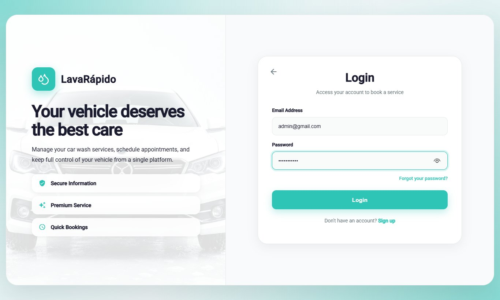

### 8.3 General Control Panel

The control panel (route */admin*, menu option **Dashboard**) summarizes what the administrator needs to run the day (Table 5).

**Table 5**

*Elements of the Administrator Control Panel*

| Element | Information it shows | Administrator action |
|---|---|---|
| Bookings today | Number of bookings of the day, compared with the previous day. | Review the workload; **View today's bookings**. |
| Services in progress | Services that operators started and have not finished. | Check the progress. |
| Active bays | Bays available to receive bookings. | Verify the capacity of the day. |
| Payments to verify | Payments pending review. | Open the review (section 12.6). |
| Today's revenue | Total of the payments approved in the day. | Compare with the reports. |
| Revenue for the last 7 days | Chart with the week total and the projected busiest day. | **View detailed report**. |
| Operators status | Available, busy, and absent operators. | **Manage shifts and bays**. |
| Payments pending review | Last receipts submitted for validation. | **Review** each one. |
| Bookings without an operator | Confirmed bookings waiting for a technician. | **Assign** (section 12.4). |

*Note.* The names correspond to the panel when the interface is in English.

**Figure 2**

*General Control Panel*

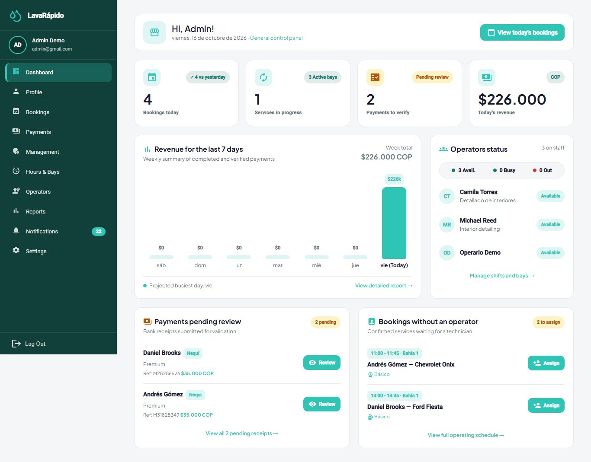

### 8.4 First Administrator Account

The initial data loads the three roles but no user accounts. When the security service runs with the development profile (*dev*), it creates one demonstration account per role (administrator, operator, and customer); their credentials appear in the team guide of the infrastructure repository and must never be used outside a local machine.

In any other environment, such as the public server, the first administrator account is created by security-service when it starts (*AdministratorBootstrapRunner*). The IT administrator writes *ADMIN_EMAIL* and *ADMIN_PASSWORD* (and, optionally, *ADMIN_FIRST_NAME* and *ADMIN_LAST_NAME*) in the *.env.production* file of the server and restarts the service. If there is still no account with the ADMIN role, the service creates it with the same rules as any account (password policy, unique email and document), and the log shows *First administrator created*. If an administrator already exists, the variables are ignored and can be removed from the file. The password is typed directly on the server and is never stored in a repository.

To turn an existing account into an administrator (for example, one registered from the public screen), the role can be assigned with SQL, because the password was already generated by the application:

1. Check that the person already has an account (if not, the person registers from the public screen).
2. Look up the identifiers of the account and of the ADMIN role.
3. Insert the ADMIN role for the account in *security.user_role*.
4. Ask the person to log out and log in again; the system must open the panel */admin*.
5. Record the change (date, author, and reason) in the change log of the team.

```sql
-- Required identifiers
SELECT user_id, username FROM security.app_user WHERE username = N'<EMAIL>';
SELECT role_id, code FROM security.[role];

-- Assign the ADMIN role
INSERT INTO security.user_role (user_id, role_id)
VALUES (<USER_ID>, <ADMIN_ROLE_ID>);
```

An account can have several roles; when it has ADMIN, the web application opens the administration panel. Once the first administrator exists, the other administrators and operators are created from **Management > Users** (section 9.3), not with SQL.

## 9. User Management

A system account consists of a person (*security.person*: ID number, first names, last names, phone, and email) and an access account (*security.app_user*: username, password hash, active status, and date of last login). The roles are assigned in *security.user_role*. The password is stored only as a BCrypt hash: no administrator can see or recover it (OWASP Foundation, 2021).

### 9.1 Account Management Principles

- **Accounts are deactivated, not deleted.** A deactivated account cannot log in, but its bookings, payments, and ratings are kept.
- **One email and one ID number per account.** The email (ending in @gmail.com) is the login username.
- **Least privilege.** Only the necessary role is assigned, and the account is deactivated when it is no longer needed.

### 9.2 Consulting Users

1. In the side menu, click **Management** and open the **Users** tab (route */admin/management*).
2. Review the table with **Name**, **Email**, **User type**, **Last sign-in**, and **Status**.
3. Use the **Enabled** and **Disabled** filters and the search box to find an account; **Clear filters** removes them.

**Figure 3**

*User List*

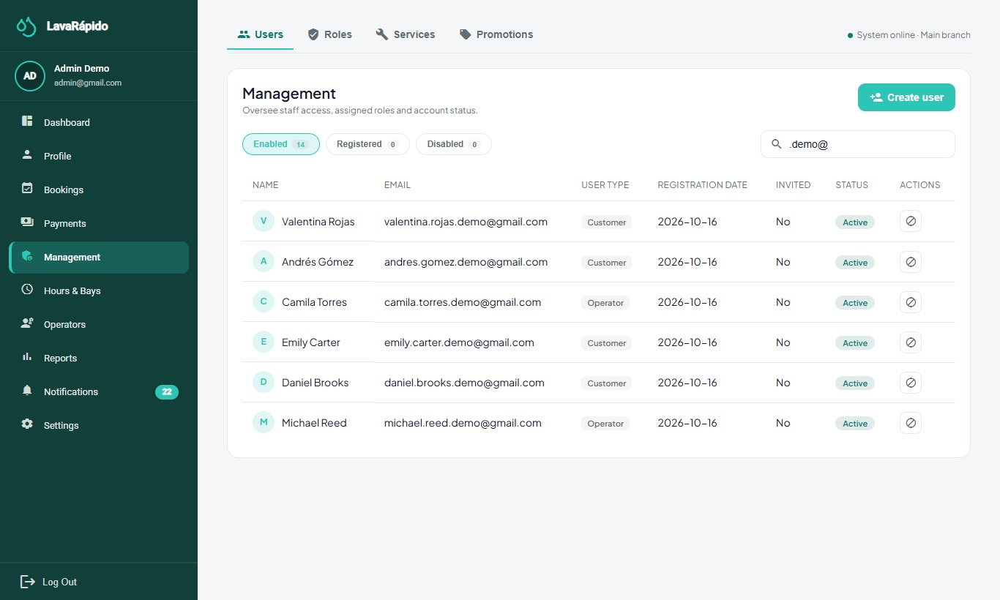

### 9.3 Creating an Operator or Administrator Account

1. In **Management > Users**, click **Create user**.
2. Fill in the **ID number**, **First names**, **Last names**, **Email**, and **Phone** (optional).
3. Type a temporary password that meets the policy (minimum 8 characters, one uppercase letter, one number, and one special character); **Show password** lets you check it before saving.
4. Choose the **Assigned role**: Operator, Administrator, or Customer.
5. Click **Create User** and verify that the message "User created" appears and that the account is listed.
6. Deliver the temporary password through a private channel and ask the person to change it in **Profile** at the first login.

Operators can also be created from **Operators > New operator** (section 12.1), which creates the account with the OPERATOR role. The system never sends the password by email: the welcome message of an account opened by an administrator explains that the password is requested from the administrator or recovered with "Forgot your password?".

**Figure 4**

*Create User Window*

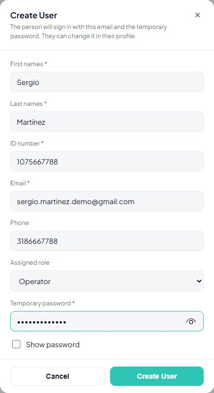

### 9.4 Activating and Deactivating an Account

1. Locate the account in **Management > Users**.
2. Choose **Disable account** (or **Enable account** to reactivate it).
3. Confirm the message "Deactivate [name]? They will no longer be able to log in."
4. Verify that the status changes to **Disabled** and, if the person is an operator with pending services, reassign them (section 12.4).

The system does not allow an administrator to deactivate their own account ("You cannot disable your own account"). Before deactivating an administrator, verify that at least one other active administrator remains.

### 9.5 Password Reset

The administrator cannot see or set a user's password. To regain access, the person uses **Forgot your password?**: a six-digit code arrives at the email, valid for 15 minutes, for a single use, and burned after five failed attempts (Table 6).

**Table 6**

*Access Situations and Administrator Action*

| Situation | Cause | Action |
|---|---|---|
| The person forgot the password | — | Direct the person to password recovery; verify that the email is correct. |
| "Your account is disabled" | The account was deactivated. | Reactivate it if appropriate (section 9.4). |
| The code does not arrive | Wrong email, MAIL_ENABLED set to false, or an SMTP failure. | Check the registered email and the mail configuration (section 17.7). |
| The person changed the email | Change made from Profile with the current password. | The new email is the login username. |

### 9.6 Active Sessions

Each login is recorded in *security.user_session* (start, expiry, revocation, IP address, and browser agent). Logging out marks the session as revoked. A token already issued cannot be revoked before it expires (one hour); it is a risk accepted in the design (ADR-006). When a compromise is suspected, deactivate the account, change the JWT secret if the compromise affects the platform, and review the sessions:

```sql
SELECT TOP (50) s.user_session_id, u.username, s.started_at, s.expires_at,
       s.revoked_at, s.ip_address, s.user_agent
FROM security.user_session s
JOIN security.app_user u ON u.user_id = s.user_id
ORDER BY s.started_at DESC;
```

## 10. Role and Permission Management

### 10.1 The Three Fixed Roles

The server applies only the three fixed roles ADMIN, OPERATOR, and CLIENT (Table 7). The **Management > Roles** tab lists the three roles with their permissions and the number of users of each one. **Role permissions** lets the administrator pick one of the three roles (there is no free-text name) and check or uncheck its permissions from the catalog of *security.permission*; the changes are saved on the server in *security.role_permission* (*GET* and *PUT /api/v1/admin/roles-permissions*). **The matrix is informative**: real authorization still depends on the role of the token, so checking or unchecking a permission does not grant or remove access to any screen or endpoint (ADR-015). If a permission no longer exists, the system answers "One of the selected permissions no longer exists. Reload the page and try again."

**Table 7**

*Matrix of Roles and Main Capabilities*

| Capability | ADMIN | OPERATOR | CLIENT |
|---|---|---|---|
| Register and manage vehicles | Look up by plate | — | Yes (own) |
| Create and cancel bookings | Yes (for any customer) | — | Yes (own) |
| Reschedule bookings and change their status | Yes | — | — |
| Assign or change the operator | Yes | — | — |
| Start and finish a service | — | Only those assigned to them | — |
| Pay and upload receipts | — | — | Yes (own) |
| Approve or reject payments; record manual payments | Yes | — | — |
| Rate a completed service | — | — | Yes, once |
| Configure hours, bays, services, and payment accounts | Yes | — | — |
| Create and deactivate accounts | Yes | — | Only deactivate their own |
| Consult reports | Yes | Their ratings | — |

*Note.* Prepared by the authors from the endpoints of each service and their required roles.

### 10.2 Control by Role and by Ownership

A valid role is not enough: each service also verifies the ownership of the resource. An operator cannot start or finish a service assigned to another operator, and a customer only reaches their own bookings, vehicles, and payments. Each service validates the token and the role required by each route; the gateway only routes the requests and does not validate tokens (ADR-006). A request from one role to a resource of another returns error 403.

### 10.3 Changing a Person's Role

The panel does not offer an option to change the role of an existing account. When it is necessary, the IT administrator follows this procedure:

1. Record the request: who asks for it, who approves it, the current role, the new role, and the reason.
2. Verify the identity of the person.
3. Modify the assignment in *security.user_role*; remove the previous role if it must not remain.
4. If the new role is OPERATOR, the operations service creates the operator record automatically the next time the operators are listed.
5. Ask the person to log out and log in again, so that the new token reflects the role.
6. File the request together with the date and the author of the change.

## 11. System Configuration

### 11.1 Business Data

**Settings > Business data** (route */admin/settings*) shows the legal name, tax ID, legal representative, address, phones, email, tax information, and official channels of the business. These data are saved in booking-service (*GET* and *PUT /api/v1/admin/establishment*), which validates each field before saving it. They are the same data customers see on the home page, in the footer, and in the help center, so a change reaches every user when the page is reloaded. The accounts and QR codes to receive payments are configured separately, in **Payment methods** (section 11.4).

### 11.2 Opening Hours and Exceptions

The **Hours & Bays** screen (route */admin/schedule*) has two tabs: **Business hours** and **Wash bays**. The changes of this screen affect the availability offered to customers immediately.

1. In **Business hours**, review the **Regular weekly schedule**: for each day, **Open** or **Closed**, the **Opening** and **Closing** times, and the **Break** (continuous or with lunch break).
2. Modify the days that changed and click **Save changes** ("Schedule saved"). **Reset values** restores the default schedule.
3. In **Exceptions and special days**, click **Add exception** to register a national holiday (closed all day) or special hours: choose the **Date**, the **Type**, the **Opening** and **Closing** times if applicable, and the **Reason / notes**, and click **Save exception**.
4. Use the **History** button to see the latest changes of the schedule.

A change applies to future availability; bookings already confirmed are not relocated automatically. Before registering a closure, check the bookings of that day in **Bookings** (filter by date) and contact the customers to reschedule or cancel them (section 12.3).

**Figure 5**

*Business Hours and Exceptions*

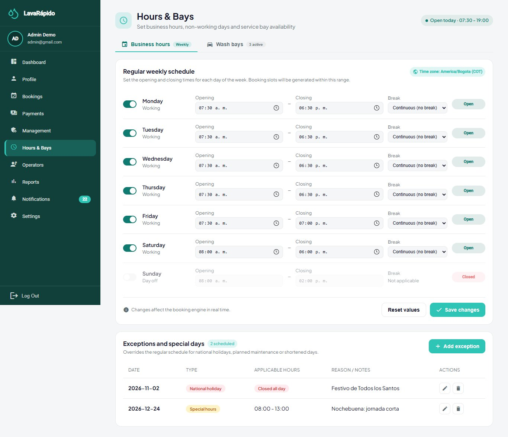

### 11.3 Washing Bays

A bay is a physical washing spot, and the number of active bays defines the capacity of the business: two active bookings cannot occupy the same bay at overlapping times. A bay can be **Active**, **Under maintenance**, or **Inactive**; only active bays receive bookings.

1. Open **Hours & Bays > Wash bays**.
2. To create a bay, click **Add bay**, type the **Bay name**, choose the **Status**, and save.
3. For a repair, edit the bay and change its status to **Under maintenance**; it stops receiving new bookings.
4. Before putting a bay under maintenance or inactive, review the future bookings assigned to it and reschedule them.
5. When the repair is finished, return the status to **Active**.

### 11.4 Payment Methods and QR Codes

**Settings > Payment methods** manages the payment accounts of the business: for each account, the method (Nequi, Daviplata, or bank transfer), the holder, the account number, the QR image, the instructions, and whether it is active. Customers see only the active accounts of the methods that require a receipt; cash does not have a QR code. A wrong QR code or account sends the business's money to a third party, so this information must be reviewed carefully.

1. Open **Settings > Payment methods**.
2. Add an account or edit an existing one: method, holder, account number, QR image, and instructions.
3. Activate or deactivate the account depending on whether it is accepted.
4. From a test customer account, open **Pay service**, scan the QR code, and verify that the holder shown by the bank is the business.

The QR images and the receipts are stored inside the database as images (data URLs); there is no separate folder of files to back up (section 14.1).

**Figure 6**

*Payment Methods Configuration*

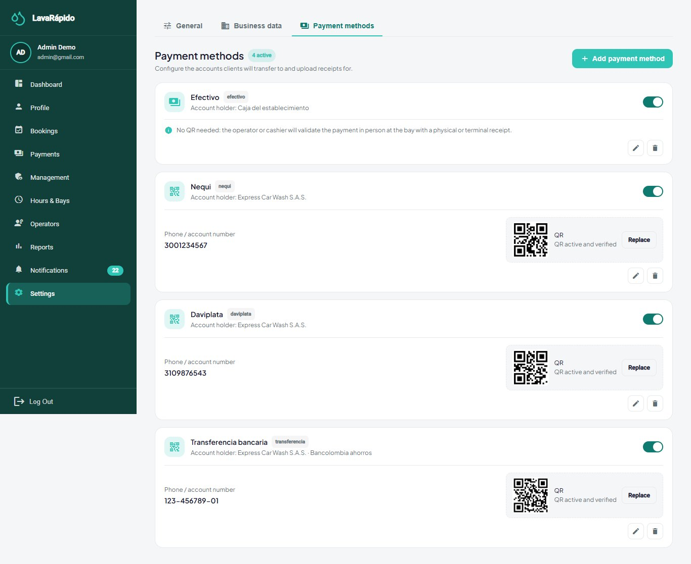

*Note.* Use a test account and QR code.

### 11.5 Platform Security Parameters

**Table 8**

*Current Security Parameters*

| Parameter | Value | Where it is configured |
|---|---|---|
| Access token validity | 1 hour; there is no refresh token | security-service (JWT_ACCESS_TOKEN_TTL). |
| Account lockout after failed attempts | 5 failed attempts within 15 minutes lock the account for 15 minutes; resetting the password unlocks it | security-service (*security.login_lockout*). |
| Recovery code | 6 digits, valid for 15 minutes, single use, 5 failed attempts | security-service. |
| Password | 8 to 72 characters, one uppercase letter, one number, one special character, no spaces | security-service and web interface. |
| Password storage | BCrypt with cost factor 12 | security-service. |
| Token signature | HS256 with a shared secret of at least 32 bytes | JWT_SECRET in the .env file. |
| Language and theme per user | Spanish, English, French, or Portuguese; four color themes | User preferences. |

*Note.* Prepared by the authors from the configuration file of the security service and ADR-006.

### 11.6 Operating Environment Variables

The variables that change the behavior of the platform are read from the file *lavarapido-infra/.env* and require restarting the affected services. The most relevant for the IT administrator are *MESSAGING_ENABLED* (RabbitMQ events), *MAIL_ENABLED* and *MAIL_\** (email), *PUSH_ENABLED* (push notifications), *REMINDER_LEADS* (reminders, by default 24 h and 1 h), *BOOKING_ZONE* (time zone of the business), *BOOKING_SLOT_MINUTES* and *BOOKING_MAX_DAYS_AHEAD* (booking grid and window), and *INTERNAL_API_KEY* (internal calls between services). Their values and the change procedure are described in the Installation Manual.

## 12. Management of Core Information

### 12.1 Operators and Availability

An operator is an account with the OPERATOR role that also has a record in *execution.operator*. The operations service creates that record automatically the first time it lists the operator accounts. The weekly availability (*execution.operator_availability*) defines the working hours of each day, and the absences (*execution.operator_absence*) block the operator between two dates; two absences of the same operator cannot overlap.

1. Open **Operators** (route */admin/operators*). Review the indicators and the cards of each operator; use the **All**, **Available**, **In service**, and **Absent** filters or the search box.
2. To add an operator, click **New operator**, fill in the account data (including a temporary password), and save.
3. Open an operator to see the detail (route */admin/operators/{id}*).
4. Click **Edit availability** to define, for each day, the **Start** and **End** of the shift; untick a day to mark it as a day off.
5. Click **Register absence** to record a leave with **Start date**, **End date**, and **Reason**.
6. Use **View full calendar** to see the week with available time, assigned services, leaves, and breaks.
7. To retire an operator, deactivate their account (section 9.4) and reassign their future services (section 12.4).

Some indicators of the detail screen (for example, punctuality, revenue goal, or skills) are illustrative and do not come from the server; the shifts, absences, services, and ratings do.

**Figure 7**

*Operator Detail With Availability and Absences*

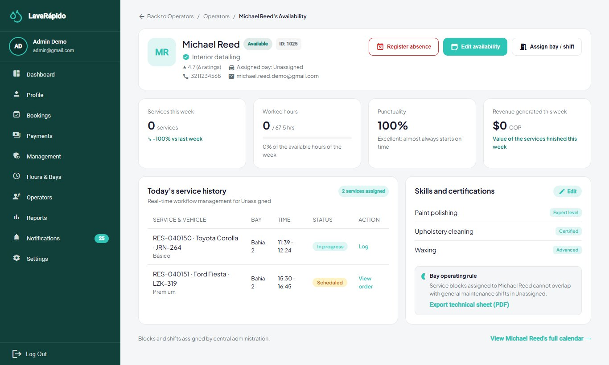

### 12.2 Services, Prices, and Points

The catalog is organized in categories (washing, polishing, detailing, interior, and packages), services, and prices. Each price corresponds to a service and a vehicle type, with an amount and an estimated duration. Prices are immutable: when a price changes, the system closes the current price and creates a new one, so that existing bookings keep the price with which they were made.

1. Open **Management > Services**.
2. Click **Add service**, or edit an existing service.
3. Type the **Service Name**, the **Description**, and the **Category**.
4. In **Price and duration by vehicle type**, define the price in Colombian pesos (COP) and the estimated duration for each vehicle type (car, sedan, SUV, pickup, truck, and motorcycle).
5. In **Loyalty points**, type the points the customer earns when the payment for this service is approved (a whole number; 0 = no points). The services table shows them in the **Points** column.
6. Click **Save Service**.
7. To stop offering a service, deactivate it ("It will no longer be available to book"); existing bookings are not altered.
8. Verify on the customer booking screen that the price, the duration, and the points shown are the new ones.

Each booking line keeps the points of the service at the moment of booking, in the same way as the price.

### 12.3 Bookings

The **Bookings** screen (route */admin/reservations*) lists the bookings with **Client**, **Vehicle & plate**, **Service**, **Date / time**, **Assigned operator**, and **Status**, together with indicators of the day (total, confirmed or in progress, awaiting operator, needs attention, and cancelled or rescheduled).

1. Use the search by client or plate, the date (**Today**), and the status and operator filters; **Clear** removes them.
2. To create a booking on behalf of a customer, click **New Booking**, look up the vehicle by plate, choose the services, the date, and a free time, and confirm.
3. Open a booking to see its detail. From there the administrator can reschedule it (another free date or time), change its status (confirm, start, complete, mark as **No show**), or cancel it by choosing a **Cancellation reason**. Each change asks for confirmation.
4. Click **Export** to download the list in Excel, PDF, or CSV.

The life cycle rules are the same for everyone: a booking cannot fall outside the opening hours or occupy a bay that is already taken, and a booking that already started can no longer be canceled (Table 9).

**Table 9**

*Booking Statuses and Administrator Action*

| Status | Meaning | Possible administrator action |
|---|---|---|
| SCHEDULED | Registered and pending confirmation. | Confirm, assign an operator, or cancel. |
| CONFIRMED | With a slot and a bay. Bookings made by customers start here. | Assign or change the operator, reschedule, or cancel. |
| IN_PROGRESS | The operator started the wash. | Supervise; it can no longer be canceled. |
| COMPLETED | Service finished. | Verify or record the payment. |
| CANCELLED | Voided by the customer or the business. | Check the reason. |
| NO_SHOW | The customer did not arrive. | Record it and review patterns. |

*Note.* Database codes according to ADR-010; the interface translates them.

**Figure 8**

*Booking Management*

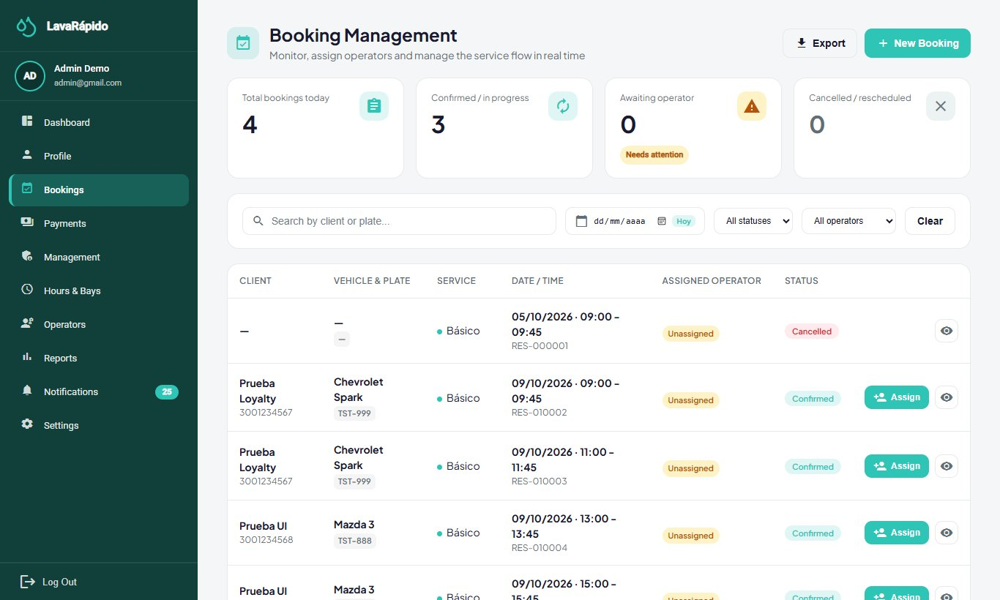

### 12.4 Assigning an Operator

When a booking is confirmed, **the system assigns the operator automatically** (RF-008): if the customer chose one who is still free, that operator is assigned; otherwise, the free operator with the fewest bookings that day. An operator is free when the account is active, has a shift at that time, has no recorded absence, and is not serving another booking at that time. If nobody is free, the booking is left without an operator and appears in the **Bookings without an operator** block of the Dashboard. A rescheduled booking keeps its operator. The administrator assigns by hand in two cases: when the booking was left without an operator and when the assigned one must be changed.

1. In the **Dashboard** (block **Bookings without an operator**) or in **Bookings**, click **Assign** on the booking.
2. The window "Assign Operator to Booking [code]" shows the details of the appointment and the list of operators. The available operators appear first; the others show why they cannot take the booking: **Inactive**, **No shift at that time**, **Absent**, or **Busy at that time**.
3. Select an available operator and, if desired, write instructions for the operator.
4. Click **Confirm Assignment**. The message "Operator assigned" appears and the operator receives a notification. If the booking already had another operator, that operator receives the notice that the service was reassigned.

The assignments list shows the bay of each booking next to its operator, so the administrator can see which operator is working in which bay. Operators are not tied to a bay for a whole shift: the bay is chosen per booking (ADR-010 and ADR-015).

Only bookings in SCHEDULED or CONFIRMED status can be assigned, and the operator can be changed while no line of the booking has started. If an operator who is not eligible is chosen, the server rejects the assignment and explains the reason.

**Figure 9**

*Manual Assignment of an Operator*

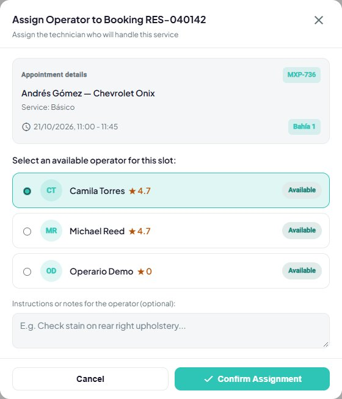

### 12.5 Vehicle Inspection Report

For long services (180 minutes or more), the administrator can record the condition of the vehicle by phases (Reception, Exterior, Interior, Engine, and Delivery) with findings and photos, and share the report with the customer through a link.

1. In **Bookings**, open the booking and choose the inspection option (route */admin/reservations/{id}/inspection*).
2. Click **Start report** when the vehicle arrives.
3. In each phase, click **Start phase**, add the findings with **Add finding** (vehicle part, type: note, minor damage, or major damage; description; and up to five JPG or PNG photos of up to 10 MB), and click **Finish phase**.
4. Click **Publish and copy link**; **View as customer** shows the public version (route */report/{token}*).
5. Click **Notify customer**. The system sends the customer a notification and an email (type *INSPECTION_REPORT*) with the summary of the inspection: phases finished, number of findings, major findings, and affected areas, together with the link to the report. The message "Customer notified" confirms the sending.

**From the mobile app.** The report can also be managed from the phone, with the same phases and the same server rules:

1. In **Bookings**, tap the eye icon of the booking and, in the detail, tap **Inspection**. The button only appears for services of 180 minutes or more that are confirmed, in progress, or completed.
2. Tap **Start report** and, in each phase, **Start phase**, **Add finding**, and **Finish phase** (or **Reopen** to correct a finished phase).
3. In **New finding**, type or choose the vehicle part from the suggestions, choose the type, and write the note. Attach up to five photos with **Take photo** (camera) or **Gallery**. The app shrinks each photo to 1600 pixels on its longer side, in JPEG format, before uploading it, because the server accepts at most 2 MB per photo.
4. Tap **Publish and share link**. The report is published and, from then on, **Share link** opens the phone share menu (WhatsApp, email, or copy). **Notify customer** sends the same notice as the web, and **View as customer** opens the public link in the browser.

The first time, the phone asks for permission to use the camera and the photos; if the permission is denied, the screen says it must be enabled in the phone settings. Saved photos are shown as thumbnails and are enlarged when tapped.

**Where it is saved:** the report, its phases, the findings, and the photos are saved in operations-service (tables *execution.inspection_report*, *execution.inspection_phase*, *execution.inspection_finding*, and *execution.inspection_photo*). The photos are shrunk before they are sent: in the browser when the web is used and on the phone when the mobile app is used. The public link (route */report/{token}*) only works after the report is published and opens from any device without logging in, which is why the notice to the customer includes it.

### 12.6 Payment Review and Approval

The system does not integrate a payment gateway (ADR-008). The customer pays outside the platform with the business's QR code and uploads the receipt; the administrator verifies that the money arrived and approves or rejects the payment. It is the most sensitive function of the role, because it authorizes the charge for a service (Table 10).

**Table 10**

*Payment Review Controls*

| Control | How the system applies it | What the administrator must do |
|---|---|---|
| Amount | The amount due is the booking total calculated by the server minus the coupon redeemed, if any; the customer declares the amount paid, and the review window compares both. | Compare the declared amount and the receipt with the amount due. |
| Single approved payment | A booking does not admit more than one approved payment, and a second payment cannot be reported while one is in review. | Do not try to approve a second payment for the same booking. |
| Transaction reference | The system rejects a reference already used in another payment (*TRANSACTION_REFERENCE_REUSED*). | Verify that the reference of the receipt matches the bank movement. |
| Real verification | The system does not query the bank. | Confirm in the app or statement of the business that the money arrived; do not rely only on the image. |
| History | Rejected payments are kept with their reason. | Do not delete rejected attempts. |

*Note.* Prepared by the authors from the payment service and ADR-008.

**Approving a digital payment.**

1. Open **Payments** (route */admin/payments*) and filter by **Pending validation**.
2. Click **Review** on the payment. The window "Review payment [code]" shows the attached receipt, the linked booking, the service and vehicle, the operator, the method, the reference, and the **Amount comparison** between the **Amount due (service)** and the **Amount declared on receipt**. If they differ, the window shows "The amounts don't match"; if the customer did not declare the amount, verify it directly on the receipt image.
3. Verify that the money arrived in the business's account with that amount and reference.
4. Click **Approve payment**. The payment changes to Approved, the customer receives the notice and the email "Payment confirmed", and the loyalty points of the booking are credited (with a notice for each coupon those points unlock).

**Rejecting a payment.** If the money did not arrive, the receipt is illegible, or the amount does not match, click **Reject**, type the **Rejection reason** (maximum 200 characters), and confirm. The customer receives a notice and an email with the reason and can report the payment again.

**Recording a cash or counter payment.** Click **Register manual payment**, choose the booking and the method, and confirm. The window shows the real amount due of the booking (with the coupon discount, if any), and the manual payment is approved immediately with that amount and credits the points. Use it only when the money was received.

**Refunding a payment.** Open an approved payment and click **Refund**. Confirm that the money was returned to the customer: the payment changes to Refunded, the points that the booking earned are reversed, and the customer receives a notice and an email. The refund cannot be undone.

**Export reconciliation** downloads the list in Excel, PDF, or CSV. Customer notices require *MESSAGING_ENABLED=true* in payment-service and notification-service.

**Figure 10**

*Payment Review*

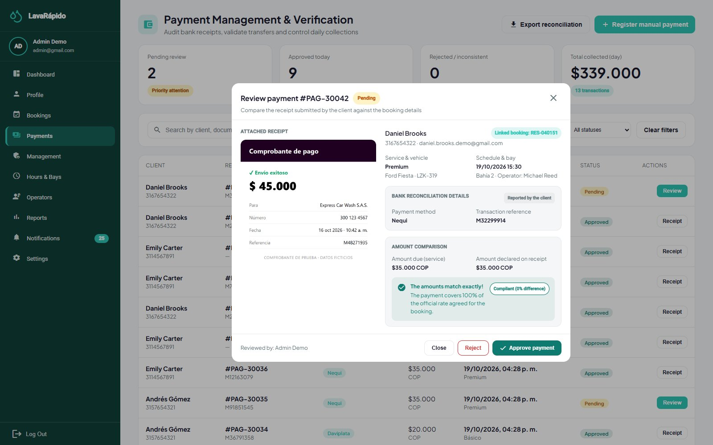

*Note.* Use a test receipt, without real bank data.

### 12.7 Notifications and Announcements

The **Notifications** option of the administrator works like that of the other roles: it lists the notifications with filters and allows marking them as read or deleting them. Every active administrator receives staff notices in the inbox and as push notifications (never by email): a new booking confirmed, a booking moved to another time, and a booking cancelled (with the reason).

Announcements are sent with *POST /api/v1/admin/notifications* (ADMIN role), which accepts only two types: *SYSTEM_MESSAGE* (free announcement, inbox and push only; available only through the API, because the panel does not have a screen for it) and *INSPECTION_REPORT* (sent from the inspection screen, also by email). Any other type is rejected with 400 *NOTIFICATION_TYPE_NOT_ALLOWED*, so that nobody can write by hand a notice that looks like an automatic one (for example, a false approved payment). The message is always saved in the inbox of the recipient; the push notification is additional (it requires *PUSH_ENABLED=true* and the mobile application) and respects the switches of each user.

### 12.8 Promotions and Loyalty

**Loyalty points.** Each service has its own points (section 12.2). When the administrator approves a payment or records a manual payment, payment-service credits the points of the booking in the ledger *payment.loyalty_transaction* (once per booking); a refund reverses them. The balance of a customer is always that of their last ledger movement, and points are never spent.

**Promotions.** The **Management > Promotions** tab manages the discount coupons that customers unlock with their points (data saved in payment-service, *GET*, *POST*, *PUT*, *PATCH*, and *DELETE /api/v1/admin/promotions*):

1. Click to create a promotion and type the **Name**, the **Description**, the **Coupon** code (for example, PREMIUM20), the icon, the benefits, and the **Start date** (if it is in the future, the promotion stays scheduled until that day).
2. Type the **Discount on redemption (%)**, between 1 and 100 (100 = free), which is applied to the booking total when the customer redeems the coupon.
3. Type the **Loyalty points required** to unlock the coupon (0 = available to everyone).
4. Save. The card of the promotion shows the discount ("N% off") and the points needed ("unlocks at N points" or "available to everyone"). The status is calculated from the start date and can be paused or resumed from the card.

When the points of a customer reach those required by an available coupon, the customer receives the notice "You have a redeemable coupon!" with its code. Redeeming a coupon does not consume points, and each coupon can be redeemed once per booking.

## 13. Administrative Reports

The **Reports** screen (route */admin/reports*) shows the performance of the business with data of bookings and payments loaded from the server:

1. Choose the filters **Date**, **Service**, and **Operator** and click **Apply filters**.
2. Review the **Charts** of services completed and revenue for the period.
3. Review the summaries **Today's Report**, **Week's Report**, and **Month's Report** (services completed and total revenue), the **Year's Total Revenue**, and the **Best-Selling Services**.
4. Click **Export report**, choose the period (day, week, or month), preview it, and download it with **Export Excel** or **Export PDF**.

For queries that the screen does not offer, the IT administrator can use the support queries of section 13.1 (Table 11).

**Table 11**

*Administrative Indicators and Data Sources*

| Indicator | Content | Data source |
|---|---|---|
| Services performed | Services completed by period, service, and operator. | booking.booking and execution.service_execution |
| Revenue | Approved payments by day, month, and account. | payment.payment |
| Average rating | Average of the ratings per operator. | execution.service_execution |
| Payments by status | Number and amount of payments in each status. | payment.payment |
| Loyalty points | Point movements and balances per customer. | payment.loyalty_transaction |
| Users | Accounts by role and status. | security.app_user and security.user_role |

**Figure 11**

*Administrative Reports*

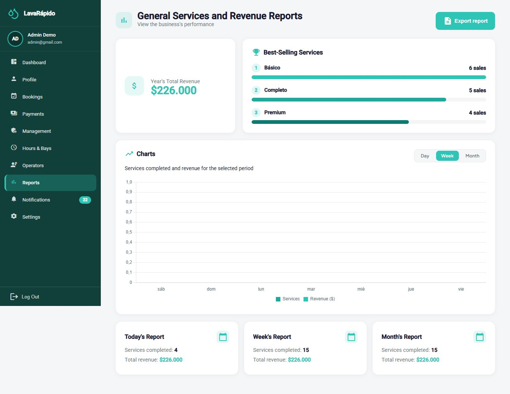

### 13.1 Support Queries

**Approved revenue per day** (dates are stored in UTC; for the Colombian calendar day, five hours are subtracted before converting to a date):

```sql
SELECT CAST(DATEADD(hour, -5, p.processed_at) AS date) AS business_day,
       COUNT(*)      AS payments,
       SUM(p.amount) AS revenue
FROM payment.payment p
JOIN payment.payment_status ps ON ps.payment_status_id = p.payment_status_id
WHERE ps.code = 'APPROVED'
  AND p.processed_at >= DATEADD(day, -30, SYSUTCDATETIME())
GROUP BY CAST(DATEADD(hour, -5, p.processed_at) AS date)
ORDER BY business_day DESC;
```

**Performance per operator:**

```sql
SELECT o.operator_id, o.user_id,
       COUNT(*)                               AS services_completed,
       AVG(CAST(se.quality_rating AS float))  AS average_rating,
       COUNT(se.quality_rating)               AS rated_services
FROM execution.service_execution se
JOIN execution.operator         o  ON o.operator_id = se.operator_id
JOIN execution.execution_status es ON es.execution_status_id = se.execution_status_id
WHERE es.code = 'COMPLETED' AND se.deleted_at IS NULL
GROUP BY o.operator_id, o.user_id
ORDER BY services_completed DESC;
```

**Payments pending review**, the most urgent indicator of the day:

```sql
SELECT p.payment_id, p.booking_id, p.amount, r.transaction_reference, r.uploaded_at
FROM payment.payment p
JOIN payment.payment_status ps ON ps.payment_status_id = p.payment_status_id
LEFT JOIN payment.payment_receipt r ON r.payment_id = p.payment_id
WHERE ps.code = 'IN_REVIEW'
ORDER BY r.uploaded_at;
```

**Transaction references used more than once** (the system rejects them since October 8, 2026; the query detects older duplicates):

```sql
SELECT r.transaction_reference, COUNT(*) AS times_used
FROM payment.payment_receipt r
WHERE r.transaction_reference IS NOT NULL
GROUP BY r.transaction_reference
HAVING COUNT(*) > 1;
```

The queries are read-only. They must be run with a query account, outside peak hours if the database is large, and their results must not be copied to shared spreadsheets without authorization, because they contain personal data.

## 14. Backups

The project documentation does not define a backup strategy, because production is outside its scope, and the application does not include a backup module. Therefore, backups are a task of the IT administrator on SQL Server and the Docker volumes. This section proposes a procedure based on contingency planning practices (Swanson et al., 2010) and on the SQL Server documentation (Microsoft, n.d.). The values marked as recommendations must be approved by the team (Annex B).

### 14.1 What Must Be Backed Up

**Table 12**

*Items That Must Be Included in the Backup*

| Item | Content | How it is backed up |
|---|---|---|
| Database *LavaRapido* | The nine schemas, the QR images and receipts (stored as data URLs), and the Liquibase control tables of each service. | Full BACKUP DATABASE. |
| File *lavarapido-infra/.env* | JWT secret, passwords, and environment variables. | Encrypted copy kept apart from the data backups; never in a repository. |
| Volume *rabbitmq-data* | Queues and pending messages of RabbitMQ. | Optional; messages are transient. |
| Environment definition | *docker-compose.yml* and code repositories. | Already versioned in Git; verify that the remotes are up to date. |
| Browser-only data | Business data and inspection reports. | They are not on the server: they cannot be backed up by the IT administrator (section 6.3). |

*Note.* Recommendations of this manual. A database restored without its *.env* file cannot be used by the services.

### 14.2 Recommended Policy

**Table 13**

*Recommended Backup Policy*

| Aspect | Recommendation |
|---|---|
| Frequency | One full backup per day outside business hours, and another immediately before each migration or major change. |
| Retention | 14 daily, 8 weekly, and 12 monthly backups. |
| 3-2-1 rule | Three copies, on two different media, one of them outside the machine where the system runs. |
| File name | backup_LavaRapido_YYYY-MM-DD_HHMM.bak (for example, backup_LavaRapido_2026-10-07_0200.bak). |
| Encryption and access | Store the copies in a folder with restricted access and encrypt those that leave the machine: they contain personal data protected by Law 1581 of 2012. |
| Recovery objectives | Maximum acceptable data loss (RPO): 24 hours. Maximum recovery time (RTO): 4 hours. |
| Verification | Check each backup and restore one in a test environment at least once a month. |

*Note.* Recommendations of this manual; they do not come from the project documentation.

### 14.3 Generating a Manual Backup

The backup is generated inside the SQL Server container (Compose service *sqlserver*, container *lavarapido-sqlserver*) and then copied to the host. The password of the *sa* account is the value of *DB_PASSWORD* in the *.env* file; it must be read from an environment variable and not typed in shared scripts.

1. Verify that there is free disk space (a backup occupies, as an order of magnitude, the size of the data).
2. Generate the backup with a checksum.
3. Check that the file is restorable.
4. Copy it to the host and then to secure storage.
5. Record the backup (date, file, size, verification result, and person responsible).

```bash
cd lavarapido-infra
# 1) Full backup inside the container
docker compose exec sqlserver /opt/mssql-tools18/bin/sqlcmd \
  -S localhost -U sa -P "$DB_PASSWORD" -C -Q \
  "BACKUP DATABASE [LavaRapido] TO DISK = N'/var/opt/mssql/data/backup_LavaRapido_2026-10-07_0200.bak' WITH INIT, CHECKSUM, COMPRESSION"

# 2) Verify that the file is restorable
docker compose exec sqlserver /opt/mssql-tools18/bin/sqlcmd \
  -S localhost -U sa -P "$DB_PASSWORD" -C -Q \
  "RESTORE VERIFYONLY FROM DISK = N'/var/opt/mssql/data/backup_LavaRapido_2026-10-07_0200.bak' WITH CHECKSUM"

# 3) Copy to the host
docker cp lavarapido-sqlserver:/var/opt/mssql/data/backup_LavaRapido_2026-10-07_0200.bak ./backups/
```

The *CHECKSUM* option detects damaged pages when backing up and when verifying.

**Figure 12**

*Backup Generated and Verified*

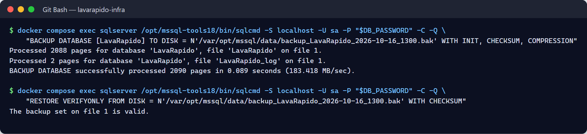

### 14.4 Automating the Daily Backup

A backup that depends on someone remembering it ends up not being made. On Linux it is scheduled with *cron*; on Windows, with the Task Scheduler. The following sample script generates the backup, verifies it, copies it, and deletes the files that exceed the retention:

```bash
#!/usr/bin/env bash
set -euo pipefail
STAMP=$(date +%F_%H%M)
FILE="backup_LavaRapido_${STAMP}.bak"
DEST="$HOME/backups"
SQL="docker compose -f $HOME/Backend/lavarapido-infra/docker-compose.yml exec -T sqlserver \
     /opt/mssql-tools18/bin/sqlcmd -S localhost -U sa -P $DB_PASSWORD -C -b"
$SQL -Q "BACKUP DATABASE [LavaRapido] TO DISK=N'/var/opt/mssql/data/$FILE' WITH INIT,CHECKSUM,COMPRESSION"
$SQL -Q "RESTORE VERIFYONLY FROM DISK=N'/var/opt/mssql/data/$FILE' WITH CHECKSUM"
docker cp lavarapido-sqlserver:/var/opt/mssql/data/$FILE "$DEST/"
find "$DEST" -name 'backup_LavaRapido_*.bak' -mtime +14 -delete
echo "$(date -Is) OK $FILE" >> "$DEST/backups.log"

# crontab -e   (every day at 2:00 a.m.; DB_PASSWORD comes from the environment of the user)
# 0 2 * * * /home/<USER>/bin/backup.sh >> /home/<USER>/backups/cron.log 2>&1
```

The script must be stored with restricted permissions and its result must be monitored: an alert when the file of the day does not exist is worth more than many backups that nobody checks.

### 14.5 Backup Before Changes

- Before deploying a new version of a service (each Java service applies its Liquibase migrations when it starts) or running the *payment-migrate* container, make a backup.
- Before bulk changes of roles, prices, or assignments, make a backup.
- Do not run *docker compose down -v* in an environment with data that matters: it deletes the database volume.

## 15. Data Restoration

Restoring overwrites the current data with those of the backup: everything recorded after it is lost. For that reason, restoration must be an authorized and recorded decision, never an improvised reaction.

### 15.1 When to Restore

**Table 14**

*Restoration Scenarios*

| Scenario | Decision |
|---|---|
| Damaged database or container lost without its volume | Full restoration from the last valid backup. |
| Erroneous bulk change (for example, prices or roles) | Restore into a temporary database, extract the correct data, and correct the real database; avoid overwriting it if there is new data. |
| Failed migration | Restore the backup prior to the migration and review the changeset. |
| Security compromise | Restore in a clean environment and change the secrets and passwords before reopening access. |
| Periodic test | Restore in a test environment, never over the real one. |

### 15.2 Full Restoration Procedure

1. Obtain authorization and announce the interruption to the users.
2. Choose the backup and check its integrity with RESTORE VERIFYONLY.
3. Stop the application services and the gateway so that they do not write during the restoration; leave SQL Server running.
4. Make a backup of the current state, even if it is damaged, so as not to lose the evidence.
5. Copy the backup file into the container and restore it.
6. Verify the structure and the data (section 15.3).
7. Start the services and run the verification tests of the Installation Manual.
8. Record the restoration and tell the users the date and time of the last recovered data.

```bash
cd lavarapido-infra
# Stop the application containers (the database stays running)
docker compose stop api-gateway security-service customer-service booking-service \
  operations-service payment-service notification-service

# Copy the backup into the container
docker cp ./backups/<FILE>.bak lavarapido-sqlserver:/var/opt/mssql/data/

# Restore (closes open connections and replaces the database)
docker compose exec sqlserver /opt/mssql-tools18/bin/sqlcmd \
  -S localhost -U sa -P "$DB_PASSWORD" -C -b -Q \
  "ALTER DATABASE [LavaRapido] SET SINGLE_USER WITH ROLLBACK IMMEDIATE;
   RESTORE DATABASE [LavaRapido] FROM DISK = N'/var/opt/mssql/data/<FILE>.bak' WITH REPLACE, CHECKSUM, STATS = 10;
   ALTER DATABASE [LavaRapido] SET MULTI_USER;"
```

The *WITH REPLACE* option overwrites the existing database: use it only when you are sure of the chosen backup. If the command fails halfway, the database may remain in a restoring state or in single-user mode; do not restart the container without reviewing the SQL Server log.

### 15.3 Post-Restoration Verification

- The nine schemas exist and the catalog tables have their rows (queries of the Installation Manual, section 11).
- The fixed identifiers are still in place: *booking_status_id = 5* (CANCELLED) and *payment_status_id = 3* (APPROVED).
- The last booking and the last session correspond to the expected date of the backup.
- An administrator can log in, and a test customer can consult the bookings.
- The tables *DATABASECHANGELOG_\** of each service reflect the last changeset applied in that backup.

Payments transferred to the business's account and not recorded because of the restoration must be compared with the bank statement and recovered with the customers.

### 15.4 Rolling Back a Migration

Liquibase changesets are forward-only. Undoing a migration therefore means restoring the previous backup and correcting the change with a new changeset; an already executed changeset must never be edited.

**Figure 13**

*Post-Restoration Verification*

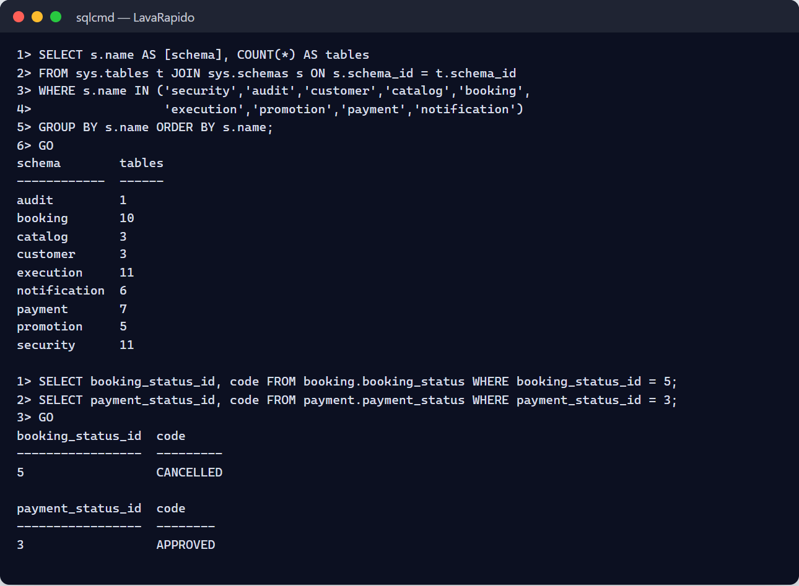

## 16. Auditing and Action History

### 16.1 What the System Records

The project design foresees an audit table, *audit.audit_log*, fed by database triggers (ADR-009). **In the current version that table exists but nothing writes to it**: the changelogs reviewed do not create audit triggers and the services do not set the session context (action ACO-04 of the corrective, preventive, and improvement actions document). Until that function is built, the traces available to the administrator are those of Table 15.

**Table 15**

*Traces Available in the Current Version*

| Source | What it contains | Typical use |
|---|---|---|
| security.user_session | Logins: user, start, expiry, revocation, IP address, and agent. | Detect unusual logins. |
| security.app_user.last_login | Last login of each account. | Identify unused accounts. |
| security.login_lockout | Failed attempts of each account and until when it is locked. | Detect attempts to guess passwords. |
| security.app_user (terms_accepted_at, data_policy_accepted_at) | Date each person accepted the legal documents. | Handle requests about consent. |
| payment.payment (approved_by, processed_at, rejection_reason) | Who approved a payment, when, and why it was rejected. | Review the approvals. |
| payment.payment_receipt (uploaded_by, uploaded_at) | Who uploaded each receipt and when. | Review the receipts. |
| payment.loyalty_transaction | Each point movement (earned and reversed) with its resulting balance. | Handle point claims. |
| booking.schedule_history | Changes of the hours, exceptions, and bays, with their date and author. | Know who changed the availability. |
| updated_at and row_version columns | Date and number of changes of each row (maintained by triggers). | Know when a record changed. |
| Container logs | Startup, errors, and requests with the correlation identifier. | Diagnose incidents. |

*Note.* Prepared by the authors from the changelogs of the services. Logs must never contain passwords, tokens, or receipt content (Kent & Souppaya, 2006).

### 16.2 Audit Queries

**Latest logins:**

```sql
SELECT TOP (100) u.username, s.started_at, s.revoked_at, s.ip_address
FROM security.user_session s
JOIN security.app_user u ON u.user_id = s.user_id
ORDER BY s.started_at DESC;
```

**Payments approved or rejected by each administrator:**

```sql
SELECT p.approved_by, ps.code AS status, COUNT(*) AS payments, MAX(p.processed_at) AS last_change
FROM payment.payment p
JOIN payment.payment_status ps ON ps.payment_status_id = p.payment_status_id
WHERE ps.code IN ('APPROVED', 'REJECTED', 'REFUNDED')
GROUP BY p.approved_by, ps.code;
```

**Accounts without logins in the last 90 days:**

```sql
SELECT username, last_login, is_active
FROM security.app_user
WHERE last_login IS NULL OR last_login < DATEADD(day, -90, SYSUTCDATETIME());
```

### 16.3 Periodic Review and Retention

- Review weekly the new administrator accounts, the deactivated accounts, the payment accounts, and the approved payments.
- Investigate immediately any new account with the ADMIN role or any change of QR codes or payment accounts.
- The documentation does not define a retention policy. Recommendation: keep the session records for at least 12 months and archive the older ones in the monthly backups.
- When the audit triggers are built, do not modify or delete rows of *audit.audit_log*, because they would lose their evidentiary value.

**Figure 14**

*Session History Query*


## 17. Security Recommendations

The project's security policy is based on defense in depth, least privilege, secure defaults, security by design, and zero trust. The following recommendations are aligned with the NIST controls (Joint Task Force, 2020) and with the OWASP Top 10 (OWASP Foundation, 2021).

### 17.1 Accounts and Passwords

- Do not share the administrator password and use individual accounts.
- Use long and unique passwords stored in a password manager. The temporary lockout slows down repeated attempts, but it does not replace a strong password.
- Change any temporary password immediately.
- Deactivate the accounts of people who leave the process on the same day.
- Review the list of administrators quarterly: it must be as short as possible.
- Log out when finished and do not log in from shared machines.

### 17.2 Personal Data

The system processes personal data (ID number, names, phone, email, vehicles, and payments) and must comply with Statutory Law 1581 of 2012 (Congreso de la República de Colombia, 2012). Registration requires accepting the Terms and Conditions and the Personal Data Processing Policy; those documents are samples prepared for a training project and must be reviewed by a lawyer before real commercial use. When a person registers, the server stores the date and time each document was accepted (*security.app_user*, columns *terms_accepted_at* and *data_policy_accepted_at*), which serves as proof of consent. The administrator must consult only the data needed for the function, must not copy them to personal media, and must handle the requests of access or correction of the data subjects. No card data are collected. Backups and exports inherit the obligation of protection.

### 17.3 Secrets and Configuration

- The *.env* file is not versioned and has restricted permissions; the repository only contains *.env.example*.
- The JWT secret (minimum 32 bytes), the *sa* password, the RabbitMQ password, and *INTERNAL_API_KEY* must be changed before any shared deployment and immediately if a compromise is suspected. Changing the JWT secret invalidates all the tokens issued and forces everyone to log in again.
- In the current local environment the services connect with the *sa* account. Before any shared deployment, create a login per service with rights only on its own schemas (pending improvement).
- The demonstration accounts of the *dev* profile must never reach a shared deployment.

### 17.4 Network and Exposure

- Only the gateway (port 8080) and the web application should be exposed outside the machine; SQL Server, RabbitMQ, Mailpit, and the ports 3001 to 3006 must not be accessible from outside.
- Outside the local environment, use HTTPS with TLS 1.2 or higher.
- The gateway does not apply a request rate limit. Account lockout stops someone trying to guess passwords, but on a server exposed to the internet a rate limit should also be added in the proxy (Caddy) or in the gateway.

### 17.5 Accepted Risks the Administrator Must Know

**Table 16**

*Risks and Administrator Measures*

| Risk | Recommended measure |
|---|---|
| A token is not revoked before it expires (1 hour). | Deactivate the account and, if serious, rotate the JWT secret. |
| HS256 signature with a secret shared among services. | Protect the .env file and rotate the secret periodically. |
| No request rate limit in the gateway. | Strong passwords; watch the Caddy and gateway logs for bursts of requests. |
| Role permissions are editable but not enforced (ADR-015). | Do not use the matrix as access control; real access depends on the role. |
| Without an Outbox, an event can be lost between the commit and its publication. | Review missing notifications and the dead-letter queues. |
| Audit trail not populated. | Use the traces of section 16 and request the audit triggers. |
| Shared SQL Server instance for all the services. | Back up frequently and limit who accesses the instance. |
| Manual payment verification. | Always confirm against the business's bank statement. |

*Note.* Prepared by the authors from ADR-004, ADR-006, ADR-008, and the technical backlog of the project.

### 17.6 Preventive Maintenance

Preventive maintenance reduces the probability of incidents and must be scheduled in the calendar of the IT administrator (Table 17). The frequencies are a proposal of this manual.

**Table 17**

*Preventive Maintenance Plan*

| Frequency | Task | How to verify it |
|---|---|---|
| Daily | Confirm that the backup was generated and verified. | The file of the day and the backup log. |
| Daily | Review the containers and the service errors. | docker compose ps and docker compose logs --since 24h. |
| Daily | Review payments pending review and bookings without an operator. | Control panel. |
| Weekly | Review the dead-letter queues of RabbitMQ. | Queues *notification-service.events.dlq* and *customer-service.events.dlq* at zero. |
| Weekly | Review disk space, the SQL Server volume, and the logs. | Usage below 80%. |
| Weekly | Review duplicate transaction references and new administrators. | Queries of sections 13.1 and 16.2. |
| Monthly | Test the restoration of a backup in a test environment. | Verification of section 15.3. |
| Monthly | Check the integrity of the database. | DBCC CHECKDB without errors. |
| Monthly | Review updates of base images and security patches. | Versions of SQL Server, RabbitMQ, and Mailpit. |
| Quarterly | Review accounts and roles. | Users list and last login. |
| Quarterly | Review vulnerable dependencies. | ./mvnw versions:display-dependency-updates, dotnet list package --vulnerable, and npm audit. |
| Quarterly | Rotate secrets (JWT, sa, RabbitMQ, internal key). | Login tests afterwards. |
| Yearly | Load the holidays of the following year; review this manual. | Exceptions loaded; version control. |

```bash
# Quick health checks
docker compose ps
docker stats --no-stream
docker system df
docker compose exec sqlserver /opt/mssql-tools18/bin/sqlcmd -S localhost -U sa -P "$DB_PASSWORD" -C \
  -Q "DBCC CHECKDB ([LavaRapido]) WITH NO_INFOMSGS"
```

### 17.7 Incident Resolution

An incident is handled with a fixed method: detect, contain, diagnose, fix, verify, and document. The first step of the diagnosis is to consult the log of the affected service, which includes the time, the level, the service name, and the correlation identifier. The root causes and the actions that prevent an incident from recurring are recorded in the corrective, preventive, and improvement actions document.

```bash
docker compose ps
docker compose logs --tail 100 <service>
docker compose logs --since 30m booking-service | grep -i error
```

**Table 18**

*Frequent Administrator Incidents*

| Incident | Probable cause | Resolution |
|---|---|---|
| A user cannot log in | Forgotten password or deactivated account. | Check the status in Management > Users; direct the person to password recovery. |
| Everyone receives 401 | Expired token or a JWT secret different among services. | Log in again; verify that all the services read the same JWT_SECRET. |
| Bookings cannot be created (503 CUSTOMER_SERVICE_UNAVAILABLE) | customer-service down or misconfigured. | Restart the service; review CUSTOMER_SERVICE_URL. |
| Operators cannot start services (503 BOOKING_SERVICE_UNAVAILABLE) | booking-service down. | Restart booking-service. |
| Bookings without an operator | No operator was free when the booking was confirmed (no shift, absent, or busy). | Assign by hand (section 12.4) and review the shifts and absences of the operators. |
| Payments fail through the gateway in Docker | The payment-service container is not running or payment-migrate failed. | Check *docker compose ps* and the log of payment-service (Installation Manual, section 17). |
| A payment cannot be approved | There is already an approved payment for the booking. | Review the payments of the booking and reject the duplicate. |
| Payment approved without the money | Fake or poorly verified receipt. | Review who approved it (approved_by); contact the customer; refund it from Payments (section 12.6). |
| Notifications do not arrive | MESSAGING_ENABLED set to false, RabbitMQ down, or messages in the dead-letter queue. | Enable messaging, start RabbitMQ, and review the queues. |
| A customer does not receive coupon or reminder emails | The customer turned off the corresponding switch in Settings. | Check the switches of the customer (*security.user_preference*); the inbox still receives the notices. |
| Points were not credited after approving a payment | The services of the booking have 0 points, or payment-service could not read the booking. | Check the points of the services and BOOKING_SERVICE_URL. |
| The recovery code does not arrive | MAIL_ENABLED set to false or wrong SMTP settings. | Review MAIL_* and, locally, Mailpit (http://localhost:8025). |
| Times shifted in the bookings | Wrong time zone; the system stores UTC. | Review BOOKING_ZONE. |
| Disk full | Logs, backups, or data growth. | Free space safely and move the backups; never delete SQL Server data files. |
| The database does not respond | Container stopped, insufficient memory, or damaged file. | Review the SQL Server log and the memory assigned to Docker; if there is damage, restore (section 15). |
| Suspected compromised account | Unusual logins or unrecognized changes. | Deactivate the account, review the sessions, and rotate secrets if serious. |

*Note.* Installation problems are detailed in the Installation Manual, section 17.

### 17.8 Severity Levels and Escalation

**Table 19**

*Recommended Incident Severity*

| Severity | Example | Target response |
|---|---|---|
| Critical | System down, data loss, or compromised administrator account. | Immediate; notify the project leader. |
| High | Services cannot be booked or paid. | Within the same working day. |
| Medium | Notifications or emails that do not arrive. | Within two business days. |
| Low | Incorrect text or format. | Next delivery. |

*Note.* Recommendation of this manual; the times must be approved by the team.

Every incident must be recorded with the date, who detected it, the description, the severity, the cause, the actions, the result, and the measures to prevent its recurrence (Annex C).

## 18. Glossary

**Table 20**

*Glossary of Administration Terms*

| Term | Definition |
|---|---|
| Administrator | ADMIN role: runs the business and manages accounts, payments, and configuration. |
| Assignment | Link between an operator and a booking; created by the system when the booking is confirmed or by the administrator by hand. |
| Audit trail | Record of data changes with their author and date. |
| Bay | Physical washing spot; the number of active bays defines the capacity. |
| Coupon | Percentage discount that the customer unlocks with points and redeems when paying. |
| BCrypt | Algorithm with which passwords are stored as irreversible hashes. |
| Backup | Copy of the database that makes it possible to recover it. |
| Dead-letter queue (DLQ) | Queue where the messages that failed after retries are kept. |
| Deactivate | Prevent an account from logging in while keeping its history. |
| Exception (schedule) | Day that does not follow the regular schedule: holiday or special hours. |
| JWT | Signed token that identifies the user and the roles; lasts one hour. |
| Least privilege | Principle of giving each account only the permissions it needs. |
| Loyalty points | Points that each service adds when its payment is approved; they are reversed if the payment is refunded. |
| Manual payment | Payment recorded by the administrator for money received at the business. |
| Refund | Return of the money of an approved payment, which reverses the points of the booking. |
| RPO | Maximum acceptable data loss, measured in time. |
| RTO | Maximum acceptable time to recover the service. |
| Severity | Level of seriousness of an incident. |

*Note.* Prepared by the authors from the project documentation.

## References

Congreso de la República de Colombia. (2012). *Ley Estatutaria 1581 de 2012, por la cual se dictan disposiciones generales para la protección de datos personales* [Statutory Law 1581 of 2012, which issues general provisions for the protection of personal data]. http://www.secretariasenado.gov.co/senado/basedoc/ley_1581_2012.html

Joint Task Force. (2020). *Security and privacy controls for information systems and organizations* (NIST Special Publication 800-53, Rev. 5). National Institute of Standards and Technology. https://doi.org/10.6028/NIST.SP.800-53r5

Kent, K., & Souppaya, M. (2006). *Guide to computer security log management* (NIST Special Publication 800-92). National Institute of Standards and Technology. https://doi.org/10.6028/NIST.SP.800-92

Microsoft. (n.d.). *Back up and restore of SQL Server databases*. Microsoft Learn. Retrieved October 7, 2026, from https://learn.microsoft.com/sql/relational-databases/backup-restore/back-up-and-restore-of-sql-server-databases

OWASP Foundation. (2021). *OWASP Top 10:2021*. https://owasp.org/Top10/

Servicio Nacional de Aprendizaje. (2026). *Guía para elaborar manuales de software: Manual de usuario, manual técnico, manual de instalación y manual de administrador* [Guide for writing software manuals: User manual, technical manual, installation manual, and administrator manual] [Unpublished instructional material]. Technologist in Software Analysis and Development program.

Swanson, M., Bowen, P., Phillips, A. W., Gallup, D., & Lynes, D. (2010). *Contingency planning guide for federal information systems* (NIST Special Publication 800-34, Rev. 1). National Institute of Standards and Technology. https://doi.org/10.6028/NIST.SP.800-34r1

Vehicle Washing Development Team. (2026a). *Vehicle washing management system: Project documentation* (vehicle-w-docs) [Unpublished project documentation]. GitHub. https://github.com/code-sena/vehicle-w-docs

Vehicle Washing Development Team. (2026b). *Front-end-proyecto-web* (develop branch) [Computer software]. GitHub. https://github.com/BrayanCABRERA123/Front-end-proyecto-web

Vehicle Washing Development Team. (2026c). *lavarapido-payment-service* (develop branch) [Computer software]. GitHub. https://github.com/merari0322/lavarapido-payment-service

Vehicle Washing Development Team. (2026d). *lavarapido-security-service* (develop branch) [Computer software]. GitHub. https://github.com/BrayanCABRERA123/lavarapido-security-service

## 19. Annexes

### Annex A. Source of the Screenshots

The figures in this manual were taken on October 16, 2026, on the version of the *develop* branch, with the whole system running in Docker and the web at *http://localhost:4200*. The terminal screenshots show the real output of the commands. Test accounts, bookings, payments, and payment methods were used, so no real passwords, bank accounts, QR codes, or personal data appear. If a screen changes, the screenshot must be taken again with the same file name in the *capturas* folder.

### Annex B. Information to Confirm Before Delivery

**Table 21**

*Information Pending Confirmation or Development*

| Topic | What is missing or contradictory | Section |
|---|---|---|
| Role permissions | Saved on the server but not enforced (ADR-015). | 10 |
| Audit trail | audit.audit_log is not populated. | 16 |
| Backup policy and RPO and RTO objectives | Not defined; the proposed values must be approved. | 14 |
| Retention of traces | No policy defined. | 16.3 |
| One login per service | The services connect with the sa account. | 17.3 |
| Request rate limit | Neither the gateway nor Caddy limits the requests per client. | 17.4 |

*Note.* Prepared by the authors from the verification of the source code and the technical backlog of the project.

### Annex C. Incident Record Template

**Table 22**

*Record of an Incident*

| Field | Content |
|---|---|
| Date and time of detection |  |
| Detected by |  |
| Description and symptoms |  |
| Severity | Critical / High / Medium / Low |
| Affected services |  |
| Correlation identifier or logs |  |
| Cause |  |
| Actions taken and person responsible |  |
| Result and closing time |  |
| Measures to prevent recurrence |  |

### Annex D. Delivery Checklist

**Table 23**

*Administrator Manual Checklist*

| Criterion | Met |
|---|---|
| Complete title page and version | Yes / No |
| Table of contents with updated pages | Yes / No |
| Objective and scope explained | Yes / No |
| The content matches the administration module of the final version | Yes / No |
| All figures replaced by real screenshots | Yes / No |
| Backup and restoration procedures tested on a real installation | Yes / No |
| No credentials, keys, or sensitive data | Yes / No |
| Items of Annex B reviewed | Yes / No |
| Exported to PDF with the name Manual_administrador_LavadoVehicular_3145556.pdf | Yes / No |

*Note.* Adapted from the checklist of the guide for writing software manuals (SENA, 2026).
