<!-- running-head: CUSTOMER USER MANUAL: VEHICLE WASHING SYSTEM -->

# Customer User Manual

Vehicle Washing Management System (Vehicle Washing)

How to Register, Book a Wash, Pay by QR Code or in Cash, Earn Points, and Rate the Service, on the Web and in the Mobile Application

Brayan Estiven Patiño Cabrera (Project Leader), Juan Camilo Guilombo Osorio (Frontend Leader), and Merari Urbano (Backend Leader)

Technologist in Software Analysis and Development (ADSO), Servicio Nacional de Aprendizaje (SENA), Training Center: Industria

Ficha 3145556

Instructor: Karol Daniela Correa

October 26, 2026

Manual Type: User Manual for the Customer Role (web application and Android mobile application) · Version 1.1

## Version Control

Table 1 records the change history of this document. Every time the development team modifies the manual, a row must be added with the version, the date, the description of the change, and the person responsible.

**Table 1**

*Version History of the Customer User Manual*

| Version | Date | Description of the change | Responsible |
|---|---|---|---|
| 1.0 | 2026-10-26 | Creation of the manual exclusive to the Customer role, separated from the User Manual (version 4.9) so that each audience has its own document, as the SENA manuals guide recommends. Reviewed against *develop* of October 26, 2026: payment at booking (section 10.3), payment screen according to the method chosen (10.5), new section on the vehicle inspection report that the business shares by link (10.8), terms and conditions updated with the clause on the inspection report and its photographs (8.1), and the mobile application (10.11). New screenshots of the booking with the "How will you pay?" step, the cash confirmation, the digital (with deadline) and cash payment screens, and the history with the payment badges. | Development team |
| 1.1 | 2026-10-26 | Data Policy with the inspection photographs (8.1); mobile application 1.1.1 with APK *versionCode* 6 and the over-the-air update published (10.11). | Development team |

*Note.* Dates are written in ISO 8601 format (year-month-day). Prepared by the development team.

## Table of Contents

<!-- toc -->

- [Version Control](#version-control)
- [4. Introduction](#4-introduction)
  - [4.1 Sources and Conventions of This Manual](#41-sources-and-conventions-of-this-manual)
- [5. Objective](#5-objective)
  - [5.1 General Objective](#51-general-objective)
  - [5.2 Specific Objectives](#52-specific-objectives)
- [6. Scope](#6-scope)
  - [6.1 What This Manual Covers](#61-what-this-manual-covers)
  - [6.2 What This Manual Does Not Cover](#62-what-this-manual-does-not-cover)
  - [6.3 About the Screenshots](#63-about-the-screenshots)
- [7. Requirements to Use the System](#7-requirements-to-use-the-system)
  - [7.1 Device and Account Requirements](#71-device-and-account-requirements)
  - [7.2 System Overview](#72-system-overview)
- [8. Logging In to the System](#8-logging-in-to-the-system)
  - [8.1 Registering a New Customer](#81-registering-a-new-customer)
  - [8.2 Logging In](#82-logging-in)
  - [8.3 Password Recovery](#83-password-recovery)
- [9. Main Menu](#9-main-menu)
- [10. System Modules](#10-system-modules)
  - [10.1 Customer Dashboard](#101-customer-dashboard)
  - [10.2 My Vehicles](#102-my-vehicles)
  - [10.3 Book a Wash](#103-book-a-wash)
  - [10.4 View or Cancel a Booking](#104-view-or-cancel-a-booking)
  - [10.5 Pay for a Service](#105-pay-for-a-service)
  - [10.6 History and Rating](#106-history-and-rating)
  - [10.7 Notifications](#107-notifications)
  - [10.8 Vehicle Inspection Report](#108-vehicle-inspection-report)
  - [10.9 Profile](#109-profile)
  - [10.10 Settings](#1010-settings)
  - [10.11 Android Mobile Application](#1011-android-mobile-application)
- [11. Messages and Validations](#11-messages-and-validations)
- [12. Logging Out](#12-logging-out)
- [13. Frequently Asked Questions](#13-frequently-asked-questions)
- [14. Glossary](#14-glossary)
- [References](#references)
- [15. Annexes](#15-annexes)
  - [Annex A. Source of the Screenshots](#annex-a-source-of-the-screenshots)
  - [Annex B. Delivery Checklist](#annex-b-delivery-checklist)

<!-- /toc -->

*Note.* Numbering starts at 4 because sections 1 to 3 are the cover, the version control, and the table of contents, which have no number in their title, as in the minimum template of the SENA manuals guide.

## 4. Introduction

The Vehicle Washing Management System (Vehicle Washing) is a web and mobile platform that lets the customers of a vehicle washing business book a slot from a phone or a computer, pay by scanning the business's QR code or in cash at the premises, earn points that unlock discount coupons, and keep the history and the rating of each service.

Before the system, customers had to call or travel to the premises without knowing whether a slot was free, and cash payments left no record. With the platform, the customer checks the real availability of the business, books in a few minutes, and follows the progress of the service from any device.

This manual is addressed exclusively to the **customer**, that is, the owner of the vehicle who uses the system to book and pay for washes. It explains, in simple language and step by step, how to create the account, log in, navigate, and use each module. No knowledge of programming, databases, or technical configuration is needed. The operator's functions are explained in the Operator User Manual and the administrator's, in the Administrator Manual.

The document follows the minimum user manual template of the guide for writing software manuals of the Technologist in Software Analysis and Development program (Servicio Nacional de Aprendizaje [SENA], 2026) and applies the APA Style, seventh edition, to headings, tables, figures, citations, and references. Its content was verified against the source code of the web application (Vehicle Washing Development Team, 2026b), the mobile application (Vehicle Washing Development Team, 2026c), and the project documentation (Vehicle Washing Development Team, 2026a). Regarding personal data, the system follows Statutory Law 1581 of 2012 (Congreso de la República de Colombia, 2012).

### 4.1 Sources and Conventions of This Manual

The screens, routes, buttons, and messages described here correspond to the *develop* branch of the web application and the mobile application as of October 26, 2026, the same version that runs on the public server since that day. In the interface the system appears under its trade name, **LavaRápido**. The names of buttons, menus, and messages are written in **bold** or between quotation marks exactly as they appear when the interface language is English; the interface is also available in Spanish, French, and Portuguese. A route such as */client/vehicles* is the part of the web address that follows the domain of the system (for example, *https://lavarapidovehicular.northcentralus.cloudapp.azure.com/client/vehicles*).

**Data always up to date.** Reloading the page is not needed to see a change made by the business: the web refreshes the screen on entering, on returning to the tab or window, and whenever a new notification arrives, and the screens that wait for an action of the business (for example, **Pay service** while the administrator reviews the payment) refresh every 45 seconds while the tab is visible. The mobile app refreshes on returning to the screen and when a push notification arrives. So when the administrator approves a payment or assigns an operator, the customer sees it in less than a minute.

## 5. Objective

### 5.1 General Objective

To explain step by step how the customer must register, log in, navigate, and use the functions of the Vehicle Washing Management System, so that the customer can book, pay for, and rate washes without the help of the development team or the staff of the business.

### 5.2 Specific Objectives

- Guide the customer through account registration, login, and password recovery.
- Describe how the customer registers vehicles, books a wash choosing the payment method, checks and cancels a booking, pays for the service, and redeems coupons.
- Explain how to consult the history, rate a service, read the notifications, and open the vehicle inspection report.
- Indicate how to customize the profile, the language, the theme, and the notifications, and how to use the Android mobile application.
- Explain the meaning of the system messages and the action the customer must take in each case, and answer the most frequent questions.

## 6. Scope

### 6.1 What This Manual Covers

- The web application of the system, used from a browser on a computer, tablet, or phone.
- The Android mobile application for the Customer role (section 10.11).
- All the functions of the **Customer** role: registration, login, password recovery, dashboard, vehicles, bookings, payments, loyalty points and coupons, history and ratings, notifications, vehicle inspection report, profile, settings, and logging out.

### 6.2 What This Manual Does Not Cover

- The functions of the **Operator** role (schedule, assigned services, starting and finishing services), which are explained in the Operator User Manual.
- The functions of the **Administrator** role (payment review, operator assignment, schedules, bays, users, services, promotions, and reports), which are explained in the Administrator Manual.
- The installation, configuration, and internal construction of the software, which are explained in the Installation Manual and the Technical Manual.
- At-home washing: in the current version the customer brings the vehicle to the business on the booked date and time.
- Electronic invoicing with the DIAN (Colombian tax authority) and card payment gateways: the system does not charge cards or connect to banks.

### 6.3 About the Screenshots

The figures in this manual are real screenshots of the system running with test accounts and data, ordered according to the flow of use. The booking, payment, and history screens (Figures 13 to 15 and 17 to 20) were taken again on October 26, 2026 to show payment at booking; the others are from October 19, 2026 and have not changed since then. Their source is explained in Annex A.

## 7. Requirements to Use the System

### 7.1 Device and Account Requirements

The system works on the current versions of Google Chrome, Mozilla Firefox, and Microsoft Edge, and its interface adapts to the screen of a phone, a tablet, or a computer. Table 2 lists what the customer needs.

**Table 2**

*Requirements to Use the System as a Customer*

| Resource | Requirement |
|---|---|
| Device | Computer, tablet, or smartphone. For the mobile app, an Android phone. |
| Browser | Google Chrome, Mozilla Firefox, or Microsoft Edge, in an updated version. |
| Connection | Stable internet access throughout the use of the system. |
| Email | An email account ending in @gmail.com to register. |
| Identity document | A Colombian ID number of 5 to 20 digits. |
| Phone | A 10-digit Colombian mobile number starting with 3. |
| Digital payment | Nequi, Daviplata, or a banking app to scan the QR code and make the transfer. If preferred, payment can be made in cash at the business when it has that option active. |

*Note.* Prepared by the authors from the validations of the registration form and the non-functional requirements of the system.

### 7.2 System Overview

**Welcome screen.** When the web address of the system is opened, the welcome screen appears. At the top there is a navigation bar with the links **Home**, **About**, and **Services**, a language selector, and the **Login** and **Register** buttons. The central block shows the **Get started** and **I already have an account** buttons; further down appear, in this order, the "About us" section, "Why choose us?", the washing services with their description and duration, the mobile app download, the contact details of the car wash, and the **Frequently asked questions** section, which answers in an accordion how to book, the payment methods, cancellation, choosing the operator, points, reminders, and the mobile app. The footer has the links **About us**, the three services, **Help center**, **Frequently asked questions**, **Terms of service**, and **Privacy policy**.

**Use on phones and tablets.** Every screen adapts to the width of the device from 360 pixels, without horizontal scrolling. On a phone, the top bar shows only the language selector and **Login** (registration is still available with **Get started**), the buttons of the front block take the full width, and, once logged in, the side menu opens with the ☰ button in the upper left corner.

**Figure 1**

*System Welcome Screen*

*Note.* Capture in a desktop browser with the full window.

**Types of washing service.** The business offers three levels of cleaning. Each service has its own duration, price, and the loyalty points it adds, and **the price depends on the type of vehicle**; for this reason, the final amount is shown in the booking summary once the vehicle and the service are chosen (Table 3).

**Table 3**

*Washing Service Levels*

| Service | What it includes | Estimated duration |
|---|---|---|
| Basic | Full exterior wash, basic vacuuming, and window cleaning. | 45 minutes |
| Premium | Everything in Basic, plus engine wash and protective liquid wax. | 75 minutes |
| Complete | Everything in Premium, plus hand waxing and interior detailing. | 120 minutes |

*Note.* Durations correspond to the initial data of the system. Prices, durations, and points are configured by the administrator for each vehicle type and may change. The service names are entered by the business and are shown as registered (in the test data, in Spanish: Básico, Premium, and Completo).

**Languages and themes.** The complete interface is available in Spanish, English, French, and Portuguese, and in four color themes (green light, green dark, pink, and pink dark). The language can be changed from the welcome screen or, once logged in, from **Settings** (section 10.10).

## 8. Logging In to the System

A customer account is needed to book. The customers create it themselves through registration (section 8.1) and from then on log in with their email and password (section 8.2).

### 8.1 Registering a New Customer

**Module name:** Customer registration.

**Description:** Allows a new person to create a customer account to book washing services.

**Role that can use it:** Person without an account (future customer).

**Route or menu where it is found:** Welcome screen > **Register** button (route */auth/register*).

**Steps to use it:**

1. Open the browser and enter the web address of the system.
2. Click **Register** on the top bar (or **Get started**).
3. Type the **ID Number**: only digits, between 5 and 20.
4. Type the **First Names** (minimum 3 characters) and the **Last Names** (minimum 2 characters).
5. Type the **Email Address**, which must end in @gmail.com (sign-up only accepts Gmail; the server checks it too). The field does not allow spaces.
6. Type the **Phone Number**: a 10-digit Colombian mobile number starting with 3. The field only accepts digits.
7. Type the **Password** and watch the list of requirements, which are checked as they are met: minimum 8 characters, at least one uppercase letter, at least one number, and at least one special character. **All four requirements are mandatory**; spaces are not allowed.
8. Repeat the password in **Confirm Password**. The eye icon shows or hides what was typed.
9. Open the **Terms and Conditions** and the **Personal Data Processing Policy** with their links, read them, and accept both. Clicking **Accept and continue** inside each document checks the corresponding box automatically.
10. Click **Register**. While the request is processed, the button shows "Registering...".

**Expected result:** The system shows the message "Registration successful!" and, after clicking **Go to login**, takes the person to the login screen. If the business has email enabled, a welcome message arrives.

**Notes or restrictions:**

- It is not possible to register two accounts with the same email address or the same ID number: the system shows "An account with this email already exists" or "An account with this ID number already exists" and does not create the account.
- The server requires both acceptance checkboxes: without them it answers "You must accept the personal data policy (Law 1581) to sign up."
- The **Terms and Conditions** have 15 sections. Since October 26, 2026 they are written in the third person ("the Customer") and include section 8, **Inspection report and vehicle photographs**: in services of three hours or more, the business may record the condition of the vehicle before and after the service, by phases, with up to five photographs per finding, and share that report with the customer (section 10.8). The **Personal Data Processing Policy** includes those photographs among the data collected (section 4), among the purposes (recording the condition of the vehicle and handling damage claims, section 5), and in retention (they are kept as long as needed to handle claims about the service, section 12).

**Figure 2**

*Customer Registration Form*

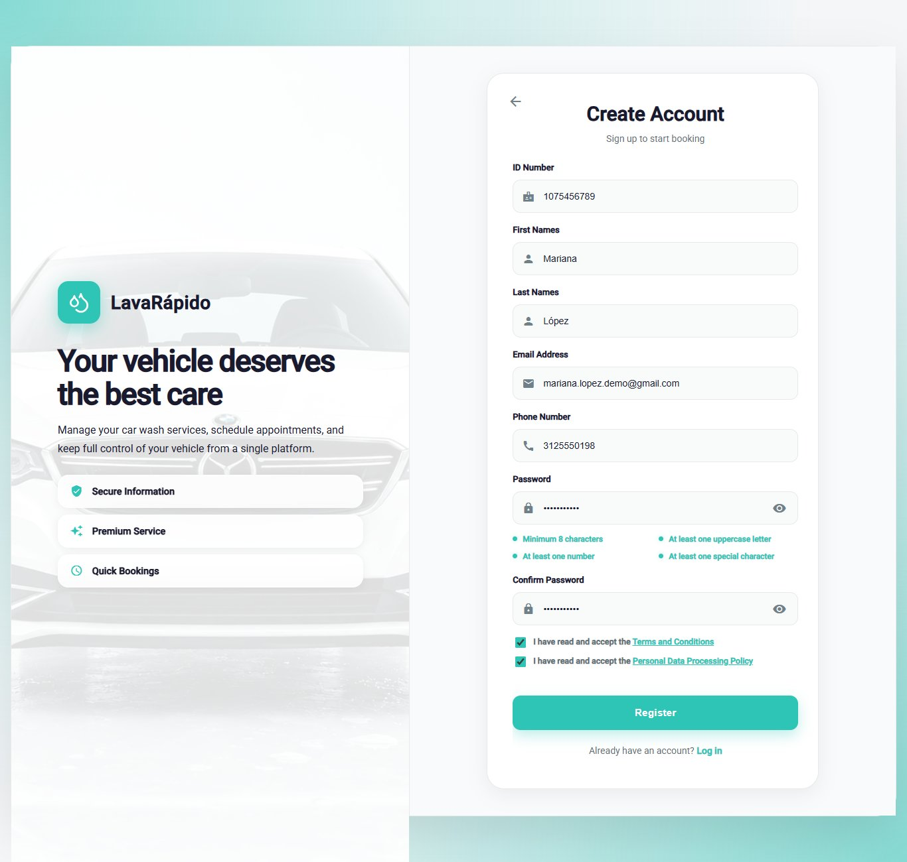

*Note.* No real personal information appears in the screenshot.

**Figure 3**

*Validation Messages in Registration*

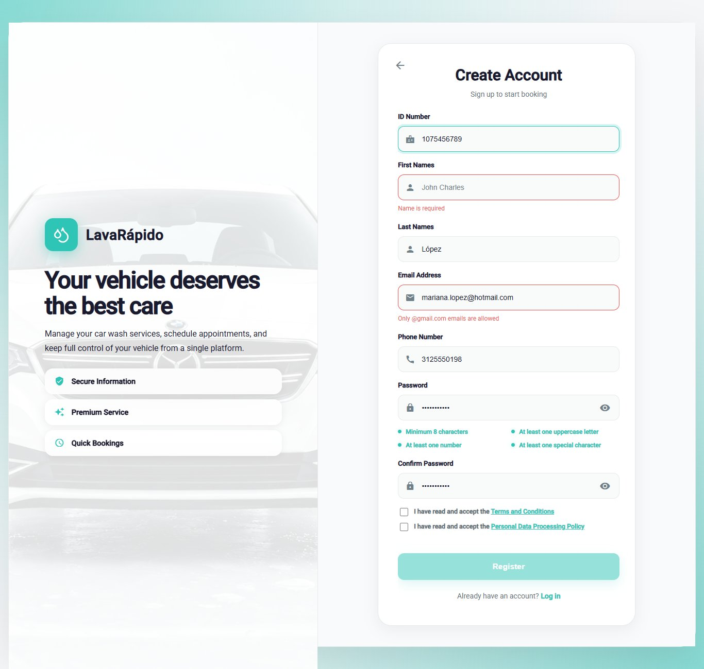

*Note.* Supports Table 8 in section 11.

### 8.2 Logging In

**Module name:** Login.

**Description:** Allows the customer to enter the system with their email and password.

**Role that can use it:** Customer (the operator and the administrator use the same screen).

**Route or menu where it is found:** Welcome screen > **Login** button (route */auth*).

**Steps to use it:**

1. Open the browser and enter the web address of the system.
2. Click **Login**.
3. Type the registered **Email Address**. Sign-in accepts an email of any domain (only the email format is checked), so accounts created earlier with another provider can get in; sign-up still requires @gmail.com.
4. Type the **Password**.
5. Click **Login**. While the request is processed, the button shows "Signing in...".

**Expected result:** The system opens the customer dashboard (route */client*). The theme and the language saved in the account are applied automatically.

**Notes or restrictions:**

- If the email or the password is wrong, the system shows "Incorrect email or password" and does not reveal which of the two failed.
- After five failed attempts within 15 minutes, the account is locked for 15 minutes and the system shows "Too many failed attempts. Your account is locked for 15 minutes; wait or use "Forgot your password?" to get in now." If the customer resets the password, they can log in right away.
- The session lasts one hour; when it expires, the system returns to the login screen with the message "Your session expired. Please sign in again."
- A deactivated account cannot log in and receives the message "Your account is disabled. Contact the administrator."
- If too many attempts are made in a row from the same device (more than 60 in a minute across sign-in, sign-up, and recovery), the system answers "Too many attempts in a row. Wait a moment and try again."

**Figure 4**

*Login Screen*

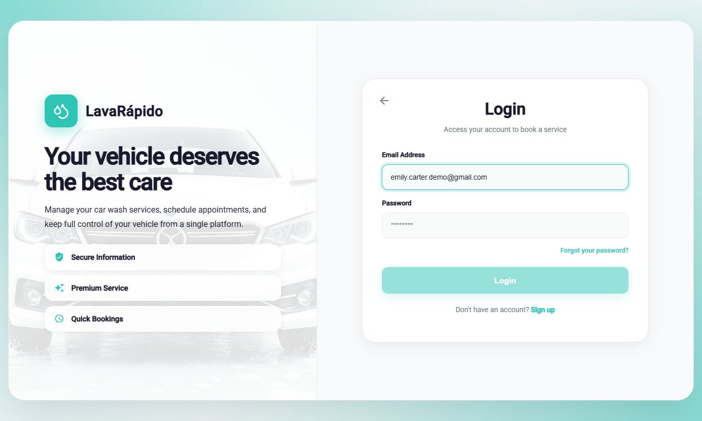

*Note.* A test email was used; no real passwords are shown.

### 8.3 Password Recovery

**Module name:** Password recovery.

**Description:** Allows the customer to recover access to the account when the password has been forgotten, by means of a six-digit verification code sent by email.

**Role that can use it:** Customer.

**Route or menu where it is found:** Login screen > **Forgot your password?** link (route */auth/forgot-password*).

**Steps to use it:**

1. On the login screen, click **Forgot your password?**.
2. **Step 1 (Recover Password):** type the email address of the account and click **Send Code**.
3. Open the email received and copy the six-digit code. The code is valid for 15 minutes.
4. **Step 2 (Verification):** type the six digits, one in each box, and click **Verify Code**. If the email did not arrive, click **Didn't receive the code? Resend**.
5. **Step 3 (New Password):** type the new password, which must meet the four requirements, confirm it, and click **Update Password**.
6. When the message "Password updated!" appears, click **Go to login** and log in with the new password.

**Expected result:** The password is changed, the code used cannot be used again, and the sessions open on other devices are closed.

**Notes or restrictions:** For security, the system shows the same screen whether the email is registered or not, so it does not reveal which accounts exist. Each new code invalidates the previous one ("We sent you a new code. The previous one no longer works."). After five incorrect attempts the code stops working and the system shows "Too many failed attempts. Wait a few minutes or request another code to try again.": request a new one with **Resend**. A three-step indicator at the top shows the stage of the process.

**Figure 5**

*Password Recovery, Step 1: Email Address*

**Figure 6**

*Password Recovery, Step 2: Verification Code*

**Figure 7**

*Password Recovery, Step 3: New Password*

**Figure 8**

*Password Change Confirmation*

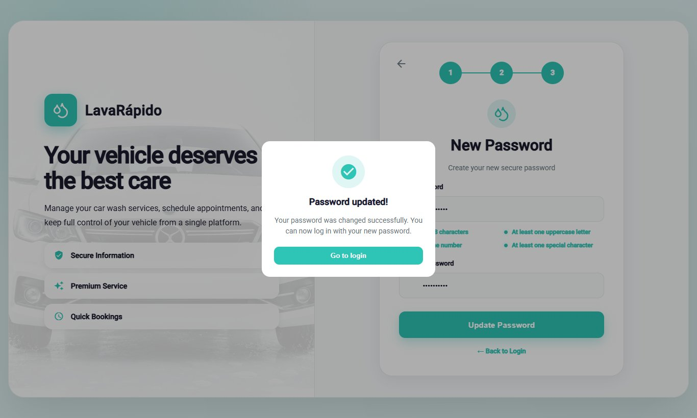

## 9. Main Menu

After logging in, the system shows a side menu with the customer's options (Table 4). At the top of the menu appear the initials, the name, and the email of the customer; at the bottom is the **Log Out** option. On a phone, the menu is opened and closed with the ☰ icon. The customer sees only their own options: if they try to open a screen of another role, the system returns them to their dashboard.

**Table 4**

*Main Menu Options of the Customer*

| Option (route) | What it is for | Section |
|---|---|---|
| Dashboard (/client) | Shows a summary of bookings, vehicles, the next service, quick access links, the loyalty progress, and benefits. | 10.1 |
| Profile (/client/profile) | Allows viewing and editing personal data, changing the email and the password, and deactivating the account. | 10.9 |
| My vehicles (/client/vehicles) | Allows registering, editing, removing, and viewing the customer's vehicles. | 10.2 |
| Book Wash (/client/reserve) | Allows scheduling a new washing service and choosing the payment method. | 10.3 |
| Pay service (/client/payment) | Allows paying a booking with a QR code or in cash, redeeming a coupon, and canceling it. | 10.5 |
| Notifications (/client/notifications) | Shows the notices about bookings, reminders, assignments, service progress, payments, points, coupons, and inspection reports. | 10.7 |
| History (/client/history) | Lists the bookings with their payment status, and allows paying, canceling, and rating them. | 10.6 |
| Settings (/client/configuration) | Allows choosing the theme, the language, and the notification preferences, and opening the help center and the legal documents. | 10.10 |
| Log Out | Ends the session securely. | 12 |

*Note.* The option names are those of the side menu when the interface is in English.

**Figure 9**

*Customer Side Menu*

## 10. System Modules

Each module is documented with the format of the manuals guide: name, description, role that can use it, route or menu, steps, screenshot, expected result, and notes or restrictions.

### 10.1 Customer Dashboard

**Module name:** Customer dashboard.

**Description:** Home screen of the customer. It summarizes the activity and offers shortcuts to the most frequent actions.

**Role that can use it:** Customer.

**Route or menu where it is found:** Side menu > **Dashboard** (route */client*).

**Steps to use it:**

1. Log in; the system opens the dashboard automatically.
2. Review the summary cards: **Active bookings**, **My vehicles**, and **Washes completed**.
3. Check the **Your next service** block, which shows the service, the vehicle, the date, the time, the **Assigned operator**, and the progress of the service. The progress stays at 0% while the booking is scheduled or confirmed, because the wash has not started yet; it rises when the operator starts the service and reaches 100% when it finishes. Click **View detail** to see all the information.
4. Use the **Quick access** links (Book a wash, Pay service, My vehicles, and Notifications) to go directly to each module.
5. Review the **Your benefits and promotions** block: the **Loyalty progress** bar shows the points accumulated ("N of M points") and, for each promotion, either "Unlocked! Redeem it when you pay." or how many points are still missing to unlock it.

**Expected result:** The customer sees the most important information and reaches any module with a single click.

**Notes or restrictions:** If there are no bookings, the block shows "No scheduled services" instead of an empty screen. The points are credited when the administrator approves the payment of a booking (or records a payment at the business), not when the service ends; until the first payment is approved, the benefits block shows "No loyalty data yet". Points are never spent: they unlock coupons, and redeeming a coupon does not reduce the balance.

**Figure 10**

*Customer Dashboard*

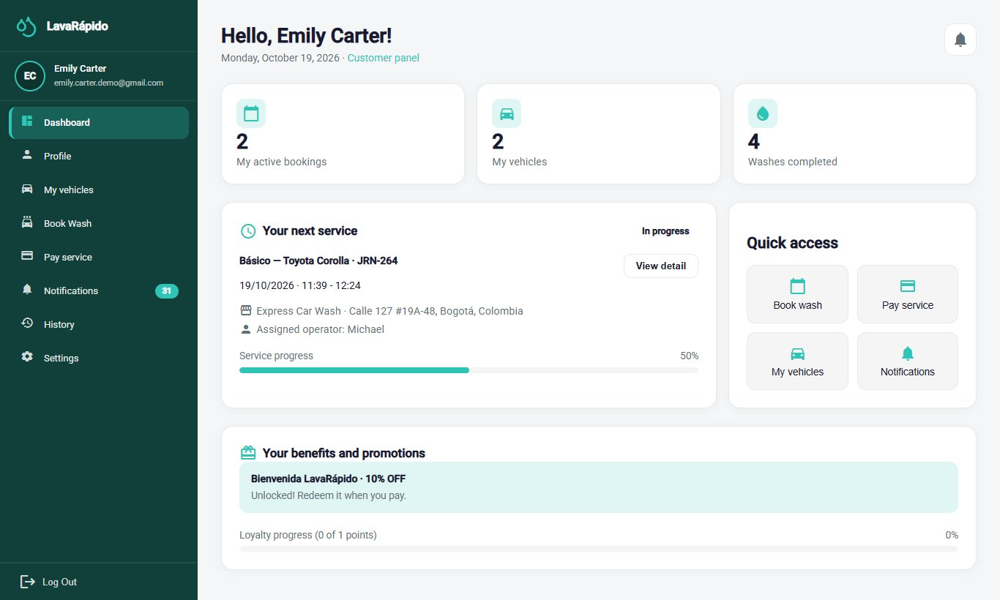

### 10.2 My Vehicles

**Module name:** My vehicles.

**Description:** Allows registering the customer's vehicles and viewing, for each one, the last wash and the total number of washes. A vehicle must be registered before a service can be booked.

**Role that can use it:** Customer.

**Route or menu where it is found:** Side menu > **My vehicles** (route */client/vehicles*).

**Steps to use it:**

1. Click **My vehicles** in the side menu.
2. Review the indicators at the top: **Registered vehicles**, **Accumulated washes**, and **Last wash performed**.
3. To add a vehicle, click **Register vehicle**.
4. In the "Register new vehicle" window, select the **Vehicle type** (Car, Sedan, SUV, Pickup, Truck, or Motorcycle) and type the **Brand**, the **Model**, the **Plate**, and the **Color**.
5. Click **Save vehicle** and verify that the vehicle appears in the list with the message "Vehicle registered!".
6. To correct the data of a vehicle, use the edit option of its card, change the fields, and click **Save changes**.
7. To remove a vehicle, use the delete option of its card and confirm in the "Delete vehicle?" window.

**Expected result:** The vehicle is registered and available to be selected when booking a wash.

**Notes or restrictions:**

- The plate must be an official Colombian plate: three letters and three numbers for cars and other vehicles (for example, ABC123), or three letters, two numbers, and one letter for motorcycles (for example, ABC12D). Foreign or promotional plates are not accepted.
- The brand is mandatory (at least two characters) and the color only accepts letters. The same plate cannot be registered twice while the vehicle is active.
- The vehicle type matters because it determines the price of each service.
- If the vehicle has active or upcoming bookings, the system does not remove it and shows "This vehicle has active or upcoming bookings: cancel them before removing it."

**Figure 11**

*Customer Vehicle List*

**Figure 12**

*Form to Register a Vehicle*

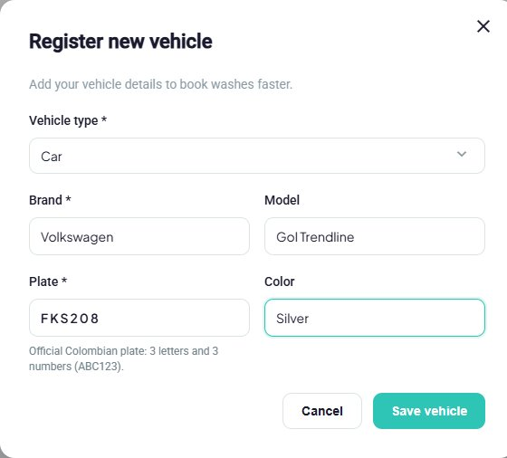

### 10.3 Book a Wash

**Module name:** Book a wash.

**Description:** Allows scheduling a washing slot by choosing the vehicle, the type of service, the date, the time, and the payment method. The system only offers times that are really free.

**Role that can use it:** Customer.

**Route or menu where it is found:** Side menu > **Book Wash** (route */client/reserve*), or the **Book a wash** quick access link of the dashboard.

**Steps to use it:**

1. Click **Book Wash**.
2. **Step 1 (Choose your vehicle):** select one of the registered vehicles. If the vehicle is not listed, use the **My Vehicles** link to register it first.
3. **Step 2 (Service type):** select Basic, Premium, or Complete. Each card shows what it includes, the duration, the price for the type of vehicle chosen, and the loyalty points it adds ("Earns N points").
4. **Step 3 (Date and time):** choose the date (the calendar does not allow past days) and then one of the free times shown in **Select a time**. The times are offered every 30 minutes, within the opening hours, outside the break, and only when a washing bay is free for the whole duration of the service.
5. Optionally, choose in **Operator (optional)** one of the operators who are free at that time. If it is left as "No preference: we assign a free one", the system assigns one automatically.
6. **Step 4 (How will you pay?):** choose one of the two options:
   - **Digital payment now:** Nequi, Daviplata, or bank transfer. The QR code is scanned and the receipt is uploaded **within the next 30 minutes** (or before the service time, if that comes first).
   - **Cash at the car wash:** paid on arrival, and the administrator records the payment, without a receipt. It only appears if the business has the cash account active, and the customer can have **at most one active cash booking**.
7. Review **Your booking summary**: vehicle, plate, service, estimated duration, date, time, location, total, and **Points you earn**. While a piece of data is missing, the confirm button stays disabled and the list of what is missing appears below it.
8. Click **Book Now**.

**Expected result:** The booking is created immediately with the status Confirmed and a washing bay, and the customer receives the confirmation in their notifications and by email. What follows depends on the payment method:

- **Digital payment:** the system opens the payment screen of that booking directly, with the notice "You have a deadline to pay: Upload the receipt before HH:mm or the booking will be released." If the receipt is not uploaded in time, the booking is cancelled automatically with the reason "The payment receipt was not uploaded in time" and the slot is freed for other customers.
- **Cash:** "Booking created!" appears with the summary and the message "Your wash is scheduled. You pay in cash at the car wash."; the **View my bookings** button opens the history. There is nothing to pay online.

**Notes or restrictions:**

- Choosing the operator is optional. If the chosen operator is no longer free when the booking is confirmed, the system assigns another one ("If the operator you chose is no longer free when we confirm, we assign another one."). The assigned operator is shown in the dashboard and in the notifications, and the administrator can change it later.
- Bookings can be made up to 60 days in advance.
- If the day is closed, the system shows "The car wash is closed that day"; if there are no free times, "No free times that day".
- If another person takes the time while the customer is booking, the system saves nothing, shows "That time was just taken", and lists the closest free times of that same day (up to five) so that the customer can choose another one.
- If the chosen time cannot be booked for another reason, the system explains which one: "The car wash is closed that day. Choose another date.", "At that time the service does not fit in the opening hours. Choose another time.", or "That time has already passed. Choose a later time."
- A vehicle cannot have two bookings at the same time ("That vehicle already has a booking at that time.").
- The service is provided at the business: the customer must bring the vehicle on the booked date and time.
- If the customer already has an active cash booking (Scheduled, Confirmed, or In progress), they cannot make another one in cash: the system shows "You already have an active booking paid in cash. Pay it or cancel it, or choose digital payment." Cash becomes available again when that booking ends, is cancelled, or is marked No show (it is not enough for the administrator to record the payment).
- While the booking with digital payment is waiting for the receipt, the History and the detail show the badge "Pay before HH:mm". Once the receipt is sent, the booking no longer expires, even if the administrator has not reviewed it yet.
- The payment method does not change if the administrator reschedules the booking. Bookings made before October 26, 2026 have no payment method and no deadline.

**Figure 13**

*Book a Wash, Steps 1 and 2: Vehicle and Service*

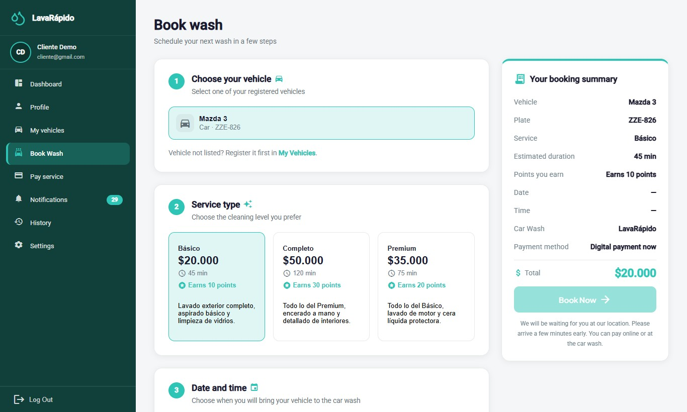

**Figure 14**

*Book a Wash, Steps 3 and 4: Date, Time, and Payment Option*

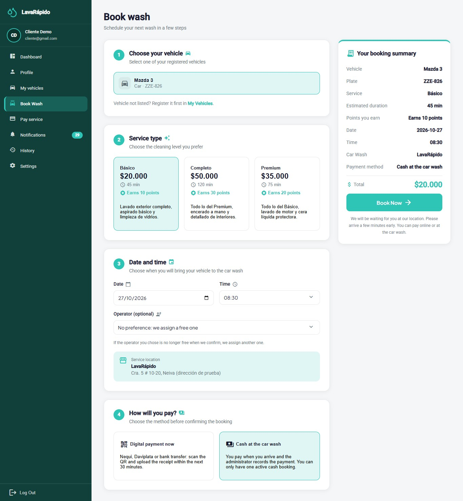

*Note.* The "How will you pay?" step exists since October 26, 2026.

**Figure 15**

*Confirmation of a Booking Paid in Cash*

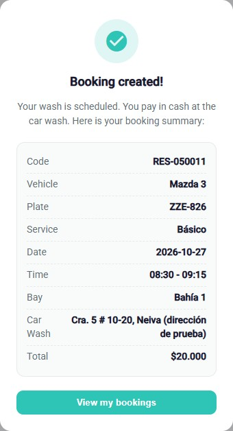

### 10.4 View or Cancel a Booking

**Module name:** Booking follow-up and cancellation.

**Description:** Allows checking the status of a booking and canceling it before the service starts.

**Role that can use it:** Customer.

**Route or menu where it is found:** Dashboard > **Your next service** > **View detail**; side menu > **History**; or side menu > **Pay service**.

**Steps to use it:**

1. Open the **Dashboard** or **History** and locate the booking.
2. On the Dashboard, click **View detail** to check the service, the vehicle, the date, the time, the assigned operator, and the status. In **History**, click the booking card to see its detail (section 10.6).
3. To cancel, click **Cancel booking** on the booking card in **History** (or on the **Pay service** screen).
4. Read the message "Cancel booking?" and click **Yes, cancel**; click **Back** to keep the booking.

**Expected result:** The booking changes to Cancelled, the message "Booking cancelled" appears, the customer receives the notice by email, and the slot becomes free for other customers.

**Notes or restrictions:** A booking can only be canceled before its start time; afterwards the system shows "This booking can no longer be changed." The cancellation cannot be undone. The application does not offer the option to change the date or the time of a booking: to move it, the customer cancels it and books again, or contacts the business so that the administrator reschedules it. If the booking already had an approved payment, the administrator decides on the refund.

**Table 5**

*Booking Statuses*

| Status | Meaning | Can the customer cancel it? |
|---|---|---|
| Scheduled | The booking was registered and is pending confirmation. | Yes, before the start time. |
| Confirmed | The booking has a slot and a washing bay. Bookings made by the customer are created with this status. | Yes, before the start time. |
| In progress | The operator started the wash. | No. |
| Completed | The service is finished; from this status it can be rated. | No. |
| Cancelled | The booking was voided by the customer or by the business, or the system closed it because one hour passed after its end without being confirmed or because the digital payment receipt was not uploaded in time ("The payment receipt was not uploaded in time"). | Not applicable. |
| No show | The customer did not arrive at the booked slot and the business recorded it. If the confirmed booking never had an operator, the system marks it this way one hour after its end time. | Not applicable. |

*Note.* Prepared by the authors from the booking statuses defined in the system.

**Figure 16**

*Booking Cancellation Confirmation*

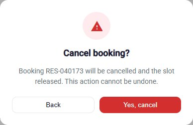

### 10.5 Pay for a Service

Payment is made by transfer to the business's account (scanning its QR code or using its account data) or in cash at the business. The system **does not request or store credit or debit card data** and does not connect to banks: an administrator verifies each digital payment manually (Table 6).

The payment method is chosen when booking (section 10.3), and the **Pay service** screen follows it: on a booking with **digital payment**, cash is not offered and the deadline is shown ("Upload the receipt before HH:mm or the booking will be released."); on a **cash** booking, the Cash method appears preselected with the notice "You pay in cash at the car wash: The administrator records the payment when you arrive; you don't need to upload a receipt.", and in the History that booking shows "You pay in cash at the car wash" instead of **Pay now**.

**Table 6**

*Available Payment Methods*

| Method | How it is paid | Is a receipt required? |
|---|---|---|
| Nequi | The QR code is scanned and the transfer is made from the app. | Yes |
| Daviplata | The QR code is scanned and the transfer is made from the app. | Yes |
| Transfer | The QR code is scanned or the account data shown is used. | Yes |
| Cash | Paid at the business when the service is received. No QR code is shown. It only appears if the business keeps the cash account active. | No; the administrator records the payment at the business. |

*Note.* The methods shown, Cash included, depend on the payment accounts that the administrator keeps active.

**Module name:** Pay service.

**Description:** Allows paying a booking by attaching the receipt of the digital payment, or confirming that it will be paid in cash, with the option of redeeming a discount coupon.

**Role that can use it:** Customer.

**Route or menu where it is found:** Side menu > **Pay service** (route */client/payment*); it opens on its own after booking with digital payment, and also with **Pay now** in History.

**Steps to use it:**

1. Open **Pay service** and review the **Booking summary**: service, vehicle, **Subtotal**, **Discount applied**, and **TOTAL TO PAY** (VAT of 19% included). On a booking with digital payment, also check the time limit of the deadline notice.
2. If you have an unlocked coupon, type it in **Coupon code** and click **Apply**. The message "Coupon applied: [name]" appears, and the discount is subtracted from the total to pay. To remove it before reporting the payment, click the **X** next to the coupon: the system cancels the redemption and the total goes back to the booking's. The **TOTAL TO PAY** is calculated by the server: if the page is reloaded or opened again after applying the coupon, the screen still shows the coupon, the discount, and the **X**.
3. In **Select your payment method**, choose Nequi, Daviplata, or Transfer (on a cash booking, Cash is already selected).
4. Scan the QR code with the banking or wallet app, or copy the number shown in **Authorized key / account** with **Copy number**, and transfer exactly the **Amount to pay**. If the code is hard to read, **Enlarge QR** shows it bigger, with **Zoom in** and **Zoom out** (also with the mouse wheel or a double click).
5. In **Confirm your payment**, drag the image of the receipt or click to browse for it (JPG or PNG of up to 10 MB). The page reduces it below 2 MB before sending it; meanwhile it shows "Preparing the receipt...".
6. Type the **Transaction reference** printed on the receipt (8 to 12 letters or numbers issued by the bank) and check the **Amount paid**, which comes filled with the amount due and must match the amount transferred (greater than 0).
7. Click **I've made the payment**. While data is missing, the button stays disabled and the list "To confirm the payment you still need to:" shows what is pending (receipt, reference, or amount).
8. On a cash booking, the screen shows **Cash** selected, the **Cash payment** block ("You'll pay directly at the shop when you pick up your vehicle. Your booking is held for you."), and the **Confirm booking** button, which only shows the notice "You pay at the car wash: Pay in cash when you pick up your vehicle. The administrator will record the payment and you will get the payment-approved notification." No receipt has to be uploaded: the money is brought on the day of the service.

**Expected result:** The system shows "Payment sent!" and the payment remains in review ("Payment under review") until an administrator approves or rejects it. The customer receives a notification and an email with the result.

**Notes or restrictions:**

- The amount due is always calculated by the system (booking total minus the coupon applied, if any); the customer cannot change it. The amount paid that the customer declares is compared by the administrator with the receipt and the bank. If the system cannot get the total, it shows "—" and the notice "We couldn't get the amount to pay. Check your connection and come back in a few seconds."; in that case, do not pay until the amount appears.
- Only bookings in Confirmed, In progress, or Completed status can be paid.
- While a payment is in review, another one cannot be reported for the same booking ("There is already a payment under review for this booking."); a booking admits a single approved payment. A reference already used in another payment is rejected ("That reference was already used in another payment. Check your receipt number.").
- If the booking changes after the payment is reported (for example, the administrator changes its services), the administrator rejects the payment with the old amount and the customer reports it again with the new amount shown on screen. If the administrator rejects the payment for another reason, the customer can report it again with a correct receipt.
- A booking with digital payment has a deadline to upload the receipt: 30 minutes from when it was made, or the service time if that comes first. If it passes, the booking is cancelled automatically and can no longer be paid ("This booking can no longer be paid (it is cancelled, paid or under review)."): the customer has to book again.
- If the image cannot be reduced below 2 MB, the message "We could not reduce the image below 2 MB. Try a screenshot of the receipt." appears.
- When the payment is approved, the customer receives the notice "Payment confirmed" (inbox and email), the loyalty points of the booking ("You earned N points", inbox only), and, for each coupon those points unlock, the notice "You have a redeemable coupon!" with its code (inbox and email). If the payment is rejected or refunded, the customer receives a notice and an email; a refund reverses the points earned by that booking.
- Once the payment is approved, the **Pay service** screen of that booking only shows the summary: the payment method, the QR code, the receipt upload, and the **I've made the payment** button disappear, and the coupon used can no longer be removed.
- A coupon is accepted only if it is active, is within its dates, and the customer has reached the points it requires; only one coupon is accepted per booking ("This booking already has a coupon. Remove it if you want to use another one."). A percentage coupon is recalculated if the booking total changes; a fixed discount is shown in pesos. The system answers "That coupon doesn't exist.", "That coupon isn't active, or you haven't reached the points it needs yet.", or "You already redeemed this coupon on this booking." A successful redemption sends a confirmation notice and email.

**Table 7**

*Payment Statuses*

| Status | Meaning | What the customer must do |
|---|---|---|
| Pending | The booking does not yet have an approved payment. | Make the payment (or bring the cash on the day of the service). |
| In review | The receipt was submitted and awaits the administrator's verification. | Wait for the verification. |
| Approved | The administrator verified the payment. | No action. |
| Rejected | The payment could not be verified; the administrator records the reason. | Report the payment again with a correct receipt. |
| Refunded | The amount of the payment was returned to the customer. | No action. |

*Note.* On the History cards these statuses are shown as Pending verification, Under review, Paid, Rejected, and Refunded.

**Figure 17**

*Payment Screen With the Deadline to Upload the Receipt*

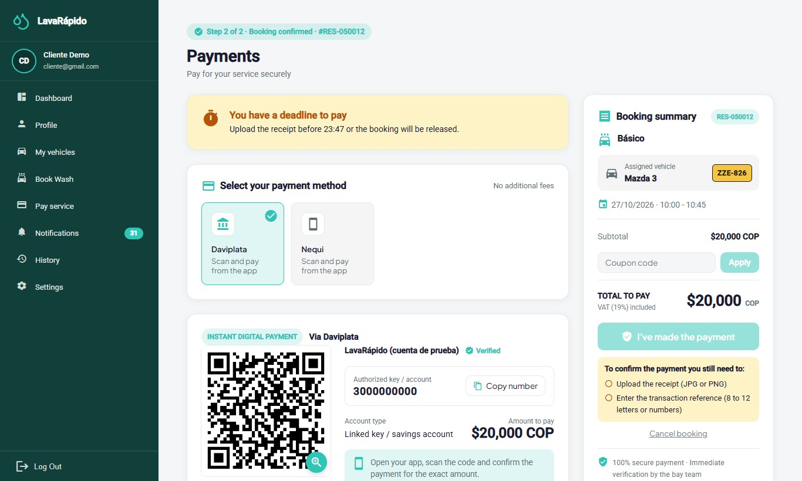

*Note.* It opens on its own after booking with digital payment.

**Figure 18**

*Payment Screen of a Booking Paid in Cash*

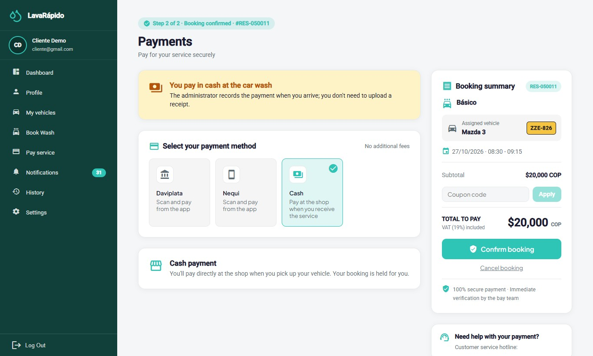

**Figure 19**

*Payment Method, QR Code, and Receipt Upload*

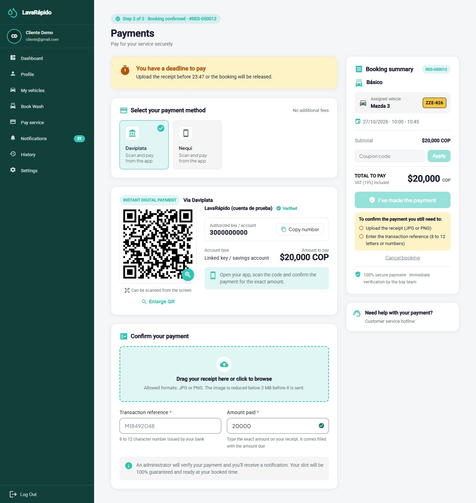

*Note.* A test QR code was used; no real bank accounts are shown.

### 10.6 History and Rating

**Module name:** History.

**Description:** Lists the customer's bookings with their status and payment status, and allows paying, canceling, and rating them.

**Role that can use it:** Customer.

**Route or menu where it is found:** Side menu > **History** (route */client/history*).

**Steps to use it:**

1. Click **History**. Bookings appear from the newest to the oldest.
2. Use the **All**, **Active**, **Completed**, and **Cancelled** filters, and the **From** and **To** dates, to narrow the list.
3. Use **Search by service, vehicle or code** to find a booking.
4. On each card, review the **Service type**, the **Vehicle**, the **Status**, and the **Payment** status, and use **Pay now** or **Cancel booking** when they are available. **Pay now** appears only when the booking can be paid (payable status, without an approved payment and without one pending or in review); a cash booking shows "You pay in cash at the car wash" and one with a pending digital payment shows the badge "Pay before HH:mm".
5. Click the card to open the **Booking details** (services, date and time, vehicle, total, payment status, and rating). The **Go to payment** button opens the payment screen of that booking; it does not appear on cancelled or no-show bookings.
6. On a completed service, click **Rate Service**.
7. Choose from one to five stars, write a comment if desired (maximum 500 characters), and click **Submit rating**.

**Expected result:** The message "Thanks for your rating!" appears, the card shows **Rated**, and the operator who performed the service can see the rating.

**Notes or restrictions:** Rating is optional, is allowed only once per booking, and only when the booking is Completed; it cannot be modified afterwards. If there are no bookings for the filters chosen, the system shows "No services found".

**Figure 20**

*History With Filters*

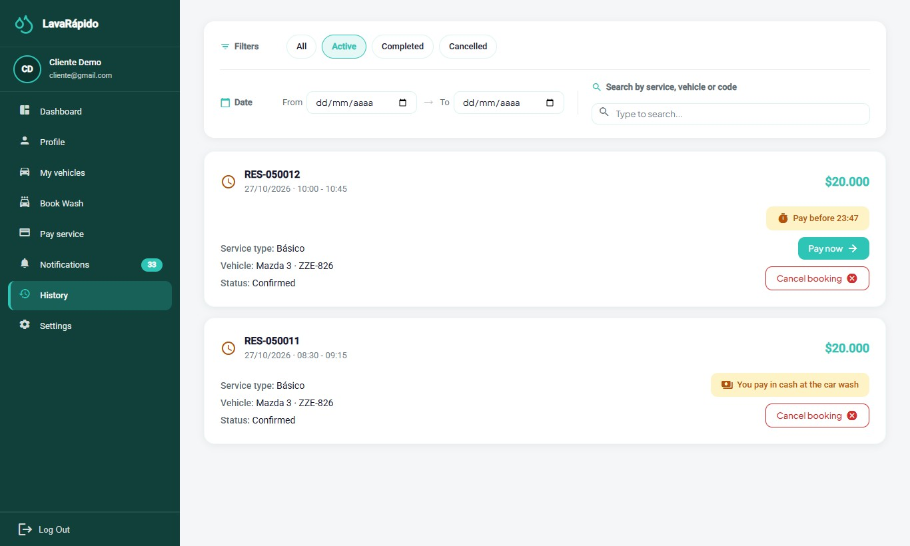

**Figure 21**

*Rating of a Completed Service*

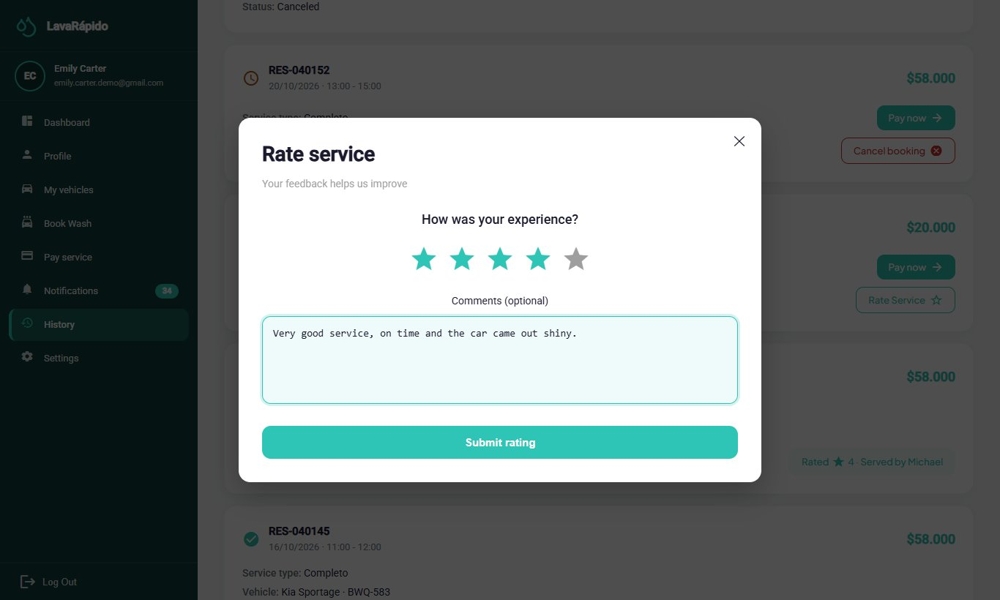

### 10.7 Notifications

**Module name:** Notifications.

**Description:** Gathers the notices of the system (booking created, confirmed, or cancelled, reminders, operator assigned, service started and completed, payment confirmed, rejected, or refunded, points earned, coupon unlocked or redeemed, and vehicle inspection report) and indicates which ones have been read.

**Role that can use it:** Customer.

**Route or menu where it is found:** Side menu > **Notifications** (route */client/notifications*), or the quick access link of the dashboard.

**Steps to use it:**

1. Click **Notifications**. The header shows how many notifications are unread.
2. Use the **All**, **Reminders**, **Promotions**, **Confirmations**, and **Others** tabs to filter by type.
3. Use the **Read status** filter and the dates to narrow the list.
4. Click a notification (or **View detail**) to read it completely; it is marked as read. If the notice belongs to a section, the detail has a button to go there: **Go to history** (bookings, payments, service, and inspection report) or **Go to home** (welcome, points, and coupons).
5. Use **Mark as read** or **Mark as unread** on each notification, or **Mark all as read**.
6. To delete a notification, use the delete option and confirm "Delete this notification?".

**Expected result:** The customer stays informed without checking each module constantly.

**Notes or restrictions:** The system sends reminders 24 hours and 1 hour before each booking. Notices that change something for the customer are also sent by email: welcome, booking created, confirmed, or cancelled and reminders, payment confirmed, rejected, or refunded, coupon redeemed or unlocked, and inspection report. The progress of the service (operator assigned, started, and completed) and the points earned arrive only in the inbox and as push notifications. The password recovery code always arrives by email. The switches of **Settings > Notifications** decide only the external channels; the inbox always receives every notice. A deleted notification cannot be recovered.

**Figure 22**

*Customer Notification Center*

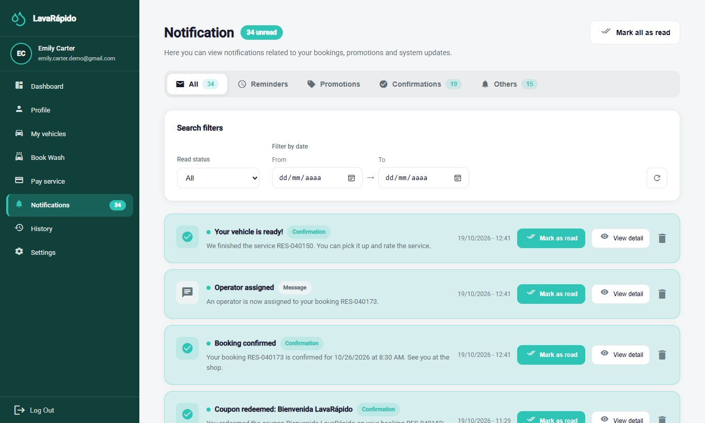

### 10.8 Vehicle Inspection Report

**Module name:** Your vehicle report (inspection report).

**Description:** Read-only page where the customer sees how the business received and delivered the vehicle, by phases (Reception, Exterior, Interior, Engine, and Delivery), with the notes and the photographs of each finding.

**Role that can use it:** Customer who received the link. Logging in is not needed: the link is personal and only the person who receives it knows it.

**Route or menu where it is found:** Link of the "Inspection report" notice that arrives in **Notifications** and by email (route */report/* followed by a unique code).

**Steps to use it:**

1. Open the inspection report notification or email and click the link.
2. Read the **Your vehicle report** header, with the subtitle "How your vehicle service is going at the car wash", the progress ("N of M phases completed"), and the date of the last update ("Updated: ...").
3. Review each phase with its status (**Pending**, **In progress**, or **Done**) and its start and end times. A phase without findings shows "Nothing to report in this phase".
4. In each finding, read the part of the vehicle, the type (**Note**, **Minor damage**, or **Major damage**), the note, and the photographs.
5. Open the link again later to see the progress: the page shows the changes the business publishes.

**Expected result:** The customer knows the condition of the vehicle before and after the service, with photographic evidence.

**Notes or restrictions:** The report only exists for services of three hours or more and only if the business decides to prepare and publish it. If the link is invalid or the report has not been published yet, the page shows "This report is not available: The link is invalid or the report has not been published yet. Contact the car wash if you think this is a mistake." The photos and notes are recorded by the business; the customer cannot modify them. For any disagreement, the customer must contact the business (Terms and Conditions, section 8).

### 10.9 Profile

**Module name:** Profile.

**Description:** Allows viewing and updating personal data, changing the email and the password, and deactivating the account.

**Role that can use it:** Customer.

**Route or menu where it is found:** Side menu > **Profile** (route */client/profile*).

**Steps to use it:**

1. Click **Profile**. The "My Profile" screen opens in view mode with the first names, last names, email, phone, address, and the date since which the person is a customer.
2. To modify the data, click **Edit profile**, change the fields, and click **Save**; the message "Profile updated!" appears.
3. To change the email, which is the login username, type the new one and confirm with the current password in the window "Confirm the email change"; from then on the new email is used to log in.
4. To change the password, go to **Password** and click **Change**. Type the **Current password**, the **New password**, and **Confirm new password**, and click **Save**.
5. To stop using the account, go to **Account**, click **Deactivate my account**, read the message, and confirm with the password.

**Expected result:** The data is updated. If the password was changed, the new one is used at the next login.

**Notes or restrictions:** If the current password is wrong, the change is rejected ("The current password is incorrect"); the new password must be different from the current one. The account is deactivated, not erased: the customer can no longer log in and the sessions are closed, but the history of bookings and payments is kept. To reactivate it, the customer must contact the administrator. The **Address** is saved in the account, so it appears the same on any device.

**Figure 23**

*Customer Profile*

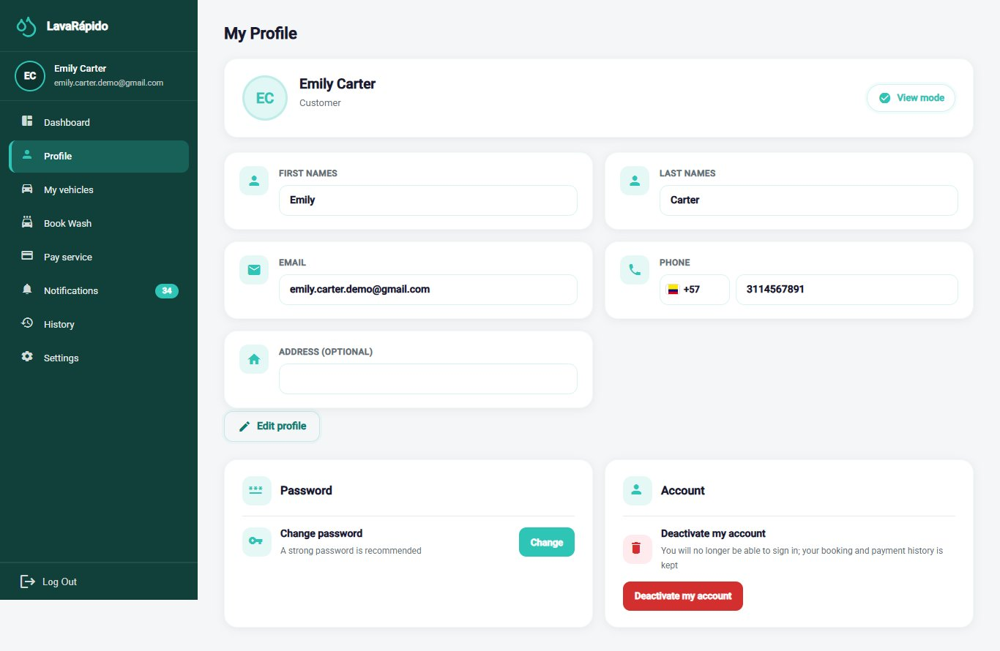

### 10.10 Settings

**Module name:** Settings.

**Description:** Allows customizing the appearance, the language, and the notification preferences, and opening the help center and the legal documents.

**Role that can use it:** Customer.

**Route or menu where it is found:** Side menu > **Settings** (route */client/configuration*).

**Steps to use it:**

1. Click **Settings**.
2. Under **Appearance**, click **Choose theme** and select one of the four color themes. The change is applied immediately.
3. Under **Languages**, select Español, English, Français, or Português. All the texts of the interface change to the chosen language.
4. Under **Notifications**, turn **Push notifications on your phone**, **Email Reminders** (booking reminders by email, one day and one hour before), and **Promotions and Offers** (alerts for the coupons you unlock with your points, by email and push) on or off.
5. Under **Help**, click **Open** next to **Help Center** to see the support line, email, opening hours, and address, taken from the data of the business registered in the system.
6. In the same **Help** card, open **View Terms and Conditions** or **View Data Policy**.

**Expected result:** The theme, the language, and the notification switches are applied immediately and are saved in the account, so they are kept at the next login and on any device.

**Notes or restrictions:** Turning off **Push notifications on your phone** stops the notices to the phone; turning off **Email Reminders** stops only the reminder emails; turning off **Promotions and Offers** stops the email and push alerts of unlocked coupons. The inbox is not affected by any switch. If the change cannot be saved, the system shows "Your notification preferences could not be saved. Please try again." Dates are shown in the format of the selected language.

**Figure 24**

*Customer Settings Screen*

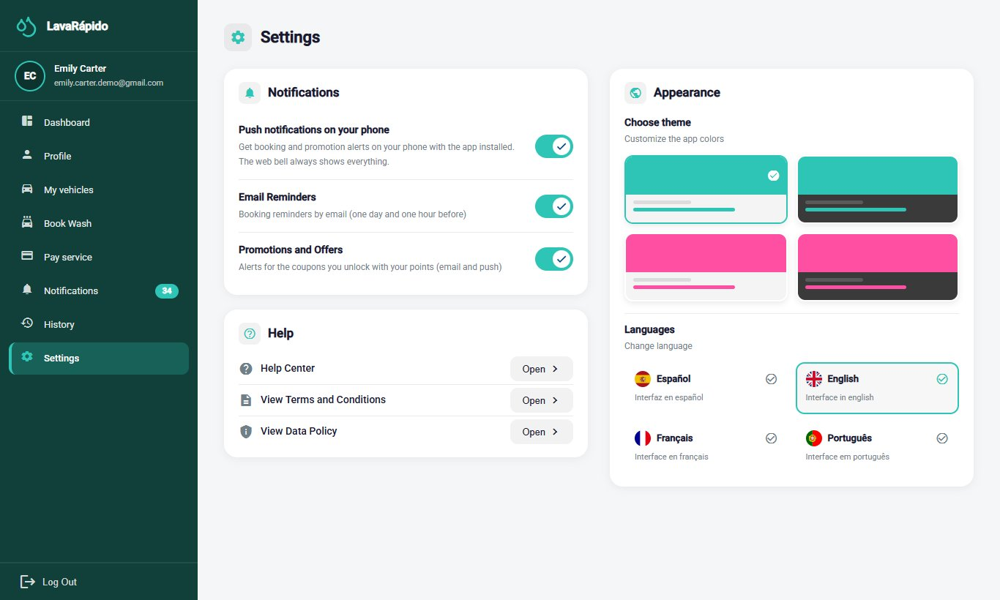

### 10.11 Android Mobile Application

The **LavaRapidoVehicular** application (version 1.1.1, APK *versionCode* 6, published on October 26, 2026) offers the customer the same functions as the web, with the same rules and the same data: a booking made in the app appears on the web and vice versa. This section explains how to install it and how its use differs; the rules of each module are those of sections 10.1 to 10.10.

**Installation.** The app is not on Google Play: it is installed from the business's website on an Android phone with an internet connection.

1. On the welcome screen of the web, tap the app download button or scan the QR code (the file is */app/LavaRapidoVehicular.apk*).
2. Open the downloaded file and tap **Install**. The first time, Android asks to allow the browser to install applications.
3. Open **LavaRapidoVehicular**. If there was a version older than the package change of October 16, 2026, uninstall it once; the following ones install over it.

**Updates.** If the business publishes a new APK, when the app opens the screen **Update the app to continue** appears with the **Download** button; it installs over the current one without losing the account or the data, and until it is installed the app cannot be used. Screen changes arrive on their own over the internet: when the app opens, **Update ready** appears; **Restart now** shows them right away and, otherwise, they apply the next time the app is opened.

**Sign-in and sign-up.** The sign-in screen asks for the email and the password with the same rules as section 8. From it the customer account is created (the same data and the acceptance of the two legal documents of section 8.1) and the password is recovered with the 6-digit code (section 8.3); if the code is mistyped five times, the app offers **Request another code**. The session is stored encrypted on the phone and lasts one hour.

**Navigation.** At the bottom there is a bar with **Home**, **Book**, **History**, and **Alerts**; the **More** button opens **My vehicles**, **Profile**, **Pay service**, **Settings**, and **Log Out**.

- **Home:** greeting, cards for active bookings, vehicles, washes done, and notifications, the **Your next service** block (status, operator, and progress), the quick access buttons, and the benefits and promotions block (section 10.1).
- **Book:** the steps on one screen: choose the vehicle, the type of service (with the estimated duration and the points it adds), the date and time (closed days and taken times are not offered), the operator (optional), with no preference by default, and **How will you pay?** (digital payment now or cash at the car wash). With digital payment, **Book Now** goes to pay with the deadline; with cash, it shows the summary and that payment is made at the car wash (section 10.3).
- **Pay service:** choose the business's account (or cash payment, if the booking is in cash), enlarge the QR with **Enlarge QR**, apply a coupon (and remove it with the **X**), attach the receipt, which the app reduces to less than 2 MB, and type the transaction reference. After sending, **Payment sent!** appears; when the administrator approves it, the screen refreshes on its own with the push notification. The booking can also be cancelled from this screen (section 10.5).
- **History:** filters for all, active, completed, and cancelled bookings, search by service, vehicle, or code, and the detail of each booking with **Pay now**, **Cancel booking**, and **Rate Service** (section 10.6).
- **My vehicles**, **Alerts**, **Profile**, and **Settings** work as in sections 10.2, 10.7, 10.9, and 10.10.

**Push notifications.** When signing in, the app asks for permission to send notifications. If it is granted, the phone receives by push the same notices as the inbox (reminders 24 hours and 1 hour before, operator assigned, service started and finished, payments, points, and coupons, among others), and tapping one opens the related screen. Android groups them in the channels **Reminders**, **Promotions and points**, **Confirmations**, **Cancellations**, **Service messages**, and **System**, which can be muted from the phone's settings. The app shows the exact reason of the server errors in the four languages.

**Logging out in the app.** Open **More** and tap **Log Out**, which asks for confirmation; after signing out, the phone stops receiving that account's notifications. Known limitation, recorded in the Corrective Actions document (ACO-39): if the session expires while the app is in the background, the phone may keep receiving that account's notifications until signing in again or logging out from **More**.

## 11. Messages and Validations

The system validates the information while the customer types. When a piece of data is not correct, it highlights the field with a red border and shows a message below it. Tables 8 and 9 explain the meaning of the most frequent messages and what the customer must do.

**Table 8**

*Messages of the Registration, Login, and Recovery Forms*

| System message | Meaning | Customer action |
|---|---|---|
| Email is required | The email field is empty. | Type the email address. |
| Please enter a valid email | On sign-in or recovery, the email does not have an email format. | Correct the email. |
| Only @gmail.com emails are allowed | In registration, an email from another provider was typed. | Use a Gmail account. |
| ID number is required / Must have between 5 and 20 digits | The ID number is empty or has an invalid length. | Type the ID number with digits only. |
| Name is required / Must contain at least 3 characters | The first names are empty or too short. | Type the first names. |
| Last names are required / Must have at least 2 characters | The last names are empty or too short. | Type the last names. |
| Phone number is required | The phone field is empty. | Type the mobile number. |
| Must start with 3 (Colombian mobile number) | The number does not start with 3. | Type a Colombian mobile number. |
| The number must contain 10 digits | The phone has fewer than 10 digits. | Complete the 10 digits. |
| You must confirm the password / Passwords do not match | The confirmation is empty or different from the password. | Type the same password in both fields. |
| The password does not meet the security requirements | One of the four requirements is missing. | Follow the list of requirements. |
| You must accept the Terms and the Data Policy to continue | One of the two legal documents was not accepted. | Read and accept both documents. |
| You must accept the personal data policy (Law 1581) to sign up. | The server received the sign-up without both acceptances. | Check both boxes and sign up again. |
| Too many attempts in a row. Wait a moment and try again. | More than 60 attempts were made in a minute from the same device. | Wait a minute and try again. |
| Too many failed attempts. Wait a few minutes or request another code to try again. | The recovery code or the current password was mistyped five times. | Request another code; if it was the current password, wait 15 minutes. |
| An account with this email already exists | The email is already registered. | Log in or recover the password. |
| An account with this ID number already exists | The ID number is already registered. | Verify the data or contact the business. |
| Incorrect email or password | The credentials do not match any account. | Check the data and try again, or recover the password. |
| Too many failed attempts. Your account is locked for 15 minutes... | The password was typed wrong five times within 15 minutes. | Wait 15 minutes or use Forgot your password?. |
| Your account is disabled. Contact the administrator. | The account was deactivated. | Ask the administrator to reactivate it. |
| The code is wrong, already used or expired. Request a new one. | The recovery code is not valid. | Request a new code. |
| Password updated! | The password was changed successfully. | Log in with the new password. |

*Note.* Texts taken from the English translation file of the web application.

**Table 9**

*Messages of Vehicles, Bookings, Payments, and Ratings*

| Message or situation | Meaning | Customer action |
|---|---|---|
| Your session expired. Please sign in again. | The one-hour session ended, or the session was closed (for example, because the administrator deactivated the account). | Log in again. |
| You do not have permission to perform this action | The action belongs to another role or to another person's data. | Use only the customer options. |
| Your customer profile is not ready yet. Please try again in a few minutes. | The customer profile is being created after registration. | Wait a moment and try again. |
| A vehicle is already registered with this plate | The plate belongs to an active vehicle. | Verify the plate. |
| The plate format does not match the vehicle type | The plate does not follow the official format for the type chosen. | Correct the plate or the type. |
| This vehicle has active or upcoming bookings: cancel them before removing it. | An attempt was made to remove a vehicle with pending bookings. | Cancel those bookings or wait for them to finish. |
| That time was just taken | The slot was taken while booking. | Choose one of the times suggested. |
| The car wash is closed that day. Choose another date. | The chosen day is marked as closed. | Choose another date. |
| At that time the service does not fit in the opening hours. Choose another time. | The service would end after closing time or overlaps the break. | Choose another of the free times. |
| That time has already passed. Choose a later time. | The chosen time is already in the past. | Choose a later time. |
| That vehicle already has a booking at that time. | The vehicle is already booked in that slot. | Choose another time. |
| That date cannot be booked. | The date is in the past or beyond the booking window. | Choose a valid date. |
| This booking can no longer be changed. | The booking already started or was closed. | Contact the business. |
| Choose how you will pay: digital payment or cash at the car wash. | A booking was attempted without choosing the payment method. | Choose an option in **How will you pay?**. |
| You already have an active booking paid in cash. Pay it or cancel it, or choose digital payment. | The customer already has an active cash booking (at most one). | Choose digital payment, or wait for that booking to end or cancel it. |
| Upload the receipt before HH:mm or the booking will be released. / Pay before HH:mm | The booking with digital payment has a deadline to upload the receipt (30 minutes or the service time). | Pay and upload the receipt before that time. |
| You pay in cash at the car wash | The booking is paid in cash on arrival; no receipt is needed. | Bring the money on the day of the service. |
| The payment receipt was not uploaded in time | Reason with which the system cancelled a booking with digital payment whose deadline passed. | Book again. |
| This booking can no longer be paid (it is cancelled, paid or under review). | Payment was attempted for a cancelled booking or one that already has a payment. | Check the status in the History. |
| Invalid file | The receipt is not a JPG or PNG image of up to 10 MB. | Attach a valid image. |
| We could not reduce the image below 2 MB. Try a screenshot of the receipt. | The photo of the receipt is too heavy even after reducing it. | Attach a screenshot of the receipt. |
| To confirm the payment you still need to: ... | Data of the payment is missing (receipt, reference, or amount). | Complete the items listed under the button. |
| That coupon doesn't exist. | The coupon code is wrong. | Check the code shown in the coupon notice. |
| That coupon isn't active, or you haven't reached the points it needs yet. | The coupon is paused, outside its dates, or locked. | Check the points in the dashboard. |
| You already redeemed this coupon on this booking. | The coupon was already used on that booking. | Pay without the coupon or use another one. |
| This booking already has a coupon. Remove it if you want to use another one. | Only one coupon is accepted per booking. | Remove the coupon with the **X** before applying another one. |
| We couldn't get the amount to pay. Check your connection and come back in a few seconds. | The system could not calculate the amount. | Wait and open the screen again; do not pay while the total shows "—". |
| There is already a payment under review for this booking. / That reference was already used in another payment. Check your receipt number. | The payment was already reported or the reference exists in another payment. | Wait for the review or correct the reference. |
| Only a completed service can be rated. / This service was already rated. | The rating is not allowed. | Wait until the service is completed; a booking is rated only once. |
| This report is not available | The inspection report link is invalid or the report has not been published. | Contact the business. |
| The data clashes with an existing record or someone changed it while you were editing. Open it again and retry. | Someone else changed the same thing at the same time. | Open the screen again and repeat the change. |
| The booking service is not responding. / The database is not responding right now. | A part of the system is stopped for a moment. | Try again in a few minutes. |
| Cannot reach the server. Please try again in a moment. | There is no connection with the system. | Check the internet connection and try again. |

*Note.* Texts taken from the English translation file of the web application.

## 12. Logging Out

Logging out when finished prevents another person from using the account, especially on shared computers or phones. Although the session expires automatically one hour after login, it is recommended to log out manually.

1. Locate the **Log Out** option at the bottom of the side menu.
2. Click **Log Out**.
3. In the "Log out" window, click **Yes, log out**.
4. Verify that the system returns to the login screen.

When signing out, the other tabs of the same browser also go back to the login screen, and if another account signs in on one tab, the others reload with that account. The closed session does not work on the server either, even if someone had copied its access. In the mobile app, the session is closed from **More** (section 10.11).

**Figure 25**

*Log Out Confirmation*

## 13. Frequently Asked Questions

##### What do I do if I forgot my password?

On the login screen, click "Forgot your password?" and follow the three steps of section 8.3. The code arrives at the registered email and is valid for 15 minutes.

##### Why won't the system let me register?

Sign-up only accepts emails ending in @gmail.com, and each email and each ID number can have only one account. In addition, the two legal documents must be accepted.

##### Can my account be locked for typing the password wrong?

Yes. After five failed attempts within 15 minutes, the account is locked for 15 minutes. You can wait that time or use **Forgot your password?** to create a new password and log in right away.

##### How do I know if my booking was confirmed?

When the time is free, the booking is confirmed at once: it appears in the dashboard and in History with the status Confirmed and the confirmation arrives by email. With digital payment, the system takes you to the payment screen; with cash, it shows "Booking created!".

##### What do I do if the time I want is already taken?

The screen only offers free times. If another person takes the time while you book, the system suggests the closest free times of the same day; choose one and confirm.

##### Can I choose who washes my vehicle?

Yes, it is optional. When booking, **Operator (optional)** lists the operators who are free at that time. If you do not choose one, the system assigns a free operator automatically. You can see the assigned operator in the dashboard and receive a notification when the operator is assigned or changed.

##### How do I change the date of a booking?

The system does not let the customer change the date or the time. Cancel the booking before its start time and book again, or contact the business so that the administrator reschedules it.

##### What happens if I do not arrive for my booking?

The business records the booking as No show. If the booking had no operator assigned, the system marks it this way one hour after the end time. If you had already paid, contact the business: the administrator decides on the refund.

##### How do I pay for my service?

The payment method is chosen when booking. With **Digital payment now**, in **Pay service** scan the QR code, transfer the exact amount, and attach the receipt with the transaction reference within the deadline. With **Cash at the car wash** (if the business has it active), pay on arrival.

##### Why was my booking cancelled on its own?

If you chose **Digital payment now** when booking, you had 30 minutes (or until the service time, if that came first) to upload the receipt. If you did not upload it in time, the system cancelled the booking with the reason "The payment receipt was not uploaded in time" and freed the slot. You can book again and pay within the deadline, or choose **Cash at the car wash** if you have no other active cash booking.

##### Why don't I see the cash option?

Because the business does not have the cash account active or because you already have an active cash booking: only one is allowed at a time.

##### Does the system store my card data?

No. The system does not request or store card data.

##### Why does my payment appear as "In review"?

Because an administrator must verify that the money arrived in the business's account. When the administrator approves or rejects it, you receive a notification and an email; you can also check the status in History.

##### Can I use a promotion code?

Yes. When your points unlock a coupon, you receive a notice with its code. In Pay service, type it in Coupon code and click Apply before confirming the payment. Only one coupon is accepted per booking.

##### How do I earn loyalty points?

Each service adds the points shown when booking ("Earns N points"). The points are credited when the administrator approves the payment of the booking, and you can see your progress in the dashboard. Points are not spent: they unlock coupons.

##### How do I rate a service?

When the booking is Completed, open History, click "Rate Service", choose from one to five stars, and, if desired, write a comment. Each booking can be rated only once.

##### What is the vehicle report I received by email?

It is the inspection report: the business records, by phases and with photos, the condition of your vehicle when receiving it and when delivering it. It opens with the link of the notice, without logging in (section 10.8).

##### Can I change the language or the colors?

Yes. In Settings you can choose Spanish, English, French, or Portuguese and one of four color themes; the choice is saved in your account.

##### Can I delete or deactivate my account?

The **Deactivate my account** option deactivates the account, without erasing it: you will not be able to log in, but your history is kept. To reactivate it, contact the administrator.

## 14. Glossary

**Table 10**

*Glossary of System Terms for the Customer*

| Term | Definition |
|---|---|
| Administrator | Person of the business who verifies payments, assigns operators, and manages schedules and promotions. |
| Bay (washing bay) | Physical spot of the business where a vehicle is washed. Two bookings cannot occupy the same bay at the same time. |
| Booking | Block of time reserved for washing a vehicle. |
| Coupon | Discount code that the customer unlocks by accumulating loyalty points and redeems when paying. |
| Customer | Owner of the vehicle who registers, books slots, and pays for the services. |
| Dashboard | Home screen that summarizes the most important information of the customer. |
| Inspection report | Record by phases, with notes and photographs, of the condition of the vehicle before and after a long service. |
| Loyalty points | Points that each service adds when its payment is approved; they unlock coupons and are not spent. |
| Notification | Notice inside the system about a relevant event. |
| Operator | Employee of the business who washes the vehicles. |
| Payment deadline | Time to upload the receipt of a booking with digital payment: 30 minutes or until the service time, whichever comes first. |
| Payment method (at booking) | Choice made when booking: digital payment now (with a deadline to upload the receipt) or cash at the car wash. |
| QR code | Two-dimensional code that is scanned with the phone to pay. |
| Rating | Score from one to five stars, with an optional comment, that the customer gives to a completed service. |
| Receipt | Image that proves that a transfer was made. |
| Reminder | Notice that the system sends 24 hours and 1 hour before a booking. |
| Theme | Combination of interface colors that each person can choose. |
| Transaction reference | Number that the bank prints on the receipt to identify the transfer. |
| Washing service | Type of wash offered (Basic, Premium, or Complete), with its own duration, price, and points. |

*Note.* Based on the glossary of the project documentation.

## References

Congreso de la República de Colombia. (2012). *Ley Estatutaria 1581 de 2012, por la cual se dictan disposiciones generales para la protección de datos personales* [Statutory Law 1581 of 2012, which issues general provisions for the protection of personal data]. http://www.secretariasenado.gov.co/senado/basedoc/ley_1581_2012.html

Servicio Nacional de Aprendizaje. (2026). *Guía para elaborar manuales de software: Manual de usuario, manual técnico, manual de instalación y manual de administrador* [Guide for writing software manuals: User manual, technical manual, installation manual, and administrator manual] [Unpublished instructional material]. Technologist in Software Analysis and Development program.

Vehicle Washing Development Team. (2026a). *Vehicle washing management system: Project documentation* (vehicle-w-docs) [Unpublished project documentation]. GitHub. https://github.com/code-sena/vehicle-w-docs

Vehicle Washing Development Team. (2026b). *Front-end-proyecto-web* (develop branch) [Computer software]. GitHub. https://github.com/BrayanCABRERA123/Front-end-proyecto-web

Vehicle Washing Development Team. (2026c). *LavadoVehicular-Movil* (version 1.1.0) [Computer software]. GitHub. https://github.com/merari0322/LavadoVehicular-Movil

## 15. Annexes

### Annex A. Source of the Screenshots

The figures in this manual are real screenshots of the whole system running in Docker with the web at *http://localhost:4200*, on the *develop* branch, with the interface in English. Figures 13 to 15 and 17 to 20 were taken on October 26, 2026 to show payment at booking, with a test customer account and a test QR code; the others, on October 19, 2026, and correspond to screens that have not changed since then. Test accounts, vehicles, bookings, and payments created only for the screenshots were used, so no real emails, ID numbers, phone numbers, plates, or bank accounts appear. If a screen changes in a future version, the corresponding screenshot must be taken again with the same file name in the *capturas* folder.

### Annex B. Delivery Checklist

**Table 11**

*Customer User Manual Checklist*

| Criterion | Met |
|---|---|
| Has a complete title page (ficha, program, instructor, training center, date) and version | Yes |
| Includes version control and a table of contents with updated pages | Yes |
| Explains the introduction, objective, and scope | Yes |
| Describes the requirements, login, main menu, and each module with the format of the guide | Yes |
| The content matches the software of the final version (*develop* of October 26, 2026) | Yes |
| All figures are real screenshots ordered according to the flow of use | Yes |
| Includes the messages and validations tables, logging out, frequently asked questions, and the glossary | Yes |
| Contains no sensitive information or real credentials | Yes |
| Spelling and APA formatting reviewed | Yes |
| Exported to PDF and Word, in Spanish and English | Yes |

*Note.* Adapted from the checklist of the guide for writing software manuals (SENA, 2026).
