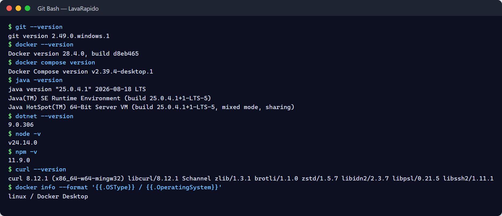
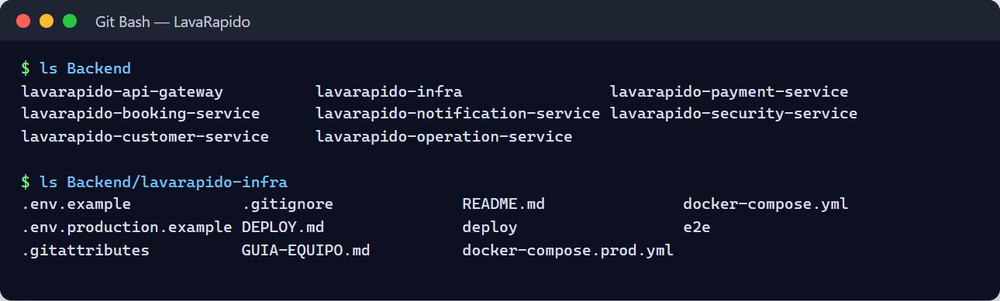
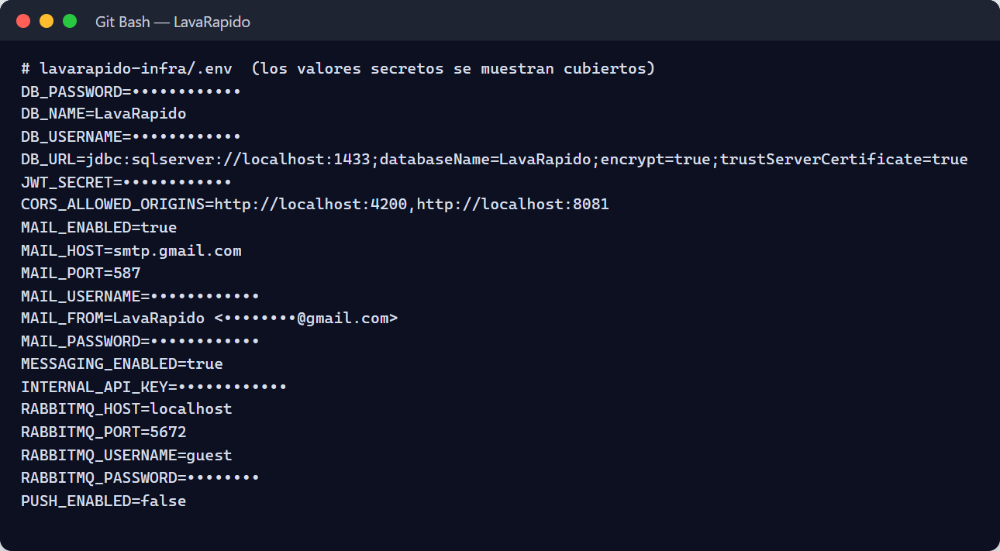
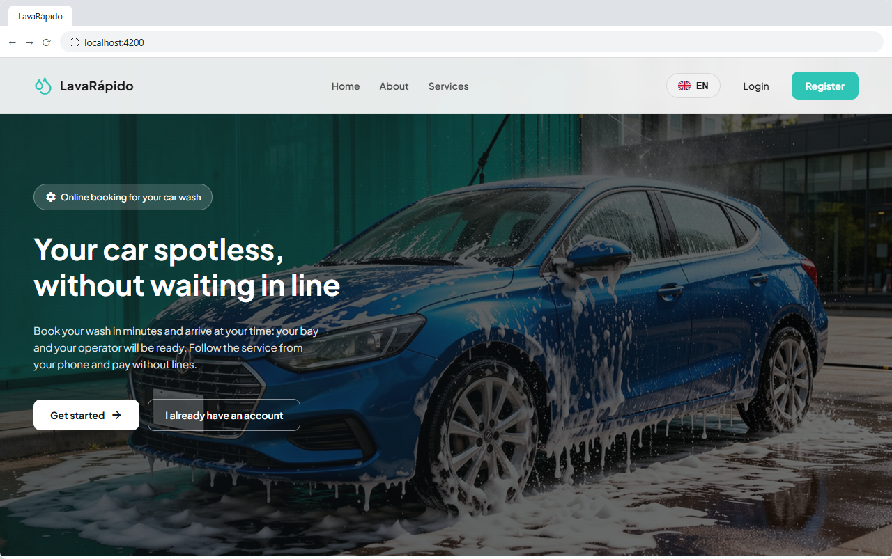
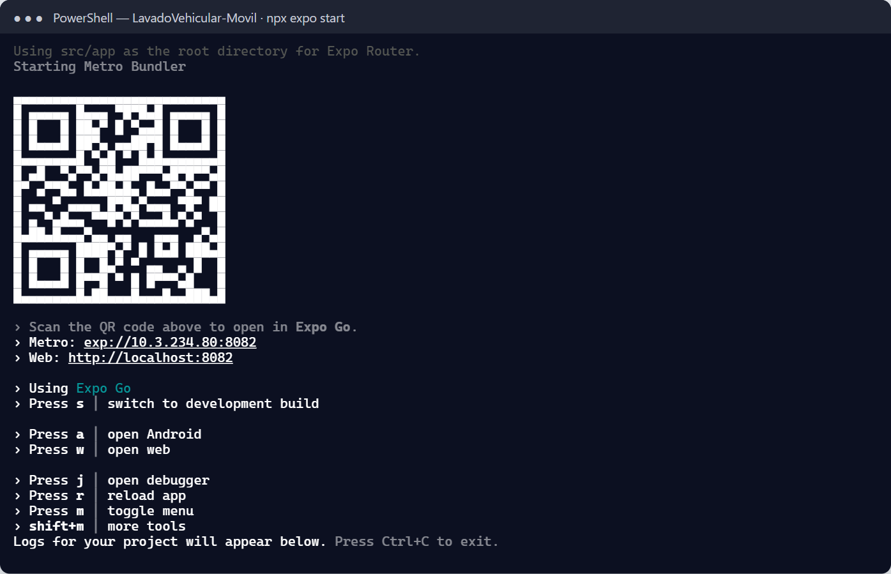
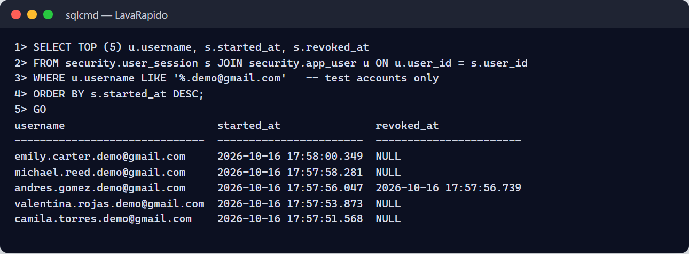

<!-- running-head: INSTALLATION MANUAL: VEHICLE WASHING SYSTEM -->

# Installation Manual

Vehicle Washing Management System (Vehicle Washing)

Requirements, Configuration, Deployment With Docker, SQL Server Database, and Service Verification

Brayan Estiven Patiño Cabrera (Project Leader), Juan Camilo Guilombo Osorio (Frontend Leader), and Merari Urbano (Backend Leader)

Technologist in Software Analysis and Development (ADSO), Servicio Nacional de Aprendizaje (SENA), Training Center: Industria

Ficha 3145556

Instructor: Karol Daniela Correa

October 17, 2026

Manual Type: Installation Manual (Infrastructure and DevOps Staff) · Version 4.1

## Version Control

Table 1 records the change history of this document. Each time the installation procedure changes (for example, because of a new version of a service or of a dependency), a row must be added with the version, the date, the description, and the person responsible.

**Table 1**

*Version History of the Installation Manual*

| Version | Date | Description of the change | Responsible |
|---|---|---|---|
| 2.0 | 2026-10-05 | Creation of the installation manual (in Spanish) from the project documentation, within version 2.0 of the manual set. | Development team |
| 3.0 | 2026-10-07 | Translation into English, APA Style (7th ed.) formatting, and verification against the infrastructure repository and the code of the services. The placeholders were replaced with the real values: repositories, Compose services, ports, database name, environment variables, migrations per service, payment-service in .NET 8, health endpoints, and demonstration accounts. Corrected: migration strategy (one changelog per service applied at startup, not a single master changelog), absence of account lockout, and gateway behavior (it does not validate tokens). | Development team |
| 3.1 | 2026-10-09 | Update against the code of October 9, 2026, and creation of the Spanish version (Manual_instalacion_LavadoVehicular_3145556_ES.md). Corrected: the operations repository is called *lavarapido-operation-service* and must be cloned with that name; real addresses of the four repositories that were pending; payment-service now runs in Docker with the *app* profile and the gateway container receives ROUTE_PAYMENT_URL; CORS origins include Expo web (8081); new changelogs (security 023, 026, and 030; booking 021, 022, and 024; notification 025, 027, 028, and 029; payment 017 to 020); 49 tables; 22 notification types; payment-service publishes events with MESSAGING_ENABLED; SPRING_PROFILES_ACTIVE added. | Development team |
| 4.0 | 2026-10-16 | Review against the code of October 16, 2026. The figures changed from placeholders to real screenshots of the installation. Updated: 57 tables in the nine schemas (checked with the query in section 11.5), account lockout after failed attempts, the payment-service health endpoint that now checks the database, a reference to the Deployment Document for the Azure server and the APK, and Annex B items that were resolved. | Development team |
| 4.1 | 2026-10-17 | Review against the code of October 17, 2026. Added the optional *EXPO_PUBLIC_WEB_URL* variable of the mobile app (section 10.5) and the native dependencies *expo-image-picker* and *expo-image-manipulator*, which require *npm install* and a new APK (section 13.2). | Development team |
| 4.2 | 2026-10-19 | Continuous integration with GitHub Actions: the scope was updated and it was removed from Annex B. | Development team |

*Note.* Dates are written in the ISO 8601 format (year-month-day). Prepared by the development team.

## Table of Contents

<!-- toc -->

- [Version Control](#version-control)
- [4. Introduction](#4-introduction)
  - [4.1 Sources of This Document](#41-sources-of-this-document)
  - [4.2 Scope](#42-scope)
- [5. Objective](#5-objective)
  - [5.1 General Objective](#51-general-objective)
  - [5.2 Specific Objectives](#52-specific-objectives)
- [6. Minimum Hardware Requirements](#6-minimum-hardware-requirements)
  - [6.1 Supported Operating Systems](#61-supported-operating-systems)
  - [6.2 Network Ports](#62-network-ports)
- [7. Required Software](#7-required-software)
  - [7.1 Checking the Installed Tools](#71-checking-the-installed-tools)
- [8. Obtaining the Project](#8-obtaining-the-project)
  - [8.1 Cloning the Repositories](#81-cloning-the-repositories)
  - [8.2 Expected Structure](#82-expected-structure)
- [9. Installing Dependencies](#9-installing-dependencies)
  - [9.1 Container Images](#91-container-images)
  - [9.2 Java Services](#92-java-services)
  - [9.3 payment-service (.NET 8)](#93-payment-service-net-8)
  - [9.4 Web Application](#94-web-application)
  - [9.5 Mobile Application](#95-mobile-application)
- [10. Configuring Environment Variables](#10-configuring-environment-variables)
  - [10.1 Creating the .env File](#101-creating-the-env-file)
  - [10.2 Variables of the .env File](#102-variables-of-the-env-file)
  - [10.3 Generating Secrets](#103-generating-secrets)
  - [10.4 Example of the .env File](#104-example-of-the-env-file)
  - [10.5 Configuring the Client Applications](#105-configuring-the-client-applications)
- [11. Database Creation and Import](#11-database-creation-and-import)
  - [11.1 Starting SQL Server and Creating the Database](#111-starting-sql-server-and-creating-the-database)
  - [11.2 Migrations of Each Service](#112-migrations-of-each-service)
  - [11.3 Alternative Method: Global Script](#113-alternative-method-global-script)
  - [11.4 Database Accounts](#114-database-accounts)
  - [11.5 Verifying the Structure and the Initial Data](#115-verifying-the-structure-and-the-initial-data)
  - [11.6 Backup and Reset of the Local Database](#116-backup-and-reset-of-the-local-database)
- [12. Running the Backend](#12-running-the-backend)
  - [12.1 Startup Order](#121-startup-order)
  - [12.2 Option A: Services in Docker (Recommended)](#122-option-a-services-in-docker-recommended)
  - [12.3 Option B: Java Services From a Terminal or the IDE](#123-option-b-java-services-from-a-terminal-or-the-ide)
  - [12.4 payment-service (.NET 8) Outside Docker](#124-payment-service-net-8-outside-docker)
  - [12.5 RabbitMQ and Mail](#125-rabbitmq-and-mail)
  - [12.6 Logs, Stopping, and Updating](#126-logs-stopping-and-updating)
- [13. Running the Frontend](#13-running-the-frontend)
  - [13.1 Web Application (Angular)](#131-web-application-angular)
  - [13.2 Mobile Application (React Native With Expo)](#132-mobile-application-react-native-with-expo)
  - [13.3 Static Mockups (Optional)](#133-static-mockups-optional)
- [14. Accessing the System](#14-accessing-the-system)
  - [14.1 First Access to the Web Application](#141-first-access-to-the-web-application)
- [15. Test Users](#15-test-users)
  - [15.1 Demonstration Accounts](#151-demonstration-accounts)
  - [15.2 Rules for Accounts](#152-rules-for-accounts)
  - [15.3 Creating a Test Customer](#153-creating-a-test-customer)
  - [15.4 Operator and Administrator Accounts](#154-operator-and-administrator-accounts)
- [16. Installation Verification](#16-installation-verification)
  - [16.1 Infrastructure and Database](#161-infrastructure-and-database)
  - [16.2 Messaging and Mail](#162-messaging-and-mail)
  - [16.3 Services and Gateway](#163-services-and-gateway)
  - [16.4 Minimum Functional Flow](#164-minimum-functional-flow)
  - [16.5 Traces Verification](#165-traces-verification)
- [17. Common Errors and Solutions](#17-common-errors-and-solutions)
- [18. Glossary](#18-glossary)
- [References](#references)
- [19. Annexes](#19-annexes)
  - [Annex A. Source of the Screenshots](#annex-a-source-of-the-screenshots)
  - [Annex B. Information to Confirm Before Delivery](#annex-b-information-to-confirm-before-delivery)
  - [Annex C. Summary of Installation Commands](#annex-c-summary-of-installation-commands)
  - [Annex D. Security Checklist Before Sharing the Environment](#annex-d-security-checklist-before-sharing-the-environment)
  - [Annex E. Delivery Checklist](#annex-e-delivery-checklist)

<!-- /toc -->

## 4. Introduction

The Vehicle Washing Management System (Vehicle Washing), internally called *LavaRapido*, is made up of a gateway (API Gateway), six backend microservices (five in Java 21 with Spring Boot 4 and one in C# with .NET 8), a Microsoft SQL Server 2022 database, a RabbitMQ message broker, a development mail server (Mailpit), and two clients: an Angular 21 web application and an Android application in React Native with Expo. This manual covers the local installation with Docker, which is the one the team uses to develop and test. The public server on Azure, which is turned on when it is needed to present the system, is set up with the scripts in the *deploy* folder of *lavarapido-infra* and is explained in the Deployment Document.

This manual explains how to prepare a machine, obtain the code, configure the environment variables, create the database, start each component in the correct order, and check that the system works. It is addressed to infrastructure and DevOps staff, or to anyone who must start the system on a local machine or a development server. It starts from the premise that an installation must be repeatable, automatable, and verifiable (Humble & Farley, 2010), and that the configuration that changes between environments must reside in the environment and not in the code (Wiggins, 2017).

### 4.1 Sources of This Document

The procedures were verified against the infrastructure repository (*lavarapido-infra*: *docker-compose.yml*, *.env.example*, and the team guide), the source code of the eleven repositories (*develop* branch as of October 17, 2026), and the project documentation updated on that same date (Vehicle Washing Development Team, 2026a, 2026b). The values that depend on each installation (passwords, keys, and addresses) are written between angle brackets, such as `<SA_PASSWORD>`; no placeholder must be copied literally into a terminal. The implementation of a release in its target environment (entry criteria, acceptance, training, and rollback) is described in the Implementation Procedure.

### 4.2 Scope

**It covers:** local installation with Docker of SQL Server, RabbitMQ, and Mailpit; the creation of the *LavaRapido* database and its migrations; the start of the six services and the gateway, in containers or from a terminal; the web and mobile applications; the first access, the test accounts, the verification, and the solution of common errors.

**It does not cover:** setting up the public server on Azure (Deployment Document), continuous integration (GitHub Actions; described in the Deployment Document), building and publishing the APK of the mobile application (Deployment Document), or the functional use of the system, which is explained in the User Manual and the Administrator Manual.

## 5. Objective

### 5.1 General Objective

To allow an infrastructure or DevOps person to install and start the Vehicle Washing Management System by following clear, complete, and verifiable instructions.

### 5.2 Specific Objectives

- Define the hardware, operating system, software, and network requirements to run the complete system.
- Describe how to obtain the code and install the backend, web, and mobile dependencies.
- Explain the configuration of the environment variables and the handling of secrets.
- Detail the creation of the database, the application of the migrations of each service, and the initial data.
- Indicate the startup order and the commands to start, stop, and review the logs of the components.
- Offer verification tests and a guide for solving frequent errors.

## 6. Minimum Hardware Requirements

The project documentation does not set hardware requirements. The values of Table 2 are recommendations of this manual, calculated to run SQL Server, RabbitMQ, Mailpit, the gateway, and the six services at the same time, plus the development tools. The only minimum with official support is that of SQL Server in a container, which requires at least 2 GB of RAM (Microsoft, n.d.).

**Table 2**

*Recommended Hardware Requirements*

| Resource | Minimum | Recommended | Remark |
|---|---|---|---|
| Processor | 4 cores, 64-bit (x64) | 6 or 8 cores | The SQL Server image is for x64; on ARM processors it runs through emulation. |
| RAM | 8 GB | 16 GB | With 8 GB, assign at least 5 GB to Docker and close other applications. |
| Memory for Docker | 5 GB | 8 GB or more | SQL Server requires 2 GB; each Java service uses up to 75% of the memory of its container. |
| Free disk | 20 GB | 40 GB on SSD | Docker images, volumes, Maven, NuGet, and npm dependencies, and logs. |
| Network | Internet access | Stable broadband | Download of images and dependencies; for a physical phone, the same Wi-Fi network as the computer. |

*Note.* Recommendations of this manual. The minimum of 2 GB of RAM for SQL Server is the one published by Microsoft (n.d.).

### 6.1 Supported Operating Systems

**Table 3**

*Operating Systems and Additional Requirements*

| Operating system | Additional requirement |
|---|---|
| Windows 10 or 11 (64-bit) | Docker Desktop with WSL 2 and virtualization enabled in the BIOS or UEFI. |
| Ubuntu 22.04 LTS or later | Docker Engine 24 or later with the Docker Compose plugin (v2). |
| macOS | Docker Desktop; with Apple Silicon, enable x64 emulation (Rosetta) for SQL Server. |

*Note.* Prepared by the authors from the team guide of the infrastructure repository.

### 6.2 Network Ports

Table 4 lists the ports that the system publishes on the host machine. They must be free before starting the installation.

**Table 4**

*Ports Used by the System*

| Component | Port | Remark |
|---|---|---|
| SQL Server | 1433 | If a native SQL Server of Windows (service MSSQLSERVER) uses this port, stop it (section 17). |
| RabbitMQ (AMQP) | 5672 | Used by the services. |
| RabbitMQ (management console) | 15672 | Web interface. |
| Mailpit (SMTP) | 1025 | Receives the emails of the services. |
| Mailpit (web interface) | 8025 | Shows the captured emails. |
| API Gateway | 8080 | Single entry point of the web and mobile applications. |
| security-service | 3001 | Accounts, login, and roles. |
| customer-service | 3002 | Customers and vehicles. |
| booking-service | 3003 | Catalog, schedule, bays, and bookings. |
| operations-service | 3004 | Operators, assignment, execution, and ratings. |
| payment-service | 3005 | Payment accounts and payments (.NET). |
| notification-service | 3006 | Notifications, push, email, and reminders. |
| Web application (Angular) | 4200 | Development server. |
| Mobile application (Expo Metro) | 8081 | Development server. |

*Note.* Values taken from *docker-compose.yml*, the configuration of each service, and the service catalog.

## 7. Required Software

Table 5 lists the tools. The versions come from the build files of each repository (*pom.xml*, *Directory.Build.props*, and *package.json*).

**Table 5**

*Software Required for the Installation*

| Tool | Version | Use |
|---|---|---|
| Git | Recent | Obtain the repositories. |
| Docker Desktop or Docker Engine with Compose v2 | 24 or later | Run SQL Server, RabbitMQ, Mailpit, the migrations, and, optionally, the services. |
| JDK (Eclipse Temurin recommended) | 21 | Run the Java services outside Docker. Maven is not needed: each service includes the Maven Wrapper (*mvnw*). |
| .NET SDK | 8.0 | Build and run payment-service. |
| Node.js and npm | Node.js 20.19 or later (22 LTS recommended); npm 11 | Web application (Angular 21) and mobile application. |
| Angular CLI | 21 (optional; *npx ng* works without a global installation) | Development server and build of the web application. |
| Expo CLI and EAS CLI (through *npx*) | According to *package.json* (Expo SDK 57) | Run the mobile application and build versions with push notifications. |
| sqlcmd (optional) | Recent | Run verification queries from the host; it is also available inside the SQL Server container. |
| Graphical SQL client (optional) | SQL Server Management Studio or Azure Data Studio | Visual inspection of the database. |
| curl | Recent | Verification tests. |
| Android Studio or an Android phone (optional) | Recent | Emulator or device for the mobile application. |

*Note.* The Liquibase CLI is not needed: the Java services apply their migrations when they start, and the *payment-migrate* container runs those of payment-service.

### 7.1 Checking the Installed Tools

Each command must print a version; if one fails, install the corresponding tool.

```bash
git --version
docker --version
docker compose version
java -version        # must show 21
dotnet --version     # must show 8.x
node -v
npm -v
curl --version
```

On Windows, *docker info* must show the Linux engine (WSL 2) and not the Windows containers engine.

**Figure 1**

*Verification of Tool Versions*



## 8. Obtaining the Project

The project is distributed in one repository per component. All the backend repositories must be cloned side by side in the same folder and **without changing their names**, because the services look for the shared configuration in *../lavarapido-infra/.env* and *docker-compose.yml* builds them from `../<repository>` (Table 6). Note that the operations repository is called *lavarapido-operation-service* (singular), although the service, its container, and its image are called *operations-service*: if it is cloned with another name, the Compose build fails.

**Table 6**

*Project Repositories*

| Repository | Content | Address |
|---|---|---|
| lavarapido-infra | docker-compose.yml, .env.example, and team guide. | https://github.com/BrayanCABRERA123/lavarapido-infra |
| lavarapido-security-service | Accounts, login, roles, profile, and password recovery. | https://github.com/BrayanCABRERA123/lavarapido-security-service |
| lavarapido-customer-service | Customers and vehicles. | https://github.com/camiloguilombo12/lavarapido-customer-service |
| lavarapido-booking-service | Catalog, schedule, bays, and bookings. | https://github.com/camiloguilombo12/lavarapido-booking-service |
| lavarapido-operation-service | Operators, assignment, execution, and ratings (service *operations-service*). | https://github.com/BrayanCABRERA123/lavarapido-operation-service |
| lavarapido-payment-service | Payment accounts, payments, and receipts (.NET 8). | https://github.com/merari0322/lavarapido-payment-service |
| lavarapido-notification-service | Notifications, push, email, and reminders. | https://github.com/BrayanCABRERA123/lavarapido-notification-service |
| lavarapido-api-gateway | Gateway (Spring Cloud Gateway). | https://github.com/BrayanCABRERA123/lavarapido-api-gateway |
| Front-end-proyecto-web | Angular web application. | https://github.com/BrayanCABRERA123/Front-end-proyecto-web |
| LavadoVehicular-Movil | Android application (React Native with Expo). | https://github.com/merari0322/LavadoVehicular-Movil |
| vehicle-w-docs | Project documentation, ADRs, and OpenAPI contracts. | https://github.com/code-sena/vehicle-w-docs |

*Note.* The addresses were taken from the Git remotes of the team copies on October 16, 2026.

### 8.1 Cloning the Repositories

The integration branch of the team is *develop*; the most recent version of every service is there (the *main* branches are older). For an evaluation installation, use *develop* or the tag of the delivered version.

```bash
mkdir Backend && cd Backend
git clone -b develop https://github.com/BrayanCABRERA123/lavarapido-infra.git
git clone -b develop https://github.com/BrayanCABRERA123/lavarapido-security-service.git
git clone -b develop https://github.com/camiloguilombo12/lavarapido-customer-service.git
git clone -b develop https://github.com/camiloguilombo12/lavarapido-booking-service.git
git clone -b develop https://github.com/BrayanCABRERA123/lavarapido-operation-service.git
git clone -b develop https://github.com/merari0322/lavarapido-payment-service.git
git clone -b develop https://github.com/BrayanCABRERA123/lavarapido-notification-service.git
git clone -b develop https://github.com/BrayanCABRERA123/lavarapido-api-gateway.git
cd ..
mkdir Frontend && cd Frontend
git clone -b develop https://github.com/BrayanCABRERA123/Front-end-proyecto-web.git
git clone -b develop https://github.com/merari0322/LavadoVehicular-Movil.git
```

To update a copy that already exists, run *git checkout develop* and *git pull* inside each repository.

### 8.2 Expected Structure

```text
Project/
|-- Backend/
|   |-- lavarapido-infra/                (docker-compose.yml + .env.example + .env)
|   |-- lavarapido-security-service/
|   |-- lavarapido-customer-service/
|   |-- lavarapido-booking-service/
|   |-- lavarapido-operation-service/     (singular: name expected by docker-compose.yml)
|   |-- lavarapido-payment-service/
|   |-- lavarapido-notification-service/
|   `-- lavarapido-api-gateway/
`-- Frontend/
    |-- Front-end-proyecto-web/          (Angular)
    `-- LavadoVehicular-Movil/           (React Native / Expo)
```

**Figure 2**

*Repositories Cloned in the Working Folder*



## 9. Installing Dependencies

### 9.1 Container Images

The local environment uses the images *mcr.microsoft.com/mssql/server:2022-latest*, *rabbitmq:4-management*, *axllent/mailpit*, and *liquibase/liquibase:4.29*; the images of the services are built from their Dockerfiles. From the infrastructure folder, validate the Compose file and download the base images:

```bash
cd Backend/lavarapido-infra
docker compose config --quiet && echo "Compose file is valid"
docker compose pull
```

The command *docker compose config* fails if *DB_PASSWORD* or *JWT_SECRET* are missing; in that case, complete the *.env* file first (section 10) and run it again.

### 9.2 Java Services

The Java services download their dependencies automatically: with Docker, during the build of the image; outside Docker, the first time *mvnw* runs (it can take several minutes). To download them in advance and run the unit tests of a service:

```bash
cd Backend/lavarapido-security-service
./mvnw -B test            # Windows: .\mvnw.cmd -B test
```

### 9.3 payment-service (.NET 8)

```bash
cd Backend/lavarapido-payment-service
dotnet restore
dotnet test               # domain, application, and integration tests (xUnit)
```

### 9.4 Web Application

```bash
cd Frontend/Front-end-proyecto-web
npm ci
```

The command *npm ci* installs exactly the versions of *package-lock.json*, which makes the installation repeatable. Known vulnerabilities are reviewed with *npm audit*.

### 9.5 Mobile Application

```bash
cd Frontend/LavadoVehicular-Movil
npm ci
```

**Figure 3**

*Successful Installation of Dependencies*


## 10. Configuring Environment Variables

The values that change between environments (connection data, secrets, mail, and switches) reside outside the code (Wiggins, 2017). All the services read the same file *lavarapido-infra/.env*: Docker Compose reads it automatically, the Java services import it with *spring.config.import*, and payment-service reads it with its *EnvFile* class. Real environment variables always take precedence over the file. The *.env* file is excluded from Git; the repository only contains *.env.example*.

### 10.1 Creating the .env File

```bash
cd Backend/lavarapido-infra
cp .env.example .env           # PowerShell: Copy-Item .env.example .env
git check-ignore -v .env       # must show the .gitignore rule that excludes it
```

If *git check-ignore* prints nothing, the file is not excluded and must not be filled with secrets until the *.gitignore* is corrected.

### 10.2 Variables of the .env File

**Table 7**

*Main Environment Variables*

| Variable | Used by | Effect and local value |
|---|---|---|
| DB_PASSWORD | SQL Server and all services | Password of the *sa* account. Required; at least 8 characters with uppercase, lowercase, number, and symbol, or SQL Server does not start. |
| DB_NAME | Infrastructure and services | Database name; *LavaRapido*. |
| DB_USERNAME | Services | *sa* in the local environment. |
| DB_URL | Java services run from the IDE | jdbc:sqlserver://localhost:1433;databaseName=LavaRapido;encrypt=true;trustServerCertificate=true |
| JWT_SECRET | All services | HS256 signing key shared by all services; at least 32 bytes. Required. |
| CORS_ALLOWED_ORIGINS | Services and gateway | Origins allowed to call from a browser: the web application and Expo web; *http://localhost:4200,http://localhost:8081*. |
| SPRING_PROFILES_ACTIVE | Java services in Docker | *dev* by default (Swagger and demonstration accounts); use another value, such as *prod*, in any shared environment. |
| MAIL_ENABLED | security-service and notification-service | *true* sends emails; *false* writes the recovery code in the log of security-service. |
| MAIL_HOST, MAIL_PORT, MAIL_USERNAME, MAIL_PASSWORD, MAIL_FROM | security-service and notification-service | SMTP server. Locally Mailpit: localhost, 1025, any user and password. Gmail requires an app password. |
| MAIL_DOCKER_HOST | Services in Docker | SMTP host seen from the containers; *mailpit* by default. |
| MESSAGING_ENABLED | Java services and payment-service | *true* publishes and consumes RabbitMQ events; *false* (default) only writes them in the log. Without events, there are no notifications, payment notices, or point notices. |
| RABBITMQ_HOST, RABBITMQ_PORT, RABBITMQ_USERNAME, RABBITMQ_PASSWORD | Java services and payment-service | localhost, 5672, guest, guest in the local environment. |
| PUSH_ENABLED, EXPO_ACCESS_TOKEN | notification-service | *true* sends push notifications through Expo; *false* only writes them in the log. |
| INTERNAL_API_KEY | security-service and notification-service | Key of the internal routes; without it, booking, payment, and coupon notices and reminders are not sent by email, and the notification switches of each user cannot be read. |
| REMINDER_LEADS | notification-service | Advance of the reminders; *24h,1h* by default. |
| BOOKING_ZONE, BOOKING_SLOT_MINUTES, BOOKING_MAX_DAYS_AHEAD | booking-service and operations-service | America/Bogota, 30, and 60 by default. |
| SECURITY_SERVICE_URL, CUSTOMER_SERVICE_URL, BOOKING_SERVICE_URL | Services that call others | Addresses of the services; they have defaults for the local environment. payment-service needs BOOKING_SERVICE_URL to read the total and to credit the points of a booking. |

*Note.* Prepared by the authors from *.env.example*, *docker-compose.yml*, and the configuration files of the services.

### 10.3 Generating Secrets

The JWT secret, the *sa* password, and the internal key must be generated with a secure random source, not typed by hand:

```bash
openssl rand -base64 48                                   # JWT_SECRET
node -e "console.log(require('crypto').randomBytes(32).toString('base64url'))"   # INTERNAL_API_KEY
```

The generated value is pasted in the *.env* file, never in a message, a shared document, or a repository.

### 10.4 Example of the .env File

The following fragment shows the structure; secrets are represented with asterisks.

```ini
DB_PASSWORD=********
DB_NAME=LavaRapido
DB_USERNAME=sa
DB_URL=jdbc:sqlserver://localhost:1433;databaseName=LavaRapido;encrypt=true;trustServerCertificate=true
JWT_SECRET=********
CORS_ALLOWED_ORIGINS=http://localhost:4200,http://localhost:8081
MAIL_ENABLED=true
MAIL_HOST=localhost
MAIL_PORT=1025
MAIL_USERNAME=dev
MAIL_PASSWORD=dev
MAIL_FROM=LavaRapido <no-reply@lavarapido.local>
MESSAGING_ENABLED=true
RABBITMQ_HOST=localhost
RABBITMQ_PORT=5672
RABBITMQ_USERNAME=guest
RABBITMQ_PASSWORD=guest
PUSH_ENABLED=false
INTERNAL_API_KEY=********
```

### 10.5 Configuring the Client Applications

- **Web application.** It calls the relative address */api/v1*. In development, *proxy.conf.json* forwards every request that starts with */api* to the gateway (*http://localhost:8080*), so no file has to be edited.
- **Mobile application.** Copy *.env.example* to *.env.local* and set *EXPO_PUBLIC_API_URL*. In the Android emulator use *http://10.0.2.2:8080/api/v1* (the default value); on a physical phone, the IPv4 address of the computer on the same Wi-Fi network (for example, *http://192.168.1.10:8080/api/v1*); and for the web version of Expo, *http://localhost:8080/api/v1*. After changing it, restart Expo with *npx expo start --clear*. The optional *EXPO_PUBLIC_WEB_URL* variable sets the web address the app uses to build the public link of the inspection report; when it is not set, the same host as the gateway with port 4200 is used.

**Figure 4**

*Configured .env File With Hidden Secrets*



*Note.* Do not capture real values of secrets.

## 11. Database Creation and Import

The system uses a single SQL Server 2022 database called *LavaRapido*, divided into nine schemas: *security*, *audit*, *customer*, *catalog*, *booking*, *execution*, *promotion*, *payment*, and *notification* (57 tables). Each service owns its schemas and migrates only them with Liquibase, with its own control tables `DATABASECHANGELOG_<SERVICE>` (Vehicle Washing Development Team, 2026a).

### 11.1 Starting SQL Server and Creating the Database

```bash
cd Backend/lavarapido-infra
docker compose up -d
docker compose ps
```

This command starts, without the services:

- *sqlserver* (container *lavarapido-sqlserver*), with a health check and the volume *sqlserver-data*.
- *db-init*, which runs once and creates the *LavaRapido* database if it does not exist.
- *payment-migrate*, which runs once the Liquibase changelogs of payment-service (schemas *payment* and *promotion*).
- *mailpit* and *rabbitmq* (container *lavarapido-rabbitmq*, with a health check).

Wait until *lavarapido-sqlserver* and *lavarapido-rabbitmq* show the status *healthy* and *db-init* and *payment-migrate* end with exit code 0. If the SQL Server container stops after a few seconds, the usual causes are a weak *DB_PASSWORD*, insufficient memory, or port 1433 already in use (section 17).

**Figure 5**

*Infrastructure Containers Running*


### 11.2 Migrations of Each Service

The Java services apply their migrations automatically when they start (*spring.liquibase*), and then Hibernate only validates that the entities match the tables. Therefore, the tables of the schemas *security*, *audit*, *customer*, *catalog*, *booking*, *execution*, and *notification* are created the first time each service starts (section 12). Table 8 shows the changelogs of the version of October 16, 2026.

**Table 8**

*Changelogs of Each Service*

| Service | Changelogs | Control table |
|---|---|---|
| security-service | 001 schemas, 002 security and audit core, 003 user preference, 020 theme palettes, 023 custom role (created and dropped again by 026), 026 role permissions (permission catalog and default assignments), 030 notification switches of the user preference, 034 lockout after failed attempts, 035 person address, 036 account creation date, 039 acceptance of the legal documents; seed 101 roles. | DATABASECHANGELOG_SECURITY |
| customer-service | 004 customer schema, 014 customer user id, 015 vehicle model; seed 102 vehicle types. | DATABASECHANGELOG_CUSTOMER |
| booking-service | 005 catalog and booking schemas, 018 changes of ADR-010, 021 schedule history, 022 loyalty points of the catalog, 024 removal of the bay operator, 032 business data of the establishment; seeds 103 catalog, 104 statuses and reasons, 109 establishment, schedule, and four bays. | DATABASECHANGELOG_BOOKING |
| operations-service | 007 execution schema, 033 inspection reports with phases, findings, and photos, 037 operator profile; seed 105 execution statuses. | DATABASECHANGELOG_OPERATIONS |
| notification-service | 010 notification schema, 016 device tokens, 017 processed events, 019 booking reminders, 025 promotion redeemed type, 027 staff notifications and booking tracking, 028 payment refunded type, 029 loyalty and inspection types, 031 unassigned booking alert, 038 new app version notice type; seed 108 notification types. | DATABASECHANGELOG_NOTIFICATION |
| payment-service | db/changelog/changes/001 to 020 (own numbering; 017 package fields, 018 required points, 019 catalog verification, 020 points reversal and sequence), run by the *payment-migrate* container. | DATABASECHANGELOG_PAYMENT |

*Note.* Source: migration strategy of the project documentation and the changelogs of the repositories.

**Rules that must always be respected.** Changesets are forward-only. A changeset that already ran is never edited: Liquibase calculates a checksum and refuses to continue if the content changed, which is an intentional protection. Every changeset has a precondition that marks it as run if the object already exists. The initial data uses fixed identifiers, and two of them are critical: *booking_status_id = 5* (CANCELLED) is used by the constraint *ck_booking_cancel* and the trigger *tr_booking_bay_overlap*, and *payment_status_id = 3* (APPROVED) by the index *ux_payment_one_approved_per_booking*.

### 11.3 Alternative Method: Global Script

The documentation repository keeps the script *lavarapido-6-services-sqlserver.sql*, with the full model for people who create the database by hand. Because every changeset has a precondition, the services can start afterwards on a database created with that script: Liquibase marks as run the objects that already exist. The script is run on the empty database:

```bash
sqlcmd -S localhost,1433 -U sa -P "<SA_PASSWORD>" -C -d LavaRapido -b -i lavarapido-6-services-sqlserver.sql
```

The recommended method is the one of section 11.2, because it leaves the history of each service in its control table.

### 11.4 Database Accounts

In the local environment all the services connect with the *sa* account (variable *DB_USERNAME*). The security policy of the project requires that each service use a login with rights only on its own schemas; it is a pending improvement that must be applied before any shared deployment. The generic procedure of SQL Server is:

```sql
CREATE LOGIN [booking_svc] WITH PASSWORD = '<STRONG_PASSWORD>', CHECK_POLICY = ON;
USE [LavaRapido];
CREATE USER [booking_svc] FOR LOGIN [booking_svc];
GRANT SELECT, INSERT, UPDATE, DELETE, EXECUTE ON SCHEMA::[catalog] TO [booking_svc];
GRANT SELECT, INSERT, UPDATE, DELETE, EXECUTE ON SCHEMA::[booking] TO [booking_svc];
```

*Note.* The migrations require rights to create objects (DDL); if the services stop using *sa*, the migrations must be run with a separate account.

### 11.5 Verifying the Structure and the Initial Data

The queries can be run from the host with *sqlcmd* or from inside the container:

```bash
docker compose exec sqlserver /opt/mssql-tools18/bin/sqlcmd -S localhost -U sa -P "$DB_PASSWORD" -C -d LavaRapido -Q "<QUERY>"
```

```sql
-- 1) Tables per schema (57 in total when all the services have started)
SELECT s.name AS schema_name, COUNT(*) AS tables
FROM sys.tables t JOIN sys.schemas s ON s.schema_id = t.schema_id
WHERE s.name IN ('security','audit','customer','catalog','booking',
                 'execution','promotion','payment','notification')
GROUP BY s.name ORDER BY s.name;

-- 2) Migration history of each service
SELECT name FROM sys.tables WHERE name LIKE 'DATABASECHANGELOG[_]%';

-- 3) Critical fixed identifiers
SELECT booking_status_id, code FROM booking.booking_status WHERE booking_status_id = 5;
SELECT payment_status_id, code FROM payment.payment_status WHERE payment_status_id = 3;
```

**Table 9**

*Expected Results of the Initial Data*

| Table | Expected result |
|---|---|
| security.role | 3 rows: ADMIN, OPERATOR, and CLIENT. |
| customer.vehicle_type | 6 rows: CAR, SEDAN, SUV, PICKUP, TRUCK, and MOTO. |
| catalog.service | The services BASIC, PREMIUM, and FULL with prices for the six vehicle types. |
| booking.booking_status | 6 rows; identifier 5 corresponds to CANCELLED. |
| booking.service_bay | 4 bays. |
| execution.execution_status | 5 rows: PENDING, IN_PROGRESS, PAUSED, COMPLETED, and WITH_ISSUE. |
| payment.payment_status | 5 rows; identifier 3 corresponds to APPROVED. |
| payment.payment_method_type | 4 rows: EFECTIVO, NEQUI, DAVIPLATA, and TRANSFERENCIA. |
| payment.loyalty_movement_type | 5 rows: EARNED, REDEEMED, EXPIRED, ADJUSTED, and REVERSED. |
| notification.notification_type | 22 rows. |
| security.permission | The permission catalog loaded by changelog 026. |

*Note.* If a catalog table is empty, the service that owns it has not started yet or its seed changeset did not run.

### 11.6 Backup and Reset of the Local Database

Before applying changes in an environment with data that matters, back up the database (Administrator Manual, section 14):

```bash
docker compose exec sqlserver /opt/mssql-tools18/bin/sqlcmd -S localhost -U sa -P "$DB_PASSWORD" -C \
  -Q "BACKUP DATABASE [LavaRapido] TO DISK = N'/var/opt/mssql/data/backup.bak' WITH INIT, CHECKSUM"
docker cp lavarapido-sqlserver:/var/opt/mssql/data/backup.bak ./backup.bak
```

To reset a disposable local environment, stop the containers and delete the volumes. **This deletes all the data:**

```bash
docker compose down -v
```

## 12. Running the Backend

### 12.1 Startup Order

The services do not depend on a strict order beyond the infrastructure, but the sequence of Table 10 avoids errors in the first start (for example, a booking that cannot validate the vehicle because customer-service is not ready).

**Table 10**

*Startup Sequence of the Local Environment*

| Step | Component | Ready when |
|---|---|---|
| 1 | SQL Server, RabbitMQ, and Mailpit (*docker compose up -d*) | sqlserver and rabbitmq are *healthy*; db-init and payment-migrate finished. |
| 2 | security-service (3001) | The log shows "Started SecurityServiceApplication". |
| 3 | customer-service (3002) | It responds on /actuator/health. |
| 4 | booking-service (3003) | It responds on /actuator/health. |
| 5 | operations-service (3004) | It responds on /actuator/health. |
| 6 | payment-service (3005) | It responds on /actuator/health. |
| 7 | notification-service (3006) | It responds on /actuator/health; it creates its queue if MESSAGING_ENABLED is true. |
| 8 | api-gateway (8080) | It responds on /actuator/health. |

*Note.* The first start of each Java service takes longer because it downloads dependencies and creates its tables.

### 12.2 Option A: Services in Docker (Recommended)

With the profile *app*, Docker Compose builds and starts the gateway and the six services (the five Java services and payment-service) in containers, after the infrastructure:

```bash
cd Backend/lavarapido-infra
docker compose --profile app up -d --build
docker compose ps
```

The *--build* option rebuilds the images from the current code; omit it to reuse images already built. Since October 8, 2026, payment-service has its own Dockerfile (build with the .NET 8 SDK, execution with the ASP.NET 8 runtime and an unprivileged user) and starts after *payment-migrate* ends successfully; the *api-gateway* container receives *ROUTE_PAYMENT_URL: http://payment-service:3005*, so the limitation TD-014 of version 3.0 no longer exists.

**Figure 6**

*Environment Containers Running*


### 12.3 Option B: Java Services From a Terminal or the IDE

For development or debugging, keep only the infrastructure in Docker and run each service with the Maven Wrapper, one terminal per service. The services read *../lavarapido-infra/.env* by themselves and use the *dev* profile by default, which enables Swagger and the demonstration accounts.

```bash
cd Backend/lavarapido-security-service
./mvnw spring-boot:run          # Windows: .\mvnw.cmd spring-boot:run
```

Repeat the command in *lavarapido-customer-service*, *lavarapido-booking-service*, *lavarapido-operation-service*, *lavarapido-notification-service*, and *lavarapido-api-gateway*. Do not run the same service in Docker and on the host at the same time, because both would try to use the same port.

### 12.4 payment-service (.NET 8) Outside Docker

```bash
cd Backend/lavarapido-payment-service
dotnet run --project src/PaymentService.Api       # http://localhost:3005
```

This option is for development or debugging; with Option A the service already runs in its container (stop it first with *docker compose stop payment-service*). The service reads *lavarapido-infra/.env*, listens on *PAYMENT_PORT* (3005 by default), and does not start without *JWT_SECRET*. It never creates its tables: they are created by the *payment-migrate* container (section 11.1). The repository also has its own *docker-compose.yml* (SQL Server on port 1434 with the database *lavado_vehicular*) only to test the migrations; it must not be used to run the system.

### 12.5 RabbitMQ and Mail

With *MESSAGING_ENABLED=true*, the services create the RabbitMQ topology when they start (payment-service only publishes: payment results, redeemed coupons, and points earned): the topic exchange *carwash.events*; the queues *customer-service.events* and *notification-service.events*; and their dead-letter queues (*.dlq*), to which a message moves after three failed retries. With *MESSAGING_ENABLED=false*, the system works, but customer profiles are created on the first request of the customer and the notifications that depend on events are not generated.

With *MAIL_ENABLED=true* and Mailpit, the emails (welcome, recovery code, booking, payment, and coupon notices, inspection reports, and reminders) do not reach real inboxes: they are read at *http://localhost:8025*. With *MAIL_ENABLED=false*, the recovery code is written in the log of security-service.

### 12.6 Logs, Stopping, and Updating

```bash
docker compose logs -f security-service           # follow a service's log
docker compose logs --since 10m booking-service   # last 10 minutes
docker compose stop                               # stop without deleting data
docker compose start                              # resume
docker compose down                               # remove containers, keep volumes
docker compose --profile app up -d --build <service>   # update a service after a change
```

The logs include the time, the level, the service name, and the correlation identifier. A log must never contain passwords, tokens, or receipt content; if they appear, it is a defect that must be reported.

## 13. Running the Frontend

### 13.1 Web Application (Angular)

```bash
cd Frontend/Front-end-proyecto-web
npm start                     # equivalent to: npx ng serve
```

The development server publishes the application at *http://localhost:4200* and forwards */api* to the gateway. The production build is generated with *npm run build* and leaves the static files in *dist/*; publishing them on a web server is outside the scope of this manual.

**Figure 7**

*Web Application Running*



### 13.2 Mobile Application (React Native With Expo)

```bash
cd Frontend/LavadoVehicular-Movil
npx expo start                # or: npm start
```

The command opens the Metro development server (port 8081) and shows a QR code. For a quick test, open the application in an Android emulator (key *a*) or on a phone with Expo Go on the same Wi-Fi network. Remember to configure *EXPO_PUBLIC_API_URL* (section 10.5).

**New native dependencies.** Since October 17, 2026, the app uses *expo-image-picker* (camera and gallery) and *expo-image-manipulator* (shrinking the photos) for the inspection report. After *git pull*, run *npm install* in *Frontend/LavadoVehicular-Movil*. Expo Go already includes these modules, but an APK built before that date does not: a new version must be built and published with EAS, as explained in the Deployment Document (section 4.3.3, "Publishing the mobile app"). The camera and photo permissions are declared in the *expo-image-picker* plugin inside *app.json*.

**Push notifications.** Expo Go does not receive remote push notifications. To test them, build a development version with EAS and set *PUSH_ENABLED=true* in the backend:

```bash
npx eas-cli login
npx eas-cli build --profile development --platform android
```

**Figure 8**

*Expo Development Server*



### 13.3 Static Mockups (Optional)

The documentation repository includes HTML mockups of the screens in *12-ux-ui/mockup*. They are opened directly in the browser and do not require the backend; they must not be confused with the real application.

## 14. Accessing the System

Once all the components are started, people access the system through the web or mobile application, and the technical staff also uses the support interfaces of Table 11.

**Table 11**

*Access Points of the Local Environment*

| Access | Address | Who uses it |
|---|---|---|
| Web application | http://localhost:4200 | Customers, operators, and administrators. |
| Mobile application | Expo Go or development build | Customers, operators, and administrators. |
| API Gateway | http://localhost:8080/api/v1 | Client applications and API tests. |
| Swagger of the Java services (profile dev) | http://localhost:3001/swagger-ui.html (3002, 3003, 3004, and 3006 equivalent) | Developers. |
| Swagger of payment-service (Development environment) | http://localhost:3005/swagger | Developers. |
| Mailpit | http://localhost:8025 | Technical staff: recovery codes and other emails. |
| RabbitMQ console | http://localhost:15672 | Technical staff: exchange, queues, and failed messages. |
| SQL Server | localhost,1433 | Technical staff: sqlcmd or a graphical client. |

*Note.* Values taken from the configuration of the services and the team guide.

### 14.1 First Access to the Web Application

1. Open an updated browser at *http://localhost:4200*.
2. Check that the welcome screen shows the **Login** and **Register** buttons.
3. Click **Login** (route */auth*) and log in with a test account (section 15).
4. Check that the system opens the home screen of the role: */client*, */operator*, or */admin*.

## 15. Test Users

### 15.1 Demonstration Accounts

When security-service starts with the *dev* profile (the default one in local), it creates one demonstration account per role (administrator, operator, and customer) if they do not exist. Their emails and passwords are documented in section 5 of the team guide (*lavarapido-infra/GUIA-EQUIPO.md*). This manual does not reproduce them, because the security policy forbids publishing credentials; those accounts must never exist in a shared environment.

### 15.2 Rules for Accounts

**Table 12**

*Rules for the Data of an Account*

| Data | Rule |
|---|---|
| Email | Must end in @gmail.com; no spaces. Each email admits a single account. |
| ID number | Between 5 and 20 digits; unique. |
| First and last names | Minimum 3 and 2 characters, respectively. |
| Phone | Colombian mobile number of 10 digits starting with 3. |
| Password | 8 to 72 characters, with at least one uppercase letter, one number, and one special character, without spaces. |
| Session | The token lasts one hour; after that, the person logs in again. |
| Failed attempts | Five failed attempts within 15 minutes lock the account for 15 minutes; resetting the password unlocks it. |

*Note.* Source: validations of the registration form and the password policy of security-service.

### 15.3 Creating a Test Customer

1. Open the web application and click **Register**.
2. Fill in the form with test data and a **test** Gmail email; accept the legal documents.
3. Click **Register** and then **Go to login**.
4. With *MAIL_ENABLED=true* and *MESSAGING_ENABLED=true*, open Mailpit (*http://localhost:8025*) and check that the welcome email arrived.
5. Log in and check that the customer dashboard (*/client*) opens.

### 15.4 Operator and Administrator Accounts

Operator and administrator accounts are created by an administrator from **Management > Users > Create user** or **Operators > New operator**, with a temporary password (Administrator Manual, section 9.3). The first administrator of an environment without the *dev* profile is created with the procedure of section 8.4 of the Administrator Manual.

## 16. Installation Verification

The verification is done in layers: infrastructure, database, messaging, services, and functional flow (Table 13).

**Table 13**

*Installation Checklist*

| No. | Check | Expected result |
|---|---|---|
| 1 | Containers | sqlserver and rabbitmq *healthy*; mailpit and the services running. |
| 2 | Database | The 57 tables in the nine schemas (section 11.5). |
| 3 | Initial data | The results of Table 9. |
| 4 | RabbitMQ | Exchange *carwash.events* and the queues of customer and notification (with messaging active). |
| 5 | Mailpit | Web interface available. |
| 6 | Health of each service | /actuator/health responds {"status":"UP"} in ports 3001 to 3006 and 8080. |
| 7 | Protected route without a token | Error 401 returned by the service. |
| 8 | Web application | The welcome screen and the login are displayed. |
| 9 | Registration and login | An account is created and the customer dashboard opens. |
| 10 | Password recovery | The code arrives in Mailpit and allows changing the password. |
| 11 | Booking flow | A vehicle is registered and a booking is created. |
| 12 | Assignment and execution | The administrator assigns an operator, who starts and finishes the service. |
| 13 | Payment | The customer reports a payment and the administrator approves it. |
| 14 | Persistence | The data remains after restarting the containers. |

*Note.* Prepared by the authors from the integration checks of the project documentation.

### 16.1 Infrastructure and Database

```bash
docker compose ps
docker compose exec sqlserver /opt/mssql-tools18/bin/sqlcmd -S localhost -U sa -P "$DB_PASSWORD" -C -Q "SELECT @@VERSION"
```

Then run the queries of section 11.5. If the results do not match, do not continue with the following tests.

### 16.2 Messaging and Mail

```bash
curl -s -u guest:guest http://localhost:15672/api/exchanges/%2F/carwash.events
docker compose exec rabbitmq rabbitmqctl list_queues name messages
curl -s -o /dev/null -w "%{http_code}\n" http://localhost:8025/
```

The first command returns the data of the exchange (type *topic*); the second, the queues with their messages (the *.dlq* queues must be at zero); and the third, the code 200 of Mailpit. Replace *guest:guest* with the RabbitMQ credentials of the *.env* file if they were changed.

### 16.3 Services and Gateway

```bash
for port in 3001 3002 3003 3004 3005 3006 8080; do
  echo "$port: $(curl -s http://localhost:$port/actuator/health)"
done
curl -i http://localhost:8080/api/v1/bookings/me
```

Each health endpoint must answer *{"status":"UP"}*. The last command calls a protected route without a token through the gateway: it must return **401**. The gateway does not validate tokens (ADR-006): it forwards the request and the service rejects it. Every service, including payment-service, checks the database in its health endpoint: if SQL Server does not answer, it replies *DOWN* with code 503.

**Figure 9**

*Response of the Health Endpoints*


### 16.4 Minimum Functional Flow

1. Register a test customer and check the welcome email in Mailpit.
2. Test password recovery: request the code, read it in Mailpit, and change the password.
3. Log in as the customer, register a vehicle, and create a booking; a free slot is confirmed immediately.
4. Log in as the administrator and assign an operator to the booking (**Bookings > Assign**).
5. Log in as the operator on the day of the booking, start the service, and finish it.
6. As the customer, report a payment with a test receipt; as the administrator, approve it in **Payments**.
7. With messaging active, check that the customer received the notifications of the booking, the assignment, and the approved payment, the email in Mailpit, and the points in the dashboard.
8. Restart the containers (*docker compose restart*) and check that the data remains.

### 16.5 Traces Verification

The audit table *audit.audit_log* exists but is not populated in the current version (Administrator Manual, section 16). After the tests of section 16.4, verify instead that the sessions were recorded:

```sql
SELECT TOP (5) u.username, s.started_at, s.revoked_at
FROM security.user_session s JOIN security.app_user u ON u.user_id = s.user_id
ORDER BY s.started_at DESC;
```

**Figure 10**

*Session Records*



## 17. Common Errors and Solutions

The first step in any error is to consult the log of the affected service with *docker compose logs --tail 100 `<service>`* or the terminal where it runs (Table 14).

**Table 14**

*Frequent Errors, Probable Causes, and Solutions*

| Error or symptom | Probable cause | Solution |
|---|---|---|
| Login failed for user 'sa' | A native SQL Server of Windows answers on port 1433, or the password differs from the one used when the volume was created. | Stop the Windows service MSSQLSERVER; use the original password or recreate the volume (*docker compose down -v*) in a disposable environment. |
| A port is in use (address already in use) | Another process uses the port. | Find it (*netstat -ano* on Windows, *lsof -i :PORT* on Linux or macOS) and stop it. |
| The SQL Server container stops | Weak DB_PASSWORD or less than 2 GB of memory. | Use a strong password and assign more memory to Docker. |
| docker compose config fails | DB_PASSWORD or JWT_SECRET missing in .env. | Complete the .env file (section 10). |
| A Java service does not start: "JWT secret" or database errors | The .env file is not in *../lavarapido-infra/* or the folder was renamed. | Keep the repositories side by side with their original names. |
| UnsupportedClassVersionError | JDK earlier than 21. | Install JDK 21 and check *java -version*. |
| payment-service does not start | JWT_SECRET missing, or .NET 8 SDK not installed. | Complete the .env file; install the .NET 8 SDK. |
| Invalid object name 'payment.payment' | The payment migrations did not run. | Run *docker compose up -d* again and check that payment-migrate ended with code 0. |
| docker compose build fails: path ../lavarapido-operation-service not found | The operations repository was cloned with another name (for example, *lavarapido-operations-service*). | Rename the folder to *lavarapido-operation-service* or clone it again with that name. |
| Payment screens fail and the other screens work | The payment-service container is not running, or payment-migrate did not end with code 0. | Check *docker compose ps* and *docker compose logs payment-service payment-migrate*. |
| Liquibase: checksum mismatch | A changeset that already ran was edited. | Revert the change and write a new changeset; in a disposable environment, recreate the database. |
| Liquibase: waiting for changelog lock | A previous start was interrupted. | Make sure no other instance is running and delete the row of the corresponding DATABASECHANGELOGLOCK_<SERVICE> table. |
| 401 on every request | Expired token or different JWT_SECRET among services. | Log in again; check that all the services read the same .env file. |
| 503 CUSTOMER_SERVICE_UNAVAILABLE or BOOKING_SERVICE_UNAVAILABLE | The service called is down. | Start customer-service or booking-service. |
| "Your customer profile is not ready yet" | The customer profile has not been created (event not consumed). | Wait and retry; with MESSAGING_ENABLED=true check the customer-service queue. |
| Emails do not arrive in Mailpit | MAIL_ENABLED=false or wrong host or port. | MAIL_HOST=localhost and MAIL_PORT=1025 on the host; MAIL_DOCKER_HOST=mailpit in Docker. |
| Booking emails and reminders do not arrive | INTERNAL_API_KEY empty. | Generate the key and restart security-service and notification-service. |
| Notifications do not arrive | MESSAGING_ENABLED=false or messages in a dead-letter queue. | Enable messaging and review the queues. |
| CORS error in the browser | The origin is not allowed. | CORS_ALLOWED_ORIGINS=http://localhost:4200,http://localhost:8081 (add the real origin if it is different) and restart the services. |
| Blank screen or 404 on /api in the web application | The gateway is not running on port 8080. | Start the gateway and check *proxy.conf.json*. |
| The mobile app does not reach the backend | localhost used from the phone, or different network. | Use 10.0.2.2 in the emulator or the IPv4 address of the computer on the same network. |
| npm ERESOLVE or build failures | Node.js version not supported by Angular 21. | Use Node.js 22 LTS and reinstall with *npm ci*. |
| Docker consumes all the memory on Windows | WSL 2 without a memory limit. | Limit the memory in *.wslconfig* and assign at least 5 GB to Docker. |
| Shifted booking times | Wrong time zone; the system stores UTC. | Check BOOKING_ZONE=America/Bogota. |

*Note.* Prepared by the authors from the infrastructure repository, the runbooks of the services, and the technical backlog.

## 18. Glossary

**Table 15**

*Glossary of Installation Terms*

| Term | Definition |
|---|---|
| API Gateway | Single entry point that routes the requests to the services; it does not validate tokens. |
| Changelog | Liquibase file that describes the changes of the database. |
| Changeset | Unit of change of a changelog, identified by its id and author. |
| Compose profile | Group of services of Docker Compose that starts only when it is requested (*--profile app*). |
| Container | Isolated process that runs an application with its dependencies. |
| CORS | Browser mechanism that restricts requests between different origins. |
| Dead-letter queue (DLQ) | Queue where messages that failed after retries are kept. |
| Exchange | RabbitMQ element that receives messages and routes them to queues. |
| Health endpoint | Route (/actuator/health) that indicates whether a service is working. |
| Image | Read-only template from which a container is created. |
| JDK | Java development kit; the project uses version 21. |
| Liquibase | Tool for versioning and migrating the database schema. |
| Mailpit | Development mail server that captures emails without sending them. |
| Maven Wrapper | Script (*mvnw*) that downloads and runs the correct version of Maven. |
| Volume | Persistent Docker storage that survives the recreation of a container. |
| WSL 2 | Windows Subsystem for Linux used by Docker Desktop. |

*Note.* Prepared by the authors from the project documentation.

## References

Humble, J., & Farley, D. (2010). *Continuous delivery: Reliable software releases through build, test, and deployment automation*. Addison-Wesley.

Microsoft. (n.d.). *Microsoft SQL Server - Ubuntu based images* [Container image]. Docker Hub. Retrieved October 7, 2026, from https://hub.docker.com/r/microsoft/mssql-server

Servicio Nacional de Aprendizaje. (2026). *Guía para elaborar manuales de software: Manual de usuario, manual técnico, manual de instalación y manual de administrador* [Guide for writing software manuals: User manual, technical manual, installation manual, and administrator manual] [Unpublished instructional material]. Technologist in Software Analysis and Development program.

Vehicle Washing Development Team. (2026a). *Vehicle washing management system: Project documentation* (vehicle-w-docs) [Unpublished project documentation]. GitHub. https://github.com/code-sena/vehicle-w-docs

Vehicle Washing Development Team. (2026b). *lavarapido-infra* (develop branch) [Computer software]. GitHub. https://github.com/BrayanCABRERA123/lavarapido-infra

Wiggins, A. (2017). *The twelve-factor app: III. Config*. https://12factor.net/config

## 19. Annexes

### Annex A. Source of the Screenshots

The figures in this manual were taken on October 16, 2026, on a Windows 11 computer with Docker Desktop, following the steps of the manual. The terminal screenshots show the real output of the commands, and the browser screenshot shows the web application running at *http://localhost:4200*. They contain no real passwords, secrets, or personal data: the values of the *.env* file are never shown.

### Annex B. Information to Confirm Before Delivery

**Table 16**

*Information Pending Confirmation*

| Topic | What is missing | Section |
|---|---|---|
| One database login per service | The services use sa. | 11.4 |

*Note.* Prepared by the authors from the verification of the repositories and the technical backlog.

### Annex C. Summary of Installation Commands

```bash
# 1. Get the project (repositories side by side; see section 8.1)
git clone -b develop https://github.com/BrayanCABRERA123/lavarapido-infra.git

# 2. Configure the environment
cd lavarapido-infra && cp .env.example .env     # set DB_PASSWORD, JWT_SECRET, INTERNAL_API_KEY

# 3. Infrastructure, database, and payment migrations
docker compose up -d && docker compose ps

# 4. Services (Java and payment-service) and gateway in Docker
docker compose --profile app up -d --build

# 5. Clients
cd ../../Frontend/Front-end-proyecto-web && npm ci && npm start
cd ../LavadoVehicular-Movil && npm ci && npx expo start

# 6. Verification
curl -s http://localhost:8080/actuator/health
```

### Annex D. Security Checklist Before Sharing the Environment

**Table 17**

*Environment Security Controls*

| Control | Met |
|---|---|
| The .env file is not versioned and has restricted permissions | Yes / No |
| JWT_SECRET has at least 32 bytes and is not a shared example | Yes / No |
| The passwords of sa and RabbitMQ and the INTERNAL_API_KEY were changed | Yes / No |
| The services do not use the sa account to connect | Yes / No |
| Only the gateway and the web application are exposed outside the machine | Yes / No |
| Mailpit, the RabbitMQ console, SQL Server, and ports 3001 to 3006 are not accessible from outside | Yes / No |
| The security service does not run with the dev profile (no demonstration accounts) | Yes / No |
| HTTPS with TLS 1.2 or later is used if the environment leaves the local machine | Yes / No |
| Logs do not contain passwords, tokens, or receipts | Yes / No |

*Note.* Prepared by the authors from the security policy of the project.

### Annex E. Delivery Checklist

**Table 18**

*Installation Manual Checklist*

| Criterion | Met |
|---|---|
| Complete title page and version | Yes / No |
| Table of contents with updated pages | Yes / No |
| Objective and scope explained | Yes / No |
| The commands match the real infrastructure repository | Yes / No |
| The repository folders keep their original names (including lavarapido-operation-service) | Yes / No |
| All figures are real screenshots of the installation | Yes / No |
| Steps verified on a clean installation | Yes / No |
| No credentials, keys, or sensitive data | Yes / No |
| Exported to PDF with the name Manual_instalacion_LavadoVehicular_3145556.pdf | Yes / No |

*Note.* Adapted from the checklist of the guide for writing software manuals (SENA, 2026).
