<!-- running-head: OPERATOR USER MANUAL: VEHICLE WASHING SYSTEM -->

# Operator User Manual

Vehicle Washing Management System (Vehicle Washing)

How to Check the Schedule, Serve the Assigned Services, Record Their Start and End, and Review the Ratings, on the Web and in the Mobile Application

Brayan Estiven Patiño Cabrera (Project Leader), Juan Camilo Guilombo Osorio (Frontend Leader), and Merari Urbano (Backend Leader)

Technologist in Software Analysis and Development (ADSO), Servicio Nacional de Aprendizaje (SENA), Training Center: Industria

Ficha 3145556

Instructor: Karol Daniela Correa

October 26, 2026

Manual Type: User Manual for the Operator Role (web application and Android mobile application) · Version 1.1

## Version Control

Table 1 records the change history of this document. Every time the development team modifies the manual, a row must be added with the version, the date, the description of the change, and the person responsible.

**Table 1**

*Version History of the Operator User Manual*

| Version | Date | Description of the change | Responsible |
|---|---|---|---|
| 1.0 | 2026-10-26 | Creation of the manual exclusive to the Operator role, separated from the User Manual (version 4.9) so that each audience has its own document, as the SENA manuals guide recommends. Reviewed against *develop* of October 26, 2026. Added: profile and responsibilities of the operator (section 7.2), first login with the temporary password (8.1), payment method of the booking shown in the service information (10.3), the notification switches and the **Deactivate my account** option of the operator, which exist on the web and were not documented (10.7 and 10.8), and the mobile application (10.9). New screenshots of the operator's profile and settings. | Development team |
| 1.1 | 2026-10-26 | Mobile application 1.1.1 with APK *versionCode* 6 and the over-the-air update published (10.9). | Development team |

*Note.* Dates are written in ISO 8601 format (year-month-day). Prepared by the development team.

## Table of Contents

<!-- toc -->

- [Version Control](#version-control)
- [4. Introduction](#4-introduction)
  - [4.1 Sources and Conventions of This Manual](#41-sources-and-conventions-of-this-manual)
- [5. Objective](#5-objective)
  - [5.1 General Objective](#51-general-objective)
  - [5.2 Specific Objectives](#52-specific-objectives)
- [6. Scope](#6-scope)
  - [6.1 What This Manual Covers](#61-what-this-manual-covers)
  - [6.2 What This Manual Does Not Cover](#62-what-this-manual-does-not-cover)
  - [6.3 About the Screenshots](#63-about-the-screenshots)
- [7. Requirements to Use the System](#7-requirements-to-use-the-system)
  - [7.1 Device and Account Requirements](#71-device-and-account-requirements)
  - [7.2 Operator Profile and Responsibilities](#72-operator-profile-and-responsibilities)
- [8. Logging In to the System](#8-logging-in-to-the-system)
  - [8.1 First Login With the Account Provided by the Administrator](#81-first-login-with-the-account-provided-by-the-administrator)
  - [8.2 Logging In](#82-logging-in)
  - [8.3 Password Recovery](#83-password-recovery)
- [9. Main Menu](#9-main-menu)
- [10. System Modules](#10-system-modules)
  - [10.1 Operator Dashboard](#101-operator-dashboard)
  - [10.2 My Schedule](#102-my-schedule)
  - [10.3 Assigned Services](#103-assigned-services)
  - [10.4 Operator Notifications](#104-operator-notifications)
  - [10.5 Service History](#105-service-history)
  - [10.6 Ratings Received](#106-ratings-received)
  - [10.7 Profile](#107-profile)
  - [10.8 Settings](#108-settings)
  - [10.9 Android Mobile Application](#109-android-mobile-application)
- [11. Messages and Validations](#11-messages-and-validations)
- [12. Logging Out](#12-logging-out)
- [13. Frequently Asked Questions](#13-frequently-asked-questions)
- [14. Glossary](#14-glossary)
- [References](#references)
- [15. Annexes](#15-annexes)
  - [Annex A. Source of the Screenshots](#annex-a-source-of-the-screenshots)
  - [Annex B. Delivery Checklist](#annex-b-delivery-checklist)

<!-- /toc -->

*Note.* Numbering starts at 4 because sections 1 to 3 are the cover, the version control, and the table of contents, which have no number in their title, as in the minimum template of the SENA manuals guide.

## 4. Introduction

The Vehicle Washing Management System (Vehicle Washing) is a web and mobile platform that organizes the work of a vehicle washing business: customers book their slots online, the system assigns each booking to a washing bay and an operator, and the administrator verifies payments and supervises the operation.

Before the system, bookings were written down by hand, slots could overlap, and work was distributed at the manager's discretion. With the platform, each operator knows at all times which vehicles are theirs, at what time, and in what order, and the customer can follow the progress of the service as the operator records it.

This manual is addressed exclusively to the **operator**, that is, the employee of the business who performs the washes. It explains, in simple language and step by step, how to log in, check the schedule and the assigned services, record the start and the end of each service, handle the system notices, and consult the history and the ratings. No knowledge of programming, databases, or technical configuration is needed. The customer's functions are explained in the Customer User Manual and the administrator's, in the Administrator Manual.

The document follows the minimum user manual template of the guide for writing software manuals of the Technologist in Software Analysis and Development program (Servicio Nacional de Aprendizaje [SENA], 2026) and applies the APA Style, seventh edition, to headings, tables, figures, citations, and references. Its content was verified against the source code of the web application (Vehicle Washing Development Team, 2026b), the mobile application (Vehicle Washing Development Team, 2026c), and the project documentation (Vehicle Washing Development Team, 2026a).

### 4.1 Sources and Conventions of This Manual

The screens, routes, buttons, and messages described here correspond to the *develop* branch of the web application and the mobile application as of October 26, 2026, the same version that runs on the public server since that day. In the interface the system appears under its trade name, **LavaRápido**. The names of buttons, menus, and messages are written in **bold** or between quotation marks exactly as they appear when the interface language is English; the interface is also available in Spanish, French, and Portuguese. A route such as */operator/schedule* is the part of the web address that follows the domain of the system.

**Data always up to date.** Reloading the page is not needed to see a new assignment or a change made by the administrator: the web refreshes the screen on entering, on returning to the tab or window, and whenever a new notification arrives. The mobile app refreshes on returning to the screen and when a push notification arrives.

## 5. Objective

### 5.1 General Objective

To explain step by step how the operator must log in, navigate, and use the functions of the Vehicle Washing Management System to serve the services assigned to them, so that the operator can work with the platform without the help of the development team.

### 5.2 Specific Objectives

- Guide the operator through the first login with the account provided by the administrator, the change of the temporary password, and password recovery.
- Describe how to consult the dashboard, the schedule, and the list of assigned services.
- Explain how to record the start and the end of each service, within which time limits, and what to do if the operator forgot to record it.
- Indicate how to handle notifications, consult the history and the ratings received, and customize the profile and the settings.
- Describe the use of the Android mobile application, the meaning of the system messages, and the answers to the most frequent questions.

## 6. Scope

### 6.1 What This Manual Covers

- The web application of the system, used from a browser on a computer, tablet, or phone.
- The Android mobile application for the Operator role (section 10.9).
- All the functions of the **Operator** role: login, password recovery, dashboard, schedule, assigned services, starting and finishing services, notifications, history, ratings received, profile, settings, and logging out.

### 6.2 What This Manual Does Not Cover

- The functions of the **Customer** role (registration, vehicles, bookings, and payments), which are explained in the Customer User Manual.
- The functions of the **Administrator** role (creation of operator accounts, assignment and reassignment of services, absences, schedules, payment review, inspection reports, and closing bookings), which are explained in the Administrator Manual.
- The installation, configuration, and internal construction of the software, which are explained in the Installation Manual and the Technical Manual.

### 6.3 About the Screenshots

The figures in this manual are real screenshots of the system running with test accounts and data, ordered according to the operator's workflow. The screenshots of the operator's profile and settings were taken on October 26, 2026; the others are from October 19, 2026 and correspond to screens that have not changed since then. Their source is explained in Annex A.

## 7. Requirements to Use the System

### 7.1 Device and Account Requirements

**Table 2**

*Requirements to Use the System as an Operator*

| Resource | Requirement |
|---|---|
| Device | Computer, tablet, or smartphone. For the mobile app, an Android phone. |
| Browser | Google Chrome, Mozilla Firefox, or Microsoft Edge, in an updated version. |
| Connection | Stable internet access during the working day. |
| Account | An active operator account, created by the administrator of the business. The operator cannot sign up on their own: the registration form only creates customer accounts. |
| Email | The email with which the administrator created the account. The password recovery codes arrive at that email. |

*Note.* Prepared by the authors from the role configuration of the system.

### 7.2 Operator Profile and Responsibilities

The system recognizes three fixed roles: Customer, Operator, and Administrator. Each person sees only the options of their role and cannot open the screens of another one: if they try, the system returns them to the home screen of their role. Table 3 summarizes what the operator can and cannot do.

**Table 3**

*Operator Permissions and Restrictions*

| Can | Cannot |
|---|---|
| See their dashboard, schedule, and the list of services assigned to them. | See or modify the services assigned to other operators: the system rejects the attempt. |
| Start a service from 15 minutes before the booked time and up to 4 hours after its end time, and finish it. | Have two services in progress at the same time. |
| See the customer's data, the vehicle, the payment method, and the administrator's notes of each assigned service. | Create, reschedule, cancel, or reassign bookings; the administrator does that. |
| Receive notices of assignments, changes, cancellations, and services to close. | Approve payments, record cash payments, or prepare inspection reports. |
| Consult their history and the ratings customers left them. | Change their role, work schedule, or absences; the administrator records them. |

*Note.* Prepared by the authors from the rules of the Operator role in the system.

**Responsibilities during the working day.** The operator must check the schedule at the beginning of the day, serve the services in the assigned order, record **Start** when beginning to wash and **Finish** when done, and answer the "Did you serve this booking?" notices so that the administrator can close the bookings without errors. The customer sees in real time the progress the operator records.

## 8. Logging In to the System

### 8.1 First Login With the Account Provided by the Administrator

**Module name:** First login of the operator.

**Description:** The administrator creates the operator's account in **Management > Users** with the operator's email and a temporary password, and hands it over in person. The operator uses it only once and changes it for their own.

**Role that can use it:** Operator.

**Route or menu where it is found:** Login screen (route */auth*) and, afterwards, side menu > **Profile** (route */operator/profile*).

**Steps to use it:**

1. Receive from the administrator the email of the account and the temporary password.
2. Log in with that data, as explained in section 8.2.
3. Open **Profile**, go to **Password**, and click **Change**.
4. Type the temporary password in **Current password**, the new one in **New password**, and repeat it in **Confirm new password**. The new one must have at least 8 characters, one uppercase letter, one number, and one special character, and be different from the current one.
5. Click **Save**.

**Expected result:** The temporary password stops working and from then on the operator logs in with their own.

**Notes or restrictions:** Nobody at the business should know the operator's final password. If the operator forgets the password, they recover it themselves with section 8.3; the administrator cannot see it.

### 8.2 Logging In

**Module name:** Login.

**Description:** Allows the operator to enter the system with their email and password.

**Role that can use it:** Operator (the customer and the administrator use the same screen).

**Route or menu where it is found:** Welcome screen > **Login** button (route */auth*).

**Steps to use it:**

1. Open the browser and enter the web address of the system.
2. Click **Login**.
3. Type the **Email Address** of the account. Sign-in accepts an email of any domain; only the email format is checked.
4. Type the **Password**.
5. Click **Login**. While the request is processed, the button shows "Signing in...".

**Expected result:** The system opens the operator dashboard (route */operator*). The theme and the language saved in the account are applied automatically.

**Notes or restrictions:**

- If the email or the password is wrong, the system shows "Incorrect email or password" and does not reveal which of the two failed.
- After five failed attempts within 15 minutes, the account is locked for 15 minutes ("Too many failed attempts. Your account is locked for 15 minutes; wait or use "Forgot your password?" to get in now.").
- The session lasts one hour; when it expires, the system returns to the login screen with the message "Your session expired. Please sign in again."
- If the administrator deactivates the account, the operator cannot log in ("Your account is disabled. Contact the administrator.") and, if a session was open, it is closed.

**Figure 1**

*Login Screen*

*Note.* A test email was used; no real passwords are shown.

### 8.3 Password Recovery

**Module name:** Password recovery.

**Description:** Allows recovering access to the account when the password has been forgotten, by means of a six-digit code sent to the email of the account.

**Role that can use it:** Operator.

**Route or menu where it is found:** Login screen > **Forgot your password?** link (route */auth/forgot-password*).

**Steps to use it:**

1. On the login screen, click **Forgot your password?**.
2. **Step 1:** type the email of the account and click **Send Code**.
3. Open the email received and copy the six-digit code, valid for 15 minutes.
4. **Step 2:** type the six digits and click **Verify Code**. If the email did not arrive, click **Didn't receive the code? Resend**.
5. **Step 3:** type the new password, confirm it, and click **Update Password**.
6. When "Password updated!" appears, click **Go to login**.

**Expected result:** The password is changed and the operator logs in with the new one.

**Notes or restrictions:** The system shows the same screen whether the email is registered or not. Each new code invalidates the previous one, and after five incorrect attempts the code stops working ("Too many failed attempts. Wait a few minutes or request another code to try again."): request a new one with **Resend**.

**Figure 2**

*Password Recovery, Step 1: Email Address*

**Figure 3**

*Password Recovery, Step 2: Verification Code*

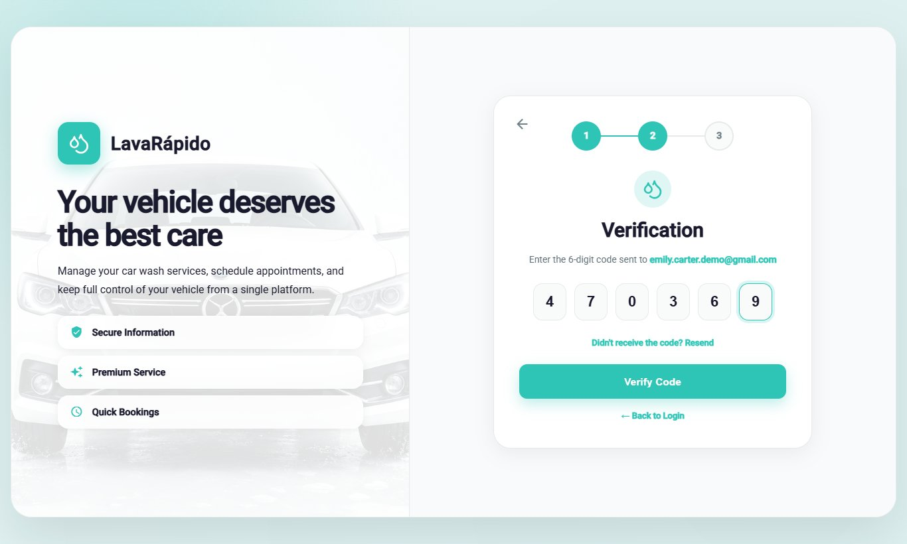

**Figure 4**

*Password Recovery, Step 3: New Password*

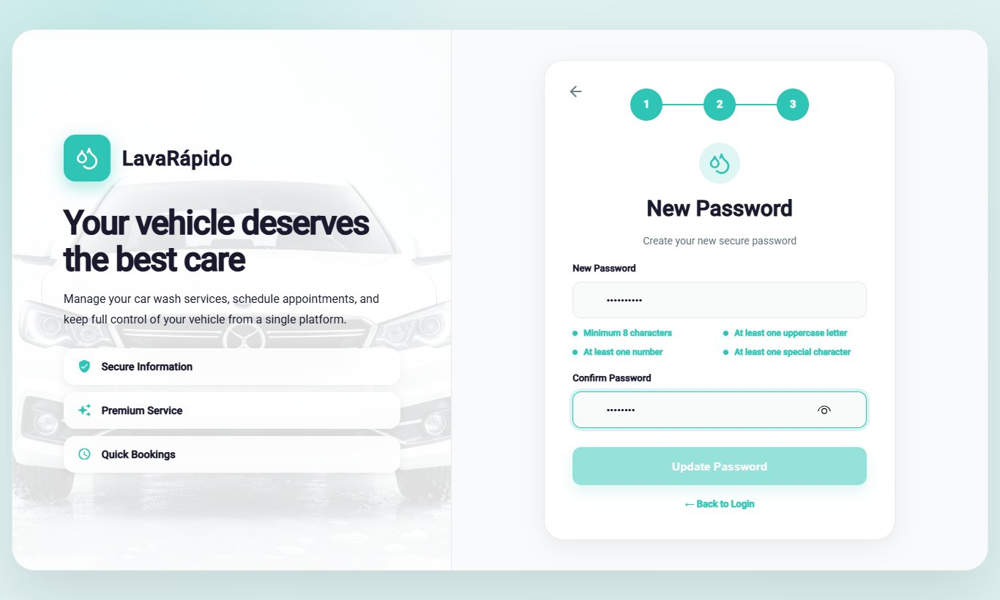

## 9. Main Menu

After logging in, the system shows a side menu with the operator's options (Table 4). At the top of the menu appear the initials, the name, and the email of the operator; at the bottom is the **Log Out** option. On a phone, the menu is opened and closed with the ☰ icon.

**Table 4**

*Main Menu Options of the Operator*

| Option (route) | What it is for | Section |
|---|---|---|
| Dashboard (/operator) | Shows the pending services, the progress of the day, and summary indicators. | 10.1 |
| Profile (/operator/profile) | Allows viewing and editing personal data, changing the password, and deactivating the account. | 10.7 |
| My Schedule (/operator/schedule) | Shows the services by day or by week and allows starting and finishing them. | 10.2 |
| Assigned services (/operator/assigned-services) | Lists the assigned services with their detail and allows starting and finishing them. | 10.3 |
| Notifications (/operator/notifications) | Shows the notices about assignments, reschedules, cancellations, reassignments, and services to close. | 10.4 |
| History (/operator/service-history) | Lists the services performed with their final status and rating. | 10.5 |
| Ratings (/operator/qualifications) | Shows the ratings left by customers. | 10.6 |
| Settings (/operator/settings) | Allows choosing the theme, the language, and the notification preferences, and opening the help center. | 10.8 |
| Log Out | Ends the session securely. | 12 |

*Note.* The option names are those of the side menu when the interface is in English. The old operator tasks route redirects to Assigned services.

**Figure 5**

*Operator Side Menu*

## 10. System Modules

Each module is documented with the format of the manuals guide: name, description, role that can use it, route or menu, steps, screenshot, expected result, and notes or restrictions. The operator can only see and update the services assigned to them.

### 10.1 Operator Dashboard

**Module name:** Operator dashboard.

**Description:** Home screen of the operator. It summarizes the pending work and the progress of the day.

**Role that can use it:** Operator.

**Route or menu where it is found:** Side menu > **Dashboard** (route */operator*).

**Steps to use it:**

1. Log in; the system opens the dashboard automatically.
2. Read the greeting, which indicates how many pending services there are ("You have N pending services for today"), and click **View assigned services** to go to the list.
3. Review the indicators (assigned bookings, services in progress, notifications, and rating) and the progress bar **Services completed today**.
4. In **Today's services**, review the upcoming assigned services with their type, vehicle, time, customer, and status, and click **Start** when it is time to begin one.

**Expected result:** The operator knows at a glance which services must be performed and how much of the day is done.

**Notes or restrictions:** If there are no assigned services, the system shows "You have no scheduled services right now."

**Figure 6**

*Operator Dashboard*

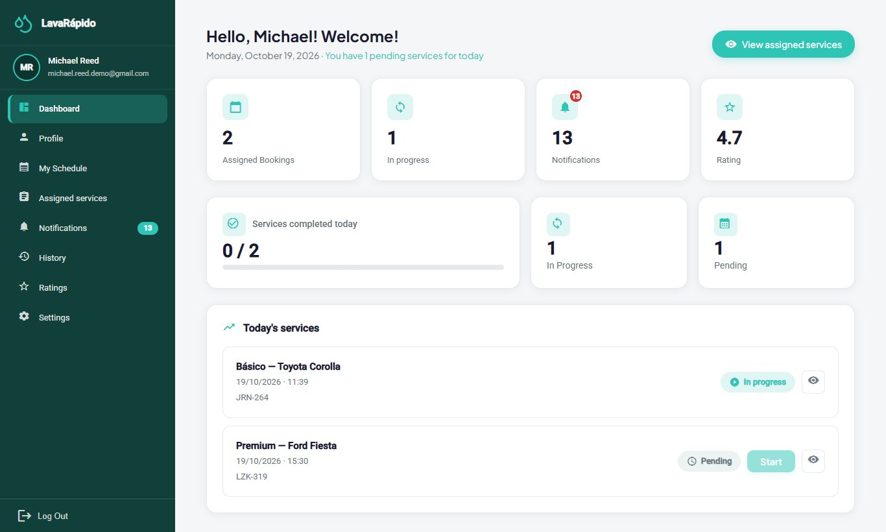

### 10.2 My Schedule

**Module name:** My Schedule.

**Description:** Shows the operator's bookings in a calendar, by day or by week, and allows starting and finishing them.

**Role that can use it:** Operator.

**Route or menu where it is found:** Side menu > **My Schedule** (route */operator/schedule*).

**Steps to use it:**

1. Click **My Schedule**.
2. Select a day in the calendar, or switch between the **Day**, **Week**, and **Completed** tabs.
3. Review the totals: **Total**, **Pending**, **In progress**, and **Completed**.
4. Check the **Next service** block, which indicates how many minutes remain before it starts.
5. In the list of bookings, click **Start** or **Finish** according to the status of each service, or **View detail** to see the date, the duration, and the vehicle.

**Expected result:** The status of the service changes and the customer can follow its progress.

**Notes or restrictions:** A service can be started from 15 minutes before the booked time and up to 4 hours after its end time. After that, the **Start** button is disabled with the notice "It can no longer be started: more than 4 h have passed since the end time" and the administrator closes the service. Only one service can be in progress at a time. A service must be started before it can be finished ("You must start the service first."). When finishing, the system asks "Finish this service?" and moves it to the history. The schedule does not show cancelled bookings or those left as No show.

**Figure 7**

*Operator Schedule*

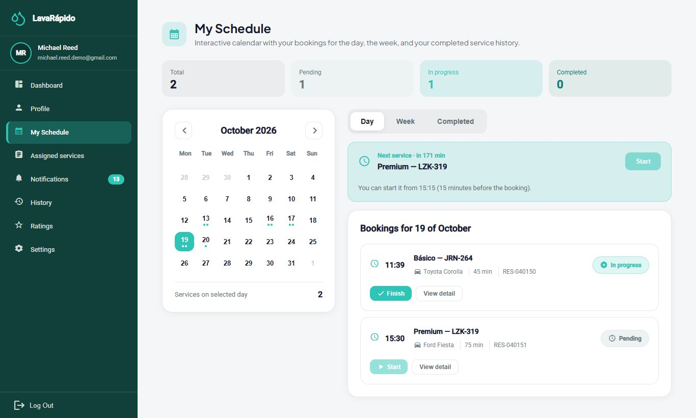

### 10.3 Assigned Services

**Module name:** Assigned services.

**Description:** Lists all the services assigned to the operator, shows the information of each one, and allows starting and finishing them.

**Role that can use it:** Operator.

**Route or menu where it is found:** Side menu > **Assigned services** (route */operator/assigned-services*).

**Steps to use it:**

1. Click **Assigned services**.
2. Review the cards: **Total Services**, **Pending**, **In Progress**, and **Completed Today**.
3. Use **Filter by date**, **Filter by service type**, or the search box, and click **Filter**.
4. In the table, read the **ID**, **Service type**, **Date & time**, **Vehicle**, **Client**, and **Status** of each service.
5. Click a service to open **Service information**: client, vehicle, service type, scheduled time, and payment method. If the administrator wrote instructions when assigning or reassigning the service, they appear in **Notes from the administrator** (on the web and in the app).
6. Click **Start Service** when beginning the wash and confirm with **Start**.
7. When the wash is finished, click **Finish Service** and confirm with **Finish**.
8. If it is necessary to communicate with the customer, use **Contact client** in **Additional options**.

**Expected result:** The status changes to In progress and then to Completed ("Service finished!"). The customer receives the service started and completed notices and can rate the service.

**Notes or restrictions:**

- The service can be started from 15 minutes before the booked time. The operator can only update the services assigned to them.
- Every service must be recorded with **Start** and **Finish**, even if late: if the time of the service has already passed, it can still be started and finished up to 4 hours after its end time, and the real hours count; afterwards the system answers "This service can no longer be started: more than 4 hours have passed since its end time. Ask the administrator to close it."
- If an assigned service was not started when its time ended, or was started and not finished one hour after its end time, the operator receives the notice "Did you serve this booking?" and the administrator sees the booking in the list of bookings to close; if it can no longer be recorded, the operator tells the administrator whether the vehicle was served, and the administrator closes it.
- The payment method shown in the service information is the one the customer chose when booking (digital payment or cash at the car wash). If the customer pays in cash, the operator refers them to the administrator, who records the payment.
- The list does not show cancelled bookings or those left as No show.

**Table 5**

*Service Statuses Shown to the Operator*

| Status | Meaning | Available action |
|---|---|---|
| Pending | The service was assigned and has not started yet. | Start Service (from 15 minutes before the booked time and up to 4 hours after its end time). |
| In progress | The operator started the wash. | Finish Service. |
| Completed | The wash is finished and the customer can rate it. | View only. |

*Note.* Prepared by the authors from the execution statuses used by the operator interface.

**Figure 8**

*List of Assigned Services With Filters*

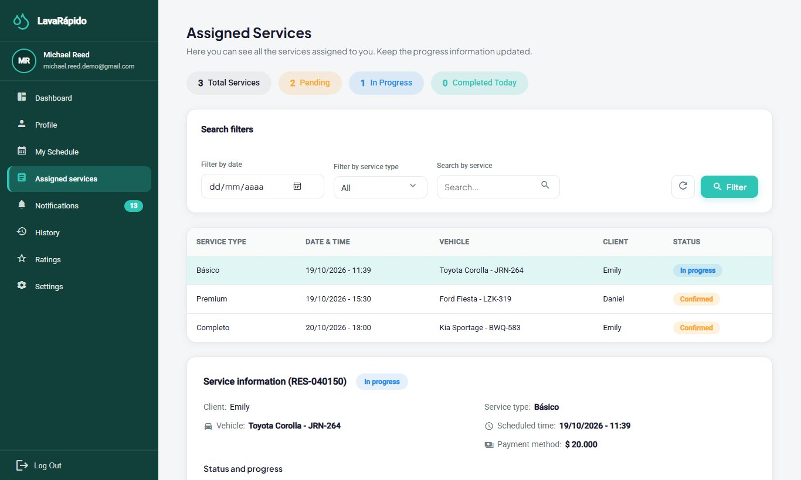

**Figure 9**

*Service Information and Action Buttons*

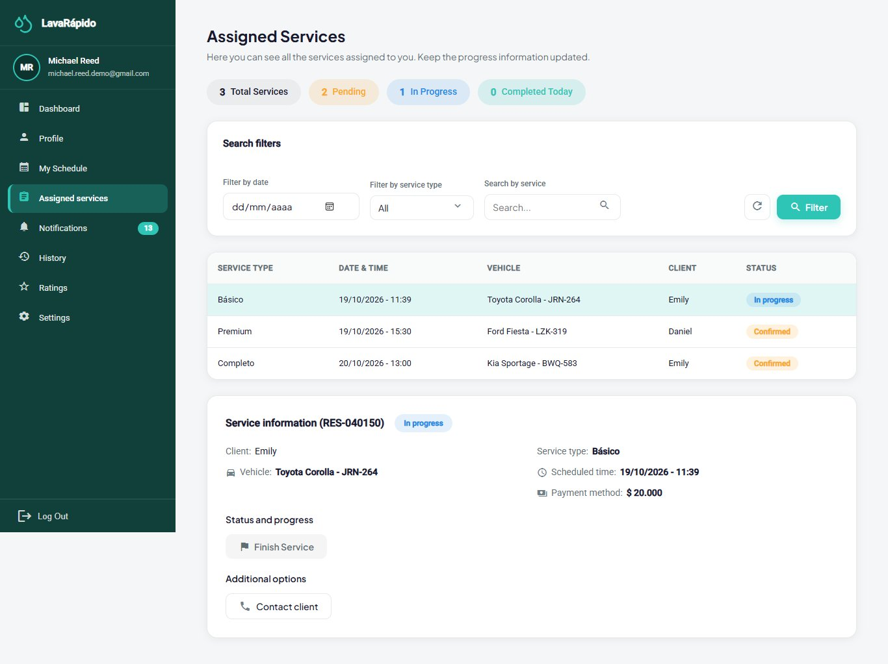

### 10.4 Operator Notifications

**Module name:** Notifications.

**Description:** Gathers the staff notices: new service assigned, service moved to another time, service cancelled, service reassigned to another operator, and "Did you serve this booking?" when a service's time ended and it was not started or not finished.

**Role that can use it:** Operator.

**Route or menu where it is found:** Side menu > **Notifications** (route */operator/notifications*).

**Steps to use it:**

1. Click **Notifications**. The header shows how many are unread.
2. Use the **All**, **Reminders**, **Promotions**, **Confirmations**, and **Others** tabs, the **Read status** filter, and the dates to narrow the list.
3. Click a notice to open its detail; it is marked as read. The **Go to assigned services** button opens the list of services (section 10.3).
4. Use **Mark as read**, **Mark as unread**, or **Mark all as read**.
5. To delete a notice, use the delete option and confirm "Delete this notification?".

**Expected result:** The operator learns at once about the changes in their work.

**Notes or restrictions:** Staff notices arrive in the inbox and as push notifications, never by email. The "Did you serve this booking?" notice arrives only once per booking. A deleted notification cannot be recovered.

**Figure 10**

*Operator Notifications*

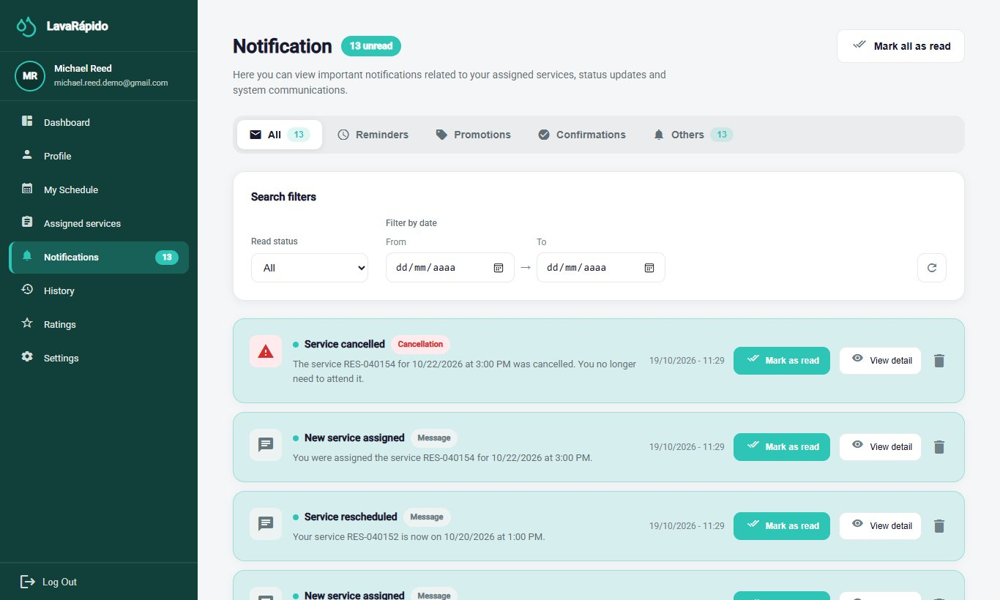

### 10.5 Service History

**Module name:** Service History.

**Description:** Lists the services of the operator with their date, vehicle, payment, rating, and final status.

**Role that can use it:** Operator.

**Route or menu where it is found:** Side menu > **History** (route */operator/service-history*).

**Steps to use it:**

1. Click **History**.
2. Review the indicators, including the **Completion rate**.
3. Use the **All**, **Completed**, **Canceled**, and **Reassigned** tabs and the **All services** filter.
4. Use the search box to find a service by code, plate, client, or vehicle.
5. Click **Clear** to remove the filters.
6. Click a service to see its detail. If the customer rated it, the **Go to ratings** button opens **Ratings received** (section 10.6).

**Expected result:** The operator consults the completed work, from the newest to the oldest, and the final status of each service.

**Notes or restrictions:** A reassigned service is one that the administrator moved to another operator; it no longer counts as the operator's own service.

**Figure 11**

*Operator Service History*

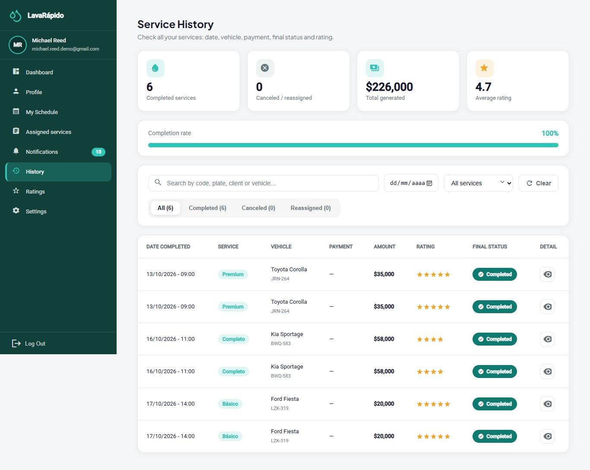

### 10.6 Ratings Received

**Module name:** Ratings received.

**Description:** Shows the ratings and comments that customers left about the operator's work.

**Role that can use it:** Operator.

**Route or menu where it is found:** Side menu > **Ratings** (route */operator/qualifications*).

**Steps to use it:**

1. Click **Ratings**.
2. Review the average rating and the total number of ratings received.
3. Use **Filter by date**, **Filter by service type** (Basic Wash, Premium Wash, or Complete Wash), and the number of stars, and click **Filter**.
4. Read each rating with the customer, the service, the date, and the comment.

**Expected result:** The operator knows the customers' opinion about their work.

**Notes or restrictions:** Only the ratings that customers decided to leave appear, because rating is optional. If there are none, the system shows "No ratings found". The operator cannot answer or modify a rating.

**Figure 12**

*Ratings Received by the Operator*

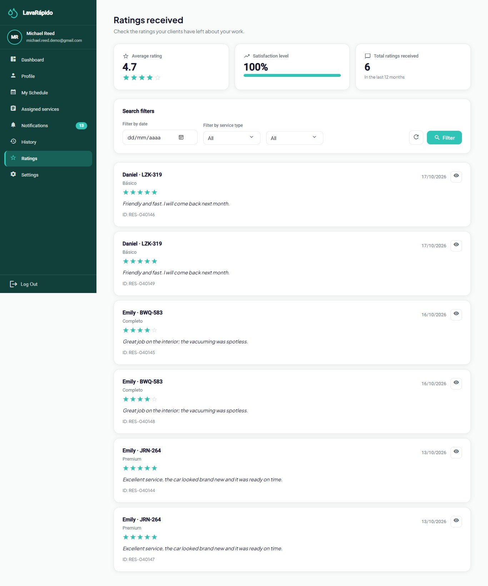

### 10.7 Profile

**Module name:** Profile.

**Description:** Allows viewing and updating the operator's personal data, changing the email and the password, and deactivating the account.

**Role that can use it:** Operator.

**Route or menu where it is found:** Side menu > **Profile** (route */operator/profile*).

**Steps to use it:**

1. Click **Profile**. The "My Profile" screen opens in view mode with the **Operator** role under the name, the first names, last names, email, phone, and address.
2. To modify the data, click **Edit profile**, change the fields, and click **Save**; "Profile updated!" appears.
3. To change the email, type the new one and confirm with the current password in the window "Confirm the email change"; from then on the new email is used to log in.
4. To change the password, go to **Password**, click **Change**, type the **Current password**, the **New password**, and **Confirm new password**, and click **Save**.
5. To stop using the account, go to **Account**, click **Deactivate my account**, and confirm with the password.

**Expected result:** The data is updated. If the password was changed, the new one is used at the next login.

**Notes or restrictions:** If the current password is wrong, the change is rejected ("The current password is incorrect"); the new one must be different from the current one. Deactivating the account does not erase it: the operator can no longer log in and the sessions are closed, but the service history is kept. Before deactivating it, it is advisable to tell the administrator, who reactivates it and reassigns the pending services.

**Figure 13**

*Operator Profile*

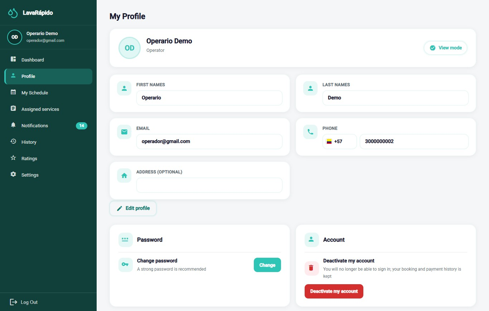

### 10.8 Settings

**Module name:** Settings.

**Description:** Allows customizing the appearance, the language, and the notification preferences, and opening the help center and the legal documents.

**Role that can use it:** Operator.

**Route or menu where it is found:** Side menu > **Settings** (route */operator/settings*).

**Steps to use it:**

1. Click **Settings**.
2. Under **Appearance**, click **Choose theme** and select one of the four color themes.
3. Under **Languages**, select Español, English, Français, or Português.
4. Under **Notifications**, turn **Push notifications on your phone** on or off to receive or not the notices on the phone with the app installed.
5. Under **Help**, click **Open** next to **Help Center** to see the support line, email, opening hours, and address of the business.
6. In the same **Help** card, open **View Terms and Conditions** or **View Data Policy**.

**Expected result:** The theme, the language, and the preferences are applied immediately and are saved in the account, so they are kept on any device.

**Notes or restrictions:** The screen is the same as the customer's; the **Email Reminders** and **Promotions and Offers** switches only take effect on customer accounts, because staff notices never arrive by email and do not include promotions. No switch affects the notification inbox.

**Figure 14**

*Operator Settings Screen*

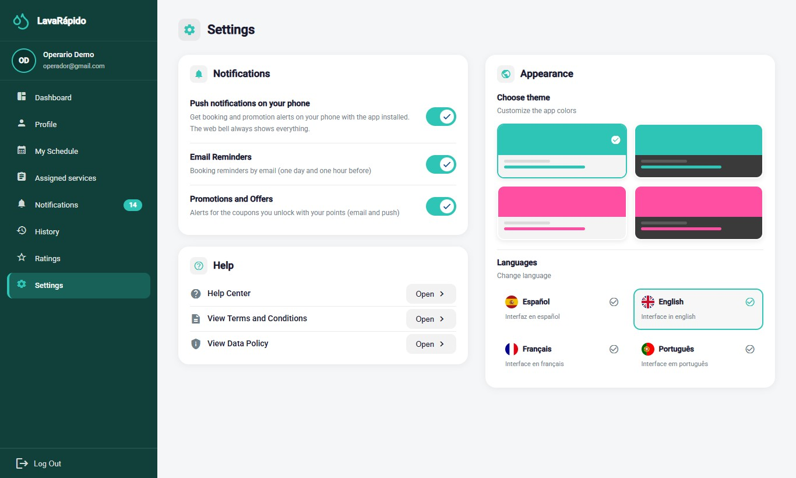

### 10.9 Android Mobile Application

The **LavaRapidoVehicular** application (version 1.1.1, APK *versionCode* 6, published on October 26, 2026) offers the operator the same functions as the web, with the same rules and the same data: a service started in the app appears started on the web and vice versa. It is the most practical way to work in the washing area.

**Installation and updates.** The app is not on Google Play. On the welcome screen of the web, tap the download button or scan the QR code (file */app/LavaRapidoVehicular.apk*), open the file, and tap **Install**; the first time, Android asks to allow the browser to install applications. If the business publishes a new APK, the app shows **Update the app to continue** with the **Download** button, and screen changes arrive on their own with **Update ready** and **Restart now**.

**Sign-in.** The sign-in screen asks for the email and the password with the same rules as section 8; password recovery offers **Request another code** if the code is mistyped five times. The session is stored encrypted on the phone and lasts one hour.

**Navigation.** At the bottom there is a bar with **Home**, **Schedule**, **Assigned**, and **Alerts**; the **More** button opens **History**, **Profile**, **Ratings**, **Settings**, and **Log Out**.

- **Home:** "You have N pending services for today", the button to see the assigned services, and the indicators of assigned bookings, in progress, notifications, and rating (section 10.1).
- **Schedule:** **Day**, **Week**, and **Completed** views, with the next service and the **Start** and **Finish** buttons. Before time, the app says "You can start it from HH:MM (15 minutes before the booking)" and, more than 4 hours after the end time, the **Start** button is disabled with "it can no longer be started" (sections 10.2 and 10.3). The service detail shows the administrator's notes.
- **Assigned:** totals of services pending, in progress, and finished today, with filters by date, type of service, and search (section 10.3).
- **History**, **Ratings** (average, total received, and satisfaction level of the last 12 months, with the detail of each rating), **Alerts**, **Profile**, and **Settings** work as in sections 10.4 to 10.8. If the notice "Did you serve this booking?" arrives, follow section 10.3.

**Push notifications.** When signing in, the app asks for permission to send notifications. If it is granted, the phone receives at once the notices of assignments, changes, cancellations, and services to close, and tapping one opens the related screen. Android groups them in channels that can be muted from the phone's settings.

**Logging out in the app.** Open **More** and tap **Log Out**, which asks for confirmation; after signing out, the phone stops receiving that account's notifications. Known limitation (Corrective Actions, ACO-39): if the session expires with the app in the background, the phone may keep receiving the account's notices until signing in again or logging out from **More**. On a shared phone, the operator must always log out at the end of the working day.

## 11. Messages and Validations

Table 6 explains the messages the operator sees most often and what to do in each case.

**Table 6**

*System Messages for the Operator*

| System message | Meaning | Operator action |
|---|---|---|
| Incorrect email or password | The credentials do not match any account. | Check the data or recover the password. |
| Too many failed attempts. Your account is locked for 15 minutes... | The password was typed wrong five times within 15 minutes. | Wait 15 minutes or use Forgot your password?. |
| Your account is disabled. Contact the administrator. | The administrator deactivated the account. | Talk to the administrator. |
| Your session expired. Please sign in again. | The one-hour session ended or the account was deactivated. | Log in again. |
| The code is wrong, already used or expired. Request a new one. | The recovery code is not valid. | Request a new code. |
| Too many failed attempts. Wait a few minutes or request another code to try again. | The recovery code or the current password was mistyped five times. | Request another code or wait 15 minutes. |
| The current password is incorrect | When changing the password, the current one does not match. | Type the password used to log in. |
| You do not have permission to perform this action | An attempt was made to act on another operator's service or a function of another role. | Work only with the assigned services. |
| You can start it from HH:MM (15 minutes before the booking) | It is still too early to start the service. | Wait until the time shown. |
| You must start the service first. / This service was already started. | An action was attempted out of order. | Start the service before finishing it. |
| This service can no longer be started: more than 4 hours have passed since its end time. Ask the administrator to close it. | The deadline to record the service passed. | Tell the administrator whether the vehicle was served. |
| Did you serve this booking? | An assigned service ended its time without being started or finished. | Record it if still possible or inform the administrator. |
| Finish this service? | Confirmation before closing the service. | Click **Finish** only if the wash is done. |
| Service finished! | The service is Completed. | Continue with the next service. |
| You have no scheduled services right now. | There are no assigned services. | Wait for new assignments. |
| The data clashes with an existing record or someone changed it while you were editing. Open it again and retry. | The administrator changed the service at the same time. | Open the screen again and repeat the action. |
| Cannot reach the server. Please try again in a moment. | There is no connection with the system. | Check the internet connection and try again. |

*Note.* Texts taken from the English translation files of the web application and the mobile application.

## 12. Logging Out

Logging out at the end of the working day prevents another person from recording services with the operator's account, above all on shared computers or phones of the business.

1. Locate the **Log Out** option at the bottom of the side menu.
2. Click **Log Out**.
3. In the "Log out" window, click **Yes, log out**.
4. Verify that the system returns to the login screen.

When signing out, the other tabs of the same browser also go back to the login screen, and the closed session stops working on the server. In the mobile app, the session is closed from **More** (section 10.9).

**Figure 15**

*Log Out Confirmation*

## 13. Frequently Asked Questions

##### How do I get my operator account?

The administrator of the business creates it and gives you the email and a temporary password. The registration form of the website only creates customer accounts.

##### What do I do if I forgot my password?

On the login screen, click "Forgot your password?" and follow the three steps of section 8.3. The code arrives at the email of your account.

##### I cannot start a service. Why?

A service can be started from 15 minutes before the booked time (before that, the system says from what time) and up to 4 hours after its end time (afterwards it answers that it can no longer be started), only if it is assigned to you, and only when you do not have another service in progress. If the service is yours and the problem continues, inform the administrator.

##### I served a vehicle and forgot to press Start. What do I do?

If no more than 4 hours have passed since the end time, open the service and press **Start** and then **Finish**; the system accepts it even if it is late. If you can no longer do it, tell the administrator that the vehicle was served, so the booking is closed as attended and not as No show.

##### Why did a service disappear from my list?

Because the customer or the administrator cancelled it, because it was left as No show, or because the administrator reassigned it to another operator. You receive a notice in each case, and the reassigned ones appear in the **Reassigned** tab of the history.

##### Can I change the time of a service or hand it over to a colleague?

No. Reschedules and reassignments are made by the administrator.

##### The customer wants to pay in cash. Do I record it?

No. The cash payment is recorded by the administrator. The service information shows the payment method the customer chose when booking.

##### Can I see the services of other operators?

No. Each operator sees and updates only the services assigned to them.

##### How do I see what customers think of my work?

**Ratings** shows the average, the total, and each rating with its comment. Rating is optional for the customer, so not every service has a rating.

##### Can I change the language or the colors?

Yes. In Settings you can choose Spanish, English, French, or Portuguese and one of four color themes; the choice is saved in your account.

## 14. Glossary

**Table 7**

*Glossary of System Terms for the Operator*

| Term | Definition |
|---|---|
| Administrator | Person of the business who creates the accounts, assigns and reassigns services, verifies payments, and closes bookings. |
| Administrator's notes | Notes the administrator writes when assigning or reassigning a service. |
| Assignment | Link between an operator and a booking, made by the system or by the administrator. |
| Bay (washing bay) | Physical spot of the business where a vehicle is washed. |
| Booking | Block of time reserved for washing a vehicle. |
| Customer | Owner of the vehicle who books and pays for the services. |
| Dashboard | Home screen that summarizes the work of the day. |
| Operator | Employee of the business who performs the washes. |
| Push notification | Notice that arrives on the phone through the mobile application. |
| Rating | Score from one to five stars, with an optional comment, that the customer gives to a completed service. |
| Reassignment | Change of the operator of a service, made by the administrator. |
| Schedule | Calendar with the services assigned to the operator, by day or by week. |
| Service to close | Booking whose time ended without its start or end being recorded; the administrator closes it. |
| Temporary password | Initial password the administrator gives when creating the account, which the operator must change at the first login. |
| Washing service | Type of wash offered (Basic, Premium, or Complete), with its own duration. |

*Note.* Based on the glossary of the project documentation.

## References

Servicio Nacional de Aprendizaje. (2026). *Guía para elaborar manuales de software: Manual de usuario, manual técnico, manual de instalación y manual de administrador* [Guide for writing software manuals: User manual, technical manual, installation manual, and administrator manual] [Unpublished instructional material]. Technologist in Software Analysis and Development program.

Vehicle Washing Development Team. (2026a). *Vehicle washing management system: Project documentation* (vehicle-w-docs) [Unpublished project documentation]. GitHub. https://github.com/code-sena/vehicle-w-docs

Vehicle Washing Development Team. (2026b). *Front-end-proyecto-web* (develop branch) [Computer software]. GitHub. https://github.com/BrayanCABRERA123/Front-end-proyecto-web

Vehicle Washing Development Team. (2026c). *LavadoVehicular-Movil* (version 1.1.0) [Computer software]. GitHub. https://github.com/merari0322/LavadoVehicular-Movil

## 15. Annexes

### Annex A. Source of the Screenshots

The figures in this manual are real screenshots of the whole system running in Docker with the web at *http://localhost:4200*, on the *develop* branch, with the interface in English. Figures 13 and 14 were taken on October 26, 2026 with a test operator account; the others, on October 19, 2026, and correspond to screens that have not changed since then. Test accounts, vehicles, and bookings created only for the screenshots were used, so no real emails, ID numbers, phone numbers, or plates appear. If a screen changes in a future version, the corresponding screenshot must be taken again with the same file name in the *capturas* folder.

### Annex B. Delivery Checklist

**Table 8**

*Operator User Manual Checklist*

| Criterion | Met |
|---|---|
| Has a complete title page (ficha, program, instructor, training center, date) and version | Yes |
| Includes version control and a table of contents with updated pages | Yes |
| Explains the introduction, objective, and scope | Yes |
| Describes the requirements, login, main menu, and each module with the format of the guide | Yes |
| The content matches the software of the final version (*develop* of October 26, 2026) | Yes |
| All figures are real screenshots ordered according to the workflow | Yes |
| Includes the messages and validations table, logging out, frequently asked questions, and the glossary | Yes |
| Contains no sensitive information or real credentials | Yes |
| Spelling and APA formatting reviewed | Yes |
| Exported to PDF and Word, in Spanish and English | Yes |

*Note.* Adapted from the checklist of the guide for writing software manuals (SENA, 2026).
