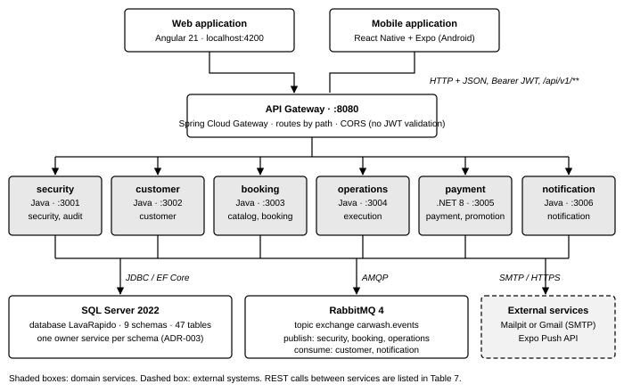
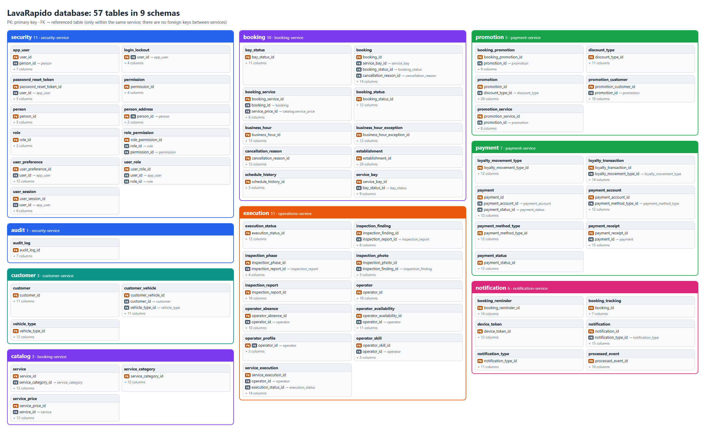

<!-- running-head: TECHNICAL MANUAL: VEHICLE WASHING SYSTEM -->

# Technical Manual

Vehicle Washing Management System (Vehicle Washing)

Microservices Architecture, Data Model, Integration Contracts, Security, and Business Logic

Brayan Estiven Patiño Cabrera (Project Leader), Juan Camilo Guilombo Osorio (Frontend Leader), and Merari Urbano (Backend Leader)

Technologist in Software Analysis and Development (ADSO), Servicio Nacional de Aprendizaje (SENA), Training Center: Industria

Ficha 3145556

Instructor: Karol Daniela Correa

October 17, 2026

Manual Type: Technical Manual (Developers and Software Architects) · Version 4.1

## Version Control

Table 1 records the change history of this document. Each modification must add a row with the version, the date, the description of the change, and the person responsible. It must not be confused with the version control of the source code, described in section 15.

**Table 1**

*Version History of the Technical Manual*

| Version | Date | Description of the change | Responsible |
|---|---|---|---|
| 1.0 | 2026-10-04 | Initial creation of the technical manual (in Spanish) from the project documentation. | Development team |
| 2.0 | 2026-10-05 | Cover data completed, system name adjusted to Vehicle Washing, and description of the migration strategy changed. | Development team |
| 3.0 | 2026-10-07 | Translation into English, APA Style (7th ed.) formatting, and verification against the source code. Corrected: payment-service is .NET 8 (ADR-013); Spring Boot 4 instead of 3; SQL Server 2022; real ports; one Liquibase changelog per service (the single master changelog of version 2.0 was wrong); 47 tables; the gateway does not validate tokens; there is no account lockout; manual operator assignment (ADR-014); English execution codes; real request of the booking endpoint; complete endpoint and event catalog; real project structure; audit trail not populated. Two real diagrams were added. | Development team |
| 3.1 | 2026-10-09 | Update against the code of the eleven repositories as of October 9, 2026 (ADR-011 sections 9 to 12 and ADR-015), and creation of the Spanish version (Manual_tecnico_LavadoVehicular_3145556_ES.md). Updated: 49 tables (booking.schedule_history and notification.booking_tracking); loyalty points per service and points ledger with reversal; promotions as percentage coupons; permission matrix of the fixed roles; notification switches of the user; payment-service events, tests, structure, and container; staff notifications; new endpoints, gateway routes, and error codes; real name of the operations repository; technical debt TD-002, TD-014, TD-015, TD-016, and TD-018 resolved. | Development team |
| 4.0 | 2026-10-16 | Review of the eleven repositories with the system running. Updated: 57 tables with the entity-relationship diagram generated from the database, dictionary of the new tables (account lockout, address, consent, operator profile, and inspection), automatic assignment and operator choice, lockout after failed attempts, inspection reports on the server, business data, health and correlation of payment-service, new endpoints and events, real test results (639 unit and 19 end-to-end), technical debt, and resolved discrepancies. | Development team |
| 4.1 | 2026-10-17 | Review against the code of October 17, 2026. Documented the inspection report of the mobile app (section 10.5), the mobile HTTP client with multipart forms and the *EXPO_PUBLIC_WEB_URL* variable (section 12.7), the *expo-image-picker* and *expo-image-manipulator* dependencies (Table 3), and the rule that ignores a late 401 after logging out. | Development team |

*Note.* Dates are written in the ISO 8601 format (year-month-day). Prepared by the development team.

## Table of Contents

<!-- toc -->

- [Version Control](#version-control)
- [4. Introduction](#4-introduction)
  - [4.1 Sources and Conventions of This Document](#41-sources-and-conventions-of-this-document)
- [5. Objective](#5-objective)
  - [5.1 General Objective](#51-general-objective)
  - [5.2 Specific Objectives](#52-specific-objectives)
- [6. Technical Scope](#6-technical-scope)
  - [6.1 What This Manual Covers](#61-what-this-manual-covers)
  - [6.2 What This Manual Does Not Cover](#62-what-this-manual-does-not-cover)
- [7. General Description of the System](#7-general-description-of-the-system)
  - [7.1 Solution Summary](#71-solution-summary)
  - [7.2 Type of Application and Main Components](#72-type-of-application-and-main-components)
  - [7.3 Architectural Constraints](#73-architectural-constraints)
- [8. Technologies Used](#8-technologies-used)
- [9. System Architecture](#9-system-architecture)
  - [9.1 Architectural Style](#91-architectural-style)
  - [9.2 API Gateway](#92-api-gateway)
  - [9.3 Internal Architecture of the Services](#93-internal-architecture-of-the-services)
  - [9.4 Communication Between Components](#94-communication-between-components)
  - [9.5 Cross-Cutting Concerns](#95-cross-cutting-concerns)
- [10. Project Structure](#10-project-structure)
  - [10.1 Repositories](#101-repositories)
  - [10.2 Structure of a Java Service](#102-structure-of-a-java-service)
  - [10.3 Structure of payment-service](#103-structure-of-payment-service)
  - [10.4 Structure of the Web Application](#104-structure-of-the-web-application)
  - [10.5 Structure of the Mobile Application](#105-structure-of-the-mobile-application)
- [11. Database](#11-database)
  - [11.1 Entity-Relationship Diagram](#111-entity-relationship-diagram)
  - [11.2 Main Tables](#112-main-tables)
  - [11.3 Data Dictionary](#113-data-dictionary)
  - [11.4 Integrity Rules](#114-integrity-rules)
  - [11.5 Migrations and Initial Data](#115-migrations-and-initial-data)
- [12. Technical Modules](#12-technical-modules)
  - [12.1 security-service](#121-security-service)
  - [12.2 customer-service](#122-customer-service)
  - [12.3 booking-service](#123-booking-service)
  - [12.4 operations-service](#124-operations-service)
  - [12.5 payment-service](#125-payment-service)
  - [12.6 notification-service](#126-notification-service)
  - [12.7 Web and Mobile Clients](#127-web-and-mobile-clients)
  - [12.8 Life Cycles](#128-life-cycles)
- [13. API or System Routes](#13-api-or-system-routes)
  - [13.1 General Conventions](#131-general-conventions)
  - [13.2 Authentication in the API](#132-authentication-in-the-api)
  - [13.3 Endpoints](#133-endpoints)
  - [13.4 Domain Events (RabbitMQ)](#134-domain-events-rabbitmq)
  - [13.5 Health and Verification](#135-health-and-verification)
- [14. Security](#14-security)
  - [14.1 Authentication and Session Control](#141-authentication-and-session-control)
  - [14.2 Authorization](#142-authorization)
  - [14.3 Input Validation](#143-input-validation)
  - [14.4 Secrets and Communication](#144-secrets-and-communication)
  - [14.5 OWASP Top 10 Checklist](#145-owasp-top-10-checklist)
  - [14.6 Personal Data Protection](#146-personal-data-protection)
  - [14.7 Accepted Risks](#147-accepted-risks)
- [15. Version Control](#15-version-control)
  - [15.1 Source Code](#151-source-code)
  - [15.2 Database Schema](#152-database-schema)
  - [15.3 Architecture Decisions](#153-architecture-decisions)
- [16. Maintenance Recommendations](#16-maintenance-recommendations)
  - [16.1 Local Environment](#161-local-environment)
  - [16.2 Configuration](#162-configuration)
  - [16.3 Updates and Dependencies](#163-updates-and-dependencies)
  - [16.4 Database](#164-database)
  - [16.5 Testing](#165-testing)
  - [16.6 Diagnosing Frequent Problems](#166-diagnosing-frequent-problems)
  - [16.7 Technical Debt](#167-technical-debt)
  - [16.8 Recommended Evolution](#168-recommended-evolution)
- [17. Glossary](#17-glossary)
- [References](#references)
- [18. Annexes](#18-annexes)
  - [Annex A. Source of the Figures](#annex-a-source-of-the-figures)
  - [Annex B. Discrepancies Detected](#annex-b-discrepancies-detected)
  - [Annex C. Delivery Checklist](#annex-c-delivery-checklist)

<!-- /toc -->

## 4. Introduction

The Vehicle Washing Management System (Vehicle Washing), internally called *LavaRapido*, is a platform that allows booking washing slots, assigning operators, executing and rating services, and verifying payments made by QR code in a single business. From the technical point of view, it is a set of six domain microservices (five written in Java 21 with Spring Boot 4 and one in C# with .NET 8) behind a gateway, with a SQL Server 2022 database that is shared physically and separated logically by schemas, asynchronous messaging through RabbitMQ, an Angular 21 web client, and a React Native mobile client.

This manual documents how the system is built: the architecture and the decisions that support it, the project structure, the data model, the communication between services, the API, security, and the business rules. It is addressed to developers, architects, technical support staff, and instructors who must maintain or evolve the system.

The architecture relies on widely documented concepts: microservices (Newman, 2021), domain-driven design (Evans, 2004), the hexagonal architecture of ports and adapters (Cockburn, 2005), the publish-subscribe messaging pattern (Hohpe & Woolf, 2003), and the REST architectural style (Fielding, 2000).

### 4.1 Sources and Conventions of This Document

Version 3.0 was verified against the source code of security-service, customer-service, payment-service, lavarapido-infra, the web application, and the mobile application (*develop* branch, October 5, 2026), and against the documentation of the other services (Vehicle Washing Development Team, 2026a, 2026b, 2026c, 2026d, 2026e, 2026f). Version 3.1 reviewed the eleven repositories (*develop* branch, October 9, 2026). Version 4.0 reviewed the eleven repositories again with the whole system running in Docker (*develop* branch, October 16, 2026): the figures for tables, changelogs, and tests come from queries to the database and from running the tests, not from previous documents. Annex B lists the discrepancies found between the code, the documentation, and the previous versions of the manuals, as the guide for writing manuals requires (Servicio Nacional de Aprendizaje [SENA], 2026). Identifiers (schemas, tables, columns, endpoints, events, and classes) are written exactly as in the code.

## 5. Objective

### 5.1 General Objective

To document the architecture, technologies, structure, data model, communication between services, API, security, and business rules of the Vehicle Washing Management System, so that another developer can understand, maintain, and continue the project.

### 5.2 Specific Objectives

- Describe the architectural style (microservices with logical data ownership) and the internal structure of each service.
- Present the real structure of the repositories and of the client applications.
- Present the nine-schema data model, its dictionary, and its integrity rules.
- Document the synchronous (REST) and asynchronous (RabbitMQ) communication with its endpoints and events.
- Explain the security model: authentication with JWT, authorization by role and ownership, validations, and data protection.
- Leave recommendations for maintenance and testing, and record the technical debt and the discrepancies found.

## 6. Technical Scope

### 6.1 What This Manual Covers

- The six backend services (security, customer, booking, operations, payment, and notification) and the API Gateway.
- The web application (Angular) and the mobile application (React Native with Expo) in their structure and their relationship with the backend.
- The SQL Server database, its migrations with Liquibase, and its integrity mechanisms.
- Messaging with RabbitMQ, email through SMTP, and push notifications through Expo.
- The local environment with Docker.

### 6.2 What This Manual Does Not Cover

- The use of the platform by customers, operators, and administrators (User Manual and Administrator Manual).
- The step-by-step installation (Installation Manual).
- Staging and production environments, which are outside the academic scope.
- Payment gateways, electronic invoicing, and inventory management, which are not part of the system.

## 7. General Description of the System

### 7.1 Solution Summary

The system serves a single business. Three fixed roles interact with it: the customer, who registers vehicles, books slots, pays, and rates; the operator, who executes the services assigned; and the administrator, who manages bookings, operators, payments, schedules, and reports. Payment does not use an external gateway: the customer transfers from a banking app and uploads the receipt, which the administrator approves or rejects manually (ADR-008). No card data are collected.

### 7.2 Type of Application and Main Components

It is a distributed client-server system with a microservices backend (Figure 1 and Table 2).

**Figure 1**

*Container Diagram of the System*



*Note.* Prepared by the authors from *docker-compose.yml* and the service catalog. The web application reaches the gateway through *proxy.conf.json* in development.

**Table 2**

*Main Components of the System*

| Component | Technology | Port | Responsibility |
|---|---|---|---|
| Web application | Angular 21 | 4200 | Interface of the three roles (customer, operator, and administrator). |
| Mobile application | React Native 0.86 with Expo SDK 57 | 8081 (Metro) | Interface of the three roles; push notifications and new version notice (APK built with EAS). |
| api-gateway | Spring Cloud Gateway 2025.1 (webmvc) | 8080 | Single entry point; routes */api/v1/\** by path; CORS. |
| security-service | Java 21, Spring Boot 4 | 3001 | People, accounts, roles, sessions, password recovery, profile, and preferences. |
| customer-service | Java 21, Spring Boot 4 | 3002 | Customer profile, vehicle types, and vehicles. |
| booking-service | Java 21, Spring Boot 4 | 3003 | Catalog and prices, establishment, schedule, bays, availability, and bookings. |
| operations-service | Java 21, Spring Boot 4 | 3004 | Operators, shifts, absences, assignment, execution, and ratings. |
| payment-service | C#, .NET 8, ASP.NET Core, EF Core | 3005 | Payment accounts with QR, payments with receipt, review, refunds, manual payments, promotions (coupons), and the loyalty points ledger. |
| notification-service | Java 21, Spring Boot 4 | 3006 | Inbox, push, email, booking reminders, and staff notices. |
| SQL Server | SQL Server 2022 (container) | 1433 | Database *LavaRapido*, nine schemas, 57 tables. |
| RabbitMQ | RabbitMQ 4 with management | 5672 and 15672 | Domain events (exchange *carwash.events*). |
| Mailpit or SMTP | Mailpit (development) or Gmail | 1025 and 8025 | Emails. |

*Note.* Prepared by the authors from the build files and *docker-compose.yml*. The gateway is infrastructure and is not counted as a domain service.

### 7.3 Architectural Constraints

- The system serves a single business.
- SQL Server is the only database engine; all the services share the database *LavaRapido*, with one owner service per schema.
- No service reads or writes the tables of another; there are no foreign keys between schemas of different services (ADR-003).
- Payment verification is manual; no payment gateway is used (ADR-008).
- The runtime environment is local with Docker.

## 8. Technologies Used

**Table 3**

*Technologies and Tools of the Project*

| Component | Technology | Version or detail |
|---|---|---|
| Backend language (five services and gateway) | Java (Eclipse Temurin) | JDK 21 |
| Backend framework | Spring Boot | 4.0.8: Web MVC, Validation, Security, OAuth2 Resource Server (JWT), Data JPA, Liquibase, Mail, AMQP, Actuator |
| API documentation | springdoc-openapi | 3.0.3 (Swagger UI only in the *dev* profile) |
| Gateway | Spring Cloud Gateway (server webmvc) | 2025.1 |
| Payment service | .NET, ASP.NET Core, EF Core (SQL Server), JwtBearer, Swashbuckle | .NET 8; EF Core and JwtBearer 8.0.11 |
| Database | Microsoft SQL Server | 2022 (image mssql/server:2022-latest); driver mssql-jdbc |
| Migrations | Liquibase | One changelog per service (SQL formatted); image liquibase 4.29 for payment |
| Messaging | RabbitMQ | 4 with management plugin; topic exchange *carwash.events* |
| Email | Spring Mail with Mailpit (development) or Gmail | SMTP |
| Push notifications | Expo Push API | Requires an EAS build on mobile |
| Web frontend | Angular, Angular Material and CDK, ngx-translate, Chart.js, jsPDF, xlsx, RxJS | 21.2.25, 21.2.14, 17, 4.5, 4.2, 0.20, 7.8; TypeScript 5.9 |
| Mobile frontend | React Native, Expo, React, React Navigation, i18next; expo-image-picker and expo-image-manipulator (inspection photos) | 0.86.3, SDK 57, 19.2, 7, 26; 57.0; TypeScript 6.0 |
| Containers | Docker and Docker Compose | Docker 24 or later; Compose v2 |
| Testing | JUnit 5 and Spring Boot Test (Java), xUnit (.NET), Vitest (web) | Through the Maven Wrapper, *dotnet test*, and *ng test* |
| Version control | Git and GitHub | Branches *main*, *develop*, and *feature/\** |
| Continuous integration | Jenkins | Planned, not configured (TD-006) |
| Diagrams and contracts | Mermaid (C4 and UML diagrams), OpenAPI 3 | Folders 08-uml and 07-api of the documentation |

*Note.* Versions taken from *pom.xml*, *Directory.Build.props*, the *.csproj* files, and *package.json* of each repository.

## 9. System Architecture

### 9.1 Architectural Style

The backend adopts a microservices architecture with logical data ownership: each service is independently deployable, is organized around a business capability, and owns its data (Newman, 2021). For academic reasons, the six services share the same SQL Server instance and database, but each schema has exactly one owner service and no service writes to or queries the schema of another (ADR-003). The current decomposition into six services replaced an earlier one with more services (ADR-002, replaced by ADR-009).

**Table 4**

*Services, Owner Schemas, and Tables*

| Service | Schemas | Tables | Domain depth |
|---|---|---|---|
| security-service | security, audit | 12 | Medium: authentication, lockout after failed attempts, roles, permissions, password rules, preferences, and consent. |
| customer-service | customer | 3 | Medium: ownership of customers and vehicles. |
| booking-service | catalog, booking | 13 | High: availability, bay overlap, life cycle, immutable prices, loyalty points per service, and schedule history. |
| operations-service | execution | 11 | High: shifts, absences, manual and automatic assignment, execution, rating, operator profile, and inspection reports. |
| payment-service | payment, promotion | 12 | High: payment review, refunds, percentage coupons, and points ledger. |
| notification-service | notification | 6 | Medium: inbox, idempotent consumption, push, email, reminders, and booking tracking for staff notices. |

*Note.* Total: 57 tables, checked with a query to *sys.tables* on October 16, 2026. Source: changelogs of each service.

### 9.2 API Gateway

The web and mobile clients call only the gateway (port 8080), so they do not need to know the internal addresses (ADR-005). The gateway routes */api/v1/\** by path to the owner service, forwards the method, body, query string, and the headers *Authorization*, *X-Correlation-Id*, and *Accept-Language* without changes, answers CORS (including preflight), and returns 404 for */internal/\** and unknown paths. **It does not validate tokens**: each service verifies the JWT itself (ADR-006). It has no database, cache, or request rate limit. Table 5 shows the routes.

**Table 5**

*Routes of the API Gateway*

| Path prefixes | Service |
|---|---|
| /api/v1/auth/\**, /api/v1/users/\**, /api/v1/admin/users/\**, /api/v1/admin/roles-permissions/\** | security-service :3001 |
| /api/v1/vehicles/\**, /api/v1/vehicle-types, /api/v1/admin/vehicles | customer-service :3002 |
| /api/v1/catalog/\**, /api/v1/schedule/\**, /api/v1/establishment, /api/v1/bookings/\**, /api/v1/admin/bookings/\**, /api/v1/admin/catalog/\**, /api/v1/admin/schedule/\**, /api/v1/admin/bays/\**, /api/v1/operator/bookings/\** | booking-service :3003 |
| /api/v1/admin/operators/\**, /api/v1/admin/assignments/\**, /api/v1/operator/services/\**, /api/v1/operator/ratings, /api/v1/ratings/\** | operations-service :3004 |
| /api/v1/payments/\**, /api/v1/payment-accounts, /api/v1/admin/payments/\**, /api/v1/admin/payment-accounts/\**, /api/v1/admin/payment-methods, /api/v1/admin/promotions/\**, /api/v1/loyalty/\** | payment-service :3005 |
| /api/v1/notifications/\**, /api/v1/admin/notifications/\** | notification-service :3006 |

*Note.* The addresses are configured with ROUTE_SECURITY_URL, ROUTE_CUSTOMER_URL, ROUTE_BOOKING_URL, ROUTE_OPERATIONS_URL, ROUTE_PAYMENT_URL, and ROUTE_NOTIFICATION_URL; the compose file defines all of them with the container names.

### 9.3 Internal Architecture of the Services

**Java services: hexagonal architecture.** The five Java services follow the ports and adapters style (Cockburn, 2005; ADR-007). The domain does not depend on Spring, JPA, SQL Server, or RabbitMQ; the dependencies point toward the domain (Table 6).

**Table 6**

*Layers of the Java Services*

| Layer | Content | Rule |
|---|---|---|
| domain | model (entities and value objects), service (domain policies), event, exception (with a stable code), port/in (use case interfaces), port/out (repositories, publishers, directories). | Does not import Spring or JPA. |
| application | usecase: services annotated with @Service and @Transactional that implement the input ports. | Coordinates ports; the rules belong to the domain. |
| infrastructure | adapter/in/web (controllers and DTOs), adapter/out/persistence (JPA entities and repositories), adapter/out/messaging (RabbitMQ), adapter/out/security and notification, config (security, CORS, JWT, OpenAPI, correlation). | Implements the output ports; thin controllers. |

*Note.* Structure verified in security-service and customer-service.

The following excerpt of *AuthenticationService* (security-service) shows a use case that only coordinates ports: it validates the password, applies the rule of the domain (*ensureCanAuthenticate*), records the session, and issues the token.

```java
@Service
@Transactional
public class AuthenticationService implements AuthenticateUserUseCase, LogoutUseCase {
    @Override
    public AuthenticationResult login(LoginCommand command) {
        UserAccount account = findByEmail(command.email())
                .filter(found -> passwordHasher.matches(command.password(), found.passwordHash()))
                .orElseThrow(InvalidCredentialsException::new);
        account.ensureCanAuthenticate();          // a disabled account cannot log in
        Instant now = clock.instant();
        account.recordSuccessfulLogin(now);
        accounts.save(account);
        long sessionId = sessions.open(account.id(), now, now.plus(tokenIssuer.timeToLive()),
                command.ipAddress(), command.userAgent());
        IssuedToken token = tokenIssuer.issue(account, sessionId, now);
        return new AuthenticationResult(token.value(), token.expiresAt(), UserAccountView.from(account));
    }
}
```

*Note.* Abbreviated excerpt of the class; the comment was translated into English. When the email does not exist, the service compares against a dummy hash so that the response time does not reveal which accounts exist.

**payment-service: layered (Clean) architecture in .NET.** It is organized in four projects with dependencies toward the domain (ADR-013): *PaymentService.Domain* (aggregate *Payment* with its state machine, *PaymentAccount*, *PaymentReceipt*, *PaymentPolicy*, *Promotion*, *LoyaltyTransaction*, and domain events, without NuGet packages), *PaymentService.Application* (use cases by feature: *PaymentCommandService*, *PaymentQueryService*, *BookingPaymentGuard*, and *AmountDueCalculator*; *PaymentAccountService*; *PromotionAdminService* and *CustomerPromotionService*; *LoyaltyService* and *LoyaltyRewardService*; input and output ports in *Ports/In* and *Ports/Out*, including *IBookingDirectory* and *IDomainEventPublisher*), *PaymentService.Infrastructure* (EF Core repositories, *BookingServiceDirectory*, an HTTP client to booking-service, and the RabbitMQ publisher in *Messaging*), and *PaymentService.Api* (controllers, JWT bearer, CORS, *GlobalExceptionHandler*, *EnvFile*, and Swagger). It keeps the same contract as the Java services: HS256 tokens of security-service, RFC 9457 errors with a stable code, */actuator/health*, and configuration from *lavarapido-infra/.env*.

### 9.4 Communication Between Components

#### 9.4.1 Synchronous Communication With REST

REST is used when the caller needs an answer to continue (ADR-004). The calls between services do not pass through the gateway: the caller forwards the token of the user, so that the target service applies its own access rules (Table 7).

**Table 7**

*Synchronous Calls Between Services*

| Source | Target and call | Reason |
|---|---|---|
| customer-service | security-service GET /api/v1/users/me | Read the personId to create a missing customer profile. |
| booking-service | customer-service GET /vehicles/{id}, /vehicles, /admin/vehicles | Ownership and type of the vehicle (ADR-012). |
| operations-service | booking-service /admin/bookings, /operator/bookings, PATCH /operator/bookings/{id}/status, /bookings/me; /internal/v1/bookings and /internal/v1/bookings/{id} (internal key) | Bookings to assign, with their bay; move them to IN_PROGRESS or COMPLETED; validate the booking being rated; read the booking when BookingConfirmed arrives for the automatic assignment, without a user token (ADR-014). |
| operations-service | security-service GET /admin/users?role=OPERATOR; GET /internal/v1/users/{id}/contact (internal key) | Operator accounts and names; customer name of each service and account status (an account that does not exist answers OPERATOR_NOT_FOUND). |
| payment-service | booking-service GET /bookings/{id}, /bookings/me, /admin/bookings/{id} | Total, status, owner, and loyalty points of the booking; the browser never sends the amount. |
| notification-service | security-service GET /internal/v1/users/{id}/contact (header X-Internal-Key) | Current email, first name, active status, and notification switches of the user (ADR-011 sections 8 and 12). |
| notification-service | security-service GET /internal/v1/users/admins (header X-Internal-Key) | Active administrators who receive the staff notices (ADR-011 section 10). |

*Note.* If the target does not answer, the caller responds 503 with a stable code (CUSTOMER_SERVICE_UNAVAILABLE or BOOKING_SERVICE_UNAVAILABLE). Default timeouts: 3 s (5 s in payment-service).

#### 9.4.2 Asynchronous Communication With RabbitMQ

RabbitMQ is used for work that can happen after the original transaction, such as creating the customer profile and the notifications. The events are published after the commit, only when *MESSAGING_ENABLED=true*; otherwise they are written in the log. The catalog of events is in section 13.4.

### 9.5 Cross-Cutting Concerns

#### 9.5.1 Audit Block and Data Life Cycle

Every domain table carries seven audit columns: *created_at*, *created_by*, *updated_at*, *updated_by*, *deleted_at*, *deleted_by*, and *row_version*. Domain data use logical deletion (*deleted_at*). A trigger `tr_touch_<table>` updates *updated_at* and increments *row_version* in every UPDATE, so the code never writes them.

The design also foresees the table *audit.audit_log*, fed by triggers that read the author from *SESSION_CONTEXT(N'user_id')*. **In the current version, the table exists but nothing writes to it**: the changelogs reviewed do not create audit triggers and the services do not set the session context. It is recorded as a discrepancy (Annex B) and as action ACO-04 of the corrective, preventive, and improvement actions document.

#### 9.5.2 Concurrency and Transactions

The column *row_version* exists, but the entities are not yet mapped with *@Version* (TD-008), so the last write wins in concurrent administrative edits. The critical overlaps are protected by the database: the trigger *tr_booking_bay_overlap* prevents two active bookings from occupying the same bay at overlapping times, and *tr_operator_absence_overlap* prevents overlapping absences. Each use case opens a local transaction that only writes the schemas of its own service; there are no distributed transactions.

#### 9.5.3 Logging, Correlation, and Errors

The services write their logs to standard output with the level, the service name, and the correlation identifier (*CorrelationIdFilter* in the Java services and *CorrelationIdMiddleware* in payment-service, key *correlationId*, header *X-Correlation-Id*). The header is forwarded in the calls from booking-service to customer-service, from operations-service to booking-service and security-service, and from payment-service to booking-service. It is still missing in the calls from customer-service and notification-service to security-service and in the RabbitMQ messages, and the gateway does not generate it yet (TD-007). Passwords, tokens, recovery codes, and the content of the receipts are never logged.

Errors follow RFC 9457, *Problem Details for HTTP APIs* (Nottingham et al., 2023): the body is *application/problem+json* with a stable *code* that the web application translates with the key `API_ERRORS.<code>`. Stack traces and messages are not included in the responses (*server.error.include-message: never*). Table 8 summarizes the status codes.

**Table 8**

*HTTP Status Codes Used by the Services*

| Code | Meaning | Examples of code |
|---|---|---|
| 400 | Invalid request or input. | VALIDATION_ERROR, INVALID_PLATE, UNKNOWN_PERMISSION, NOTIFICATION_TYPE_NOT_ALLOWED |
| 401 | Authentication absent, invalid, or expired. | UNAUTHORIZED, INVALID_CREDENTIALS |
| 403 | Authenticated but not authorized. | FORBIDDEN, ACCOUNT_DISABLED |
| 404 | Resource not found or belonging to another user. | VEHICLE_NOT_FOUND, BOOKING_NOT_FOUND |
| 409 | Conflict with the current state. | EMAIL_ALREADY_REGISTERED, SLOT_UNAVAILABLE, OPERATOR_BUSY, PAYMENT_ALREADY_REPORTED, TRANSACTION_REFERENCE_REUSED, PROMOTION_ALREADY_REDEEMED |
| 503 | Dependency unavailable. | CUSTOMER_SERVICE_UNAVAILABLE, BOOKING_SERVICE_UNAVAILABLE |

*Note.* Codes taken from the exception handlers of the services and the translation file of the web application.

#### 9.5.4 Time and Language

All timestamps are stored in UTC (*DATETIME2(3)*, *SYSUTCDATETIME()*). Booking dates and times are exchanged as local dates of the business (*yyyy-MM-dd* and *HH:mm*) in the zone *BOOKING_ZONE* (America/Bogota), and the responses also carry the UTC instants. The backend returns stable codes, and the clients translate them into Spanish, English, French, or Portuguese.

#### 9.5.5 Patterns Not Adopted

The project decided not to adopt in this version Outbox, Saga, CQRS, Event Sourcing, BFF, service mesh, Redis, database per service, formal circuit breaker, or payment gateway. The most important consequence is the absence of Outbox: an event can be lost if the service stops between the commit and the publication (TD-011).

## 10. Project Structure

### 10.1 Repositories

The project is distributed in eleven Git repositories, cloned side by side (Table 9).

**Table 9**

*Repositories of the Project*

| Repository | Content |
|---|---|
| lavarapido-infra | docker-compose.yml, .env.example, README, and team guide (GUIA-EQUIPO.md). |
| lavarapido-security-service, lavarapido-customer-service, lavarapido-booking-service, lavarapido-operation-service (singular; service *operations-service*), lavarapido-notification-service | Java services (Maven Wrapper, Dockerfile, *src/main*, *src/test*). |
| lavarapido-payment-service | .NET 8 solution, Dockerfile, Liquibase changelogs in *db/*, and its own docker-compose for testing migrations. |
| lavarapido-api-gateway | Spring Cloud Gateway. |
| Front-end-proyecto-web | Angular application. |
| LavadoVehicular-Movil | React Native application with Expo. |
| vehicle-w-docs | Documentation: governance, requirements, architecture and ADRs, data, API contracts, UML, services, DevOps, quality, UX, operations, and project control. |

*Note.* The repository addresses are listed in the Installation Manual, section 8.

### 10.2 Structure of a Java Service

The following tree corresponds to security-service; the other Java services follow the same organization (`com.lavarapido.<service>`).

```text
lavarapido-security-service/
|-- Dockerfile                      (build with Temurin 21 JDK, run with Temurin 21 JRE)
|-- pom.xml, mvnw, mvnw.cmd
`-- src/
    |-- main/java/com/lavarapido/security/
    |   |-- SecurityServiceApplication.java
    |   |-- domain/
    |   |   |-- model/        UserAccount, Person, EmailAddress, HashedPassword, RoleCode, UserPreference...
    |   |   |-- service/      PasswordPolicy, PasswordRecoveryPolicy
    |   |   |-- event/        UserRegistered, PasswordChanged, EmailChanged, AccountDeactivated
    |   |   |-- exception/    InvalidCredentialsException, WeakPasswordException...
    |   |   `-- port/in, port/out
    |   |-- application/usecase/   AuthenticationService, AccountRegistrationService,
    |   |                          PasswordRecoveryService, UserAdministrationService...
    |   `-- infrastructure/
    |       |-- adapter/in/web/          AuthController, UserProfileController,
    |       |                            UserAdministrationController, InternalUserController, dto/
    |       |-- adapter/out/persistence/ entity/, repository/, *PersistenceAdapter
    |       |-- adapter/out/messaging/   RabbitDomainEventPublisher, LoggingDomainEventPublisher
    |       |-- adapter/out/notification/ EmailResetCodeNotifier, LoggingResetCodeNotifier
    |       |-- adapter/out/security/    BCryptPasswordHasher, JwtTokenIssuer...
    |       `-- config/                  SecurityConfig, JwtConfig, CorrelationIdFilter,
    |                                    InternalApiKeyFilter, DevDataSeeder, OpenApiConfig
    |-- main/resources/
    |   |-- application.yml, application-dev.yml
    |   `-- db/changelog/  db.changelog-master.xml, 001-..., 002-..., 003-..., 020-..., 023-..., 026-..., 030-..., seed/101-...
    `-- test/java/...      domain, use case, security, and web tests
```

### 10.3 Structure of payment-service

```text
lavarapido-payment-service/
|-- PaymentService.sln, Directory.Build.props (net8.0), Dockerfile
|-- db/changelog/db.changelog-master.yaml, changes/001 ... 020
|-- src/
|   |-- PaymentService.Domain/          Payments/, Promotions/, Loyalty/, Common/
|   |-- PaymentService.Application/     Payments/ (PaymentCommandService, PaymentQueryService,
|   |                                   BookingPaymentGuard, AmountDueCalculator), PaymentAccounts/,
|   |                                   Promotions/, Loyalty/ (LoyaltyService, LoyaltyRewardService),
|   |                                   Ports/In, Ports/Out, Common/
|   |-- PaymentService.Infrastructure/  Persistence/, Booking/BookingServiceDirectory.cs, Messaging/
|   `-- PaymentService.Api/             Controllers/ (Payments, AdminPayments, AdminPaymentAccounts,
|                                       Promotions, Loyalty), Program.cs, Errors/, Configuration/
`-- tests/  PaymentService.Domain.UnitTests, PaymentService.Application.UnitTests,
            PaymentService.Infrastructure.IntegrationTests
```

### 10.4 Structure of the Web Application

```text
Front-end-proyecto-web/src/
|-- app/
|   |-- app.routes.ts            (/, /auth, /client, /operator, /admin, /report/:token)
|   |-- core/
|   |   |-- constants/  api.ts (API_BASE_URL = '/api/v1'), payment-texts.ts (temporary)
|   |   |-- guards/     auth-guard.ts (session and role per area)
|   |   |-- interceptors/ auth-interceptor.ts (Bearer token; session expired -> /auth)
|   |   |-- models/, utils/ (api-error.ts translates the error codes)
|   |   `-- services/   auth, booking-api, operations-api, payments-api, promotions-api,
|   |                   loyalty-api, role-permissions-api, notifications, vehicles,
|   |                   user-admin, preferences, inspection-store, photo-storage...
|   |-- features/
|   |   |-- landing/        welcome page
|   |   |-- auth/           login, register, forgot-password (3 steps)
|   |   |-- client/         dashboard, vehicles, reserve, payment, history, notifications, profile, configuration
|   |   |-- operator/       home, schedule, assigned-services, service-history, qualifications, notifications...
|   |   |-- admin/          dashboard, reservations, inspection, payments, management, schedule,
|   |   |                   operators, operator-detail, operator-calendar, reports, settings...
|   |   `-- public-report/  public inspection report
|   |-- layout/, shared/    sidebar, dialogs (modals), components, pipes
|-- assets/i18n/            es.json, en.json, fr.json, pt.json
`-- proxy.conf.json         /api -> http://localhost:8080
```

The application is zoneless and uses signals; each area has a lazy module protected by *authGuard* with the required role (CLIENT, OPERATOR, or ADMIN), and the authentication pages use *guestGuard*.

### 10.5 Structure of the Mobile Application

The mobile application is organized in *src/modules* by role (*auth*, *client*, *operator*, and *admin*, each with its *screens*), *src/shared* (components and shared screens of notifications, profile, and settings), and *src/app/config/locales* (es, en, fr, and pt). All the calls go to the gateway through *EXPO_PUBLIC_API_URL*.

The administrator's inspection report (RF-036) follows the same organization as the rest of the module: *core/services/operations/InspectionService.ts* calls the same endpoints as the web (*/admin/inspections/...*); *modules/admin/viewmodels/useInspection.ts* keeps the state returned by the server; *modules/admin/services/inspectionPhotos.ts* takes or picks the photos with *expo-image-picker* and shrinks them with *expo-image-manipulator* (1600 px on the longer side, JPEG), because the server accepts at most 2 MB per photo; *modules/admin/components/inspection* holds the card of each phase, the finding form, and the enlarged photo; and *modules/admin/screens/AdminInspectionScreen.tsx* is the screen, opened from the booking detail (navigation route *AdminInspection*). The texts of this module are in *modules/admin/constants/inspectionTexts.ts*, in the four languages.

## 11. Database

The system uses a single SQL Server 2022 database called *LavaRapido*, divided into nine schemas owned by six services, with 57 tables.

### 11.1 Entity-Relationship Diagram

Figure 2 was generated directly from the *LavaRapido* database (catalog views *sys.tables*, *sys.columns*, and *sys.foreign_keys*) with all the services started. It shows each table inside its schema, its primary keys, and its foreign keys with the table they point to; the other columns are summarized as a number. References between services (for example, *execution.operator.user_id* to *security.app_user*) do not appear because they have no foreign key (Table 10).

**Figure 2**

*Entity-Relationship Diagram of the System*



### 11.2 Main Tables

#### 11.2.1 Schema Ownership and Foreign Key Rules

Foreign keys are allowed only inside the boundary of a service. Between services, the references are indexed columns whose value the application validates before writing (ADR-003). For example, *booking.booking_service.service_price_id* is a foreign key to *catalog.service_price* because both schemas belong to booking-service, whereas *payment.payment.booking_id* is not (Table 10).

**Table 10**

*References Between Services Without a Foreign Key*

| Column | Points to | Owner of the target |
|---|---|---|
| customer.customer.person_id, customer.customer.user_id | security.person, security.app_user | security-service |
| catalog.service_price.vehicle_type_id | customer.vehicle_type | customer-service |
| booking.booking.customer_vehicle_id | customer.customer_vehicle | customer-service |
| booking.booking.booked_by | security.app_user | security-service |
| execution.operator.user_id | security.app_user | security-service |
| execution.service_execution.booking_service_id | booking.booking_service | booking-service |
| promotion.promotion_service.service_id | catalog.service | booking-service |
| promotion.promotion_customer.customer_id, promotion.booking_promotion.booking_id | customer.customer, booking.booking | customer-service, booking-service |
| payment.payment.booking_id, payment.loyalty_transaction.booking_id | booking.booking | booking-service |
| payment.payment.approved_by, payment.payment_receipt.uploaded_by, reviewed_by | security.app_user | security-service |
| payment.loyalty_transaction.customer_id | security.app_user (holds the user_id of the customer, ADR-015) | security-service |
| notification.notification.user_id and the user_id of device_token and booking_reminder | security.app_user | security-service |

*Note.* Prepared by the authors from the changelogs and the data models of the services.

#### 11.2.2 Modeling Conventions

- **Surrogate keys:** IDENTITY(1,1) integers (BIGINT in high-growth tables, INT or SMALLINT in catalogs), not UUIDs.
- **Audit block:** seven columns in every domain table, except the shared security core.
- **Logical deletion:** every query must include *deleted_at IS NULL*; business uniqueness rules use filtered indexes with that condition (for example, the license plate is unique only among active vehicles).
- **Time:** DATETIME2(3) in UTC.
- **Names:** single-word schemas; tables in singular snake_case; primary keys `<table>_id`; constraints *pk_*, *fk_*, *uq_*, *ck_*; indexes *ix_* and *ux_*; triggers *tr_* and *tr_touch_*. *[role]*, *[permission]*, and *[action]* go between brackets because they are reserved words.
- **Catalogs:** separate tables with the shape *code*, *name*, *display_order*, and *is_active*, so that a foreign key prevents mixing statuses of different entities.
- **Status codes:** in English in the database (SCHEDULED, CONFIRMED, IN_PROGRESS, COMPLETED, CANCELLED, NO_SHOW; PENDING, IN_REVIEW, APPROVED, REJECTED, REFUNDED; PENDING, IN_PROGRESS, PAUSED, COMPLETED, WITH_ISSUE). The payment method codes remain in Spanish (EFECTIVO, NEQUI, DAVIPLATA, TRANSFERENCIA).

#### 11.2.3 Tables by Schema

**Table 11**

*Tables of the System by Schema*

| Schema (owner) | Tables |
|---|---|
| security (security-service) | person, person_address, app_user, role, permission, role_permission, user_role, user_session, password_reset_token, user_preference, login_lockout |
| audit (security-service) | audit_log |
| customer (customer-service) | vehicle_type, customer, customer_vehicle |
| catalog (booking-service) | service_category, service, service_price |
| booking (booking-service) | establishment, business_hour, business_hour_exception, bay_status, service_bay, booking_status, cancellation_reason, booking, booking_service, schedule_history |
| execution (operations-service) | execution_status, operator, operator_availability, operator_absence, service_execution, operator_profile, operator_skill, inspection_report, inspection_phase, inspection_finding, inspection_photo |
| promotion (payment-service) | discount_type, promotion, promotion_service, promotion_customer, booking_promotion |
| payment (payment-service) | payment_method_type, payment_account, payment_status, payment, payment_receipt, loyalty_movement_type, loyalty_transaction |
| notification (notification-service) | notification_type, notification, device_token, processed_event, booking_reminder, booking_tracking |

*Note.* Prepared by the authors from the migration strategy and the data models of the services.

### 11.3 Data Dictionary

The dictionary lists, for each table, its columns, types, nullability, and constraints. To keep it readable, the standard audit block (seven columns) is summarized as "audit block". The columns of security, customer, and payment were verified in the changelogs; the others come from the data models of the documentation.

**Table 12**

*Data Dictionary of the Security and Audit Schemas*

| Table | Field | Type | Null | Constraint or description |
|---|---|---|---|---|
| security.person | person_id | BIGINT | No | PK |
| | document_number | NVARCHAR(20) | No | Unique (uq_person_document) |
| | first_name, last_name | NVARCHAR(60) | No | — |
| | phone | NVARCHAR(20) | Yes | — |
| | email | NVARCHAR(120) | Yes | — |
| security.app_user | user_id | BIGINT | No | PK |
| | person_id | BIGINT | No | FK to person; unique |
| | username | NVARCHAR(60) | No | Unique; it is the email |
| | password_hash | NVARCHAR(255) | No | BCrypt hash |
| | is_active | BIT | No | Default 1 |
| | last_login | DATETIME2(3) | Yes | — |
| | terms_accepted_at, data_policy_accepted_at | DATETIME2(3) | Yes | Date the Terms and the Data Policy were accepted at registration (changelog 039); null for older accounts |
| | created_at | DATETIME2(3) | No | Account creation date (changelog 036) |
| security.role | role_id, code, name | SMALLINT, NVARCHAR(30), NVARCHAR(60) | No | PK; code unique (ADMIN, OPERATOR, CLIENT) |
| security.permission | permission_id, code, name, resource, action | SMALLINT, NVARCHAR | No | PK; code unique; catalog loaded by changelog 026 |
| security.role_permission | role_permission_id, role_id, permission_id | BIGINT, SMALLINT, SMALLINT | No | FKs; unique (role_id, permission_id); informative matrix edited by the administrator (ADR-015) |
| security.user_role | user_role_id, user_id, role_id | BIGINT, BIGINT, SMALLINT | No | FKs; unique (user_id, role_id) |
| security.user_session | user_session_id, user_id | BIGINT | No | PK; FK to app_user |
| | refresh_token_hash | NVARCHAR(255) | Yes | Not used (no refresh tokens) |
| | started_at, expires_at | DATETIME2(3) | No | — |
| | revoked_at | DATETIME2(3) | Yes | Set at logout |
| | ip_address, user_agent | NVARCHAR(45), NVARCHAR(300) | Yes | — |
| security.password_reset_token | password_reset_token_id, user_id | BIGINT | No | PK; FK to app_user |
| | token_hash | NVARCHAR(255) | No | Unique; BCrypt hash of the code |
| | requested_at, expires_at | DATETIME2(3) | No | ck: expires_at > requested_at |
| | used_at, ip_address | DATETIME2(3), NVARCHAR(45) | Yes | — |
| security.user_preference | user_preference_id, user_id | BIGINT | No | PK; FK and unique user_id |
| | theme | NVARCHAR(20) | No | green-light, green-dark, pink, or pink-dark |
| | language | NVARCHAR(5) | No | es, en, fr, or pt |
| | notifications_enabled | BIT | No | Default 1; push switch |
| | email_reminders_enabled, promotions_enabled | BIT | No | Default 1 (changelog 030); audit block |
| security.person_address | person_id, address | BIGINT, NVARCHAR(200) | No | PK and FK to person; contact address of the profile (changelog 035) |
| security.login_lockout | user_id, failed_count, first_failed_at, locked_until | BIGINT, INT, DATETIME2(3) | No/Yes | PK and FK to app_user; failed attempts and temporary lockout (changelog 034) |
| audit.audit_log | audit_log_id | BIGINT | No | PK |
| | entity, entity_id, action | NVARCHAR(60), BIGINT, NVARCHAR(20) | No | — |
| | previous_data, new_data | NVARCHAR(MAX) | Yes | JSON text |
| | changed_by | BIGINT | Yes | — |
| | changed_at | DATETIME2(3) | No | Default SYSUTCDATETIME() |

*Note.* Source: changelogs 001, 002, 003, 020, 026, 030, 034, 035, 036, and 039 of security-service. Changelog 023 created *security.custom_role* and 026 dropped it (ADR-015).

**Table 13**

*Data Dictionary of the Customer Schema*

| Table | Field | Type | Null | Constraint or description |
|---|---|---|---|---|
| customer.vehicle_type | vehicle_type_id | SMALLINT | No | PK; ids 1 to 6 fixed |
| | code, name | NVARCHAR(30), NVARCHAR(60) | No | CAR, SEDAN, SUV, PICKUP, TRUCK, MOTO |
| | size_factor | DECIMAL(4,2) | No | > 0 (0.80 to 1.35); pricing suggestion |
| | display_order, is_active | SMALLINT, BIT | No | Audit block |
| customer.customer | customer_id | BIGINT | No | PK |
| | person_id | BIGINT | No | Unique; reference to security.person |
| | user_id | BIGINT | Yes | Unique among active rows; the JWT *sub* |
| | loyalty_points | INT | No | ≥ 0; display copy |
| | customer_since | DATE | No | Audit block |
| customer.customer_vehicle | customer_vehicle_id, customer_id | BIGINT | No | PK; FK to customer |
| | license_plate | NVARCHAR(10) | No | Unique among active vehicles (ux_customer_vehicle_plate_active) |
| | vehicle_type_id | SMALLINT | No | FK to vehicle_type |
| | brand, model, color | NVARCHAR(50), NVARCHAR(50), NVARCHAR(30) | Yes | Audit block |

*Note.* Source: changelogs 004, 014, 015, and seed 102 of customer-service.

**Table 14**

*Data Dictionary of the Catalog and Booking Schemas*

| Table | Field | Type | Null | Constraint or description |
|---|---|---|---|---|
| catalog.service_category | service_category_id, code, name, description, display_order, is_active | SMALLINT, NVARCHAR | No/Yes | LAVADO, POLICHADO, DETALLADO, INTERIOR, PAQUETES |
| catalog.service | service_id, code, name, description, service_category_id, is_active | INT, NVARCHAR | No/Yes | FK to service_category; BASIC, PREMIUM, FULL |
| | loyalty_points | INT | No | Default 0 (changelog 022); points the customer earns when the payment is approved |
| catalog.service_price | service_price_id, service_id, vehicle_type_id | BIGINT, INT, SMALLINT | No | FK to service; one current price per pair (ux_service_price_current) |
| | price, estimated_minutes | DECIMAL(12,2), SMALLINT | No | Immutable (tr_service_price_immutable) |
| | valid_from, valid_to | DATE | No/Yes | Audit block |
| booking.establishment | establishment_id, legal_name, trade_name, tax_id, address, phone, email, logo_url, singleton; business data (changelog 032): business_type, founded_on, legal_representative, legal_representative_document, website, tax_regime, ciiu_activity, dian_resolution, invoice_prefix, invoice_range, instagram, facebook, support_line, service_hours_note | SMALLINT, NVARCHAR, DATE, BIT | No/Yes | A single row (unique singleton); edited through GET and PUT /api/v1/admin/establishment |
| booking.business_hour | business_hour_id, day_of_week, opens_at, closes_at, break_starts_at, break_ends_at, is_active | SMALLINT, TIME(0), BIT | No/Yes | One row per day (1 = Monday) |
| booking.business_hour_exception | business_hour_exception_id, exception_date, is_closed, opens_at, closes_at, reason | INT, DATE, BIT, TIME(0), NVARCHAR(120) | No/Yes | Unique date |
| booking.bay_status | bay_status_id, code, name, accepts_bookings, display_order | SMALLINT, NVARCHAR, BIT | No | ACTIVE, MAINTENANCE, INACTIVE |
| booking.service_bay | service_bay_id, code, name, bay_status_id | SMALLINT, NVARCHAR, SMALLINT | No | FK to bay_status; four bays in the seed |
| booking.booking_status | booking_status_id, code, name, is_final, display_order, is_active | SMALLINT, NVARCHAR, BIT | No | Ids 1 to 6; 5 = CANCELLED |
| booking.cancellation_reason | cancellation_reason_id, code, name, is_customer_fault, display_order, is_active | SMALLINT, NVARCHAR, BIT | No | — |
| booking.booking | booking_id, customer_vehicle_id, service_bay_id, booking_status_id, booked_by | BIGINT, SMALLINT | No/Yes | FKs to service_bay and booking_status; overlap trigger |
| | scheduled_start, scheduled_end | DATETIME2(3) | No | UTC |
| | cancellation_reason_id | SMALLINT | Yes | Only with status 5 (ck_booking_cancel) |
| | points_redeemed, points_discount_amount, notes | INT, DECIMAL(12,2), NVARCHAR(300) | No/Yes | Points stay at 0; no total column |
| booking.booking_service | booking_service_id, booking_id, service_price_id, quantity | BIGINT, SMALLINT | No | FKs to booking and catalog.service_price |
| booking.schedule_history | schedule_history_id, entity_type, title, detail, changed_at, changed_by | BIGINT, NVARCHAR, DATETIME2(3) | No/Yes | Log of the changes of schedule, exceptions, and bays (changelog 021) |

*Note.* Source: changelogs 005, 018, 021, 022, and 024 of booking-service. Changelog 024 removed *service_bay.operator_id* (ADR-015). Each table also has the audit block, except the history log.

**Table 15**

*Data Dictionary of the Execution Schema*

| Table | Field | Type | Null | Constraint or description |
|---|---|---|---|---|
| execution.execution_status | execution_status_id, code, name, is_final, display_order, is_active | SMALLINT, NVARCHAR, BIT | No | PENDING, IN_PROGRESS, PAUSED, COMPLETED, WITH_ISSUE |
| execution.operator | operator_id, user_id, hired_on, is_active | INT, BIGINT, DATE, BIT | No | user_id unique; created automatically for OPERATOR accounts |
| execution.operator_availability | operator_availability_id, operator_id, day_of_week, starts_at, ends_at, is_active | INT, SMALLINT, TIME(0), BIT | No | One row per operator and day; starts_at < ends_at |
| execution.operator_absence | operator_absence_id, operator_id, starts_at, ends_at, reason | INT, DATETIME2(3), NVARCHAR(120) | No | No overlap (tr_operator_absence_overlap) |
| execution.service_execution | service_execution_id, booking_service_id, operator_id, execution_status_id | BIGINT, INT, SMALLINT | No | booking_service_id unique |
| | started_at, finished_at | DATETIME2(3) | Yes | — |
| | quality_rating, quality_comment, rated_at | SMALLINT, NVARCHAR(500), DATETIME2(3) | Yes | Rating 1 to 5; comment and date only with a rating |
| | is_comment_visible | BIT | No | Audit block |
| execution.operator_profile | operator_id, specialty | INT, NVARCHAR(80) | No/Yes | PK and FK to operator; operator specialty (changelog 037) |
| execution.operator_skill | operator_skill_id, operator_id, name, skill_level, display_order | INT, NVARCHAR(60), NVARCHAR(12), SMALLINT | No | FK to operator; unique name per operator; level CERTIFIED, EXPERT, or ADVANCED (ck_operator_skill_level) |
| execution.inspection_report | inspection_report_id, booking_id, booking_code, vehicle, plate, services, booking_date, booking_time, duration_minutes, public_token, is_published, published_at | BIGINT, NVARCHAR, DATE, TIME, INT, BIT, DATETIME2(3) | No/Yes | One report per booking (uq_inspection_report_booking); unique public token (changelog 033) |
| execution.inspection_phase | inspection_phase_id, inspection_report_id, phase, status, started_at, finished_at | BIGINT, NVARCHAR(20), DATETIME2(3) | No/Yes | FK to inspection_report; one row per phase (uq_inspection_phase); phase and status checked by ck constraints |
| execution.inspection_finding | inspection_finding_id, inspection_report_id, phase, area, severity, note | BIGINT, NVARCHAR | No/Yes | FK to inspection_report; severity INFO, MINOR, or MAJOR (ck_inspfinding_severity) |
| execution.inspection_photo | inspection_photo_id, inspection_finding_id, content_type, content, size_bytes | BIGINT, NVARCHAR(30), VARBINARY(MAX), INT | No | FK to inspection_finding; JPG or PNG up to 2 MB |

*Note.* Source: changelogs 007, 033, and 037 and seed 105 of operations-service.

**Table 16**

*Data Dictionary of the Promotion and Payment Schemas*

| Table | Field | Type | Null | Constraint or description |
|---|---|---|---|---|
| promotion.discount_type | discount_type_id, code, name, display_order, is_active | SMALLINT, NVARCHAR | No | PERCENT, FIXED |
| promotion.promotion | promotion_id, code, name, description, discount_type_id, discount_value, max_discount_amount, min_purchase_amount, is_public, min_completed_booking, valid_from, valid_to, max_redemptions, max_redemptions_per_customer, is_active | INT, NVARCHAR, DECIMAL, BIT, DATE | No/Yes | discount_type PERCENT with discount_value from 1 to 100 (ADR-015) |
| | price, duration_minutes, icon, featured, benefits | DECIMAL, SMALLINT, NVARCHAR, BIT | Yes | Display fields (changeset 017); price and duration optional |
| | required_points | INT | No | Points needed to unlock the coupon; 0 = no gate (changeset 018) |
| promotion.promotion_service, promotion_customer, booking_promotion | Links of a promotion with services, customers, and bookings | INT, BIGINT, DECIMAL | No/Yes | booking_promotion records each redemption (one per coupon and booking) |
| payment.payment_method_type | payment_method_type_id, code, name, requires_account, requires_receipt, display_order, is_active | SMALLINT, NVARCHAR, BIT | No | EFECTIVO, NEQUI, DAVIPLATA, TRANSFERENCIA |
| payment.payment_account | payment_account_id, payment_method_type_id | SMALLINT | No | PK; FK to payment_method_type |
| | account_holder, account_number, instructions | NVARCHAR(120), NVARCHAR(50), NVARCHAR(300) | No/Yes | — |
| | qr_image_url | NVARCHAR(MAX) | Yes | QR image as a data URL (changeset 016) |
| | is_active | BIT | No | Audit block |
| payment.payment_status | payment_status_id, code, name, is_final, display_order | SMALLINT, NVARCHAR, BIT | No | Ids 1 to 5; 3 = APPROVED |
| payment.payment | payment_id, booking_id, payment_account_id, payment_status_id | BIGINT, SMALLINT | No | FKs to payment_account and payment_status |
| | amount | DECIMAL(12,2) | No | > 0; booking total |
| | processed_at, approved_by, rejection_reason | DATETIME2(3), BIGINT, NVARCHAR(200) | Yes | One approved payment per booking (ux_payment_one_approved_per_booking) |
| payment.payment_receipt | payment_receipt_id, payment_id | BIGINT | No | FK to payment |
| | file_url | NVARCHAR(MAX) | No | Receipt image as a data URL (changeset 016) |
| | transaction_reference, reported_amount | NVARCHAR(100), DECIMAL(12,2) | Yes | Indexed reference (not unique) |
| | uploaded_at, uploaded_by | DATETIME2(3), BIGINT | No | — |
| | reviewed_at, reviewed_by, review_comment | DATETIME2(3), BIGINT, NVARCHAR(300) | Yes | Both or neither (ck_preceipt_review) |
| payment.loyalty_movement_type | loyalty_movement_type_id, code, name, sign, display_order, is_active | SMALLINT, NVARCHAR | No | EARNED, REDEEMED, EXPIRED, ADJUSTED, REVERSED (changeset 020) |
| payment.loyalty_transaction | loyalty_transaction_id, customer_id, loyalty_movement_type_id, booking_id, points, balance_after, expires_on, description | BIGINT, SMALLINT, INT, DATE, NVARCHAR(200) | No/Yes | FK to payment.loyalty_movement_type; customer_id holds the user_id; EARNED once per customer and booking |
| | sequence_no | INT | No | Position of the movement in the ledger of the customer; unique per customer (changeset 020) |

*Note.* Source: changelogs 001 to 020 of payment-service. Each table also has the audit block.

**Table 17**

*Data Dictionary of the Notification Schema*

| Table | Field | Type | Null | Constraint or description |
|---|---|---|---|---|
| notification.notification_type | notification_type_id, code, name, display_order, is_active | SMALLINT, NVARCHAR | No | 24 types (customer, staff, payment, loyalty, inspection, unassigned booking, new app version, and system types) |
| notification.notification | notification_id, user_id, notification_type_id, title, message, reference_entity, reference_id, is_read, read_at, sent_at | BIGINT, SMALLINT, NVARCHAR(120), NVARCHAR(500), BIT, DATETIME2(3) | No/Yes | FK to notification_type; logical deletion |
| notification.device_token | Expo push token of each device of a user | — | — | Changeset 016 |
| notification.processed_event | eventId of each consumed event (idempotency) | — | — | Changeset 017 |
| notification.booking_reminder | One pending reminder per booking and lead time (user, booking time, remind_at, sent_at) | — | — | Changeset 019 |
| notification.booking_tracking | booking_id, booking_code, customer_user_id, operator_user_id, scheduled_start, is_cancelled, updated_at | BIGINT, NVARCHAR(20), DATETIME2(3), BIT | No/Yes | Own projection to tell a new booking from a rescheduled one and know the assigned operator (changeset 027) |

*Note.* Source: data model of notification-service. The columns of the last three tables must be completed from their changelogs (Annex B).

### 11.4 Integrity Rules

**Table 18**

*Integrity Rules and Where They Are Guaranteed*

| Rule | Where it is guaranteed |
|---|---|
| Two active bookings cannot occupy the same bay at overlapping times. | Trigger tr_booking_bay_overlap and booking-service. |
| A vehicle cannot have two overlapping bookings; a booking cannot fall outside the business hours, the break, or the exceptions. | booking-service. |
| The price of a booking line does not change if the catalog changes. | Trigger tr_service_price_immutable. |
| A cancellation reason only exists with status CANCELLED. | Constraint ck_booking_cancel. |
| Only the vehicles of the customer are used in their bookings. | booking-service through customer-service (404 VEHICLE_NOT_FOUND). |
| The operator assigned must be active, on shift for the whole booking, not absent, and not busy. | AssignmentPolicy in operations-service. |
| Only the assigned operator starts or finishes; only on the day of the booking; one service at a time. | operations-service. |
| A booking is rated once, only when COMPLETED, and only by its owner; the rating is written on every line. | operations-service and constraints ck_sexec_*. |
| At most one approved payment per booking; no second payment while one is in review; the amount is the booking total. | Index ux_payment_one_approved_per_booking and payment-service. |
| A transaction reference cannot be reused. | payment-service (409 TRANSACTION_REFERENCE_REUSED). |
| A coupon is redeemed only if active, in its dates, and unlocked by the balance; once per booking. | payment-service (CustomerPromotionService) and promotion.booking_promotion. |
| Two ledger movements of the same customer cannot be computed on the same balance. | Unique sequence_no per customer (409 on conflict). |

*Note.* Prepared by the authors from the code and the data models of the services.

### 11.5 Migrations and Initial Data

Each service owns the Liquibase changelog of its schemas and applies it at startup; *ddl-auto: validate* then checks that the JPA entities match the tables. Each service records its history in its own tables `DATABASECHANGELOG_<SERVICE>` and `DATABASECHANGELOGLOCK_<SERVICE>`. The payment-service is the exception: its changelogs live in *db/changelog* and are run by the *payment-migrate* container (ADR-013). Every changeset has a precondition *onFail:MARK_RAN*, so a database created with the global script *lavarapido-6-services-sqlserver.sql* converges with one created by the services. The numbering is shared (001 to 013 initial schemas, 014 onward later changes, 101 to 109 seeds), except in payment-service, which uses its own numbering 001 to 020 (TD-019). The global high-water mark is 030; the next shared changeset is 031. The list of changelogs of each service is in the Installation Manual, section 11.2.

## 12. Technical Modules

### 12.1 security-service

**Function:** identity and access: registration with the acceptance of the legal documents, login with JWT and lockout after failed attempts, sessions, password recovery by code, profile (name, phone, address, email, password, and deactivation), preferences (theme, language, and the three notification switches, with partial update), account administration, and the informative permission matrix of the three fixed roles.

**Main files:** AuthController, UserProfileController, UserAdministrationController, InternalUserController; AuthenticationService, AccountRegistrationService, PasswordRecoveryService, EmailChangeService, AccountDeactivationService, UserAdministrationService, UserPreferenceService; PasswordPolicy; JwtTokenIssuer; LoginLockout and LoginLockoutPersistenceAdapter; UserAddressController; EmailResetCodeNotifier; RabbitDomainEventPublisher; DevDataSeeder.

**Tables:** schemas security and audit.

**Rules:** passwords with BCrypt (cost 12); password policy of 8 to 72 characters with an uppercase letter, a digit, and a special character, without spaces; the recovery code has 6 digits, lasts 15 minutes, is single use, and five failed attempts invalidate it (counter in memory); requesting a new code invalidates the previous one; the email of a nonexistent account produces the same response; email change and deactivation require the current password; an administrator cannot deactivate their own account; five failed attempts within 15 minutes lock the account for 15 minutes (*LoginLockout*, 423 ACCOUNT_LOCKED), and a successful login or a password reset clears the counter; registration stores the acceptance date of the legal documents when *acceptsTerms* and *acceptsDataPolicy* arrive.

**Events:** publishes UserRegistered (*security.user_registered*), which carries *createdByAdmin* so that the welcome message explains how to log in; PasswordChanged, EmailChanged, and AccountDeactivated are raised by the domain. **Internal routes:** contact of a user with its switches, and list of active administrators.

### 12.2 customer-service

**Function:** customer profile and vehicles.

**Main files:** CustomerVehicleController, VehicleTypeController, AdminVehicleController; CustomerVehicleService, CustomerRegistrationService (consumes UserRegistered), VehicleTypeQueryService; LicensePlatePolicy and LicensePlate.

**Tables:** customer.vehicle_type, customer, and customer_vehicle.

**Rules:** the profile is created from the event UserRegistered or on the first request of the customer (reading *personId* from security-service); plates are stored clean and in uppercase, with the format ABC123 for cars and ABC12D for motorcycles; plates are unique among active vehicles; another customer's vehicle answers 404. **Events:** consumes *security.user_registered* (queue *customer-service.events*); its domain events are only logged.

### 12.3 booking-service

**Function:** catalog and prices by vehicle type, establishment, weekly schedule with break, exceptions, bays, availability, and bookings.

**Rules:** availability is calculated on a 30-minute grid inside the opening hours, outside the break, not in the past, up to 60 days ahead, and with at least one active bay free for the whole duration; a booking is created directly as CONFIRMED with a bay; if the slot is taken, nothing is saved and up to five alternative times of the same day are returned (409 SLOT_UNAVAILABLE, which also carries the reason: CLOSED_DAY, OUTSIDE_HOURS, TIME_PASSED, or NO_FREE_BAY, calculated by *AvailabilityPolicy.whyUnavailable*); the request may carry *preferredOperatorId*, which travels in BookingConfirmed so that operations-service respects it if that operator is free; customers can reschedule or cancel only before the start; the administrator moves bookings through IN_PROGRESS, COMPLETED, NO_SHOW, or CANCELLED; each catalog service has its *loyalty_points*, each booking line copies them when the booking is built, and *Booking.totalLoyaltyPoints()* exposes the total in *BookingResponse.totalLoyaltyPoints*; changes of schedule, exceptions, and bays are recorded in *schedule_history*. The business data of the establishment (identity, tax information, and channels) are read and saved with *GET* and *PUT /api/v1/admin/establishment*; the */internal/v1/bookings* routes serve operations-service with the internal key. **Events:** publishes BookingConfirmed (created or rescheduled) and BookingCancelled.

### 12.4 operations-service

**Function:** operators, weekly shifts, absences, operator profile and skills, manual and automatic assignment, execution, ratings, and inspection reports (ADR-014).

**Rules:** the operator rows are created from the accounts with the OPERATOR role; if two requests create the same operator at the same time, the second one reads the row already created instead of failing; *AssignmentPolicy* returns the reason that blocks an operator (OPERATOR_INACTIVE, OPERATOR_NOT_ON_SHIFT, OPERATOR_ABSENT, OPERATOR_BUSY); only SCHEDULED or CONFIRMED bookings are assigned, and one *service_execution* is created per booking line. **Automatic assignment (RF-008):** when BookingConfirmed is consumed, *AutoAssignmentPolicy* chooses the operator requested by the customer if still free and, otherwise, the free operator with the fewest bookings that day (on a tie, the lowest id); if nobody is free, the booking is left without an operator for the administrator, and a reschedule keeps the operator it already had. *GET /api/v1/operators/available* lists the free operators the customer can choose when booking. A service can be started from 15 minutes before the booked time (*StartPolicy*); starting and finishing move the booking in booking-service; the assignments returned by *GET /api/v1/admin/assignments* include the bay of the booking (ADR-015). **Inspection (RF-036):** only for services of 180 minutes or more; phases Reception, Exterior, Interior, Engine, and Delivery; up to five photos of 2 MB per finding, stored in *execution.inspection_photo*; the public link uses a random token and only works after publishing. **Events:** consumes *booking.confirmed* and publishes OperatorAssigned, ServiceStarted, ServiceCompleted, and InspectionShared.

### 12.5 payment-service

**Function:** payment accounts with QR, payments with receipt, review, refunds, and manual payments (ADR-008 and ADR-013).

**Rules:** only bookings CONFIRMED, IN_PROGRESS, or COMPLETED can be paid, and *PaymentPolicy.CanReportPayment* also requires that there is no approved payment and none pending or in review (exposed as *payable* in *GET /api/v1/payments/me/bookings*); the amount due is the total returned by booking-service minus the redeemed coupon (*AmountDueCalculator*); the payment reported by the customer goes directly to IN_REVIEW with the declared amount; a reused transaction reference is rejected; rejection requires a reason of up to 200 characters; a manual payment is approved immediately; the state machine is PENDING → IN_REVIEW → APPROVED or REJECTED, and APPROVED → REFUNDED. **Loyalty and promotions (ADR-015):** an approval credits the points of the booking as EARNED (idempotent per customer and booking); a refund reverses them (REVERSED); the balance is the *balance_after* of the last movement; a coupon is a percentage discount unlocked when the balance reaches *required_points*, and redeeming it does not consume points. **Events:** publishes PaymentConfirmed, PaymentRejected, PaymentRefunded, PromotionRedeemed, and LoyaltyPointsEarned after the commit, only with *MESSAGING_ENABLED=true*. **Correlation and health:** *CorrelationIdMiddleware* takes or creates the *X-Correlation-Id* and forwards it to booking-service; */health* and */actuator/health* check SQL Server with a 3-second limit.

### 12.6 notification-service

**Function:** converts events into notifications (inbox, push through Expo, and email) and schedules booking reminders (ADR-011).

**Rules:** the notification is always saved first, and a push failure never makes the request fail; consumption is idempotent by *eventId* (*processed_event*); BookingConfirmed schedules reminders 24 h and 1 h before, BookingCancelled cancels them, and a rescheduling moves them; customer emails read the current address and switches from security-service through the internal route; a notice is emailed only when it changes something for the customer (booking, reminder, payment result, coupon, and inspection report), while service progress, points earned, and every staff notice stay in the inbox and push; the projection *booking_tracking* feeds the staff notices (rescheduled, cancelled, and unassigned for the operator; created, rescheduled, and cancelled for every active administrator); the administrator endpoint accepts only *SYSTEM_MESSAGE* and *INSPECTION_REPORT*; InspectionShared creates the notice to the customer with the public link of the report (*/report/{token}*); every few minutes *UnassignedBookingAlertService* warns the administrators about confirmed bookings that start in less than 2 hours and still have no operator (once per booking); the internal route *POST /internal/v1/notifications/app-update*, called by *deploy/publish-apk.sh*, announces by push that a new version of the application is available. **Configuration:** MESSAGING_ENABLED, PUSH_ENABLED, MAIL_ENABLED, INTERNAL_API_KEY, REMINDERS_ENABLED, REMINDER_LEADS, and REMINDER_CHECK_INTERVAL.

### 12.7 Web and Mobile Clients

The web application consumes the gateway through the services of *core/services*; *auth-interceptor* adds the token and redirects to */auth?expired* when the server answers 401 while the session is still open (a 401 that arrives after logging out is ignored, so "Your session expired" is not shown to someone who left on their own), and *api-error* translates the error codes. Every screen reads and saves through the API: the business data use *BusinessStore* over booking-service, and the inspection reports use *inspection-api* over operations-service (the photos are compressed in the browser before being sent). Only the reports are calculated in the browser from the bookings and payments. Roles and permissions, promotions, loyalty, preferences, and notification switches are read and saved through the API (*role-permissions-api*, *promotions-api*, *loyalty-api*, and *preferences*). The mobile application covers the three roles with equivalent screens and stores the session with *expo-secure-store*. Its HTTP client (*core/api/httpClient.ts*) sends JSON or *multipart* forms (the inspection photos), accepts its own timeout per request (60 seconds to upload photos), and applies the same rule as the web to a 401. *core/api/config.ts* exposes *WEB_URL*, the address of the web used to build the public link of the report; it is taken from *EXPO_PUBLIC_WEB_URL* or, when it is not set, from the same host as the gateway with port 4200.

### 12.8 Life Cycles

**Table 19**

*Domain State Machines*

| Entity | States (database codes) | Main transitions |
|---|---|---|
| Booking | SCHEDULED, CONFIRMED, IN_PROGRESS, COMPLETED, CANCELLED, NO_SHOW | Creation → CONFIRMED; SCHEDULED → CONFIRMED; CONFIRMED → IN_PROGRESS → COMPLETED; SCHEDULED or CONFIRMED → CANCELLED or NO_SHOW. |
| Service execution | PENDING, IN_PROGRESS, PAUSED, COMPLETED, WITH_ISSUE | PENDING → IN_PROGRESS → COMPLETED. PAUSED and WITH_ISSUE exist in the catalog but are not used. |
| Payment | PENDING, IN_REVIEW, APPROVED, REJECTED, REFUNDED | PENDING → IN_REVIEW → APPROVED or REJECTED; APPROVED → REFUNDED. |
| Point movement | EARNED, REVERSED (also REDEEMED, EXPIRED, and ADJUSTED in the catalog) | Payment approval → EARNED; refund → REVERSED. Movements are never modified. |

*Note.* Prepared by the authors from the code and the data models of the services.

**Figure 3**

*Booking State Diagram*


*Note.* Gray states are final. The administrator can also change the status of a booking directly from the panel (*PATCH /api/v1/admin/bookings/{id}/status*).

## 13. API or System Routes

The external API follows the REST style (Fielding, 2000). All external access goes through the gateway. The OpenAPI contracts of the seven components are in *07-api/contracts/openapi* of the documentation, and each Java service publishes its Swagger UI in the *dev* profile (*/swagger-ui.html*); payment-service publishes it at */swagger* in the Development environment.

### 13.1 General Conventions

- **Versioning:** prefix */api/v1* in the path.
- **Format:** JSON; numeric identifiers (IDENTITY), not UUIDs.
- **Authentication:** header *Authorization: Bearer `<JWT>`* on every non-public route.
- **Correlation:** header *X-Correlation-Id*.
- **Ownership:** the identity comes from the verified token, never from the body; prices, totals, and end times are never accepted from the client.
- **Pagination:** the paginated lists (accounts and notifications) return a *PageResponse* object with the items and the paging data.
- **Errors:** RFC 9457 problem details with a stable *code* (section 9.5.3).
- **Internal routes:** */internal/v1/\** with the header *X-Internal-Key*; they are not routed by the gateway.

### 13.2 Authentication in the API

security-service issues a JWT signed with HS256 (secret JWT_SECRET of at least 32 bytes) valid for one hour, with the claims *sub* (user identifier), *roles*, *sid* (session identifier), *iss* (lavarapido-security-service), *aud* (lavarapido-api), *iat*, *nbf*, *exp*, and *jti*. There is no refresh token: when the token expires, the person logs in again. A JWT cannot be revoked before its expiration (Jones et al., 2015); logout only closes the session record. Every service validates the signature, the issuer, and the audience with the same secret.

### 13.3 Endpoints

**Table 20**

*Endpoints of the System*

| Method | Route | Role | Description |
|---|---|---|---|
| POST | /api/v1/auth/register | Public | Registers a customer (documentNumber, firstName, lastName, email, phone, password, acceptsTerms, acceptsDataPolicy). |
| POST | /api/v1/auth/login | Public | Returns accessToken, expiry, and user; 423 ACCOUNT_LOCKED after five failed attempts. |
| POST | /api/v1/auth/logout | Token | Closes the session. |
| POST | /api/v1/auth/password/forgot, /verify, /reset | Public | Password recovery in three steps. |
| GET, PATCH | /api/v1/users/me | Token | Profile. |
| PUT | /api/v1/users/me/email, /api/v1/users/me/password | Token | Change email or password (current password required). |
| POST | /api/v1/users/me/deactivate | Token | Deactivates the own account. |
| GET, PUT | /api/v1/users/me/address | Token | Contact address of the profile. |
| GET, PUT | /api/v1/users/me/preferences | Token | Theme, language, and the switches notificationsEnabled (push), emailRemindersEnabled, and promotionsEnabled; PUT is partial. |
| GET, POST | /api/v1/admin/users | ADMIN | Lists (paginated, by role) and creates accounts. |
| PATCH | /api/v1/admin/users/{userId}/status | ADMIN | Activates or deactivates an account. |
| GET | /api/v1/admin/roles-permissions | ADMIN | Permission catalog and the permissions of each fixed role. |
| PUT | /api/v1/admin/roles-permissions/{role} | ADMIN | Replaces the permissions of a role (400 UNKNOWN_PERMISSION). |
| GET | /api/v1/vehicle-types | Public | Vehicle types. |
| GET, POST | /api/v1/vehicles | CLIENT | Own vehicles; registers a vehicle. |
| GET, PUT, DELETE | /api/v1/vehicles/{id} | CLIENT | Own vehicle (404 if it belongs to another customer). |
| GET | /api/v1/admin/vehicles?ids= or ?plate= | ADMIN | Vehicles with their ownerUserId. |
| GET | /api/v1/catalog/categories, /api/v1/catalog/services?vehicleTypeId= | Public | Catalog with prices by vehicle type. |
| GET | /api/v1/schedule/business-hours, /api/v1/schedule/exceptions, /api/v1/establishment | Public | Schedule and data of the business. |
| GET | /api/v1/bookings/availability?date=&vehicleTypeId=&serviceIds= | Token | Free start times of a day. |
| POST | /api/v1/bookings | CLIENT | Creates a booking. |
| GET | /api/v1/bookings/me, /api/v1/bookings/{id}, /api/v1/bookings/cancellation-reasons | CLIENT | Own bookings and catalog of reasons. |
| PUT, POST | /api/v1/bookings/{id}, /api/v1/bookings/{id}/cancel | CLIENT | Reschedule or cancel before the start. |
| GET, POST | /api/v1/admin/bookings (?from=&to=&status=) | ADMIN | Lists and creates bookings for any customer. |
| GET | /api/v1/admin/bookings/day-summary?date= | ADMIN | Indicators of the day for the dashboard. |
| GET, PUT | /api/v1/admin/bookings/{id} | ADMIN | Detail and rescheduling. |
| PATCH | /api/v1/admin/bookings/{id}/status | ADMIN | Changes the status (with reasonCode when canceling). |
| GET, POST, PUT, DELETE, PATCH | /api/v1/admin/catalog/services[/{id}[/status]] | ADMIN | Services and prices. |
| PUT | /api/v1/admin/schedule/business-hours | ADMIN | Weekly schedule. |
| GET | /api/v1/admin/schedule/history | ADMIN | History of changes to the schedule, exceptions, and bays. |
| GET, PUT | /api/v1/admin/establishment | ADMIN | Business data of the establishment. |
| POST, PUT, DELETE | /api/v1/admin/schedule/exceptions[/{id}] | ADMIN | Exceptions. |
| GET, POST, PUT, DELETE | /api/v1/admin/bays[/{id}] | ADMIN | Bays. |
| GET, PATCH | /api/v1/operator/bookings[/{id}[/status]] | OPERATOR, ADMIN | Used by operations-service. |
| GET | /api/v1/admin/operators | ADMIN | Operators. |
| GET, PUT | /api/v1/admin/operators/profiles, /api/v1/admin/operators/{id}/profile | ADMIN | Specialty and skills of the operators. |
| GET | /api/v1/operators/available?date=&time=&minutes= | Token | Free operators the customer can choose when booking. |
| PATCH, PUT | /api/v1/admin/operators/{id}/status, /availability | ADMIN | Activate or deactivate; replace the weekly shift. |
| GET, POST, DELETE | /api/v1/admin/operators/{id}/absences[/{absenceId}] | ADMIN | Absences. |
| GET | /api/v1/admin/assignments (?from=&to=) | ADMIN | Assignments. |
| PUT | /api/v1/admin/assignments/{bookingId} | ADMIN | Assigns or changes the operator (409 with the reason). |
| GET | /api/v1/admin/assignments/{bookingId}/candidates | ADMIN | Operators with their blocking reason. |
| GET, POST, PATCH, DELETE | /api/v1/admin/inspections/{bookingId}[/phases/{phase}, /findings[/{findingId}], /publish, /share, /photos/{photoId}] | ADMIN | Inspection report: start, phases, findings with photos (multipart), publish, and notify the customer. |
| GET | /api/v1/public/inspections/{token}[/photos/{photoId}] | Public | Published report and its photos, without logging in. |
| GET | /api/v1/operator/services (?from=&to=) | OPERATOR | Own services. |
| POST | /api/v1/operator/services/{bookingId}/start, /finish | OPERATOR | Starts or finishes a service. |
| GET | /api/v1/operator/ratings | OPERATOR | Ratings received. |
| GET, POST | /api/v1/ratings/me, /api/v1/ratings/{bookingId} | CLIENT | Ratings given; rates a booking (1 to 5, comment up to 500). |
| GET | /api/v1/payment-accounts | Token | Active accounts with QR. |
| POST, GET | /api/v1/payments, /api/v1/payments/me | CLIENT | Reports a payment with receipt; own payments. |
| GET | /api/v1/payments/me/bookings | CLIENT | Latest payment status and *payable* flag of each own booking. |
| GET, POST | /api/v1/admin/payments (?status=) | ADMIN | Lists payments; registers a manual payment. |
| GET | /api/v1/admin/payments/amount-due | ADMIN | Real amount due of a booking (with the coupon discount). |
| POST | /api/v1/admin/payments/{id}/approve, /reject, /refund | ADMIN | Review of a payment. |
| GET, POST, PUT | /api/v1/admin/payment-accounts[/{id}], /api/v1/admin/payment-methods | ADMIN | Payment accounts and methods. |
| GET, POST, PUT, PATCH, DELETE | /api/v1/admin/promotions[/{id}[/active]], /api/v1/admin/promotions/metrics | ADMIN | Promotions (coupons), pause and resume, and metrics. |
| GET | /api/v1/loyalty/balance, /api/v1/loyalty/promotions | CLIENT | Points balance and promotions with their *unlocked* flag. |
| POST | /api/v1/loyalty/redeem | CLIENT | Redeems a coupon on a booking. |
| GET | /api/v1/notifications, /api/v1/notifications/unread-count | Token | Inbox (filters and pagination) and counter. |
| PATCH, POST, DELETE | /api/v1/notifications/{id}/read, /unread, /read-all, /{id} | Token | Read status and deletion. |
| PUT, POST | /api/v1/notifications/devices, /devices/unregister | Token | Expo push tokens. |
| POST | /api/v1/admin/notifications | ADMIN | Manual notification; only SYSTEM_MESSAGE or INSPECTION_REPORT (400 NOTIFICATION_TYPE_NOT_ALLOWED). |
| GET | /internal/v1/users/{userId}/contact | Internal key | Contact and notification switches of a user for notification-service. |
| GET | /internal/v1/users/admins | Internal key | Identifiers of the active administrators. |
| GET | /internal/v1/bookings?from=&to=, /internal/v1/bookings/{id} | Internal key | Bookings for the automatic assignment of operations-service. |
| POST | /internal/v1/notifications/app-update | Internal key | Push notice of a new version of the mobile application. |
| GET | /actuator/health | Public | Health of each service and of the gateway. |

*Note.* Prepared by the authors from the controllers of the services and the service documentation.

#### 13.3.1 Creating a Booking

The body of the request uses local dates of the business. The server calculates the end time, the bay, and the price.

```http
POST /api/v1/bookings
Authorization: Bearer <JWT>
Content-Type: application/json

{
  "vehicleId": 12,
  "serviceIds": [1],
  "date": "2026-10-12",
  "time": "10:30",
  "notes": "Check the upholstery"
}
```

*Note.* Structure of *CreateBookingRequest* of the web application; the values are fictitious.

**Table 21**

*Relevant Error Responses When Creating a Booking*

| Situation | Response |
|---|---|
| The vehicle does not exist or belongs to another customer | 404 VEHICLE_NOT_FOUND (the same response on purpose). |
| customer-service does not answer | 503 CUSTOMER_SERVICE_UNAVAILABLE. |
| The time cannot be booked | 409 SLOT_UNAVAILABLE with up to five alternative times and the reason: CLOSED_DAY, OUTSIDE_HOURS, TIME_PASSED, or NO_FREE_BAY. |
| The vehicle already has a booking at that time | 409 VEHICLE_ALREADY_BOOKED. |
| The service is not offered for the vehicle type | SERVICE_NOT_AVAILABLE_FOR_VEHICLE. |
| Invalid date (past or beyond 60 days) | INVALID_DATE. |
| Invalid shape of the request | 400 VALIDATION_ERROR. |

*Note.* Codes taken from the translation file of the web application and the documentation of booking-service.

### 13.4 Domain Events (RabbitMQ)

The messaging uses a single topic exchange, *carwash.events*. The routing key follows the convention `<owner-schema>.<event_in_snake_case>` (Hohpe & Woolf, 2003). Every message carries the same envelope:

```json
{
  "eventId": "uuid (idempotency key)",
  "eventType": "BookingConfirmed",
  "aggregateId": "145",
  "occurredAt": "2026-10-12T15:00:00Z",
  "version": 1,
  "payload": { "bookingId": 145, "customerUserId": 7, "scheduledStart": "2026-10-12T15:00:00Z" }
}
```

**Table 22**

*Events Published and Consumed*

| Event | Routing key | Publisher | Consumers | Status |
|---|---|---|---|---|
| UserRegistered | security.user_registered | security-service | customer-service, notification-service | Published |
| BookingConfirmed | booking.confirmed | booking-service | notification-service, operations-service (automatic assignment) | Published |
| BookingCancelled | booking.cancelled | booking-service | notification-service | Published |
| OperatorAssigned | execution.operator_assigned | operations-service | notification-service | Published |
| ServiceStarted | execution.service_started | operations-service | notification-service | Published |
| ServiceCompleted | execution.service_completed | operations-service | notification-service | Published |
| InspectionShared | execution.inspection_shared | operations-service | notification-service | Published (with the token of the public link) |
| PaymentConfirmed, PaymentRejected, PaymentRefunded | payment.confirmed, payment.rejected, payment.refunded | payment-service | notification-service | Published |
| PromotionRedeemed | payment.promotion_redeemed | payment-service | notification-service | Published |
| LoyaltyPointsEarned | payment.loyalty_points_earned | payment-service | notification-service | Published (with unlockedPromotions) |
| BookingCreated | booking.created | — | notification-service (bound) | Not published |

*Note.* Delivery is at least once; acknowledgment after processing; three retries and then the dead-letter queue (*.dlq*); publication after the commit, without Outbox. Each event that generates a notification carries the user identifier of the recipient (*customerUserId* or *operatorUserId*), so notification-service does not query other services (ADR-011).

### 13.5 Health and Verification

Each service and the gateway expose */actuator/health* (and payment-service also */health*). All of them check the database: payment-service waits at most 3 seconds for SQL Server and, if it does not answer, replies DOWN with code 503. The recommended integration checks are described in the Installation Manual, section 16, and the end-to-end tests in *lavarapido-infra/e2e* run the complete flows against the containers.

## 14. Security

The security policy of the project is based on defense in depth, least privilege, secure defaults, security by design, and zero trust, and its checklist follows the OWASP Top 10 (OWASP Foundation, 2021).

### 14.1 Authentication and Session Control

**Table 23**

*Authentication Parameters*

| Element | Decision |
|---|---|
| Token | Bearer JWT issued by security-service. |
| Algorithm | HS256 with a shared secret (minimum 32 bytes); RS256 is the planned evolution. |
| Validity | One hour (JWT_ACCESS_TOKEN_TTL); no refresh token. |
| Claims | sub, roles, sid, iss, aud, iat, nbf, exp, and jti; no name, email, phone, or document. |
| Passwords | BCrypt with cost 12 (Provos & Mazières, 1999); maximum 72 characters, the input limit of BCrypt. |
| Login attempts | Five failed attempts within 15 minutes lock the account for 15 minutes (423 ACCOUNT_LOCKED, table *security.login_lockout*); a successful login or a password reset clears the counter; the response time is the same for unknown emails. |
| Sessions | security.user_session records each login; logout sets revoked_at. |
| Revocation | A token remains valid until it expires (accepted risk of ADR-006). |

*Note.* Source: configuration and code of security-service and ADR-006.

### 14.2 Authorization

The system has three fixed roles (ADMIN, OPERATOR, and CLIENT) and no custom roles; the tables *permission* and *role_permission* hold an informative permission matrix that the administrator edits, but no route checks it yet (ADR-015). Each service declares in its security configuration which roles reach each route (for example, */api/v1/admin/\** requires ADMIN). A valid role is not enough: each service also verifies **ownership**, so an operator cannot start the service of another and a customer reaches only their own bookings, vehicles, and payments. Calls between services forward the token of the user, so the target service authorizes the original user. The routes */internal/\** use a different filter (*InternalApiKeyFilter*) with the key *INTERNAL_API_KEY*; if the key is empty, the routes stay closed.

### 14.3 Input Validation

- Validation at the edge with Bean Validation (Java) and in the domain with value objects (EmailAddress, DocumentNumber, PhoneNumber, LicensePlate, PersonName); the validations of the forms are only a convenience.
- Allowlists instead of blocklists (for example, @gmail.com emails, Colombian plate formats, and four themes).
- **SQL injection:** JPA and EF Core with parameters; concatenating SQL is forbidden.
- **XSS:** Angular interpolation escapes by default; the sanitizer is not bypassed.
- Prices, totals, and end times never come from the client.

### 14.4 Secrets and Communication

- The secrets (sa password, JWT secret, SMTP, RabbitMQ, and internal key) are read from environment variables or from *lavarapido-infra/.env*, excluded from Git; the repository only contains *.env.example*.
- In the local environment the services connect with *sa*; before any shared deployment, each service must have a login with rights only on its schemas.
- HTTPS with TLS 1.2 or later is mandatory outside the local environment; only the gateway must be exposed.
- The demonstration accounts of *DevDataSeeder* exist only in the *dev* profile.

### 14.5 OWASP Top 10 Checklist

**Table 24**

*Controls by OWASP Category*

| Category | Control | Status |
|---|---|---|
| A01 Broken access control | Role per route and ownership in each service; identity from the token. | Applied |
| A02 Cryptographic failures | BCrypt; secrets in environment variables; TLS outside local. | Applied (TLS pending in deployment) |
| A03 Injection | Parameterized queries; validation of inputs. | Applied |
| A04 Insecure design | Same response for unknown emails; identifiers are not used as access control. | Applied |
| A05 Security misconfiguration | No stack traces in responses; Swagger only in dev. | Applied |
| A06 Vulnerable components | Review with versions:display-dependency-updates, dotnet list package --vulnerable, and npm audit. | Manual |
| A07 Identification and authentication failures | One-hour token; temporary lockout after failed attempts; no rate limit in the gateway. | Partial |
| A08 Software and data integrity failures | Pinned versions; validation of messages; invalid messages to the DLQ. | Applied |
| A09 Security logging and monitoring failures | Logs without personal data and with correlation id; audit trail not populated. | Partial |
| A10 Server-side request forgery | The services only call configured internal addresses. | Applied |

*Note.* Prepared by the authors from the security policy and the code.

### 14.6 Personal Data Protection

The processing of personal data must comply with Statutory Law 1581 of 2012 (Congreso de la República de Colombia, 2012). Registration requires the explicit acceptance of the Terms and Conditions and of the Personal Data Processing Policy (two checkboxes on the web and on the mobile app). *RegisterRequest* sends *acceptsTerms* and *acceptsDataPolicy*, and security-service stores the date and time of each acceptance in *security.app_user* (columns *terms_accepted_at* and *data_policy_accepted_at*, changelog 039). No card data are collected. The only personal data traveling on the message bus are the email and the name in UserRegistered, and its *toString()* omits them so that they do not reach the logs.

### 14.7 Accepted Risks

- Impossibility of revoking a JWT before its expiration.
- Symmetric HS256 signature with a secret shared among services.
- No rate limit in the gateway; account lockout only slows down attempts against a single account.
- Possible loss of events between the commit and the publication (no Outbox, TD-011).
- Shared SQL Server instance and *sa* account in the local environment.
- Role permissions editable but not enforced (ADR-015).
- Display fields and discount fields of a promotion not kept consistent by any constraint (ADR-015).

## 15. Version Control

### 15.1 Source Code

The project uses Git with repositories on GitHub. Work is done on *feature/\** or *feat/\** branches that are merged into *develop* (integration); *main* holds stable versions and, at the time of this review, is behind *develop* in the backend services. Commits follow the format *type(scope): description* (for example, *feat(payment): JWT auth, payment accounts with QR, admin review and manual payments*). The conventions are in *00-governance/git-conventions.md*.

### 15.2 Database Schema

The schema is versioned with Liquibase: each change is a changeset with an identifier and an author, and Liquibase stores a checksum. Changesets are immutable and forward-only; a later change is recorded in a new changeset.

### 15.3 Architecture Decisions

**Table 25**

*Architecture Decision Records*

| ADR | Topic | Status |
|---|---|---|
| ADR-001 | Documentation language (English) | Accepted |
| ADR-002 | Architectural style and original decomposition | Superseded by ADR-009 |
| ADR-003 | Database strategy: one instance, one owner per schema | Accepted |
| ADR-004 | Communication between services: REST and RabbitMQ | Accepted |
| ADR-005 | API Gateway | Accepted |
| ADR-006 | Authentication and authorization: HS256 JWT verified by each service | Accepted |
| ADR-007 | Internal architecture: hexagonal | Accepted |
| ADR-008 | Payment verification by QR and receipt | Accepted |
| ADR-009 | Revised decomposition into six services | Proposed (in use) |
| ADR-010 | Alignment of the data model and the frontend | Accepted |
| ADR-011 | Notifications: push, events, emails, and reminders | Accepted |
| ADR-012 | Booking: vehicle resolution over REST | Accepted |
| ADR-013 | payment-service in .NET 8 with layered architecture | Proposed (in use) |
| ADR-014 | Operations: booking integration, operator provisioning, and manual assignment | Proposed (in use) |
| ADR-015 | Loyalty points, promotions, fixed-role permissions, and per-booking bays | Accepted |

*Note.* Source: folder *05-architecture/decisions/records* of the documentation.

## 16. Maintenance Recommendations

### 16.1 Local Environment

The local environment and its startup order are described in the Installation Manual. SQL Server and RabbitMQ must be healthy before the services; each service must tolerate that a dependency is not ready and answer 503 with a stable code.

### 16.2 Configuration

The configuration variables are described in the Installation Manual, section 10. Any new variable must be added to *.env.example* with a comment and, if the service runs in Docker, to its *environment* block of *docker-compose.yml*.

### 16.3 Updates and Dependencies

- Before each delivery, run *./mvnw versions:display-dependency-updates*, *dotnet list package --outdated --vulnerable*, and *npm outdated* and *npm audit*, and fix critical and high vulnerabilities.
- Pin exact versions; do not use floating versions.
- Keep the ADRs, the data models, and the OpenAPI contracts updated when the design changes; export the contracts from the running service (*/v3/api-docs*).

### 16.4 Database

- A new domain table must create its *tr_touch_* trigger in the same changeset.
- Every new query must include *deleted_at IS NULL*.
- Seeds use fixed identifiers; never reseed without *IDENTITY_INSERT* (CANCELLED = 5, APPROVED = 3).
- The next changeset of the global numbering is 040.
- Back up the database before deploying a service that adds changesets.

### 16.5 Testing

The testing strategy proposes a pyramid of unit, integration, contract, and end-to-end tests, with at least 80% line coverage and 90% in the domain. On October 16, 2026, all the tests were run with these results: 639 unit and integration tests passed (web 43, gateway 34, security-service 147, customer-service 68, booking-service 40, operations-service 54, notification-service 112, and payment-service 141, with 7 skipped on purpose) and 19 of 19 end-to-end tests passed against the containers (*lavarapido-infra/e2e*: complete booking, payment, and service flow, inspection, and access rules). The Java services test their domain, use cases, and web layer without a database (*./mvnw test*); payment-service has three test projects (domain, application, and integration). There are still no persistence tests against a real SQL Server inside the Java services (TD-010); the end-to-end tests partly cover that gap. The recommended concurrency tests are two simultaneous bookings for the same bay, two updates with the same *row_version*, two simultaneous point movements of the same customer, and the duplicate delivery of the same event.

### 16.6 Diagnosing Frequent Problems

**Table 26**

*Frequent Problems and Suggested Checks*

| Symptom | Probable cause | Check |
|---|---|---|
| 401 with a token that seemed valid | Expired token or different JWT_SECRET, issuer, or audience. | Log in again; verify the .env file. |
| 503 CUSTOMER_SERVICE_UNAVAILABLE or BOOKING_SERVICE_UNAVAILABLE | The dependency is down or its URL is wrong. | Health of the service and CUSTOMER_SERVICE_URL or BOOKING_SERVICE_URL. |
| "Customer profile not ready" (CUSTOMER_NOT_PROVISIONED) | The UserRegistered event was not consumed. | Queue customer-service.events and its DLQ. |
| Notifications that do not arrive | MESSAGING_ENABLED=false, an event without recipient, or a message in the DLQ. | Configuration and queue notification-service.events.dlq. |
| Compose build fails for operations-service | The repository was not cloned as lavarapido-operation-service. | Installation Manual, section 8. |
| Points not credited after an approval | Services with 0 points, MESSAGING_ENABLED=false (no notice), or BOOKING_SERVICE_URL wrong. | payment.loyalty_transaction and the log of payment-service. |
| Push not delivered | PUSH_ENABLED=false, Expo Go, or a deactivated token. | Configuration and notification.device_token. |
| Liquibase checksum error | An executed changeset was edited. | Revert and create a new changeset. |

*Note.* Prepared by the authors from the runbooks of the services.

### 16.7 Technical Debt

**Table 27**

*Main Technical Debt Items*

| Item | Description | Priority |
|---|---|---|
| TD-006 | Jenkins pipeline per repository. | Medium |
| TD-007 | Forward X-Correlation-Id from customer-service and notification-service to security-service and in the messages; generate it in the gateway. | Low |
| TD-008 | Optimistic locking with @Version. | Low |
| TD-010 | Persistence tests against a real SQL Server (Testcontainers). | Low |
| TD-011 | Outbox for events. | Low |
| TD-012 | Metrics with Micrometer and Prometheus. | Low |
| TD-019 | payment changelogs with their own numbering. | Low |

*Note.* Source: *15-project-control/technical-backlog.md* of the documentation (Vehicle Washing Development Team, 2026a), reviewed against the code on October 16, 2026. Between October 8 and 16, 2026, TD-001, TD-002, TD-003, TD-009, TD-013, TD-014, TD-015, TD-016, TD-017, TD-018, TD-020, and TD-021 were resolved; their closure is recorded in the corrective, preventive, and improvement actions document.

### 16.8 Recommended Evolution

If the project leaves the academic scope, the documentation identifies as natural evolution: RS256 signature, refresh tokens, a request rate limit, Outbox, one database login per service (or one database per service), audit triggers, real enforcement of the permission matrix, mTLS between services, observability (metrics and tracing), image storage outside the database, and a payment gateway. Each change requires an ADR.

## 17. Glossary

**Table 28**

*Technical Glossary*

| Term | Definition |
|---|---|
| ADR | Architecture Decision Record. |
| Aggregate | Group of domain objects kept consistent together, with a root (Evans, 2004); for example, Payment. |
| API Gateway | Single external entry point that routes the requests; it does not validate tokens in this system. |
| Hexagonal architecture | Ports and adapters style in which the domain does not depend on the infrastructure (Cockburn, 2005). |
| Bay | Physical washing station; the number of active bays is the capacity. |
| Correlation id | Identifier that follows a request through the gateway, the services, and the messages. |
| Dead-letter queue (DLQ) | Queue where the messages that failed after the retries are kept. |
| Domain event | Business fact published so that other services react. |
| Idempotency | Processing the same event more than once without duplicate effects. |
| JWT | JSON Web Token: signed token that carries identity and roles (Jones et al., 2015). |
| Ledger | Record of the point movements of each customer; the balance is that of the last movement. |
| Liquibase | Tool to version and migrate the database schema. |
| Logical deletion | Mark *deleted_at* instead of deleting the row. |
| Outbox | Pattern that stores events in the same transaction before publishing them; not adopted. |
| Problem details | Standard format of HTTP errors (RFC 9457) with a stable code. |
| Topic exchange | RabbitMQ exchange that routes messages by routing keys. |
| Value object | Object defined by its values (for example, LicensePlate or EmailAddress). |

*Note.* Prepared by the authors from the glossary of the project and the references cited.

## References

Cockburn, A. (2005). *Hexagonal architecture*. https://alistair.cockburn.us/hexagonal-architecture/

Congreso de la República de Colombia. (2012). *Ley Estatutaria 1581 de 2012, por la cual se dictan disposiciones generales para la protección de datos personales* [Statutory Law 1581 of 2012, which issues general provisions for the protection of personal data]. http://www.secretariasenado.gov.co/senado/basedoc/ley_1581_2012.html

Evans, E. (2004). *Domain-driven design: Tackling complexity in the heart of software*. Addison-Wesley.

Fielding, R. T. (2000). *Architectural styles and the design of network-based software architectures* [Doctoral dissertation, University of California, Irvine]. https://ics.uci.edu/~fielding/pubs/dissertation/top.htm

Hohpe, G., & Woolf, B. (2003). *Enterprise integration patterns: Designing, building, and deploying messaging solutions*. Addison-Wesley.

Jones, M., Bradley, J., & Sakimura, N. (2015). *JSON Web Token (JWT)* (RFC 7519). Internet Engineering Task Force. https://www.rfc-editor.org/rfc/rfc7519

Newman, S. (2021). *Building microservices: Designing fine-grained systems* (2nd ed.). O'Reilly Media.

Nottingham, M., Wilde, E., & Dalal, S. (2023). *Problem details for HTTP APIs* (RFC 9457). Internet Engineering Task Force. https://www.rfc-editor.org/rfc/rfc9457

OWASP Foundation. (2021). *OWASP Top 10:2021*. https://owasp.org/Top10/

Provos, N., & Mazières, D. (1999). A future-adaptable password scheme. In *Proceedings of the 1999 USENIX Annual Technical Conference, FREENIX Track* (pp. 81–91). USENIX Association.

Servicio Nacional de Aprendizaje. (2026). *Guía para elaborar manuales de software: Manual de usuario, manual técnico, manual de instalación y manual de administrador* [Guide for writing software manuals: User manual, technical manual, installation manual, and administrator manual] [Unpublished instructional material]. Technologist in Software Analysis and Development program.

Vehicle Washing Development Team. (2026a). *Vehicle washing management system: Project documentation* (vehicle-w-docs) [Unpublished project documentation]. GitHub. https://github.com/code-sena/vehicle-w-docs

Vehicle Washing Development Team. (2026b). *Front-end-proyecto-web* (develop branch) [Computer software]. GitHub. https://github.com/BrayanCABRERA123/Front-end-proyecto-web

Vehicle Washing Development Team. (2026c). *lavarapido-customer-service* (develop branch) [Computer software]. GitHub. https://github.com/camiloguilombo12/lavarapido-customer-service

Vehicle Washing Development Team. (2026d). *lavarapido-infra* (develop branch) [Computer software]. GitHub. https://github.com/BrayanCABRERA123/lavarapido-infra

Vehicle Washing Development Team. (2026e). *lavarapido-payment-service* (develop branch) [Computer software]. GitHub. https://github.com/merari0322/lavarapido-payment-service

Vehicle Washing Development Team. (2026f). *lavarapido-security-service* (develop branch) [Computer software]. GitHub. https://github.com/BrayanCABRERA123/lavarapido-security-service

## 18. Annexes

### Annex A. Source of the Figures

Figures 1 and 3 are diagrams prepared from the code. Figure 2 was generated on October 16, 2026, from the real database, with all the services started, so it shows the 57 tables as they exist. No figure contains secrets or personal data.

### Annex B. Discrepancies Detected

Table 29 gathers the contradictions found between the code, the project documentation, and version 2.0 of the manuals. Each one must be resolved before the final delivery.

**Table 29**

*Discrepancies and Decision Adopted in This Manual*

| Topic | Discrepancy | Criterion used here |
|---|---|---|
| Stack of the services | Version 2.0 stated Java 21 and Spring Boot 3 in the six services. | Code: Spring Boot 4.0.8 in the Java services and .NET 8 in payment-service (ADR-013). |
| Migrations | Version 2.0 described a single master changelog for the whole database. | Code and migration strategy: one changelog per service applied at startup; payment through payment-migrate. |
| Gateway | Version 2.0 said that the gateway rejects invalid JWTs at the edge. | Gateway documentation and ADR-006: it does not validate tokens; each service does. |
| Account lockout | Version 3.1 stated that it did not exist. | Code of 2026-10-16: five failed attempts within 15 minutes lock the account for 15 minutes (RF-004b). Resolved. |
| Operator assignment | Version 3.1 stated manual assignment only and no choice by the customer. | Code of 2026-10-16: automatic assignment when the booking is confirmed, with the optional choice of the customer (RF-008 and RF-010). Resolved. |
| Audit trail | The architecture says that triggers feed audit.audit_log. | Code: the table exists but no trigger or service writes to it. |
| Booking request | Version 2.0 used customerVehicleId, scheduledStart, and services with quantity. | Code: vehicleId, serviceIds, date, time, and notes. |
| Execution codes | Version 2.0 used Spanish codes (PENDIENTE, EN_PROCESO...). | Data model: PENDING, IN_PROGRESS, PAUSED, COMPLETED, WITH_ISSUE. |
| Number of tables | Version 2.0 cited 43, 44, or 49 tables; version 3.1 cited 49. | 57 tables on 2026-10-16, checked in the database (the tables for account lockout, person address, operator profile and skills, and the four inspection tables were added). |
| Error format | Version 2.0 described an object with error, message, and traceId. | Code: RFC 9457 problem details with code. |
| Promotions | Version 3.0 stated that promotions worked only in the browser. | Code of 2026-10-09: percentage coupons in payment-service, unlocked with points (ADR-015). Resolved. |
| Payment notices and points | Version 3.0 stated that payment-service did not publish events. | Code of 2026-10-09: it publishes five events and credits points (ADR-011 and ADR-015). Resolved. |
| Repeated reference | ADR-008 and RF-016 forbid reusing a transaction reference. | Code of 2026-10-09: rejected with TRANSACTION_REFERENCE_REUSED. Resolved. |
| Name of the operations repository | Version 3.0 of the manuals called it lavarapido-operations-service. | Real name: lavarapido-operation-service (expected by docker-compose.yml). Resolved. |
| Administration module | Version 2.0 of the administrator manual stated that it had no code. | Code: complete module under /admin. |
| README of lavarapido-infra | It marked operations-service and payment-service as planned. | Fixed on 2026-10-16: every service appears as implemented. Resolved. |
| Team guide (section 6) | It listed as mock data screens that were already connected. | Fixed on 2026-10-16: only the reports, calculated in the browser, and the permission matrix, which is not enforced, remain. Resolved. |
| Interface texts | The landing page announced a service "wherever you are", the "Report progress" button sent nothing, the "Delete account" option only deactivated the account, and the refund texts were only in Spanish. | Fixed on 2026-10-16: the page talks about the service at the car wash, the button was removed, the option is called "Deactivate my account", and the refund is translated into the four languages. Resolved. |
| Dictionary of the notification schema | The columns of device_token, processed_event, and booking_reminder were not available in the reviewed copy. | Purpose documented; columns to be completed. |

*Note.* Prepared by the authors from the cross-analysis of the code and the documentation.

### Annex C. Delivery Checklist

**Table 30**

*Technical Manual Checklist*

| Criterion | Met |
|---|---|
| Complete title page and version | Yes / No |
| Table of contents with updated pages | Yes / No |
| Objective and scope explained | Yes / No |
| The content matches the code of the final version | Yes / No |
| Entity-relationship diagram included | Yes / No |
| Project structure verified against the real code | Yes / No |
| Discrepancies of Annex B resolved | Yes / No |
| No credentials, keys, or sensitive data | Yes / No |
| Spelling and APA formatting reviewed | Yes / No |
| Exported to PDF with the name Manual_tecnico_LavadoVehicular_3145556.pdf | Yes / No |

*Note.* Adapted from the checklist of the guide for writing software manuals (SENA, 2026).
