<!-- running-head: USER MANUAL: VEHICLE WASHING SYSTEM -->

# User Manual

Vehicle Washing Management System (Vehicle Washing)

Web Platform for Booking Washes, Paying by QR Code, and Managing the Operator's Daily Work

Brayan Estiven Patiño Cabrera (Project Leader), Juan Camilo Guilombo Osorio (Frontend Leader), and Merari Urbano (Backend Leader)

Technologist in Software Analysis and Development (ADSO), Servicio Nacional de Aprendizaje (SENA), Training Center: Industria

Ficha 3145556

Instructor: Karol Daniela Correa

October 17, 2026

Manual Type: User Manual (Customer and Operator Roles) · Version 4.1

## Version Control

Table 1 records the change history of this document. Each time the development team modifies the manual, a new row must be added with the version, the date, the description of the change, and the person responsible.

**Table 1**

*Version History of the User Manual*

| Version | Date | Description of the change | Responsible |
|---|---|---|---|
| 1.0 | 2026-10-03 | Initial creation of the user manual (in Spanish) for the Customer and Operator roles. | Development team |
| 2.0 | 2026-10-05 | Cover data completed (ficha, instructor, and training center) and the system name adjusted to Vehicle Washing. | Development team |
| 3.0 | 2026-10-07 | Translation into English, formatting according to the APA Style (7th ed.), restructuring according to the SENA guide, and verification against the source code of the web application. Corrected: screen routes, registration fields (ID number, first and last names, acceptance of the legal documents), password rules, absence of account lockout, booking flow (no operator choice, no rescheduling from the web), payment flow (no promotion code, reference rules), history filters, notifications by email, and operator statuses. | Development team |
| 3.1 | 2026-10-09 | Update against the code of October 9, 2026, and creation of the Spanish version (Manual_usuario_LavadoVehicular_3145556_ES.md). Added: loyalty points per service and in the booking summary, loyalty progress and unlocked coupons in the dashboard, coupon redemption when paying, list of missing data under the confirm button, payment status in the history and Pay now only when the booking can be paid, email notices of approved, rejected, and refunded payments, points earned, unlocked coupons, and inspection reports, notification switches saved in the account, staff notices for the operator, and new messages. Removed: WhatsApp from the help center. | Development team |
| 4.0 | 2026-10-16 | Review against the code of October 16, 2026. The figures changed from placeholders to real screenshots of the running system with test data. Added: optional operator choice when booking and automatic assignment of a free one, account lockout for 15 minutes after five failed attempts, messages that explain why a time cannot be booked, starting the service from 15 minutes before the booked time, downloading the Android application from the web, the profile address saved in the account, and the Deactivate my account option, formerly called Delete account. Removed: the Report progress button, which no longer exists on the operator screen. | Development team |
| 4.1 | 2026-10-17 | Review against the code of October 17, 2026. Updated the welcome screen ("About us" section without figures, new frequently asked questions section, footer without social networks or contact links) and described how it adapts to phones and tablets. Clarified that the progress of the next service stays at 0% until the wash starts and that the dashboard greeting names the car wash Lavado Vehicular. | Development team |
| 4.2 | 2026-10-19 | Administrator accounts do not have the Deactivate my account option (frequently asked questions). | Development team |

*Note.* Dates are written in the ISO 8601 format (year-month-day). Prepared by the development team.

## Table of Contents

<!-- toc -->

- [Version Control](#version-control)
- [4. Introduction](#4-introduction)
  - [4.1 Sources and Conventions of This Manual](#41-sources-and-conventions-of-this-manual)
- [5. Objective](#5-objective)
  - [5.1 General Objective](#51-general-objective)
  - [5.2 Specific Objectives](#52-specific-objectives)
- [6. Scope](#6-scope)
  - [6.1 What This Manual Covers](#61-what-this-manual-covers)
  - [6.2 What This Manual Does Not Cover](#62-what-this-manual-does-not-cover)
  - [6.3 About the Screenshots](#63-about-the-screenshots)
- [7. Requirements to Use the System](#7-requirements-to-use-the-system)
  - [7.1 Device and Browser Requirements](#71-device-and-browser-requirements)
  - [7.2 System Roles](#72-system-roles)
  - [7.3 System Overview](#73-system-overview)
- [8. Logging In to the System](#8-logging-in-to-the-system)
  - [8.1 Registering a New Customer](#81-registering-a-new-customer)
  - [8.2 Logging In](#82-logging-in)
  - [8.3 Password Recovery](#83-password-recovery)
- [9. Main Menu](#9-main-menu)
  - [9.1 Customer Menu](#91-customer-menu)
  - [9.2 Operator Menu](#92-operator-menu)
- [10. System Modules](#10-system-modules)
  - [10.1 Customer Role Modules](#101-customer-role-modules)
  - [10.2 Operator Role Modules](#102-operator-role-modules)
- [11. Messages and Validations](#11-messages-and-validations)
- [12. Logging Out](#12-logging-out)
- [13. Frequently Asked Questions](#13-frequently-asked-questions)
- [14. Glossary](#14-glossary)
- [References](#references)
- [15. Annexes](#15-annexes)
  - [Annex A. Source of the Screenshots](#annex-a-source-of-the-screenshots)
  - [Annex B. Delivery Checklist](#annex-b-delivery-checklist)

<!-- /toc -->

## 4. Introduction

The Vehicle Washing Management System (Vehicle Washing) is a web platform that lets the customers of a vehicle washing business book a slot from a phone or a computer, and that organizes in a single place the work of the operators, the verification of payments, and the follow-up of each service.

Before the system, customers had to call or travel to the premises without knowing whether a slot was free. Inside the business, bookings were written down by hand, slots could overlap, work was distributed at the manager's discretion, and cash payments left no record of the customer. The system replaces that procedure with a digital flow: the customer checks the real availability of the business, books in a few minutes, pays by scanning the business's QR code, and keeps the history and the rating of each service.

This manual explains, in simple language and step by step, how the two people who use the system every day work with it: the **customer**, who is the owner of the vehicle, and the **operator**, who is the employee who performs the wash. No knowledge of programming, databases, or technical configuration is needed to follow the instructions.

The document follows the structure of the guide for writing software manuals of the Technologist in Software Analysis and Development program (Servicio Nacional de Aprendizaje [SENA], 2026) and applies the APA Style, seventh edition, to headings, tables, figures, citations, and references. Its content was verified against the source code of the web application (Vehicle Washing Development Team, 2026b) and the project documentation (Vehicle Washing Development Team, 2026a). Regarding the personal data of users, the system follows Statutory Law 1581 of 2012, which regulates the processing of personal data in Colombia (Congreso de la República de Colombia, 2012).

### 4.1 Sources and Conventions of This Manual

The screens, routes, buttons, and messages described here correspond to the *develop* branch of the web application as of October 17, 2026. In the interface the system appears under its trade name, **LavaRápido**. The names of buttons, menus, and messages are written in **bold** or between quotation marks exactly as they appear when the interface language is English; the interface is also available in Spanish, French, and Portuguese. A route such as */client/vehicles* is the part of the web address that follows the domain of the system (for example, *http://localhost:4200/client/vehicles* in the local environment).

## 5. Objective

### 5.1 General Objective

To explain step by step how the customer and the operator must log in, navigate, and use the main functions of the Vehicle Washing Management System, so that any person can use the software without the help of the development team.

### 5.2 Specific Objectives

- Guide the customer through account registration, login, and password recovery.
- Describe how the customer registers vehicles, books a wash, cancels a booking, pays for the service, and rates the attention received.
- Describe how the operator checks the schedule, reviews the services assigned, starts and finishes each service, and consults the ratings received.
- Explain the meaning of the messages and validations shown by the system and the action the person must take in each case.
- Answer the most frequent questions of the people who use the platform.

## 6. Scope

### 6.1 What This Manual Covers

- The web application of the system, used from a browser on a computer, tablet, or phone.
- The **Customer** role: registration, login, password recovery, dashboard, vehicles, bookings, payments, loyalty points and coupons, history, ratings, notifications, profile, and settings.
- The **Operator** role: dashboard, schedule, assigned services, starting and finishing services, notifications, history, ratings received, profile, and settings.
- Appearance preferences (four color themes) and language (Spanish, English, French, and Portuguese).

### 6.2 What This Manual Does Not Cover

- The functions of the **Administrator** role (bookings, operator assignment, payment review, schedules and bays, users, services, reports, and configuration), which are explained in the Administrator Manual.
- The installation, configuration, and internal construction of the software, which are explained in the Installation Manual and the Technical Manual.
- The Android mobile application (React Native with Expo), which offers equivalent modules for the three roles. It is downloaded from the home page of the web with the download button or the QR code; this manual documents only the web version.
- At-home washing: in the current version the customer brings the vehicle to the business on the booked date and time.
- Electronic invoicing with the DIAN (Colombian tax authority), payment gateways, and the management of supplies or inventory.

### 6.3 About the Screenshots

The figures in this manual are real screenshots of the system running in the local environment, taken on October 16, 2026, with test accounts and data. They are ordered according to the flow of use, and their source is explained in Annex A.

## 7. Requirements to Use the System

### 7.1 Device and Browser Requirements

The system works on the current versions of Google Chrome, Mozilla Firefox, and Microsoft Edge, and its interface adapts to the screen of a phone, a tablet, or a computer. Table 2 lists the requirements.

**Table 2**

*Minimum Requirements to Use the System*

| Resource | Requirement |
|---|---|
| Device | Computer, tablet, or smartphone. |
| Browser | Google Chrome, Mozilla Firefox, or Microsoft Edge, in an updated version. |
| Connection | Stable internet access throughout the use of the system. |
| Email | An email account ending in @gmail.com. The system only accepts this type of email. |
| Identity document | A Colombian ID number of 5 to 20 digits. |
| Phone | A 10-digit Colombian mobile number starting with 3. |
| Account | A registered and active user. Operators receive their account from the business administrator. |
| Digital payment (customers) | Nequi, Daviplata, or a banking app to scan the QR code and make the transfer. |

*Note.* Prepared by the authors from the validations of the registration form and the non-functional requirements of the system.

### 7.2 System Roles

The system recognizes three fixed roles. Each person sees only the options of the role and cannot open the screens of another role: if the person tries to do so, the system returns to the home screen of the role (Table 3).

**Table 3**

*System Roles and General Description*

| Role | Who they are | What they do in the system | Home route |
|---|---|---|---|
| Customer | Owner of the vehicle. | Registers vehicles, books slots, pays, rates the service, and consults the history. | /client |
| Operator | Employee who performs the wash. | Consults the schedule and the assigned services, starts and finishes each service, and consults the ratings. | /operator |
| Administrator | Owner or manager of the business. | Manages bookings, operators, payments, schedules, users, and reports. Documented in the Administrator Manual. | /admin |

*Note.* Prepared by the authors from the route configuration of the web application.

### 7.3 System Overview

**Welcome screen.** When the web address of the system is opened, the welcome screen appears. At the top there is a navigation bar with the links **Home**, **About**, and **Services**, a language selector, and the **Login** and **Register** buttons. The central block shows the **Get started** and **I already have an account** buttons; further down appear, in this order, the "About us" section, "Why choose us?", the washing services with their description and duration, the mobile app download, the contact details of the car wash, and the **Frequently asked questions** section, which answers in an accordion (one question open at a time) how to book, the payment methods, cancellation, choosing the operator, points, reminders, and the mobile app. The footer has the links **About us**, the three services, **Help center**, **Frequently asked questions** (which goes to that section), **Terms of service**, and **Privacy policy**.

**Use on phones and tablets.** Every screen adapts to the width of the device from 360 pixels, without horizontal scrolling. On a phone, the top bar shows only the language selector and **Login** (registration is still available with **Get started**), the buttons of the front block take the full width, and, once logged in, the side menu opens with the ☰ button in the upper left corner.

**Figure 1**

*System Welcome Screen*

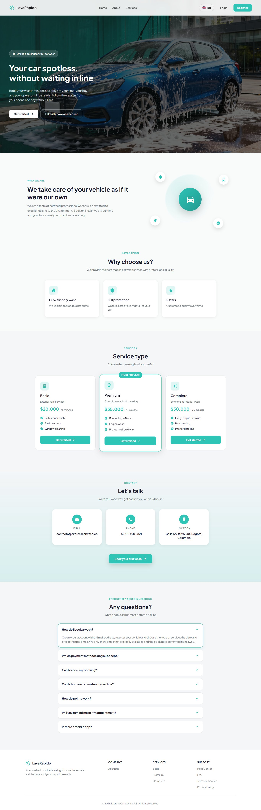

*Note.* Capture in a desktop browser with the full window.

**Types of washing service.** The business offers three levels of cleaning. Each service has its own duration and price, and **the price depends on the type of vehicle**; for this reason, the final amount is shown in the booking summary once the person chooses the vehicle and the service (Table 4).

**Table 4**

*Washing Service Levels*

| Service | What it includes | Estimated duration |
|---|---|---|
| Basic | Full exterior wash, basic vacuuming, and window cleaning. | 45 minutes |
| Premium | Everything in Basic, plus engine wash and protective liquid wax. | 75 minutes |
| Complete | Everything in Premium, plus hand waxing and interior detailing. | 120 minutes |

*Note.* Durations correspond to the initial data of the system. Prices and durations are configured by the administrator for each vehicle type and may change.

**Languages and themes.** The complete interface is available in Spanish, English, French, and Portuguese, and in four color themes (green light, green dark, pink, and pink dark). The language can be changed from the welcome screen or, once logged in, from **Settings** (section 10.1.9).

## 8. Logging In to the System

Every person must have an account to use the functions of the system. Customers create their own account through registration; operators receive their account from the business administrator, with a temporary password that they should change after the first login.

### 8.1 Registering a New Customer

**Module name:** Customer registration.

**Description:** Allows a new person to create a customer account to book washing services.

**Role that can use it:** Person without an account (future customer).

**Route or menu where it is found:** Welcome screen > **Register** button (route */auth/register*).

**Steps to use it:**

1. Open the browser and enter the web address of the system.
2. Click **Register** on the top bar (or **Get started**).
3. Type the **ID Number**: only digits, between 5 and 20.
4. Type the **First Names** (minimum 3 characters) and the **Last Names** (minimum 2 characters).
5. Type the **Email Address**, which must end in @gmail.com. The field does not allow spaces.
6. Type the **Phone Number**: a 10-digit Colombian mobile number starting with 3. The field only accepts digits.
7. Type the **Password** and watch the list of requirements, which are checked as they are met: minimum 8 characters, at least one uppercase letter, at least one number, and at least one special character. **All four requirements are mandatory**; spaces are not allowed.
8. Repeat the password in **Confirm Password**. The eye icon shows or hides what was typed.
9. Open the **Terms and Conditions** and the **Personal Data Processing Policy** with their links and accept both. Clicking **Accept and continue** inside each document checks the corresponding box automatically.
10. Click **Register**. While the request is processed, the button shows "Registering...".

**Expected result:** The system shows the message "Registration successful!" and, after clicking **Go to login**, takes the person to the login screen.

**Notes or restrictions:** It is not possible to register two accounts with the same email address or the same ID number. In those cases, the system shows "An account with this email already exists" or "An account with this ID number already exists" and does not create the account.

**Figure 2**

*Customer Registration Form*

*Note.* No real personal information may appear in the screenshot.

**Figure 3**

*Validation Messages in Registration*

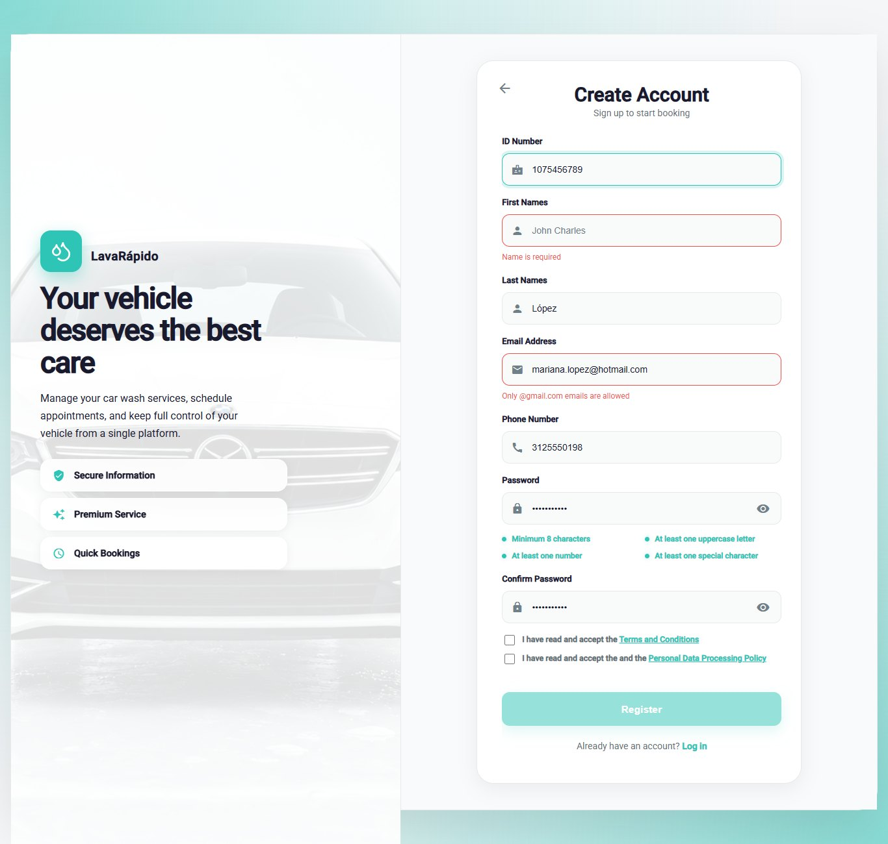

*Note.* Supports Table 13 in section 11.

### 8.2 Logging In

**Module name:** Login.

**Description:** Allows the customer, the operator, or the administrator to enter the system with their credentials.

**Role that can use it:** Customer, Operator, and Administrator.

**Route or menu where it is found:** Welcome screen > **Login** button (route */auth*).

**Steps to use it:**

1. Open the browser and enter the web address of the system.
2. Click **Login**.
3. Type the registered **Email Address** (ending in @gmail.com).
4. Type the **Password**.
5. Click **Login**. While the request is processed, the button shows "Signing in...".

**Expected result:** The system opens the home screen of the person's role: */client* for the customer, */operator* for the operator, or */admin* for the administrator.

**Notes or restrictions:** If the email or the password is wrong, the system shows "Incorrect email or password" and does not reveal which of the two failed. After five failed attempts within 15 minutes, the account is locked for 15 minutes and the system shows "Too many failed attempts. Your account is locked for 15 minutes; wait or use "Forgot your password?" to get in now." If the person resets the password, they can log in right away. The session lasts one hour; when it expires, the system returns to the login screen with the message "Your session expired. Please sign in again." A deactivated account cannot log in and receives the message "Your account is disabled. Contact the administrator."

**Figure 4**

*Login Screen*

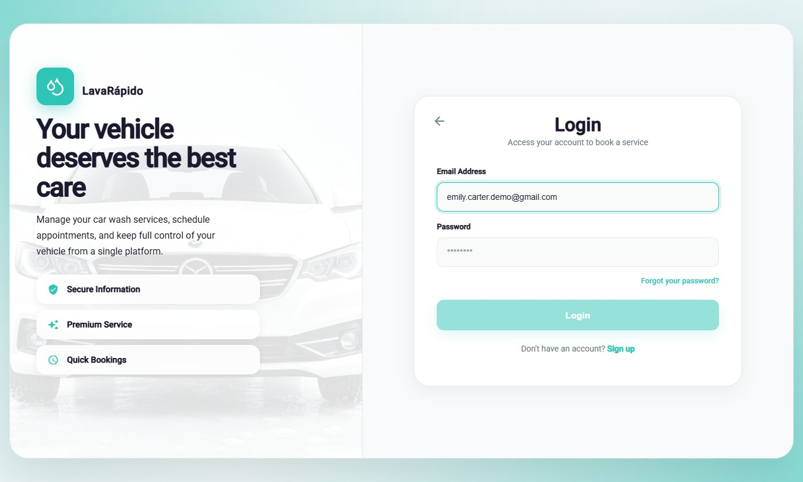

*Note.* Use a test email; do not show real passwords.

### 8.3 Password Recovery

**Module name:** Password recovery.

**Description:** Allows the person to recover access to the account when the password has been forgotten, by means of a six-digit verification code sent by email.

**Role that can use it:** Customer, Operator, and Administrator.

**Route or menu where it is found:** Login screen > **Forgot your password?** link (route */auth/forgot-password*).

**Steps to use it:**

1. On the login screen, click **Forgot your password?**.
2. **Step 1 (Recover Password):** type the email address of the account and click **Send Code**.
3. Open the email received and copy the six-digit code. The code is valid for 15 minutes.
4. **Step 2 (Verification):** type the six digits, one in each box, and click **Verify Code**. If the email did not arrive, click **Didn't receive the code? Resend**.
5. **Step 3 (New Password):** type the new password, which must meet the four requirements, confirm it, and click **Update Password**.
6. When the message "Password updated!" appears, click **Go to login** and log in with the new password.

**Expected result:** The password is changed and the code used cannot be used again.

**Notes or restrictions:** For security, the system shows the same screen whether the email is registered or not, so it does not reveal which accounts exist. Each new code invalidates the previous one ("We sent you a new code. The previous one no longer works."). After five incorrect attempts the code stops working and a new one must be requested. A three-step indicator at the top shows the stage of the process.

**Figure 5**

*Password Recovery, Step 1: Email Address*

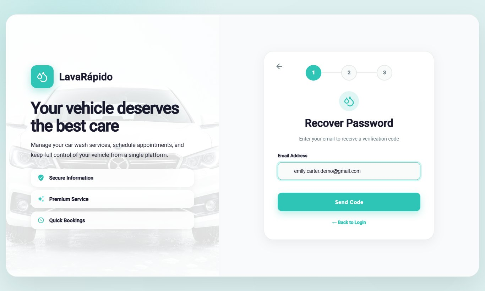

**Figure 6**

*Password Recovery, Step 2: Verification Code*

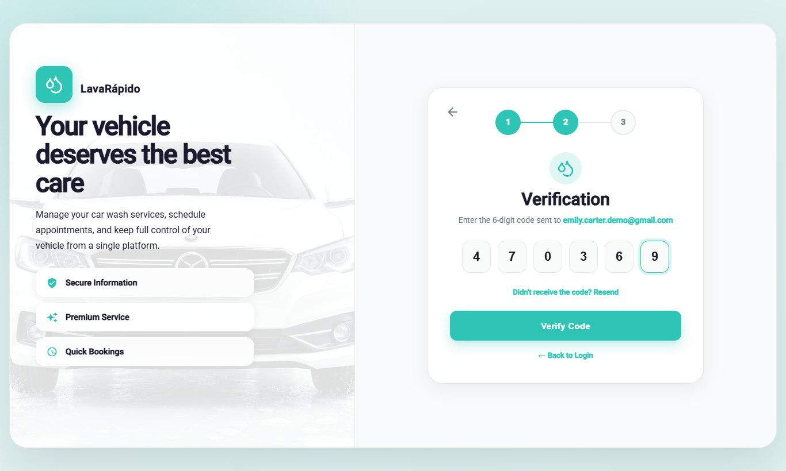

**Figure 7**

*Password Recovery, Step 3: New Password*

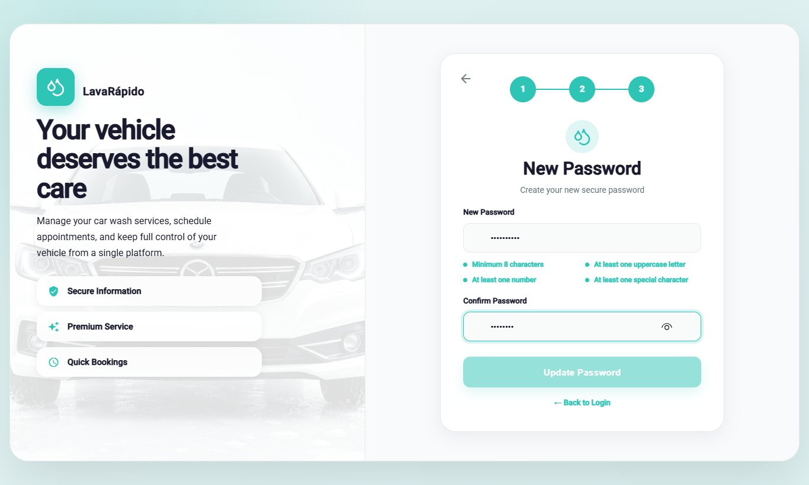

**Figure 8**

*Password Change Confirmation*

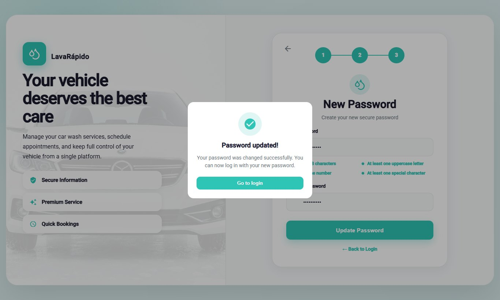

## 9. Main Menu

After logging in, the system shows a side menu with the options of the person's role. At the top of the menu appear the initials, the name, and the email of the person with the open session; at the bottom is the **Log Out** option. On a phone, the menu is opened and closed with the menu icon.

### 9.1 Customer Menu

**Table 5**

*Main Menu Options of the Customer Role*

| Option (route) | What it is for |
|---|---|
| Dashboard (/client) | Shows a summary of bookings, vehicles, the next service, quick access links, and benefits. |
| Profile (/client/profile) | Allows viewing and editing personal data, changing the email and the password, and deactivating the account. |
| My vehicles (/client/vehicles) | Allows registering, editing, deleting, and viewing the customer's vehicles. |
| Book Wash (/client/reserve) | Allows scheduling a new washing service. |
| Pay service (/client/payment) | Allows paying a booking with a QR code or in cash, redeeming a coupon, and canceling it. |
| Notifications (/client/notifications) | Shows the notices about bookings, reminders, assignments, and the progress of the service. |
| History (/client/history) | Lists the bookings with their payment status, and allows paying, canceling, and rating them. |
| Settings (/client/configuration) | Allows choosing the theme, the language, and the notification preferences, and opening the help center and the legal documents. |
| Log Out | Ends the session securely. |

*Note.* The option names are those of the side menu when the interface is in English.

**Figure 9**

*Side Menu of the Customer Role*

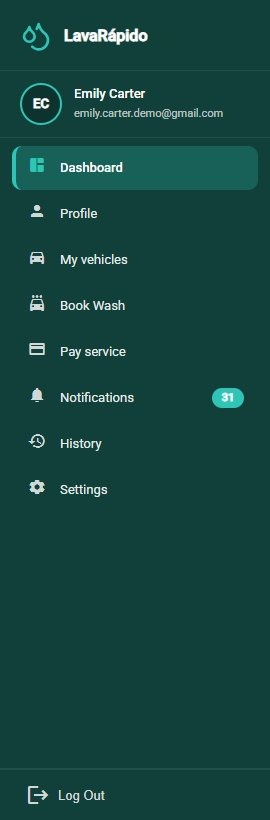

### 9.2 Operator Menu

**Table 6**

*Main Menu Options of the Operator Role*

| Option (route) | What it is for |
|---|---|
| Dashboard (/operator) | Shows the pending services, the progress of the day, and summary indicators. |
| Profile (/operator/profile) | Allows viewing and editing personal data and changing the password. |
| My Schedule (/operator/schedule) | Shows the services by day or by week and allows starting and finishing them. |
| Assigned services (/operator/assigned-services) | Lists the assigned services with their detail and allows starting and finishing them. |
| Notifications (/operator/notifications) | Shows the notices about assignments and status changes. |
| History (/operator/service-history) | Lists the services performed with their final status and rating. |
| Ratings (/operator/qualifications) | Shows the ratings left by customers. |
| Settings (/operator/settings) | Allows choosing the theme and the language and opening the help center. |
| Log Out | Ends the session securely. |

*Note.* The option names are those of the side menu when the interface is in English.

**Figure 10**

*Side Menu of the Operator Role*

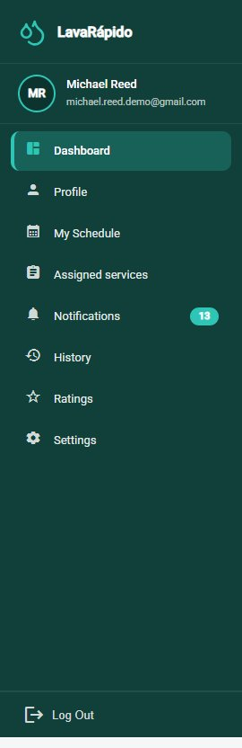

## 10. System Modules

Each module is documented with the same format: name, description, role that can use it, route or menu, steps, expected result, and notes. The modules are grouped by role.

### 10.1 Customer Role Modules

#### 10.1.1 Customer Dashboard

**Module name:** Customer dashboard.

**Description:** Home screen of the customer. It summarizes the activity and offers shortcuts to the most frequent actions.

**Role that can use it:** Customer.

**Route or menu where it is found:** Side menu > **Dashboard** (route */client*).

**Steps to use it:**

1. Log in with a customer account; the system opens the dashboard automatically.
2. Review the summary cards: **Active bookings**, **My vehicles**, and **Washes completed**.
3. Check the **Your next service** block, which shows the service, the vehicle, the date, the time, the **Assigned operator**, and the progress of the service. The progress stays at 0% while the booking is scheduled or confirmed, because the wash has not started yet; it rises when the operator starts the service and reaches 100% when it finishes. Click **View detail** to see all the information.
4. Use the **Quick access** links (Book a wash, Pay service, My vehicles, and Notifications) to go directly to each module.
5. Review the **Your benefits and promotions** block: the **Loyalty progress** bar shows the points accumulated ("N of M points") and, for each promotion, either "Unlocked! Redeem it when you pay." or how many points are still missing to unlock it.

**Expected result:** The customer sees the most important information and reaches any module with a single click.

**Notes or restrictions:** If there are no bookings, the block shows "No scheduled services" instead of an empty screen. The points are credited when the administrator approves the payment of a booking (or records a payment at the business), not when the service ends; until the first payment is approved, the benefits block shows "No loyalty data yet". Points are never spent: they unlock coupons, and redeeming a coupon does not reduce the balance.

**Figure 11**

*Customer Dashboard*

#### 10.1.2 My Vehicles

**Module name:** My vehicles.

**Description:** Allows registering the customer's vehicles and viewing, for each one, the last wash and the total number of washes. A vehicle must be registered before a service can be booked.

**Role that can use it:** Customer.

**Route or menu where it is found:** Side menu > **My vehicles** (route */client/vehicles*).

**Steps to use it:**

1. Click **My vehicles** in the side menu.
2. Review the indicators at the top: **Registered vehicles**, **Accumulated washes**, and **Last wash performed**.
3. To add a vehicle, click **Register vehicle**.
4. In the "Register new vehicle" window, select the **Vehicle type** (Car, Sedan, SUV, Pickup, Truck, or Motorcycle) and type the **Brand**, the **Model**, the **Plate**, and the **Color**.
5. Click **Save vehicle** and verify that the vehicle appears in the list with the message "Vehicle registered!".
6. To correct the data of a vehicle, use the edit option of its card, change the fields, and click **Save changes**.
7. To remove a vehicle, use the delete option of its card and confirm in the "Delete vehicle?" window.

**Expected result:** The vehicle is registered and available to be selected when booking a wash.

**Notes or restrictions:** The plate must be an official Colombian plate: three letters and three numbers for cars and other vehicles (for example, ABC123), or three letters, two numbers, and one letter for motorcycles (for example, ABC12D). Foreign or promotional plates are not accepted. The brand is mandatory (at least two characters) and the color only accepts letters. The same plate cannot be registered twice while the vehicle is active. The vehicle type matters because it determines the price of each service.

**Figure 12**

*Customer Vehicle List*

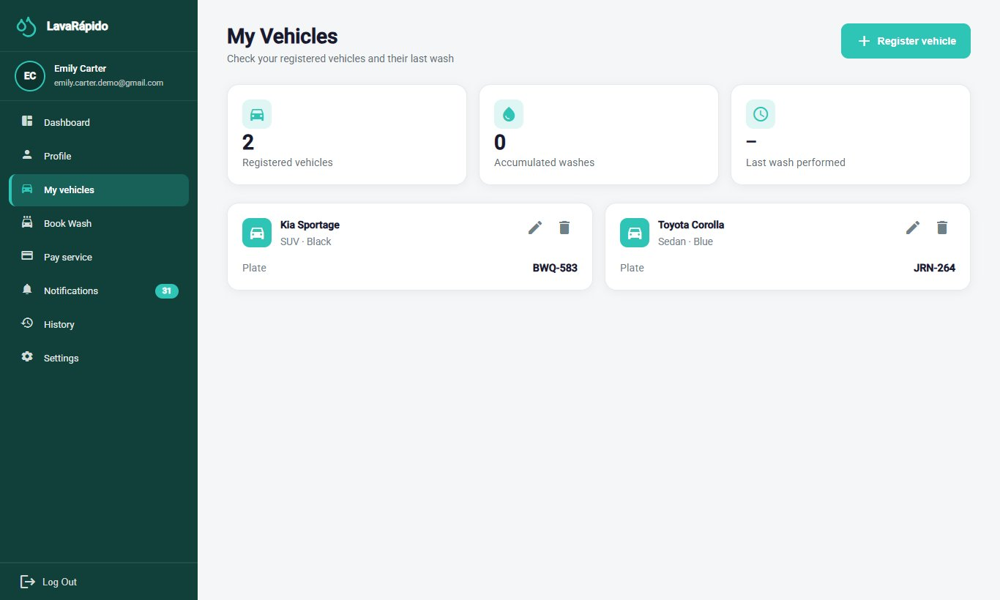

**Figure 13**

*Form to Register a Vehicle*

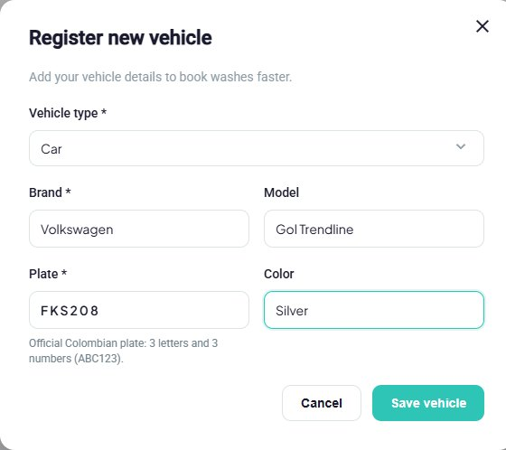

#### 10.1.3 Book a Wash

**Module name:** Book a wash.

**Description:** Allows scheduling a washing slot by choosing the vehicle, the type of service, the date, and the time. The system only offers times that are really free.

**Role that can use it:** Customer.

**Route or menu where it is found:** Side menu > **Book Wash** (route */client/reserve*), or the **Book a wash** quick access link.

**Steps to use it:**

1. Click **Book Wash**.
2. **Step 1 (Choose your vehicle):** select one of the registered vehicles. If the vehicle is not listed, use the **My Vehicles** link to register it first.
3. **Step 2 (Service type):** select Basic, Premium, or Complete. Each card shows what it includes, the duration, the price for the type of vehicle chosen, and the loyalty points it adds ("Earns N points").
4. **Step 3 (Date and time):** choose the date and then one of the free times shown in **Select a time**. The times are offered every 30 minutes, within the opening hours, outside the break, and only when a washing bay is free for the whole duration of the service.
5. Optionally, choose in **Operator (optional)** one of the operators who are free at that time. If it is left as "No preference: we assign a free one", the system assigns one automatically.
6. Review **Your booking summary**: vehicle, plate, service, estimated duration, date, time, location, total, and **Points you earn**.
7. Click **Book Now**.

**Expected result:** The booking is created immediately with the status Confirmed and a washing bay. The system shows "Booking created!" with the booking code, and the **Go to payment** button opens the payment screen for that booking.

**Notes or restrictions:**

- Choosing the operator is optional. If the chosen operator is no longer free when the booking is confirmed, the system assigns another one ("If the operator you chose is no longer free when we confirm, we assign another one."). The assigned operator is shown in the dashboard and in the notifications, and the administrator can change it later.
- Bookings can be made up to 60 days in advance.
- If the day is closed, the system shows "The car wash is closed that day"; if there are no free times, "No free times that day".
- If another person takes the time while the customer is booking, the system saves nothing, shows "That time was just taken", and lists the closest free times of that same day (up to five) so that the customer can choose another one.
- If the chosen time cannot be booked for another reason, the system explains which one: "The car wash is closed that day. Choose another date.", "At that time the service does not fit in the opening hours. Choose another time.", or "That time has already passed. Choose a later time."
- A vehicle cannot have two bookings at the same time ("That vehicle already has a booking at that time.").
- The service is provided at the business: the customer must bring the vehicle on the booked date and time.

**Figure 14**

*Book a Wash, Steps 1 and 2: Vehicle and Service*

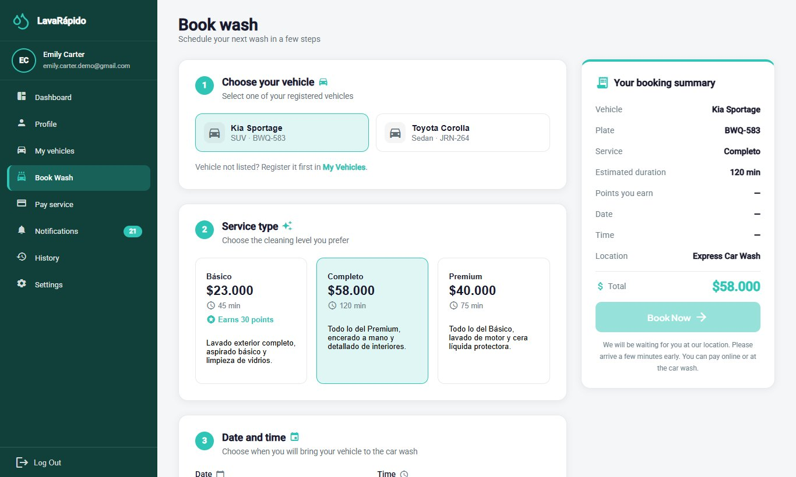

**Figure 15**

*Book a Wash, Step 3 and Summary*

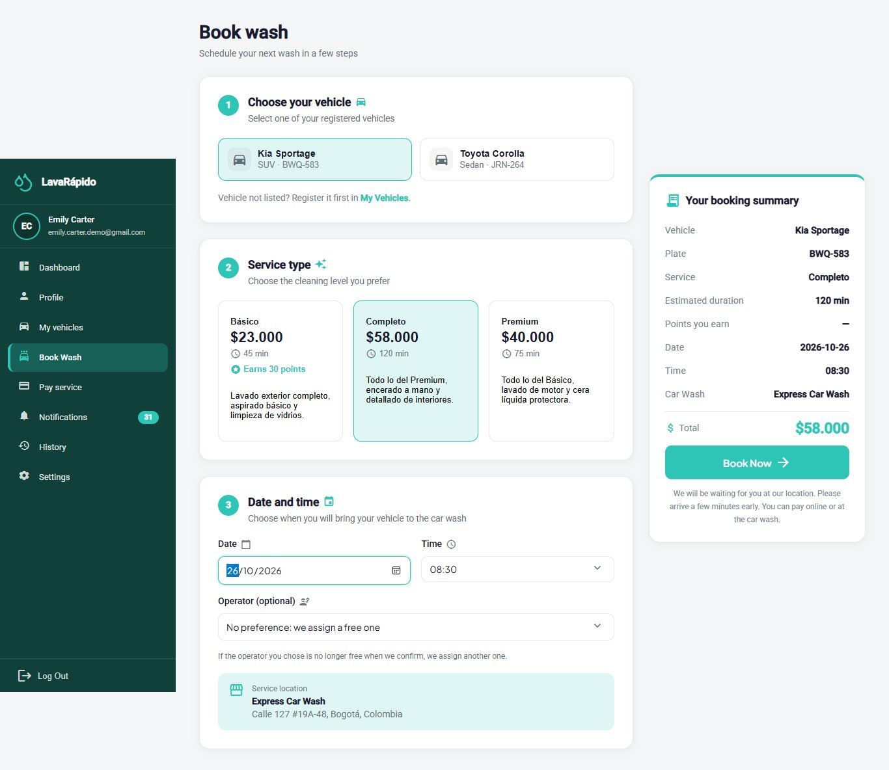

**Figure 16**

*Booking Confirmation*

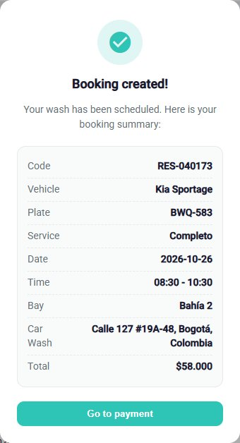

#### 10.1.4 View or Cancel a Booking

**Module name:** Booking follow-up and cancellation.

**Description:** Allows checking the status of a booking and canceling it before the service starts.

**Role that can use it:** Customer.

**Route or menu where it is found:** Dashboard > **Your next service** > **View detail**; side menu > **History**; or side menu > **Pay service**.

**Steps to use it:**

1. Open the **Dashboard** or **History** and locate the booking.
2. Click **View detail** to check the service, the vehicle, the date, the time, the assigned operator, and the status.
3. To cancel, click **Cancel booking** on the booking card in **History** (or on the **Pay service** screen).
4. Read the message "Cancel booking?" and click **Yes, cancel**; click **Back** to keep the booking.

**Expected result:** The booking changes to Cancelled, the message "Booking cancelled" appears, and the slot becomes free for other customers.

**Notes or restrictions:** A booking can only be canceled before its start time; afterwards the system shows "This booking can no longer be changed." The cancellation cannot be undone. The web application does not offer the option to change the date or the time of a booking: to move it, the customer cancels it and books again, or contacts the business so that the administrator reschedules it.

**Table 7**

*Booking Statuses*

| Status | Meaning | Can the customer cancel it? |
|---|---|---|
| Scheduled | The booking was registered and is pending confirmation. | Yes, before the start time. |
| Confirmed | The booking has a slot and a washing bay. Bookings made by the customer are created with this status. | Yes, before the start time. |
| In progress | The operator started the wash. | No. |
| Completed | The service is finished; from this status it can be rated. | No. |
| Cancelled | The booking was voided by the customer or by the business. | Not applicable. |
| No show | The customer did not arrive at the booked slot. | Not applicable. |

*Note.* The names are those displayed by the interface in English (codes SCHEDULED, CONFIRMED, IN_PROGRESS, COMPLETED, CANCELLED, and NO_SHOW in the database).

**Figure 17**

*Booking Cancellation Confirmation*

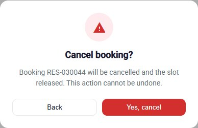

#### 10.1.5 Pay for a Service

Payment is made by transfer to the business's account (scanning its QR code or using its account data) or in cash at the business. The system **does not request or store credit or debit card data** and does not connect to banks: an administrator verifies each digital payment manually (Table 8).

**Table 8**

*Available Payment Methods*

| Method | How it is paid | Is a receipt required? |
|---|---|---|
| Nequi | The QR code is scanned and the transfer is made from the app. | Yes |
| Daviplata | The QR code is scanned and the transfer is made from the app. | Yes |
| Transfer | The QR code is scanned or the account data shown is used. | Yes |
| Cash | Paid at the business when the service is received. No QR code is shown. | No; the administrator records the payment at the business. |

*Note.* The digital methods shown depend on the payment accounts that the administrator keeps active.

**Module name:** Pay service.

**Description:** Allows paying a booking by attaching the receipt of the digital payment, or announcing that it will be paid in cash.

**Role that can use it:** Customer.

**Route or menu where it is found:** Side menu > **Pay service** (route */client/payment*); also **Go to payment** after booking, or **Pay now** in History.

**Steps to use it:**

1. Open **Pay service** and review the **Booking summary**: service, vehicle, **Subtotal**, **Discount applied**, and **TOTAL TO PAY** (VAT of 19% included).
2. If you have an unlocked coupon, type it in **Coupon code** and click **Apply**. The message "Coupon applied: [name]" appears, and the discount is subtracted from the total to pay.
3. In **Select your payment method**, choose Nequi, Daviplata, Transfer, or Cash.
4. For a digital method: scan the QR code with the banking or wallet app, or copy the number shown in **Authorized key / account** with **Copy number**, and transfer exactly the **Amount to pay**.
5. In **Confirm your payment**, drag the image of the receipt or click to browse for it (JPG or PNG, maximum 10 MB).
6. Type the **Transaction reference** printed on the receipt (8 to 12 letters or numbers issued by the bank) and check the **Amount paid** (greater than 0), which must match the amount transferred.
7. Click **I've made the payment**. While data is missing, the button stays disabled and the list "To confirm the payment you still need to:" shows what is pending (receipt, reference, or amount).
8. For cash: select **Cash** and click **Confirm booking**; the payment is made at the business when the vehicle is picked up.

**Expected result:** The system shows "Payment sent!" and the payment remains in review ("Payment under review") until an administrator approves or rejects it. The customer receives a notification and an email with the result.

**Notes or restrictions:**

- The amount due is always calculated by the system (booking total minus the coupon applied, if any); the customer cannot change it. The amount paid that the customer declares is compared by the administrator with the receipt and the bank.
- Only bookings in Confirmed, In progress, or Completed status can be paid.
- While a payment is in review, another one cannot be reported for the same booking; a booking admits a single approved payment.
- If the administrator rejects the payment, the customer can report it again with a correct receipt.
- When the payment is approved, the customer receives the notice "Payment confirmed" (inbox and email), the loyalty points of the booking ("You earned N points", inbox only), and, for each coupon those points unlock, the notice "You have a redeemable coupon!" with its code (inbox and email). If the payment is rejected or refunded, the customer receives a notice and an email; a refund reverses the points earned by that booking.
- A coupon is accepted only if it is active, is within its dates, and the customer has reached the points it requires; it can be redeemed once per booking. The system answers "That coupon doesn't exist.", "That coupon isn't active, or you haven't reached the points it needs yet.", or "You already redeemed this coupon on this booking." A successful redemption sends a confirmation notice and email.

**Table 9**

*Payment Statuses*

| Status | Meaning | What the customer must do |
|---|---|---|
| Pending | The booking does not yet have an approved payment. | Make the payment. |
| In review | The receipt was submitted and awaits the administrator's verification. | Wait for the verification. |
| Approved | The administrator verified the payment. | No action. |
| Rejected | The payment could not be verified; the administrator records the reason. | Report the payment again with a correct receipt. |
| Refunded | The amount of the payment was returned to the customer. | No action. |

*Note.* Codes PENDING, IN_REVIEW, APPROVED, REJECTED, and REFUNDED in the database. On the History cards they are shown as Pending verification, Under review, Paid, Rejected, and Refunded.

**Figure 18**

*Payment Method Selection and Booking Summary*

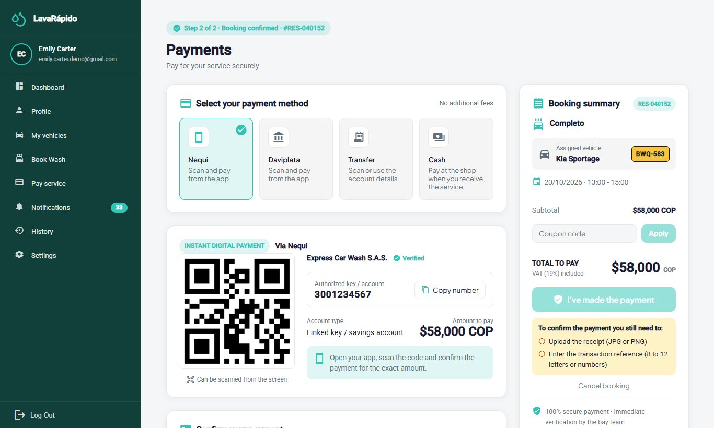

**Figure 19**

*QR Code and Receipt Upload*

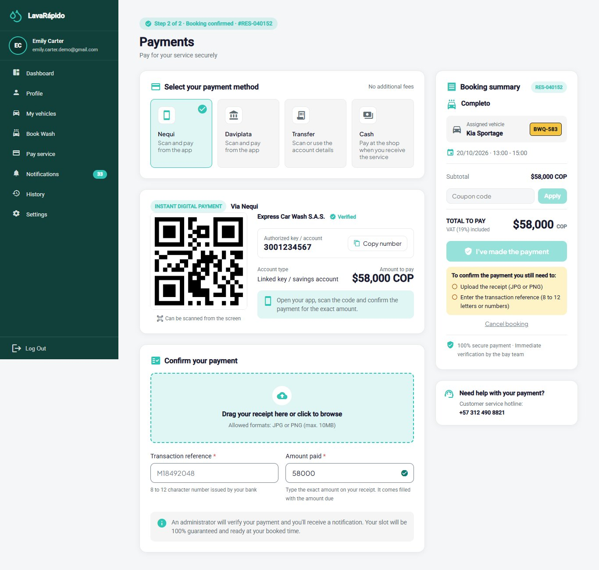

*Note.* Use a test QR code; do not show real bank accounts.

#### 10.1.6 History and Rating

**Module name:** History.

**Description:** Lists the customer's bookings with their status and allows paying, canceling, and rating them.

**Role that can use it:** Customer.

**Route or menu where it is found:** Side menu > **History** (route */client/history*).

**Steps to use it:**

1. Click **History**.
2. Use the **All**, **Active**, **Completed**, and **Cancelled** filters, and the **From** and **To** dates, to narrow the list.
3. Use **Search by service, vehicle or code** to find a booking.
4. On each card, review the **Service type**, the **Vehicle**, the **Status**, and the **Payment** status, and use **Pay now** or **Cancel booking** when they are available. **Pay now** appears only when the booking can be paid (payable status, without an approved payment and without one pending or in review).
5. On a completed service, click **Rate Service**.
6. Choose from one to five stars, write a comment if desired (maximum 500 characters), and click **Submit rating**.

**Expected result:** The message "Thanks for your rating!" appears, the card shows **Rated**, and the operator who performed the service can see the rating.

**Notes or restrictions:** Rating is optional, is allowed only once per booking, and only when the booking is Completed; it cannot be modified afterwards. If there are no bookings for the filters chosen, the system shows "No services found".

**Figure 20**

*History With Filters*

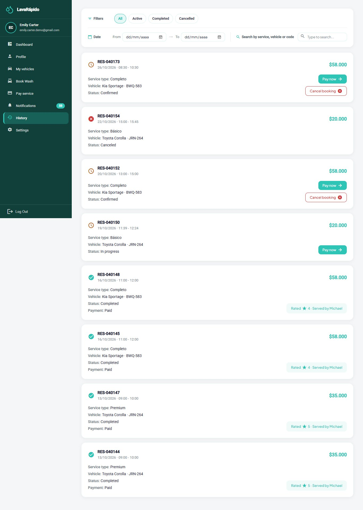

**Figure 21**

*Rating of a Completed Service*

#### 10.1.7 Notifications

**Module name:** Notifications.

**Description:** Gathers the notices of the system (booking created, confirmed, or cancelled, reminders, operator assigned, service started and completed, payment confirmed, rejected, or refunded, points earned, coupon unlocked or redeemed, and vehicle inspection report) and indicates which ones have been read.

**Role that can use it:** Customer and Operator.

**Route or menu where it is found:** Side menu > **Notifications**.

**Steps to use it:**

1. Click **Notifications**. The header shows how many notifications are unread.
2. Use the **All**, **Reminders**, **Promotions**, **Confirmations**, and **Others** tabs to filter by type.
3. Use the **Read status** filter and the dates to narrow the list.
4. Open a notification to read it completely; it is marked as read.
5. Use **Mark as read** or **Mark as unread** on each notification, or **Mark all as read**.
6. To delete a notification, use the delete option and confirm "Delete this notification?".

**Expected result:** The person stays informed without checking each module constantly.

**Notes or restrictions:** The system sends reminders 24 hours and 1 hour before each booking. Notices that change something for the customer are also sent by email: welcome, booking created, confirmed, cancelled, and reminders, payment confirmed, rejected, and refunded, coupon redeemed or unlocked, and inspection report. The progress of the service (operator assigned, started, and completed) and the points earned arrive only in the inbox and as push notifications. The password recovery code always arrives by email. The switches of **Settings > Notifications** decide only the external channels; the inbox always receives every notice. A deleted notification cannot be recovered.

**Figure 22**

*Notification Center*

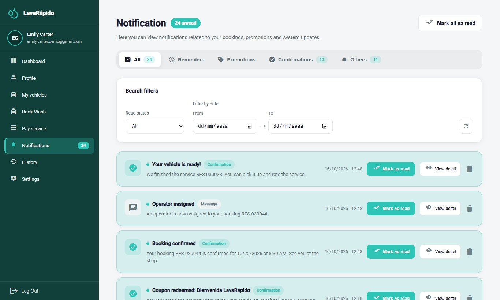

#### 10.1.8 Profile

**Module name:** Profile.

**Description:** Allows viewing and updating personal data, changing the email and the password, and deactivating the account.

**Role that can use it:** Customer, Operator, and Administrator.

**Route or menu where it is found:** Side menu > **Profile**.

**Steps to use it:**

1. Click **Profile**. The "My Profile" screen opens in view mode with the first names, last names, email, phone, and the date since which the person is a member.
2. To modify the data, click **Edit profile**, change the fields, and click **Save**; the message "Profile updated!" appears.
3. To change the email, which is the login username, type the new one and confirm with the current password in the window "Confirm the email change"; from then on the new email is used to log in.
4. To change the password, go to **Password** and click **Change**. Type the **Current password**, the **New password**, and **Confirm new password**, and click **Save**.
5. To stop using the account, go to **Account**, click **Deactivate my account**, read the message, and confirm with the password.

**Expected result:** The data is updated. If the password was changed, the new one is used at the next login.

**Notes or restrictions:** If the current password is wrong, the change is rejected ("The current password is incorrect"); the new password must be different from the current one. The account is deactivated, not erased: the person can no longer log in and the sessions are closed, but the history of bookings and payments is kept. To reactivate it, the person must contact the administrator. The **Address** is saved in the account, so it appears the same on any device.

**Figure 23**

*User Profile*

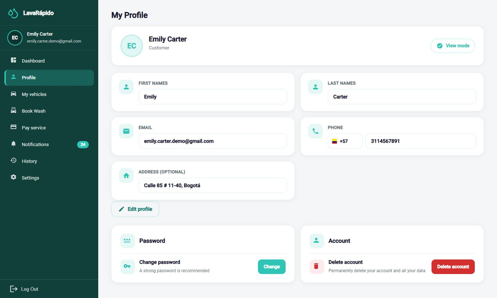

#### 10.1.9 Settings

**Module name:** Settings.

**Description:** Allows customizing the appearance, the language, and the notification preferences, and opening the help center and the legal documents.

**Role that can use it:** Customer, Operator, and Administrator.

**Route or menu where it is found:** Side menu > **Settings** (route */client/configuration* for the customer).

**Steps to use it:**

1. Click **Settings**.
2. Under **Appearance**, click **Choose theme** and select one of the four color themes. The change is applied immediately.
3. Under **Languages**, select Español, English, Français, or Português. All the texts of the interface change to the chosen language.
4. Under **Notifications**, turn **Push Notifications**, **Email Reminders** (booking reminders by email, one day and one hour before), and **Promotions and Offers** (alerts for the coupons you unlock with your points, by email and push) on or off.
5. Under **Help**, click **Open** to see the help center: support line, email, opening hours (Monday to Saturday, 7:00 a.m. to 6:30 p.m.), and address, taken from the data of the business registered in the system.
6. Under **Legal and privacy**, open **View Terms and Conditions** or **View Data Policy**.

**Expected result:** The theme, the language, and the notification switches are applied immediately and are saved in the account, so they are kept at the next login and on any device.

**Notes or restrictions:** Turning off **Push Notifications** stops the notices to the phone; turning off **Email Reminders** stops only the reminder emails; turning off **Promotions and Offers** stops the email and push alerts of unlocked coupons. The inbox is not affected by any switch. If the change cannot be saved, the system shows "Your notification preferences could not be saved. Please try again." Dates are shown in the format of the selected language.

**Figure 24**

*Settings Screen*

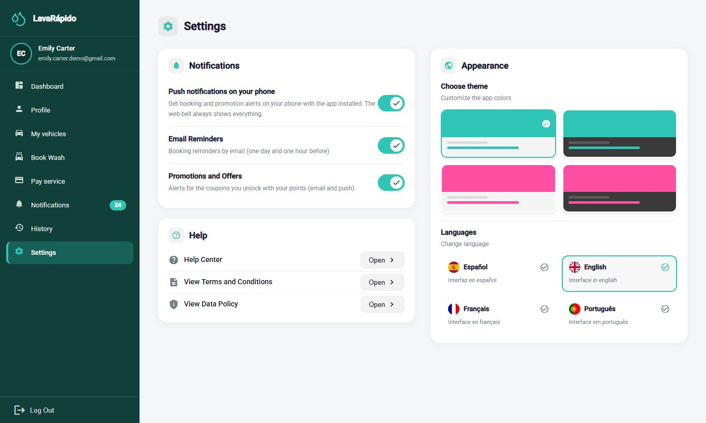

### 10.2 Operator Role Modules

The operator receives the account from the business administrator. The operator can only see and update the services assigned to them; the system rejects any attempt to change a service of another operator.

#### 10.2.1 Operator Dashboard

**Module name:** Operator dashboard.

**Description:** Home screen of the operator. It summarizes the pending work and the progress of the day.

**Role that can use it:** Operator.

**Route or menu where it is found:** Side menu > **Dashboard** (route */operator*).

**Steps to use it:**

1. Log in with an operator account; the system opens the dashboard automatically.
2. Read the greeting, which indicates how many pending services there are ("You have N pending services for today"), and click **View assigned services** to go to the list.
3. Review the indicators (assigned bookings, services in progress, notifications, and rating) and the progress bar **Services completed today**.
4. In **Today's services**, review the upcoming assigned services with their type, vehicle, time, customer, and status, and click **Start** when it is time to begin one.

**Expected result:** The operator knows at a glance which services must be performed.

**Notes or restrictions:** If there are no assigned services, the system shows "You have no scheduled services right now."

**Figure 25**

*Operator Dashboard*

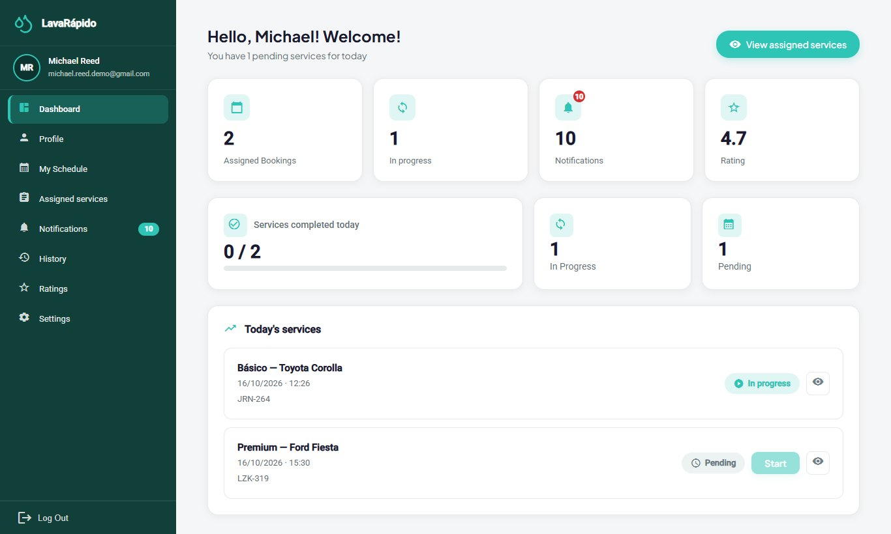

#### 10.2.2 My Schedule

**Module name:** My Schedule.

**Description:** Shows the operator's bookings in a calendar, by day or by week, and allows starting and finishing them.

**Role that can use it:** Operator.

**Route or menu where it is found:** Side menu > **My Schedule** (route */operator/schedule*).

**Steps to use it:**

1. Click **My Schedule**.
2. Select a day in the calendar, or switch between the **Day**, **Week**, and **Completed** tabs.
3. Review the totals: **Total**, **Pending**, **In progress**, and **Completed**.
4. Check the **Next service** block, which indicates how many minutes remain before it starts.
5. In the list of bookings, click **Start** or **Finish** according to the status of each service, or **View detail** to see the date, the duration, and the vehicle.

**Expected result:** The status of the service changes and the customer can follow its progress.

**Notes or restrictions:** A service can only be started on the day of the booking, and only one service can be in progress at a time. A service must be started before it can be finished ("You must start the service first."). When finishing, the system asks "Finish this service?" and moves it to the history.

**Figure 26**

*Operator Schedule*

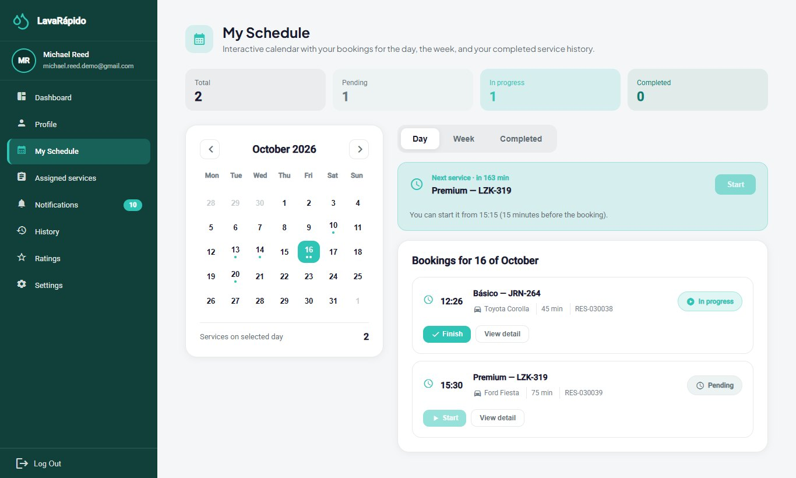

#### 10.2.3 Assigned Services

**Module name:** Assigned services.

**Description:** Lists all the services assigned to the operator and allows starting and finishing them.

**Role that can use it:** Operator.

**Route or menu where it is found:** Side menu > **Assigned services** (route */operator/assigned-services*).

**Steps to use it:**

1. Click **Assigned services**.
2. Review the cards: **Total Services**, **Pending**, **In Progress**, and **Completed Today**.
3. Use **Filter by date**, **Filter by service type**, or the search box, and click **Filter**.
4. In the table, read the **ID**, **Service type**, **Date & time**, **Vehicle**, **Client**, and **Status** of each service.
5. Click a service to open **Service information**: client, vehicle, service type, scheduled time, and payment method.
6. Click **Start Service** when beginning the wash and confirm with **Start**.
7. When the wash is finished, click **Finish Service** and confirm with **Finish**.
8. If it is necessary to communicate with the customer, use **Contact client** in **Additional options**.

**Expected result:** The status changes to In progress and then to Completed ("Service finished!"). The customer receives the notices and can rate the service.

**Notes or restrictions:** The service can be started from 15 minutes before the booked time. The operator can only update the services assigned to them.

**Table 10**

*Service Statuses Shown to the Operator*

| Status | Meaning | Available action |
|---|---|---|
| Pending | The service was assigned and has not started yet. | Start Service (from 15 minutes before the booked time). |
| In progress | The operator started the wash. | Finish Service. |
| Completed | The wash is finished and the customer can rate it. | View only. |

*Note.* The database also defines the execution statuses PAUSED and WITH_ISSUE, which the current interface does not use.

**Figure 27**

*List of Assigned Services With Filters*

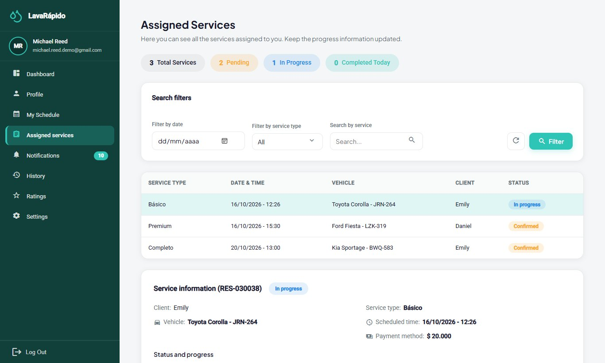

**Figure 28**

*Service Information and Action Buttons*

#### 10.2.4 Operator Notifications

The operator's notifications work like the customer's (section 10.1.7). The most frequent notices are a new service assigned, a service moved to another time, a service cancelled, and a service reassigned to another operator. These staff notices arrive in the inbox and as push notifications, never by email. The operator opens them with **Notifications** in the side menu and uses the tabs, the filters, and the **Mark as read** and **Mark all as read** buttons.

**Figure 29**

*Operator Notifications*

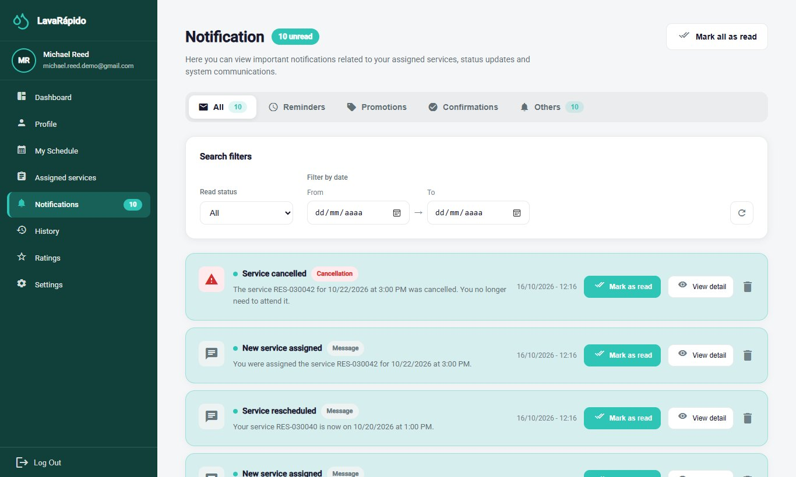

#### 10.2.5 Service History

**Module name:** Service History.

**Description:** Lists the services of the operator with their date, vehicle, payment, rating, and final status.

**Role that can use it:** Operator.

**Route or menu where it is found:** Side menu > **History** (route */operator/service-history*).

**Steps to use it:**

1. Click **History**.
2. Review the indicators, including the **Completion rate**.
3. Use the **All**, **Completed**, **Canceled**, and **Reassigned** tabs and the **All services** filter.
4. Use the search box to find a service by code, plate, client, or vehicle.
5. Click **Clear** to remove the filters.

**Expected result:** The operator consults the completed work and the final status of each service.

**Notes or restrictions:** A reassigned service is one that the administrator moved to another operator; it no longer counts as the operator's own service.

**Figure 30**

*Operator Service History*

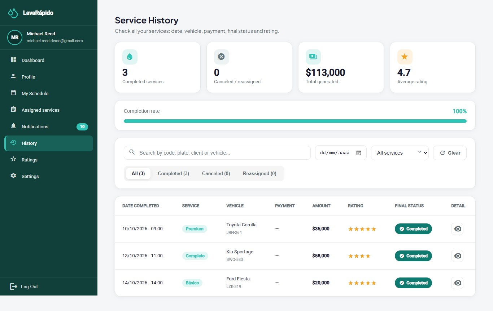

#### 10.2.6 Ratings Received

**Module name:** Ratings received.

**Description:** Shows the ratings and comments that customers left about the operator's work.

**Role that can use it:** Operator.

**Route or menu where it is found:** Side menu > **Ratings** (route */operator/qualifications*).

**Steps to use it:**

1. Click **Ratings**.
2. Review the average rating and the total number of ratings received.
3. Use **Filter by date**, **Filter by service type** (Basic Wash, Premium Wash, or Complete Wash), and the number of stars, and click **Filter**.
4. Read each rating with the customer, the service, the date, and the comment.

**Expected result:** The operator knows the customers' opinion.

**Notes or restrictions:** Only the ratings that customers decided to leave appear, because rating is optional. If there are none, the system shows "No ratings found".

**Figure 31**

*Ratings Received by the Operator*

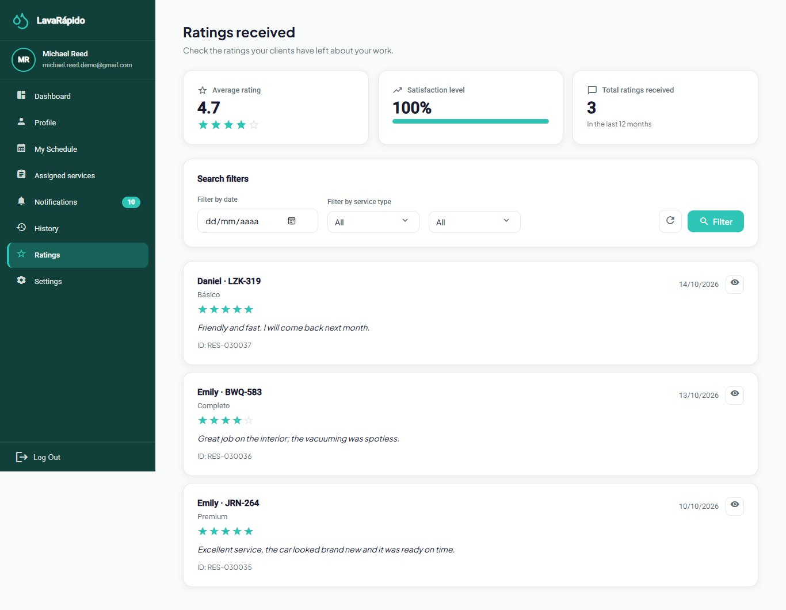

#### 10.2.7 Operator Profile and Settings

The operator views and edits the personal data and changes the password in **Profile**, following the steps of section 10.1.8. The theme, the language, and the help center are available in **Settings** (route */operator/settings*), as explained in section 10.1.9. If the administrator provided a temporary password, it should be changed at the first login.

## 11. Messages and Validations

The system validates the information while the person types. When a piece of data is not correct, it highlights the field with a red border and shows a message below it. Tables 11 and 12 explain the meaning of the most frequent messages and what the person must do.

**Table 11**

*Messages of the Registration, Login, and Recovery Forms*

| System message | Meaning | User action |
|---|---|---|
| Email is required | The email field is empty. | Type the email address. |
| Please enter a valid @gmail.com email | The email does not have a valid format or does not end in @gmail.com. | Correct the email. |
| Only @gmail.com emails are allowed | In registration, an email from another provider was typed. | Use a Gmail account. |
| ID number is required / Must have between 5 and 20 digits | The ID number is empty or has an invalid length. | Type the ID number with digits only. |
| Name is required / Must contain at least 3 characters | The first names are empty or too short. | Type the first names. |
| Last names are required / Must have at least 2 characters | The last names are empty or too short. | Type the last names. |
| Phone number is required | The phone field is empty. | Type the mobile number. |
| Must start with 3 (Colombian mobile number) | The number does not start with 3. | Type a Colombian mobile number. |
| The number must contain 10 digits | The phone has fewer than 10 digits. | Complete the 10 digits. |
| You must confirm the password / Passwords do not match | The confirmation is empty or different from the password. | Type the same password in both fields. |
| The password does not meet the security requirements | One of the four requirements is missing. | Follow the list of requirements. |
| You must accept the Terms and the Data Policy to continue | One of the two legal documents was not accepted. | Read and accept both documents. |
| An account with this email already exists | The email is already registered. | Log in or recover the password. |
| An account with this ID number already exists | The ID number is already registered. | Verify the data or contact the business. |
| Incorrect email or password | The credentials do not match any account. | Check the data and try again, or recover the password. |
| Your account is disabled. Contact the administrator. | The account was deactivated. | Ask the administrator to reactivate it. |
| The code is wrong, already used or expired. Request a new one. | The recovery code is not valid. | Request a new code. |
| Password updated! | The password was changed successfully. | Log in with the new password. |

*Note.* Texts taken from the English translation file of the web application.

**Table 12**

*System Operation Messages*

| Message or situation | Meaning | User action |
|---|---|---|
| Your session expired. Please sign in again. | The one-hour session ended. | Log in again. |
| You do not have permission to perform this action | The action belongs to another role or to another person's data. | Use only the options of the role. |
| Your customer profile is not ready yet. Please try again in a few minutes. | The customer profile is being created after registration. | Wait a moment and try again. |
| A vehicle is already registered with this plate | The plate belongs to an active vehicle. | Verify the plate. |
| The plate format does not match the vehicle type | The plate does not follow the official format for the type chosen. | Correct the plate or the type. |
| That time was just taken | The slot was taken while booking. | Choose one of the times suggested. |
| The car wash is closed that day. Choose another date. | The chosen day is marked as closed. | Choose another date. |
| At that time the service does not fit in the opening hours. Choose another time. | The service would end after closing time or overlaps the break. | Choose another of the free times. |
| That time has already passed. Choose a later time. | The chosen time is already in the past. | Choose a later time. |
| Too many failed attempts. Your account is locked for 15 minutes... | The password was typed wrong five times within 15 minutes. | Wait 15 minutes or use Forgot your password?. |
| That vehicle already has a booking at that time. | The vehicle is already booked in that slot. | Choose another time. |
| That date cannot be booked. | The date is in the past or beyond the booking window. | Choose a valid date. |
| This booking can no longer be changed. | The booking already started or was closed. | Contact the business. |
| Invalid file | The receipt is not a JPG or PNG image of up to 10 MB. | Attach a valid image. |
| Only a completed service can be rated. / This service was already rated. | The rating is not allowed. | Wait until the service is completed; a booking is rated only once. |
| You must start the service first. / This service was already started. | The operator tried an action out of order. | Start the service before finishing it. |
| To confirm the payment you still need to: ... | Data of the payment is missing (receipt, reference, or amount). | Complete the items listed under the button. |
| That coupon doesn't exist. | The coupon code is wrong. | Check the code shown in the coupon notice. |
| That coupon isn't active, or you haven't reached the points it needs yet. | The coupon is paused, outside its dates, or locked. | Check the points in the dashboard. |
| You already redeemed this coupon on this booking. | The coupon was already used on that booking. | Pay without the coupon or use another one. |
| Cannot reach the server. Please try again in a moment. | There is no connection with the system. | Check the internet connection and try again. |

*Note.* Texts taken from the English translation file of the web application.

## 12. Logging Out

Logging out when finished prevents another person from using the account, especially on shared computers or phones. Although the session expires automatically one hour after login, it is recommended to log out manually.

1. Locate the **Log Out** option at the bottom of the side menu.
2. Click **Log Out**.
3. In the "Log out" window, click **Yes, log out**.
4. Verify that the system returns to the login screen.

**Figure 32**

*Log Out Confirmation*

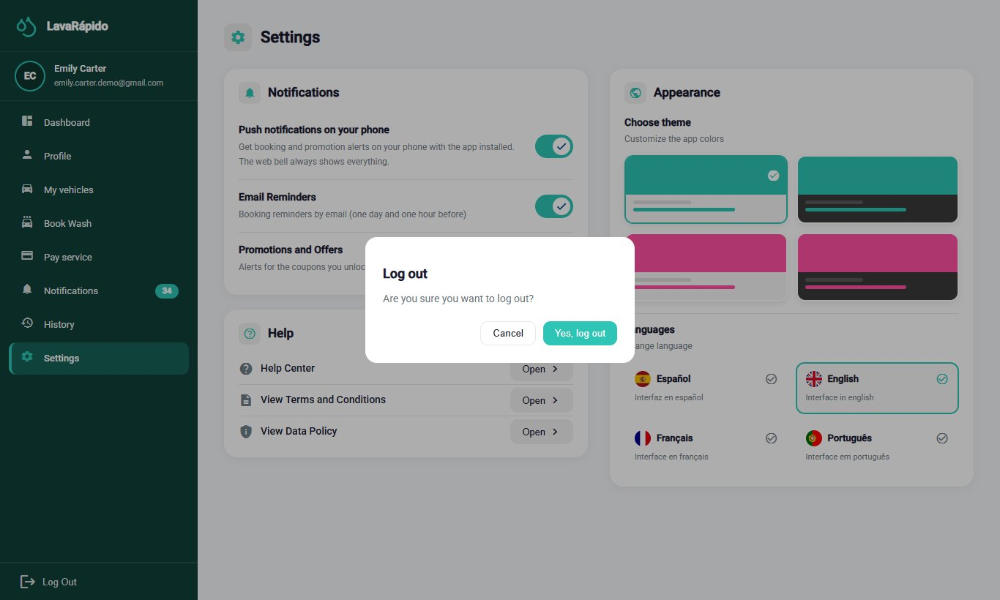

## 13. Frequently Asked Questions

##### What do I do if I forgot my password?

On the login screen, click "Forgot your password?" and follow the three steps of section 8.3. The code arrives at the registered email and is valid for 15 minutes.

##### Why won't the system let me register?

The system only accepts emails ending in @gmail.com, and each email and each ID number can have only one account. In addition, the two legal documents must be accepted.

##### Can my account be locked for typing the password wrong?

Yes. After five failed attempts within 15 minutes, the account is locked for 15 minutes. You can wait that time or use **Forgot your password?** to create a new password and log in right away.

##### How do I know if my booking was confirmed?

When the time is free, the booking is confirmed at once: the system shows "Booking created!" and the booking appears in the dashboard and in History with the status Confirmed.

##### What do I do if the time I want is already taken?

The screen only offers free times. If another person takes the time while you book, the system suggests the closest free times of the same day; choose one and confirm.

##### Can I choose who washes my vehicle?

Yes, it is optional. When booking, **Operator (optional)** lists the operators who are free at that time. If you do not choose one, the system assigns a free operator automatically. You can see the assigned operator in the dashboard and receive a notification when the operator is assigned or changed.

##### How do I change the date of a booking?

The web application does not allow changing the date or the time. Cancel the booking before its start time and book again, or contact the business.

##### How do I pay for my service?

In Pay service, choose the method. With Nequi, Daviplata, or Transfer, scan the QR code, transfer the exact amount, and attach the receipt with the transaction reference; with Cash, pay at the business.

##### Does the system store my card data?

No. The system does not request or store card data.

##### Why does my payment appear as "In review"?

Because an administrator must verify that the money arrived in the business's account. When the administrator approves or rejects it, you receive a notification and an email; you can also check the status in History.

##### Can I use a promotion code?

Yes. When your points unlock a coupon, you receive a notice with its code. In Pay service, type it in Coupon code and click Apply before confirming the payment.

##### How do I earn loyalty points?

Each service adds the points shown when booking ("Earns N points"). The points are credited when the administrator approves the payment of the booking, and you can see your progress in the dashboard. Points are not spent: they unlock coupons.

##### How do I rate a service?

When the booking is Completed, open History, click "Rate Service", choose from one to five stars, and, if desired, write a comment. Each booking can be rated only once.

##### Can I change the language or the colors?

Yes. In Settings you can choose Spanish, English, French, or Portuguese and one of four color themes.

##### Can I delete or deactivate my account?

The **Deactivate my account** option deactivates the account, without erasing it: you will not be able to log in, but your history is kept. To reactivate it, contact the administrator. Administrator accounts do not have this option.

##### I am an operator and cannot start a service. Why?

A service can only be started on the day of the booking, only if it is assigned to you, and only when you do not have another service in progress. If the service is yours and the problem continues, inform the administrator.

## 14. Glossary

**Table 13**

*Glossary of System Terms*

| Term | Definition |
|---|---|
| Administrator | Role that manages bookings, operators, payments, schedules, users, and reports. |
| Assignment | Link between an operator and a booking, made by the administrator. |
| Bay (washing bay) | Physical spot of the business where a vehicle is washed. Two bookings cannot occupy the same bay at the same time. |
| Booking | Block of time reserved for washing a vehicle. |
| Coupon | Discount code that the customer unlocks by accumulating loyalty points and redeems when paying. |
| Customer | Person who registers vehicles and books slots. |
| Dashboard | Home screen that summarizes the most important information of each role. |
| Loyalty points | Points that each service adds when its payment is approved; they unlock coupons and are not spent. |
| Notification | Notice inside the system about a relevant event. |
| Operator | Employee who washes the vehicles. |
| QR code | Two-dimensional code that is scanned with the phone to pay. |
| Rating | Score from one to five stars, with an optional comment, that the customer gives to a completed service. |
| Receipt | Image that proves that a transfer was made. |
| Reminder | Notice that the system sends 24 hours and 1 hour before a booking. |
| Theme | Combination of interface colors that each person can choose. |
| Transaction reference | Number that the bank prints on the receipt to identify the transfer. |
| Washing service | Type of wash offered (Basic, Premium, or Complete), with its own duration and price. |

*Note.* Based on the glossary of the project documentation.

## References

Congreso de la República de Colombia. (2012). *Ley Estatutaria 1581 de 2012, por la cual se dictan disposiciones generales para la protección de datos personales* [Statutory Law 1581 of 2012, which issues general provisions for the protection of personal data]. http://www.secretariasenado.gov.co/senado/basedoc/ley_1581_2012.html

Servicio Nacional de Aprendizaje. (2026). *Guía para elaborar manuales de software: Manual de usuario, manual técnico, manual de instalación y manual de administrador* [Guide for writing software manuals: User manual, technical manual, installation manual, and administrator manual] [Unpublished instructional material]. Technologist in Software Analysis and Development program.

Vehicle Washing Development Team. (2026a). *Vehicle washing management system: Project documentation* (vehicle-w-docs) [Unpublished project documentation]. GitHub. https://github.com/code-sena/vehicle-w-docs

Vehicle Washing Development Team. (2026b). *Front-end-proyecto-web* (develop branch) [Computer software]. GitHub. https://github.com/BrayanCABRERA123/Front-end-proyecto-web

## 15. Annexes

### Annex A. Source of the Screenshots

The figures in this manual were taken on October 16, 2026, on the version of the *develop* branch, with the whole system running in Docker and the web at *http://localhost:4200*. Test accounts, vehicles, bookings, and payments created only for the screenshots were used, so no real emails, ID numbers, phone numbers, plates, or bank accounts appear. If a screen changes in a future version, the corresponding screenshot must be taken again with the same file name in the *capturas* folder.

### Annex B. Delivery Checklist

**Table 14**

*User Manual Checklist*

| Criterion | Met |
|---|---|
| Has a complete title page (ficha, instructor, and training center) and version | Yes / No |
| Includes a table of contents with updated pages | Yes / No |
| Explains objective and scope | Yes / No |
| The content matches the software of the final version | Yes / No |
| All figures are real screenshots of the final version | Yes / No |
| The steps are clear and ordered | Yes / No |
| Contains no sensitive information or real credentials | Yes / No |
| Spelling and APA formatting reviewed | Yes / No |
| Exported to PDF with the name Manual_usuario_LavadoVehicular_3145556.pdf | Yes / No |

*Note.* Adapted from the checklist of the guide for writing software manuals (SENA, 2026).
