<!-- running-head: MANUAL DE ADMINISTRADOR: SISTEMA DE LAVADO VEHICULAR -->

# Manual de Administrador

Sistema de Gestión de Lavado Vehicular (Vehicle Washing)

Gestión de Usuarios y Roles, Configuración, Reservas, Pagos, Fidelización, Reportes, Respaldos, Auditoría, Mantenimiento y Resolución de Incidentes

Brayan Estiven Patiño Cabrera (líder de proyecto), Juan Camilo Guilombo Osorio (líder de frontend) y Merari Urbano (líder de backend)

Tecnólogo en Análisis y Desarrollo de Software (ADSO), Servicio Nacional de Aprendizaje (SENA), Centro de Formación: Industria

Ficha 3145556

Instructora: Karol Daniela Correa

21 de octubre de 2026

Tipo de manual: Manual de administrador (administradores del negocio y administradores de TI) · Versión 4.6

## Control de Versiones

La Tabla 1 registra el historial de cambios de este documento. Cada vez que cambie una función administrativa, un procedimiento de operación o el estado de implementación de un módulo, se debe agregar una fila con la versión, la fecha, la descripción y el responsable.

**Tabla 1**

*Historial de Versiones del Manual de Administrador*

| Versión | Fecha | Descripción del cambio | Responsable |
|---|---|---|---|
| 2.0 | 2026-10-06 | Creación del manual de administrador (en español) a partir de la documentación del proyecto, dentro de la versión 2.0 del conjunto de manuales. | Equipo de desarrollo |
| 3.0 | 2026-10-07 | Traducción al inglés, formato APA (7.ª ed.) y verificación contra el código fuente. El módulo de administración de la aplicación web se documenta pantalla por pantalla (se describía como inexistente). Se corrigieron: estado de implementación de cada función, creación de cuentas desde el panel, ausencia de bloqueo de cuenta, asignación manual de operarios, revisión de pagos y pagos manuales, funciones guardadas solo en el navegador, nombres reales de contenedores y base de datos, y estado de la auditoría. | Equipo de desarrollo |
| 3.1 | 2026-10-09 | Actualización contra el código del 9 de octubre de 2026 (ADR-011, secciones 9 a 12, y ADR-015) y creación de esta versión en español (la versión en inglés es Manual_administrador_LavadoVehicular_3145556_EN.md). Se actualizaron: tabla de estado de implementación; matriz de permisos de los tres roles fijos guardada en el servidor (informativa, no aplicada); puntos de fidelización por servicio; promociones como cupones porcentuales desbloqueables con puntos; reembolsos desde la interfaz con reversión de puntos; comparación del monto declarado; validación de referencias reutilizadas; avisos al cliente de los resultados de pago; avisos al personal para los administradores; informe de inspección notificado al cliente en lugar de WhatsApp; payment-service en Docker; nuevos tipos de notificación y revisiones de colas de mensajes muertos. | Equipo de desarrollo |
| 4.0 | 2026-10-16 | Revisión contra el código del 16 de octubre de 2026. Las figuras pasaron de marcadores a capturas reales. Se actualizaron: bloqueo de la cuenta por intentos fallidos, asignación automática de operarios con la elección opcional del cliente, datos del negocio e informes de inspección guardados en el servidor, consentimiento de los documentos legales guardado al registrarse, creación automática del primer administrador con ADMIN_EMAIL y ADMIN_PASSWORD, textos del reembolso traducidos, nuevas trazas de la Tabla 15, riesgos de la Tabla 16 y temas del Anexo B que quedaron resueltos. | Equipo de desarrollo |
| 4.1 | 2026-10-17 | Revisión contra el código del 17 de octubre de 2026. Se agregó el informe de inspección desde la aplicación móvil (sección 12.5): se abre desde el detalle de la reserva, toma las fotos con la cámara o la galería, las reduce en el celular antes de subirlas y comparte el enlace con el menú del teléfono. | Equipo de desarrollo |
| 4.2 | 2026-10-19 | El cambio de tipo de usuario se hace desde Gestión > Usuarios (sección 10.3); una cuenta de administrador no se puede desactivar (sección 9.4). | Equipo de desarrollo |
| 4.3 | 2026-10-19 | Capturas tomadas de nuevo el 19 de octubre de 2026 con datos de demostración, y nueva Figura 5 de datos del negocio por completar (sección 11.1). | Equipo de desarrollo |
| 4.4 | 2026-10-20 | Se retiró el cambio de tipo de usuario desde Gestión > Usuarios, que el equipo revirtió en la web, la app y el servidor: el rol se elige al crear la cuenta (sección 10.3). Se quitó el filtro Registrados de la lista de usuarios (sección 9.2). Las notificaciones abren su detalle con un botón para ir a Reservas o al inicio (sección 12.7). | Equipo de desarrollo |
| 4.5 | 2026-10-21 | Revisión contra el código y el servidor del 21 de octubre de 2026: al desactivar una cuenta su sesión deja de servir (secciones 9.4, 9.6 y 17.5); la pestaña de roles dice que el acceso lo decide el rol (sección 10.1); la cuenta de efectivo y su opción para el cliente (sección 11.4); reservas que se cierran solas, conteo único de reservas sin operario y candado de la asignación (secciones 12.3 y 12.4); comprobante de máximo 2 MB (sección 12.6); reportes con solo reservas completadas (sección 13); respaldos automáticos del servidor público (secciones 14.6 y 15.2) y encabezados de seguridad (sección 17.4). Se corrigieron la fecha y la versión de la portada y la fila de datos que antes se guardaban solo en el navegador (Tabla 12). | Equipo de desarrollo |
| 4.6 | 2026-10-21 | Cambio de la regla de las reservas que terminan sin cerrarse, revisada por el equipo la noche del 21 de octubre: solo pasa sola a No asistió la reserva confirmada que nunca tuvo operario; la que tenía operario y nadie registró queda en la tarjeta **Por cerrar** del inicio (web y app móvil), donde el administrador elige **Se atendió** o **No asistió** (secciones 6.3, 8.3, 12.3 y 12.7). Reservas sin operario con una sola regla también en la app móvil (secciones 8.3 y 12.4); variables *FOLLOW_UP_\** (sección 11.6); nuevo incidente y término del glosario (Tablas 18 y 20). | Equipo de desarrollo |

*Nota.* Las fechas se escriben en formato ISO 8601 (año-mes-día). Elaborado por el equipo de desarrollo.

## Tabla de Contenido

<!-- toc -->

- [Control de Versiones](#control-de-versiones)
- [4. Introducción](#4-introducción)
  - [4.1 Fuentes y Estado de la Documentación](#41-fuentes-y-estado-de-la-documentación)
- [5. Objetivo](#5-objetivo)
  - [5.1 Objetivo General](#51-objetivo-general)
  - [5.2 Objetivos Específicos](#52-objetivos-específicos)
- [6. Alcance](#6-alcance)
  - [6.1 Qué Cubre Este Manual](#61-qué-cubre-este-manual)
  - [6.2 Qué No Cubre Este Manual](#62-qué-no-cubre-este-manual)
  - [6.3 Estado de Implementación de las Funciones Administrativas](#63-estado-de-implementación-de-las-funciones-administrativas)
- [7. Perfil del Administrador](#7-perfil-del-administrador)
  - [7.1 Quién Es el Administrador](#71-quién-es-el-administrador)
  - [7.2 Responsabilidades](#72-responsabilidades)
  - [7.3 Permisos y Restricciones](#73-permisos-y-restricciones)
  - [7.4 Regla Fundamental: Cuentas Individuales](#74-regla-fundamental-cuentas-individuales)
- [8. Acceso al Panel de Administración](#8-acceso-al-panel-de-administración)
  - [8.1 Requisitos de Acceso](#81-requisitos-de-acceso)
  - [8.2 Ingreso al Panel](#82-ingreso-al-panel)
  - [8.3 Panel de Control General](#83-panel-de-control-general)
  - [8.4 Primera Cuenta de Administrador](#84-primera-cuenta-de-administrador)
- [9. Gestión de Usuarios](#9-gestión-de-usuarios)
  - [9.1 Principios de Gestión de Cuentas](#91-principios-de-gestión-de-cuentas)
  - [9.2 Consulta de Usuarios](#92-consulta-de-usuarios)
  - [9.3 Creación de una Cuenta de Operario o Administrador](#93-creación-de-una-cuenta-de-operario-o-administrador)
  - [9.4 Activación y Desactivación de una Cuenta](#94-activación-y-desactivación-de-una-cuenta)
  - [9.5 Restablecimiento de la Contraseña](#95-restablecimiento-de-la-contraseña)
  - [9.6 Sesiones Activas](#96-sesiones-activas)
- [10. Gestión de Roles y Permisos](#10-gestión-de-roles-y-permisos)
  - [10.1 Los Tres Roles Fijos](#101-los-tres-roles-fijos)
  - [10.2 Control por Rol y por Propiedad](#102-control-por-rol-y-por-propiedad)
  - [10.3 Cambio del Rol de una Persona](#103-cambio-del-rol-de-una-persona)
- [11. Configuración del Sistema](#11-configuración-del-sistema)
  - [11.1 Datos del Negocio](#111-datos-del-negocio)
  - [11.2 Horario de Atención y Excepciones](#112-horario-de-atención-y-excepciones)
  - [11.3 Bahías de Lavado](#113-bahías-de-lavado)
  - [11.4 Medios de Pago y Códigos QR](#114-medios-de-pago-y-códigos-qr)
  - [11.5 Parámetros de Seguridad de la Plataforma](#115-parámetros-de-seguridad-de-la-plataforma)
  - [11.6 Variables de Entorno de Operación](#116-variables-de-entorno-de-operación)
- [12. Gestión de la Información Principal](#12-gestión-de-la-información-principal)
  - [12.1 Operarios y Disponibilidad](#121-operarios-y-disponibilidad)
  - [12.2 Servicios, Precios y Puntos](#122-servicios-precios-y-puntos)
  - [12.3 Reservas](#123-reservas)
  - [12.4 Asignación de un Operario](#124-asignación-de-un-operario)
  - [12.5 Informe de Inspección del Vehículo](#125-informe-de-inspección-del-vehículo)
  - [12.6 Revisión y Aprobación de Pagos](#126-revisión-y-aprobación-de-pagos)
  - [12.7 Notificaciones y Avisos](#127-notificaciones-y-avisos)
  - [12.8 Promociones y Fidelización](#128-promociones-y-fidelización)
- [13. Reportes Administrativos](#13-reportes-administrativos)
  - [13.1 Consultas de Soporte](#131-consultas-de-soporte)
- [14. Respaldos](#14-respaldos)
  - [14.1 Qué Se Debe Respaldar](#141-qué-se-debe-respaldar)
  - [14.2 Política Recomendada](#142-política-recomendada)
  - [14.3 Generación de un Respaldo Manual](#143-generación-de-un-respaldo-manual)
  - [14.4 Automatización del Respaldo Diario](#144-automatización-del-respaldo-diario)
  - [14.5 Respaldo Antes de los Cambios](#145-respaldo-antes-de-los-cambios)
  - [14.6 Respaldos Automáticos del Servidor Público](#146-respaldos-automáticos-del-servidor-público)
- [15. Restauración de Datos](#15-restauración-de-datos)
  - [15.1 Cuándo Restaurar](#151-cuándo-restaurar)
  - [15.2 Procedimiento de Restauración Completa](#152-procedimiento-de-restauración-completa)
  - [15.3 Verificación Posterior a la Restauración](#153-verificación-posterior-a-la-restauración)
  - [15.4 Reversión de una Migración](#154-reversión-de-una-migración)
- [16. Auditoría e Historial de Acciones](#16-auditoría-e-historial-de-acciones)
  - [16.1 Qué Registra el Sistema](#161-qué-registra-el-sistema)
  - [16.2 Consultas de Auditoría](#162-consultas-de-auditoría)
  - [16.3 Revisión Periódica y Retención](#163-revisión-periódica-y-retención)
- [17. Recomendaciones de Seguridad](#17-recomendaciones-de-seguridad)
  - [17.1 Cuentas y Contraseñas](#171-cuentas-y-contraseñas)
  - [17.2 Datos Personales](#172-datos-personales)
  - [17.3 Secretos y Configuración](#173-secretos-y-configuración)
  - [17.4 Red y Exposición](#174-red-y-exposición)
  - [17.5 Riesgos Aceptados que el Administrador Debe Conocer](#175-riesgos-aceptados-que-el-administrador-debe-conocer)
  - [17.6 Mantenimiento Preventivo](#176-mantenimiento-preventivo)
  - [17.7 Resolución de Incidentes](#177-resolución-de-incidentes)
  - [17.8 Niveles de Severidad y Escalamiento](#178-niveles-de-severidad-y-escalamiento)
- [18. Glosario](#18-glosario)
- [Referencias](#referencias)
- [19. Anexos](#19-anexos)
  - [Anexo A. Origen de las Capturas](#anexo-a-origen-de-las-capturas)
  - [Anexo B. Información por Confirmar Antes de la Entrega](#anexo-b-información-por-confirmar-antes-de-la-entrega)
  - [Anexo C. Plantilla de Registro de Incidentes](#anexo-c-plantilla-de-registro-de-incidentes)
  - [Anexo D. Lista de Verificación para la Entrega](#anexo-d-lista-de-verificación-para-la-entrega)

<!-- /toc -->

## 4. Introducción

El Sistema de Gestión de Lavado Vehicular (Vehicle Washing) gestiona las reservas, la asignación de operarios, la ejecución de los servicios, la verificación de los pagos y la fidelización de los clientes de un lavadero. Dentro del sistema, el administrador es la persona que dirige el negocio en el día a día y que además responde por la seguridad de las cuentas, la integridad de los datos y la continuidad del servicio.

Este manual está dirigido a los administradores del negocio y a los administradores de tecnologías de la información (TI). Explica cómo acceder al panel de administración; gestionar usuarios, roles y permisos; configurar el negocio, el horario, las bahías de lavado y los medios de pago; gestionar operarios, servicios, puntos, promociones, reservas, inspecciones y pagos; consultar reportes; y, desde el punto de vista de la infraestructura, hacer respaldos y restauraciones, consultar las trazas disponibles, aplicar un plan de mantenimiento preventivo y resolver incidentes. Los controles de seguridad se alinean con las prácticas de gestión de riesgos del National Institute of Standards and Technology (Joint Task Force, 2020), los principios de contingencia de la guía NIST SP 800-34 (Swanson et al., 2010) y el OWASP Top 10 (OWASP Foundation, 2021).

### 4.1 Fuentes y Estado de la Documentación

El manual se verificó contra el código fuente de la aplicación web y de los servicios (Equipo de Desarrollo Vehicle Washing, 2026b, 2026c, 2026d) y contra la documentación del proyecto actualizada al 21 de octubre de 2026 (Equipo de Desarrollo Vehicle Washing, 2026a). La aplicación web incluye un módulo de administración completo bajo la ruta */admin*, restringido al rol ADMIN. Los nombres de las pantallas, botones y mensajes se escriben tal como aparecen cuando el idioma de la interfaz es el español.

Casi todas las pantallas del módulo guardan sus datos en el servidor. Las excepciones son los reportes, que se calculan en el navegador a partir de las reservas y los pagos, y la matriz de permisos, que se guarda en el servidor pero todavía no cambia lo que puede hacer cada rol. La sección 6.3 indica el estado de cada función para que el administrador sepa qué datos son oficiales. Cuando la documentación no define un valor (por ejemplo, una política de retención o un objetivo de recuperación), el manual lo presenta como **recomendación** y lo lista en el Anexo B para que el equipo lo apruebe, como exige la guía para elaborar manuales (Servicio Nacional de Aprendizaje [SENA], 2026).

## 5. Objetivo

### 5.1 Objetivo General

Guiar al administrador en la gestión, configuración y supervisión del Sistema de Gestión de Lavado Vehicular, asegurando un uso seguro y ordenado de la plataforma, la protección de sus datos y la continuidad de su operación.

### 5.2 Objetivos Específicos

- Describir el perfil, las responsabilidades y las restricciones del administrador del negocio y del administrador de TI.
- Explicar la gestión de cuentas, los tres roles fijos, la matriz de permisos y los controles de acceso por rol y por propiedad del recurso.
- Detallar la configuración del horario, las bahías y los medios de pago, y la gestión de operarios, servicios, puntos, promociones, reservas, inspecciones y pagos.
- Presentar los reportes del panel y las consultas de soporte para el administrador de TI.
- Establecer procedimientos verificables de respaldo, restauración y consulta de trazas.
- Ofrecer un plan de mantenimiento preventivo y una guía de resolución de incidentes.

## 6. Alcance

### 6.1 Qué Cubre Este Manual

- Las funciones del rol ADMIN en la aplicación web (ruta */admin*): panel de control, reservas, pagos, gestión de usuarios, roles, servicios y promociones, horarios y bahías, operarios, reportes, notificaciones, perfil y configuración.
- Los procedimientos del administrador de TI sobre la base de datos SQL Server, RabbitMQ, los contenedores Docker y los registros: respaldos, restauración, trazas, mantenimiento y resolución de incidentes.

### 6.2 Qué No Cubre Este Manual

- El uso del sistema por parte de clientes y operarios (Manual de Usuario).
- La arquitectura interna, el modelo de datos completo y los contratos de la API (Manual Técnico).
- La instalación inicial del entorno (Manual de Instalación) y la puesta en operación de una versión (Procedimiento de Implementación).
- Las pantallas de administración de la aplicación Android, que ofrece módulos equivalentes a los de la web y se descarga desde la página de inicio.
- Los entornos de pruebas y de producción, que la documentación declara fuera del alcance académico; las recomendaciones de este manual para esos entornos son indicativas.

### 6.3 Estado de Implementación de las Funciones Administrativas

La Tabla 2 resume el estado real de cada función en la versión del 21 de octubre de 2026, revisada contra el código y con el sistema en funcionamiento.

**Tabla 2**

*Estado de Implementación de las Funciones Administrativas*

| Función | Pantalla | Estado | Sección |
|---|---|---|---|
| Panel de control con indicadores | Dashboard | Completa (datos del servidor). | 8.3 |
| Crear cuentas y activarlas o desactivarlas | Gestión > Usuarios | Completa. | 9 |
| Roles y permisos | Gestión > Roles | Completa en cuanto a la matriz de permisos: el servidor aplica los tres roles fijos y los permisos marcados para cada rol se guardan en el servidor (ADR-015). La matriz es informativa: todavía no cambia lo que puede hacer cada rol, y desde el 21 de octubre de 2026 la pestaña lo dice. | 10 |
| Servicios, precios, duraciones por tipo de vehículo y puntos de fidelización | Gestión > Servicios | Completa. | 12.2 |
| Promociones y cupones | Gestión > Promociones | Completa: cupones porcentuales guardados en payment-service, desbloqueables con puntos y aplicados cuando el cliente paga. | 12.8 |
| Horario semanal, excepciones y bahías | Horarios y bahías | Completa. | 11.2 y 11.3 |
| Datos del negocio | Configuración > Datos del negocio | Completa: se guardan en booking-service y son los que ven los clientes en la página de inicio y en el centro de ayuda. | 11.1 |
| Medios de pago (cuentas y códigos QR) | Configuración > Medios de pago | Completa. | 11.4 |
| Operarios, disponibilidad semanal y ausencias | Operarios | Completa. | 12.1 |
| Reservas: crear, reprogramar, cambiar el estado y cancelar | Reservas | Completa. | 12.3 |
| Reservas por cerrar (servicios que terminaron sin registrarse) | Dashboard (web y app móvil) | Completa desde el 21 de octubre de 2026: **Se atendió** o **No asistió**. | 12.3 |
| Asignación de operarios | Reservas, Dashboard | Completa: el sistema asigna un operario libre al confirmarse la reserva (el que eligió el cliente, si sigue libre) y el administrador lo cambia a mano o asigna las reservas que quedaron sin operario. | 12.4 |
| Informe de inspección del vehículo | Reservas > Inspección | Completa: el informe y las fotos se guardan en operations-service y el cliente recibe el resumen con el enlace al informe por notificación y correo (**Notificar al cliente**). | 12.5 |
| Revisión, aprobación, rechazo y reembolso de pagos; pagos manuales | Pagos | Completa. | 12.6 |
| Reportes y exportación a Excel o PDF | Reportes | Completa (calculados en el navegador a partir de reservas y pagos; solo cuentan las reservas completadas). | 13 |
| Bandeja de notificaciones, incluidos los avisos al personal | Notificaciones | Completa. Los avisos libres a usuarios se envían solo por la API. | 12.7 |
| Puntos de fidelización | Gestión > Servicios y panel del cliente | Completa: se acreditan cuando se aprueba un pago y se revierten cuando se reembolsa. | 12.8 |
| Respaldos, restauración y trazas | — | No son funciones de la aplicación: se hacen sobre la base de datos y la infraestructura. En el servidor público los respaldos son automáticos desde el 21 de octubre de 2026. | 14 a 16 |

*Nota.* Elaborado por los autores a partir del código fuente de la aplicación web y de los servicios, y del backlog técnico del proyecto (Equipo de Desarrollo Vehicle Washing, 2026a).

## 7. Perfil del Administrador

### 7.1 Quién Es el Administrador

El sistema define tres roles fijos: Administrador (código ADMIN), Operario (OPERATOR) y Cliente (CLIENT). El administrador es el dueño o encargado del lavadero. Este manual distingue dos perfiles que, según el tamaño del equipo, pueden recaer en la misma persona (Tabla 3).

**Tabla 3**

*Perfiles de Administración*

| Perfil | Descripción | Secciones |
|---|---|---|
| Administrador del negocio (rol ADMIN) | Dirige el negocio mediante el panel de administración de la aplicación web. | 8 a 13 |
| Administrador de TI | Responsable de los servidores, contenedores, base de datos, respaldos, trazas y seguridad. No es un rol de la aplicación: actúa con cuentas de infraestructura. | 14 a 17 y los procedimientos de base de datos de otras secciones |

*Nota.* No existe un rol de superadministrador: los tres roles son fijos y no existen roles personalizados (ADR-010 y ADR-015).

### 7.2 Responsabilidades

- Mantener actualizados el horario, las bahías, los servicios, los precios, los puntos, las promociones y las cuentas de pago.
- Revisar el bloque **Reservas sin operario** y asignar a mano las reservas que el sistema no pudo asignar porque no había operarios libres.
- Verificar los pagos digitales contra el comprobante y el banco, registrar los pagos en efectivo y hacer los reembolsos que correspondan.
- Crear, desactivar y supervisar las cuentas de operarios y administradores.
- Consultar los reportes y las trazas, y detectar comportamientos anómalos.
- Garantizar los respaldos, la capacidad de restauración y el mantenimiento preventivo.
- Atender los incidentes y documentarlos.

### 7.3 Permisos y Restricciones

**Tabla 4**

*Permisos y Restricciones del Administrador*

| Permiso | Restricción |
|---|---|
| Gestiona reservas, operarios, horarios, bahías, servicios, precios, puntos, promociones y cuentas de pago. | Trabaja solo desde el panel con una cuenta individual; el acceso directo a la base de datos corresponde al administrador de TI. |
| Revisa, aprueba, rechaza o reembolsa pagos y registra pagos manuales. | Una reserva admite un solo pago aprobado; un pago en revisión no se puede duplicar; un reembolso no se puede deshacer. |
| Ve la información de clientes, vehículos y reservas necesaria para operar. | Debe tratarla conforme a la Ley 1581 de 2012 y a la política de seguridad. |
| Crea cuentas con su tipo de usuario y las activa o desactiva. | Las cuentas se desactivan, no se borran; el tipo de usuario no se cambia después de crear la cuenta; una cuenta de administrador no se desactiva y nadie desactiva la suya. |
| Consulta los roles y marca los permisos de cada uno. | No puede crear ni eliminar roles; la matriz de permisos todavía no cambia el acceso real. |

*Nota.* Todas las rutas bajo */admin* requieren el rol ADMIN; una persona con otro rol que intente abrirlas vuelve a la pantalla de inicio de su propio rol.

### 7.4 Regla Fundamental: Cuentas Individuales

Cada persona que administra el sistema debe usar una cuenta individual y segura. Las cuentas de administrador no se deben compartir, porque los registros de sesión y los campos que guardan quién aprobó un pago identifican la cuenta que actuó; una cuenta compartida impide asignar responsabilidades. La cuenta de cualquier persona que deje de participar en el proceso se debe desactivar de inmediato.

## 8. Acceso al Panel de Administración

### 8.1 Requisitos de Acceso

- Navegador actualizado (Chrome, Firefox o Edge) y conexión con el sistema.
- Una cuenta activa con el rol ADMIN.
- Para las tareas de TI: acceso al equipo donde corren los contenedores y a SQL Server con una cuenta de infraestructura.

### 8.2 Ingreso al Panel

1. Abrir la dirección web de la aplicación (en el entorno local, *http://localhost:4200*).
2. Hacer clic en **Iniciar Sesión**.
3. Escribir el correo (terminado en @gmail.com) y la contraseña de la cuenta de administrador.
4. Hacer clic en **Iniciar Sesión**. El sistema valida las credenciales y abre el panel de administración (ruta */admin*).

La sesión dura una hora; al vencerse, el administrador debe ingresar de nuevo. Después de cinco intentos fallidos en menos de 15 minutos, la cuenta queda bloqueada durante 15 minutos; restablecer la contraseña la desbloquea de inmediato. Aun así, las contraseñas de administrador deben ser largas y únicas (sección 17.1).

**Figura 1**

*Ingreso del Administrador*

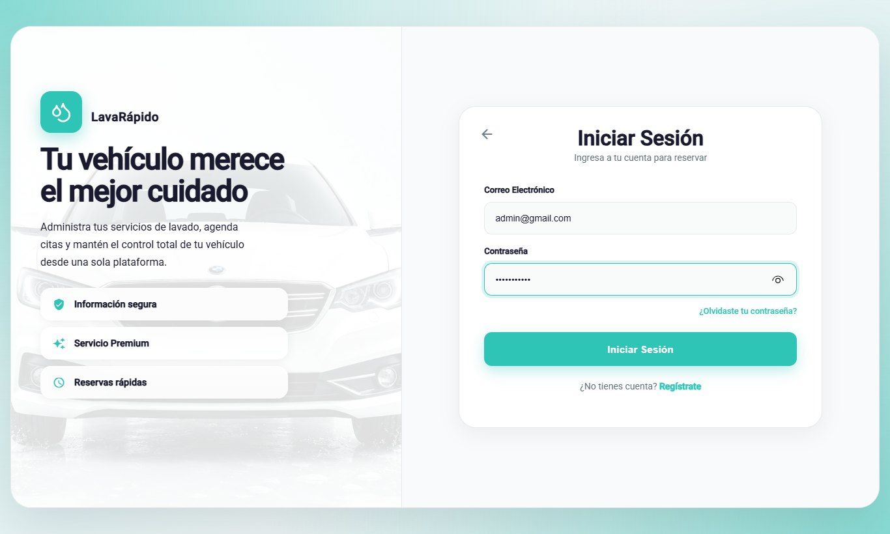

### 8.3 Panel de Control General

El panel de control (ruta */admin*, opción del menú **Dashboard**) resume lo que el administrador necesita para dirigir la jornada (Tabla 5).

**Tabla 5**

*Elementos del Panel de Control del Administrador*

| Elemento | Información que muestra | Acción del administrador |
|---|---|---|
| Reservas de hoy | Número de reservas del día, comparado con el día anterior. | Revisar la carga de trabajo; **Ver reservas de hoy**. |
| Servicios en curso | Servicios que los operarios iniciaron y no han terminado. | Consultar el avance. |
| Bahías activas | Bahías disponibles para recibir reservas. | Verificar la capacidad del día. |
| Pagos por verificar | Pagos pendientes de revisión. | Abrir la revisión (sección 12.6). |
| Ingresos de hoy | Total de los pagos aprobados en el día. | Comparar con los reportes. |
| Ingresos de los últimos 7 días | Gráfica con el total de la semana y el día de mayor movimiento proyectado. | **Ver reporte detallado**. |
| Estado de los operarios | Operarios disponibles, ocupados y ausentes. | **Gestionar turnos y bahías**. |
| Pagos pendientes de revisión | Últimos comprobantes enviados para validación. | **Revisar** cada uno. |
| Reservas sin operario | Reservas programadas o confirmadas que esperan un técnico y cuya hora no ha terminado; desde el 21 de octubre de 2026 es el mismo conteo de la pantalla Reservas, en la web y en la app móvil. | **Asignar** (sección 12.4). |
| Por cerrar | Reservas con operario que terminaron y nadie registró (no se iniciaron o no se finalizaron). Solo aparece cuando hay alguna, en la web y en la app móvil. | **Se atendió** o **No asistió** (sección 12.3). |

*Nota.* Los nombres corresponden al panel cuando la interfaz está en español.

**Figura 2**

*Panel de Control General*

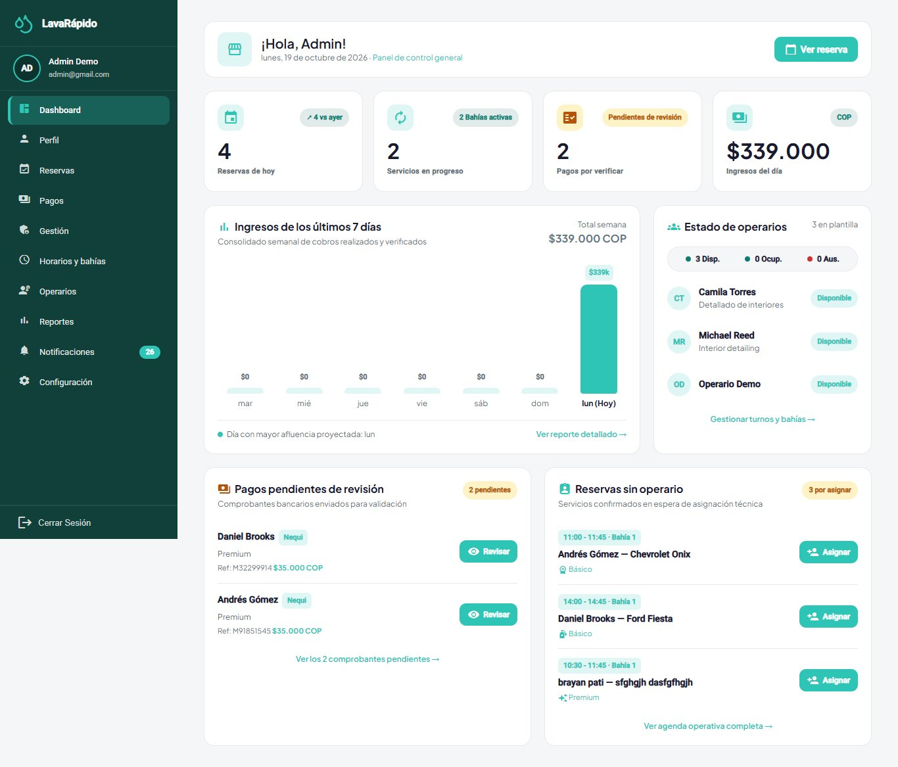

### 8.4 Primera Cuenta de Administrador

Los datos iniciales cargan los tres roles, pero ninguna cuenta de usuario. Cuando el servicio de seguridad corre con el perfil de desarrollo (*dev*), crea una cuenta de demostración por rol (administrador, operario y cliente); sus credenciales aparecen en la guía del equipo del repositorio de infraestructura y nunca se deben usar fuera de un equipo local.

En cualquier otro entorno, como el servidor público, la primera cuenta de administrador la crea security-service al arrancar (*AdministratorBootstrapRunner*). El administrador de TI escribe *ADMIN_EMAIL* y *ADMIN_PASSWORD* (y, si quiere, *ADMIN_FIRST_NAME* y *ADMIN_LAST_NAME*) en el archivo *.env.production* del servidor y reinicia el servicio. Si todavía no existe ninguna cuenta con el rol ADMIN, el servicio la crea con las mismas reglas de cualquier cuenta (política de contraseñas, correo y documento únicos) y el registro muestra *First administrator created*. Si ya existe un administrador, las variables se ignoran y se pueden borrar del archivo. La contraseña se escribe directamente en el servidor y nunca se guarda en un repositorio.

Un administrador nuevo se crea normalmente desde **Gestión > Usuarios > Crear usuario** con el rol Administrador (sección 9.3). La web y la app no permiten cambiar el tipo de usuario de una cuenta que ya existe (sección 10.3); si hay que convertir en administrador una cuenta ya creada (por ejemplo, una registrada desde la pantalla pública), el administrador de TI asigna el rol con SQL, porque la contraseña ya la generó la aplicación:

1. Verificar que la persona ya tiene su cuenta (si no, que se registre desde la pantalla pública).
2. Consultar los identificadores de la cuenta y del rol ADMIN.
3. Insertar el rol ADMIN para la cuenta en *security.user_role*.
4. Pedir a la persona que cierre la sesión e ingrese de nuevo; el sistema debe abrir el panel */admin*.
5. Registrar el cambio (fecha, autor y motivo) en la bitácora de cambios del equipo.

```sql
-- Identificadores necesarios
SELECT user_id, username FROM security.app_user WHERE username = N'<CORREO>';
SELECT role_id, code FROM security.[role];

-- Asignar el rol ADMIN
INSERT INTO security.user_role (user_id, role_id)
VALUES (<USER_ID>, <ID_ROL_ADMIN>);
```

Una cuenta puede tener varios roles; cuando tiene ADMIN, la aplicación web abre el panel de administración. Una vez existe el primer administrador, los demás administradores y los operarios se crean desde **Gestión > Usuarios** (sección 9.3), no con SQL.

## 9. Gestión de Usuarios

Una cuenta del sistema está formada por una persona (*security.person*: número de documento, nombres, apellidos, teléfono y correo) y una cuenta de acceso (*security.app_user*: usuario, hash de la contraseña, estado activo y fecha del último ingreso). Los roles se asignan en *security.user_role*. La contraseña se guarda solo como un hash BCrypt: ningún administrador puede verla ni recuperarla (OWASP Foundation, 2021).

### 9.1 Principios de Gestión de Cuentas

- **Las cuentas se desactivan, no se borran.** Una cuenta desactivada no puede ingresar, pero se conservan sus reservas, pagos y calificaciones.
- **Un correo y un número de documento por cuenta.** El correo (terminado en @gmail.com) es el usuario de ingreso.
- **Mínimo privilegio.** Solo se asigna el rol necesario y la cuenta se desactiva cuando ya no se necesita.

### 9.2 Consulta de Usuarios

1. En el menú lateral, hacer clic en **Gestión** y abrir la pestaña **Usuarios** (ruta */admin/management*).
2. Revisar la tabla con **Nombres**, **Correo**, **Tipo de usuario**, **Fecha de registro**, **Último acceso** y **Estado**. El tipo de usuario solo se muestra; no se cambia desde la tabla (sección 10.3).
3. Usar los filtros **Habilitados** e **Inhabilitados** y el cuadro de búsqueda (nombre, correo o tipo de usuario) para encontrar una cuenta. Si la búsqueda no encuentra nada, **Limpiar filtros** vuelve a mostrar las cuentas habilitadas.

**Figura 3**

*Lista de Usuarios*

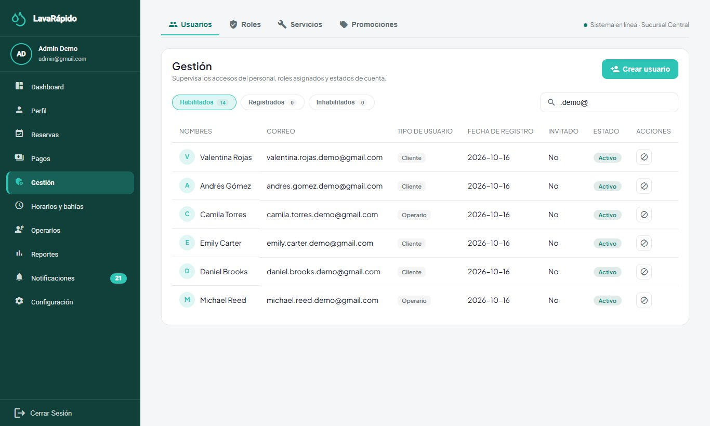

### 9.3 Creación de una Cuenta de Operario o Administrador

1. En **Gestión > Usuarios**, hacer clic en **Crear usuario**.
2. Diligenciar el **Número de documento**, los **Nombres**, los **Apellidos**, el **Correo** y el **Teléfono** (opcional).
3. Escribir una contraseña temporal que cumpla la política (mínimo 8 caracteres, una mayúscula, un número y un carácter especial); **Mostrar contraseña** permite revisarla antes de guardar.
4. Elegir el **Rol asignado**: Operario, Administrador o Cliente.
5. Hacer clic en **Crear Usuario** y verificar que aparezca el mensaje "Usuario creado" y que la cuenta se liste.
6. Entregar la contraseña temporal por un canal privado y pedir a la persona que la cambie en **Perfil** en el primer ingreso.

Los operarios también se pueden crear desde **Operarios > Nuevo operario** (sección 12.1), que crea la cuenta con el rol OPERATOR. El sistema no envía la contraseña por correo: el mensaje de bienvenida de una cuenta creada por el administrador explica que la contraseña se solicita al administrador o se recupera con "¿Olvidaste tu contraseña?".

**Figura 4**

*Ventana para Crear un Usuario*

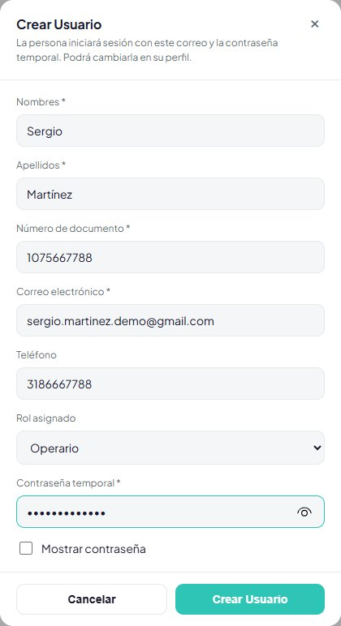

### 9.4 Activación y Desactivación de una Cuenta

1. Ubicar la cuenta en **Gestión > Usuarios**.
2. Elegir **Desactivar cuenta** (o **Activar cuenta** para reactivarla).
3. Confirmar el mensaje que advierte que la persona ya no podrá iniciar sesión. Desde el 21 de octubre de 2026, si tenía una sesión abierta, esa sesión deja de funcionar en máximo 30 segundos en todos sus equipos.
4. Verificar que el estado cambie a **Inhabilitado** y, si la persona es un operario con servicios pendientes, reasignarlos (sección 12.4).

Una cuenta de administrador no se puede desactivar: el botón aparece bloqueado con el mensaje "Una cuenta de administrador no se puede desactivar." Como el tipo de usuario no se cambia desde el panel (sección 10.3), retirar a un administrador requiere que el administrador de TI le quite ese rol en la base de datos y lo anote en la bitácora del equipo. Tampoco se puede desactivar la propia cuenta, ni desde esta tabla ni desde **Perfil**.

### 9.5 Restablecimiento de la Contraseña

El administrador no puede ver ni fijar la contraseña de un usuario. Para recuperar el acceso, la persona usa **¿Olvidaste tu contraseña?**: llega a su correo un código de seis dígitos, válido durante 15 minutos, de un solo uso y que se invalida después de cinco intentos fallidos (Tabla 6).

**Tabla 6**

*Situaciones de Acceso y Acción del Administrador*

| Situación | Causa | Acción |
|---|---|---|
| La persona olvidó la contraseña | — | Orientarla a la recuperación de la contraseña; verificar que el correo sea correcto. |
| "Tu cuenta está desactivada" | La cuenta fue desactivada. | Reactivarla si corresponde (sección 9.4). |
| El código no llega | Correo equivocado, MAIL_ENABLED en false o una falla del SMTP. | Revisar el correo registrado y la configuración del correo (sección 17.7). |
| La persona cambió el correo | Cambio hecho desde Perfil con la contraseña actual. | El nuevo correo es el usuario de ingreso. |

### 9.6 Sesiones Activas

Cada ingreso queda registrado en *security.user_session* (inicio, vencimiento, revocación, dirección IP y agente del navegador). Al cerrar sesión, la sesión queda marcada como revocada, y desactivar la cuenta revoca todas sus sesiones. Cambiar la contraseña desde **Perfil** revoca las demás sesiones de la persona (la del equipo desde el que la cambió sigue abierta) y recuperarla con el código enviado al correo revoca todas. Desde el 21 de octubre de 2026 el token de una sesión revocada deja de servir: security-service lo rechaza y el API Gateway lo corta antes de llegar a los demás servicios, con un margen de hasta 30 segundos (si security-service no responde, el token sirve hasta que vence, como antes). Ante la sospecha de un compromiso, desactivar la cuenta, cambiar el secreto JWT si el compromiso afecta a la plataforma y revisar las sesiones:

```sql
SELECT TOP (50) s.user_session_id, u.username, s.started_at, s.expires_at,
       s.revoked_at, s.ip_address, s.user_agent
FROM security.user_session s
JOIN security.app_user u ON u.user_id = s.user_id
ORDER BY s.started_at DESC;
```

## 10. Gestión de Roles y Permisos

### 10.1 Los Tres Roles Fijos

El servidor aplica solo los tres roles fijos ADMIN, OPERATOR y CLIENT (Tabla 7). La pestaña **Gestión > Roles** lista los tres roles con sus permisos y el número de usuarios de cada uno. **Permisos del rol** permite al administrador elegir uno de los tres roles (no hay un nombre de texto libre) y marcar o desmarcar sus permisos a partir del catálogo de *security.permission*; los cambios se guardan en el servidor en *security.role_permission* (*GET* y *PUT /api/v1/admin/roles-permissions*). **La matriz es informativa**: la autorización real sigue dependiendo del rol del token, por lo que marcar o desmarcar un permiso no concede ni quita acceso a ninguna pantalla ni endpoint (ADR-015). Desde el 21 de octubre de 2026 la pestaña y el diálogo de permisos lo explican en pantalla: los roles son fijos y el acceso lo decide el rol. Si un permiso ya no existe, el sistema responde "Uno de los permisos elegidos ya no existe. Recarga la página e inténtalo de nuevo."

**Tabla 7**

*Matriz de Roles y Capacidades Principales*

| Capacidad | ADMIN | OPERATOR | CLIENT |
|---|---|---|---|
| Registrar y gestionar vehículos | Consulta por placa | — | Sí (propios) |
| Crear y cancelar reservas | Sí (para cualquier cliente) | — | Sí (propias) |
| Reprogramar reservas y cambiar su estado | Sí | — | — |
| Asignar o cambiar el operario | Sí | — | — |
| Iniciar y finalizar un servicio | — | Solo los que tiene asignados | — |
| Pagar, subir comprobantes y canjear cupones | — | — | Sí (propios) |
| Aprobar, rechazar o reembolsar pagos; registrar pagos manuales | Sí | — | — |
| Calificar un servicio completado | — | — | Sí, una vez |
| Configurar horarios, bahías, servicios, puntos, promociones y cuentas de pago | Sí | — | — |
| Crear y desactivar cuentas | Sí | — | Solo desactivar la propia |
| Consultar reportes | Sí | Sus calificaciones | — |

*Nota.* Elaborado por los autores a partir de los endpoints de cada servicio y los roles que exigen.

### 10.2 Control por Rol y por Propiedad

Un rol válido no basta: cada servicio también verifica la propiedad del recurso. Un operario no puede iniciar ni finalizar un servicio asignado a otro operario, y un cliente solo llega a sus propias reservas, vehículos y pagos. Cada servicio valida el token y el rol que exige cada ruta; el gateway enruta las solicitudes y no revisa la firma de los tokens (ADR-006), pero desde el 21 de octubre de 2026 corta los de sesiones cerradas. Una solicitud de un rol a un recurso de otro devuelve el error 403.

### 10.3 Rol de una Persona

Cada cuenta tiene un solo tipo de usuario (Cliente, Operario o Administrador), que se elige al crearla: Cliente cuando la persona se registra desde la pantalla pública, o el **Rol asignado** de **Crear usuario** (sección 9.3) cuando la crea el administrador. Desde el 20 de octubre de 2026 la web y la app no ofrecen cambiar el tipo de usuario de una cuenta ya creada: la columna **Tipo de usuario** de **Gestión > Usuarios** solo lo muestra, y el servidor no tiene una ruta para cambiarlo.

Si de verdad una persona necesita otro rol, el administrador de TI lo ajusta en la base de datos (*security.user_role*, con el mismo procedimiento de la sección 8.4), le pide que cierre la sesión e ingrese de nuevo y registra quién pidió el cambio y el motivo en la bitácora del equipo. Si el nuevo rol es Operario, el servicio de operaciones crea su registro de operario la próxima vez que se listen los operarios; luego se le asignan turnos en **Operarios** (sección 12).

## 11. Configuración del Sistema

### 11.1 Datos del Negocio

**Configuración > Datos del negocio** (ruta */admin/settings*) reúne los datos del lavadero en cuatro tarjetas: **Información general** (razón social, nombre comercial, NIT, tipo de negocio, fecha de fundación y representante legal), **Ubicación y contacto** (dirección, teléfonos y correo), **Información fiscal** (régimen, actividad CIIU, resolución de la DIAN, prefijo y rango de facturación) y **Canales oficiales** (sitio web, redes sociales, línea de atención y horario). Estos datos se guardan en booking-service (*GET* y *PUT /api/v1/admin/establishment*), que valida cada campo antes de guardarlo. Son los mismos que ven los clientes en la página de inicio, en el pie de página y en el centro de ayuda, por lo que un cambio se refleja para todos los usuarios al recargar la página. Las cuentas y los códigos QR para recibir pagos se configuran aparte, en **Medios de pago** (sección 11.4).

El sistema se entrega sin datos de un negocio real: los campos que faltan aparecen como **Por completar** y un aviso al inicio de la pantalla recuerda llenarlos cuando el sistema se implemente para una empresa.

1. Hacer clic en el lápiz de la tarjeta que se quiere cambiar.
2. Diligenciar los campos en la ventana y hacer clic en **Aplicar**. La pantalla muestra **Cambios sin guardar**.
3. Repetir con las demás tarjetas si hace falta y hacer clic en **Guardar cambios** ("Datos guardados"). **Descartar** deshace lo que no se ha guardado.

La razón social, el NIT y la dirección son obligatorios; el teléfono debe tener al menos 7 dígitos, el correo debe ser válido y la fecha de fundación no puede ser futura. En la aplicación móvil, **Más > Configuración > Datos del negocio** muestra las mismas tarjetas con su lápiz y guarda en el mismo lugar.

**Figura 5**

*Datos del Negocio por Completar*

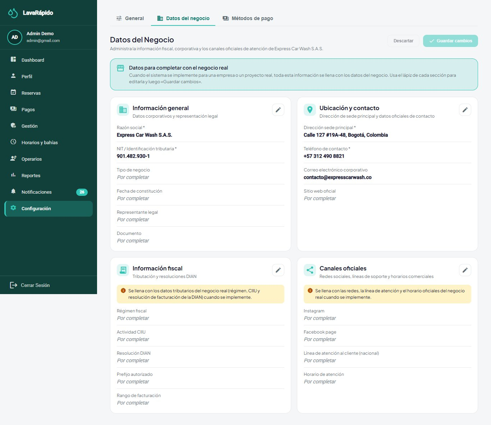

### 11.2 Horario de Atención y Excepciones

La pantalla **Horarios y bahías** (ruta */admin/schedule*) tiene dos pestañas: **Horario de atención** y **Bahías de lavado**. Los cambios de esta pantalla afectan de inmediato la disponibilidad que se ofrece a los clientes.

1. En **Horario de atención**, revisar el **Horario semanal regular**: para cada día, **Abierto** o **Cerrado**, la hora de **Apertura**, la de **Cierre** y la **Pausa** (jornada continua o con pausa para almorzar).
2. Modificar los días que cambiaron y hacer clic en **Guardar cambios** ("Horario guardado"). **Restablecer valores** recupera el horario por defecto.
3. En **Excepciones y días especiales**, hacer clic en **Agregar excepción** para registrar un festivo (cerrado todo el día) o un horario especial: elegir la **Fecha**, el **Tipo**, las horas de **Apertura** y **Cierre** si aplican y el **Motivo / descripción**, y hacer clic en **Guardar excepción**.
4. Usar el botón **Historial** para ver los últimos cambios del horario, que quedan registrados en *booking.schedule_history*.

Un cambio aplica a la disponibilidad futura; las reservas ya confirmadas no se reubican automáticamente. Antes de registrar un cierre, consultar las reservas de ese día en **Reservas** (filtro por fecha) y contactar a los clientes para reprogramarlas o cancelarlas (sección 12.3).

**Figura 6**

*Horario de Atención y Excepciones*

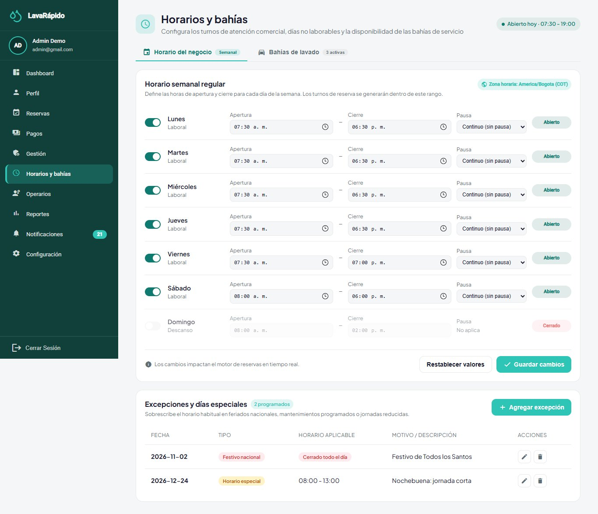

### 11.3 Bahías de Lavado

Una bahía es un puesto físico de lavado, y el número de bahías activas define la capacidad del lavadero: dos reservas activas no pueden ocupar la misma bahía en horarios que se superponen. Una bahía puede estar **Activa**, **En mantenimiento** o **Inactiva**; solo las bahías activas reciben reservas.

1. Abrir **Horarios y bahías > Bahías de lavado**.
2. Para crear una bahía, hacer clic en **Agregar bahía**, escribir el **Nombre de la bahía**, elegir el **Estado** y guardar.
3. Para una reparación, editar la bahía y cambiar su estado a **En mantenimiento**; deja de recibir reservas nuevas.
4. Antes de poner una bahía en mantenimiento o inactiva, revisar las reservas futuras asignadas a ella y reprogramarlas.
5. Al terminar la reparación, volver el estado a **Activa**.

### 11.4 Medios de Pago y Códigos QR

**Configuración > Medios de pago** gestiona las cuentas de pago del lavadero: para cada cuenta, el método (Nequi, Daviplata o transferencia bancaria), el titular, el número de cuenta, la imagen del QR (solo PNG o JPG), las instrucciones y si está activa. Los clientes ven solo las cuentas activas. La cuenta de efectivo (*Caja del establecimiento*) aparece en la misma lista y no tiene código QR; desde el 21 de octubre de 2026, si se desactiva, la opción Efectivo desaparece de la pantalla de pago del cliente. Un código QR o una cuenta equivocados envían el dinero del lavadero a un tercero, por lo que esta información se debe revisar con cuidado.

1. Abrir **Configuración > Medios de pago**.
2. Agregar una cuenta o editar una existente: método, titular, número de cuenta, imagen del QR e instrucciones.
3. Activar o desactivar la cuenta según se acepte o no.
4. Desde una cuenta de cliente de prueba, abrir **Pagar servicio**, escanear el código QR y verificar que el titular que muestra el banco sea el lavadero.

Las imágenes de los QR y los comprobantes se guardan dentro de la base de datos como imágenes (URL de datos); no hay una carpeta aparte de archivos que respaldar (sección 14.1).

**Figura 7**

*Configuración de los Medios de Pago*

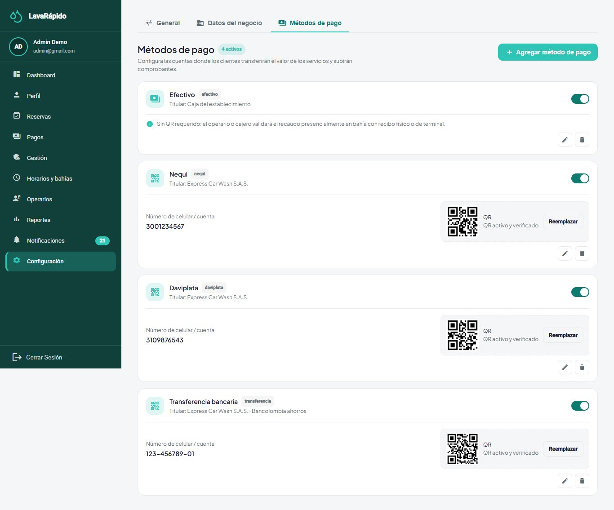

*Nota.* Usar una cuenta y un código QR de prueba.

### 11.5 Parámetros de Seguridad de la Plataforma

**Tabla 8**

*Parámetros de Seguridad Vigentes*

| Parámetro | Valor | Dónde se configura |
|---|---|---|
| Vigencia del token de acceso | 1 hora; no hay token de actualización | security-service (JWT_ACCESS_TOKEN_TTL). |
| Sesión cerrada | El token de una sesión cerrada (cierre de sesión o cuenta desactivada) deja de servir en máximo 30 segundos (desde el 21 de octubre de 2026) | security-service y API Gateway (*SESSION_CHECK_\**). |
| Bloqueo de cuenta por intentos fallidos | 5 intentos fallidos en 15 minutos bloquean la cuenta durante 15 minutos; restablecer la contraseña la desbloquea | security-service (*security.login_lockout*). |
| Código de recuperación | 6 dígitos, válido 15 minutos, de un solo uso, 5 intentos fallidos | security-service. |
| Contraseña | De 8 a 72 caracteres, una mayúscula, un número, un carácter especial, sin espacios | security-service e interfaz web. |
| Almacenamiento de la contraseña | BCrypt con factor de costo 12 | security-service. |
| Firma del token | HS256 con un secreto compartido de al menos 32 bytes | JWT_SECRET en el archivo .env. |
| Idioma, tema e interruptores de notificación por usuario | Español, inglés, francés o portugués; cuatro temas de color; push, recordatorios por correo y promociones | Preferencias del usuario (*security.user_preference*). |

*Nota.* Elaborado por los autores a partir del archivo de configuración del servicio de seguridad y de ADR-006.

### 11.6 Variables de Entorno de Operación

Las variables que cambian el comportamiento de la plataforma se leen del archivo *lavarapido-infra/.env* y requieren reiniciar los servicios afectados. Las más relevantes para el administrador de TI son *MESSAGING_ENABLED* (eventos de RabbitMQ, también en payment-service), *MAIL_ENABLED* y *MAIL_\** (correo), *PUSH_ENABLED* (notificaciones push), *REMINDER_LEADS* (recordatorios, por defecto 24 h y 1 h), *BOOKING_ZONE* (zona horaria del lavadero), *BOOKING_SLOT_MINUTES* y *BOOKING_MAX_DAYS_AHEAD* (rejilla y ventana de reservas), *INTERNAL_API_KEY* (llamadas internas entre servicios) y *SPRING_PROFILES_ACTIVE* (perfil de los servicios Java; *dev* crea cuentas de demostración). Las del 21 de octubre de 2026, *SESSION_CHECK_\** (chequeo de sesión del gateway), *BOOKING_EXPIRY_\** (reservas que terminaron sin cerrarse; *BOOKING_EXPIRY_GRACE_MINUTES* la usan booking-service y operations-service) y *FOLLOW_UP_\** (revisión de la lista **Por cerrar** en operations-service), tienen valor por defecto y todavía no pasan por el archivo de Compose, así que en Docker no se cambian desde *.env*. Sus valores y el procedimiento de cambio se describen en el Manual de Instalación.

## 12. Gestión de la Información Principal

### 12.1 Operarios y Disponibilidad

Un operario es una cuenta con el rol OPERATOR que además tiene un registro en *execution.operator*. El servicio de operaciones crea ese registro automáticamente la primera vez que lista las cuentas de operarios. La disponibilidad semanal (*execution.operator_availability*) define el horario de trabajo de cada día, y las ausencias (*execution.operator_absence*) bloquean al operario entre dos fechas; dos ausencias del mismo operario no se pueden superponer.

1. Abrir **Operarios** (ruta */admin/operators*). Revisar los indicadores y las tarjetas de cada operario; usar los filtros **Todos**, **Disponibles**, **En servicio** y **Ausentes** o el cuadro de búsqueda.
2. Para agregar un operario, hacer clic en **Nuevo operario**, diligenciar los datos de la cuenta (incluida una contraseña temporal) y guardar.
3. Abrir un operario para ver el detalle (ruta */admin/operators/{id}*).
4. Hacer clic en **Editar disponibilidad** para definir, para cada día, el **Inicio** y el **Fin** del turno; desmarcar un día para indicarlo como día libre.
5. Hacer clic en **Registrar ausencia** para registrar un permiso con **Fecha de inicio**, **Fecha de fin** y **Motivo**.
6. Usar el calendario completo para ver la semana con el tiempo disponible, los servicios asignados, los permisos y los descansos.
7. Para retirar a un operario, desactivar su cuenta (sección 9.4) y reasignar sus servicios futuros (sección 12.4).

Algunos indicadores de la pantalla de detalle (por ejemplo, puntualidad, meta de ingresos o habilidades) son ilustrativos y no provienen del servidor; los turnos, ausencias, servicios y calificaciones sí. Los operarios no quedan ligados a una bahía durante todo el turno: la bahía se elige por reserva (ADR-015).

**Figura 8**

*Detalle del Operario con Disponibilidad y Ausencias*

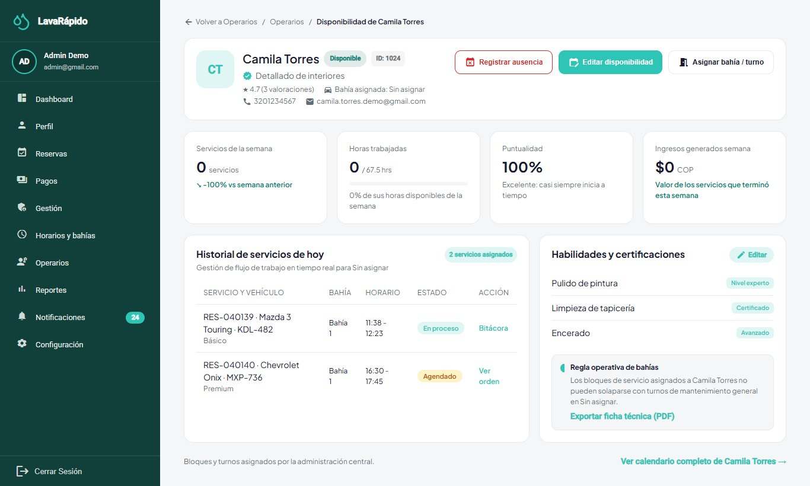

### 12.2 Servicios, Precios y Puntos

El catálogo se organiza en categorías (lavado, polichado, detallado, interior y paquetes), servicios y precios. Cada precio corresponde a un servicio y un tipo de vehículo, con un valor y una duración estimada. Los precios son inmutables: cuando un precio cambia, el sistema cierra el precio vigente y crea uno nuevo, de modo que las reservas existentes conservan el precio con el que se hicieron.

1. Abrir **Gestión > Servicios**.
2. Hacer clic en **Agregar servicio** o editar un servicio existente.
3. Escribir el **Nombre del Servicio**, la **Descripción** y la **Categoría**.
4. En **Precio y duración por tipo de vehículo**, definir el precio en pesos colombianos (COP) y la duración estimada para cada tipo de vehículo (automóvil, sedán, SUV, pickup, camión y motocicleta).
5. En **Puntos de fidelización**, escribir los puntos que gana el cliente cuando se aprueba el pago de este servicio (número entero; 0 = no suma puntos). La tabla de servicios los muestra en la columna **Puntos**.
6. Hacer clic en **Guardar Servicio**.
7. Para dejar de ofrecer un servicio, desactivarlo (deja de estar disponible para reservar); las reservas existentes no se alteran.
8. Verificar en la pantalla de reserva del cliente que el precio, la duración y los puntos mostrados sean los nuevos.

Cada línea de reserva conserva los puntos del servicio en el momento de reservar, igual que el precio.

### 12.3 Reservas

La pantalla **Reservas** (ruta */admin/reservations*) lista las reservas con **Cliente**, **Vehículo y placa**, **Servicio**, **Fecha / hora**, **Operario asignado** y **Estado**, junto con los indicadores del día (total, confirmadas o en curso, en espera de operario, que requieren atención, y canceladas o reprogramadas).

1. Usar la búsqueda por cliente o placa, la fecha (**Hoy**) y los filtros de estado y operario; **Limpiar** los quita.
2. Para crear una reserva a nombre de un cliente, hacer clic en **Nueva Reserva**, buscar el vehículo por placa, elegir los servicios, la fecha y una hora libre, y confirmar.
3. Abrir una reserva para ver su detalle. Desde allí el administrador puede reprogramarla (otra fecha u hora libre), cambiar su estado (confirmar, iniciar, completar, marcar como **No asistió**) o cancelarla eligiendo un **Motivo de cancelación**. Cada cambio pide confirmación.
4. Hacer clic en **Exportar** para descargar la lista en Excel, PDF o CSV.

Las reglas del ciclo de vida son las mismas para todos: una reserva no puede quedar fuera del horario de atención ni ocupar una bahía que ya está tomada, y una reserva que ya empezó no se puede cancelar (Tabla 9). Cuando una reserva se crea, se reprograma o se cancela, todos los administradores activos reciben un aviso en la bandeja.

**Reservas que terminaron sin cerrarse (desde el 21 de octubre de 2026).** El sistema solo cierra una reserva por su cuenta cuando no hay duda de lo que pasó; en los demás casos la decisión es del administrador:

- Una reserva **Programada** que nunca se confirmó se cancela sola una hora después de su hora de fin, con el motivo "Venció sin confirmarse", que no aparece en la lista de motivos para cancelar a mano.
- Una reserva **Confirmada** que nunca tuvo operario pasa sola a **No asistió** una hora después de su fin, porque nadie pudo atenderla.
- Una reserva **Confirmada con operario** a la que nadie le dio **Iniciar** cuando terminó su hora, o una reserva **En progreso** que nadie finalizó una hora después de su fin, nunca se marca sola: pasa a la tarjeta **Por cerrar** del inicio. El operario recibe el aviso "¿Atendiste este servicio?" y cada administrador activo el aviso "Servicio sin registrar" (sección 12.7).

Esta regla reemplazó la primera versión del mismo día, que cerraba como No asistió toda reserva que nadie iniciaba: si el operario lavaba el vehículo y olvidaba marcar **Iniciar**, quedaba registrado que el cliente no llegó. En ningún caso el sistema hace reembolsos: si la reserva estaba pagada, el administrador revisa el pago en **Pagos** (sección 12.6).

Para cerrar las reservas pendientes:

1. Ubicar la tarjeta **Por cerrar** en el **Dashboard** de la web o en el inicio de la app móvil. Solo aparece cuando hay alguna reserva pendiente y muestra las de la última semana.
2. Confirmar con el operario si atendió el vehículo. Si todavía es el mismo día, el operario puede registrar el servicio con **Iniciar** y **Finalizar** aunque sea tarde; así se guardan sus horas reales y la reserva sale de la lista.
3. Si el vehículo se atendió, hacer clic en **Se atendió**. La reserva queda Completada sin inventar horas: sin hora de inicio no cuenta para la puntualidad del operario y sin hora de fin no suma horas trabajadas, pero sí cuenta como servicio realizado y como ingreso. El cliente no recibe el aviso de que ya puede recoger el vehículo (llegaría horas tarde), pero sí puede calificar el servicio.
4. Si el cliente no llegó, hacer clic en **No asistió**. Esta opción solo aplica a una reserva que nunca se inició y el estado es definitivo.
5. Si aparece un mensaje de que la reserva ya no está por cerrar, es porque otro administrador o el operario la cerraron antes; basta con actualizar la pantalla.

**Tabla 9**

*Estados de una Reserva y Acción del Administrador*

| Estado | Significado | Acción posible del administrador |
|---|---|---|
| SCHEDULED (Programada) | Registrada y pendiente de confirmación. | Confirmar, asignar un operario o cancelar. |
| CONFIRMED (Confirmada) | Con turno y bahía. Las reservas que hacen los clientes empiezan aquí. | Asignar o cambiar el operario, reprogramar o cancelar. |
| IN_PROGRESS (En progreso) | El operario inició el lavado. | Supervisar; ya no se puede cancelar. |
| COMPLETED (Completada) | Servicio terminado. | Verificar o registrar el pago. |
| CANCELLED (Cancelada) | Anulada por el cliente o por el lavadero, o cerrada por el sistema porque pasó una hora de su fin sin confirmarse. | Consultar el motivo. |
| NO_SHOW (No asistió) | El cliente no llegó (lo marca el administrador), o la reserva confirmada terminó sin operario hace una hora (lo marca el sistema). | Registrarlo, revisar patrones y, si el cliente había pagado, decidir el reembolso. |

*Nota.* Códigos de la base de datos según ADR-010; la interfaz los traduce.

**Figura 9**

*Gestión de Reservas*

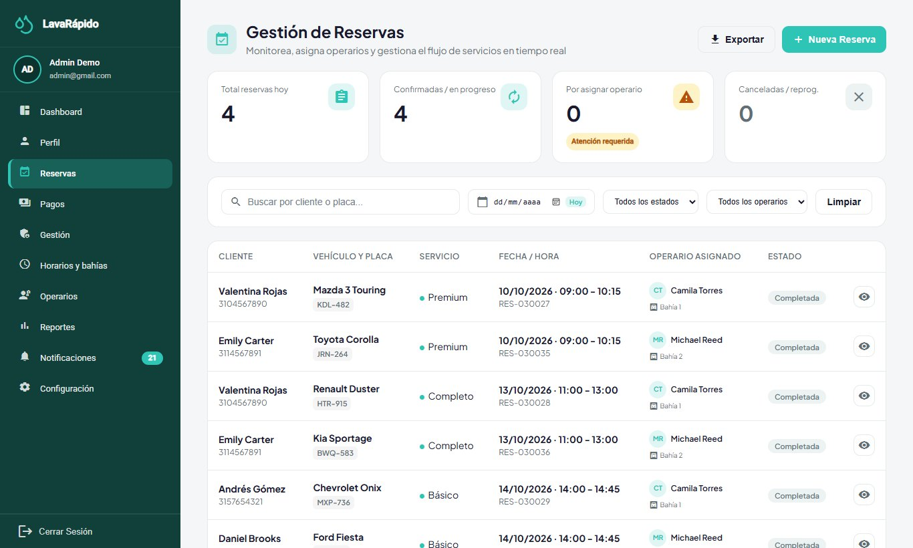

### 12.4 Asignación de un Operario

Cuando se confirma una reserva, **el sistema asigna el operario automáticamente** (RF-008): si el cliente eligió uno y sigue libre, se le asigna ese; si no, el operario libre con menos reservas ese día. Un operario está libre cuando su cuenta está activa, tiene turno a esa hora, no tiene una ausencia registrada y no atiende otra reserva en ese horario. Si ninguno está libre, la reserva queda sin operario y aparece en el bloque **Reservas sin operario** del Dashboard. Desde el 21 de octubre de 2026 el Dashboard y la pantalla **Reservas**, en la web y en la app móvil, usan el mismo conteo: reservas programadas o confirmadas, sin operario en ningún servicio y cuya hora todavía no termina. Una reserva reprogramada conserva su operario. El administrador asigna a mano en dos casos: cuando la reserva quedó sin operario y cuando necesita cambiar el que se asignó.

1. En el **Dashboard** (bloque **Reservas sin operario**) o en **Reservas**, hacer clic en **Asignar** en la reserva.
2. La ventana de asignación muestra los detalles de la cita y la lista de operarios. Los operarios disponibles aparecen primero; los demás indican por qué no pueden tomar la reserva: **Inactivo**, **Sin turno a esa hora**, **Ausente** u **Ocupado a esa hora**.
3. Seleccionar un operario disponible y, si se desea, escribir instrucciones para el operario.
4. Hacer clic en **Confirmar Asignación**. Aparece el mensaje "Operario asignado" y el operario recibe una notificación. Si la reserva ya tenía otro operario, ese operario recibe el aviso de que el servicio se reasignó.

La lista de asignaciones muestra la bahía de cada reserva junto a su operario, de modo que el administrador ve qué operario trabaja en qué bahía. Los operarios no quedan ligados a una bahía durante todo el turno: la bahía se elige por reserva (ADR-010 y ADR-015).

Solo se pueden asignar reservas en estado SCHEDULED o CONFIRMED, y el operario se puede cambiar mientras ninguna línea de la reserva haya comenzado. Si se elige un operario que no es elegible, el servidor rechaza la asignación y explica el motivo. Si la asignación automática y una manual ocurren al mismo tiempo, el sistema las hace una después de la otra, para que un operario no quede con dos servicios a la misma hora.

**Figura 10**

*Asignación Manual de un Operario*

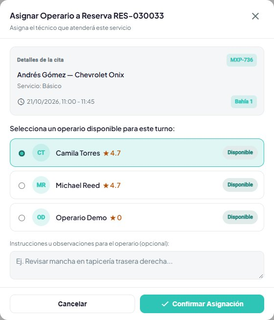

### 12.5 Informe de Inspección del Vehículo

Para los servicios largos (180 minutos o más), el administrador puede registrar el estado del vehículo por fases (Recepción, Exterior, Interior, Motor y Entrega) con hallazgos y fotos, y avisar al cliente.

1. En **Reservas**, abrir la reserva y elegir la opción de inspección (ruta */admin/reservations/{id}/inspection*).
2. Hacer clic en **Iniciar reporte** cuando llegue el vehículo.
3. En cada fase, hacer clic en **Iniciar fase**, agregar los hallazgos con **Agregar hallazgo** (parte del vehículo; tipo: nota, daño menor o daño mayor; descripción; y hasta cinco fotos JPG o PNG de hasta 10 MB) y hacer clic en **Terminar fase**.
4. Hacer clic en **Publicar y copiar enlace**; **Ver como cliente** muestra la versión pública (ruta */report/{token}*).
5. Hacer clic en **Notificar al cliente**. El sistema envía al cliente una notificación y un correo (tipo *INSPECTION_REPORT*) con el resumen de la inspección: fases terminadas, número de hallazgos, hallazgos mayores y áreas afectadas, junto con el enlace al informe. El mensaje "Cliente notificado" confirma el envío.

**Desde la aplicación móvil.** El informe también se gestiona desde el celular, con las mismas fases y las mismas reglas del servidor:

1. En **Reservas**, tocar el ícono del ojo de la reserva y, en el detalle, tocar **Inspección**. El botón solo aparece en servicios de 180 minutos o más que estén confirmados, en curso o completados.
2. Tocar **Iniciar reporte** y, en cada fase, **Iniciar fase**, **Agregar hallazgo** y **Terminar fase** (o **Reabrir** para corregir una fase terminada).
3. En **Nuevo hallazgo**, escribir o elegir la parte del vehículo entre las sugerencias, elegir el tipo y escribir la nota. Adjuntar hasta cinco fotos con **Tomar foto** (cámara) o **Galería**. La aplicación reduce cada foto a 1600 píxeles en su lado mayor, en formato JPEG, antes de subirla, porque el servidor acepta como máximo 2 MB por foto.
4. Tocar **Publicar y compartir enlace**. El informe queda publicado y, desde ese momento, **Compartir enlace** abre el menú de compartir del teléfono (WhatsApp, correo o copiar). **Notificar al cliente** envía el mismo aviso que la web y **Ver como cliente** abre el enlace público en el navegador.

La primera vez, el celular pide permiso para usar la cámara y las fotos; si el permiso se niega, la pantalla indica que debe activarse en los ajustes del teléfono. Las fotos ya guardadas se ven en miniatura y se amplían al tocarlas.

**Dónde se guarda:** el informe, sus fases, los hallazgos y las fotos se guardan en operations-service (tablas *execution.inspection_report*, *execution.inspection_phase*, *execution.inspection_finding* y *execution.inspection_photo*). Las fotos se reducen antes de enviarse: en el navegador cuando se usa la web y en el celular cuando se usa la aplicación móvil. El enlace público (ruta */report/{token}*) solo funciona después de publicar el informe y abre desde cualquier dispositivo sin iniciar sesión, por eso el aviso al cliente lo incluye.

### 12.6 Revisión y Aprobación de Pagos

El sistema no integra una pasarela de pagos (ADR-008). El cliente paga por fuera de la plataforma con el código QR del lavadero y sube el comprobante; el administrador verifica que el dinero llegó y aprueba o rechaza el pago. Es la función más delicada del rol, porque autoriza el cobro de un servicio (Tabla 10).

**Tabla 10**

*Controles de la Revisión de Pagos*

| Control | Cómo lo aplica el sistema | Qué debe hacer el administrador |
|---|---|---|
| Monto | El monto a pagar es el total de la reserva calculado por el servidor menos el cupón canjeado, si lo hay; el cliente declara el monto pagado y la ventana de revisión compara ambos. | Comparar el monto declarado y el comprobante con el monto a pagar. |
| Un solo pago aprobado | Una reserva no admite más de un pago aprobado, y no se puede reportar un segundo pago mientras uno está en revisión. | No intentar aprobar un segundo pago para la misma reserva. |
| Referencia de la transacción | El sistema rechaza una referencia ya usada en otro pago (*TRANSACTION_REFERENCE_REUSED*). | Verificar que la referencia del comprobante coincida con el movimiento del banco. |
| Verificación real | El sistema no consulta al banco. | Confirmar en la aplicación o el extracto del lavadero que el dinero llegó; no confiar solo en la imagen. |
| Historial | Los pagos rechazados se conservan con su motivo. | No borrar los intentos rechazados. |
| Tamaño del comprobante | El servidor rechaza comprobantes de más de 2 MB (*RECEIPT_TOO_LARGE*); la web y la app los reducen antes de enviarlos. | Si una imagen se ve borrosa, pedir al cliente una captura de pantalla del comprobante. |

*Nota.* Elaborado por los autores a partir del servicio de pagos y de ADR-008.

**Aprobación de un pago digital.**

1. Abrir **Pagos** (ruta */admin/payments*) y filtrar por **Pendiente de validación**.
2. Hacer clic en **Revisar** en el pago. La ventana de revisión muestra el comprobante adjunto, la reserva vinculada, el servicio y el vehículo, el operario, el método, la referencia y la **Comparativa de montos** entre el **Monto a pagar (servicio)** y el **Monto declarado en comprobante**. Si no coinciden, la ventana muestra "Los montos no coinciden"; si el cliente no declaró el monto, verificarlo directamente en la imagen del comprobante.
3. Verificar que el dinero llegó a la cuenta del lavadero con ese monto y esa referencia.
4. Hacer clic en **Aprobar pago**. El pago cambia a Aprobado, el cliente recibe el aviso y el correo de pago confirmado, y se acreditan los puntos de fidelización de la reserva (con un aviso por cada cupón que esos puntos desbloquean).

**Rechazo de un pago.** Si el dinero no llegó, el comprobante es ilegible o el monto no coincide, hacer clic en **Rechazar**, escribir el **Motivo del rechazo** (máximo 200 caracteres) y confirmar. El cliente recibe un aviso y un correo con el motivo y puede reportar el pago de nuevo.

**Registro de un pago en efectivo o en el local.** Hacer clic en **Registrar pago manual**, elegir la reserva y el método, y confirmar. La ventana muestra el monto real a pagar de la reserva (con el descuento del cupón, si lo hay), y el pago manual queda aprobado de inmediato con ese monto y acredita los puntos. Usarlo solo cuando se recibió el dinero.

**Reembolso de un pago.** Abrir un pago aprobado y hacer clic en **Reembolsar**. Confirmar que se devolvió el dinero al cliente: el pago cambia a Reembolsado, se revierten los puntos que ganó la reserva y el cliente recibe un aviso y un correo. El reembolso no se puede deshacer.

**Exportar conciliación** descarga la lista en Excel, PDF o CSV. Los avisos al cliente requieren *MESSAGING_ENABLED=true* en payment-service y en notification-service.

**Figura 11**

*Revisión de Pagos*

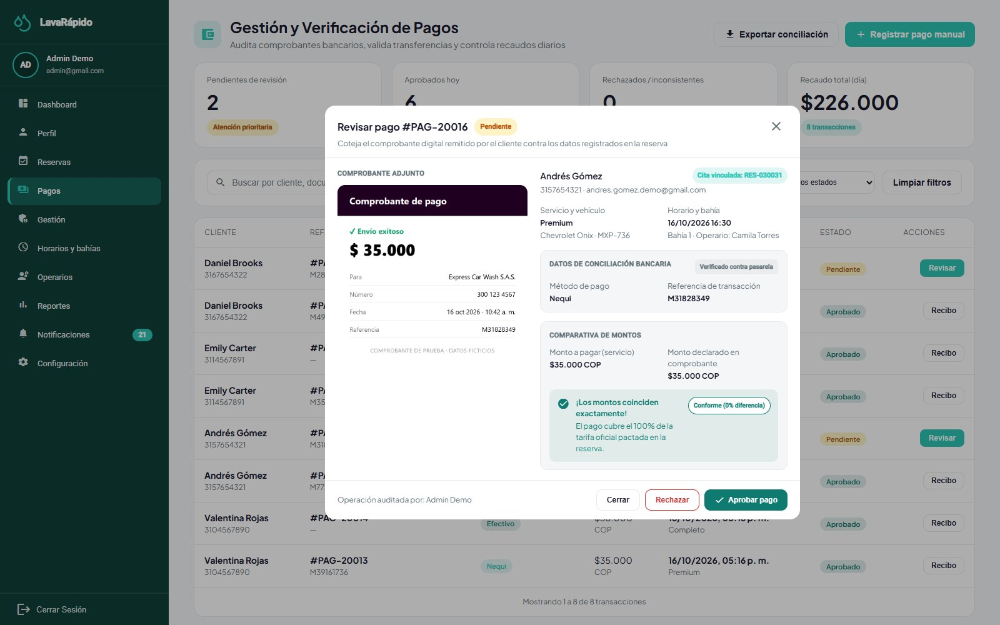

*Nota.* Usar un comprobante de prueba, sin datos bancarios reales.

### 12.7 Notificaciones y Avisos

La opción **Notificaciones** del administrador funciona como la de los demás roles: lista las notificaciones con filtros y permite marcarlas como leídas o eliminarlas. Al hacer clic en una notificación se abre su detalle y queda leída; los avisos de reservas traen el botón **Ir a reservas** y el de bienvenida **Ir al inicio**. Todo administrador activo recibe avisos al personal en la bandeja y como notificación push (nunca por correo): una nueva reserva confirmada, una reserva movida a otra hora, una reserva cancelada (con el motivo) y, desde el 21 de octubre de 2026, el aviso "Servicio sin registrar" cuando una reserva con operario terminó y nadie la inició o la finalizó. Ese aviso llega una sola vez por reserva y abre el inicio, donde la reserva aparece en **Por cerrar** (sección 12.3).

Los avisos se envían con *POST /api/v1/admin/notifications* (rol ADMIN), que acepta solo dos tipos: *SYSTEM_MESSAGE* (aviso libre, solo bandeja y push; disponible solo por la API, porque el panel no tiene una pantalla para ello) e *INSPECTION_REPORT* (enviado desde la pantalla de inspección, también por correo). Cualquier otro tipo se rechaza con 400 *NOTIFICATION_TYPE_NOT_ALLOWED*, para que nadie pueda escribir a mano un aviso que parezca automático (por ejemplo, un falso pago aprobado). El mensaje siempre se guarda en la bandeja del destinatario; la notificación push es adicional (requiere *PUSH_ENABLED=true* y la aplicación móvil) y respeta los interruptores de cada usuario.

### 12.8 Promociones y Fidelización

**Puntos de fidelización.** Cada servicio tiene sus propios puntos (sección 12.2). Cuando el administrador aprueba un pago o registra un pago manual, payment-service acredita los puntos de la reserva en el libro de movimientos *payment.loyalty_transaction* (una vez por reserva); un reembolso los revierte. El saldo de un cliente siempre es el de su último movimiento, y los puntos nunca se gastan.

**Promociones.** La pestaña **Gestión > Promociones** administra los cupones de descuento que los clientes desbloquean con sus puntos (datos guardados en payment-service, *GET*, *POST*, *PUT*, *PATCH* y *DELETE /api/v1/admin/promotions*):

1. Crear una promoción y escribir el **Nombre**, la **Descripción**, el código del **Cupón** (por ejemplo, PREMIUM20), el ícono, los beneficios y la **Fecha de inicio** (si es futura, la promoción queda programada hasta ese día).
2. Escribir el **Descuento al canjear (%)**, entre 1 y 100 (100 = gratis), que se aplica al total de la reserva cuando el cliente canjea el cupón.
3. Escribir los **Puntos de fidelización necesarios** para desbloquear el cupón (0 = disponible para todos).
4. Guardar. La tarjeta de la promoción muestra el descuento y los puntos necesarios (o "disponible para todos"). El estado se calcula a partir de la fecha de inicio y se puede pausar o reanudar desde la tarjeta.

Cuando los puntos de un cliente alcanzan los que exige un cupón disponible, el cliente recibe el aviso "¡Tienes un cupón canjeable!" con su código. Canjear un cupón no consume puntos, y cada cupón se puede canjear una vez por reserva.

## 13. Reportes Administrativos

La pantalla **Reportes** (ruta */admin/reports*) muestra el desempeño del lavadero con datos de reservas y pagos cargados del servidor:

1. Elegir los filtros **Fecha**, **Servicio** y **Operario** y hacer clic en **Aplicar filtros**.
2. Revisar las **Gráficas** de servicios completados e ingresos del periodo. Desde el 21 de octubre de 2026 las tarjetas y las gráficas cuentan como servicios realizados solo las reservas completadas.
3. Revisar los resúmenes **Reporte del Día**, **Reporte de la Semana** y **Reporte del Mes** (servicios completados e ingresos totales), los **Ingresos Totales del Año** y los **Servicios Más Vendidos**.
4. Hacer clic en **Exportar reporte**, elegir el periodo (día, semana o mes), revisar la vista previa y descargarlo con **Exportar Excel** o **Exportar PDF**.

Para las consultas que la pantalla no ofrece, el administrador de TI puede usar las consultas de soporte de la sección 13.1 (Tabla 11).

**Tabla 11**

*Indicadores Administrativos y Fuentes de Datos*

| Indicador | Contenido | Fuente de datos |
|---|---|---|
| Servicios realizados | Servicios completados por periodo, servicio y operario. | booking.booking y execution.service_execution |
| Ingresos | Pagos aprobados por día, mes y cuenta. | payment.payment |
| Calificación promedio | Promedio de las calificaciones por operario. | execution.service_execution |
| Pagos por estado | Número y valor de los pagos en cada estado. | payment.payment |
| Puntos de fidelización | Movimientos y saldos de puntos por cliente. | payment.loyalty_transaction |
| Usuarios | Cuentas por rol y estado. | security.app_user y security.user_role |

**Figura 12**

*Reportes Administrativos*

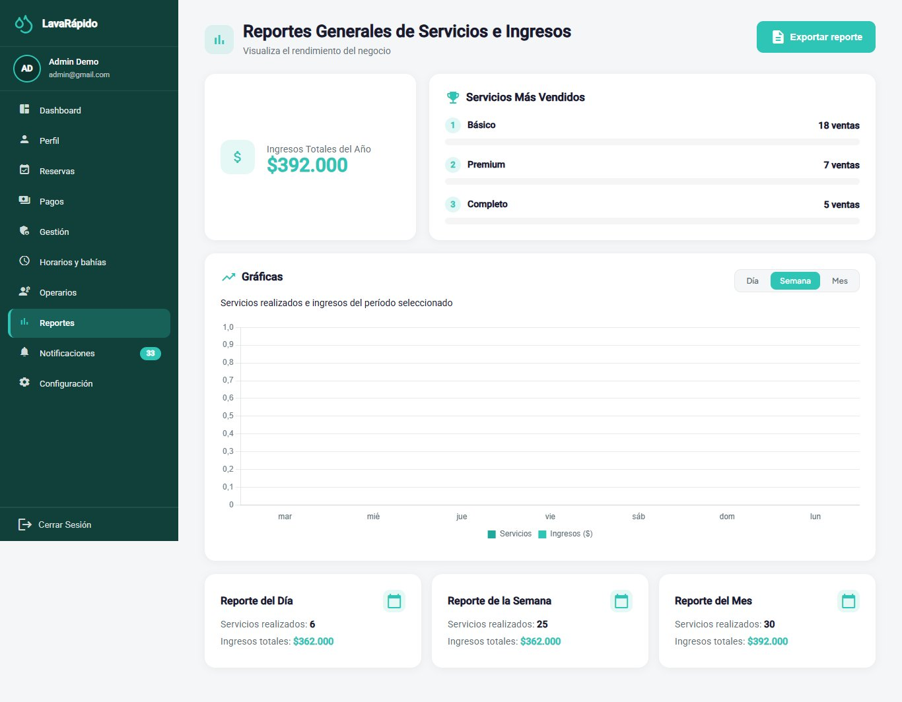

### 13.1 Consultas de Soporte

**Ingresos aprobados por día** (las fechas se guardan en UTC; para el día calendario de Colombia se restan cinco horas antes de convertir a fecha):

```sql
SELECT CAST(DATEADD(hour, -5, p.processed_at) AS date) AS dia_negocio,
       COUNT(*)      AS pagos,
       SUM(p.amount) AS ingresos
FROM payment.payment p
JOIN payment.payment_status ps ON ps.payment_status_id = p.payment_status_id
WHERE ps.code = 'APPROVED'
  AND p.processed_at >= DATEADD(day, -30, SYSUTCDATETIME())
GROUP BY CAST(DATEADD(hour, -5, p.processed_at) AS date)
ORDER BY dia_negocio DESC;
```

**Desempeño por operario:**

```sql
SELECT o.operator_id, o.user_id,
       COUNT(*)                               AS servicios_completados,
       AVG(CAST(se.quality_rating AS float))  AS calificacion_promedio,
       COUNT(se.quality_rating)               AS servicios_calificados
FROM execution.service_execution se
JOIN execution.operator         o  ON o.operator_id = se.operator_id
JOIN execution.execution_status es ON es.execution_status_id = se.execution_status_id
WHERE es.code = 'COMPLETED' AND se.deleted_at IS NULL
GROUP BY o.operator_id, o.user_id
ORDER BY servicios_completados DESC;
```

**Pagos pendientes de revisión**, el indicador más urgente del día:

```sql
SELECT p.payment_id, p.booking_id, p.amount, r.transaction_reference, r.uploaded_at
FROM payment.payment p
JOIN payment.payment_status ps ON ps.payment_status_id = p.payment_status_id
LEFT JOIN payment.payment_receipt r ON r.payment_id = p.payment_id
WHERE ps.code = 'IN_REVIEW'
ORDER BY r.uploaded_at;
```

**Referencias de transacción usadas más de una vez** (el sistema las rechaza desde el 8 de octubre de 2026; la consulta detecta duplicados anteriores):

```sql
SELECT r.transaction_reference, COUNT(*) AS veces_usada
FROM payment.payment_receipt r
WHERE r.transaction_reference IS NOT NULL
GROUP BY r.transaction_reference
HAVING COUNT(*) > 1;
```

Las consultas son de solo lectura. Se deben ejecutar con una cuenta de consulta, fuera de las horas pico si la base de datos es grande, y sus resultados no se deben copiar en hojas de cálculo compartidas sin autorización, porque contienen datos personales.

## 14. Respaldos

La documentación del proyecto no define una estrategia de respaldos, porque la producción está fuera de su alcance, y la aplicación no incluye un módulo de respaldos. Por lo tanto, los respaldos son una tarea del administrador de TI sobre SQL Server y los volúmenes de Docker. En el servidor público, desde el 21 de octubre de 2026, esa tarea está automatizada con los scripts de *lavarapido-infra/deploy* (sección 14.6); las secciones 14.1 a 14.5 sirven para un equipo local y para entender lo que hacen esos scripts. Esta sección propone un procedimiento basado en las prácticas de planificación de contingencias (Swanson et al., 2010) y en la documentación de SQL Server (Microsoft, s. f.). Los valores marcados como recomendaciones los debe aprobar el equipo (Anexo B).

### 14.1 Qué Se Debe Respaldar

**Tabla 12**

*Elementos que Debe Incluir el Respaldo*

| Elemento | Contenido | Cómo se respalda |
|---|---|---|
| Base de datos *LavaRapido* | Los nueve esquemas, las imágenes de los QR y los comprobantes (guardados como URL de datos), el libro de puntos y las tablas de control de Liquibase de cada servicio. | BACKUP DATABASE completo. |
| Archivo *lavarapido-infra/.env* | Secreto JWT, contraseñas y variables de entorno. | Copia cifrada guardada aparte de los respaldos de datos; nunca en un repositorio. |
| Volumen *rabbitmq-data* | Colas y mensajes pendientes de RabbitMQ. | Opcional; los mensajes son transitorios. |
| Definición del entorno | *docker-compose.yml* y repositorios de código. | Ya versionados en Git; verificar que los remotos estén actualizados. |
| Datos del negocio e informes de inspección | Desde el 15 de octubre de 2026 se guardan en booking-service y operations-service, dentro de *LavaRapido* (sección 6.3). | Quedan incluidos en el BACKUP DATABASE. |

*Nota.* Recomendaciones de este manual. Una base de datos restaurada sin su archivo *.env* no la pueden usar los servicios.

### 14.2 Política Recomendada

**Tabla 13**

*Política de Respaldos Recomendada*

| Aspecto | Recomendación |
|---|---|
| Frecuencia | Un respaldo completo diario fuera del horario de atención, y otro inmediatamente antes de cada migración o cambio importante. |
| Retención | 14 respaldos diarios, 8 semanales y 12 mensuales. |
| Regla 3-2-1 | Tres copias, en dos medios distintos, una de ellas fuera del equipo donde corre el sistema. |
| Nombre del archivo | backup_LavaRapido_AAAA-MM-DD_HHMM.bak (por ejemplo, backup_LavaRapido_2026-10-16_0200.bak). |
| Cifrado y acceso | Guardar las copias en una carpeta de acceso restringido y cifrar las que salen del equipo: contienen datos personales protegidos por la Ley 1581 de 2012. |
| Objetivos de recuperación | Pérdida máxima de datos aceptable (RPO): 24 horas. Tiempo máximo de recuperación (RTO): 4 horas. |
| Verificación | Comprobar cada respaldo y restaurar uno en un entorno de pruebas al menos una vez al mes. |

*Nota.* Recomendaciones de este manual; no provienen de la documentación del proyecto.

### 14.3 Generación de un Respaldo Manual

El respaldo se genera dentro del contenedor de SQL Server (servicio de Compose *sqlserver*, contenedor *lavarapido-sqlserver*) y luego se copia al equipo anfitrión. La contraseña de la cuenta *sa* es el valor de *DB_PASSWORD* del archivo *.env*; se debe leer de una variable de entorno y no escribirla en scripts compartidos.

1. Verificar que haya espacio libre en disco (un respaldo ocupa, como orden de magnitud, el tamaño de los datos).
2. Generar el respaldo con suma de comprobación.
3. Comprobar que el archivo se puede restaurar.
4. Copiarlo al equipo anfitrión y luego a un almacenamiento seguro.
5. Registrar el respaldo (fecha, archivo, tamaño, resultado de la verificación y responsable).

```bash
cd lavarapido-infra
# 1) Respaldo completo dentro del contenedor
docker compose exec sqlserver /opt/mssql-tools18/bin/sqlcmd \
  -S localhost -U sa -P "$DB_PASSWORD" -C -Q \
  "BACKUP DATABASE [LavaRapido] TO DISK = N'/var/opt/mssql/data/backup_LavaRapido_2026-10-16_0200.bak' WITH INIT, CHECKSUM, COMPRESSION"

# 2) Verificar que el archivo se puede restaurar
docker compose exec sqlserver /opt/mssql-tools18/bin/sqlcmd \
  -S localhost -U sa -P "$DB_PASSWORD" -C -Q \
  "RESTORE VERIFYONLY FROM DISK = N'/var/opt/mssql/data/backup_LavaRapido_2026-10-16_0200.bak' WITH CHECKSUM"

# 3) Copiar al equipo anfitrión
docker cp lavarapido-sqlserver:/var/opt/mssql/data/backup_LavaRapido_2026-10-16_0200.bak ./backups/
```

La opción *CHECKSUM* detecta páginas dañadas al respaldar y al verificar.

**Figura 13**

*Respaldo Generado y Verificado*


### 14.4 Automatización del Respaldo Diario

Un respaldo que depende de que alguien lo recuerde termina sin hacerse. En Linux se programa con *cron*; en Windows, con el Programador de tareas. El siguiente script de ejemplo genera el respaldo, lo verifica, lo copia y borra los archivos que superan la retención:

```bash
#!/usr/bin/env bash
set -euo pipefail
STAMP=$(date +%F_%H%M)
FILE="backup_LavaRapido_${STAMP}.bak"
DEST="$HOME/backups"
SQL="docker compose -f $HOME/Backend/lavarapido-infra/docker-compose.yml exec -T sqlserver \
     /opt/mssql-tools18/bin/sqlcmd -S localhost -U sa -P $DB_PASSWORD -C -b"
$SQL -Q "BACKUP DATABASE [LavaRapido] TO DISK=N'/var/opt/mssql/data/$FILE' WITH INIT,CHECKSUM,COMPRESSION"
$SQL -Q "RESTORE VERIFYONLY FROM DISK=N'/var/opt/mssql/data/$FILE' WITH CHECKSUM"
docker cp lavarapido-sqlserver:/var/opt/mssql/data/$FILE "$DEST/"
find "$DEST" -name 'backup_LavaRapido_*.bak' -mtime +14 -delete
echo "$(date -Is) OK $FILE" >> "$DEST/backups.log"

# crontab -e   (todos los días a las 2:00 a. m.; DB_PASSWORD viene del entorno del usuario)
# 0 2 * * * /home/<USUARIO>/bin/backup.sh >> /home/<USUARIO>/backups/cron.log 2>&1
```

El script se debe guardar con permisos restringidos y su resultado se debe vigilar: una alerta cuando no existe el archivo del día vale más que muchos respaldos que nadie revisa.

### 14.5 Respaldo Antes de los Cambios

- Antes de implementar una nueva versión de un servicio (cada servicio Java aplica sus migraciones de Liquibase al arrancar) o de ejecutar el contenedor *payment-migrate*, hacer un respaldo (Procedimiento de Implementación, fase 3).
- Antes de cambios masivos de roles, precios, puntos o asignaciones, hacer un respaldo.
- No ejecutar *docker compose down -v* en un entorno con datos que importen: borra el volumen de la base de datos.

### 14.6 Respaldos Automáticos del Servidor Público

Desde el 21 de octubre de 2026 el servidor público respalda la base sin intervención (Documento de Despliegue, sección 3.2):

- *deploy/backup-db.sh* hace un respaldo completo con suma de comprobación, comprueba que se puede restaurar y lo guarda comprimido en *~/lavarapido/backups/*, con permisos solo para su dueño (600). Se conservan los últimos 14.
- Corre antes de cada actualización (si falla, *update-server.sh* no actualiza), 5 minutos después de encender la máquina virtual y todos los días a las 23:00 UTC (6:00 p. m. en Colombia) si está encendida.
- Después de cada respaldo programado, *deploy/verify-backup.sh* lo restaura con otro nombre, revisa que tenga las tablas de la base real y lo borra. Así la prueba de restauración de la sección 14.2 se hace todos los días, sin tocar la base real.
- Cada respaldo, verificación y restauración queda en *~/lavarapido/backups/backup.log*: *tail -20* muestra lo último y *grep FALLÓ* solo los problemas.
- La base usa el modelo de recuperación SIMPLE: con respaldos completos no hacen falta respaldos del registro de transacciones, y el registro no crece sin límite.
- Los respaldos viven en el mismo disco de la máquina virtual: protegen de un error o de una migración mala, no de perder la máquina. Para cumplir la regla 3-2-1 de la Tabla 13, copiarlos al computador del administrador de TI con *scp* o tomar una instantánea del disco en Azure.

## 15. Restauración de Datos

Restaurar sobrescribe los datos actuales con los del respaldo: se pierde todo lo registrado después de él. Por esa razón, la restauración debe ser una decisión autorizada y registrada, nunca una reacción improvisada.

### 15.1 Cuándo Restaurar

**Tabla 14**

*Escenarios de Restauración*

| Escenario | Decisión |
|---|---|
| Base de datos dañada o contenedor perdido sin su volumen | Restauración completa desde el último respaldo válido. |
| Cambio masivo erróneo (por ejemplo, precios o roles) | Restaurar en una base de datos temporal, extraer los datos correctos y corregir la base real; evitar sobrescribirla si hay datos nuevos. |
| Migración fallida | Restaurar el respaldo previo a la migración y revisar el changeset. |
| Compromiso de seguridad | Restaurar en un entorno limpio y cambiar los secretos y las contraseñas antes de reabrir el acceso. |
| Prueba periódica | Restaurar en un entorno de pruebas, nunca sobre el real. |

### 15.2 Procedimiento de Restauración Completa

1. Obtener la autorización y anunciar la interrupción a los usuarios.
2. Elegir el respaldo y comprobar su integridad con RESTORE VERIFYONLY.
3. Detener los servicios de la aplicación y el gateway para que no escriban durante la restauración; dejar SQL Server en ejecución.
4. Hacer un respaldo del estado actual, aunque esté dañado, para no perder la evidencia.
5. Copiar el archivo de respaldo dentro del contenedor y restaurarlo.
6. Verificar la estructura y los datos (sección 15.3).
7. Iniciar los servicios y ejecutar las pruebas de verificación del Manual de Instalación.
8. Registrar la restauración e informar a los usuarios la fecha y la hora de los últimos datos recuperados.

```bash
cd lavarapido-infra
# Detener los contenedores de la aplicación (la base de datos sigue en ejecución)
docker compose stop api-gateway security-service customer-service booking-service \
  operations-service payment-service notification-service

# Copiar el respaldo dentro del contenedor
docker cp ./backups/<ARCHIVO>.bak lavarapido-sqlserver:/var/opt/mssql/data/

# Restaurar (cierra las conexiones abiertas y reemplaza la base de datos)
docker compose exec sqlserver /opt/mssql-tools18/bin/sqlcmd \
  -S localhost -U sa -P "$DB_PASSWORD" -C -b -Q \
  "ALTER DATABASE [LavaRapido] SET SINGLE_USER WITH ROLLBACK IMMEDIATE;
   RESTORE DATABASE [LavaRapido] FROM DISK = N'/var/opt/mssql/data/<ARCHIVO>.bak' WITH REPLACE, CHECKSUM, STATS = 10;
   ALTER DATABASE [LavaRapido] SET MULTI_USER;"
```

En el servidor público se usa *bash ~/lavarapido/lavarapido-infra/deploy/restore-db.sh `<ARCHIVO>`.bak.gz*: pide escribir RESTAURAR, guarda antes un respaldo de cómo estaba la base, detiene los siete servicios, restaura y los vuelve a levantar (de 2 a 3 minutos sin servicio). Con *--as LavaRapido_prueba* la restaura con otro nombre, sin tocar la base real, para revisar un respaldo. La opción *WITH REPLACE* sobrescribe la base de datos existente: usarla solo cuando se esté seguro del respaldo elegido. Si el comando falla a mitad de camino, la base de datos puede quedar en estado de restauración o en modo de un solo usuario; no reiniciar el contenedor sin revisar el registro de SQL Server.

### 15.3 Verificación Posterior a la Restauración

- Existen los nueve esquemas y las tablas de catálogo tienen sus filas (consultas del Manual de Instalación, sección 11).
- Los identificadores fijos siguen en su lugar: *booking_status_id = 5* (CANCELLED) y *payment_status_id = 3* (APPROVED).
- La última reserva y la última sesión corresponden a la fecha esperada del respaldo.
- Un administrador puede ingresar y un cliente de prueba puede consultar sus reservas y su saldo de puntos.
- Las tablas *DATABASECHANGELOG_\** de cada servicio reflejan el último changeset aplicado en ese respaldo.

Los pagos transferidos a la cuenta del lavadero y no registrados por causa de la restauración se deben comparar con el extracto bancario y recuperar con los clientes.

### 15.4 Reversión de una Migración

Los changesets de Liquibase solo avanzan. Deshacer una migración significa, por lo tanto, restaurar el respaldo anterior y corregir el cambio con un nuevo changeset; un changeset ya ejecutado nunca se edita.

**Figura 14**

*Verificación Posterior a la Restauración*

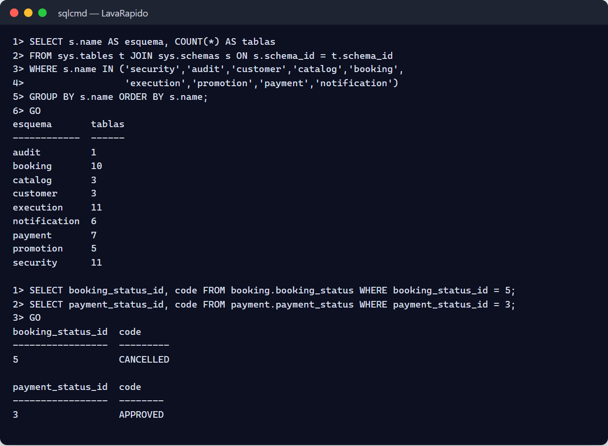

## 16. Auditoría e Historial de Acciones

### 16.1 Qué Registra el Sistema

El diseño del proyecto prevé una tabla de auditoría, *audit.audit_log*, alimentada por disparadores de la base de datos (ADR-009). **En la versión actual esa tabla existe, pero nadie escribe en ella**: los changelogs revisados no crean disparadores de auditoría y los servicios no fijan el contexto de sesión (acción ACO-04 del documento de acciones correctivas, preventivas y de mejoramiento). Mientras esa función no se construya, las trazas disponibles para el administrador son las de la Tabla 15.

**Tabla 15**

*Trazas Disponibles en la Versión Actual*

| Fuente | Qué contiene | Uso típico |
|---|---|---|
| security.user_session | Ingresos: usuario, inicio, vencimiento, revocación, dirección IP y agente. | Detectar ingresos inusuales. |
| security.app_user.last_login | Último ingreso de cada cuenta. | Identificar cuentas sin uso. |
| security.login_lockout | Intentos fallidos de cada cuenta y hasta cuándo está bloqueada. | Detectar intentos de adivinar contraseñas. |
| security.app_user (terms_accepted_at, data_policy_accepted_at) | Fecha en que cada persona aceptó los documentos legales. | Atender solicitudes sobre el consentimiento. |
| payment.payment (approved_by, processed_at, rejection_reason) | Quién aprobó un pago, cuándo y por qué se rechazó. | Revisar las aprobaciones. |
| payment.payment_receipt (uploaded_by, uploaded_at) | Quién subió cada comprobante y cuándo. | Revisar los comprobantes. |
| payment.loyalty_transaction | Cada movimiento de puntos (ganados y revertidos) con su saldo resultante. | Atender reclamos de puntos. |
| booking.schedule_history | Cambios del horario, las excepciones y las bahías, con su fecha y su autor. | Saber quién cambió la disponibilidad. |
| Columnas updated_at y row_version | Fecha y número de cambios de cada fila (mantenidos por disparadores). | Saber cuándo cambió un registro. |
| Registros de los contenedores | Arranque, errores y solicitudes con el identificador de correlación. | Diagnosticar incidentes. |

*Nota.* Elaborado por los autores a partir de los changelogs de los servicios. Los registros nunca deben contener contraseñas, tokens ni el contenido de los comprobantes (Kent y Souppaya, 2006).

### 16.2 Consultas de Auditoría

**Últimos ingresos:**

```sql
SELECT TOP (100) u.username, s.started_at, s.revoked_at, s.ip_address
FROM security.user_session s
JOIN security.app_user u ON u.user_id = s.user_id
ORDER BY s.started_at DESC;
```

**Pagos aprobados, rechazados o reembolsados por cada administrador:**

```sql
SELECT p.approved_by, ps.code AS estado, COUNT(*) AS pagos, MAX(p.processed_at) AS ultimo_cambio
FROM payment.payment p
JOIN payment.payment_status ps ON ps.payment_status_id = p.payment_status_id
WHERE ps.code IN ('APPROVED', 'REJECTED', 'REFUNDED')
GROUP BY p.approved_by, ps.code;
```

**Cuentas sin ingresos en los últimos 90 días:**

```sql
SELECT username, last_login, is_active
FROM security.app_user
WHERE last_login IS NULL OR last_login < DATEADD(day, -90, SYSUTCDATETIME());
```

### 16.3 Revisión Periódica y Retención

- Revisar cada semana las cuentas nuevas de administrador, las cuentas desactivadas, las cuentas de pago, los pagos aprobados y los reembolsos.
- Investigar de inmediato cualquier cuenta nueva con el rol ADMIN o cualquier cambio de los códigos QR o de las cuentas de pago.
- La documentación no define una política de retención. Recomendación: conservar los registros de sesión al menos 12 meses y archivar los más antiguos en los respaldos mensuales.
- Cuando se construyan los disparadores de auditoría, no modificar ni borrar filas de *audit.audit_log*, porque perderían su valor probatorio.

**Figura 15**

*Consulta del Historial de Sesiones*

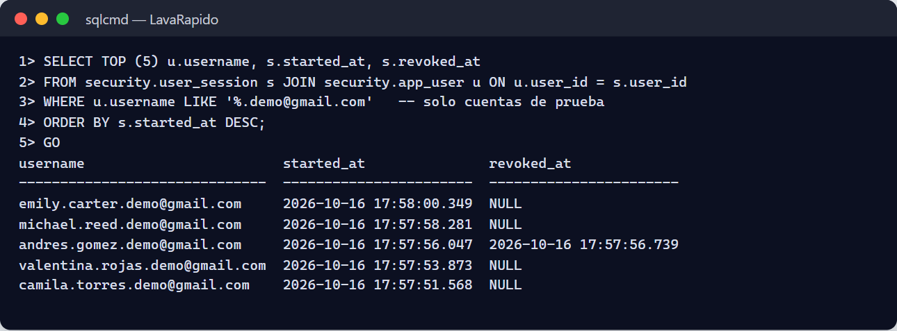

## 17. Recomendaciones de Seguridad

La política de seguridad del proyecto se basa en la defensa en profundidad, el mínimo privilegio, los valores seguros por defecto, la seguridad desde el diseño y la confianza cero. Las siguientes recomendaciones se alinean con los controles del NIST (Joint Task Force, 2020) y con el OWASP Top 10 (OWASP Foundation, 2021).

### 17.1 Cuentas y Contraseñas

- No compartir la contraseña de administrador y usar cuentas individuales.
- Usar contraseñas largas y únicas guardadas en un gestor de contraseñas. El bloqueo temporal frena los intentos repetidos, pero no reemplaza una contraseña fuerte.
- Cambiar de inmediato cualquier contraseña temporal.
- Desactivar el mismo día las cuentas de las personas que salen del proceso.
- Revisar cada trimestre la lista de administradores: debe ser lo más corta posible.
- Cerrar la sesión al terminar y no ingresar desde equipos compartidos.

### 17.2 Datos Personales

El sistema trata datos personales (número de documento, nombres, teléfono, correo, vehículos, pagos y puntos) y debe cumplir la Ley Estatutaria 1581 de 2012 (Congreso de la República de Colombia, 2012). El registro exige aceptar los Términos y Condiciones y la Política de Tratamiento de Datos Personales; esos documentos son modelos elaborados para un proyecto de formación y los debe revisar un abogado antes de un uso comercial real. Cuando una persona se registra, el servidor guarda la fecha y la hora en que aceptó cada documento (*security.app_user*, columnas *terms_accepted_at* y *data_policy_accepted_at*), lo que sirve como prueba del consentimiento. El administrador debe consultar solo los datos necesarios para su función, no copiarlos en medios personales y atender las solicitudes de acceso o corrección de los titulares. No se recogen datos de tarjetas. Los respaldos y las exportaciones heredan la obligación de protección.

### 17.3 Secretos y Configuración

- El archivo *.env* no se versiona y tiene permisos restringidos; el repositorio solo contiene *.env.example*.
- El secreto JWT (mínimo 32 bytes), la contraseña de *sa*, la contraseña de RabbitMQ y *INTERNAL_API_KEY* se deben cambiar antes de cualquier despliegue compartido y de inmediato ante la sospecha de un compromiso. Cambiar el secreto JWT invalida todos los tokens emitidos y obliga a todos a ingresar de nuevo.
- En el entorno local actual los servicios se conectan con la cuenta *sa*. Antes de cualquier despliegue compartido, crear un inicio de sesión por servicio con derechos solo sobre sus propios esquemas (mejora pendiente).
- Las cuentas de demostración del perfil *dev* nunca deben llegar a un despliegue compartido (*SPRING_PROFILES_ACTIVE* distinto de *dev*).

### 17.4 Red y Exposición

- Solo el gateway (puerto 8080) y la aplicación web deben estar expuestos fuera del equipo; SQL Server, RabbitMQ, Mailpit y los puertos 3001 a 3006 no deben ser accesibles desde fuera.
- Fuera del entorno local, usar HTTPS con TLS 1.2 o superior. En el servidor público, Caddy agrega además encabezados de seguridad y una política de contenido (CSP) desde el 20 de octubre de 2026, y Docker revisa la salud de cada contenedor cada 30 segundos (*docker compose ps* muestra *healthy*).
- El gateway no aplica un límite de solicitudes. El bloqueo de cuentas frena a quien intenta adivinar contraseñas, pero en un servidor expuesto a internet conviene agregar también un límite de solicitudes en el proxy (Caddy) o en el gateway.

### 17.5 Riesgos Aceptados que el Administrador Debe Conocer

**Tabla 16**

*Riesgos y Medidas del Administrador*

| Riesgo | Medida recomendada |
|---|---|
| El token de una sesión cerrada todavía sirve hasta 30 segundos (o hasta que vence, si security-service no responde). | Desactivar la cuenta, que cierra todas sus sesiones, y, si es grave, rotar el secreto JWT. |
| Firma HS256 con un secreto compartido entre servicios. | Proteger el archivo .env y rotar el secreto periódicamente. |
| Sin límite de solicitudes en el gateway. | Contraseñas fuertes; vigilar los registros de Caddy y del gateway en busca de ráfagas de solicitudes. |
| Permisos por rol editables pero no aplicados (ADR-015). | No usar la matriz como control de acceso; el acceso real depende del rol. |
| Sin Outbox, un evento se puede perder entre el commit y su publicación. | Revisar las notificaciones faltantes y las colas de mensajes muertos. |
| Auditoría no poblada. | Usar las trazas de la sección 16 y solicitar los disparadores de auditoría. |
| Instancia de SQL Server compartida por todos los servicios. | Respaldar con frecuencia y limitar quién accede a la instancia. |
| Verificación manual de los pagos. | Confirmar siempre contra el extracto bancario del lavadero. |

*Nota.* Elaborado por los autores a partir de ADR-004, ADR-006, ADR-008, ADR-015 y el backlog técnico del proyecto.

### 17.6 Mantenimiento Preventivo

El mantenimiento preventivo reduce la probabilidad de incidentes y se debe programar en el calendario del administrador de TI (Tabla 17). Las frecuencias son una propuesta de este manual.

**Tabla 17**

*Plan de Mantenimiento Preventivo*

| Frecuencia | Tarea | Cómo se verifica |
|---|---|---|
| Diaria | Confirmar que el respaldo se generó y se verificó. | El archivo del día y la bitácora de respaldos (en el servidor público, *tail -5 ~/lavarapido/backups/backup.log*). |
| Diaria | Revisar los contenedores y los errores de los servicios. | docker compose ps y docker compose logs --since 24h. |
| Diaria | Revisar los pagos pendientes de revisión y las reservas sin operario. | Panel de control. |
| Semanal | Revisar las colas de mensajes muertos de RabbitMQ. | Colas *notification-service.events.dlq* y *customer-service.events.dlq* en cero. |
| Semanal | Revisar el espacio en disco, el volumen de SQL Server y los registros. | Uso por debajo del 80 %. |
| Semanal | Revisar los reembolsos, las referencias duplicadas y los administradores nuevos. | Consultas de las secciones 13.1 y 16.2. |
| Mensual | Probar la restauración de un respaldo en un entorno de pruebas. | Verificación de la sección 15.3 (en el servidor público, *verify-backup.sh* lo hace cada día). |
| Mensual | Comprobar la integridad de la base de datos. | DBCC CHECKDB sin errores. |
| Mensual | Revisar las actualizaciones de las imágenes base y los parches de seguridad. | Versiones de SQL Server, RabbitMQ y Mailpit. |
| Trimestral | Revisar las cuentas y los roles. | Lista de usuarios y último ingreso. |
| Trimestral | Revisar las dependencias vulnerables. | ./mvnw versions:display-dependency-updates, dotnet list package --vulnerable y npm audit. |
| Trimestral | Rotar los secretos (JWT, sa, RabbitMQ, llave interna). | Pruebas de ingreso posteriores. |
| Anual | Cargar los festivos del año siguiente; revisar este manual. | Excepciones cargadas; control de versiones. |

```bash
# Verificaciones rápidas de salud
docker compose ps
docker stats --no-stream
docker system df
docker compose exec sqlserver /opt/mssql-tools18/bin/sqlcmd -S localhost -U sa -P "$DB_PASSWORD" -C \
  -Q "DBCC CHECKDB ([LavaRapido]) WITH NO_INFOMSGS"
```

### 17.7 Resolución de Incidentes

Un incidente se atiende con un método fijo: detectar, contener, diagnosticar, corregir, verificar y documentar. El primer paso del diagnóstico es consultar el registro del servicio afectado, que incluye la hora, el nivel, el nombre del servicio y el identificador de correlación. Las causas raíz y las acciones que impiden que un incidente se repita se registran en el documento de acciones correctivas, preventivas y de mejoramiento.

```bash
docker compose ps
docker compose logs --tail 100 <servicio>
docker compose logs --since 30m booking-service | grep -i error
```

**Tabla 18**

*Incidentes Frecuentes del Administrador*

| Incidente | Causa probable | Resolución |
|---|---|---|
| Un usuario no puede ingresar | Contraseña olvidada o cuenta desactivada. | Revisar el estado en Gestión > Usuarios; orientar a la persona a la recuperación de la contraseña. |
| Todos reciben 401 | Token vencido o un secreto JWT distinto entre servicios. | Ingresar de nuevo; verificar que todos los servicios lean el mismo JWT_SECRET. |
| No se pueden crear reservas (503 CUSTOMER_SERVICE_UNAVAILABLE) | customer-service caído o mal configurado. | Reiniciar el servicio; revisar CUSTOMER_SERVICE_URL. |
| Los operarios no pueden iniciar servicios (503 BOOKING_SERVICE_UNAVAILABLE) | booking-service caído. | Reiniciar booking-service. |
| Reservas sin operario | No había operarios libres cuando se confirmó la reserva (sin turno, ausentes u ocupados). | Asignar a mano (sección 12.4) y revisar los turnos y las ausencias de los operarios. |
| Reservas en Por cerrar | El operario atendió el vehículo pero no marcó Iniciar o Finalizar, o el cliente no llegó. | Preguntar al operario y cerrar con Se atendió o No asistió (sección 12.3); recordar al equipo registrar cada servicio. |
| Los pagos fallan a través del gateway en Docker | El contenedor de payment-service no está en ejecución o payment-migrate falló. | Revisar *docker compose ps* y el registro de payment-service (Manual de Instalación, sección 17). |
| Un pago no se puede aprobar | Ya hay un pago aprobado para la reserva. | Revisar los pagos de la reserva y rechazar el duplicado. |
| Pago aprobado sin el dinero | Comprobante falso o mal verificado. | Revisar quién lo aprobó (approved_by); contactar al cliente; reembolsarlo desde Pagos (sección 12.6). |
| Las notificaciones no llegan | MESSAGING_ENABLED en false, RabbitMQ caído o mensajes en la cola de mensajes muertos. | Activar la mensajería, iniciar RabbitMQ y revisar las colas. |
| Un cliente no recibe correos de cupones o recordatorios | El cliente desactivó el interruptor correspondiente en Configuración. | Revisar los interruptores del cliente (*security.user_preference*); la bandeja sigue recibiendo los avisos. |
| No se acreditaron puntos después de aprobar un pago | Los servicios de la reserva tienen 0 puntos, o payment-service no pudo leer la reserva. | Revisar los puntos de los servicios y BOOKING_SERVICE_URL. |
| El código de recuperación no llega | MAIL_ENABLED en false o configuración SMTP equivocada. | Revisar MAIL_* y, en local, Mailpit (http://localhost:8025). |
| Horas corridas en las reservas | Zona horaria equivocada; el sistema guarda UTC. | Revisar BOOKING_ZONE. |
| Disco lleno | Registros, respaldos o crecimiento de los datos. | Liberar espacio de forma segura y mover los respaldos; nunca borrar archivos de datos de SQL Server. |
| La base de datos no responde | Contenedor detenido, memoria insuficiente o archivo dañado. | Revisar el registro de SQL Server y la memoria asignada a Docker; si hay daño, restaurar (sección 15). |
| Sospecha de una cuenta comprometida | Ingresos inusuales o cambios no reconocidos. | Desactivar la cuenta, revisar las sesiones y rotar secretos si es grave. |

*Nota.* Los problemas de instalación se detallan en el Manual de Instalación, sección 17.

### 17.8 Niveles de Severidad y Escalamiento

**Tabla 19**

*Severidad Recomendada de los Incidentes*

| Severidad | Ejemplo | Respuesta objetivo |
|---|---|---|
| Crítica | Sistema caído, pérdida de datos o cuenta de administrador comprometida. | Inmediata; avisar al líder de proyecto. |
| Alta | No se pueden reservar ni pagar servicios. | Dentro de la misma jornada laboral. |
| Media | Notificaciones o correos que no llegan. | Dentro de dos días hábiles. |
| Baja | Texto o formato incorrecto. | Siguiente entrega. |

*Nota.* Recomendación de este manual; los tiempos los debe aprobar el equipo. Equivalen a los niveles P0, P1, P2 y P3 de la gestión de incidentes del proyecto.

Todo incidente se debe registrar con la fecha, quién lo detectó, la descripción, la severidad, la causa, las acciones, el resultado y las medidas para evitar que se repita (Anexo C).

## 18. Glosario

**Tabla 20**

*Glosario de Términos de Administración*

| Término | Definición |
|---|---|
| Administrador | Rol ADMIN: dirige el negocio y gestiona cuentas, pagos y configuración. |
| Asignación | Vínculo entre un operario y una reserva; lo crea el sistema al confirmarse la reserva o el administrador a mano. |
| Auditoría | Registro de los cambios de los datos con su autor y su fecha. |
| Bahía | Puesto físico de lavado; el número de bahías activas define la capacidad. |
| BCrypt | Algoritmo con el que las contraseñas se guardan como hashes irreversibles. |
| Cola de mensajes muertos (DLQ) | Cola donde se guardan los mensajes que fallaron después de los reintentos. |
| Cupón | Descuento porcentual que el cliente desbloquea con puntos y canjea al pagar. |
| Desactivar | Impedir que una cuenta ingrese conservando su historial. |
| Excepción (de horario) | Día que no sigue el horario regular: festivo u horario especial. |
| JWT | Token firmado que identifica al usuario y sus roles; dura una hora. |
| Mínimo privilegio | Principio de dar a cada cuenta solo los permisos que necesita. |
| Pago manual | Pago registrado por el administrador por dinero recibido en el lavadero. |
| Por cerrar | Tarjeta del inicio con las reservas con operario que terminaron sin registrarse; el administrador las cierra con Se atendió o No asistió. |
| Puntos de fidelización | Puntos que suma cada servicio cuando se aprueba su pago; se revierten si el pago se reembolsa. |
| Reembolso | Devolución del dinero de un pago aprobado, que revierte los puntos de la reserva. |
| Respaldo | Copia de la base de datos que permite recuperarla. |
| RPO | Pérdida máxima de datos aceptable, medida en tiempo. |
| RTO | Tiempo máximo aceptable para recuperar el servicio. |
| Severidad | Nivel de gravedad de un incidente. |

*Nota.* Elaborado por los autores a partir de la documentación del proyecto.

## Referencias

Congreso de la República de Colombia. (2012). *Ley Estatutaria 1581 de 2012, por la cual se dictan disposiciones generales para la protección de datos personales*. http://www.secretariasenado.gov.co/senado/basedoc/ley_1581_2012.html

Equipo de Desarrollo Vehicle Washing. (2026a). *Vehicle washing management system: Project documentation* (vehicle-w-docs) [Documentación de proyecto no publicada]. GitHub. https://github.com/code-sena/vehicle-w-docs

Equipo de Desarrollo Vehicle Washing. (2026b). *Front-end-proyecto-web* (rama develop) [Software]. GitHub. https://github.com/BrayanCABRERA123/Front-end-proyecto-web

Equipo de Desarrollo Vehicle Washing. (2026c). *lavarapido-payment-service* (rama develop) [Software]. GitHub. https://github.com/merari0322/lavarapido-payment-service

Equipo de Desarrollo Vehicle Washing. (2026d). *lavarapido-security-service* (rama develop) [Software]. GitHub. https://github.com/BrayanCABRERA123/lavarapido-security-service

Joint Task Force. (2020). *Security and privacy controls for information systems and organizations* (NIST Special Publication 800-53, Rev. 5). National Institute of Standards and Technology. https://doi.org/10.6028/NIST.SP.800-53r5

Kent, K., y Souppaya, M. (2006). *Guide to computer security log management* (NIST Special Publication 800-92). National Institute of Standards and Technology. https://doi.org/10.6028/NIST.SP.800-92

Microsoft. (s. f.). *Back up and restore of SQL Server databases*. Microsoft Learn. Recuperado el 9 de octubre de 2026, de https://learn.microsoft.com/sql/relational-databases/backup-restore/back-up-and-restore-of-sql-server-databases

OWASP Foundation. (2021). *OWASP Top 10:2021*. https://owasp.org/Top10/

Servicio Nacional de Aprendizaje. (2026). *Guía para elaborar manuales de software: Manual de usuario, manual técnico, manual de instalación y manual de administrador* [Material de formación no publicado]. Programa Tecnólogo en Análisis y Desarrollo de Software.

Swanson, M., Bowen, P., Phillips, A. W., Gallup, D., y Lynes, D. (2010). *Contingency planning guide for federal information systems* (NIST Special Publication 800-34, Rev. 1). National Institute of Standards and Technology. https://doi.org/10.6028/NIST.SP.800-34r1

## 19. Anexos

### Anexo A. Origen de las Capturas

Las figuras de este manual se tomaron el 16 de octubre de 2026 sobre la versión de la rama *develop*, con el sistema completo corriendo en Docker y la web en *http://localhost:4200*. Las capturas de terminal muestran la salida real de los comandos. Se usaron cuentas, reservas, pagos y medios de pago de prueba, por lo que no aparecen contraseñas, cuentas bancarias, códigos QR ni datos personales reales. Si una pantalla cambia, la captura se debe tomar de nuevo con el mismo nombre de archivo de la carpeta *capturas*.

### Anexo B. Información por Confirmar Antes de la Entrega

**Tabla 21**

*Información Pendiente de Confirmación o de Desarrollo*

| Tema | Qué falta o qué es contradictorio | Sección |
|---|---|---|
| Permisos por rol | Se guardan en el servidor, pero no se aplican (ADR-015). | 10 |
| Auditoría | audit.audit_log no se alimenta. | 16 |
| Política de respaldos y objetivos RPO y RTO | En el servidor público los respaldos son automáticos y se verifican cada día (sección 14.6); faltan aprobar los objetivos RPO y RTO y una copia fuera de la máquina virtual. | 14 |
| Retención de trazas | No hay una política definida. | 16.3 |
| Un inicio de sesión por servicio | Los servicios se conectan con la cuenta sa. | 17.3 |
| Límite de solicitudes | El gateway y Caddy no limitan las solicitudes por cliente. | 17.4 |

*Nota.* Elaborado por los autores a partir de la verificación del código fuente y del backlog técnico del proyecto.

### Anexo C. Plantilla de Registro de Incidentes

**Tabla 22**

*Registro de un Incidente*

| Campo | Contenido |
|---|---|
| Fecha y hora de detección |  |
| Detectado por |  |
| Descripción y síntomas |  |
| Severidad | Crítica / Alta / Media / Baja |
| Servicios afectados |  |
| Identificador de correlación o registros |  |
| Causa |  |
| Acciones tomadas y responsable |  |
| Resultado y hora de cierre |  |
| Medidas para evitar que se repita |  |

### Anexo D. Lista de Verificación para la Entrega

**Tabla 23**

*Lista de Verificación del Manual de Administrador*

| Criterio | Cumple |
|---|---|
| Portada completa y versión | Sí / No |
| Tabla de contenido con páginas actualizadas | Sí / No |
| Objetivo y alcance explicados | Sí / No |
| El contenido coincide con el módulo de administración de la versión final | Sí / No |
| Todas las figuras reemplazadas por capturas reales | Sí / No |
| Procedimientos de respaldo y restauración probados en una instalación real | Sí / No |
| Sin credenciales, llaves ni datos sensibles | Sí / No |
| Temas del Anexo B revisados | Sí / No |
| Exportado a PDF con el nombre Manual_administrador_LavadoVehicular_3145556.pdf | Sí / No |

*Nota.* Adaptado de la lista de verificación de la guía para elaborar manuales de software (SENA, 2026).
