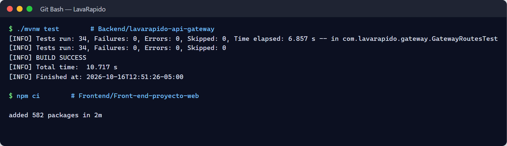
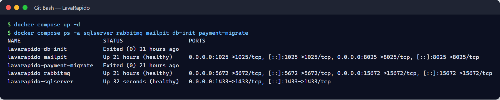
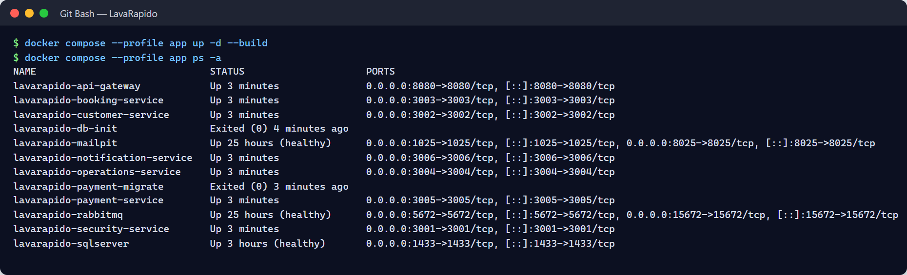
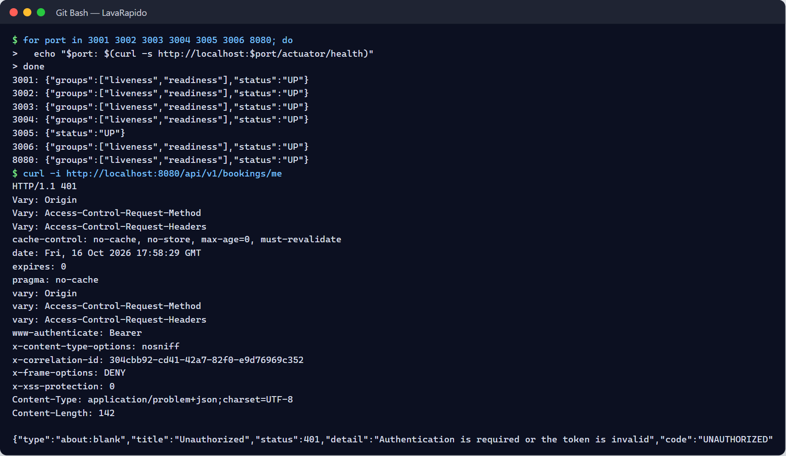

<!-- running-head: MANUAL DE INSTALACIÓN: SISTEMA DE LAVADO VEHICULAR -->

# Manual de Instalación

Sistema de Gestión de Lavado Vehicular (Vehicle Washing)

Requisitos, Configuración, Despliegue con Docker, Base de Datos SQL Server y Verificación de los Servicios

Brayan Estiven Patiño Cabrera (líder de proyecto), Juan Camilo Guilombo Osorio (líder de frontend) y Merari Urbano Quintero (líder de backend)

Tecnólogo en Análisis y Desarrollo de Software (ADSO), Servicio Nacional de Aprendizaje (SENA), Centro de Formación: Industria

Ficha 3145556

Instructora: Karol Daniela Correa

24 de octubre de 2026

Tipo de manual: Manual de instalación (personal de infraestructura y DevOps) · Versión 4.7

## Control de Versiones

La Tabla 1 registra el historial de cambios de este documento. Cada vez que cambie el procedimiento de instalación (por ejemplo, por una nueva versión de un servicio o de una dependencia), se debe agregar una fila con la versión, la fecha, la descripción y el responsable.

**Tabla 1**

*Historial de Versiones del Manual de Instalación*

| Versión | Fecha | Descripción del cambio | Responsable |
|---|---|---|---|
| 2.0 | 2026-10-05 | Creación del manual de instalación (en español) a partir de la documentación del proyecto, dentro de la versión 2.0 del conjunto de manuales. | Equipo de desarrollo |
| 3.0 | 2026-10-07 | Traducción al inglés, formato APA (7.ª ed.) y verificación contra el repositorio de infraestructura y el código de los servicios. Se reemplazaron los marcadores por los valores reales: repositorios, servicios de Compose, puertos, nombre de la base de datos, variables de entorno, migraciones por servicio, payment-service en .NET 8, endpoints de salud y cuentas de demostración. Se corrigieron: la estrategia de migraciones (un changelog por servicio aplicado al arrancar), la ausencia de bloqueo de cuenta y el comportamiento del gateway (no valida tokens). | Equipo de desarrollo |
| 3.1 | 2026-10-09 | Actualización contra el código del 9 de octubre de 2026 y creación de esta versión en español (la versión en inglés es Manual_instalacion_LavadoVehicular_3145556_EN.md). Se corrigieron: el repositorio de operaciones se llama *lavarapido-operation-service* y se debe clonar con ese nombre; direcciones reales de los cuatro repositorios que estaban pendientes; payment-service ahora corre en Docker con el perfil *app* y el contenedor del gateway recibe ROUTE_PAYMENT_URL; los orígenes CORS incluyen Expo web (8081); nuevos changelogs (security 023, 026 y 030; booking 021, 022 y 024; notification 025, 027, 028 y 029; payment 017 a 020); 49 tablas; 22 tipos de notificación; payment-service publica eventos con MESSAGING_ENABLED; se agregó SPRING_PROFILES_ACTIVE. | Equipo de desarrollo |
| 4.0 | 2026-10-16 | Revisión contra el código del 16 de octubre de 2026. Las figuras pasaron de marcadores a capturas reales de la instalación. Se actualizaron: 57 tablas en los nueve esquemas (comprobado con la consulta de la sección 11.5), bloqueo de la cuenta por intentos fallidos, endpoint de salud de payment-service que ahora comprueba la base de datos, referencia al Documento de Despliegue para el servidor de Azure y el APK, y temas del Anexo B que quedaron resueltos. | Equipo de desarrollo |
| 4.1 | 2026-10-17 | Revisión contra el código del 17 de octubre de 2026. Se agregaron la variable opcional *EXPO_PUBLIC_WEB_URL* de la aplicación móvil (sección 10.5) y las dependencias nativas *expo-image-picker* y *expo-image-manipulator*, que exigen *npm install* y un APK nuevo (sección 13.2). | Equipo de desarrollo |
| 4.2 | 2026-10-19 | Integración continua con GitHub Actions: se actualizó el alcance y se retiró del Anexo B. | Equipo de desarrollo |
| 4.3 | 2026-10-20 | Revisión contra el código del 20 de octubre de 2026: el catálogo *notification.notification_type* tiene 24 filas (las migraciones 031 y 038 agregaron la alerta de reserva sin operario y el aviso de versión nueva de la app). | Equipo de desarrollo |
| 4.4 | 2026-10-21 | Revisión contra el código del 21 de octubre de 2026: variables opcionales del chequeo de sesión del gateway y del cierre de reservas vencidas (sección 10.2), semillas 110 a 112 de booking-service (sección 11.2), motivos de cancelación (Tabla 9), respaldos automáticos del servidor público (sección 11.6), verificación del token de una sesión cerrada (secciones 16.3 y 16.4) y errores nuevos (Tabla 14). | Equipo de desarrollo |
| 4.5 | 2026-10-21 | Cambio de la regla de las reservas que terminan sin cerrarse, revisada por el equipo la noche del 21 de octubre: booking-service solo cancela las programadas vencidas y operations-service revisa las confirmadas y las iniciadas. Se agregaron las variables *FOLLOW_UP_ENABLED* y *FOLLOW_UP_INTERVAL*, *BOOKING_EXPIRY_GRACE_MINUTES* compartida por booking-service y operations-service, y los servicios que usan *INTERNAL_API_KEY* (sección 10.2); changelogs 040 de operations-service y 041 de notification-service (sección 11.2); 26 tipos de notificación (Tabla 9); verificación de la tarjeta "Por cerrar" (sección 16.4); un error nuevo (Tabla 14) y el Anexo B. | Equipo de desarrollo |
| 4.6 | 2026-10-23 | Revisión contra *develop* del 23 de octubre de 2026 y la versión *v1.0.0*: ramas y etiquetas de cada repositorio (8.1); variables que el compose ya pasa, incluidas *FOLLOW_UP_LOOK_BACK_DAYS*, *ALLOWED_EMAIL_DOMAINS*, *DEMO_\*_PASSWORD*, *ADMIN_DOCUMENT* y *ADMIN_PHONE*, e *INTERNAL_API_KEY* obligatoria para el operario (10.2); el script global *lavarapido-6-services-sqlserver.sql* no está versionado (11.3); el APK de prueba de las notificaciones push se compila con el perfil *preview* de EAS, porque *development* no existe (13.2); cuentas de demostración por variables (15.1). Incluye el contenido de las ramas *fix/A-05* y *fix/B-02* de Merari Urbano. | Equipo de desarrollo |
| 4.7 | 2026-10-24 | Revisión contra *develop* del 24 de octubre de 2026, que corre en el servidor público desde ese día (8.1); variables nuevas del gateway (*AUTH_RATE_LIMIT_\**, *TRUSTED_PROXIES*, *ROUTE_CONNECT_TIMEOUT*, *ROUTE_READ_TIMEOUT*) y de operations-service (*START_LATE_LIMIT*), *INTERNAL_API_KEY* y *BOOKING_SERVICE_URL* en customer-service, y *BOOKING_EXPIRY_CHECK_\** sin efecto (10.2); la web publicada escucha en el puerto 8080 (Anexo B). | Equipo de desarrollo |

*Nota.* Las fechas se escriben en formato ISO 8601 (año-mes-día). Elaborado por el equipo de desarrollo.

## Tabla de Contenido

<!-- toc -->

- [Control de Versiones](#control-de-versiones)
- [4. Introducción](#4-introducción)
  - [4.1 Fuentes de Este Documento](#41-fuentes-de-este-documento)
  - [4.2 Alcance](#42-alcance)
- [5. Objetivo](#5-objetivo)
  - [5.1 Objetivo General](#51-objetivo-general)
  - [5.2 Objetivos Específicos](#52-objetivos-específicos)
- [6. Requisitos Mínimos de Hardware](#6-requisitos-mínimos-de-hardware)
  - [6.1 Sistemas Operativos Compatibles](#61-sistemas-operativos-compatibles)
  - [6.2 Puertos de Red](#62-puertos-de-red)
- [7. Software Requerido](#7-software-requerido)
  - [7.1 Verificación de las Herramientas Instaladas](#71-verificación-de-las-herramientas-instaladas)
- [8. Obtención del Proyecto](#8-obtención-del-proyecto)
  - [8.1 Clonación de los Repositorios](#81-clonación-de-los-repositorios)
  - [8.2 Estructura Esperada](#82-estructura-esperada)
- [9. Instalación de Dependencias](#9-instalación-de-dependencias)
  - [9.1 Imágenes de Contenedores](#91-imágenes-de-contenedores)
  - [9.2 Servicios Java](#92-servicios-java)
  - [9.3 payment-service (.NET 8)](#93-payment-service-net-8)
  - [9.4 Aplicación Web](#94-aplicación-web)
  - [9.5 Aplicación Móvil](#95-aplicación-móvil)
- [10. Configuración de las Variables de Entorno](#10-configuración-de-las-variables-de-entorno)
  - [10.1 Creación del Archivo .env](#101-creación-del-archivo-env)
  - [10.2 Variables del Archivo .env](#102-variables-del-archivo-env)
  - [10.3 Generación de Secretos](#103-generación-de-secretos)
  - [10.4 Ejemplo del Archivo .env](#104-ejemplo-del-archivo-env)
  - [10.5 Configuración de las Aplicaciones Cliente](#105-configuración-de-las-aplicaciones-cliente)
- [11. Creación e Importación de la Base de Datos](#11-creación-e-importación-de-la-base-de-datos)
  - [11.1 Inicio de SQL Server y Creación de la Base de Datos](#111-inicio-de-sql-server-y-creación-de-la-base-de-datos)
  - [11.2 Migraciones de Cada Servicio](#112-migraciones-de-cada-servicio)
  - [11.3 Método Alternativo: Script Global](#113-método-alternativo-script-global)
  - [11.4 Cuentas de la Base de Datos](#114-cuentas-de-la-base-de-datos)
  - [11.5 Verificación de la Estructura y de los Datos Iniciales](#115-verificación-de-la-estructura-y-de-los-datos-iniciales)
  - [11.6 Respaldo y Reinicio de la Base de Datos Local](#116-respaldo-y-reinicio-de-la-base-de-datos-local)
- [12. Ejecución del Backend](#12-ejecución-del-backend)
  - [12.1 Orden de Arranque](#121-orden-de-arranque)
  - [12.2 Opción A: Servicios en Docker (Recomendada)](#122-opción-a-servicios-en-docker-recomendada)
  - [12.3 Opción B: Servicios Java desde una Terminal o el IDE](#123-opción-b-servicios-java-desde-una-terminal-o-el-ide)
  - [12.4 payment-service (.NET 8) Fuera de Docker](#124-payment-service-net-8-fuera-de-docker)
  - [12.5 RabbitMQ y Correo](#125-rabbitmq-y-correo)
  - [12.6 Registros, Detención y Actualización](#126-registros-detención-y-actualización)
- [13. Ejecución del Frontend](#13-ejecución-del-frontend)
  - [13.1 Aplicación Web (Angular)](#131-aplicación-web-angular)
  - [13.2 Aplicación Móvil (React Native con Expo)](#132-aplicación-móvil-react-native-con-expo)
  - [13.3 Maquetas Estáticas (Opcional)](#133-maquetas-estáticas-opcional)
- [14. Acceso al Sistema](#14-acceso-al-sistema)
  - [14.1 Primer Acceso a la Aplicación Web](#141-primer-acceso-a-la-aplicación-web)
- [15. Usuarios de Prueba](#15-usuarios-de-prueba)
  - [15.1 Cuentas de Demostración](#151-cuentas-de-demostración)
  - [15.2 Reglas de las Cuentas](#152-reglas-de-las-cuentas)
  - [15.3 Creación de un Cliente de Prueba](#153-creación-de-un-cliente-de-prueba)
  - [15.4 Cuentas de Operario y Administrador](#154-cuentas-de-operario-y-administrador)
- [16. Verificación de la Instalación](#16-verificación-de-la-instalación)
  - [16.1 Infraestructura y Base de Datos](#161-infraestructura-y-base-de-datos)
  - [16.2 Mensajería y Correo](#162-mensajería-y-correo)
  - [16.3 Servicios y Gateway](#163-servicios-y-gateway)
  - [16.4 Flujo Funcional Mínimo](#164-flujo-funcional-mínimo)
  - [16.5 Verificación de Trazas](#165-verificación-de-trazas)
- [17. Errores Comunes y Soluciones](#17-errores-comunes-y-soluciones)
- [18. Glosario](#18-glosario)
- [Referencias](#referencias)
- [19. Anexos](#19-anexos)
  - [Anexo A. Origen de las Capturas](#anexo-a-origen-de-las-capturas)
  - [Anexo B. Información por Confirmar Antes de la Entrega](#anexo-b-información-por-confirmar-antes-de-la-entrega)
  - [Anexo C. Resumen de Comandos de Instalación](#anexo-c-resumen-de-comandos-de-instalación)
  - [Anexo D. Lista de Verificación de Seguridad Antes de Compartir el Entorno](#anexo-d-lista-de-verificación-de-seguridad-antes-de-compartir-el-entorno)
  - [Anexo E. Lista de Verificación para la Entrega](#anexo-e-lista-de-verificación-para-la-entrega)

<!-- /toc -->

*Nota.* La numeración empieza en 4 porque las secciones 1 a 3 son la portada, el control de versiones y la tabla de contenido, que no llevan número en el título. Se conserva así para que sigan valiendo las referencias entre documentos por número de sección (por ejemplo, "Manual de Instalación, sección 10").

## 4. Introducción

El Sistema de Gestión de Lavado Vehicular (Vehicle Washing), llamado internamente *LavaRapido*, está formado por un gateway (API Gateway), seis microservicios de backend (cinco en Java 21 con Spring Boot 4 y uno en C# con .NET 8), una base de datos Microsoft SQL Server 2022, un intermediario de mensajes RabbitMQ, un servidor de correo de desarrollo (Mailpit) y dos clientes: una aplicación web en Angular 21 y una aplicación Android en React Native con Expo. Este manual cubre la instalación local con Docker, que es la que usa el equipo para desarrollar y probar. El servidor público en Azure, que se enciende cuando se necesita para presentar el sistema, se monta con los scripts de la carpeta *deploy* de *lavarapido-infra* y se explica en el Documento de Despliegue.

Este manual explica cómo preparar un equipo, obtener el código, configurar las variables de entorno, crear la base de datos, iniciar cada componente en el orden correcto y comprobar que el sistema funciona. Está dirigido al personal de infraestructura y DevOps, o a cualquier persona que deba poner en marcha el sistema en un equipo local o en un servidor de desarrollo. Parte de la premisa de que una instalación debe ser repetible, automatizable y verificable (Humble y Farley, 2010), y de que la configuración que cambia entre entornos debe residir en el entorno y no en el código (Wiggins, 2017).

### 4.1 Fuentes de Este Documento

Los procedimientos se verificaron contra el repositorio de infraestructura (*lavarapido-infra*: *docker-compose.yml*, *.env.example* y la guía del equipo), el código fuente de los once repositorios (rama *develop* al 21 de octubre de 2026) y la documentación del proyecto actualizada a esa misma fecha (Equipo de Desarrollo Vehicle Washing, 2026a, 2026b). Los valores que dependen de cada instalación (contraseñas, llaves y direcciones) se escriben entre ángulos, como `<CONTRASEÑA_SA>`; ningún marcador se debe copiar literalmente en una terminal. La puesta en operación de una versión en su entorno de destino (criterios de entrada, aceptación, capacitación y reversión) se describe en el Procedimiento de Implementación.

### 4.2 Alcance

**Cubre:** la instalación local con Docker de SQL Server, RabbitMQ y Mailpit; la creación de la base de datos *LavaRapido* y sus migraciones; el arranque de los seis servicios y del gateway, en contenedores o desde una terminal; las aplicaciones web y móvil; el primer acceso, las cuentas de prueba, la verificación y la solución de errores comunes.

**No cubre:** el montaje del servidor público en Azure (Documento de Despliegue), la integración continua (GitHub Actions; se describe en el Documento de Despliegue), la compilación y publicación del APK de la aplicación móvil (Documento de Despliegue) ni el uso funcional del sistema, que se explica en el Manual de Usuario y en el Manual de Administrador.

## 5. Objetivo

### 5.1 Objetivo General

Permitir que una persona de infraestructura o DevOps instale y ponga en marcha el Sistema de Gestión de Lavado Vehicular siguiendo instrucciones claras, completas y verificables.

### 5.2 Objetivos Específicos

- Definir los requisitos de hardware, sistema operativo, software y red para ejecutar el sistema completo.
- Describir cómo obtener el código e instalar las dependencias del backend, la web y la aplicación móvil.
- Explicar la configuración de las variables de entorno y el manejo de los secretos.
- Detallar la creación de la base de datos, la aplicación de las migraciones de cada servicio y los datos iniciales.
- Indicar el orden de arranque y los comandos para iniciar, detener y revisar los registros de los componentes.
- Ofrecer pruebas de verificación y una guía para resolver los errores frecuentes.

## 6. Requisitos Mínimos de Hardware

La documentación del proyecto no fija requisitos de hardware. Los valores de la Tabla 2 son recomendaciones de este manual, calculadas para ejecutar al mismo tiempo SQL Server, RabbitMQ, Mailpit, el gateway y los seis servicios, además de las herramientas de desarrollo. El único mínimo con respaldo oficial es el de SQL Server en contenedor, que requiere al menos 2 GB de RAM (Microsoft, s. f.).

**Tabla 2**

*Requisitos de Hardware Recomendados*

| Recurso | Mínimo | Recomendado | Observación |
|---|---|---|---|
| Procesador | 4 núcleos, 64 bits (x64) | 6 u 8 núcleos | La imagen de SQL Server es para x64; en procesadores ARM corre mediante emulación. |
| RAM | 8 GB | 16 GB | Con 8 GB, asignar al menos 5 GB a Docker y cerrar otras aplicaciones. |
| Memoria para Docker | 5 GB | 8 GB o más | SQL Server requiere 2 GB; cada servicio Java usa hasta el 75 % de la memoria de su contenedor. |
| Disco libre | 20 GB | 40 GB en SSD | Imágenes de Docker, volúmenes, dependencias de Maven, NuGet y npm, y registros. |
| Red | Acceso a internet | Banda ancha estable | Descarga de imágenes y dependencias; para un teléfono físico, la misma red Wi-Fi que el computador. |

*Nota.* Recomendaciones de este manual. El mínimo de 2 GB de RAM para SQL Server es el que publica Microsoft (s. f.).

### 6.1 Sistemas Operativos Compatibles

**Tabla 3**

*Sistemas Operativos y Requisitos Adicionales*

| Sistema operativo | Requisito adicional |
|---|---|
| Windows 10 u 11 (64 bits) | Docker Desktop con WSL 2 y virtualización activada en la BIOS o UEFI. |
| Ubuntu 22.04 LTS o posterior | Docker Engine 24 o posterior con el complemento Docker Compose (v2). |
| macOS | Docker Desktop; con Apple Silicon, activar la emulación x64 (Rosetta) para SQL Server. |

*Nota.* Elaborado por los autores a partir de la guía del equipo del repositorio de infraestructura.

### 6.2 Puertos de Red

La Tabla 4 lista los puertos que el sistema publica en el equipo anfitrión. Deben estar libres antes de empezar la instalación.

**Tabla 4**

*Puertos que Usa el Sistema*

| Componente | Puerto | Observación |
|---|---|---|
| SQL Server | 1433 | Si un SQL Server nativo de Windows (servicio MSSQLSERVER) usa este puerto, detenerlo (sección 17). |
| RabbitMQ (AMQP) | 5672 | Lo usan los servicios. |
| RabbitMQ (consola de administración) | 15672 | Interfaz web. |
| Mailpit (SMTP) | 1025 | Recibe los correos de los servicios. |
| Mailpit (interfaz web) | 8025 | Muestra los correos capturados. |
| API Gateway | 8080 | Punto de entrada único de las aplicaciones web y móvil. |
| security-service | 3001 | Cuentas, ingreso, roles y permisos. |
| customer-service | 3002 | Clientes y vehículos. |
| booking-service | 3003 | Catálogo, horario, bahías y reservas. |
| operations-service | 3004 | Operarios, asignación, ejecución y calificaciones. |
| payment-service | 3005 | Cuentas de pago, pagos, promociones y puntos (.NET). |
| notification-service | 3006 | Notificaciones, push, correo y recordatorios. |
| Aplicación web (Angular) | 4200 | Servidor de desarrollo. |
| Aplicación móvil (Expo Metro) | 8081 | Servidor de desarrollo. |

*Nota.* Valores tomados de *docker-compose.yml*, de la configuración de cada servicio y del catálogo de servicios.

## 7. Software Requerido

La Tabla 5 lista las herramientas. Las versiones provienen de los archivos de construcción de cada repositorio (*pom.xml*, *Directory.Build.props* y *package.json*).

**Tabla 5**

*Software Requerido para la Instalación*

| Herramienta | Versión | Uso |
|---|---|---|
| Git | Reciente | Obtener los repositorios. |
| Docker Desktop o Docker Engine con Compose v2 | 24 o posterior | Ejecutar SQL Server, RabbitMQ, Mailpit, las migraciones y los servicios. |
| JDK (se recomienda Eclipse Temurin) | 21 | Ejecutar los servicios Java fuera de Docker. No se necesita Maven: cada servicio incluye el Maven Wrapper (*mvnw*). |
| .NET SDK | 8.0 | Construir, probar y ejecutar payment-service fuera de Docker. |
| Node.js y npm | Node.js 20.19 o posterior (se recomienda 22 LTS); npm 11 | Aplicación web (Angular 21) y aplicación móvil. |
| Angular CLI | 21 (opcional; *npx ng* funciona sin instalación global) | Servidor de desarrollo y construcción de la aplicación web. |
| Expo CLI y EAS CLI (mediante *npx*) | Según *package.json* (Expo SDK 57) | Ejecutar la aplicación móvil y construir versiones con notificaciones push. |
| sqlcmd (opcional) | Reciente | Ejecutar consultas de verificación desde el anfitrión; también está dentro del contenedor de SQL Server. |
| Cliente SQL gráfico (opcional) | SQL Server Management Studio o Azure Data Studio | Inspección visual de la base de datos. |
| curl | Reciente | Pruebas de verificación. |
| Android Studio o un teléfono Android (opcional) | Reciente | Emulador o dispositivo para la aplicación móvil. |

*Nota.* No se necesita la CLI de Liquibase: los servicios Java aplican sus migraciones al arrancar y el contenedor *payment-migrate* ejecuta las de payment-service.

### 7.1 Verificación de las Herramientas Instaladas

Cada comando debe imprimir una versión; si alguno falla, instalar la herramienta correspondiente.

```bash
git --version
docker --version
docker compose version
java -version        # debe mostrar 21
dotnet --version     # debe mostrar 8.x
node -v
npm -v
curl --version
```

En Windows, *docker info* debe mostrar el motor Linux (WSL 2) y no el motor de contenedores de Windows.

**Figura 1**

*Verificación de las Versiones de las Herramientas*


## 8. Obtención del Proyecto

El proyecto se distribuye en un repositorio por componente. Todos los repositorios del backend se deben clonar uno al lado del otro en la misma carpeta y **sin cambiar su nombre**, porque los servicios buscan la configuración compartida en *../lavarapido-infra/.env* y *docker-compose.yml* los construye desde `../<repositorio>` (Tabla 6). Hay que tener en cuenta que el repositorio de operaciones se llama *lavarapido-operation-service* (en singular), aunque el servicio, su contenedor y su imagen se llaman *operations-service*: si se clona con otro nombre, la construcción de Compose falla.

**Tabla 6**

*Repositorios del Proyecto*

| Repositorio | Contenido | Dirección |
|---|---|---|
| lavarapido-infra | docker-compose.yml, .env.example y guía del equipo. | https://github.com/BrayanCABRERA123/lavarapido-infra |
| lavarapido-security-service | Cuentas, ingreso, roles, permisos, perfil y recuperación de la contraseña. | https://github.com/BrayanCABRERA123/lavarapido-security-service |
| lavarapido-customer-service | Clientes y vehículos. | https://github.com/camiloguilombo12/lavarapido-customer-service |
| lavarapido-booking-service | Catálogo, horario, bahías y reservas. | https://github.com/camiloguilombo12/lavarapido-booking-service |
| lavarapido-operation-service | Operarios, asignación, ejecución y calificaciones (servicio *operations-service*). | https://github.com/BrayanCABRERA123/lavarapido-operation-service |
| lavarapido-payment-service | Cuentas de pago, pagos, comprobantes, promociones y puntos (.NET 8). | https://github.com/merari0322/lavarapido-payment-service |
| lavarapido-notification-service | Notificaciones, push, correo y recordatorios. | https://github.com/BrayanCABRERA123/lavarapido-notification-service |
| lavarapido-api-gateway | Gateway (Spring Cloud Gateway). | https://github.com/BrayanCABRERA123/lavarapido-api-gateway |
| Front-end-proyecto-web | Aplicación web en Angular. | https://github.com/BrayanCABRERA123/Front-end-proyecto-web |
| LavadoVehicular-Movil | Aplicación Android (React Native con Expo). | https://github.com/merari0322/LavadoVehicular-Movil |
| vehicle-w-docs | Documentación del proyecto, ADR y contratos OpenAPI. | https://github.com/code-sena/vehicle-w-docs |

*Nota.* Las direcciones se tomaron de los remotos de Git de las copias del equipo al 16 de octubre de 2026.

### 8.1 Clonación de los Repositorios

La rama de integración del equipo es *develop*; allí está la versión más reciente de cada servicio. Desde el 23 de octubre de 2026, *main* tiene la versión entregada *v1.0.0* en 8 repositorios (web, api-gateway, security, customer, booking, operations, notification e infra), y *develop* va adelante con los arreglos del 23 y del 24 de octubre (128 ramas ese día), que saldrán en *v1.1.0*; *develop* es lo que corre en el servidor público desde el 24 de octubre de 2026. payment-service tiene *v1.0.0* desde el 24 de octubre de 2026 (su PR #2 se fusionó y su *main* incluye todo *develop*); la app móvil todavía no tiene versión (PR #1 abierto; su *main* es del 6 de julio de 2026) y se instala desde *develop*. Para una instalación de evaluación, usar la etiqueta *v1.0.0* (y *develop* en la app) o *develop* en todos para ver lo más reciente, que es lo que corre en el servidor público.

```bash
mkdir Backend && cd Backend
git clone -b develop https://github.com/BrayanCABRERA123/lavarapido-infra.git
git clone -b develop https://github.com/BrayanCABRERA123/lavarapido-security-service.git
git clone -b develop https://github.com/camiloguilombo12/lavarapido-customer-service.git
git clone -b develop https://github.com/camiloguilombo12/lavarapido-booking-service.git
git clone -b develop https://github.com/BrayanCABRERA123/lavarapido-operation-service.git
git clone -b develop https://github.com/merari0322/lavarapido-payment-service.git
git clone -b develop https://github.com/BrayanCABRERA123/lavarapido-notification-service.git
git clone -b develop https://github.com/BrayanCABRERA123/lavarapido-api-gateway.git
cd ..
mkdir Frontend && cd Frontend
git clone -b develop https://github.com/BrayanCABRERA123/Front-end-proyecto-web.git
git clone -b develop https://github.com/merari0322/LavadoVehicular-Movil.git
```

Para actualizar una copia existente, ejecutar *git checkout develop* y *git pull* dentro de cada repositorio.

### 8.2 Estructura Esperada

```text
Proyecto/
|-- Backend/
|   |-- lavarapido-infra/                (docker-compose.yml + .env.example + .env)
|   |-- lavarapido-security-service/
|   |-- lavarapido-customer-service/
|   |-- lavarapido-booking-service/
|   |-- lavarapido-operation-service/     (en singular: nombre que espera docker-compose.yml)
|   |-- lavarapido-payment-service/
|   |-- lavarapido-notification-service/
|   `-- lavarapido-api-gateway/
`-- Frontend/
    |-- Front-end-proyecto-web/          (Angular)
    `-- LavadoVehicular-Movil/           (React Native / Expo)
```

**Figura 2**

*Repositorios Clonados en la Carpeta de Trabajo*


## 9. Instalación de Dependencias

### 9.1 Imágenes de Contenedores

El entorno local usa las imágenes *mcr.microsoft.com/mssql/server:2022-latest*, *rabbitmq:4-management*, *axllent/mailpit* y *liquibase/liquibase:4.29*; las imágenes de los servicios se construyen desde sus Dockerfile (payment-service usa las imágenes oficiales del SDK y del runtime de .NET 8). Desde la carpeta de infraestructura, validar el archivo de Compose y descargar las imágenes base:

```bash
cd Backend/lavarapido-infra
docker compose config --quiet && echo "El archivo de Compose es válido"
docker compose pull
```

El comando *docker compose config* falla si faltan *DB_PASSWORD* o *JWT_SECRET*; en ese caso, completar primero el archivo *.env* (sección 10) y ejecutarlo de nuevo.

### 9.2 Servicios Java

Los servicios Java descargan sus dependencias automáticamente: con Docker, durante la construcción de la imagen; fuera de Docker, la primera vez que corre *mvnw* (puede tardar varios minutos). Para descargarlas por adelantado y ejecutar las pruebas unitarias de un servicio:

```bash
cd Backend/lavarapido-security-service
./mvnw -B test            # Windows: .\mvnw.cmd -B test
```

### 9.3 payment-service (.NET 8)

```bash
cd Backend/lavarapido-payment-service
dotnet restore
dotnet test               # pruebas de dominio, de aplicación y de integración (xUnit)
```

### 9.4 Aplicación Web

```bash
cd Frontend/Front-end-proyecto-web
npm ci
```

El comando *npm ci* instala exactamente las versiones de *package-lock.json*, lo que hace repetible la instalación. Las vulnerabilidades conocidas se revisan con *npm audit*.

### 9.5 Aplicación Móvil

```bash
cd Frontend/LavadoVehicular-Movil
npm ci
```

**Figura 3**

*Instalación Exitosa de las Dependencias*



## 10. Configuración de las Variables de Entorno

Los valores que cambian entre entornos (datos de conexión, secretos, correo e interruptores) residen fuera del código (Wiggins, 2017). Todos los servicios leen el mismo archivo *lavarapido-infra/.env*: Docker Compose lo lee automáticamente, los servicios Java lo importan con *spring.config.import* y payment-service lo lee con su clase *EnvFile*. Las variables de entorno reales siempre tienen prioridad sobre el archivo. El archivo *.env* está excluido de Git; el repositorio solo contiene *.env.example*.

### 10.1 Creación del Archivo .env

```bash
cd Backend/lavarapido-infra
cp .env.example .env           # PowerShell: Copy-Item .env.example .env
git check-ignore -v .env       # debe mostrar la regla de .gitignore que lo excluye
```

Si *git check-ignore* no imprime nada, el archivo no está excluido y no se debe llenar con secretos hasta corregir el *.gitignore*.

### 10.2 Variables del Archivo .env

**Tabla 7**

*Variables de Entorno Principales*

| Variable | La usa | Efecto y valor local |
|---|---|---|
| DB_PASSWORD | SQL Server y todos los servicios | Contraseña de la cuenta *sa*. Obligatoria; al menos 8 caracteres con mayúscula, minúscula, número y símbolo, o SQL Server no arranca. |
| DB_NAME | Infraestructura y servicios | Nombre de la base de datos; *LavaRapido*. |
| DB_USERNAME | Servicios | *sa* en el entorno local. |
| DB_URL | Servicios Java ejecutados desde el IDE | jdbc:sqlserver://localhost:1433;databaseName=LavaRapido;encrypt=true;trustServerCertificate=true |
| JWT_SECRET | Todos los servicios | Llave de firma HS256 compartida por todos los servicios; al menos 32 bytes. Obligatoria. |
| CORS_ALLOWED_ORIGINS | Servicios y gateway | Orígenes que pueden llamar desde un navegador: la aplicación web y Expo web; *http://localhost:4200,http://localhost:8081*. |
| SPRING_PROFILES_ACTIVE | Servicios Java en Docker | *dev* por defecto en el archivo de Compose (Swagger y cuentas de demostración); usar otro valor, como *prod*, en cualquier entorno compartido. Desde *develop* del 23 de octubre de 2026, security-service sin esta variable arranca en *prod* (E-05). |
| DEMO_ADMIN_PASSWORD, DEMO_OPERATOR_PASSWORD, DEMO_CLIENT_PASSWORD | security-service (perfil *dev*) | Contraseñas de las cuentas de demostración *admin@gmail.com*, *operador@gmail.com* y *cliente@gmail.com* (desde *develop* del 23 de octubre de 2026, E-05). Vacía: esa cuenta no se crea. Cada quien las elige en su *.env*; no están en el código ni en los documentos. |
| ALLOWED_EMAIL_DOMAINS | security-service | Dominios de correo permitidos al registrarse, al crear usuarios y al cambiar el correo, separados por comas; *gmail.com* por defecto (desde *develop* del 23 de octubre de 2026, A-01). Con otro dominio el servidor responde 400 *EMAIL_DOMAIN_NOT_ALLOWED*. |
| ADMIN_EMAIL, ADMIN_PASSWORD, ADMIN_DOCUMENT, ADMIN_PHONE | security-service (producción) | Primer administrador, creado solo si la base no tiene ninguno; *ADMIN_DOCUMENT* y *ADMIN_PHONE* son su cédula y su celular (sin ellos el perfil queda con valores de relleno). Van en *.env.production* y los pasa *docker-compose.prod.yml*. |
| MAIL_ENABLED | security-service y notification-service | *true* envía correos; *false* escribe el código de recuperación en el registro de security-service. |
| MAIL_HOST, MAIL_PORT, MAIL_USERNAME, MAIL_PASSWORD, MAIL_FROM | security-service y notification-service | Servidor SMTP. En local, Mailpit: localhost, 1025, cualquier usuario y contraseña. Gmail requiere una contraseña de aplicación. |
| MAIL_DOCKER_HOST | Servicios en Docker | Host SMTP visto desde los contenedores; *mailpit* por defecto. |
| MESSAGING_ENABLED | Servicios Java y payment-service | *true* publica y consume eventos de RabbitMQ; *false* (por defecto) solo los escribe en el registro. Sin eventos no hay notificaciones, avisos de pago ni avisos de puntos. |
| RABBITMQ_HOST, RABBITMQ_PORT, RABBITMQ_USERNAME, RABBITMQ_PASSWORD | Servicios Java y payment-service | localhost, 5672, guest, guest en el entorno local. |
| PUSH_ENABLED, EXPO_ACCESS_TOKEN | notification-service | *true* envía notificaciones push mediante Expo; *false* solo las escribe en el registro. |
| INTERNAL_API_KEY | security-service, customer-service, booking-service, operations-service y notification-service | Llave de las rutas internas; sin ella no se envían por correo los avisos de reservas, pagos y cupones ni los recordatorios, no se pueden leer los interruptores de notificación de cada usuario, no hay asignación automática y operations-service no puede cerrar como No asistió las reservas confirmadas que terminaron sin operario. Desde *develop* del 23 de octubre de 2026 (E-01) también es obligatoria para que el operario inicie y termine servicios: booking-service solo acepta esas rutas desde operations-service con esta llave. Desde el 24 de octubre de 2026 la usa también customer-service para preguntar a booking-service si un vehículo tiene reservas activas antes de retirarlo: sin ella, retirar un vehículo responde 503 *BOOKING_SERVICE_UNAVAILABLE*; en producción el compose no arranca si falta. |
| REMINDER_LEADS | notification-service | Anticipación de los recordatorios; *24h,1h* por defecto. |
| BOOKING_ZONE, BOOKING_SLOT_MINUTES, BOOKING_MAX_DAYS_AHEAD | booking-service y operations-service | America/Bogota, 30 y 60 por defecto. |
| SESSION_CHECK_ENABLED, SESSION_CHECK_CACHE_TTL, SESSION_CHECK_TIMEOUT | api-gateway | Chequeo de la sesión del token (desde el 21 de octubre de 2026): *true*, *30s* y *3s* por defecto. Están comentadas en *.env.example* y el archivo de Compose las pasa al contenedor. Desde el 24 de octubre se revisa con cualquier esquema del encabezado. |
| AUTH_RATE_LIMIT_ENABLED, AUTH_RATE_LIMIT_REQUESTS, AUTH_RATE_LIMIT_WINDOW | api-gateway | Límite de peticiones por IP en */api/v1/auth/\** (desde el 24 de octubre de 2026): *true*, *60* y *1m* por defecto; al pasarse responde 429 *RATE_LIMITED* con *Retry-After*. Tienen valor por defecto en el servicio y el compose no las pasa: para cambiarlas, agregarlas al bloque *environment* del gateway. |
| TRUSTED_PROXIES | api-gateway | Redes desde las que se cree el encabezado *X-Forwarded-For* (por defecto las privadas y locales: *127.0.0.0/8*, *10.0.0.0/8*, *172.16.0.0/12*, *192.168.0.0/16*, *::1* y *fc00::/7*). Con Caddy delante no hace falta cambiarla. |
| ROUTE_CONNECT_TIMEOUT, ROUTE_READ_TIMEOUT | api-gateway | Tiempo para conectar y para leer la respuesta de cada servicio (desde el 24 de octubre de 2026): *5s* y *60s* por defecto; si se pasa, el gateway responde 500. |
| BOOKING_EXPIRY_CHECK_ENABLED, BOOKING_EXPIRY_CHECK_INTERVAL | booking-service | **Sin efecto desde el 24 de octubre de 2026** (B-07): la tarea que cancelaba las reservas programadas vencidas se quitó, porque todas las reservas nacen y se reprograman confirmadas. El archivo de Compose todavía las pasa; se pueden borrar de *.env*. |
| BOOKING_EXPIRY_GRACE_MINUTES | booking-service y operations-service | Minutos después de la hora de fin antes de cerrar una reserva vencida; *60* por defecto. La usan los dos servicios, así que si se cambia debe tener el mismo valor en ambos; el archivo de Compose la pasa a los dos. |
| FOLLOW_UP_ENABLED, FOLLOW_UP_INTERVAL, FOLLOW_UP_LOOK_BACK_DAYS | operations-service | Revisión de las reservas que terminaron sin cerrarse (desde la noche del 21 de octubre de 2026): pasa a No asistió la confirmada que nunca tuvo operario y deja en "Por cerrar" la que tenía operario y nadie registró. *true*, *PT5M* y *28* (días hacia atrás que revisa, porque el servidor puede pasar semanas apagado) por defecto; necesita *INTERNAL_API_KEY*. Pasan por el archivo de Compose. |
| START_LATE_LIMIT | operations-service | Hasta cuánto después de la hora de fin el operario puede iniciar un servicio (desde el 24 de octubre de 2026): *PT4H* por defecto; después responde 409 *SERVICE_TOO_LATE*. No pasa por el compose. |
| SECURITY_SERVICE_URL, CUSTOMER_SERVICE_URL, BOOKING_SERVICE_URL | Servicios que llaman a otros | Direcciones de los servicios; tienen valores por defecto para el entorno local. payment-service necesita BOOKING_SERVICE_URL para leer el total y acreditar los puntos de una reserva. Desde el 24 de octubre de 2026 customer-service también la usa, pero con la raíz del servicio (*http://booking-service:3003* en Docker, *http://localhost:3003* en local, sin */api/v1*), fijada en el compose; opcional, *BOOKING_SERVICE_TIMEOUT* (3 s). |

*Nota.* Elaborado por los autores a partir de *.env.example*, *docker-compose.yml* y los archivos de configuración de los servicios.

### 10.3 Generación de Secretos

El secreto JWT, la contraseña de *sa* y la llave interna se deben generar con una fuente aleatoria segura, no escribirlos a mano:

```bash
openssl rand -base64 48                                   # JWT_SECRET
node -e "console.log(require('crypto').randomBytes(32).toString('base64url'))"   # INTERNAL_API_KEY
```

El valor generado se pega en el archivo *.env*, nunca en un mensaje, un documento compartido o un repositorio.

### 10.4 Ejemplo del Archivo .env

El siguiente fragmento muestra la estructura; los secretos se representan con asteriscos.

```ini
DB_PASSWORD=********
DB_NAME=LavaRapido
DB_USERNAME=sa
DB_URL=jdbc:sqlserver://localhost:1433;databaseName=LavaRapido;encrypt=true;trustServerCertificate=true
JWT_SECRET=********
CORS_ALLOWED_ORIGINS=http://localhost:4200,http://localhost:8081
MAIL_ENABLED=true
MAIL_HOST=localhost
MAIL_PORT=1025
MAIL_USERNAME=dev
MAIL_PASSWORD=dev
MAIL_FROM=LavaRapido <no-reply@lavarapido.local>
MESSAGING_ENABLED=true
RABBITMQ_HOST=localhost
RABBITMQ_PORT=5672
RABBITMQ_USERNAME=guest
RABBITMQ_PASSWORD=guest
PUSH_ENABLED=false
INTERNAL_API_KEY=********
```

### 10.5 Configuración de las Aplicaciones Cliente

- **Aplicación web.** Llama a la dirección relativa */api/v1*. En desarrollo, *proxy.conf.json* reenvía toda solicitud que empiece por */api* al gateway (*http://localhost:8080*), por lo que no hay que editar ningún archivo.
- **Aplicación móvil.** Copiar *.env.example* a *.env.local* y fijar *EXPO_PUBLIC_API_URL*. En el emulador de Android usar *http://10.0.2.2:8080/api/v1* (el valor por defecto); en un teléfono físico, la dirección IPv4 del computador en la misma red Wi-Fi (por ejemplo, *http://192.168.1.10:8080/api/v1*); y para la versión web de Expo, *http://localhost:8080/api/v1*. Después de cambiarla, reiniciar Expo con *npx expo start --clear*. La variable opcional *EXPO_PUBLIC_WEB_URL* fija la dirección de la web con la que la aplicación arma el enlace público del informe de inspección; si no se define, se usa el mismo equipo del gateway con el puerto 4200.

**Figura 4**

*Archivo .env Configurado con los Secretos Ocultos*


*Nota.* No capturar valores reales de los secretos.

## 11. Creación e Importación de la Base de Datos

El sistema usa una sola base de datos SQL Server 2022 llamada *LavaRapido*, dividida en nueve esquemas: *security*, *audit*, *customer*, *catalog*, *booking*, *execution*, *promotion*, *payment* y *notification* (57 tablas). Cada servicio es dueño de sus esquemas y solo migra los suyos con Liquibase, con sus propias tablas de control `DATABASECHANGELOG_<SERVICIO>` (Equipo de Desarrollo Vehicle Washing, 2026a).

### 11.1 Inicio de SQL Server y Creación de la Base de Datos

```bash
cd Backend/lavarapido-infra
docker compose up -d
docker compose ps
```

Este comando inicia, sin los servicios:

- *sqlserver* (contenedor *lavarapido-sqlserver*), con chequeo de salud y el volumen *sqlserver-data*.
- *db-init*, que se ejecuta una vez y crea la base de datos *LavaRapido* si no existe.
- *payment-migrate*, que ejecuta una vez los changelogs de Liquibase de payment-service (esquemas *payment* y *promotion*).
- *mailpit* y *rabbitmq* (contenedor *lavarapido-rabbitmq*, con chequeo de salud).

Esperar a que *lavarapido-sqlserver* y *lavarapido-rabbitmq* muestren el estado *healthy* y a que *db-init* y *payment-migrate* terminen con código de salida 0. Si el contenedor de SQL Server se detiene a los pocos segundos, las causas habituales son una *DB_PASSWORD* débil, memoria insuficiente o el puerto 1433 ya ocupado (sección 17).

**Figura 5**

*Contenedores de Infraestructura en Ejecución*



### 11.2 Migraciones de Cada Servicio

Los servicios Java aplican sus migraciones automáticamente al arrancar (*spring.liquibase*), y luego Hibernate solo valida que las entidades coincidan con las tablas. Por eso, las tablas de los esquemas *security*, *audit*, *customer*, *catalog*, *booking*, *execution* y *notification* se crean la primera vez que arranca cada servicio (sección 12). La Tabla 8 muestra los changelogs de la versión del 21 de octubre de 2026.

**Tabla 8**

*Changelogs de Cada Servicio*

| Servicio | Changelogs | Tabla de control |
|---|---|---|
| security-service | 001 esquemas, 002 núcleo de seguridad y auditoría, 003 preferencias del usuario, 020 paletas de tema, 023 rol personalizado (creado y eliminado de nuevo por 026), 026 permisos por rol (catálogo de permisos y asignaciones por defecto), 030 interruptores de notificación de las preferencias, 034 bloqueo por intentos fallidos, 035 dirección de la persona, 036 fecha de creación de la cuenta, 039 aceptación de los documentos legales; semilla 101 roles. | DATABASECHANGELOG_SECURITY |
| customer-service | 004 esquema de clientes, 014 identificador de usuario del cliente, 015 modelo del vehículo; semilla 102 tipos de vehículo. | DATABASECHANGELOG_CUSTOMER |
| booking-service | 005 esquemas de catálogo y reservas, 018 cambios de ADR-010, 021 historial del horario, 022 puntos de fidelización del catálogo, 024 retiro del operario de la bahía, 032 datos del negocio del establecimiento; semillas 103 catálogo, 104 estados y motivos, 109 establecimiento, horario y cuatro bahías, 110 datos del negocio, 111 borrado de los datos de ejemplo del negocio para que el negocio real los complete y 112 motivo *EXPIRED* del cierre automático de reservas vencidas. | DATABASECHANGELOG_BOOKING |
| operations-service | 007 esquema de ejecución, 033 informes de inspección con fases, hallazgos y fotos, 037 perfil del operario, 040 hora del aviso de servicio sin registrar (*follow_up_notice_at*); semilla 105 estados de ejecución. | DATABASECHANGELOG_OPERATIONS |
| notification-service | 010 esquema de notificaciones, 016 tokens de dispositivos, 017 eventos procesados, 019 recordatorios de reservas, 025 tipo de cupón canjeado, 027 notificaciones al personal y seguimiento de reservas, 028 tipo de pago reembolsado, 029 tipos de puntos e inspección, 031 aviso de reserva sin operario, 038 tipo de aviso de versión nueva de la app, 041 tipos de aviso de servicio sin registrar para el operario y el administrador; semilla 108 tipos de notificación. | DATABASECHANGELOG_NOTIFICATION |
| payment-service | db/changelog/changes/001 a 020 (numeración propia; 017 campos de paquete, 018 puntos necesarios, 019 verificación de catálogos, 020 reversión de puntos y secuencia), ejecutados por el contenedor *payment-migrate*. | DATABASECHANGELOG_PAYMENT |

*Nota.* Fuente: estrategia de migraciones de la documentación del proyecto y changelogs de los repositorios.

**Reglas que siempre se deben respetar.** Los changesets solo avanzan. Un changeset que ya se ejecutó nunca se edita: Liquibase calcula una suma de comprobación y se niega a continuar si el contenido cambió, lo cual es una protección intencional. Cada changeset tiene una precondición que lo marca como ejecutado si el objeto ya existe. Los datos iniciales usan identificadores fijos, y dos de ellos son críticos: *booking_status_id = 5* (CANCELLED) lo usan la restricción *ck_booking_cancel* y el disparador *tr_booking_bay_overlap*, y *payment_status_id = 3* (APPROVED) el índice *ux_payment_one_approved_per_booking*.

### 11.3 Método Alternativo: Script Global

**Al 23 de octubre de 2026 el script *lavarapido-6-services-sqlserver.sql* no está versionado en ninguno de los repositorios** (tampoco en su historial), así que este método no se puede seguir: la base se crea solo con los changelogs de Liquibase que cada servicio aplica al arrancar (sección 11.2). Si el equipo vuelve a publicar el script, se ejecuta sobre la base de datos vacía y, como cada changeset tiene una precondición, Liquibase marca como ejecutados los objetos que ya existen:

```bash
sqlcmd -S localhost,1433 -U sa -P "<CONTRASEÑA_SA>" -C -d LavaRapido -b -i lavarapido-6-services-sqlserver.sql
```

El método recomendado es el de la sección 11.2, porque deja el historial de cada servicio en su tabla de control.

### 11.4 Cuentas de la Base de Datos

En el entorno local todos los servicios se conectan con la cuenta *sa* (variable *DB_USERNAME*). La política de seguridad del proyecto exige que cada servicio use un inicio de sesión con derechos solo sobre sus propios esquemas; es una mejora pendiente que se debe aplicar antes de cualquier despliegue compartido. El procedimiento genérico de SQL Server es:

```sql
CREATE LOGIN [booking_svc] WITH PASSWORD = '<CONTRASEÑA_FUERTE>', CHECK_POLICY = ON;
USE [LavaRapido];
CREATE USER [booking_svc] FOR LOGIN [booking_svc];
GRANT SELECT, INSERT, UPDATE, DELETE, EXECUTE ON SCHEMA::[catalog] TO [booking_svc];
GRANT SELECT, INSERT, UPDATE, DELETE, EXECUTE ON SCHEMA::[booking] TO [booking_svc];
```

*Nota.* Las migraciones requieren derechos para crear objetos (DDL); si los servicios dejan de usar *sa*, las migraciones se deben ejecutar con una cuenta aparte.

### 11.5 Verificación de la Estructura y de los Datos Iniciales

Las consultas se pueden ejecutar desde el anfitrión con *sqlcmd* o desde dentro del contenedor:

```bash
docker compose exec sqlserver /opt/mssql-tools18/bin/sqlcmd -S localhost -U sa -P "$DB_PASSWORD" -C -d LavaRapido -Q "<CONSULTA>"
```

```sql
-- 1) Tablas por esquema (57 en total cuando todos los servicios han arrancado)
SELECT s.name AS esquema, COUNT(*) AS tablas
FROM sys.tables t JOIN sys.schemas s ON s.schema_id = t.schema_id
WHERE s.name IN ('security','audit','customer','catalog','booking',
                 'execution','promotion','payment','notification')
GROUP BY s.name ORDER BY s.name;

-- 2) Historial de migraciones de cada servicio
SELECT name FROM sys.tables WHERE name LIKE 'DATABASECHANGELOG[_]%';

-- 3) Identificadores fijos críticos
SELECT booking_status_id, code FROM booking.booking_status WHERE booking_status_id = 5;
SELECT payment_status_id, code FROM payment.payment_status WHERE payment_status_id = 3;
```

**Tabla 9**

*Resultados Esperados de los Datos Iniciales*

| Tabla | Resultado esperado |
|---|---|
| security.role | 3 filas: ADMIN, OPERATOR y CLIENT. |
| security.permission | El catálogo de permisos cargado por el changelog 026. |
| customer.vehicle_type | 6 filas: CAR, SEDAN, SUV, PICKUP, TRUCK y MOTO. |
| catalog.service | Los servicios BASIC, PREMIUM y FULL con precios para los seis tipos de vehículo. |
| booking.booking_status | 6 filas; el identificador 5 corresponde a CANCELLED. |
| booking.cancellation_reason | 7 filas; *EXPIRED* (semilla 112) solo lo usa el sistema y no aparece en la lista de motivos. |
| booking.service_bay | 4 bahías. |
| execution.execution_status | 5 filas: PENDING, IN_PROGRESS, PAUSED, COMPLETED y WITH_ISSUE. |
| payment.payment_status | 5 filas; el identificador 3 corresponde a APPROVED. |
| payment.payment_method_type | 4 filas: EFECTIVO, NEQUI, DAVIPLATA y TRANSFERENCIA. |
| payment.loyalty_movement_type | 5 filas: EARNED, REDEEMED, EXPIRED, ADJUSTED y REVERSED. |
| notification.notification_type | 26 filas. |

*Nota.* Si una tabla de catálogo está vacía, el servicio dueño todavía no ha arrancado o su changeset de semilla no se ejecutó.

### 11.6 Respaldo y Reinicio de la Base de Datos Local

Antes de aplicar cambios en un entorno con datos que importen, respaldar la base de datos (Manual de Administrador, sección 14):

```bash
docker compose exec sqlserver /opt/mssql-tools18/bin/sqlcmd -S localhost -U sa -P "$DB_PASSWORD" -C \
  -Q "BACKUP DATABASE [LavaRapido] TO DISK = N'/var/opt/mssql/data/backup.bak' WITH INIT, CHECKSUM"
docker cp lavarapido-sqlserver:/var/opt/mssql/data/backup.bak ./backup.bak
```

En el servidor público los respaldos son automáticos: *deploy/backup-db.sh* respalda la base todos los días y antes de cada actualización, *deploy/verify-backup.sh* comprueba cada respaldo restaurándolo con otro nombre y *deploy/restore-db.sh* restaura uno (Documento de Despliegue, sección 3.2).

Para reiniciar un entorno local desechable, detener los contenedores y borrar los volúmenes. **Esto borra todos los datos:**

```bash
docker compose down -v
```

## 12. Ejecución del Backend

### 12.1 Orden de Arranque

Los servicios no dependen de un orden estricto más allá de la infraestructura, pero la secuencia de la Tabla 10 evita errores en el primer arranque (por ejemplo, una reserva que no puede validar el vehículo porque customer-service no está listo).

**Tabla 10**

*Secuencia de Arranque del Entorno Local*

| Paso | Componente | Listo cuando |
|---|---|---|
| 1 | SQL Server, RabbitMQ y Mailpit (*docker compose up -d*) | sqlserver y rabbitmq están *healthy*; db-init y payment-migrate terminaron. |
| 2 | security-service (3001) | El registro muestra "Started SecurityServiceApplication". |
| 3 | customer-service (3002) | Responde en /actuator/health. |
| 4 | booking-service (3003) | Responde en /actuator/health. |
| 5 | operations-service (3004) | Responde en /actuator/health. |
| 6 | payment-service (3005) | Responde en /actuator/health. |
| 7 | notification-service (3006) | Responde en /actuator/health; crea su cola si MESSAGING_ENABLED es true. |
| 8 | api-gateway (8080) | Responde en /actuator/health. |

*Nota.* El primer arranque de cada servicio Java tarda más porque descarga dependencias y crea sus tablas.

### 12.2 Opción A: Servicios en Docker (Recomendada)

Con el perfil *app*, Docker Compose construye e inicia en contenedores el gateway y los seis servicios (los cinco servicios Java y payment-service), después de la infraestructura:

```bash
cd Backend/lavarapido-infra
docker compose --profile app up -d --build
docker compose ps
```

La opción *--build* reconstruye las imágenes a partir del código actual; omitirla para reutilizar las imágenes ya construidas. Desde el 8 de octubre de 2026, payment-service tiene su propio Dockerfile (construcción con el SDK de .NET 8, ejecución con el runtime de ASP.NET 8 y un usuario sin privilegios) y arranca después de que *payment-migrate* termina con éxito; el contenedor *api-gateway* recibe *ROUTE_PAYMENT_URL: http://payment-service:3005*, por lo que la limitación TD-014 de la versión 3.0 ya no existe.

**Figura 6**

*Contenedores del Entorno en Ejecución*



### 12.3 Opción B: Servicios Java desde una Terminal o el IDE

Para desarrollo o depuración, mantener solo la infraestructura en Docker y ejecutar cada servicio con el Maven Wrapper, una terminal por servicio. Los servicios leen *../lavarapido-infra/.env* por sí mismos y usan por defecto el perfil *dev*, que activa Swagger y las cuentas de demostración.

```bash
cd Backend/lavarapido-security-service
./mvnw spring-boot:run          # Windows: .\mvnw.cmd spring-boot:run
```

Repetir el comando en *lavarapido-customer-service*, *lavarapido-booking-service*, *lavarapido-operation-service*, *lavarapido-notification-service* y *lavarapido-api-gateway*. No ejecutar el mismo servicio en Docker y en el anfitrión al mismo tiempo, porque ambos intentarían usar el mismo puerto.

### 12.4 payment-service (.NET 8) Fuera de Docker

```bash
cd Backend/lavarapido-payment-service
dotnet run --project src/PaymentService.Api       # http://localhost:3005
```

Esta opción es para desarrollo o depuración; con la Opción A el servicio ya corre en su contenedor (detenerlo primero con *docker compose stop payment-service*). El servicio lee *lavarapido-infra/.env*, escucha en *PAYMENT_PORT* (3005 por defecto) y no arranca sin *JWT_SECRET*. Nunca crea sus tablas: las crea el contenedor *payment-migrate* (sección 11.1). El repositorio también tiene su propio *docker-compose.yml* (SQL Server en el puerto 1434 con la base *lavado_vehicular*) solo para probar las migraciones; no se debe usar para ejecutar el sistema.

### 12.5 RabbitMQ y Correo

Con *MESSAGING_ENABLED=true*, los servicios crean la topología de RabbitMQ al arrancar (payment-service solo publica: resultados de pagos, cupones canjeados y puntos ganados): el exchange de tipo topic *carwash.events*; las colas *customer-service.events* y *notification-service.events*; y sus colas de mensajes muertos (*.dlq*), a las que pasa un mensaje después de tres reintentos fallidos. Con *MESSAGING_ENABLED=false*, el sistema funciona, pero los perfiles de cliente se crean en la primera solicitud del cliente y no se generan las notificaciones que dependen de eventos.

Con *MAIL_ENABLED=true* y Mailpit, los correos (bienvenida, código de recuperación, avisos de reservas, pagos y cupones, informes de inspección y recordatorios) no llegan a buzones reales: se leen en *http://localhost:8025*. Con *MAIL_ENABLED=false*, el código de recuperación se escribe en el registro de security-service.

### 12.6 Registros, Detención y Actualización

```bash
docker compose logs -f security-service           # seguir el registro de un servicio
docker compose logs --since 10m booking-service   # últimos 10 minutos
docker compose stop                               # detener sin borrar datos
docker compose start                              # reanudar
docker compose down                               # quitar contenedores, conservar volúmenes
docker compose --profile app up -d --build <servicio>   # actualizar un servicio después de un cambio
```

Los registros incluyen la hora, el nivel, el nombre del servicio y el identificador de correlación. Un registro nunca debe contener contraseñas, tokens ni el contenido de los comprobantes; si aparecen, es un defecto que se debe reportar.

## 13. Ejecución del Frontend

### 13.1 Aplicación Web (Angular)

```bash
cd Frontend/Front-end-proyecto-web
npm start                     # equivale a: npx ng serve
```

El servidor de desarrollo publica la aplicación en *http://localhost:4200* y reenvía */api* al gateway. La construcción de producción se genera con *npm run build* y deja los archivos estáticos en *dist/*; su publicación en un servidor web está fuera del alcance de este manual (ver el Procedimiento de Implementación).

**Figura 7**

*Aplicación Web en Ejecución*


### 13.2 Aplicación Móvil (React Native con Expo)

```bash
cd Frontend/LavadoVehicular-Movil
npx expo start                # o: npm start
```

El comando abre el servidor de desarrollo Metro (puerto 8081) y muestra un código QR. Para una prueba rápida, abrir la aplicación en un emulador de Android (tecla *a*) o en un teléfono con Expo Go en la misma red Wi-Fi. Recordar configurar *EXPO_PUBLIC_API_URL* (sección 10.5).

**Dependencias nativas nuevas.** Desde el 17 de octubre de 2026 la aplicación usa *expo-image-picker* (cámara y galería) y *expo-image-manipulator* (reducción de las fotos) para el informe de inspección. Después de hacer *git pull*, ejecutar *npm install* en *Frontend/LavadoVehicular-Movil*. Expo Go ya incluye estos módulos, pero un APK compilado antes de esa fecha no los tiene: hay que compilar y publicar una versión nueva con EAS, como explica el Documento de Despliegue (sección 4.3.3, «Publicación de la app móvil»). Los permisos de cámara y fotos se declaran en el *plugin* de *expo-image-picker* dentro de *app.json*. Los cambios del 21 de octubre de 2026 (comprobante comprimido, lupa del QR y pantalla de actualización obligatoria del APK) no agregan dependencias nativas.

**Notificaciones push.** Expo Go no recibe notificaciones push remotas. Para probarlas, construir el APK con el perfil *preview* de EAS (el único definido en *eas.json* además de *production*; no existe un perfil *development*) y fijar *PUSH_ENABLED=true* en el backend:

```bash
npx eas-cli login
npx eas-cli build --profile preview --platform android
```

**Figura 8**

*Servidor de Desarrollo de Expo*


### 13.3 Maquetas Estáticas (Opcional)

El repositorio de documentación incluye maquetas HTML de las pantallas en *12-ux-ui/mockup*. Se abren directamente en el navegador y no requieren el backend; no se deben confundir con la aplicación real.

## 14. Acceso al Sistema

Una vez iniciados todos los componentes, las personas acceden al sistema mediante la aplicación web o móvil, y el personal técnico usa además las interfaces de soporte de la Tabla 11.

**Tabla 11**

*Puntos de Acceso del Entorno Local*

| Acceso | Dirección | Quién lo usa |
|---|---|---|
| Aplicación web | http://localhost:4200 | Clientes, operarios y administradores. |
| Aplicación móvil | Expo Go o versión de desarrollo | Clientes, operarios y administradores. |
| API Gateway | http://localhost:8080/api/v1 | Aplicaciones cliente y pruebas de la API. |
| Swagger de los servicios Java (perfil dev) | http://localhost:3001/swagger-ui.html (equivalente en 3002, 3003, 3004 y 3006) | Desarrolladores. |
| Swagger de payment-service (entorno Development) | http://localhost:3005/swagger | Desarrolladores. |
| Mailpit | http://localhost:8025 | Personal técnico: códigos de recuperación y otros correos. |
| Consola de RabbitMQ | http://localhost:15672 | Personal técnico: exchange, colas y mensajes fallidos. |
| SQL Server | localhost,1433 | Personal técnico: sqlcmd o un cliente gráfico. |

*Nota.* Valores tomados de la configuración de los servicios y de la guía del equipo.

### 14.1 Primer Acceso a la Aplicación Web

1. Abrir un navegador actualizado en *http://localhost:4200*.
2. Comprobar que la pantalla de bienvenida muestra los botones **Iniciar Sesión** y **Registrarse**.
3. Hacer clic en **Iniciar Sesión** (ruta */auth*) e ingresar con una cuenta de prueba (sección 15).
4. Comprobar que el sistema abre la pantalla de inicio del rol: */client*, */operator* o */admin*.

## 15. Usuarios de Prueba

### 15.1 Cuentas de Demostración

Cuando security-service arranca con el perfil *dev* (el predeterminado en local), crea una cuenta de demostración por rol (administrador *admin@gmail.com*, operario *operador@gmail.com* y cliente *cliente@gmail.com*) si no existen. Desde *develop* del 23 de octubre de 2026 (E-05) sus contraseñas no están en el código ni en ningún documento: cada quien las define en su *lavarapido-infra/.env* con *DEMO_ADMIN_PASSWORD*, *DEMO_OPERATOR_PASSWORD* y *DEMO_CLIENT_PASSWORD*, y la cuenta cuya variable queda vacía no se crea (guía del equipo, *lavarapido-infra/GUIA-EQUIPO.md*, sección 5). Las cuentas ya creadas con las contraseñas antiguas siguen funcionando hasta que se cambien. Esas cuentas nunca deben existir en un entorno compartido.

### 15.2 Reglas de las Cuentas

**Tabla 12**

*Reglas para los Datos de una Cuenta*

| Dato | Regla |
|---|---|
| Correo | Debe terminar en @gmail.com; sin espacios. Cada correo admite una sola cuenta. |
| Número de documento | Entre 5 y 20 dígitos; único. |
| Nombres y apellidos | Mínimo 3 y 2 caracteres, respectivamente. |
| Teléfono | Número celular colombiano de 10 dígitos que empiece por 3. |
| Contraseña | De 8 a 72 caracteres, con al menos una mayúscula, un número y un carácter especial, sin espacios. |
| Sesión | El token dura una hora; después, la persona ingresa de nuevo. |
| Intentos fallidos | Cinco intentos fallidos en 15 minutos bloquean la cuenta durante 15 minutos; restablecer la contraseña la desbloquea. |

*Nota.* Fuente: validaciones del formulario de registro y política de contraseñas de security-service.

### 15.3 Creación de un Cliente de Prueba

1. Abrir la aplicación web y hacer clic en **Registrarse**.
2. Diligenciar el formulario con datos de prueba y un correo de Gmail **de prueba**; aceptar los documentos legales.
3. Hacer clic en **Registrarse** y luego en **Ir a iniciar sesión**.
4. Con *MAIL_ENABLED=true* y *MESSAGING_ENABLED=true*, abrir Mailpit (*http://localhost:8025*) y comprobar que llegó el correo de bienvenida.
5. Ingresar y comprobar que se abre el panel del cliente (*/client*).

### 15.4 Cuentas de Operario y Administrador

Las cuentas de operario y administrador las crea un administrador desde **Gestión > Usuarios > Crear usuario** u **Operarios > Nuevo operario**, con una contraseña temporal (Manual de Administrador, sección 9.3). El primer administrador de un entorno sin el perfil *dev* se crea con el procedimiento de la sección 8.4 del Manual de Administrador.

## 16. Verificación de la Instalación

La verificación se hace por capas: infraestructura, base de datos, mensajería, servicios y flujo funcional (Tabla 13).

**Tabla 13**

*Lista de Verificación de la Instalación*

| N.° | Verificación | Resultado esperado |
|---|---|---|
| 1 | Contenedores | sqlserver y rabbitmq *healthy*; mailpit y los servicios en ejecución. |
| 2 | Base de datos | Las 57 tablas en los nueve esquemas (sección 11.5). |
| 3 | Datos iniciales | Los resultados de la Tabla 9. |
| 4 | RabbitMQ | Exchange *carwash.events* y las colas de customer y notification (con la mensajería activa). |
| 5 | Mailpit | Interfaz web disponible. |
| 6 | Salud de cada servicio | /actuator/health responde {"status":"UP"} en los puertos 3001 a 3006 y 8080. |
| 7 | Ruta protegida sin token | Error 401 devuelto por el servicio. |
| 8 | Aplicación web | Se muestran la pantalla de bienvenida y el inicio de sesión. |
| 9 | Registro e ingreso | Se crea una cuenta y se abre el panel del cliente. |
| 10 | Recuperación de la contraseña | El código llega a Mailpit y permite cambiar la contraseña. |
| 11 | Flujo de reserva | Se registra un vehículo y se crea una reserva. |
| 12 | Asignación y ejecución | El administrador asigna un operario, que inicia y finaliza el servicio. |
| 13 | Pago | El cliente reporta un pago y el administrador lo aprueba. |
| 14 | Persistencia | Los datos permanecen después de reiniciar los contenedores. |

*Nota.* Elaborado por los autores a partir de las verificaciones de integración de la documentación del proyecto.

### 16.1 Infraestructura y Base de Datos

```bash
docker compose ps
docker compose exec sqlserver /opt/mssql-tools18/bin/sqlcmd -S localhost -U sa -P "$DB_PASSWORD" -C -Q "SELECT @@VERSION"
```

Luego ejecutar las consultas de la sección 11.5. Si los resultados no coinciden, no continuar con las pruebas siguientes.

### 16.2 Mensajería y Correo

```bash
curl -s -u guest:guest http://localhost:15672/api/exchanges/%2F/carwash.events
docker compose exec rabbitmq rabbitmqctl list_queues name messages
curl -s -o /dev/null -w "%{http_code}\n" http://localhost:8025/
```

El primer comando devuelve los datos del exchange (tipo *topic*); el segundo, las colas con sus mensajes (las colas *.dlq* deben estar en cero); y el tercero, el código 200 de Mailpit. Reemplazar *guest:guest* por las credenciales de RabbitMQ del archivo *.env* si se cambiaron.

### 16.3 Servicios y Gateway

```bash
for port in 3001 3002 3003 3004 3005 3006 8080; do
  echo "$port: $(curl -s http://localhost:$port/actuator/health)"
done
curl -i http://localhost:8080/api/v1/bookings/me
```

Cada endpoint de salud debe responder *{"status":"UP"}*. El último comando llama a una ruta protegida sin token a través del gateway: debe devolver **401**. El gateway no verifica la firma de los tokens (ADR-006): una solicitud sin token pasa directo y la rechaza booking-service. Desde el 21 de octubre de 2026 el gateway sí corta el token de una sesión cerrada: después de cerrar sesión, repetir la llamada con el mismo token (*-H "Authorization: Bearer `<TOKEN>`"*) devuelve 401 desde el gateway, sin llegar al servicio. Todos los servicios, incluido payment-service, comprueban la base de datos en su endpoint de salud: si SQL Server no responde, contestan *DOWN* con el código 503.

**Figura 9**

*Respuesta de los Endpoints de Salud*



### 16.4 Flujo Funcional Mínimo

1. Registrar un cliente de prueba y comprobar el correo de bienvenida en Mailpit.
2. Probar la recuperación de la contraseña: solicitar el código, leerlo en Mailpit y cambiar la contraseña.
3. Ingresar como cliente, registrar un vehículo y crear una reserva; un turno libre se confirma de inmediato.
4. Ingresar como administrador y asignar un operario a la reserva (**Reservas > Asignar**).
5. Ingresar como operario el día de la reserva, iniciar el servicio y finalizarlo.
6. Como cliente, reportar un pago con un comprobante de prueba; como administrador, aprobarlo en **Pagos**.
7. Con la mensajería activa, comprobar que el cliente recibió las notificaciones de la reserva, la asignación y el pago aprobado, el correo en Mailpit y los puntos en el panel.
8. Cerrar sesión y repetir una llamada con el mismo token: el gateway responde 401.
9. Opcional: crear como administrador una reserva de prueba para una hora que termine pronto, con operario, y no iniciarla. Unos minutos después de su hora de fin debe aparecer en la tarjeta **Por cerrar** del inicio del administrador, con el aviso "Servicio sin registrar"; al hacer clic en **Se atendió** queda Completada.
10. Reiniciar los contenedores (*docker compose restart*) y comprobar que los datos permanecen.

### 16.5 Verificación de Trazas

La tabla de auditoría *audit.audit_log* existe, pero no se alimenta en la versión actual (Manual de Administrador, sección 16). Después de las pruebas de la sección 16.4, verificar en su lugar que las sesiones quedaron registradas:

```sql
SELECT TOP (5) u.username, s.started_at, s.revoked_at
FROM security.user_session s JOIN security.app_user u ON u.user_id = s.user_id
ORDER BY s.started_at DESC;
```

**Figura 10**

*Registros de Sesión*


## 17. Errores Comunes y Soluciones

El primer paso ante cualquier error es consultar el registro del servicio afectado con *docker compose logs --tail 100 `<servicio>`* o la terminal donde corre (Tabla 14).

**Tabla 14**

*Errores Frecuentes, Causas Probables y Soluciones*

| Error o síntoma | Causa probable | Solución |
|---|---|---|
| Login failed for user 'sa' | Un SQL Server nativo de Windows responde en el puerto 1433, o la contraseña difiere de la usada al crear el volumen. | Detener el servicio de Windows MSSQLSERVER; usar la contraseña original o recrear el volumen (*docker compose down -v*) en un entorno desechable. |
| Un puerto está en uso (address already in use) | Otro proceso usa el puerto. | Encontrarlo (*netstat -ano* en Windows, *lsof -i :PUERTO* en Linux o macOS) y detenerlo. |
| El contenedor de SQL Server se detiene | DB_PASSWORD débil o menos de 2 GB de memoria. | Usar una contraseña fuerte y asignar más memoria a Docker. |
| docker compose config falla | Faltan DB_PASSWORD o JWT_SECRET en .env. | Completar el archivo .env (sección 10). |
| docker compose build falla: no se encuentra la ruta ../lavarapido-operation-service | El repositorio de operaciones se clonó con otro nombre (por ejemplo, *lavarapido-operations-service*). | Renombrar la carpeta a *lavarapido-operation-service* o clonarlo de nuevo con ese nombre. |
| Un servicio Java no arranca: errores de "JWT secret" o de base de datos | El archivo .env no está en *../lavarapido-infra/* o se renombró la carpeta. | Mantener los repositorios uno al lado del otro con sus nombres originales. |
| UnsupportedClassVersionError | JDK anterior a 21. | Instalar el JDK 21 y comprobar *java -version*. |
| payment-service no arranca | Falta JWT_SECRET o no está instalado el SDK de .NET 8 (ejecución fuera de Docker). | Completar el archivo .env; instalar el SDK de .NET 8. |
| Invalid object name 'payment.payment' | Las migraciones de pagos no se ejecutaron. | Ejecutar de nuevo *docker compose up -d* y comprobar que payment-migrate terminó con código 0. |
| Las pantallas de pagos fallan y las demás funcionan | El contenedor de payment-service no está en ejecución o payment-migrate no terminó con código 0. | Revisar *docker compose ps* y *docker compose logs payment-service payment-migrate*. |
| Liquibase: checksum mismatch | Se editó un changeset que ya se había ejecutado. | Revertir el cambio y escribir un changeset nuevo; en un entorno desechable, recrear la base de datos. |
| Liquibase: waiting for changelog lock | Se interrumpió un arranque anterior. | Asegurarse de que no corre otra instancia y borrar la fila de la tabla DATABASECHANGELOGLOCK_<SERVICIO> correspondiente. |
| 401 en todas las solicitudes | Token vencido o JWT_SECRET distinto entre servicios. | Ingresar de nuevo; comprobar que todos los servicios lean el mismo archivo .env. |
| 401 justo después de cerrar sesión en otra pestaña o dispositivo | La sesión se cerró y el gateway corta su token. | Ingresar de nuevo. |
| Las solicitudes tardan unos 3 segundos más y el registro del gateway dice *No se pudo confirmar la sesión* | security-service no responde; el gateway deja pasar la solicitud después de esperarlo. | Iniciar security-service y revisar su salud. |
| 503 CUSTOMER_SERVICE_UNAVAILABLE o BOOKING_SERVICE_UNAVAILABLE | El servicio llamado está caído. | Iniciar customer-service o booking-service. |
| "Tu perfil de cliente aún no está listo" | El perfil del cliente no se ha creado (evento no consumido). | Esperar y reintentar; con MESSAGING_ENABLED=true revisar la cola de customer-service. |
| Los correos no llegan a Mailpit | MAIL_ENABLED=false o host o puerto equivocados. | MAIL_HOST=localhost y MAIL_PORT=1025 en el anfitrión; MAIL_DOCKER_HOST=mailpit en Docker. |
| No llegan los correos de reservas, pagos ni los recordatorios | INTERNAL_API_KEY vacía. | Generar la llave y reiniciar security-service y notification-service. |
| Las reservas que terminaron no aparecen en "Por cerrar" o las que no tenían operario no pasan a No asistió | FOLLOW_UP_ENABLED=false, INTERNAL_API_KEY vacía o booking-service caído. | Revisar el registro de operations-service (*Could not follow up finished bookings* o *was not closed as not attended*) y la llave interna. |
| Las notificaciones no llegan | MESSAGING_ENABLED=false o mensajes en una cola de mensajes muertos. | Activar la mensajería y revisar las colas. |
| Error de CORS en el navegador | El origen no está permitido. | CORS_ALLOWED_ORIGINS=http://localhost:4200,http://localhost:8081 (agregar el origen real si es distinto) y reiniciar los servicios. |
| Pantalla en blanco o 404 en /api en la aplicación web | El gateway no está corriendo en el puerto 8080. | Iniciar el gateway y revisar *proxy.conf.json*. |
| La aplicación móvil no llega al backend | Se usó localhost desde el teléfono o una red distinta. | Usar 10.0.2.2 en el emulador o la dirección IPv4 del computador en la misma red. |
| npm ERESOLVE o fallas de construcción | Versión de Node.js no compatible con Angular 21. | Usar Node.js 22 LTS y reinstalar con *npm ci*. |
| Docker consume toda la memoria en Windows | WSL 2 sin límite de memoria. | Limitar la memoria en *.wslconfig* y asignar al menos 5 GB a Docker. |
| Horas de las reservas corridas | Zona horaria equivocada; el sistema guarda UTC. | Comprobar BOOKING_ZONE=America/Bogota. |

*Nota.* Elaborado por los autores a partir del repositorio de infraestructura, los runbooks de los servicios y el backlog técnico.

## 18. Glosario

**Tabla 15**

*Glosario de Términos de Instalación*

| Término | Definición |
|---|---|
| API Gateway | Punto de entrada único que enruta las solicitudes a los servicios; no verifica la firma de los tokens, pero desde el 21 de octubre de 2026 corta los de sesiones cerradas. |
| Changelog | Archivo de Liquibase que describe los cambios de la base de datos. |
| Changeset | Unidad de cambio de un changelog, identificada por su id y su autor. |
| Cola de mensajes muertos (DLQ) | Cola donde se guardan los mensajes que fallaron después de los reintentos. |
| Contenedor | Proceso aislado que ejecuta una aplicación con sus dependencias. |
| CORS | Mecanismo del navegador que restringe las solicitudes entre orígenes distintos. |
| Endpoint de salud | Ruta (/actuator/health) que indica si un servicio está funcionando. |
| Exchange | Elemento de RabbitMQ que recibe mensajes y los enruta a las colas. |
| Imagen | Plantilla de solo lectura a partir de la cual se crea un contenedor. |
| JDK | Kit de desarrollo de Java; el proyecto usa la versión 21. |
| Liquibase | Herramienta para versionar y migrar el esquema de la base de datos. |
| Mailpit | Servidor de correo de desarrollo que captura los correos sin enviarlos. |
| Maven Wrapper | Script (*mvnw*) que descarga y ejecuta la versión correcta de Maven. |
| Perfil de Compose | Grupo de servicios de Docker Compose que solo se inicia cuando se solicita (*--profile app*). |
| Volumen | Almacenamiento persistente de Docker que sobrevive a la recreación de un contenedor. |
| WSL 2 | Subsistema de Windows para Linux que usa Docker Desktop. |

*Nota.* Elaborado por los autores a partir de la documentación del proyecto.

## Referencias

Equipo de Desarrollo Vehicle Washing. (2026a). *Vehicle washing management system: Project documentation* (vehicle-w-docs) [Documentación de proyecto no publicada]. GitHub. https://github.com/code-sena/vehicle-w-docs

Equipo de Desarrollo Vehicle Washing. (2026b). *lavarapido-infra* (rama develop) [Software]. GitHub. https://github.com/BrayanCABRERA123/lavarapido-infra

Humble, J., y Farley, D. (2010). *Continuous delivery: Reliable software releases through build, test, and deployment automation*. Addison-Wesley.

Microsoft. (s. f.). *Microsoft SQL Server - Ubuntu based images* [Imagen de contenedor]. Docker Hub. Recuperado el 9 de octubre de 2026, de https://hub.docker.com/r/microsoft/mssql-server

Servicio Nacional de Aprendizaje. (2026). *Guía para elaborar manuales de software: Manual de usuario, manual técnico, manual de instalación y manual de administrador* [Material de formación no publicado]. Programa Tecnólogo en Análisis y Desarrollo de Software.

Wiggins, A. (2017). *The twelve-factor app: III. Config*. https://12factor.net/config

## 19. Anexos

### Anexo A. Origen de las Capturas

Las figuras de este manual se tomaron el 16 de octubre de 2026 en un computador con Windows 11 y Docker Desktop, siguiendo los pasos del manual. Las capturas de terminal muestran la salida real de los comandos y la del navegador, la aplicación web corriendo en *http://localhost:4200*. No contienen contraseñas, secretos ni datos personales reales: los valores del archivo *.env* nunca se muestran.

### Anexo B. Información por Confirmar Antes de la Entrega

**Tabla 16**

*Información Pendiente de Confirmación*

| Tema | Qué falta | Sección |
|---|---|---|
| Un inicio de sesión de base de datos por servicio | Los servicios usan sa. | 11.4 |
| Variables del 21 de octubre de 2026 | Resuelto el 22 de octubre de 2026: las nueve (*SESSION_CHECK_\**, *BOOKING_EXPIRY_\** y *FOLLOW_UP_\**) están en *.env.example* y *docker-compose.yml* (acción ACO-14, cerrada). | 10.2 |
| Variables del 24 de octubre de 2026 | *AUTH_RATE_LIMIT_\**, *TRUSTED_PROXIES*, *ROUTE_\*_TIMEOUT* y *START_LATE_LIMIT* tienen valor por defecto pero todavía no están en *.env.example* ni en el compose (ACO-40). | 10.2 |
| Web publicada | Desde el 24 de octubre de 2026 la imagen de la web corre nginx sin *root* en el puerto 8080 (antes 80); Caddy apunta a *web:8080*. En local no cambia nada: *ng serve* sigue en el 4200. | 9 |
| Script global de la base | *lavarapido-6-services-sqlserver.sql* no está versionado; la base solo se crea con Liquibase. | 11.3 |

*Nota.* Elaborado por los autores a partir de la verificación de los repositorios y del backlog técnico.

### Anexo C. Resumen de Comandos de Instalación

```bash
# 1. Obtener el proyecto (repositorios uno al lado del otro; ver la sección 8.1)
git clone -b develop https://github.com/BrayanCABRERA123/lavarapido-infra.git

# 2. Configurar el entorno
cd lavarapido-infra && cp .env.example .env     # fijar DB_PASSWORD, JWT_SECRET, INTERNAL_API_KEY

# 3. Infraestructura, base de datos y migraciones de pagos
docker compose up -d && docker compose ps

# 4. Servicios (Java y payment-service) y gateway en Docker
docker compose --profile app up -d --build

# 5. Clientes
cd ../../Frontend/Front-end-proyecto-web && npm ci && npm start
cd ../LavadoVehicular-Movil && npm ci && npx expo start

# 6. Verificación
curl -s http://localhost:8080/actuator/health
```

### Anexo D. Lista de Verificación de Seguridad Antes de Compartir el Entorno

**Tabla 17**

*Controles de Seguridad del Entorno*

| Control | Cumple |
|---|---|
| El archivo .env no está versionado y tiene permisos restringidos | Sí / No |
| JWT_SECRET tiene al menos 32 bytes y no es un ejemplo compartido | Sí / No |
| Se cambiaron las contraseñas de sa y de RabbitMQ y la INTERNAL_API_KEY | Sí / No |
| Los servicios no usan la cuenta sa para conectarse | Sí / No |
| Solo el gateway y la aplicación web están expuestos fuera del equipo | Sí / No |
| Mailpit, la consola de RabbitMQ, SQL Server y los puertos 3001 a 3006 no son accesibles desde fuera | Sí / No |
| Los servicios no corren con el perfil dev (sin cuentas de demostración) | Sí / No |
| Se usa HTTPS con TLS 1.2 o superior si el entorno sale del equipo local | Sí / No |
| Los registros no contienen contraseñas, tokens ni comprobantes | Sí / No |

*Nota.* Elaborado por los autores a partir de la política de seguridad del proyecto.

### Anexo E. Lista de Verificación para la Entrega

**Tabla 18**

*Lista de Verificación del Manual de Instalación*

| Criterio | Cumple |
|---|---|
| Portada completa y versión | Sí / No |
| Tabla de contenido con páginas actualizadas | Sí / No |
| Objetivo y alcance explicados | Sí / No |
| Los comandos coinciden con el repositorio de infraestructura real | Sí / No |
| Las carpetas de los repositorios conservan su nombre original (incluido lavarapido-operation-service) | Sí / No |
| Todas las figuras son capturas reales de la instalación | Sí / No |
| Pasos verificados en una instalación limpia | Sí / No |
| Sin credenciales, llaves ni datos sensibles | Sí / No |
| Exportado a PDF con el nombre Manual_instalacion_LavadoVehicular_3145556.pdf | Sí / No |

*Nota.* Adaptado de la lista de verificación de la guía para elaborar manuales de software (SENA, 2026).
