<!-- running-head: MANUAL DE USUARIO DEL OPERARIO: SISTEMA DE LAVADO VEHICULAR -->

# Manual de Usuario del Operario

Sistema de Gestión de Lavado Vehicular (Vehicle Washing)

Cómo Consultar la Agenda, Atender los Servicios Asignados, Registrar su Inicio y su Fin y Revisar las Calificaciones, en la Web y en la Aplicación Móvil

Brayan Estiven Patiño Cabrera (líder de proyecto), Juan Camilo Guilombo Osorio (líder de frontend) y Merari Urbano (líder de backend)

Tecnólogo en Análisis y Desarrollo de Software (ADSO), Servicio Nacional de Aprendizaje (SENA), Centro de Formación: Industria

Ficha 3145556

Instructora: Karol Daniela Correa

27 de octubre de 2026

Tipo de manual: Manual de usuario del rol Operario (aplicación web y aplicación móvil Android) · Versión 1.3

## Control de Versiones

La Tabla 1 registra el historial de cambios de este documento. Cada vez que el equipo de desarrollo modifique el manual, se debe agregar una fila con la versión, la fecha, la descripción del cambio y el responsable.

**Tabla 1**

*Historial de Versiones del Manual de Usuario del Operario*

| Versión | Fecha | Descripción del cambio | Responsable |
|---|---|---|---|
| 1.0 | 2026-10-26 | Creación del manual exclusivo del rol Operario, separado del Manual de Usuario (versión 4.9) para que cada público tenga su propio documento, según la guía de manuales del SENA. Revisado contra *develop* del 26 de octubre de 2026. Se agregaron: perfil y responsabilidades del operario (sección 7.2), primer ingreso con la contraseña temporal (8.1), forma de pago de la reserva visible en la información del servicio (10.3), interruptores de notificación y opción **Desactivar mi cuenta** del operario, que existen en la web y no estaban documentados (10.7 y 10.8), y aplicación móvil (10.9). Capturas nuevas del perfil y de la configuración del operario. | Equipo de desarrollo |
| 1.1 | 2026-10-26 | Aplicación móvil 1.1.1 con el APK *versionCode* 6 y la actualización por internet publicada (10.9). | Equipo de desarrollo |
| 1.2 | 2026-10-27 | Capturas de la aplicación móvil (Figuras 15 a 18) en la sección 10.9; el cierre de sesión pasa a ser la Figura 19. | Equipo de desarrollo |
| 1.3 | 2026-10-27 | Referencia de la aplicación móvil con la versión *v1.1.2* del repositorio, del 27 de octubre de 2026 (Referencias). | Equipo de desarrollo |

*Nota.* Las fechas se escriben en formato ISO 8601 (año-mes-día). Elaborado por el equipo de desarrollo.

## Tabla de Contenido

<!-- toc -->

- [Control de Versiones](#control-de-versiones)
- [4. Introducción](#4-introducción)
  - [4.1 Fuentes y Convenciones de Este Manual](#41-fuentes-y-convenciones-de-este-manual)
- [5. Objetivo](#5-objetivo)
  - [5.1 Objetivo General](#51-objetivo-general)
  - [5.2 Objetivos Específicos](#52-objetivos-específicos)
- [6. Alcance](#6-alcance)
  - [6.1 Qué Cubre Este Manual](#61-qué-cubre-este-manual)
  - [6.2 Qué No Cubre Este Manual](#62-qué-no-cubre-este-manual)
  - [6.3 Sobre las Capturas de Pantalla](#63-sobre-las-capturas-de-pantalla)
- [7. Requisitos para Usar el Sistema](#7-requisitos-para-usar-el-sistema)
  - [7.1 Requisitos del Dispositivo y de la Cuenta](#71-requisitos-del-dispositivo-y-de-la-cuenta)
  - [7.2 Perfil y Responsabilidades del Operario](#72-perfil-y-responsabilidades-del-operario)
- [8. Ingreso al Sistema](#8-ingreso-al-sistema)
  - [8.1 Primer Ingreso con la Cuenta Entregada por el Administrador](#81-primer-ingreso-con-la-cuenta-entregada-por-el-administrador)
  - [8.2 Inicio de Sesión](#82-inicio-de-sesión)
  - [8.3 Recuperación de la Contraseña](#83-recuperación-de-la-contraseña)
- [9. Menú Principal](#9-menú-principal)
- [10. Módulos del Sistema](#10-módulos-del-sistema)
  - [10.1 Panel del Operario](#101-panel-del-operario)
  - [10.2 Mi Agenda](#102-mi-agenda)
  - [10.3 Servicios Asignados](#103-servicios-asignados)
  - [10.4 Notificaciones del Operario](#104-notificaciones-del-operario)
  - [10.5 Historial de Servicios](#105-historial-de-servicios)
  - [10.6 Calificaciones Recibidas](#106-calificaciones-recibidas)
  - [10.7 Perfil](#107-perfil)
  - [10.8 Configuración](#108-configuración)
  - [10.9 Aplicación Móvil Android](#109-aplicación-móvil-android)
- [11. Mensajes y Validaciones](#11-mensajes-y-validaciones)
- [12. Cierre de Sesión](#12-cierre-de-sesión)
- [13. Preguntas Frecuentes](#13-preguntas-frecuentes)
- [14. Glosario](#14-glosario)
- [Referencias](#referencias)
- [15. Anexos](#15-anexos)
  - [Anexo A. Origen de las Capturas](#anexo-a-origen-de-las-capturas)
  - [Anexo B. Lista de Verificación para la Entrega](#anexo-b-lista-de-verificación-para-la-entrega)

<!-- /toc -->

*Nota.* La numeración empieza en 4 porque las secciones 1 a 3 son la portada, el control de versiones y la tabla de contenido, que no llevan número en el título, como en la plantilla mínima de la guía de manuales del SENA.

## 4. Introducción

El Sistema de Gestión de Lavado Vehicular (Vehicle Washing) es una plataforma web y móvil que organiza el trabajo de un lavadero de vehículos: los clientes reservan sus turnos en línea, el sistema asigna cada reserva a una bahía de lavado y a un operario, y el administrador verifica los pagos y supervisa la operación.

Antes del sistema, las reservas se anotaban a mano, los turnos podían superponerse y el trabajo se repartía a criterio del encargado. Con la plataforma, cada operario sabe en todo momento qué vehículos le corresponden, a qué hora y en qué orden, y el cliente puede seguir el avance de su servicio a medida que el operario lo registra.

Este manual está dirigido exclusivamente al **operario**, es decir, al empleado del lavadero que realiza los lavados. Explica en lenguaje sencillo y paso a paso cómo ingresar, consultar la agenda y los servicios asignados, registrar el inicio y el fin de cada servicio, atender los avisos del sistema y consultar el historial y las calificaciones. No se necesitan conocimientos de programación, de bases de datos ni de configuración técnica. Las funciones del cliente se explican en el Manual de Usuario del Cliente y las del administrador, en el Manual de Administrador.

El documento sigue la plantilla mínima del manual de usuario de la guía para elaborar manuales de software del programa Tecnólogo en Análisis y Desarrollo de Software (Servicio Nacional de Aprendizaje [SENA], 2026) y aplica las normas APA, séptima edición, en títulos, tablas, figuras, citas y referencias. Su contenido se verificó contra el código fuente de la aplicación web (Equipo de Desarrollo Vehicle Washing, 2026b), de la aplicación móvil (Equipo de Desarrollo Vehicle Washing, 2026c) y la documentación del proyecto (Equipo de Desarrollo Vehicle Washing, 2026a).

### 4.1 Fuentes y Convenciones de Este Manual

Las pantallas, rutas, botones y mensajes descritos corresponden a la rama *develop* de la aplicación web y de la aplicación móvil al 26 de octubre de 2026, la misma versión que corre en el servidor público desde ese día. En la interfaz el sistema aparece con su nombre comercial, **LavaRápido**. Los nombres de botones, menús y mensajes se escriben en **negrita** o entre comillas tal como aparecen cuando el idioma de la interfaz es el español; la interfaz también está disponible en inglés, francés y portugués. Una ruta como */operator/schedule* es la parte de la dirección web que sigue al dominio del sistema.

**Datos siempre al día.** No hace falta recargar la página para ver una asignación nueva o un cambio hecho por el administrador: la web actualiza la pantalla al entrar, al volver a la pestaña o a la ventana y cada vez que llega una notificación nueva. La app móvil se actualiza al volver a la pantalla y al llegar una notificación push.

## 5. Objetivo

### 5.1 Objetivo General

Explicar paso a paso cómo el operario debe ingresar, navegar y usar las funciones del Sistema de Gestión de Lavado Vehicular para atender los servicios que tiene asignados, de modo que pueda trabajar con la plataforma sin ayuda del equipo de desarrollo.

### 5.2 Objetivos Específicos

- Guiar al operario en el primer ingreso con la cuenta que le entrega el administrador, el cambio de la contraseña temporal y la recuperación de la contraseña.
- Describir cómo consultar el panel, la agenda y la lista de servicios asignados.
- Explicar cómo registrar el inicio y el fin de cada servicio, dentro de qué plazos y qué hacer si se olvidó registrarlo.
- Indicar cómo atender las notificaciones, consultar el historial y las calificaciones recibidas, y personalizar el perfil y la configuración.
- Describir el uso de la aplicación móvil Android, el significado de los mensajes del sistema y las respuestas a las preguntas más frecuentes.

## 6. Alcance

### 6.1 Qué Cubre Este Manual

- La aplicación web del sistema, usada desde un navegador en un computador, una tableta o un teléfono.
- La aplicación móvil Android para el rol Operario (sección 10.9).
- Todas las funciones del rol **Operario**: ingreso, recuperación de la contraseña, panel, agenda, servicios asignados, inicio y finalización de servicios, notificaciones, historial, calificaciones recibidas, perfil, configuración y cierre de sesión.

### 6.2 Qué No Cubre Este Manual

- Las funciones del rol **Cliente** (registro, vehículos, reservas y pagos), que se explican en el Manual de Usuario del Cliente.
- Las funciones del rol **Administrador** (creación de cuentas de operario, asignación y reasignación de servicios, ausencias, horarios, revisión de pagos, informes de inspección y cierre de reservas), que se explican en el Manual de Administrador.
- La instalación, la configuración y la construcción interna del software, que se explican en el Manual de Instalación y en el Manual Técnico.

### 6.3 Sobre las Capturas de Pantalla

Las figuras de este manual son capturas reales del sistema funcionando con cuentas y datos de prueba, ordenadas según el flujo de trabajo del operario. Las capturas del perfil y de la configuración del operario se tomaron el 26 de octubre de 2026; las demás son del 19 de octubre de 2026 y corresponden a pantallas que no cambiaron desde entonces. Las Figuras 15 a 18 son de la aplicación móvil. Su origen se explica en el Anexo A.

## 7. Requisitos para Usar el Sistema

### 7.1 Requisitos del Dispositivo y de la Cuenta

**Tabla 2**

*Requisitos para Usar el Sistema como Operario*

| Recurso | Requisito |
|---|---|
| Dispositivo | Computador, tableta o teléfono inteligente. Para la app móvil, un teléfono Android. |
| Navegador | Google Chrome, Mozilla Firefox o Microsoft Edge, en una versión actualizada. |
| Conexión | Acceso estable a internet durante la jornada. |
| Cuenta | Una cuenta de operario activa, creada por el administrador del lavadero. El operario no puede registrarse por sí mismo: el formulario de registro solo crea cuentas de cliente. |
| Correo | El correo con el que el administrador creó la cuenta. A ese correo llegan los códigos de recuperación de la contraseña. |

*Nota.* Elaborado por los autores a partir de la configuración de roles del sistema.

### 7.2 Perfil y Responsabilidades del Operario

El sistema reconoce tres roles fijos: Cliente, Operario y Administrador. Cada persona ve solo las opciones de su rol y no puede abrir las pantallas de otro: si lo intenta, el sistema la devuelve a la pantalla de inicio de su rol. La Tabla 3 resume lo que puede y lo que no puede hacer el operario.

**Tabla 3**

*Permisos y Restricciones del Operario*

| Puede | No puede |
|---|---|
| Ver su panel, su agenda y la lista de los servicios que tiene asignados. | Ver o modificar los servicios asignados a otros operarios: el sistema rechaza el intento. |
| Iniciar un servicio desde 15 minutos antes de la hora reservada y hasta 4 horas después de su hora de fin, y finalizarlo. | Tener dos servicios en curso al mismo tiempo. |
| Ver los datos del cliente, del vehículo, la forma de pago y las indicaciones del administrador de cada servicio asignado. | Crear, reprogramar, cancelar o reasignar reservas; eso lo hace el administrador. |
| Recibir avisos de asignaciones, cambios, cancelaciones y servicios por cerrar. | Aprobar pagos, registrar pagos en efectivo o elaborar informes de inspección. |
| Consultar su historial y las calificaciones que le dejaron los clientes. | Cambiar su rol, su horario de trabajo o sus ausencias; eso lo registra el administrador. |

*Nota.* Elaborado por los autores a partir de las reglas del rol Operario en el sistema.

**Responsabilidades durante la jornada.** El operario debe revisar su agenda al comenzar el día, atender los servicios en el orden asignado, registrar **Iniciar** cuando empieza a lavar y **Finalizar** cuando termina, y responder los avisos "¿Atendiste este servicio?" para que el administrador pueda cerrar las reservas sin errores. El cliente ve en tiempo real el avance que registra el operario.

## 8. Ingreso al Sistema

### 8.1 Primer Ingreso con la Cuenta Entregada por el Administrador

**Nombre del módulo:** Primer ingreso del operario.

**Descripción:** El administrador crea la cuenta del operario en **Gestión > Usuarios** con su correo y una contraseña temporal, y se la entrega personalmente. El operario la usa una sola vez y la cambia por una propia.

**Rol que puede usarlo:** Operario.

**Ruta o menú donde se encuentra:** Pantalla de inicio de sesión (ruta */auth*) y, después, menú lateral > **Perfil** (ruta */operator/profile*).

**Pasos para utilizarlo:**

1. Recibir del administrador el correo de la cuenta y la contraseña temporal.
2. Ingresar al sistema con esos datos, como se explica en la sección 8.2.
3. Abrir **Perfil**, ir a **Contraseña** y hacer clic en **Cambiar**.
4. Escribir la contraseña temporal en **Contraseña actual**, la nueva en **Nueva contraseña** y repetirla en **Confirmar nueva contraseña**. La nueva debe tener mínimo 8 caracteres, una letra mayúscula, un número y un carácter especial, y ser distinta de la actual.
5. Hacer clic en **Guardar**.

**Resultado esperado:** La contraseña temporal deja de funcionar y el operario ingresa desde entonces con la suya.

**Observaciones o restricciones:** Nadie del lavadero debe conocer la contraseña definitiva del operario. Si el operario olvida la contraseña, la recupera él mismo con la sección 8.3; el administrador no puede verla.

### 8.2 Inicio de Sesión

**Nombre del módulo:** Inicio de sesión.

**Descripción:** Permite al operario entrar al sistema con su correo y su contraseña.

**Rol que puede usarlo:** Operario (la misma pantalla la usan el cliente y el administrador).

**Ruta o menú donde se encuentra:** Pantalla de bienvenida > botón **Iniciar Sesión** (ruta */auth*).

**Pasos para utilizarlo:**

1. Abrir el navegador e ingresar la dirección web del sistema.
2. Hacer clic en **Iniciar Sesión**.
3. Escribir el **Correo Electrónico** de la cuenta. El inicio de sesión acepta un correo de cualquier dominio; solo se revisa que tenga formato de correo.
4. Escribir la **Contraseña**.
5. Hacer clic en **Iniciar Sesión**. Mientras se procesa la solicitud, el botón muestra "Ingresando...".

**Resultado esperado:** El sistema abre el panel del operario (ruta */operator*). El tema y el idioma guardados en la cuenta se aplican automáticamente.

**Observaciones o restricciones:**

- Si el correo o la contraseña son incorrectos, el sistema muestra "Correo o contraseña incorrectos" y no revela cuál de los dos falló.
- Después de cinco intentos fallidos en menos de 15 minutos, la cuenta queda bloqueada durante 15 minutos ("Demasiados intentos fallidos. Tu cuenta quedó bloqueada 15 minutos; espera o usa "¿Olvidaste tu contraseña?" para entrar ya.").
- La sesión dura una hora; al vencerse, el sistema vuelve a la pantalla de inicio de sesión con el mensaje "Tu sesión expiró. Inicia sesión de nuevo."
- Si el administrador desactiva la cuenta, el operario no puede ingresar ("Tu cuenta está desactivada. Contacta al administrador.") y, si tenía una sesión abierta, la sesión se cierra.

**Figura 1**

*Pantalla de Inicio de Sesión*

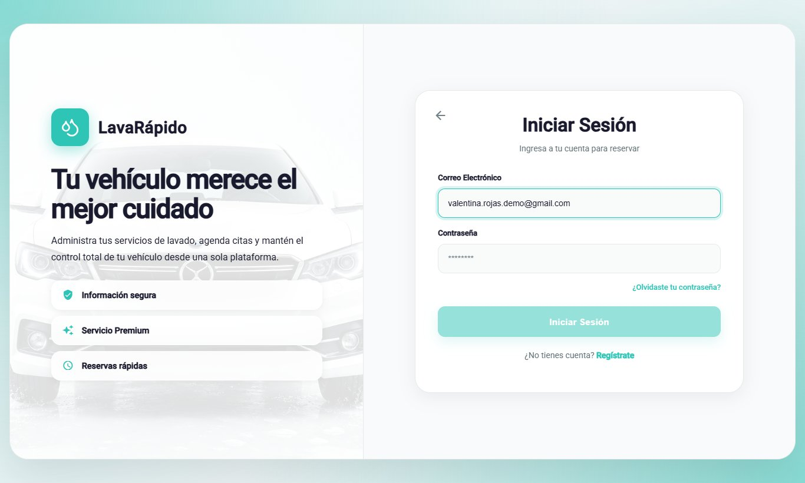

*Nota.* Se usó un correo de prueba; no se muestran contraseñas reales.

### 8.3 Recuperación de la Contraseña

**Nombre del módulo:** Recuperación de la contraseña.

**Descripción:** Permite recuperar el acceso a la cuenta cuando se olvidó la contraseña, mediante un código de seis dígitos enviado al correo de la cuenta.

**Rol que puede usarlo:** Operario.

**Ruta o menú donde se encuentra:** Pantalla de inicio de sesión > enlace **¿Olvidaste tu contraseña?** (ruta */auth/forgot-password*).

**Pasos para utilizarlo:**

1. En la pantalla de inicio de sesión, hacer clic en **¿Olvidaste tu contraseña?**.
2. **Paso 1:** escribir el correo de la cuenta y hacer clic en **Enviar Código**.
3. Abrir el correo recibido y copiar el código de seis dígitos, válido durante 15 minutos.
4. **Paso 2:** escribir los seis dígitos y hacer clic en **Verificar Código**. Si el correo no llegó, hacer clic en **¿No recibiste el código? Reenviar**.
5. **Paso 3:** escribir la nueva contraseña, confirmarla y hacer clic en **Actualizar Contraseña**.
6. Cuando aparezca "¡Contraseña actualizada!", hacer clic en **Ir a iniciar sesión**.

**Resultado esperado:** La contraseña se cambia y el operario ingresa con la nueva.

**Observaciones o restricciones:** El sistema muestra la misma pantalla esté o no registrado el correo. Cada código nuevo invalida el anterior, y después de cinco intentos incorrectos el código deja de funcionar ("Demasiados intentos fallidos. Espera unos minutos o pide otro código para volver a intentarlo."): hay que pedir uno nuevo con **Reenviar**.

**Figura 2**

*Recuperación de la Contraseña, Paso 1: Correo Electrónico*

**Figura 3**

*Recuperación de la Contraseña, Paso 2: Código de Verificación*

**Figura 4**

*Recuperación de la Contraseña, Paso 3: Nueva Contraseña*

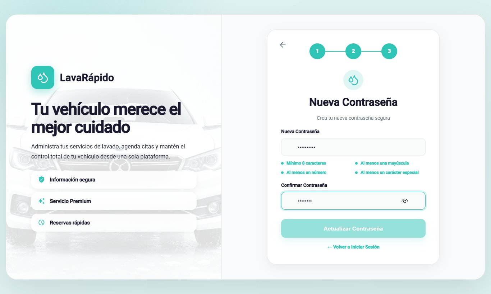

## 9. Menú Principal

Después de iniciar sesión, el sistema muestra un menú lateral con las opciones del operario (Tabla 4). En la parte superior del menú aparecen las iniciales, el nombre y el correo del operario; en la parte inferior está la opción **Cerrar Sesión**. En el teléfono, el menú se abre y se cierra con el ícono ☰.

**Tabla 4**

*Opciones del Menú Principal del Operario*

| Opción (ruta) | Para qué sirve | Sección |
|---|---|---|
| Dashboard (/operator) | Muestra los servicios pendientes, el avance del día e indicadores de resumen. | 10.1 |
| Perfil (/operator/profile) | Permite ver y editar los datos personales, cambiar la contraseña y desactivar la cuenta. | 10.7 |
| Mi Agenda (/operator/schedule) | Muestra los servicios por día o por semana y permite iniciarlos y finalizarlos. | 10.2 |
| Servicios asignados (/operator/assigned-services) | Lista los servicios asignados con su detalle y permite iniciarlos y finalizarlos. | 10.3 |
| Notificaciones (/operator/notifications) | Muestra los avisos de asignaciones, reprogramaciones, cancelaciones, reasignaciones y servicios por cerrar. | 10.4 |
| Historial (/operator/service-history) | Lista los servicios realizados con su estado final y su calificación. | 10.5 |
| Calificaciones (/operator/qualifications) | Muestra las calificaciones que dejaron los clientes. | 10.6 |
| Configuración (/operator/settings) | Permite elegir el tema, el idioma y las preferencias de notificación, y abrir el centro de ayuda. | 10.8 |
| Cerrar Sesión | Termina la sesión de forma segura. | 12 |

*Nota.* Los nombres de las opciones son los del menú lateral cuando la interfaz está en español. La ruta antigua de tareas del operario redirige a Servicios asignados.

**Figura 5**

*Menú Lateral del Operario*

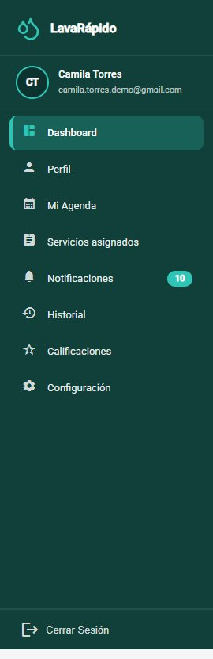

## 10. Módulos del Sistema

Cada módulo se documenta con el formato de la guía de manuales: nombre, descripción, rol que puede usarlo, ruta o menú, pasos, captura de pantalla, resultado esperado y observaciones o restricciones. El operario solo puede ver y actualizar los servicios que tiene asignados.

### 10.1 Panel del Operario

**Nombre del módulo:** Panel del operario.

**Descripción:** Pantalla de inicio del operario. Resume el trabajo pendiente y el avance del día.

**Rol que puede usarlo:** Operario.

**Ruta o menú donde se encuentra:** Menú lateral > **Dashboard** (ruta */operator*).

**Pasos para utilizarlo:**

1. Iniciar sesión; el sistema abre el panel automáticamente.
2. Leer el saludo, que indica cuántos servicios pendientes hay para el día ("Tienes N servicios pendientes para hoy"), y hacer clic en **Ver servicios asignados** para ir a la lista.
3. Revisar los indicadores (reservas asignadas, servicios en curso, notificaciones y calificación) y la barra de avance **Servicios completados hoy**.
4. En **Servicios de hoy**, revisar los próximos servicios asignados con su tipo, vehículo, hora, cliente y estado, y hacer clic en **Iniciar** cuando sea el momento de empezar uno.

**Resultado esperado:** El operario sabe de un vistazo qué servicios debe realizar y cuánto lleva del día.

**Observaciones o restricciones:** Si no hay servicios asignados, el sistema muestra "No tienes servicios programados por ahora."

**Figura 6**

*Panel del Operario*

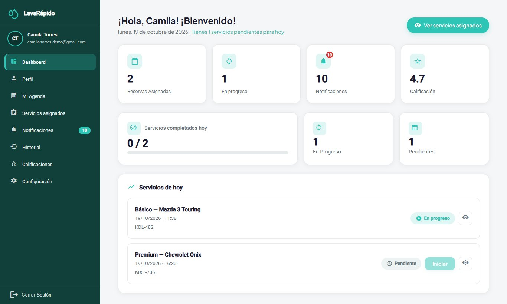

### 10.2 Mi Agenda

**Nombre del módulo:** Mi Agenda.

**Descripción:** Muestra las reservas del operario en un calendario, por día o por semana, y permite iniciarlas y finalizarlas.

**Rol que puede usarlo:** Operario.

**Ruta o menú donde se encuentra:** Menú lateral > **Mi Agenda** (ruta */operator/schedule*).

**Pasos para utilizarlo:**

1. Hacer clic en **Mi Agenda**.
2. Seleccionar un día en el calendario o cambiar entre las pestañas **Día**, **Semana** y **Completados**.
3. Revisar los totales: **Total**, **Pendientes**, **En progreso** y **Completados**.
4. Consultar el bloque **Próximo servicio**, que indica cuántos minutos faltan para que empiece.
5. En la lista de reservas, hacer clic en **Iniciar** o **Finalizar** según el estado de cada servicio, o en **Ver detalle** para ver la fecha, la duración y el vehículo.

**Resultado esperado:** El estado del servicio cambia y el cliente puede seguir su avance.

**Observaciones o restricciones:** Un servicio se puede iniciar desde 15 minutos antes de la hora reservada y hasta 4 horas después de su hora de fin. Pasado ese plazo, el botón **Iniciar** queda deshabilitado con el aviso "Ya no se puede iniciar: pasaron más de 4 h de la hora de fin" y el servicio lo cierra el administrador. Solo puede haber un servicio en curso a la vez. Un servicio debe iniciarse antes de poder finalizarlo ("Primero debes iniciar el servicio."). Al finalizar, el sistema pregunta "¿Finalizar este servicio?" y lo pasa al historial. La agenda no muestra las reservas canceladas ni las que quedaron en No asistió.

**Figura 7**

*Agenda del Operario*

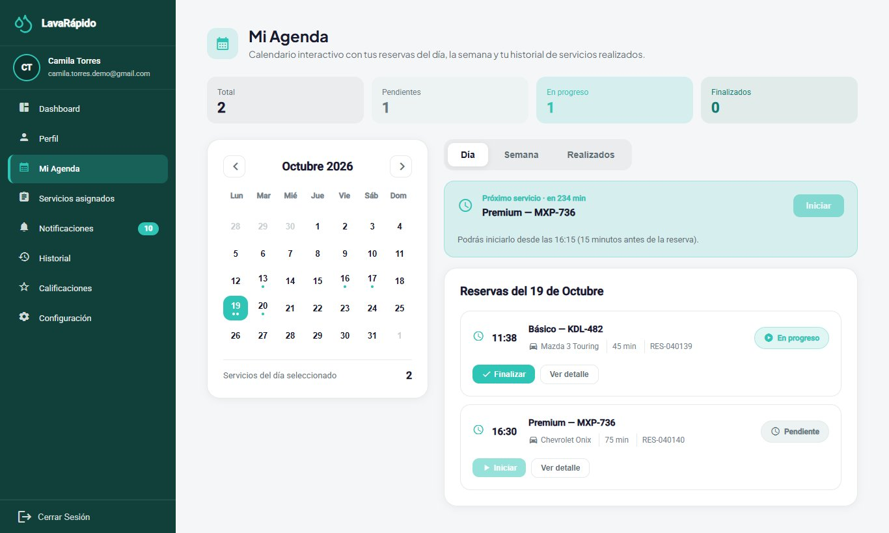

### 10.3 Servicios Asignados

**Nombre del módulo:** Servicios asignados.

**Descripción:** Lista todos los servicios asignados al operario, muestra la información de cada uno y permite iniciarlos y finalizarlos.

**Rol que puede usarlo:** Operario.

**Ruta o menú donde se encuentra:** Menú lateral > **Servicios asignados** (ruta */operator/assigned-services*).

**Pasos para utilizarlo:**

1. Hacer clic en **Servicios asignados**.
2. Revisar las tarjetas: **Servicios Totales**, **Pendientes**, **En Progreso** y **Finalizados Hoy**.
3. Usar **Filtrar por fecha**, **Filtrar por tipo de servicio** o el cuadro de búsqueda, y hacer clic en **Filtrar**.
4. En la tabla, leer el **ID**, el **Tipo de servicio**, la fecha y hora, el **Vehículo**, el **Cliente** y el **Estado** de cada servicio.
5. Hacer clic en un servicio para abrir **Información del servicio**: cliente, vehículo, tipo de servicio, hora programada y método de pago. Si el administrador escribió instrucciones al asignar o reasignar el servicio, aparecen en **Indicaciones del administrador** (en la web y en la app).
6. Hacer clic en **Iniciar Servicio** al comenzar el lavado y confirmar con **Iniciar**.
7. Al terminar el lavado, hacer clic en **Finalizar Servicio** y confirmar con **Finalizar**.
8. Si es necesario comunicarse con el cliente, usar **Contactar al cliente** en **Opciones adicionales**.

**Resultado esperado:** El estado cambia a En progreso y luego a Completado ("¡Servicio finalizado!"). El cliente recibe los avisos de servicio iniciado y completado y puede calificar el servicio.

**Observaciones o restricciones:**

- El servicio se puede iniciar desde 15 minutos antes de la hora reservada. El operario solo puede actualizar los servicios que tiene asignados.
- Cada servicio se debe registrar con **Iniciar** y **Finalizar**, aunque se haga tarde: si la hora del servicio ya pasó, todavía se puede iniciar y finalizar hasta 4 horas después de su hora de fin, y cuentan las horas reales; después el sistema responde "Ya no se puede iniciar este servicio: pasaron más de 4 horas desde la hora de fin. Pide al administrador que lo cierre."
- Si un servicio asignado no se inició cuando terminó su hora, o se inició y no se finalizó una hora después de su hora de fin, el operario recibe el aviso "¿Atendiste este servicio?" y el administrador ve la reserva en su lista de reservas por cerrar; si ya no es posible registrarlo, el operario le informa al administrador si atendió o no el vehículo, y el administrador lo cierra.
- El método de pago que aparece en la información del servicio es la forma que eligió el cliente al reservar (pago digital o efectivo en el lavadero). Si el cliente paga en efectivo, el operario lo remite al administrador, que es quien registra el pago.
- La lista no muestra las reservas canceladas ni las que quedaron en No asistió.

**Tabla 5**

*Estados del Servicio que Ve el Operario*

| Estado | Significado | Acción disponible |
|---|---|---|
| Pendiente | El servicio fue asignado y todavía no ha comenzado. | Iniciar Servicio (desde 15 minutos antes de la hora reservada y hasta 4 horas después de su hora de fin). |
| En progreso | El operario inició el lavado. | Finalizar Servicio. |
| Completado | El lavado terminó y el cliente puede calificarlo. | Solo consulta. |

*Nota.* Elaborado por los autores a partir de los estados de ejecución que usa la interfaz del operario.

**Figura 8**

*Lista de Servicios Asignados con Filtros*

**Figura 9**

*Información del Servicio y Botones de Acción*

### 10.4 Notificaciones del Operario

**Nombre del módulo:** Notificaciones.

**Descripción:** Reúne los avisos del personal: nuevo servicio asignado, servicio movido a otra hora, servicio cancelado, servicio reasignado a otro operario y "¿Atendiste este servicio?" cuando un servicio terminó su hora y no se inició o no se finalizó.

**Rol que puede usarlo:** Operario.

**Ruta o menú donde se encuentra:** Menú lateral > **Notificaciones** (ruta */operator/notifications*).

**Pasos para utilizarlo:**

1. Hacer clic en **Notificaciones**. El encabezado muestra cuántas no se han leído.
2. Usar las pestañas **Todas**, **Recordatorios**, **Promociones**, **Confirmaciones** y **Otras**, el filtro **Estado de lectura** y las fechas para acotar la lista.
3. Hacer clic en un aviso para abrir su detalle; queda marcado como leído. El botón **Ir a servicios asignados** lleva a la lista de servicios (sección 10.3).
4. Usar **Marcar leído**, **Marcar no leído** o **Marcar todo como leído**.
5. Para eliminar un aviso, usar la opción de eliminar y confirmar "¿Eliminar esta notificación?".

**Resultado esperado:** El operario se entera de inmediato de los cambios en su trabajo.

**Observaciones o restricciones:** Los avisos al personal llegan a la bandeja y como notificación push, nunca por correo. El aviso "¿Atendiste este servicio?" llega una sola vez por reserva. Una notificación eliminada no se puede recuperar.

**Figura 10**

*Notificaciones del Operario*

### 10.5 Historial de Servicios

**Nombre del módulo:** Historial de servicios.

**Descripción:** Lista los servicios del operario con su fecha, vehículo, pago, calificación y estado final.

**Rol que puede usarlo:** Operario.

**Ruta o menú donde se encuentra:** Menú lateral > **Historial** (ruta */operator/service-history*).

**Pasos para utilizarlo:**

1. Hacer clic en **Historial**.
2. Revisar los indicadores, incluida la **Tasa de servicios completados**.
3. Usar las pestañas **Todos**, **Finalizados**, **Cancelados** y **Reasignados** y el filtro **Todos los servicios**.
4. Usar el cuadro de búsqueda para encontrar un servicio por código, placa, cliente o vehículo.
5. Hacer clic en **Limpiar** para quitar los filtros.
6. Hacer clic en un servicio para ver su detalle. Si el cliente lo calificó, el botón **Ir a calificaciones** lleva a **Calificaciones recibidas** (sección 10.6).

**Resultado esperado:** El operario consulta el trabajo realizado, del más reciente al más antiguo, y el estado final de cada servicio.

**Observaciones o restricciones:** Un servicio reasignado es uno que el administrador pasó a otro operario; deja de contar como servicio propio del operario.

**Figura 11**

*Historial de Servicios del Operario*

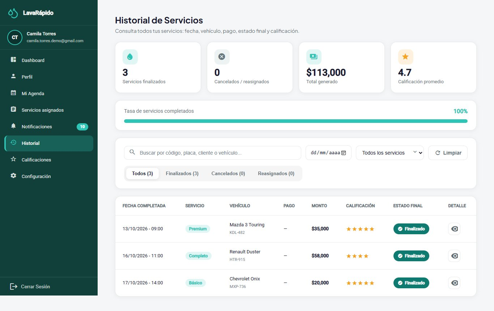

### 10.6 Calificaciones Recibidas

**Nombre del módulo:** Calificaciones recibidas.

**Descripción:** Muestra las calificaciones y comentarios que los clientes dejaron sobre el trabajo del operario.

**Rol que puede usarlo:** Operario.

**Ruta o menú donde se encuentra:** Menú lateral > **Calificaciones** (ruta */operator/qualifications*).

**Pasos para utilizarlo:**

1. Hacer clic en **Calificaciones**.
2. Revisar la calificación promedio y el total de calificaciones recibidas.
3. Usar **Filtrar por fecha**, **Filtrar por tipo de servicio** (lavado básico, premium o completo) y el número de estrellas, y hacer clic en **Filtrar**.
4. Leer cada calificación con el cliente, el servicio, la fecha y el comentario.

**Resultado esperado:** El operario conoce la opinión de los clientes sobre su trabajo.

**Observaciones o restricciones:** Solo aparecen las calificaciones que los clientes decidieron dejar, porque calificar es opcional. Si no hay ninguna, el sistema muestra "No se encontraron calificaciones". El operario no puede responder ni modificar una calificación.

**Figura 12**

*Calificaciones Recibidas por el Operario*

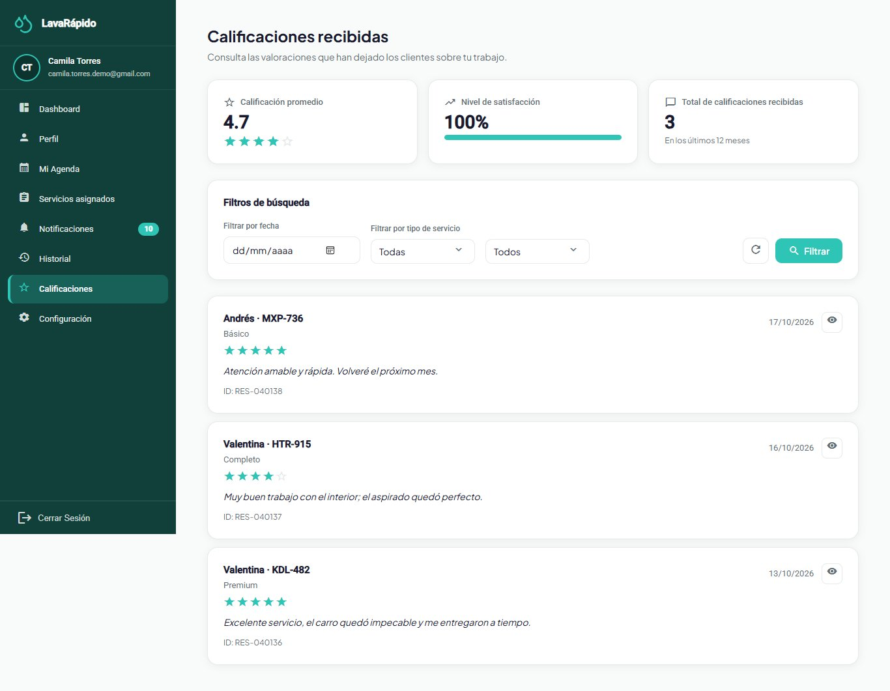

### 10.7 Perfil

**Nombre del módulo:** Perfil.

**Descripción:** Permite ver y actualizar los datos personales del operario, cambiar el correo y la contraseña, y desactivar la cuenta.

**Rol que puede usarlo:** Operario.

**Ruta o menú donde se encuentra:** Menú lateral > **Perfil** (ruta */operator/profile*).

**Pasos para utilizarlo:**

1. Hacer clic en **Perfil**. La pantalla "Mi Perfil" se abre en modo de consulta con el rol **Operario** debajo del nombre, los nombres, apellidos, correo, teléfono y dirección.
2. Para modificar los datos, hacer clic en **Editar perfil**, cambiar los campos y hacer clic en **Guardar**; aparece "¡Perfil actualizado!".
3. Para cambiar el correo, escribir el nuevo y confirmar con la contraseña actual en la ventana "Confirma el cambio de correo"; desde ese momento se ingresa con el nuevo correo.
4. Para cambiar la contraseña, ir a **Contraseña**, hacer clic en **Cambiar**, escribir la **Contraseña actual**, la **Nueva contraseña** y **Confirmar nueva contraseña**, y hacer clic en **Guardar**.
5. Para dejar de usar la cuenta, ir a **Cuenta**, hacer clic en **Desactivar mi cuenta** y confirmar con la contraseña.

**Resultado esperado:** Los datos quedan actualizados. Si se cambió la contraseña, la nueva se usa en el siguiente ingreso.

**Observaciones o restricciones:** Si la contraseña actual es incorrecta, el cambio se rechaza ("La contraseña actual es incorrecta"); la nueva debe ser distinta de la actual. Desactivar la cuenta no la borra: el operario ya no puede ingresar y sus sesiones se cierran, pero se conserva el historial de servicios. Antes de desactivarla conviene avisar al administrador, que es quien la reactiva y quien reasigna los servicios pendientes.

**Figura 13**

*Perfil del Operario*

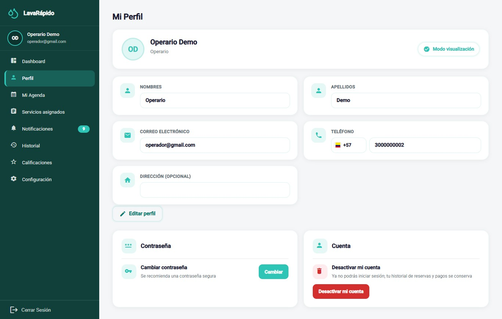

### 10.8 Configuración

**Nombre del módulo:** Configuración.

**Descripción:** Permite personalizar la apariencia, el idioma y las preferencias de notificación, y abrir el centro de ayuda y los documentos legales.

**Rol que puede usarlo:** Operario.

**Ruta o menú donde se encuentra:** Menú lateral > **Configuración** (ruta */operator/settings*).

**Pasos para utilizarlo:**

1. Hacer clic en **Configuración**.
2. En **Apariencia**, hacer clic en **Elegir tema** y seleccionar uno de los cuatro temas de color.
3. En **Idiomas**, seleccionar Español, English, Français o Português.
4. En **Notificaciones**, activar o desactivar **Notificaciones push en el celular** para recibir o no los avisos en el teléfono con la app instalada.
5. En **Ayuda**, hacer clic en **Abrir** junto a **Centro de ayuda** para ver la línea de atención, el correo, el horario y la dirección del lavadero.
6. En la misma tarjeta **Ayuda**, abrir **Ver Términos y Condiciones** o **Ver Política de Datos**.

**Resultado esperado:** El tema, el idioma y las preferencias se aplican de inmediato y se guardan en la cuenta, de modo que se conservan en cualquier dispositivo.

**Observaciones o restricciones:** La pantalla es la misma del cliente; los interruptores **Recordatorios por Email** y **Promociones y Ofertas** solo tienen efecto en las cuentas de cliente, porque los avisos del personal nunca llegan por correo ni incluyen promociones. Ningún interruptor afecta la bandeja de notificaciones.

**Figura 14**

*Pantalla de Configuración del Operario*

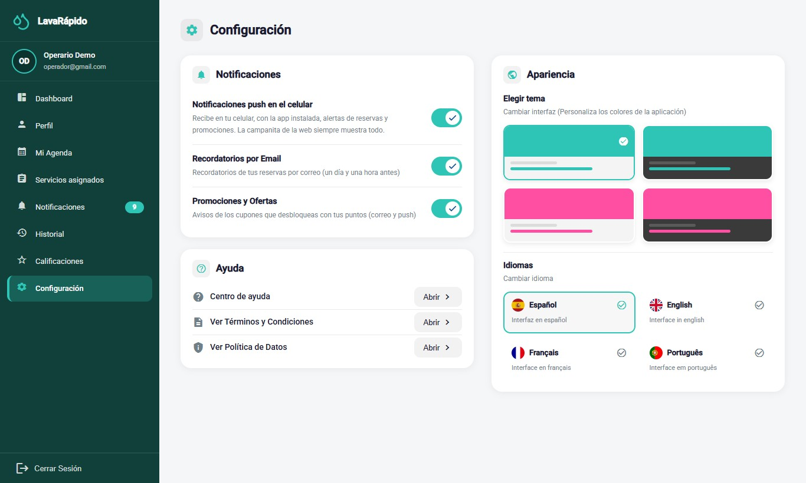

### 10.9 Aplicación Móvil Android

La aplicación **LavaRapidoVehicular** (versión 1.1.1, APK *versionCode* 6, publicada el 26 de octubre de 2026) ofrece al operario las mismas funciones que la web, con las mismas reglas y los mismos datos: un servicio iniciado en la app aparece iniciado en la web y al revés. Es la forma más práctica de trabajar en la zona de lavado.

**Instalación y actualizaciones.** La app no está en Google Play. En la pantalla de bienvenida de la web se toca el botón de descarga o se escanea el código QR (archivo */app/LavaRapidoVehicular.apk*), se abre el archivo y se toca **Instalar**; la primera vez Android pide permitir que el navegador instale aplicaciones. Si el lavadero publica un APK nuevo, la app muestra **Actualiza la app para continuar** con el botón **Descargar**, y los cambios de pantallas llegan solos con **Actualización lista** y **Reiniciar ahora**.

**Ingreso.** La pantalla de ingreso pide el correo y la contraseña con las mismas reglas de la sección 8; la recuperación de la contraseña ofrece **Pedir otro código** si el código se escribe mal cinco veces. La sesión se guarda cifrada en el teléfono y dura una hora.

**Navegación.** Abajo hay una barra con **Inicio**, **Agenda**, **Asignados** y **Avisos**; el botón **Más** abre **Historial**, **Perfil**, **Calificaciones**, **Configuración** y **Cerrar Sesión**.

- **Inicio:** "Tienes N servicios pendientes para hoy", el botón **Ver servicios asignados** y los indicadores de reservas asignadas, en progreso, notificaciones y calificación (sección 10.1).
- **Agenda:** vistas **Día**, **Semana** y **Realizados**, con el **Próximo servicio** y los botones **Iniciar** y **Finalizar**. Antes de tiempo la app indica "Podrás iniciarlo desde las HH:MM (15 minutos antes de la reserva)" y, más de 4 horas después de la hora de fin, el botón **Iniciar** queda deshabilitado con "ya no se puede iniciar" (secciones 10.2 y 10.3). El detalle del servicio muestra las indicaciones del administrador.
- **Asignados:** totales de servicios pendientes, en progreso y finalizados hoy, con filtros por fecha, tipo de servicio y búsqueda (sección 10.3).
- **Historial**, **Calificaciones** (promedio, total recibido y nivel de satisfacción de los últimos 12 meses, con el detalle de cada calificación), **Avisos**, **Perfil** y **Configuración** funcionan como en las secciones 10.4 a 10.8. Si llega el aviso "¿Atendiste este servicio?", se sigue la sección 10.3.

**Figura 15**

*Inicio del Operario en la Aplicación Móvil*

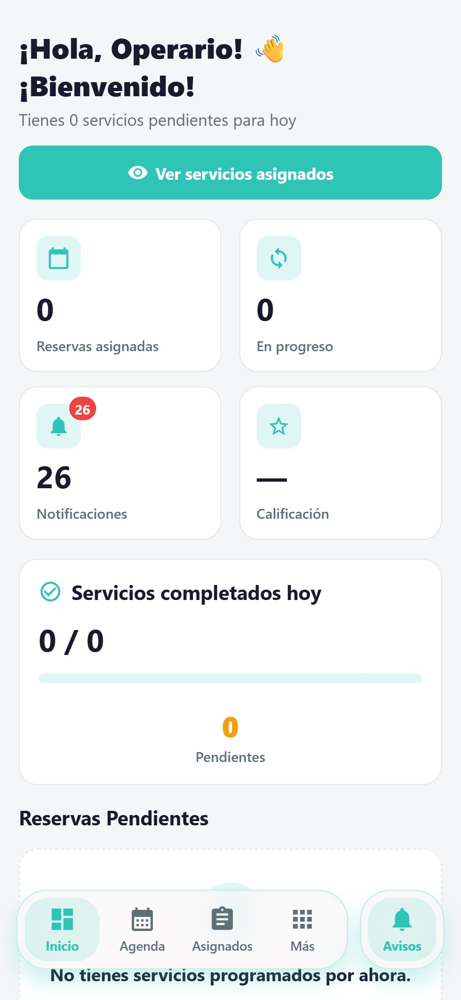

**Figura 16**

*Agenda en la Aplicación Móvil (Vista Semana)*

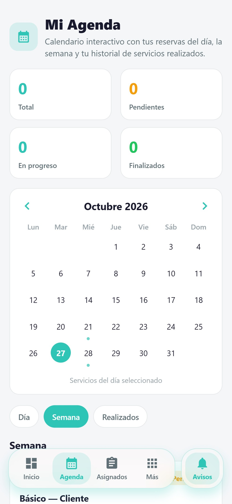

**Figura 17**

*Servicios Asignados en la Aplicación Móvil*

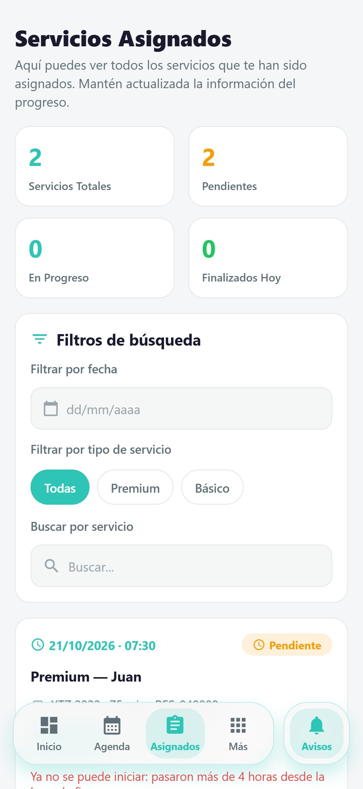

*Nota.* Al final de la lista aparece un servicio cuya hora de fin pasó hace más de 4 horas, con el aviso de que ya no se puede iniciar.

**Figura 18**

*Menú Más del Operario en la Aplicación Móvil*

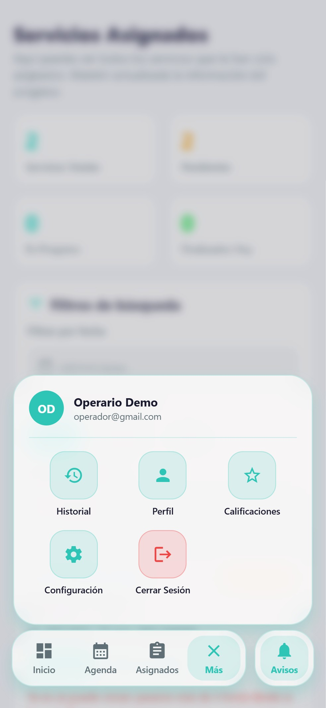

**Notificaciones push.** Al ingresar, la app pide permiso para enviar notificaciones. Si se acepta, el teléfono recibe al instante los avisos de asignaciones, cambios, cancelaciones y servicios por cerrar, y tocar uno abre la pantalla relacionada. Android los agrupa en canales que se pueden silenciar desde los ajustes del teléfono.

**Cierre de sesión en la app.** Abrir **Más** y tocar **Cerrar Sesión**, que pide confirmación; al cerrar, el teléfono deja de recibir las notificaciones de esa cuenta. Limitación conocida (Acciones Correctivas, ACO-39): si la sesión vence con la app en segundo plano, el teléfono puede seguir recibiendo los avisos de la cuenta hasta que se vuelva a ingresar o se cierre la sesión desde **Más**. En un teléfono compartido, el operario siempre debe cerrar su sesión al terminar la jornada.

## 11. Mensajes y Validaciones

La Tabla 6 explica los mensajes que el operario ve con más frecuencia y lo que debe hacer en cada caso.

**Tabla 6**

*Mensajes del Sistema para el Operario*

| Mensaje del sistema | Significado | Acción del operario |
|---|---|---|
| Correo o contraseña incorrectos | Las credenciales no coinciden con ninguna cuenta. | Revisar los datos o recuperar la contraseña. |
| Demasiados intentos fallidos. Tu cuenta quedó bloqueada 15 minutos... | Se escribió mal la contraseña cinco veces en menos de 15 minutos. | Esperar 15 minutos o usar ¿Olvidaste tu contraseña?. |
| Tu cuenta está desactivada. Contacta al administrador. | El administrador desactivó la cuenta. | Hablar con el administrador. |
| Tu sesión expiró. Inicia sesión de nuevo. | Terminó la sesión de una hora o la cuenta se desactivó. | Iniciar sesión de nuevo. |
| El código es incorrecto, ya se usó o expiró. Solicita uno nuevo. | El código de recuperación no es válido. | Solicitar un código nuevo. |
| Demasiados intentos fallidos. Espera unos minutos o pide otro código para volver a intentarlo. | Se escribió mal cinco veces el código de recuperación o la contraseña actual. | Pedir otro código o esperar 15 minutos. |
| La contraseña actual es incorrecta | Al cambiar la contraseña, la actual no coincide. | Escribir la contraseña con la que se ingresó. |
| No tienes permiso para realizar esta acción | Se intentó actuar sobre un servicio de otro operario o una función de otro rol. | Trabajar solo con los servicios asignados. |
| Podrás iniciarlo desde las HH:MM (15 minutos antes de la reserva) | Todavía es muy temprano para iniciar el servicio. | Esperar hasta la hora indicada. |
| Primero debes iniciar el servicio. / Este servicio ya fue iniciado. | Se intentó una acción fuera de orden. | Iniciar el servicio antes de finalizarlo. |
| Ya no se puede iniciar este servicio: pasaron más de 4 horas desde la hora de fin. Pide al administrador que lo cierre. | El plazo para registrar el servicio venció. | Avisar al administrador si el vehículo se atendió. |
| ¿Atendiste este servicio? | Un servicio asignado terminó su hora sin iniciarse o sin finalizarse. | Registrarlo si todavía se puede o informar al administrador. |
| ¿Finalizar este servicio? | Confirmación antes de cerrar el servicio. | Hacer clic en **Finalizar** solo si el lavado terminó. |
| ¡Servicio finalizado! | El servicio quedó Completado. | Continuar con el siguiente servicio. |
| No tienes servicios programados por ahora. | No hay servicios asignados. | Esperar nuevas asignaciones. |
| Los datos chocan con un registro existente o alguien los cambió mientras los editabas. Vuelve a abrirlos e intenta de nuevo. | El administrador cambió el servicio al mismo tiempo. | Volver a abrir la pantalla y repetir la acción. |
| No hay conexión con el servidor. Intenta de nuevo en un momento. | No hay conexión con el sistema. | Revisar la conexión a internet e intentar de nuevo. |

*Nota.* Textos tomados de los archivos de traducción al español de la aplicación web y de la aplicación móvil.

## 12. Cierre de Sesión

Cerrar la sesión al terminar la jornada evita que otra persona registre servicios con la cuenta del operario, sobre todo en computadores o teléfonos compartidos del lavadero.

1. Ubicar la opción **Cerrar Sesión** en la parte inferior del menú lateral.
2. Hacer clic en **Cerrar Sesión**.
3. En la ventana "Cerrar sesión", hacer clic en **Sí, cerrar**.
4. Verificar que el sistema vuelva a la pantalla de inicio de sesión.

Al cerrar sesión, las demás pestañas del mismo navegador también vuelven a la pantalla de inicio de sesión, y la sesión cerrada deja de servir en el servidor. En la app móvil, la sesión se cierra desde **Más** (sección 10.9).

**Figura 19**

*Confirmación del Cierre de Sesión*

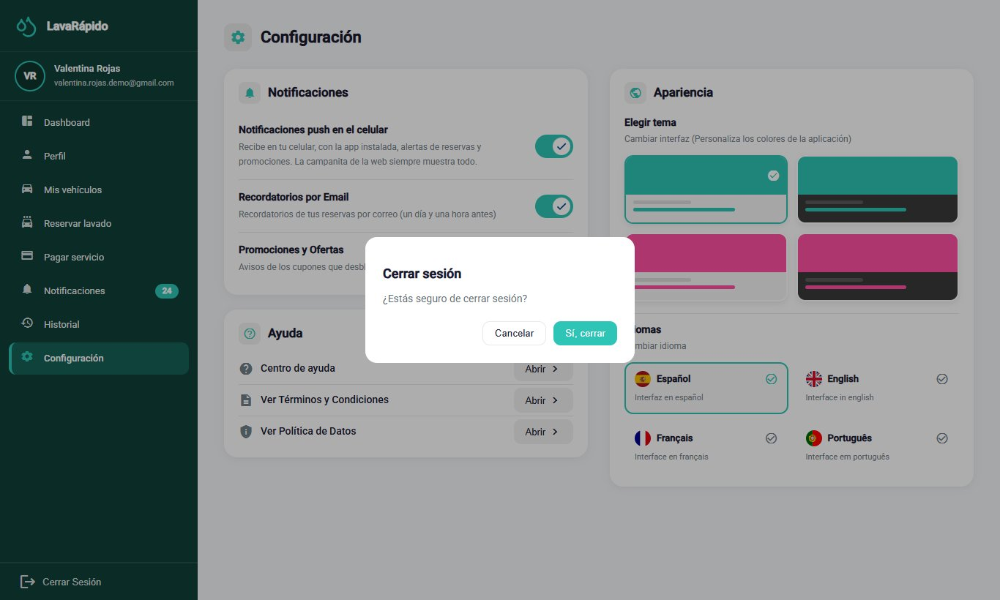

## 13. Preguntas Frecuentes

##### ¿Cómo obtengo mi cuenta de operario?

La crea el administrador del lavadero y le entrega el correo y una contraseña temporal. El formulario de registro de la página solo crea cuentas de cliente.

##### ¿Qué hago si olvidé mi contraseña?

En la pantalla de inicio de sesión, haga clic en "¿Olvidaste tu contraseña?" y siga los tres pasos de la sección 8.3. El código llega al correo de su cuenta.

##### No puedo iniciar un servicio. ¿Por qué?

Un servicio se puede iniciar desde 15 minutos antes de la hora reservada (antes, el sistema indica desde qué hora) y hasta 4 horas después de su hora de fin (después responde que ya no se puede iniciar), solo si está asignado a usted y solo cuando no tiene otro servicio en curso. Si el servicio es suyo y el problema continúa, informe al administrador.

##### Atendí un vehículo y olvidé marcar Iniciar. ¿Qué hago?

Si no han pasado más de 4 horas desde la hora de fin, abra el servicio y márquelo con **Iniciar** y luego con **Finalizar**; el sistema lo acepta aunque sea tarde. Si ya no puede hacerlo, informe al administrador que el vehículo sí se atendió, para que cierre la reserva como atendida y no como No asistió.

##### ¿Por qué desapareció un servicio de mi lista?

Porque el cliente o el administrador lo canceló, porque quedó como No asistió o porque el administrador lo reasignó a otro operario. Usted recibe un aviso en cada caso, y los reasignados aparecen en la pestaña **Reasignados** del historial.

##### ¿Puedo cambiar la hora de un servicio o pasárselo a un compañero?

No. Las reprogramaciones y reasignaciones las hace el administrador.

##### El cliente quiere pagar en efectivo. ¿Lo registro yo?

No. El pago en efectivo lo registra el administrador. La información del servicio muestra la forma de pago que eligió el cliente al reservar.

##### ¿Puedo ver los servicios de otros operarios?

No. Cada operario ve y actualiza solo los servicios que tiene asignados.

##### ¿Cómo veo lo que opinan los clientes de mi trabajo?

En **Calificaciones** aparecen el promedio, el total y cada calificación con su comentario. Calificar es opcional para el cliente, así que no todos los servicios tienen calificación.

##### ¿Puedo cambiar el idioma o los colores?

Sí. En Configuración puede elegir español, inglés, francés o portugués y uno de cuatro temas de color; la elección se guarda en su cuenta.

## 14. Glosario

**Tabla 7**

*Glosario de Términos del Sistema para el Operario*

| Término | Definición |
|---|---|
| Administrador | Persona del lavadero que crea las cuentas, asigna y reasigna servicios, verifica pagos y cierra las reservas. |
| Agenda | Calendario con los servicios asignados al operario, por día o por semana. |
| Asignación | Vínculo entre un operario y una reserva, hecho por el sistema o por el administrador. |
| Bahía (de lavado) | Puesto físico del lavadero donde se lava un vehículo. |
| Calificación | Puntuación de una a cinco estrellas, con un comentario opcional, que el cliente da a un servicio completado. |
| Cliente | Persona dueña del vehículo que reserva y paga los servicios. |
| Contraseña temporal | Contraseña inicial que el administrador entrega al crear la cuenta y que el operario debe cambiar en el primer ingreso. |
| Dashboard (panel) | Pantalla de inicio que resume el trabajo del día. |
| Indicaciones del administrador | Notas que el administrador escribe al asignar o reasignar un servicio. |
| Notificación push | Aviso que llega al teléfono a través de la aplicación móvil. |
| Operario | Empleado del lavadero que realiza los lavados. |
| Reasignación | Cambio del operario de un servicio, hecho por el administrador. |
| Reserva | Bloque de tiempo apartado para lavar un vehículo. |
| Servicio de lavado | Tipo de lavado ofrecido (Básico, Premium o Completo), con su propia duración. |
| Servicio por cerrar | Reserva cuyo tiempo terminó sin registrarse el inicio o el fin; la cierra el administrador. |

*Nota.* Basado en el glosario de la documentación del proyecto.

## Referencias

Equipo de Desarrollo Vehicle Washing. (2026a). *Vehicle washing management system: Project documentation* (vehicle-w-docs) [Documentación de proyecto no publicada]. GitHub. https://github.com/code-sena/vehicle-w-docs

Equipo de Desarrollo Vehicle Washing. (2026b). *Front-end-proyecto-web* (rama develop) [Software]. GitHub. https://github.com/BrayanCABRERA123/Front-end-proyecto-web

Equipo de Desarrollo Vehicle Washing. (2026c). *LavadoVehicular-Movil* (versión 1.1.2) [Software]. GitHub. https://github.com/merari0322/LavadoVehicular-Movil

Servicio Nacional de Aprendizaje. (2026). *Guía para elaborar manuales de software: Manual de usuario, manual técnico, manual de instalación y manual de administrador* [Material de formación no publicado]. Programa Tecnólogo en Análisis y Desarrollo de Software.

## 15. Anexos

### Anexo A. Origen de las Capturas

Las figuras de este manual son capturas reales del sistema completo corriendo en Docker con la web en *http://localhost:4200*, sobre la rama *develop*. Las Figuras 13 y 14 se tomaron el 26 de octubre de 2026 con una cuenta de operario de prueba; las demás, el 19 de octubre de 2026, y corresponden a pantallas que no cambiaron desde entonces. Se usaron cuentas, vehículos y reservas de prueba creados solo para las capturas, por lo que no aparecen correos, documentos, teléfonos ni placas reales. Las capturas de la aplicación móvil se tomaron el 27 de octubre de 2026 con el código de la app (*develop*, versión 1.1.1) ejecutado en el modo web de Expo, con el tamaño y la densidad de pantalla de un celular (393 × 852 puntos, densidad 2,5), contra el mismo sistema local y con las mismas cuentas de prueba. Las pantallas son las de la app; lo único que cambia frente al teléfono es que no aparecen la barra de estado ni los permisos del sistema operativo. Si una pantalla cambia en una versión futura, la captura correspondiente se debe tomar de nuevo con el mismo nombre de archivo de la carpeta *capturas*.

### Anexo B. Lista de Verificación para la Entrega

**Tabla 8**

*Lista de Verificación del Manual de Usuario del Operario*

| Criterio | Cumple |
|---|---|
| Tiene portada completa (ficha, programa, instructora, centro de formación, fecha) y versión | Sí |
| Incluye control de versiones y tabla de contenido con páginas actualizadas | Sí |
| Explica la introducción, el objetivo y el alcance | Sí |
| Describe los requisitos, el ingreso, el menú principal y cada módulo con el formato de la guía | Sí |
| El contenido coincide con el software de la versión final (*develop* del 26 de octubre de 2026) | Sí |
| Todas las figuras son capturas reales y están ordenadas según el flujo de trabajo | Sí |
| Incluye la tabla de mensajes y validaciones, el cierre de sesión, las preguntas frecuentes y el glosario | Sí |
| No contiene información sensible ni credenciales reales | Sí |
| Ortografía y formato APA revisados | Sí |
| Exportado a PDF y a Word, en español y en inglés | Sí |

*Nota.* Adaptado de la lista de verificación de la guía para elaborar manuales de software (SENA, 2026).
