<!-- running-head: MANUAL DE USUARIO: SISTEMA DE LAVADO VEHICULAR -->

# Manual de Usuario

Sistema de Gestión de Lavado Vehicular (Vehicle Washing)

Plataforma Web para Reservar Lavados, Pagar con Código QR, Acumular Puntos y Gestionar el Trabajo Diario del Operario

Brayan Estiven Patiño Cabrera (líder de proyecto), Juan Camilo Guilombo Osorio (líder de frontend) y Merari Urbano (líder de backend)

Tecnólogo en Análisis y Desarrollo de Software (ADSO), Servicio Nacional de Aprendizaje (SENA), Centro de Formación: Industria

Ficha 3145556

Instructora: Karol Daniela Correa

27 de octubre de 2026

Tipo de manual: Manual de usuario (roles Cliente y Operario, en la web y en la aplicación móvil) · Versión 4.13

## Control de Versiones

La Tabla 1 registra el historial de cambios de este documento. Cada vez que el equipo de desarrollo modifique el manual, se debe agregar una fila con la versión, la fecha, la descripción del cambio y el responsable.

**Tabla 1**

*Historial de Versiones del Manual de Usuario*

| Versión | Fecha | Descripción del cambio | Responsable |
|---|---|---|---|
| 1.0 | 2026-10-03 | Creación inicial del manual de usuario (en español) para los roles Cliente y Operario. | Equipo de desarrollo |
| 2.0 | 2026-10-05 | Datos de portada completados (ficha, instructora y centro de formación) y nombre del sistema ajustado a Vehicle Washing. | Equipo de desarrollo |
| 3.0 | 2026-10-07 | Traducción al inglés, formato según las normas APA (7.ª ed.), reestructuración según la guía del SENA y verificación contra el código fuente de la aplicación web. Se corrigieron: rutas de las pantallas, campos del registro (número de documento, nombres, apellidos y aceptación de los documentos legales), reglas de la contraseña, ausencia de bloqueo de cuenta, flujo de reserva (sin elección de operario ni reprogramación desde la web), flujo de pago (reglas de la referencia), filtros del historial, notificaciones por correo y estados del operario. | Equipo de desarrollo |
| 3.1 | 2026-10-09 | Actualización contra el código del 9 de octubre de 2026 y creación de esta versión en español (la versión en inglés es Manual_usuario_LavadoVehicular_3145556_EN.md). Se agregaron: puntos de fidelización por servicio y en el resumen de la reserva, progreso de fidelidad y cupones desbloqueados en el panel, canje de cupones al pagar, lista de datos faltantes bajo el botón de confirmar, estado del pago en el historial y botón Pagar ahora solo cuando la reserva se puede pagar, avisos por correo de pagos aprobados, rechazados y reembolsados, de puntos ganados, de cupones desbloqueados y de informes de inspección, interruptores de notificaciones guardados en la cuenta, avisos al operario y nuevos mensajes. Se retiró WhatsApp del centro de ayuda. | Equipo de desarrollo |
| 4.0 | 2026-10-16 | Revisión contra el código del 16 de octubre de 2026. Las figuras pasaron de marcadores a capturas reales del sistema funcionando con datos de prueba. Se agregaron: elección opcional del operario al reservar y asignación automática de uno libre, bloqueo de la cuenta por 15 minutos después de cinco intentos fallidos, mensajes que explican por qué una hora no se puede reservar, inicio del servicio desde 15 minutos antes de la hora reservada, descarga de la aplicación Android desde la web, dirección del perfil guardada en la cuenta y la opción Desactivar mi cuenta, que antes se llamaba Eliminar cuenta. Se retiró el botón Reportar progreso, que ya no existe en la pantalla del operario. | Equipo de desarrollo |
| 4.1 | 2026-10-17 | Revisión contra el código del 17 de octubre de 2026. Se actualizó la pantalla de bienvenida (sección "Quiénes somos" sin cifras, nueva sección de preguntas frecuentes, pie de página sin redes sociales ni enlaces de contacto) y se describió cómo se adapta a celulares y tabletas. Se aclaró que el avance del próximo servicio queda en 0 % hasta que empieza el lavado y que el saludo del panel nombra al lavadero como Lavado Vehicular. | Equipo de desarrollo |
| 4.2 | 2026-10-19 | Las cuentas de administrador no tienen la opción Desactivar mi cuenta (preguntas frecuentes). | Equipo de desarrollo |
| 4.3 | 2026-10-19 | Capturas tomadas de nuevo el 19 de octubre de 2026 (fecha en los paneles, calendarios sin días pasados y resumen de la reserva). | Equipo de desarrollo |
| 4.4 | 2026-10-20 | El historial del cliente y el del operario van de la reserva más reciente a la más antigua y abren el detalle al hacer clic, con los botones **Ir al pago** e **Ir a calificaciones**. Las notificaciones abren su detalle al hacer clic, con un botón para ir al apartado de donde viene el aviso. Con el pago aprobado, la pantalla de pago solo muestra el resumen. | Equipo de desarrollo |
| 4.5 | 2026-10-21 | Revisión contra el código del 21 de octubre de 2026: el comprobante se reduce a menos de 2 MB antes de enviarlo y el QR se amplía con **Ampliar QR** (sección 10.1.5); Efectivo solo aparece si el lavadero tiene activa esa cuenta; las reservas que nadie inicia se cierran solas una hora después de su hora de fin (Tabla 7, sección 10.2.3 y preguntas frecuentes); al cerrar sesión, las demás pestañas también salen (sección 12); la aplicación móvil pide instalar el APK nuevo cuando se publica (sección 6.2). Se corrigieron la fecha y la versión de la portada. | Equipo de desarrollo |
| 4.6 | 2026-10-21 | Cambio de la regla de las reservas que terminan sin registrarse, revisada por el equipo la noche del 21 de octubre: solo la reserva confirmada que nunca tuvo operario pasa sola a No asistió; si tenía operario, el operario recibe el aviso "¿Atendiste este servicio?" y el administrador la cierra (Tabla 7, secciones 10.2.3 y 10.2.4 y preguntas frecuentes). La agenda y los servicios asignados ya no muestran reservas canceladas ni en No asistió. | Equipo de desarrollo |
| 4.7 | 2026-10-23 | Revisión contra *develop* del 23 de octubre de 2026: capítulo nuevo de la aplicación móvil Android para los tres roles (sección 10.3), hecho a partir de las 31 pantallas de la app; el operario puede iniciar desde 15 minutos antes de la hora reservada y no hay límite posterior (secciones 10.2.2 y 13); el cupón aplicado se quita con la **X** y el sistema anula el canje, y solo se acepta un cupón por reserva (sección 10.1.5). | Equipo de desarrollo |
| 4.8 | 2026-10-24 | Revisión contra *develop* del 24 de octubre de 2026, que corre en el servidor público desde ese día: las pantallas se actualizan solas, sin recargar (4.1 y 10.3.4); el inicio de sesión acepta cualquier dominio de correo y el registro sigue pidiendo @gmail.com (8.1, 8.2 y 10.3.2); el servidor exige el consentimiento, limita los intentos seguidos y anula el código de recuperación al 5.º error (8.1 a 8.3); el monto a pagar y el cupón vienen del servidor y se conservan al recargar (10.1.5); un vehículo con reservas activas no se retira (10.1.2); el operario ve las notas del administrador y puede iniciar hasta 4 horas después de la hora de fin (10.2.2, 10.2.3 y 13); avisos de pago de una reserva cancelada y permisos de solo lectura para el administrador en la app (10.3.6); mensajes de error nuevos (Tablas 11 y 12). | Equipo de desarrollo |
| 4.9 | 2026-10-26 | Pago al reservar, revisado contra *develop* del 26 de octubre de 2026 y desplegado en el servidor público ese día: paso "¿Cómo vas a pagar?" al reservar, plazo de 30 minutos para subir el comprobante del pago digital y máximo una reserva activa en efectivo (10.1.3); reserva cancelada por falta de pago (10.1.4); pantalla de pago según la forma elegida y etiqueta de efectivo (10.1.5 y 10.3.4); mensajes nuevos (Tabla 12) y pregunta frecuente sobre el plazo de pago (13). | Equipo de desarrollo |
| 4.10 | 2026-10-26 | Se crean el Manual de Usuario del Cliente y el Manual de Usuario del Operario (versión 1.0), con el contenido de este manual separado por rol según la guía del SENA; este manual se conserva como referencia conjunta de los dos roles. Correcciones: el operario también tiene los interruptores de notificación y **Desactivar mi cuenta** (10.2.7), y la app móvil *v1.1.0* ya se publicó (10.3.4). | Equipo de desarrollo |
| 4.11 | 2026-10-26 | Aplicación móvil 1.1.1: APK *versionCode* 6 y actualización por internet publicados el 26 de octubre de 2026 (10.3 y 10.3.4). | Equipo de desarrollo |
| 4.12 | 2026-10-27 | Las horas alternativas de "Esa hora ya se ocupó" respetan las otras reservas del mismo vehículo (10.1.3 y 13). | Equipo de desarrollo |
| 4.13 | 2026-10-27 | La sección 10.3 remite a las capturas de la aplicación móvil de los manuales por rol. | Equipo de desarrollo |

*Nota.* Las fechas se escriben en formato ISO 8601 (año-mes-día). Elaborado por el equipo de desarrollo.

## Tabla de Contenido

<!-- toc -->

- [Control de Versiones](#control-de-versiones)
- [4. Introducción](#4-introducción)
  - [4.1 Fuentes y Convenciones de Este Manual](#41-fuentes-y-convenciones-de-este-manual)
- [5. Objetivo](#5-objetivo)
  - [5.1 Objetivo General](#51-objetivo-general)
  - [5.2 Objetivos Específicos](#52-objetivos-específicos)
- [6. Alcance](#6-alcance)
  - [6.1 Qué Cubre Este Manual](#61-qué-cubre-este-manual)
  - [6.2 Qué No Cubre Este Manual](#62-qué-no-cubre-este-manual)
  - [6.3 Sobre las Capturas de Pantalla](#63-sobre-las-capturas-de-pantalla)
- [7. Requisitos para Usar el Sistema](#7-requisitos-para-usar-el-sistema)
  - [7.1 Requisitos del Dispositivo y del Navegador](#71-requisitos-del-dispositivo-y-del-navegador)
  - [7.2 Roles del Sistema](#72-roles-del-sistema)
  - [7.3 Presentación del Sistema](#73-presentación-del-sistema)
- [8. Ingreso al Sistema](#8-ingreso-al-sistema)
  - [8.1 Registro de un Cliente Nuevo](#81-registro-de-un-cliente-nuevo)
  - [8.2 Inicio de Sesión](#82-inicio-de-sesión)
  - [8.3 Recuperación de la Contraseña](#83-recuperación-de-la-contraseña)
- [9. Menú Principal](#9-menú-principal)
  - [9.1 Menú del Cliente](#91-menú-del-cliente)
  - [9.2 Menú del Operario](#92-menú-del-operario)
- [10. Módulos del Sistema](#10-módulos-del-sistema)
  - [10.1 Módulos del Rol Cliente](#101-módulos-del-rol-cliente)
  - [10.2 Módulos del Rol Operario](#102-módulos-del-rol-operario)
  - [10.3 Aplicación Móvil Android](#103-aplicación-móvil-android)
- [11. Mensajes y Validaciones](#11-mensajes-y-validaciones)
- [12. Cierre de Sesión](#12-cierre-de-sesión)
- [13. Preguntas Frecuentes](#13-preguntas-frecuentes)
- [14. Glosario](#14-glosario)
- [Referencias](#referencias)
- [15. Anexos](#15-anexos)
  - [Anexo A. Origen de las Capturas](#anexo-a-origen-de-las-capturas)
  - [Anexo B. Lista de Verificación para la Entrega](#anexo-b-lista-de-verificación-para-la-entrega)

<!-- /toc -->

*Nota.* La numeración empieza en 4 porque las secciones 1 a 3 son la portada, el control de versiones y la tabla de contenido, que no llevan número en el título. Se conserva así para que sigan valiendo las referencias entre documentos por número de sección (por ejemplo, "Manual de Instalación, sección 10").

## 4. Introducción

El Sistema de Gestión de Lavado Vehicular (Vehicle Washing) es una plataforma web que permite a los clientes de un lavadero reservar un turno desde el teléfono o el computador, y que organiza en un solo lugar el trabajo de los operarios, la verificación de los pagos y el seguimiento de cada servicio.

Antes del sistema, los clientes tenían que llamar o desplazarse al local sin saber si había un turno libre. Dentro del negocio, las reservas se anotaban a mano, los turnos podían superponerse, el trabajo se repartía a criterio del encargado y los pagos en efectivo no dejaban registro del cliente. El sistema reemplaza ese procedimiento por un flujo digital: el cliente consulta la disponibilidad real del lavadero, reserva en pocos minutos, paga escaneando el código QR del negocio, acumula puntos que desbloquean cupones de descuento y conserva el historial y la calificación de cada servicio.

Este manual explica, en lenguaje sencillo y paso a paso, cómo trabajan con el sistema las dos personas que lo usan todos los días: el **cliente**, que es el dueño del vehículo, y el **operario**, que es el empleado que realiza el lavado. No se necesitan conocimientos de programación, de bases de datos ni de configuración técnica para seguir las instrucciones.

El documento sigue la estructura de la guía para elaborar manuales de software del programa Tecnólogo en Análisis y Desarrollo de Software (Servicio Nacional de Aprendizaje [SENA], 2026) y aplica las normas APA, séptima edición, en títulos, tablas, figuras, citas y referencias. Su contenido se verificó contra el código fuente de la aplicación web (Equipo de Desarrollo Vehicle Washing, 2026b) y la documentación del proyecto (Equipo de Desarrollo Vehicle Washing, 2026a). En cuanto a los datos personales de los usuarios, el sistema se rige por la Ley Estatutaria 1581 de 2012, que regula el tratamiento de datos personales en Colombia (Congreso de la República de Colombia, 2012).

### 4.1 Fuentes y Convenciones de Este Manual

Las pantallas, rutas, botones y mensajes descritos corresponden a la rama *develop* de la aplicación web al 17 de octubre de 2026. En la interfaz el sistema aparece con su nombre comercial, **LavaRápido**. Los nombres de botones, menús y mensajes se escriben en **negrita** o entre comillas tal como aparecen cuando el idioma de la interfaz es el español; la interfaz también está disponible en inglés, francés y portugués. Una ruta como */client/vehicles* es la parte de la dirección web que sigue al dominio del sistema (por ejemplo, *http://localhost:4200/client/vehicles* en el entorno local).

**Datos siempre al día (desde el 24 de octubre de 2026).** Ya no hace falta recargar la página para ver un cambio hecho por otra persona: la web actualiza la pantalla al entrar, al volver a la pestaña o a la ventana y cada vez que llega una notificación nueva, y las pantallas que esperan a otra persona (por ejemplo, **Pagar servicio** mientras el administrador revisa el pago) se actualizan cada 45 segundos mientras la pestaña está visible. La app móvil se actualiza al volver a la pantalla y al llegar una notificación push. Así, cuando el administrador aprueba un pago o asigna un operario, el cliente lo ve en menos de un minuto.

## 5. Objetivo

### 5.1 Objetivo General

Explicar paso a paso cómo el cliente y el operario deben ingresar, navegar y usar las funciones principales del Sistema de Gestión de Lavado Vehicular, de modo que cualquier persona pueda usar el software sin ayuda del equipo de desarrollo.

### 5.2 Objetivos Específicos

- Guiar al cliente en el registro de la cuenta, el inicio de sesión y la recuperación de la contraseña.
- Describir cómo el cliente registra vehículos, reserva un lavado, cancela una reserva, paga el servicio, canjea cupones y califica la atención recibida.
- Describir cómo el operario consulta la agenda, revisa los servicios asignados, inicia y finaliza cada servicio y consulta las calificaciones recibidas.
- Explicar el significado de los mensajes y validaciones del sistema y la acción que debe tomar la persona en cada caso.
- Responder las preguntas más frecuentes de las personas que usan la plataforma.

## 6. Alcance

### 6.1 Qué Cubre Este Manual

- La aplicación web del sistema, usada desde un navegador en un computador, una tableta o un teléfono, y la aplicación móvil Android, con sus diferencias de uso para los tres roles (sección 10.3).
- El rol **Cliente**: registro, inicio de sesión, recuperación de la contraseña, panel, vehículos, reservas, pagos, puntos de fidelización y cupones, historial, calificaciones, notificaciones, perfil y configuración.
- El rol **Operario**: panel, agenda, servicios asignados, inicio y finalización de servicios, notificaciones, historial, calificaciones recibidas, perfil y configuración.
- Las preferencias de apariencia (cuatro temas de color) e idioma (español, inglés, francés y portugués).

### 6.2 Qué No Cubre Este Manual

- Las funciones del rol **Administrador** (reservas, asignación de operarios, revisión de pagos, horarios y bahías, usuarios, servicios, promociones, reportes y configuración), que se explican en el Manual de Administrador.
- La instalación, la configuración y la construcción interna del software, que se explican en el Manual de Instalación y en el Manual Técnico.
- El detalle de las reglas del rol Administrador en la aplicación móvil: la sección 10.3.6 resume sus pantallas, y las reglas son las del Manual de Administrador.
- El lavado a domicilio: en la versión actual el cliente lleva el vehículo al lavadero en la fecha y la hora reservadas.
- La facturación electrónica ante la DIAN, las pasarelas de pago y la gestión de insumos o inventario.

### 6.3 Sobre las Capturas de Pantalla

Las figuras de este manual son capturas reales del sistema funcionando en el entorno local, tomadas el 16 de octubre de 2026 con cuentas y datos de prueba. Están ordenadas según el flujo de uso y su origen se explica en el Anexo A.

## 7. Requisitos para Usar el Sistema

### 7.1 Requisitos del Dispositivo y del Navegador

El sistema funciona en las versiones actuales de Google Chrome, Mozilla Firefox y Microsoft Edge, y su interfaz se adapta a la pantalla de un teléfono, una tableta o un computador. La Tabla 2 lista los requisitos.

**Tabla 2**

*Requisitos Mínimos para Usar el Sistema*

| Recurso | Requisito |
|---|---|
| Dispositivo | Computador, tableta o teléfono inteligente. |
| Navegador | Google Chrome, Mozilla Firefox o Microsoft Edge, en una versión actualizada. |
| Conexión | Acceso estable a internet durante todo el uso del sistema. |
| Correo | Una cuenta de correo terminada en @gmail.com. El sistema solo acepta este tipo de correo. |
| Documento de identidad | Un número de documento colombiano de 5 a 20 dígitos. |
| Teléfono | Un número celular colombiano de 10 dígitos que empiece por 3. |
| Cuenta | Un usuario registrado y activo. Los operarios reciben su cuenta del administrador del negocio. |
| Pago digital (clientes) | Nequi, Daviplata o una aplicación bancaria para escanear el código QR y hacer la transferencia. |

*Nota.* Elaborado por los autores a partir de las validaciones del formulario de registro y de los requisitos no funcionales del sistema.

### 7.2 Roles del Sistema

El sistema reconoce tres roles fijos. Cada persona ve solo las opciones de su rol y no puede abrir las pantallas de otro: si lo intenta, el sistema la devuelve a la pantalla de inicio de su rol (Tabla 3).

**Tabla 3**

*Roles del Sistema y Descripción General*

| Rol | Quién es | Qué hace en el sistema | Ruta de inicio |
|---|---|---|---|
| Cliente | Dueño del vehículo. | Registra vehículos, reserva turnos, paga, acumula puntos, canjea cupones, califica el servicio y consulta el historial. | /client |
| Operario | Empleado que realiza el lavado. | Consulta la agenda y los servicios asignados, inicia y finaliza cada servicio y consulta las calificaciones. | /operator |
| Administrador | Dueño o encargado del lavadero. | Gestiona reservas, operarios, pagos, horarios, usuarios, promociones y reportes. Se documenta en el Manual de Administrador. | /admin |

*Nota.* Elaborado por los autores a partir de la configuración de rutas de la aplicación web.

### 7.3 Presentación del Sistema

**Pantalla de bienvenida.** Al abrir la dirección web del sistema aparece la pantalla de bienvenida. En la parte superior hay una barra de navegación con los enlaces **Inicio**, **Nosotros** y **Servicios**, un selector de idioma y los botones **Iniciar Sesión** y **Registrarse**. El bloque central muestra los botones **Comenzar ahora** y **Ya tengo cuenta**; más abajo aparecen, en este orden, la sección "Quiénes somos", "¿Por qué elegirnos?", los servicios de lavado con su descripción y duración, la descarga de la aplicación móvil, los datos de contacto del lavadero y la sección **Preguntas frecuentes**, que responde en un acordeón (una pregunta abierta a la vez) cómo reservar, los métodos de pago, la cancelación, la elección del operario, los puntos, los recordatorios y la aplicación para celular. El pie de página tiene los enlaces **Sobre nosotros**, los tres servicios, **Centro de ayuda**, **Preguntas frecuentes** (que lleva a esa sección), **Términos de servicio** y **Política de privacidad**.

**Uso en celulares y tabletas.** Todas las pantallas se adaptan al ancho del dispositivo desde 360 píxeles, sin desplazamiento lateral. En el celular, la barra superior muestra solo el selector de idioma e **Iniciar sesión** (el registro sigue disponible con **Comenzar ahora**), los botones de la portada ocupan todo el ancho y, con la sesión iniciada, el menú lateral se abre con el botón ☰ de la esquina superior izquierda.

**Figura 1**

*Pantalla de Bienvenida del Sistema*

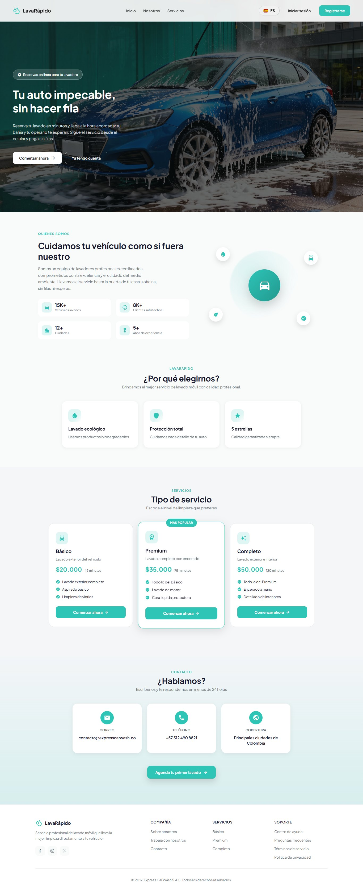

*Nota.* Captura en un navegador de escritorio con la ventana completa.

**Tipos de servicio de lavado.** El lavadero ofrece tres niveles de limpieza. Cada servicio tiene su propia duración, su precio y los puntos de fidelización que suma, y **el precio depende del tipo de vehículo**; por eso el valor final se muestra en el resumen de la reserva una vez la persona elige el vehículo y el servicio (Tabla 4).

**Tabla 4**

*Niveles de Servicio de Lavado*

| Servicio | Qué incluye | Duración estimada |
|---|---|---|
| Básico | Lavado exterior completo, aspirado básico y limpieza de vidrios. | 45 minutos |
| Premium | Todo lo del Básico, más lavado de motor y cera líquida protectora. | 75 minutos |
| Completo | Todo lo del Premium, más encerado a mano y detallado interior. | 120 minutos |

*Nota.* Las duraciones corresponden a los datos iniciales del sistema. El administrador configura los precios, las duraciones y los puntos de cada tipo de vehículo, y pueden cambiar.

**Idiomas y temas.** Toda la interfaz está disponible en español, inglés, francés y portugués, y en cuatro temas de color (verde claro, verde oscuro, rosado y rosado oscuro). El idioma se puede cambiar desde la pantalla de bienvenida o, con la sesión iniciada, desde **Configuración** (sección 10.1.9).

## 8. Ingreso al Sistema

Toda persona debe tener una cuenta para usar las funciones del sistema. Los clientes crean su propia cuenta mediante el registro; los operarios reciben su cuenta del administrador del negocio, con una contraseña temporal que deben cambiar después del primer ingreso.

### 8.1 Registro de un Cliente Nuevo

**Nombre del módulo:** Registro de clientes.

**Descripción:** Permite a una persona nueva crear una cuenta de cliente para reservar servicios de lavado.

**Rol que puede usarlo:** Persona sin cuenta (futuro cliente).

**Ruta o menú donde se encuentra:** Pantalla de bienvenida > botón **Registrarse** (ruta */auth/register*).

**Pasos para utilizarlo:**

1. Abrir el navegador e ingresar la dirección web del sistema.
2. Hacer clic en **Registrarse** en la barra superior (o en **Comenzar ahora**).
3. Escribir el **Número de Documento**: solo dígitos, entre 5 y 20.
4. Escribir los **Nombres** (mínimo 3 caracteres) y los **Apellidos** (mínimo 2 caracteres).
5. Escribir el **Correo Electrónico**, que debe terminar en @gmail.com (el registro solo acepta Gmail; el servidor también lo comprueba). El campo no admite espacios.
6. Escribir el **Teléfono**: un número celular colombiano de 10 dígitos que empiece por 3. El campo solo acepta dígitos.
7. Escribir la **Contraseña** y observar la lista de requisitos, que se marcan a medida que se cumplen: mínimo 8 caracteres, al menos una letra mayúscula, al menos un número y al menos un carácter especial. **Los cuatro requisitos son obligatorios**; no se admiten espacios.
8. Repetir la contraseña en **Confirmar Contraseña**. El ícono del ojo muestra u oculta lo escrito.
9. Abrir los **Términos y Condiciones** y la **Política de Tratamiento de Datos Personales** con sus enlaces y aceptar ambos. Al hacer clic en **Aceptar y continuar** dentro de cada documento, la casilla correspondiente se marca automáticamente.
10. Hacer clic en **Registrarse**. Mientras se procesa la solicitud, el botón muestra "Registrando...".

**Resultado esperado:** El sistema muestra el mensaje "¡Registro exitoso!" y, al hacer clic en **Ir a iniciar sesión**, lleva a la persona a la pantalla de inicio de sesión. Si el lavadero tiene activado el correo, llega un mensaje de bienvenida.

**Observaciones o restricciones:** No es posible registrar dos cuentas con el mismo correo ni con el mismo número de documento. En esos casos, el sistema muestra "Ya existe una cuenta con este correo" o "Ya existe una cuenta con este número de documento" y no crea la cuenta. Desde el 24 de octubre de 2026 el servidor también exige las dos casillas de aceptación: sin ellas responde "Debes aceptar el tratamiento de datos personales (Ley 1581) para registrarte."

**Figura 2**

*Formulario de Registro de Clientes*

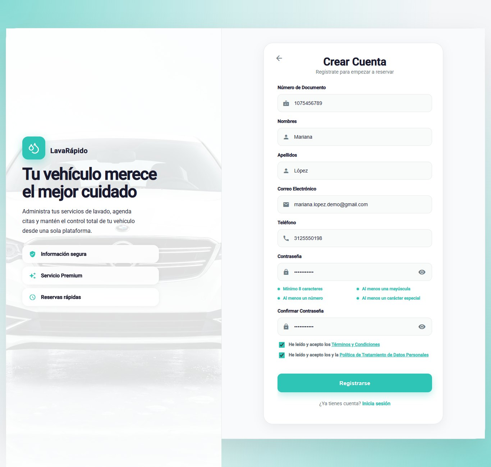

*Nota.* En la captura no debe aparecer información personal real.

**Figura 3**

*Mensajes de Validación en el Registro*

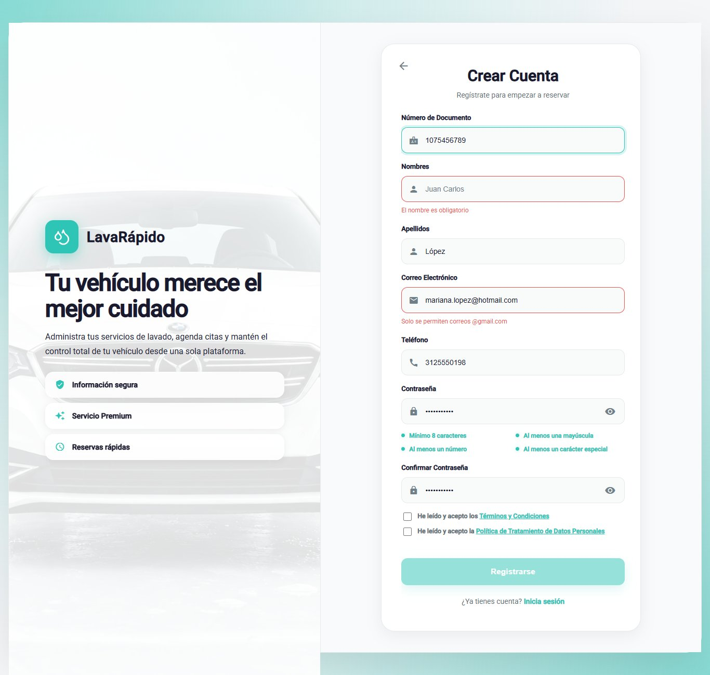

*Nota.* Apoya la Tabla 11 de la sección 11.

### 8.2 Inicio de Sesión

**Nombre del módulo:** Inicio de sesión.

**Descripción:** Permite al cliente, al operario o al administrador entrar al sistema con sus credenciales.

**Rol que puede usarlo:** Cliente, Operario y Administrador.

**Ruta o menú donde se encuentra:** Pantalla de bienvenida > botón **Iniciar Sesión** (ruta */auth*).

**Pasos para utilizarlo:**

1. Abrir el navegador e ingresar la dirección web del sistema.
2. Hacer clic en **Iniciar Sesión**.
3. Escribir el **Correo Electrónico** registrado. Desde el 24 de octubre de 2026 el inicio de sesión acepta un correo de cualquier dominio (solo se revisa que tenga formato de correo), para que las cuentas creadas antes con otro proveedor puedan entrar; el registro sigue pidiendo @gmail.com.
4. Escribir la **Contraseña**.
5. Hacer clic en **Iniciar Sesión**. Mientras se procesa la solicitud, el botón muestra "Ingresando...".

**Resultado esperado:** El sistema abre la pantalla de inicio del rol de la persona: */client* para el cliente, */operator* para el operario o */admin* para el administrador. El tema y el idioma guardados en la cuenta se aplican automáticamente.

**Observaciones o restricciones:** Si el correo o la contraseña son incorrectos, el sistema muestra "Correo o contraseña incorrectos" y no revela cuál de los dos falló. Después de cinco intentos fallidos en menos de 15 minutos, la cuenta queda bloqueada durante 15 minutos y el sistema muestra "Demasiados intentos fallidos. Tu cuenta quedó bloqueada 15 minutos; espera o usa "¿Olvidaste tu contraseña?" para entrar ya." Si la persona restablece la contraseña, puede entrar de inmediato. La sesión dura una hora; al vencerse, el sistema vuelve a la pantalla de inicio de sesión con el mensaje "Tu sesión expiró. Inicia sesión de nuevo." Una cuenta desactivada no puede ingresar y recibe el mensaje "Tu cuenta está desactivada. Contacta al administrador." Desde el 24 de octubre de 2026, si se hacen demasiados intentos seguidos desde el mismo equipo (más de 60 en un minuto entre inicio de sesión, registro y recuperación), el sistema responde "Hiciste demasiados intentos seguidos. Espera un momento y vuelve a intentarlo."

**Figura 4**

*Pantalla de Inicio de Sesión*

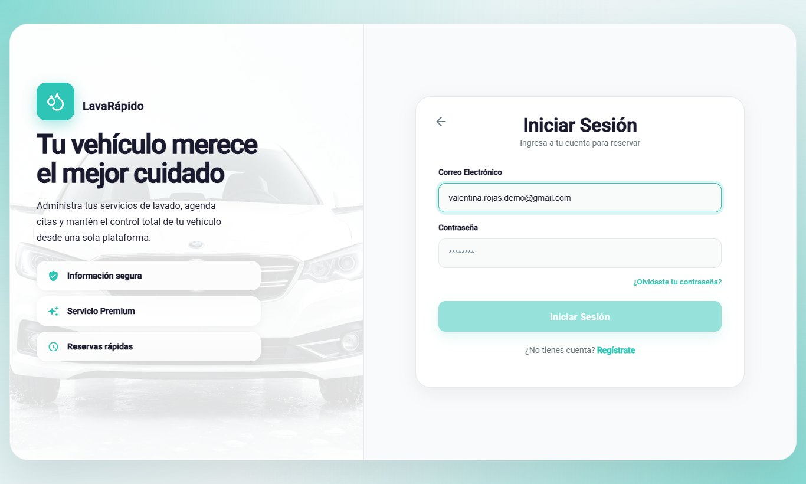

*Nota.* Usar un correo de prueba; no mostrar contraseñas reales.

### 8.3 Recuperación de la Contraseña

**Nombre del módulo:** Recuperación de la contraseña.

**Descripción:** Permite recuperar el acceso a la cuenta cuando se olvidó la contraseña, mediante un código de verificación de seis dígitos enviado por correo.

**Rol que puede usarlo:** Cliente, Operario y Administrador.

**Ruta o menú donde se encuentra:** Pantalla de inicio de sesión > enlace **¿Olvidaste tu contraseña?** (ruta */auth/forgot-password*).

**Pasos para utilizarlo:**

1. En la pantalla de inicio de sesión, hacer clic en **¿Olvidaste tu contraseña?**.
2. **Paso 1 (Recuperar Contraseña):** escribir el correo de la cuenta y hacer clic en **Enviar Código**.
3. Abrir el correo recibido y copiar el código de seis dígitos. El código es válido durante 15 minutos.
4. **Paso 2 (Verificación):** escribir los seis dígitos, uno en cada casilla, y hacer clic en **Verificar Código**. Si el correo no llegó, hacer clic en **¿No recibiste el código? Reenviar**.
5. **Paso 3 (Nueva Contraseña):** escribir la nueva contraseña, que debe cumplir los cuatro requisitos, confirmarla y hacer clic en **Actualizar Contraseña**.
6. Cuando aparezca el mensaje "¡Contraseña actualizada!", hacer clic en **Ir a iniciar sesión** e ingresar con la nueva contraseña.

**Resultado esperado:** La contraseña se cambia y el código usado no puede volver a usarse.

**Observaciones o restricciones:** Por seguridad, el sistema muestra la misma pantalla esté o no registrado el correo, de modo que no revela qué cuentas existen. Cada código nuevo invalida el anterior ("Te enviamos un código nuevo. El anterior ya no sirve."). Después de cinco intentos incorrectos el código deja de funcionar y el sistema muestra "Demasiados intentos fallidos. Espera unos minutos o pide otro código para volver a intentarlo." (desde el 24 de octubre de 2026): hay que solicitar uno nuevo con **Reenviar** (en la app, **Pedir otro código**). Un indicador de tres pasos en la parte superior muestra la etapa del proceso.

**Figura 5**

*Recuperación de la Contraseña, Paso 1: Correo Electrónico*

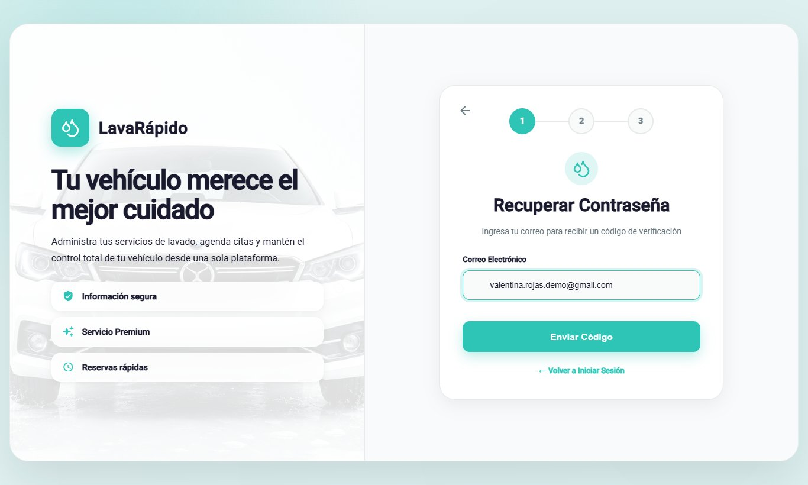

**Figura 6**

*Recuperación de la Contraseña, Paso 2: Código de Verificación*

**Figura 7**

*Recuperación de la Contraseña, Paso 3: Nueva Contraseña*

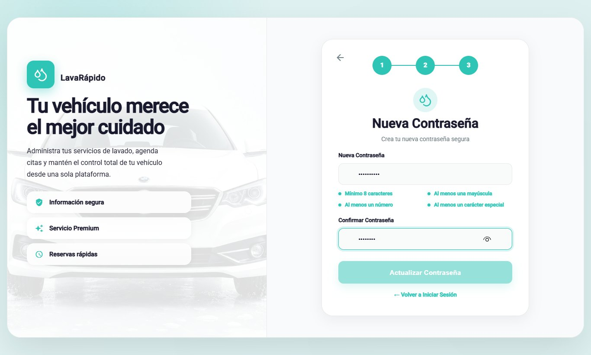

**Figura 8**

*Confirmación del Cambio de Contraseña*

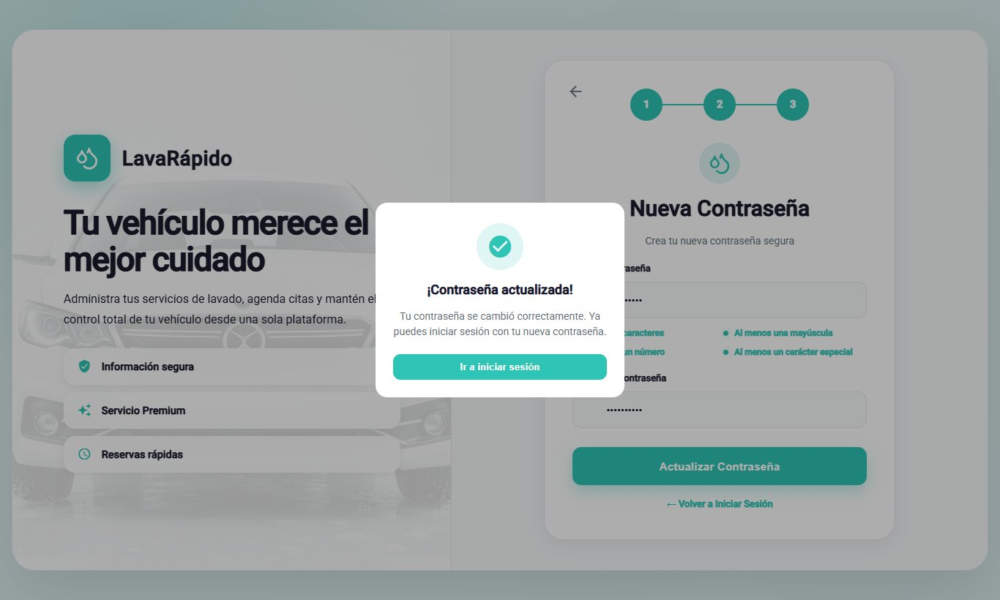

## 9. Menú Principal

Después de iniciar sesión, el sistema muestra un menú lateral con las opciones del rol de la persona. En la parte superior del menú aparecen las iniciales, el nombre y el correo de la persona con la sesión abierta; en la parte inferior está la opción **Cerrar Sesión**. En el teléfono, el menú se abre y se cierra con el ícono de menú.

### 9.1 Menú del Cliente

**Tabla 5**

*Opciones del Menú Principal del Rol Cliente*

| Opción (ruta) | Para qué sirve |
|---|---|
| Dashboard (/client) | Muestra un resumen de reservas, vehículos, el próximo servicio, accesos rápidos, el progreso de fidelidad y los beneficios. |
| Perfil (/client/profile) | Permite ver y editar los datos personales, cambiar el correo y la contraseña, y desactivar la cuenta. |
| Mis vehículos (/client/vehicles) | Permite registrar, editar, eliminar y ver los vehículos del cliente. |
| Reservar lavado (/client/reserve) | Permite programar un nuevo servicio de lavado. |
| Pagar servicio (/client/payment) | Permite pagar una reserva con código QR o en efectivo, canjear un cupón y cancelarla. |
| Notificaciones (/client/notifications) | Muestra los avisos de reservas, recordatorios, asignaciones, avance del servicio, pagos, puntos y cupones. |
| Historial (/client/history) | Lista las reservas con el estado de su pago y permite pagarlas, cancelarlas y calificarlas. |
| Configuración (/client/configuration) | Permite elegir el tema, el idioma y las preferencias de notificación, y abrir el centro de ayuda y los documentos legales. |
| Cerrar Sesión | Termina la sesión de forma segura. |

*Nota.* Los nombres de las opciones son los del menú lateral cuando la interfaz está en español.

**Figura 9**

*Menú Lateral del Rol Cliente*

### 9.2 Menú del Operario

**Tabla 6**

*Opciones del Menú Principal del Rol Operario*

| Opción (ruta) | Para qué sirve |
|---|---|
| Dashboard (/operator) | Muestra los servicios pendientes, el avance del día e indicadores de resumen. |
| Perfil (/operator/profile) | Permite ver y editar los datos personales y cambiar la contraseña. |
| Mi Agenda (/operator/schedule) | Muestra los servicios por día o por semana y permite iniciarlos y finalizarlos. |
| Servicios asignados (/operator/assigned-services) | Lista los servicios asignados con su detalle y permite iniciarlos y finalizarlos. |
| Notificaciones (/operator/notifications) | Muestra los avisos de asignaciones, reprogramaciones, cancelaciones y reasignaciones. |
| Historial (/operator/service-history) | Lista los servicios realizados con su estado final y su calificación. |
| Calificaciones (/operator/qualifications) | Muestra las calificaciones que dejaron los clientes. |
| Configuración (/operator/settings) | Permite elegir el tema y el idioma y abrir el centro de ayuda. |
| Cerrar Sesión | Termina la sesión de forma segura. |

*Nota.* Los nombres de las opciones son los del menú lateral cuando la interfaz está en español. La ruta antigua de tareas del operario redirige a Servicios asignados.

**Figura 10**

*Menú Lateral del Rol Operario*

## 10. Módulos del Sistema

Cada módulo se documenta con el mismo formato: nombre, descripción, rol que puede usarlo, ruta o menú, pasos, resultado esperado y observaciones. Los módulos se agrupan por rol.

### 10.1 Módulos del Rol Cliente

#### 10.1.1 Panel del Cliente

**Nombre del módulo:** Panel del cliente.

**Descripción:** Pantalla de inicio del cliente. Resume la actividad y ofrece atajos a las acciones más frecuentes.

**Rol que puede usarlo:** Cliente.

**Ruta o menú donde se encuentra:** Menú lateral > **Dashboard** (ruta */client*).

**Pasos para utilizarlo:**

1. Iniciar sesión con una cuenta de cliente; el sistema abre el panel automáticamente.
2. Revisar las tarjetas de resumen: **Reservas activas**, **Mis vehículos** y **Lavados realizados**.
3. Consultar el bloque **Tu próximo servicio**, que muestra el servicio, el vehículo, la fecha, la hora, el **Operario asignado** y el avance del servicio. El avance queda en 0 % mientras la reserva está programada o confirmada, porque el lavado aún no ha empezado; sube cuando el operario inicia el servicio y llega a 100 % al finalizar. Hacer clic en **Ver detalle** para ver toda la información.
4. Usar los **Accesos rápidos** (Agendar lavado, Pagar servicio, Mis vehículos y Notificaciones) para ir directamente a cada módulo.
5. Revisar el bloque **Tus beneficios y promociones**: la barra **Progreso de fidelidad** muestra los puntos acumulados ("N de M puntos") y, para cada promoción, indica "¡Ya la desbloqueaste! Cánjala al pagar." o cuántos puntos faltan para desbloquearla ("Te faltan N puntos para desbloquearla").

**Resultado esperado:** El cliente ve la información más importante y llega a cualquier módulo con un solo clic.

**Observaciones o restricciones:** Si no hay reservas, el bloque muestra "No tienes servicios programados" en lugar de una pantalla vacía. Los puntos se acreditan cuando el administrador aprueba el pago de una reserva (o registra un pago en el local), no cuando termina el servicio; hasta que se apruebe el primer pago, el bloque de beneficios muestra "Aún no tienes datos de fidelidad". Los puntos nunca se gastan: desbloquean cupones, y canjear un cupón no reduce el saldo.

**Figura 11**

*Panel del Cliente*

#### 10.1.2 Mis Vehículos

**Nombre del módulo:** Mis vehículos.

**Descripción:** Permite registrar los vehículos del cliente y ver, para cada uno, el último lavado y el total de lavados. Se debe registrar un vehículo antes de poder reservar un servicio.

**Rol que puede usarlo:** Cliente.

**Ruta o menú donde se encuentra:** Menú lateral > **Mis vehículos** (ruta */client/vehicles*).

**Pasos para utilizarlo:**

1. Hacer clic en **Mis vehículos** en el menú lateral.
2. Revisar los indicadores de la parte superior: **Vehículos registrados**, **Lavados acumulados** y **Último lavado realizado**.
3. Para agregar un vehículo, hacer clic en **Registrar vehículo**.
4. En la ventana "Registrar nuevo vehículo", seleccionar el **Tipo de vehículo** (automóvil, sedán, camioneta SUV, pickup, camión o motocicleta) y escribir la **Marca**, el **Modelo**, la **Placa** y el **Color**.
5. Hacer clic en **Guardar vehículo** y verificar que el vehículo aparezca en la lista con el mensaje "¡Vehículo registrado!".
6. Para corregir los datos de un vehículo, usar la opción de editar de su tarjeta, cambiar los campos y hacer clic en **Guardar cambios**.
7. Para retirar un vehículo, usar la opción de eliminar de su tarjeta y confirmar en la ventana "¿Eliminar vehículo?". Desde el 24 de octubre de 2026, si el vehículo tiene reservas activas o futuras, el sistema no lo retira y muestra "Este vehículo tiene reservas activas o futuras: cancélalas antes de retirarlo."

**Resultado esperado:** El vehículo queda registrado y disponible para seleccionarlo al reservar un lavado.

**Observaciones o restricciones:** La placa debe ser una placa colombiana oficial: tres letras y tres números para automóviles y demás vehículos (por ejemplo, ABC123), o tres letras, dos números y una letra para motocicletas (por ejemplo, ABC12D). No se aceptan placas extranjeras ni promocionales. La marca es obligatoria (al menos dos caracteres) y el color solo admite letras. La misma placa no se puede registrar dos veces mientras el vehículo esté activo. El tipo de vehículo importa porque determina el precio de cada servicio.

**Figura 12**

*Lista de Vehículos del Cliente*

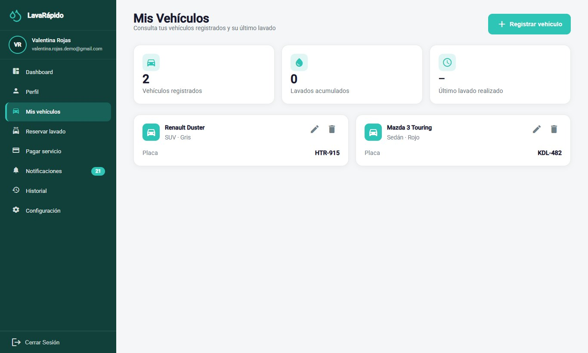

**Figura 13**

*Formulario para Registrar un Vehículo*

#### 10.1.3 Reservar un Lavado

**Nombre del módulo:** Reservar lavado.

**Descripción:** Permite programar un turno de lavado eligiendo el vehículo, el tipo de servicio, la fecha, la hora y la forma de pago. El sistema solo ofrece horas que están realmente libres.

**Rol que puede usarlo:** Cliente.

**Ruta o menú donde se encuentra:** Menú lateral > **Reservar lavado** (ruta */client/reserve*), o el acceso rápido **Agendar lavado**.

**Pasos para utilizarlo:**

1. Hacer clic en **Reservar lavado**.
2. **Paso 1 (Elige tu vehículo):** seleccionar uno de los vehículos registrados. Si el vehículo no aparece, usar el enlace **Mis Vehículos** para registrarlo primero.
3. **Paso 2 (Tipo de servicio):** seleccionar Básico, Premium o Completo. Cada tarjeta muestra qué incluye, la duración, el precio para el tipo de vehículo elegido y los puntos de fidelización que suma ("Suma N puntos").
4. **Paso 3 (Fecha y hora):** elegir la fecha (el calendario no deja escoger días pasados) y luego una de las horas libres que aparecen en **Selecciona una hora**. Las horas se ofrecen cada 30 minutos, dentro del horario de atención, fuera del descanso y solo cuando hay una bahía de lavado libre durante toda la duración del servicio.
5. Si se desea, elegir en **Operario (opcional)** uno de los operarios libres a esa hora. Si se deja en "Sin preferencia: te asignamos uno libre", el sistema asigna uno automáticamente.
6. **Paso 4 (¿Cómo vas a pagar?):** elegir una de las dos opciones (desde el 26 de octubre de 2026):
   - **Pago digital ahora:** Nequi, Daviplata o transferencia. Se escanea el QR y se sube el comprobante **dentro de los 30 minutos siguientes** (o antes de la hora del servicio, si es más pronto).
   - **Efectivo en el lavadero:** se paga al llegar y el administrador registra el pago, sin comprobante. Solo aparece si el lavadero tiene activa la cuenta de efectivo, y el cliente puede tener **como máximo una reserva activa en efectivo**.
7. Revisar el **Resumen de tu reserva**: vehículo, placa, servicio, duración estimada, fecha, hora, ubicación, total y **Puntos que ganas**.
8. Hacer clic en **Reservar Ahora**.

**Resultado esperado:** La reserva se crea de inmediato con el estado Confirmada y una bahía de lavado, y el cliente recibe la confirmación en sus notificaciones y por correo. Lo que sigue depende de la forma de pago:

- **Pago digital:** el sistema abre directamente la pantalla de pago de esa reserva con el aviso "Tienes un plazo para pagar: Sube el comprobante antes de las HH:mm o la reserva se libera." Si el comprobante no se sube a tiempo, la reserva se cancela sola con el motivo "No se subió el comprobante de pago a tiempo" y el horario queda libre para otros clientes.
- **Efectivo:** aparece "¡Reserva creada!" con el resumen y el mensaje "Tu lavado quedó programado. Pagas en efectivo en el lavadero."; el botón **Ver mis reservas** abre el historial. No hay nada que pagar en línea.

**Observaciones o restricciones:**

- Elegir el operario es opcional. Si el operario elegido ya no está libre al confirmar, el sistema asigna otro ("Si el operario que elegiste ya no está libre al confirmar, te asignamos otro."). El operario asignado se ve en el panel y en las notificaciones, y el administrador puede cambiarlo después.
- Las reservas se pueden hacer con hasta 60 días de anticipación.
- Si el día está cerrado, el sistema muestra "Ese día el lavadero está cerrado"; si no hay horas libres, "No hay horas libres ese día".
- Si otra persona toma la hora mientras el cliente está reservando, el sistema no guarda nada, muestra "Esa hora ya se ocupó: Te mostramos las horas libres más cercanas de ese día." y deja en **Selecciona una hora** solo las horas libres más cercanas de ese mismo día (hasta cinco) para que el cliente elija otra. Desde el 27 de octubre de 2026 esas horas también respetan las otras reservas del mismo vehículo: no se ofrece una hora que se cruce con otra reserva activa de ese vehículo, porque un vehículo no puede estar en dos bahías al mismo tiempo.
- Si la hora elegida no se puede reservar por otro motivo, el sistema explica cuál: "El lavadero no abre ese día. Elige otra fecha.", "A esa hora el servicio no cabe en el horario de atención. Elige otra hora." o "Esa hora ya pasó. Elige una hora más tarde."
- Un vehículo no puede tener dos reservas a la misma hora ("Ese vehículo ya tiene una reserva a esa hora.").
- El servicio se presta en el lavadero: el cliente debe llevar el vehículo en la fecha y la hora reservadas.
- Si el cliente ya tiene una reserva activa en efectivo (Programada, Confirmada o En progreso), no puede hacer otra en efectivo: el sistema muestra "Ya tienes una reserva activa con pago en efectivo. Págala o cancélala, o elige pago digital." El efectivo vuelve a estar disponible cuando esa reserva termina, se cancela o queda como No asistió (no basta con que el administrador registre el pago).
- Mientras la reserva con pago digital está esperando el comprobante, el Historial y el detalle muestran la insignia "Paga antes de las HH:mm". Una vez enviado el comprobante, la reserva ya no vence, aunque el administrador todavía no lo haya revisado.
- La forma de pago no cambia si el administrador reprograma la reserva. Las reservas hechas antes del 26 de octubre de 2026 no tienen forma de pago ni plazo.

**Figura 14**

*Reservar un Lavado, Pasos 1 y 2: Vehículo y Servicio*

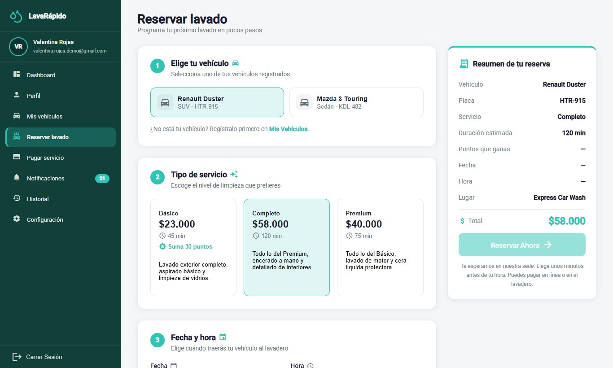

**Figura 15**

*Reservar un Lavado, Paso 3 y Resumen*

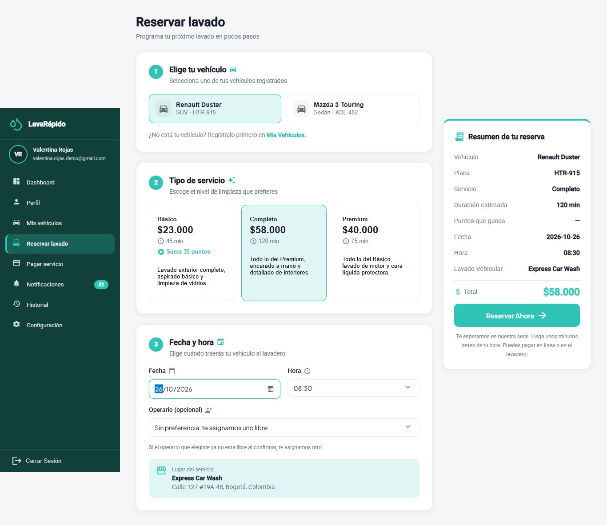

**Figura 16**

*Confirmación de la Reserva*

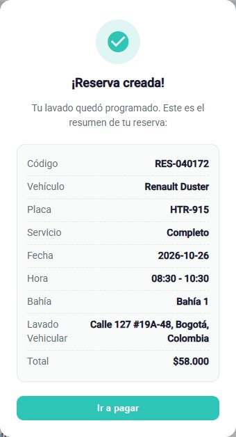

#### 10.1.4 Consultar o Cancelar una Reserva

**Nombre del módulo:** Seguimiento y cancelación de reservas.

**Descripción:** Permite consultar el estado de una reserva y cancelarla antes de que empiece el servicio.

**Rol que puede usarlo:** Cliente.

**Ruta o menú donde se encuentra:** Dashboard > **Tu próximo servicio** > **Ver detalle**; menú lateral > **Historial**; o menú lateral > **Pagar servicio**.

**Pasos para utilizarlo:**

1. Abrir el **Dashboard** o el **Historial** y ubicar la reserva.
2. En el Dashboard, hacer clic en **Ver detalle** para consultar el servicio, el vehículo, la fecha, la hora, el operario asignado y el estado. En el **Historial**, hacer clic en la tarjeta de la reserva para ver su detalle (sección 10.1.6).
3. Para cancelar, hacer clic en **Cancelar reserva** en la tarjeta de la reserva en **Historial** (o en la pantalla **Pagar servicio**).
4. Leer el mensaje "¿Cancelar reserva?" y hacer clic en **Sí, cancelar**; hacer clic en **Volver** para conservar la reserva.

**Resultado esperado:** La reserva cambia a Cancelada, aparece el mensaje "Reserva cancelada", el cliente recibe el aviso por correo y el turno queda libre para otros clientes.

**Observaciones o restricciones:** Una reserva solo se puede cancelar antes de su hora de inicio; después, el sistema muestra "Esta reserva ya no se puede cambiar." La cancelación no se puede deshacer. La aplicación web no ofrece la opción de cambiar la fecha o la hora de una reserva: para moverla, el cliente la cancela y reserva de nuevo, o contacta al lavadero para que el administrador la reprograme.

**Tabla 7**

*Estados de una Reserva*

| Estado | Significado | ¿El cliente puede cancelarla? |
|---|---|---|
| Programada | La reserva se registró y está pendiente de confirmación. | Sí, antes de la hora de inicio. |
| Confirmada | La reserva tiene turno y bahía de lavado. Las reservas que hace el cliente se crean con este estado. | Sí, antes de la hora de inicio. |
| En progreso | El operario inició el lavado. | No. |
| Completada | El servicio terminó; desde este estado se puede calificar. | No. |
| Cancelada | La reserva fue anulada por el cliente o por el lavadero, o el sistema la cerró porque pasó una hora de su fin sin confirmarse o, desde el 26 de octubre de 2026, porque no se subió el comprobante del pago digital a tiempo ("No se subió el comprobante de pago a tiempo"). | No aplica. |
| No asistió | El cliente no llegó al turno reservado y el lavadero lo registró así. Si la reserva confirmada nunca tuvo operario, el sistema la marca así una hora después de su hora de fin. | No aplica. |

*Nota.* Códigos SCHEDULED, CONFIRMED, IN_PROGRESS, COMPLETED, CANCELLED y NO_SHOW en la base de datos; la interfaz los traduce.

**Figura 17**

*Confirmación de la Cancelación de una Reserva*

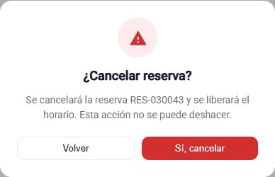

#### 10.1.5 Pagar un Servicio

El pago se hace por transferencia a la cuenta del lavadero (escaneando su código QR o usando los datos de su cuenta) o en efectivo en el local. El sistema **no solicita ni guarda datos de tarjetas de crédito o débito** y no se conecta con los bancos: un administrador verifica manualmente cada pago digital (Tabla 8).

Desde el 26 de octubre de 2026 la forma de pago se elige al reservar (sección 10.1.3), y la pantalla **Pagar servicio** la respeta: en una reserva con **pago digital** no se ofrece el efectivo y se muestra el plazo ("Sube el comprobante antes de las HH:mm o la reserva se libera."); en una reserva **en efectivo** el método Efectivo aparece preseleccionado con el aviso "Pagas en efectivo en el lavadero: El administrador registra el pago cuando llegues; no necesitas subir comprobante.", y en el Historial esa reserva muestra "Pagas en efectivo en el lavadero" en lugar de **Pagar ahora**.

**Tabla 8**

*Métodos de Pago Disponibles*

| Método | Cómo se paga | ¿Requiere comprobante? |
|---|---|---|
| Nequi | Se escanea el código QR y se hace la transferencia desde la aplicación. | Sí |
| Daviplata | Se escanea el código QR y se hace la transferencia desde la aplicación. | Sí |
| Transferencia | Se escanea el código QR o se usan los datos de la cuenta que se muestran. | Sí |
| Efectivo | Se paga en el lavadero al recibir el servicio. No se muestra código QR. Solo aparece si el lavadero tiene activa la cuenta de efectivo. | No; el administrador registra el pago en el local. |

*Nota.* Los métodos que se muestran, incluido Efectivo, dependen de las cuentas de pago que el administrador mantenga activas.

**Nombre del módulo:** Pagar servicio.

**Descripción:** Permite pagar una reserva adjuntando el comprobante del pago digital, o anunciar que se pagará en efectivo, con la opción de canjear un cupón de descuento.

**Rol que puede usarlo:** Cliente.

**Ruta o menú donde se encuentra:** Menú lateral > **Pagar servicio** (ruta */client/payment*); también **Ir a pagar** después de reservar, o **Pagar ahora** en el Historial.

**Pasos para utilizarlo:**

1. Abrir **Pagar servicio** y revisar el **Resumen de la reserva**: servicio, vehículo, **Subtotal**, **Descuento aplicado** y **TOTAL A PAGAR** (IVA del 19 % incluido).
2. Si se tiene un cupón desbloqueado, escribirlo en **Código del cupón** y hacer clic en **Aplicar**. Aparece el mensaje "Cupón aplicado: [nombre]" y el descuento se resta del total a pagar. Para quitarlo antes de reportar el pago, hacer clic en la **X** junto al cupón: el sistema anula el canje y el total vuelve a ser el de la reserva. Desde el 24 de octubre de 2026 el **TOTAL A PAGAR** es el que calcula el servidor: si se recarga la página o se vuelve a entrar después de aplicar el cupón, la pantalla sigue mostrando el cupón, el descuento y la **X**. Si el sistema no logra consultar el total, muestra "—" y el aviso "No pudimos consultar el total a pagar. Revisa tu conexión y vuelve a entrar en unos segundos."; en ese caso no conviene pagar hasta que aparezca el monto.
3. En **Selecciona tu método de pago**, elegir Nequi, Daviplata, Transferencia o Efectivo.
4. Para un método digital: escanear el código QR con la aplicación bancaria o la billetera, o copiar el número que aparece en **Llave / Cuenta autorizada** con **Copiar número**, y transferir exactamente el **Monto a pagar**. Si el código es difícil de leer, **Ampliar QR** lo muestra más grande, con **Acercar** y **Alejar** (también con la rueda del mouse o con doble clic).
5. En **Confirma tu pago**, arrastrar la imagen del comprobante o hacer clic para buscarla (JPG o PNG de hasta 10 MB). La página la reduce a menos de 2 MB antes de enviarla; mientras tanto muestra "Preparando el comprobante...".
6. Escribir la **Referencia de la transacción** impresa en el comprobante (de 8 a 12 letras o números emitidos por el banco) y revisar el **Monto pagado** (mayor que 0), que debe coincidir con lo transferido.
7. Hacer clic en **Ya realicé el pago**. Mientras falten datos, el botón permanece deshabilitado y la lista "Para confirmar el pago te falta:" indica lo pendiente (comprobante, referencia o monto).
8. Para efectivo: en una reserva hecha en efectivo el método **Efectivo** ya viene seleccionado; el pago se hace en el lavadero y lo registra el administrador, sin comprobante.

**Resultado esperado:** El sistema muestra "¡Pago enviado!" y el pago queda en revisión ("Pago en verificación") hasta que un administrador lo apruebe o lo rechace. El cliente recibe una notificación y un correo con el resultado.

**Observaciones o restricciones:**

- El monto a pagar siempre lo calcula el sistema (total de la reserva menos el cupón aplicado, si lo hay); el cliente no puede cambiarlo. El administrador compara el monto pagado que declara el cliente con el comprobante y con el banco.
- Solo se pueden pagar las reservas en estado Confirmada, En progreso o Completada.
- Mientras un pago está en revisión no se puede reportar otro para la misma reserva ("Ya hay un pago en revisión para esta reserva."); una reserva admite un solo pago aprobado. Una referencia que ya se usó en otro pago se rechaza ("Esa referencia ya se usó en otro pago. Revisa el número de tu comprobante.").
- Si la reserva cambia después de reportar el pago (por ejemplo, el administrador le cambia los servicios), el pago reportado ya no se puede aprobar con el monto viejo: el administrador lo rechaza y el cliente lo reporta de nuevo con el monto nuevo que muestra la pantalla.
- Si el administrador rechaza el pago, el cliente puede reportarlo de nuevo con un comprobante correcto.
- Una reserva con pago digital tiene plazo para subir el comprobante: 30 minutos desde que se hizo, o la hora del servicio si es más pronto. Si se vence, la reserva se cancela sola y ya no se puede pagar ("Esta reserva ya no se puede pagar (está cancelada, pagada o en revisión)."): hay que reservar de nuevo.
- Si la imagen no se puede reducir a menos de 2 MB, aparece "No pudimos reducir la imagen a menos de 2 MB. Prueba con una captura de pantalla del comprobante."
- Cuando el pago se aprueba, el cliente recibe el aviso de pago confirmado (bandeja y correo), los puntos de fidelización de la reserva ("Ganaste N puntos", solo en la bandeja) y, por cada cupón que esos puntos desbloquean, el aviso "¡Tienes un cupón canjeable!" con su código (bandeja y correo). Si el pago se rechaza o se reembolsa, el cliente recibe un aviso y un correo; un reembolso revierte los puntos ganados por esa reserva.
- Cuando el pago queda aprobado, la pantalla **Pagar servicio** de esa reserva solo muestra el resumen: desaparecen el método de pago, el código QR, la carga del comprobante y el botón **Ya realicé el pago**, y el cupón usado (si lo hay) ya no se puede quitar.
- Un cupón se acepta solo si está activo, está dentro de sus fechas y el cliente alcanzó los puntos que exige; solo se acepta un cupón por reserva (desde el 23 de octubre de 2026; antes se podían combinar cupones distintos; si ya hay uno, el sistema responde "Esta reserva ya tiene un cupón. Quítalo si quieres usar otro."). Un cupón de porcentaje se recalcula si cambia el total de la reserva; uno de descuento fijo se muestra en pesos. El sistema responde "Ese cupón no existe.", "Ese cupón no está vigente o todavía no acumulas los puntos necesarios." o "Ya canjeaste este cupón en esta reserva." Un canje exitoso envía un aviso y un correo de confirmación.

**Tabla 9**

*Estados de un Pago*

| Estado | Significado | Qué debe hacer el cliente |
|---|---|---|
| Pendiente | La reserva todavía no tiene un pago aprobado. | Hacer el pago. |
| En revisión | Se envió el comprobante y espera la verificación del administrador. | Esperar la verificación. |
| Aprobado | El administrador verificó el pago. | Ninguna acción. |
| Rechazado | No se pudo verificar el pago; el administrador registra el motivo. | Reportar de nuevo el pago con un comprobante correcto. |
| Reembolsado | El valor del pago se devolvió al cliente. | Ninguna acción. |

*Nota.* Códigos PENDING, IN_REVIEW, APPROVED, REJECTED y REFUNDED en la base de datos. En las tarjetas del Historial se muestran como Pendiente de verificación, En revisión, Pagado, Rechazado y Reembolsado.

**Figura 18**

*Selección del Método de Pago y Resumen de la Reserva*

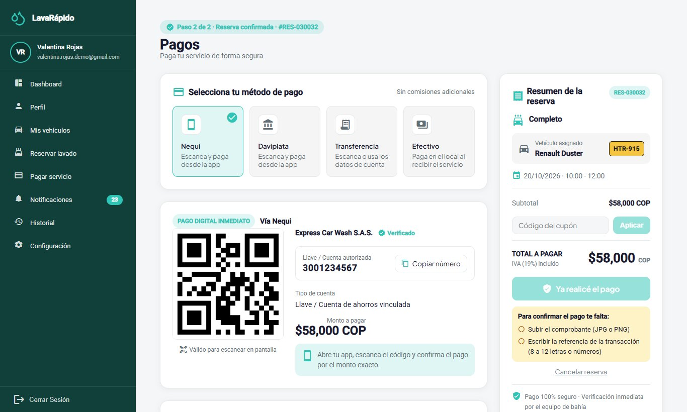

**Figura 19**

*Código QR y Carga del Comprobante*

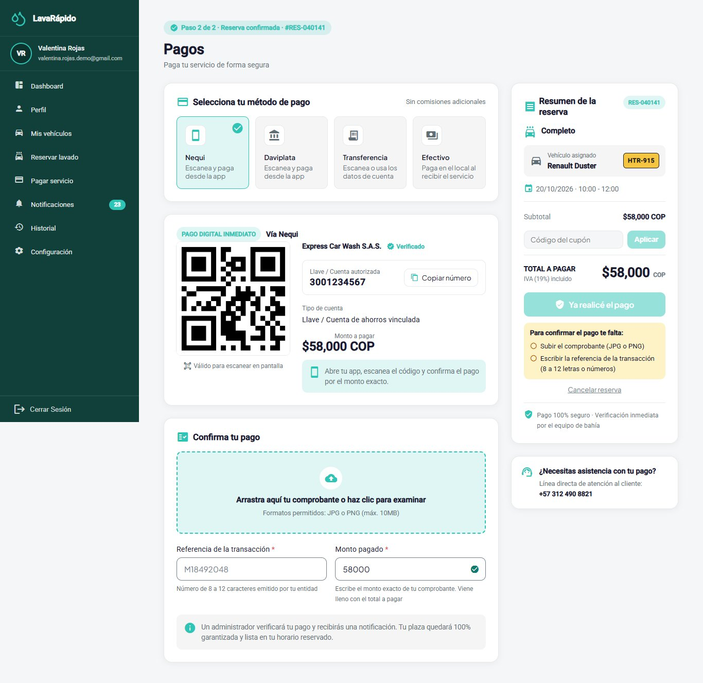

*Nota.* Usar un código QR de prueba; no mostrar cuentas bancarias reales.

#### 10.1.6 Historial y Calificación

**Nombre del módulo:** Historial.

**Descripción:** Lista las reservas del cliente con su estado y el estado de su pago, y permite pagarlas, cancelarlas y calificarlas.

**Rol que puede usarlo:** Cliente.

**Ruta o menú donde se encuentra:** Menú lateral > **Historial** (ruta */client/history*).

**Pasos para utilizarlo:**

1. Hacer clic en **Historial**. Las reservas aparecen de la más reciente a la más antigua.
2. Usar los filtros **Todas**, **Activas**, **Completadas** y **Canceladas**, y las fechas **Desde** y **Hasta**, para acotar la lista.
3. Usar **Buscar por servicio, vehículo o código** para encontrar una reserva.
4. En cada tarjeta, revisar el **Tipo de servicio**, el **Vehículo**, el **Estado** y el estado del **Pago**, y usar **Pagar ahora** o **Cancelar reserva** cuando estén disponibles. **Pagar ahora** aparece solo cuando la reserva se puede pagar (estado pagable, sin un pago aprobado y sin uno pendiente o en revisión).
5. Hacer clic en la tarjeta para abrir el **Detalle de la reserva** (servicios, fecha y hora, vehículo, total, estado del pago y calificación). El botón **Ir al pago** lleva a la pantalla de pago de esa reserva; no aparece en las reservas canceladas o en las que el cliente no asistió.
6. En un servicio completado, hacer clic en **Calificar Servicio**.
7. Elegir de una a cinco estrellas, escribir un comentario si se desea (máximo 500 caracteres) y hacer clic en **Enviar calificación**.

**Resultado esperado:** Aparece el mensaje "¡Gracias por tu calificación!", la tarjeta muestra **Calificado** y el operario que realizó el servicio puede ver la calificación.

**Observaciones o restricciones:** La calificación es opcional, se permite una sola vez por reserva y solo cuando la reserva está Completada; después no se puede modificar. Si no hay reservas para los filtros elegidos, el sistema muestra "No se encontraron servicios".

**Figura 20**

*Historial con Filtros*

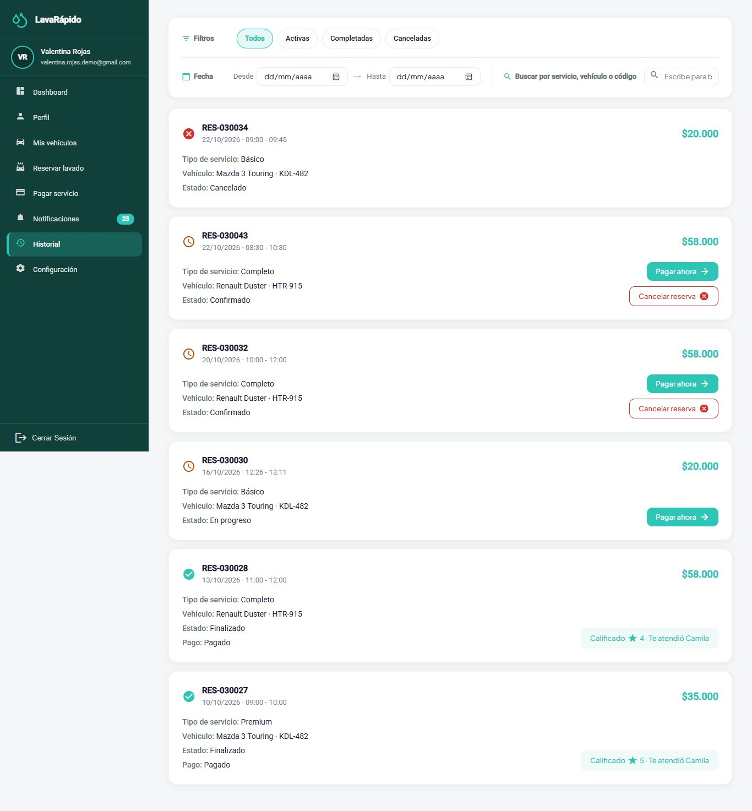

**Figura 21**

*Calificación de un Servicio Completado*

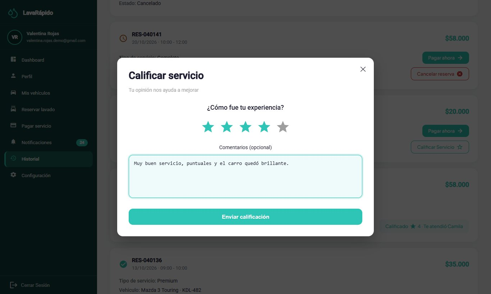

#### 10.1.7 Notificaciones

**Nombre del módulo:** Notificaciones.

**Descripción:** Reúne los avisos del sistema (reserva creada, confirmada o cancelada, recordatorios, operario asignado, servicio iniciado y completado, pago confirmado, rechazado o reembolsado, puntos ganados, cupón desbloqueado o canjeado, e informe de inspección del vehículo) e indica cuáles se han leído.

**Rol que puede usarlo:** Cliente y Operario.

**Ruta o menú donde se encuentra:** Menú lateral > **Notificaciones**.

**Pasos para utilizarlo:**

1. Hacer clic en **Notificaciones**. El encabezado muestra cuántas notificaciones no se han leído.
2. Usar las pestañas **Todas**, **Recordatorios**, **Promociones**, **Confirmaciones** y **Otras** para filtrar por tipo.
3. Usar el filtro **Estado de lectura** y las fechas para acotar la lista.
4. Hacer clic en una notificación (o en **Ver detalle**) para leerla completa; queda marcada como leída. Si el aviso pertenece a un apartado, el detalle trae un botón para ir allí: **Ir al historial** (reservas, pagos, servicio e informe de inspección) o **Ir al inicio** (bienvenida, puntos y cupones); en el operario, **Ir a servicios asignados**.
5. Usar **Marcar leído** o **Marcar no leído** en cada notificación, o **Marcar todo como leído**.
6. Para eliminar una notificación, usar la opción de eliminar y confirmar "¿Eliminar esta notificación?".

**Resultado esperado:** La persona se mantiene informada sin tener que revisar cada módulo constantemente.

**Observaciones o restricciones:** El sistema envía recordatorios 24 horas y 1 hora antes de cada reserva. Los avisos que cambian algo para el cliente también llegan por correo: bienvenida, reserva creada, confirmada o cancelada y recordatorios, pago confirmado, rechazado o reembolsado, cupón canjeado o desbloqueado, e informe de inspección. El avance del servicio (operario asignado, iniciado y completado) y los puntos ganados llegan solo a la bandeja y como notificación push. El código de recuperación de la contraseña siempre llega por correo. Los interruptores de **Configuración > Notificaciones** deciden solo los canales externos; la bandeja siempre recibe todos los avisos. Una notificación eliminada no se puede recuperar.

**Figura 22**

*Centro de Notificaciones*

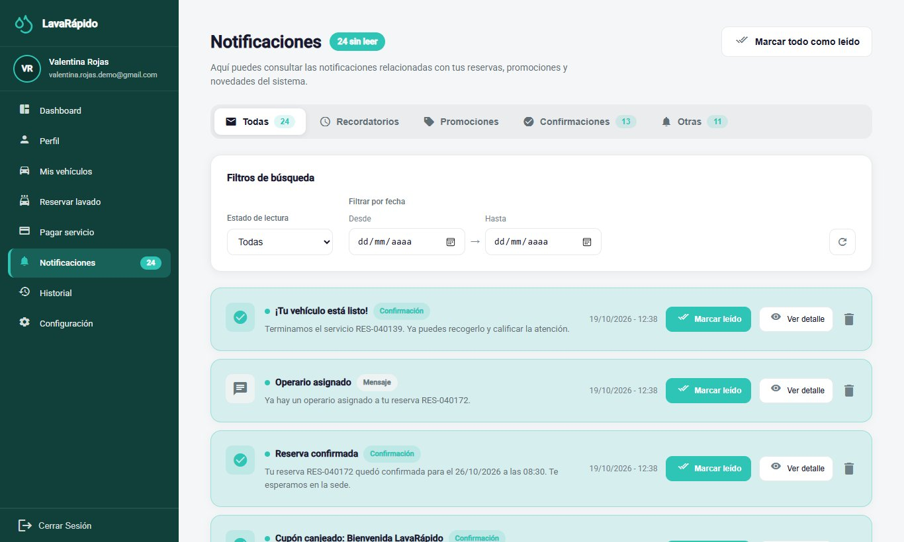

#### 10.1.8 Perfil

**Nombre del módulo:** Perfil.

**Descripción:** Permite ver y actualizar los datos personales, cambiar el correo y la contraseña, y desactivar la cuenta.

**Rol que puede usarlo:** Cliente, Operario y Administrador.

**Ruta o menú donde se encuentra:** Menú lateral > **Perfil**.

**Pasos para utilizarlo:**

1. Hacer clic en **Perfil**. La pantalla "Mi Perfil" se abre en modo de consulta con los nombres, apellidos, correo, teléfono y la fecha desde la cual la persona es cliente.
2. Para modificar los datos, hacer clic en **Editar perfil**, cambiar los campos y hacer clic en **Guardar**; aparece el mensaje "¡Perfil actualizado!".
3. Para cambiar el correo, que es el usuario de ingreso, escribir el nuevo y confirmar con la contraseña actual en la ventana "Confirma el cambio de correo"; desde ese momento se ingresa con el nuevo correo.
4. Para cambiar la contraseña, ir a **Contraseña** y hacer clic en **Cambiar**. Escribir la **Contraseña actual**, la **Nueva contraseña** y **Confirmar nueva contraseña**, y hacer clic en **Guardar**.
5. Para dejar de usar la cuenta, ir a **Cuenta**, hacer clic en **Desactivar mi cuenta**, leer el mensaje y confirmar con la contraseña.

**Resultado esperado:** Los datos quedan actualizados. Si se cambió la contraseña, la nueva se usa en el siguiente ingreso.

**Observaciones o restricciones:** Si la contraseña actual es incorrecta, el cambio se rechaza ("La contraseña actual es incorrecta"); la nueva contraseña debe ser distinta de la actual. La cuenta se desactiva, no se borra: la persona ya no puede ingresar y sus sesiones se cierran, pero se conserva el historial de reservas y pagos. Para reactivarla, la persona debe contactar al administrador. La **Dirección** se guarda en la cuenta, por lo que aparece igual en cualquier dispositivo.

**Figura 23**

*Perfil del Usuario*

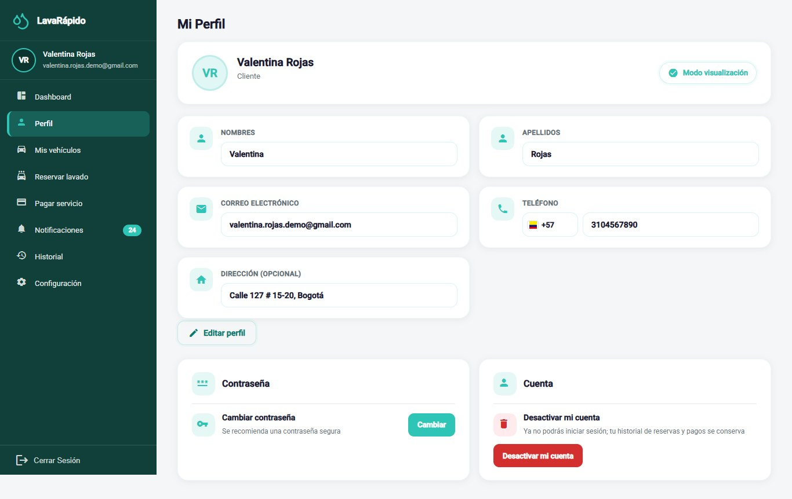

#### 10.1.9 Configuración

**Nombre del módulo:** Configuración.

**Descripción:** Permite personalizar la apariencia, el idioma y las preferencias de notificación, y abrir el centro de ayuda y los documentos legales.

**Rol que puede usarlo:** Cliente, Operario y Administrador.

**Ruta o menú donde se encuentra:** Menú lateral > **Configuración** (ruta */client/configuration* para el cliente).

**Pasos para utilizarlo:**

1. Hacer clic en **Configuración**.
2. En **Apariencia**, hacer clic en **Elegir tema** y seleccionar uno de los cuatro temas de color. El cambio se aplica de inmediato.
3. En **Idiomas**, seleccionar Español, English, Français o Português. Todos los textos de la interfaz cambian al idioma elegido.
4. En **Notificaciones**, activar o desactivar **Notificaciones Push**, **Recordatorios por Email** (recordatorios de la reserva por correo, un día y una hora antes) y **Promociones y Ofertas** (avisos de los cupones que se desbloquean con los puntos, por correo y push).
5. En **Ayuda**, hacer clic en **Abrir** para ver el **Centro de ayuda**: línea de atención, correo, horario de atención (de lunes a sábado, de 7:00 a. m. a 6:30 p. m.) y dirección, tomados de los datos del lavadero registrados en el sistema.
6. En **Legal y privacidad**, abrir **Ver Términos y Condiciones** o **Ver Política de Datos**.

**Resultado esperado:** El tema, el idioma y los interruptores de notificación se aplican de inmediato y se guardan en la cuenta, de modo que se conservan en el siguiente ingreso y en cualquier dispositivo.

**Observaciones o restricciones:** Desactivar **Notificaciones Push** detiene los avisos al teléfono; desactivar **Recordatorios por Email** detiene solo los correos de recordatorio; desactivar **Promociones y Ofertas** detiene los avisos por correo y push de los cupones desbloqueados. Ningún interruptor afecta la bandeja. Si el cambio no se puede guardar, el sistema muestra "No se pudieron guardar tus preferencias de notificación. Inténtalo de nuevo." Las fechas se muestran en el formato del idioma seleccionado.

**Figura 24**

*Pantalla de Configuración*

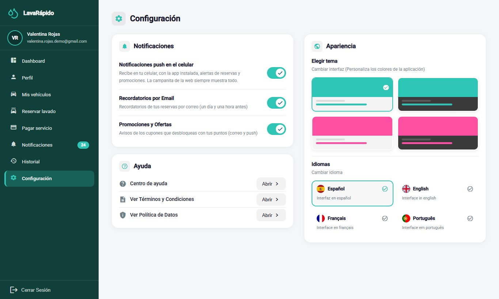

### 10.2 Módulos del Rol Operario

El operario recibe la cuenta del administrador del negocio. El operario solo puede ver y actualizar los servicios que tiene asignados; el sistema rechaza cualquier intento de cambiar un servicio de otro operario.

#### 10.2.1 Panel del Operario

**Nombre del módulo:** Panel del operario.

**Descripción:** Pantalla de inicio del operario. Resume el trabajo pendiente y el avance del día.

**Rol que puede usarlo:** Operario.

**Ruta o menú donde se encuentra:** Menú lateral > **Dashboard** (ruta */operator*).

**Pasos para utilizarlo:**

1. Iniciar sesión con una cuenta de operario; el sistema abre el panel automáticamente.
2. Leer el saludo, que indica cuántos servicios pendientes hay para el día, y hacer clic en **Ver servicios asignados** para ir a la lista.
3. Revisar los indicadores (reservas asignadas, servicios en curso, notificaciones y calificación) y la barra de avance **Servicios completados hoy**.
4. En **Servicios de hoy**, revisar los próximos servicios asignados con su tipo, vehículo, hora, cliente y estado, y hacer clic en **Iniciar** cuando sea el momento de empezar uno.

**Resultado esperado:** El operario sabe de un vistazo qué servicios debe realizar.

**Observaciones o restricciones:** Si no hay servicios asignados, el sistema muestra "No tienes servicios programados por ahora."

**Figura 25**

*Panel del Operario*

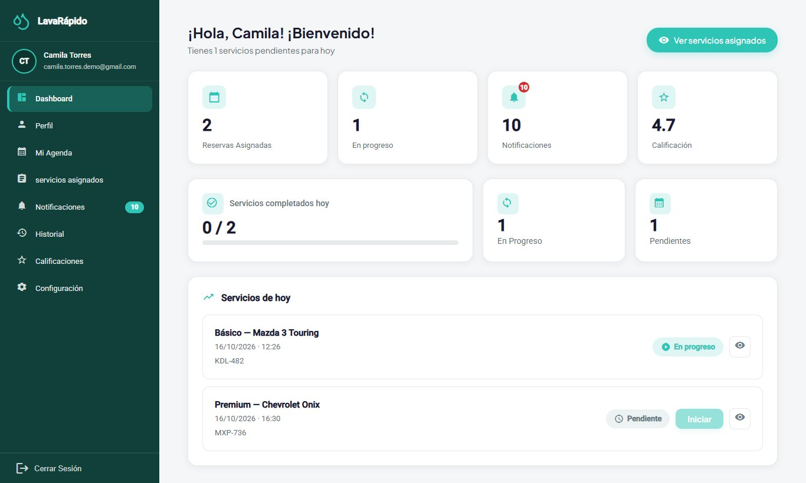

#### 10.2.2 Mi Agenda

**Nombre del módulo:** Mi Agenda.

**Descripción:** Muestra las reservas del operario en un calendario, por día o por semana, y permite iniciarlas y finalizarlas.

**Rol que puede usarlo:** Operario.

**Ruta o menú donde se encuentra:** Menú lateral > **Mi Agenda** (ruta */operator/schedule*).

**Pasos para utilizarlo:**

1. Hacer clic en **Mi Agenda**.
2. Seleccionar un día en el calendario o cambiar entre las pestañas **Día**, **Semana** y **Completados**.
3. Revisar los totales: **Total**, **Pendientes**, **En progreso** y **Completados**.
4. Consultar el bloque **Próximo servicio**, que indica cuántos minutos faltan para que empiece.
5. En la lista de reservas, hacer clic en **Iniciar** o **Finalizar** según el estado de cada servicio, o en **Ver detalle** para ver la fecha, la duración y el vehículo.

**Resultado esperado:** El estado del servicio cambia y el cliente puede seguir su avance.

**Observaciones o restricciones:** Un servicio se puede iniciar desde 15 minutos antes de la hora reservada y hasta 4 horas después de su hora de fin (un servicio que sí se hizo se puede registrar tarde dentro de ese plazo; desde el 24 de octubre de 2026). Pasado ese plazo, el botón **Iniciar** queda deshabilitado con el aviso "Ya no se puede iniciar: pasaron más de 4 h de la hora de fin" y el servicio lo cierra el administrador. Solo puede haber un servicio en curso a la vez. Un servicio debe iniciarse antes de poder finalizarlo ("Primero debes iniciar el servicio."). Al finalizar, el sistema pregunta "¿Finalizar este servicio?" y lo pasa al historial.

**Figura 26**

*Agenda del Operario*

#### 10.2.3 Servicios Asignados

**Nombre del módulo:** Servicios asignados.

**Descripción:** Lista todos los servicios asignados al operario y permite iniciarlos y finalizarlos.

**Rol que puede usarlo:** Operario.

**Ruta o menú donde se encuentra:** Menú lateral > **Servicios asignados** (ruta */operator/assigned-services*).

**Pasos para utilizarlo:**

1. Hacer clic en **Servicios asignados**.
2. Revisar las tarjetas: **Servicios Totales**, **Pendientes**, **En Progreso** y **Finalizados Hoy**.
3. Usar **Filtrar por fecha**, **Filtrar por tipo de servicio** o el cuadro de búsqueda, y hacer clic en **Filtrar**.
4. En la tabla, leer el **ID**, el **Tipo de servicio**, la fecha y hora, el **Vehículo**, el **Cliente** y el **Estado** de cada servicio.
5. Hacer clic en un servicio para abrir **Información del servicio**: cliente, vehículo, tipo de servicio, hora programada y método de pago. Desde el 24 de octubre de 2026, si el administrador escribió instrucciones al asignar o reasignar el servicio, aparecen en **Indicaciones del administrador** (en la web y en la app).
6. Hacer clic en **Iniciar Servicio** al comenzar el lavado y confirmar con **Iniciar**.
7. Al terminar el lavado, hacer clic en **Finalizar Servicio** y confirmar con **Finalizar**.
8. Si es necesario comunicarse con el cliente, usar **Contactar al cliente** en **Opciones adicionales**.

**Resultado esperado:** El estado cambia a En progreso y luego a Completado ("¡Servicio finalizado!"). El cliente recibe los avisos y puede calificar el servicio.

**Observaciones o restricciones:** El servicio se puede iniciar desde 15 minutos antes de la hora reservada. El operario solo puede actualizar los servicios que tiene asignados. Cada servicio se debe registrar con **Iniciar** y **Finalizar**, aunque se haga tarde: si la hora del servicio ya pasó, todavía se puede iniciar y finalizar hasta 4 horas después de su hora de fin, y cuentan las horas reales; después el sistema responde "Ya no se puede iniciar este servicio: pasaron más de 4 horas desde la hora de fin. Pide al administrador que lo cierre." Si un servicio asignado no se inició cuando terminó su hora, o se inició y no se finalizó una hora después de su hora de fin, el operario recibe el aviso "¿Atendiste este servicio?" y el administrador ve la reserva en su lista de reservas por cerrar; si ya no es posible registrarlo, el operario le informa al administrador si atendió o no el vehículo, y el administrador lo cierra. La agenda y la lista de servicios asignados no muestran las reservas canceladas ni las que quedaron en No asistió.

**Tabla 10**

*Estados del Servicio que Ve el Operario*

| Estado | Significado | Acción disponible |
|---|---|---|
| Pendiente | El servicio fue asignado y todavía no ha comenzado. | Iniciar Servicio (desde 15 minutos antes de la hora reservada y hasta 4 horas después de su hora de fin). |
| En progreso | El operario inició el lavado. | Finalizar Servicio. |
| Completado | El lavado terminó y el cliente puede calificarlo. | Solo consulta. |

*Nota.* La base de datos también define los estados de ejecución PAUSED y WITH_ISSUE, que la interfaz actual no usa.

**Figura 27**

*Lista de Servicios Asignados con Filtros*

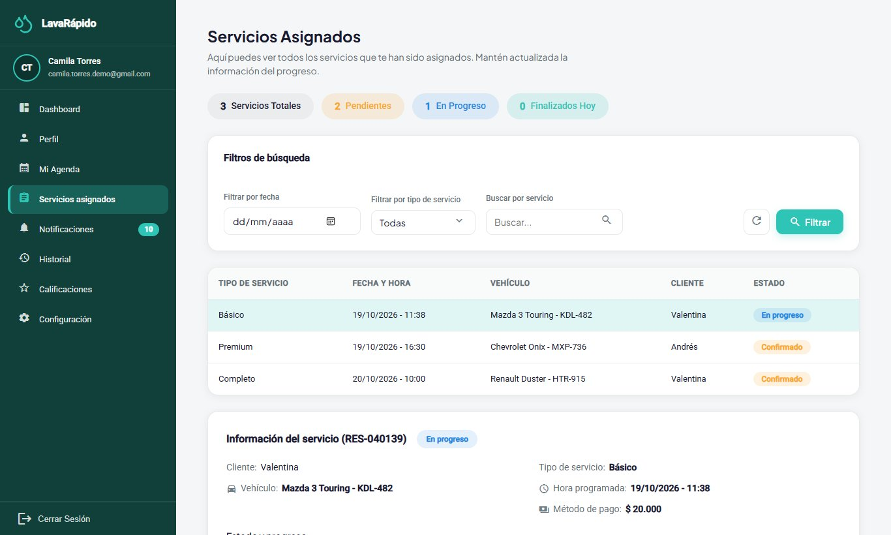

**Figura 28**

*Información del Servicio y Botones de Acción*

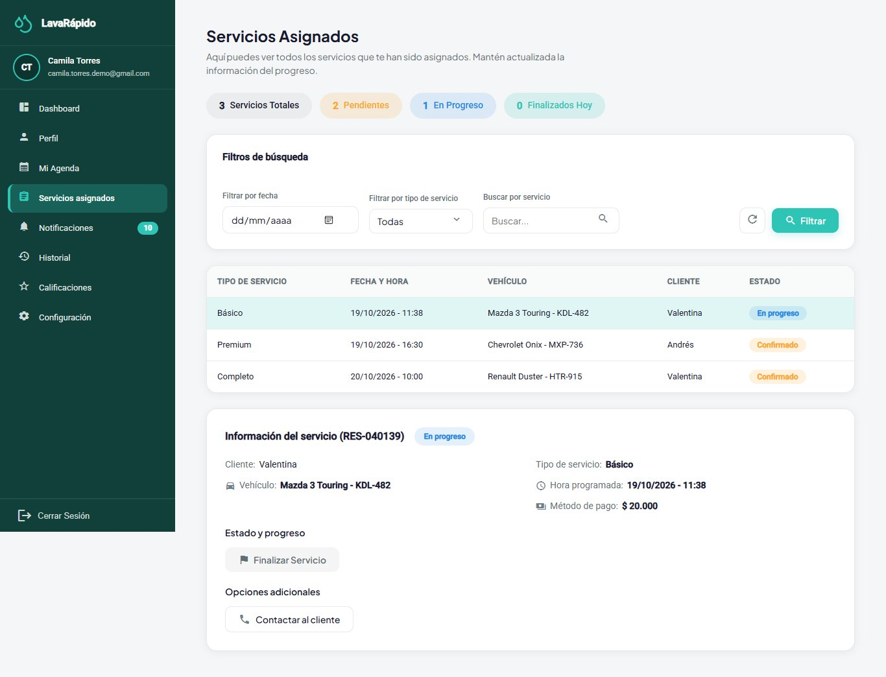

#### 10.2.4 Notificaciones del Operario

Las notificaciones del operario funcionan como las del cliente (sección 10.1.7). Los avisos más frecuentes son un nuevo servicio asignado, un servicio movido a otra hora, un servicio cancelado y un servicio reasignado a otro operario. Desde el 21 de octubre de 2026 también llega el aviso "¿Atendiste este servicio?" cuando un servicio terminó su hora y no se inició o no se finalizó (una sola vez por reserva; sección 10.2.3). Estos avisos al personal llegan a la bandeja y como notificación push, nunca por correo. El operario los abre con **Notificaciones** en el menú lateral y usa las pestañas, los filtros y los botones **Marcar leído** y **Marcar todo como leído**. Al hacer clic en uno de estos avisos se abre su detalle con el botón **Ir a servicios asignados**.

**Figura 29**

*Notificaciones del Operario*

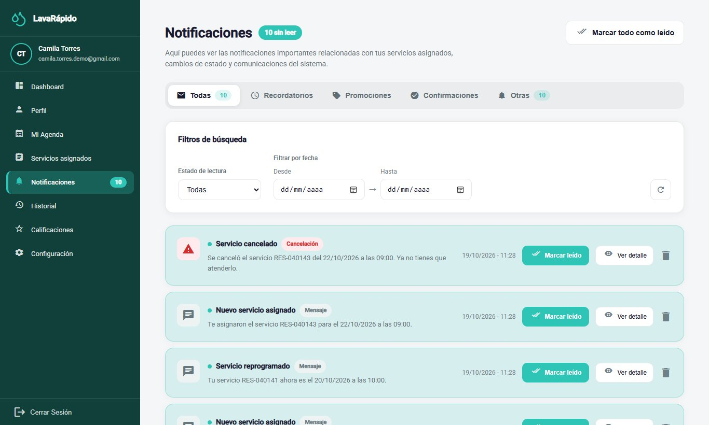

#### 10.2.5 Historial de Servicios

**Nombre del módulo:** Historial de servicios.

**Descripción:** Lista los servicios del operario con su fecha, vehículo, pago, calificación y estado final.

**Rol que puede usarlo:** Operario.

**Ruta o menú donde se encuentra:** Menú lateral > **Historial** (ruta */operator/service-history*).

**Pasos para utilizarlo:**

1. Hacer clic en **Historial**.
2. Revisar los indicadores, incluida la **Tasa de servicios completados**.
3. Usar las pestañas **Todos**, **Finalizados**, **Cancelados** y **Reasignados** y el filtro **Todos los servicios**.
4. Usar el cuadro de búsqueda para encontrar un servicio por código, placa, cliente o vehículo.
5. Hacer clic en **Limpiar** para quitar los filtros.
6. Hacer clic en un servicio para ver su detalle. Si el cliente lo calificó, el botón **Ir a calificaciones** lleva a **Calificaciones recibidas** (sección 10.2.6).

**Resultado esperado:** El operario consulta el trabajo realizado, del más reciente al más antiguo, y el estado final de cada servicio.

**Observaciones o restricciones:** Un servicio reasignado es uno que el administrador pasó a otro operario; deja de contar como servicio propio del operario.

**Figura 30**

*Historial de Servicios del Operario*

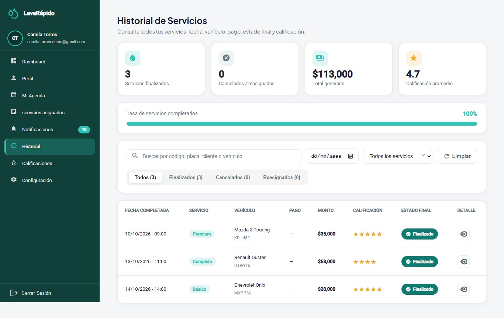

#### 10.2.6 Calificaciones Recibidas

**Nombre del módulo:** Calificaciones recibidas.

**Descripción:** Muestra las calificaciones y comentarios que los clientes dejaron sobre el trabajo del operario.

**Rol que puede usarlo:** Operario.

**Ruta o menú donde se encuentra:** Menú lateral > **Calificaciones** (ruta */operator/qualifications*).

**Pasos para utilizarlo:**

1. Hacer clic en **Calificaciones**.
2. Revisar la calificación promedio y el total de calificaciones recibidas.
3. Usar **Filtrar por fecha**, **Filtrar por tipo de servicio** (lavado básico, premium o completo) y el número de estrellas, y hacer clic en **Filtrar**.
4. Leer cada calificación con el cliente, el servicio, la fecha y el comentario.

**Resultado esperado:** El operario conoce la opinión de los clientes.

**Observaciones o restricciones:** Solo aparecen las calificaciones que los clientes decidieron dejar, porque calificar es opcional. Si no hay ninguna, el sistema muestra "No se encontraron calificaciones".

**Figura 31**

*Calificaciones Recibidas por el Operario*

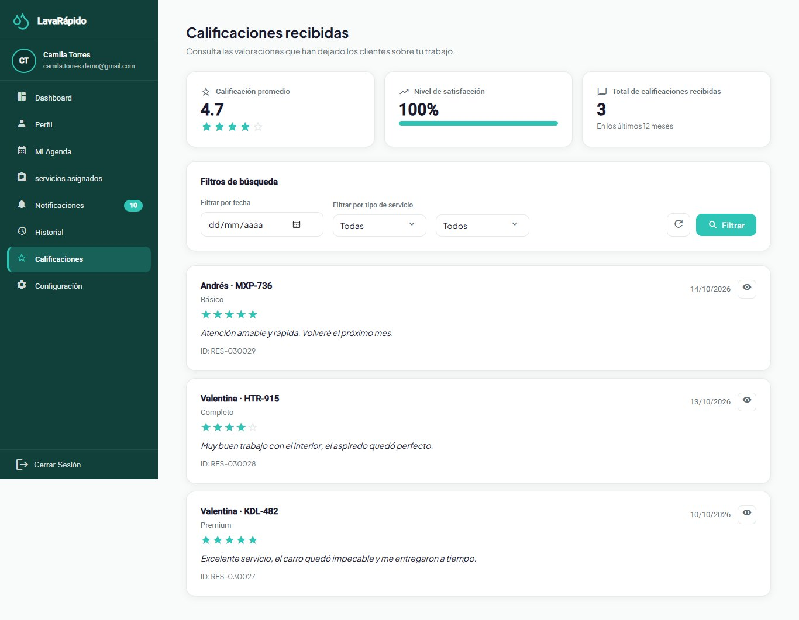

#### 10.2.7 Perfil y Configuración del Operario

El operario consulta y edita sus datos personales, cambia la contraseña y puede desactivar su cuenta en **Perfil**, siguiendo los pasos de la sección 10.1.8. En **Configuración** (ruta */operator/settings*) están el tema, el idioma, los interruptores de notificación y el centro de ayuda, como se explica en la sección 10.1.9; para el operario solo tiene efecto **Notificaciones push en el celular**, porque los avisos del personal nunca llegan por correo. Si el administrador le entregó una contraseña temporal, debe cambiarla en el primer ingreso. El detalle completo está en el Manual de Usuario del Operario.

### 10.3 Aplicación Móvil Android

La aplicación LavaRapidoVehicular (versión 1.1.1, APK *versionCode* 6 publicado el 26 de octubre de 2026, paquete *com.vehiclecarwash.app*) ofrece a los tres roles las mismas funciones que la web, con las mismas reglas y los mismos datos: lo que se hace en una se ve en la otra. Esta sección explica cómo instalarla y en qué cambia su uso; las reglas de cada módulo son las de las secciones 10.1 y 10.2, y las del administrador, las del Manual de Administrador. Se escribió a partir de las 31 pantallas del código de la app del 23 de octubre de 2026 (3 de ingreso, 8 del cliente, 8 del operario y 12 del administrador); sus capturas están en el Manual de Usuario del Cliente (Figuras 26 a 32) y en el Manual de Usuario del Operario (Figuras 15 a 18).

#### 10.3.1 Instalación y Actualizaciones

**Requisitos:** un teléfono Android con conexión a internet y espacio para instalar un APK. La app no está en Google Play: se instala desde la web del lavadero.

1. En la página de inicio de la web, tocar el botón de descarga de la app o escanear el código QR (el archivo es */app/LavaRapidoVehicular.apk*).
2. Abrir el archivo descargado y tocar **Instalar**. La primera vez, Android pide permitir que el navegador instale aplicaciones.
3. Abrir **LavaRapidoVehicular**. Si había una versión anterior al cambio de paquete del 16 de octubre de 2026, desinstalarla una vez; las siguientes se instalan encima.

Las actualizaciones llegan de dos formas:

- **Actualización obligatoria.** Si el lavadero publica un APK nuevo, al abrir la app aparece la pantalla **Actualiza la app para continuar** con el botón **Descargar**. Cuando termine la descarga, abrir el archivo e instalarlo encima: no se pierden la cuenta ni los datos. Hasta instalarla no se puede seguir.
- **Mejoras por internet.** Los cambios de pantallas llegan solos: al abrir la app aparece **Actualización lista**; **Reiniciar ahora** los muestra de inmediato y, si no, se aplican la próxima vez que se abra.

#### 10.3.2 Ingreso, Registro y Cierre de Sesión

La pantalla de ingreso pide el correo y la contraseña, con las mismas reglas de la sección 8: desde el 24 de octubre de 2026 acepta un correo de cualquier dominio (el registro sigue pidiendo @gmail.com) y cinco intentos fallidos bloquean la cuenta 15 minutos. Si el código de recuperación se escribe mal cinco veces, la app ofrece **Pedir otro código**. Desde ella se crea una cuenta de cliente (los mismos datos y la aceptación de los dos documentos legales de la sección 8.1) y se recupera la contraseña con el código de 6 dígitos que llega al correo (sección 8.3). La sesión se guarda cifrada en el teléfono y dura hasta que vence el token (una hora); entonces la app vuelve a pedir el ingreso. Para salir, abrir **Más** y tocar **Cerrar Sesión**, que pide confirmación; al cerrar, el teléfono deja de recibir las notificaciones de esa cuenta.

#### 10.3.3 Navegación

Cada rol ve solo sus pantallas. Abajo hay una barra con tres opciones principales y **Avisos**; el botón **Más** abre un panel con el resto de las opciones y **Cerrar Sesión**:

- **Cliente:** barra con **Inicio**, **Reservar**, **Historial** y **Avisos**; en **Más**: **Mis vehículos**, **Perfil**, **Pagar servicio** y **Configuración**.
- **Operario:** barra con **Inicio**, **Agenda**, **Asignados** y **Avisos**; en **Más**: **Historial**, **Perfil**, **Calificaciones** y **Configuración**.
- **Administrador:** barra con **Inicio**, **Reservas**, **Pagos** y **Avisos**; en **Más**: **Operarios**, **Perfil**, **Gestión**, **Horarios y bahías**, **Reportes** y **Configuración**.

#### 10.3.4 Uso por el Cliente

- **Inicio:** saludo, tarjetas de **Mis reservas activas**, **Mis vehículos**, **Lavados realizados** y **Notificaciones**, el bloque **Tu próximo servicio** (estado, operario y avance), los **Accesos rápidos** (**Agendar lavado**, **Pagar servicio**, **Mis vehículos** y **Notificaciones**) y **Tus beneficios y promociones**, con el progreso de fidelidad y los cupones desbloqueados (sección 10.1.1).
- **Reservar:** pasos en una sola pantalla: **Elige tu vehículo**, **Tipo de servicio** (con la duración estimada y los puntos que suma), **Fecha y hora** (los días cerrados y las horas ocupadas no se ofrecen), **Operario (opcional)**, con **Sin preferencia** por defecto, y, desde el 26 de octubre de 2026, **¿Cómo vas a pagar?** (pago digital ahora o efectivo en el lavadero, con las mismas reglas de la web). Con pago digital, **Reservar Ahora** lleva a pagar con el plazo; con efectivo, muestra el resumen y que se paga en el lavadero (sección 10.1.3). El cambio está en la app desde *v1.1.0*; el 26 de octubre de 2026 se publicó el APK *versionCode* 6 (1.1.1) y la actualización por internet.
- **Pagar servicio:** se elige la cuenta del lavadero (o **Pago en efectivo**, si el lavadero la tiene activa), se amplía el QR con **Ampliar QR**, se aplica un cupón (y se quita con la **X**), se adjunta el comprobante, que la app reduce a menos de 2 MB, y se escribe la referencia de la transacción. El **Monto a pagar** lo calcula el servidor y, desde el 24 de octubre de 2026, el cupón aplicado se sigue viendo al salir y volver a la pantalla. Al enviar aparece **¡Pago enviado!** y el pago queda en revisión; cuando el administrador lo aprueba, la pantalla se actualiza sola con la notificación push. Desde esta pantalla también se cancela la reserva (sección 10.1.5).
- **Historial:** filtros **Todos**, **Activas**, **Completadas** y **Canceladas**, búsqueda por servicio, vehículo o código, y el detalle de cada reserva con **Pagar ahora**, **Cancelar reserva** y **Calificar Servicio** (sección 10.1.6).
- **Mis vehículos**, **Avisos**, **Perfil** y **Configuración** funcionan como en las secciones 10.1.2, 10.1.7, 10.1.8 y 10.1.9.

#### 10.3.5 Uso por el Operario

- **Inicio:** "Tienes N servicios pendientes para hoy", el botón **Ver servicios asignados** y los indicadores de reservas asignadas, en progreso, notificaciones y calificación (sección 10.2.1).
- **Agenda:** vistas **Día**, **Semana** y **Realizados**, con el **Próximo servicio** y los botones **Iniciar** y **Finalizar**. Antes de tiempo la app indica "Podrás iniciarlo desde las HH:MM (15 minutos antes de la reserva)" y, desde el 24 de octubre de 2026, más de 4 horas después de la hora de fin el botón **Iniciar** queda deshabilitado con "ya no se puede iniciar" (secciones 10.2.2 y 10.2.3). El detalle del servicio muestra las notas del administrador.
- **Asignados:** totales de servicios pendientes, en progreso y finalizados hoy, con filtros por fecha, tipo de servicio y búsqueda (sección 10.2.3).
- **Historial**, **Calificaciones** (promedio, total recibido y nivel de satisfacción de los últimos 12 meses, con el detalle de cada calificación), **Avisos**, **Perfil** y **Configuración** funcionan como en las secciones 10.2.4 a 10.2.7. Si llega el aviso "¿Atendiste este servicio?", se sigue la sección 10.2.4.

#### 10.3.6 Uso por el Administrador

Las reglas son las del Manual de Administrador; la app reúne sus funciones así:

- **Inicio** (**Panel de control general**): reservas de hoy, servicios en progreso, pagos por revisar, ingresos del día y bahías activas, los ingresos de los últimos 7 días, el estado de los operarios y las tarjetas **Pagos pendientes de revisión** (con **Revisar**), **Reservas sin operario** (con la asignación) y **Por cerrar**, donde se confirma si la reserva se atendió o el cliente no asistió.
- **Reservas** (**Gestión de Reservas**): **Nueva Reserva**, **Asignar operario**, el detalle de cada reserva con su informe de inspección del vehículo y **Exportar**, que genera un archivo CSV.
- **Pagos** (**Gestión y Verificación de Pagos**): **Revisar** cada comprobante para aprobarlo o rechazarlo (la cola se carga por páginas y la imagen del comprobante se pide al abrirlo), **Registrar pago manual** cuando el cliente pagó en caja (la cuenta de efectivo aparece aunque esté desactivada para los clientes), reembolsar un pago aprobado y **Exportar conciliación**. Desde el 24 de octubre de 2026, si la reserva de un pago se canceló, el pago muestra un aviso para **reembolsarlo** (si estaba aprobado) o **rechazarlo** (si estaba en revisión); en la web el aviso dice "Reserva cancelada: reembolsar" o "Reserva cancelada: rechazar".
- **Operarios**: lista, detalle con habilidades, estado del día y calendario; las cuentas nuevas de operario se crean en **Gestión**.
- **Gestión**: pestañas **Usuarios**, **Roles** (los 3 roles son fijos; desde el 24 de octubre de 2026 la matriz de permisos es de solo consulta, en la web y en la app: "Esta tabla muestra los permisos de referencia de cada rol y es solo de consulta."), **Servicios** y **Promociones**.
- **Horarios y bahías**: horario semanal, excepciones y bahías. **Reportes**: servicios realizados, servicios más vendidos, gráficas y **Exportar reporte** con vista previa.

#### 10.3.7 Notificaciones Push y Diferencias con la Web

- Al ingresar, la app pide permiso para enviar notificaciones. Si se acepta, el teléfono recibe por push los mismos avisos de la bandeja (recordatorios 24 horas y 1 hora antes, operario asignado, servicio iniciado y terminado, pagos, puntos y cupones, entre otros) y tocar uno abre la pantalla relacionada. Android los agrupa en los canales **Recordatorios**, **Promociones y puntos**, **Confirmaciones**, **Cancelaciones**, **Mensajes del servicio** y **Sistema**, que se pueden silenciar desde los ajustes del teléfono.
- Los datos son los mismos de la web: una reserva hecha en la app aparece en la web y al revés.
- Desde el 24 de octubre de 2026 la app muestra el motivo exacto de los errores del servidor (en los cuatro idiomas), el formulario de reserva del administrador solo ofrece los cambios de estado permitidos y el cupón se conserva al volver a la pantalla de pago.
- Limitación conocida al 24 de octubre de 2026, registrada en el documento de Acciones Correctivas (ACO-39): si la sesión vence mientras la app está en segundo plano, el teléfono puede seguir recibiendo las notificaciones de esa cuenta hasta que se vuelva a iniciar sesión o se cierre la sesión desde **Más**.

## 11. Mensajes y Validaciones

El sistema valida la información mientras la persona escribe. Cuando un dato no es correcto, resalta el campo con un borde rojo y muestra un mensaje debajo. Las Tablas 11 y 12 explican el significado de los mensajes más frecuentes y lo que debe hacer la persona.

**Tabla 11**

*Mensajes de los Formularios de Registro, Ingreso y Recuperación*

| Mensaje del sistema | Significado | Acción del usuario |
|---|---|---|
| El correo es obligatorio | El campo de correo está vacío. | Escribir el correo. |
| Debe ingresar un correo válido | En el inicio de sesión o la recuperación, el correo no tiene formato de correo (desde el 24 de octubre de 2026 se acepta cualquier dominio). | Corregir el correo. |
| Solo se permiten correos @gmail.com | En el registro se escribió un correo de otro proveedor. | Usar una cuenta de Gmail. |
| El documento es obligatorio / Debe tener entre 5 y 20 dígitos | El número de documento está vacío o tiene una longitud no válida. | Escribir el documento solo con dígitos. |
| El nombre es obligatorio / Debe tener mínimo 3 caracteres | Los nombres están vacíos o son demasiado cortos. | Escribir los nombres. |
| Los apellidos son obligatorios / Debe tener mínimo 2 caracteres | Los apellidos están vacíos o son demasiado cortos. | Escribir los apellidos. |
| El teléfono es obligatorio | El campo de teléfono está vacío. | Escribir el número celular. |
| Debe comenzar con 3 (número celular colombiano) | El número no empieza por 3. | Escribir un número celular colombiano. |
| El número debe tener 10 dígitos | El teléfono tiene menos de 10 dígitos. | Completar los 10 dígitos. |
| Las contraseñas no coinciden | La confirmación es diferente de la contraseña. | Escribir la misma contraseña en ambos campos. |
| La contraseña no cumple los requisitos de seguridad | Falta uno de los cuatro requisitos. | Seguir la lista de requisitos. |
| Debes aceptar los Términos y la Política de Datos para continuar | No se aceptó uno de los dos documentos legales. | Leer y aceptar ambos documentos. |
| Debes aceptar el tratamiento de datos personales (Ley 1581) para registrarte. | El servidor recibió el registro sin las dos aceptaciones (desde el 24 de octubre de 2026). | Marcar las dos casillas y registrarse de nuevo. |
| Hiciste demasiados intentos seguidos. Espera un momento y vuelve a intentarlo. | Se hicieron más de 60 intentos en un minuto desde el mismo equipo (desde el 24 de octubre de 2026). | Esperar un minuto e intentar de nuevo. |
| Demasiados intentos fallidos. Espera unos minutos o pide otro código para volver a intentarlo. | Se escribió mal cinco veces el código de recuperación o la contraseña actual (desde el 24 de octubre de 2026). | Pedir otro código; si fue la contraseña actual, esperar 15 minutos. |
| Ya existe una cuenta con este correo | El correo ya está registrado. | Iniciar sesión o recuperar la contraseña. |
| Ya existe una cuenta con este número de documento | El número de documento ya está registrado. | Verificar los datos o contactar al lavadero. |
| Correo o contraseña incorrectos | Las credenciales no coinciden con ninguna cuenta. | Revisar los datos e intentar de nuevo, o recuperar la contraseña. |
| Tu cuenta está desactivada. Contacta al administrador. | La cuenta fue desactivada. | Pedir al administrador que la reactive. |
| El código es incorrecto, ya se usó o expiró. Solicita uno nuevo. | El código de recuperación no es válido. | Solicitar un código nuevo. |
| ¡Contraseña actualizada! | La contraseña se cambió correctamente. | Ingresar con la nueva contraseña. |

*Nota.* Textos tomados del archivo de traducción al español de la aplicación web.

**Tabla 12**

*Mensajes de Operación del Sistema*

| Mensaje o situación | Significado | Acción del usuario |
|---|---|---|
| Tu sesión expiró. Inicia sesión de nuevo. | Terminó la sesión de una hora, o la sesión se cerró (por ejemplo, porque el administrador desactivó la cuenta). | Iniciar sesión de nuevo. |
| No tienes permiso para realizar esta acción | La acción pertenece a otro rol o a datos de otra persona. | Usar solo las opciones del rol. |
| Tu perfil de cliente aún no está listo. Intenta de nuevo en unos minutos. | El perfil de cliente se está creando después del registro. | Esperar un momento e intentar de nuevo. |
| Ya existe un vehículo registrado con esta placa | La placa pertenece a un vehículo activo. | Verificar la placa. |
| El formato de la placa no corresponde al tipo de vehículo | La placa no sigue el formato oficial del tipo elegido. | Corregir la placa o el tipo. |
| Esa hora ya se ocupó | El turno se tomó mientras se reservaba. | Elegir una de las horas sugeridas. |
| El lavadero no abre ese día. Elige otra fecha. | El día elegido está marcado como cerrado. | Elegir otra fecha. |
| A esa hora el servicio no cabe en el horario de atención. Elige otra hora. | El servicio terminaría después del cierre o cruza el descanso. | Elegir otra de las horas libres. |
| Esa hora ya pasó. Elige una hora más tarde. | La hora elegida ya pasó. | Elegir una hora más tarde. |
| Demasiados intentos fallidos. Tu cuenta quedó bloqueada 15 minutos... | Se escribió mal la contraseña cinco veces en menos de 15 minutos. | Esperar 15 minutos o usar ¿Olvidaste tu contraseña?. |
| Ese vehículo ya tiene una reserva a esa hora. | El vehículo ya está reservado en ese turno. | Elegir otra hora. |
| Este vehículo tiene reservas activas o futuras: cancélalas antes de retirarlo. | Se intentó retirar un vehículo con reservas pendientes (desde el 24 de octubre de 2026). | Cancelar o esperar a que terminen esas reservas. |
| La fecha no es válida para reservar. | La fecha ya pasó o está fuera de la ventana de reservas. | Elegir una fecha válida. |
| Esta reserva ya no se puede cambiar. | La reserva ya empezó o se cerró. | Contactar al lavadero. |
| Elige cómo vas a pagar: pago digital o efectivo en el lavadero. | Se intentó reservar sin elegir la forma de pago (desde el 26 de octubre de 2026). | Elegir una opción en **¿Cómo vas a pagar?**. |
| Ya tienes una reserva activa con pago en efectivo. Págala o cancélala, o elige pago digital. | El cliente ya tiene una reserva activa en efectivo (máximo una). | Elegir pago digital, o esperar a que esa reserva termine o cancelarla. |
| Sube el comprobante antes de las HH:mm o la reserva se libera. / Paga antes de las HH:mm | La reserva con pago digital tiene un plazo para subir el comprobante (30 minutos o la hora del servicio). | Pagar y subir el comprobante antes de esa hora. |
| Pagas en efectivo en el lavadero | La reserva se paga en efectivo al llegar; no hay que subir comprobante. | Llevar el dinero el día del servicio. |
| No se subió el comprobante de pago a tiempo | Motivo con el que el sistema canceló una reserva con pago digital cuyo plazo venció. | Reservar de nuevo. |
| Esta reserva ya no se puede pagar (está cancelada, pagada o en revisión). | Se intentó pagar una reserva cancelada o que ya tiene un pago. | Revisar el estado en el Historial. |
| Archivo no válido | El comprobante no es una imagen JPG o PNG de hasta 10 MB. | Adjuntar una imagen válida. |
| No pudimos reducir la imagen a menos de 2 MB. Prueba con una captura de pantalla del comprobante. | La foto del comprobante es demasiado pesada aun después de reducirla. | Adjuntar una captura de pantalla del comprobante. |
| Para confirmar el pago te falta: ... | Faltan datos del pago (comprobante, referencia o monto). | Completar los elementos listados bajo el botón. |
| Ese cupón no existe. | El código del cupón es incorrecto. | Revisar el código que aparece en el aviso del cupón. |
| Ese cupón no está vigente o todavía no acumulas los puntos necesarios. | El cupón está pausado, fuera de sus fechas o bloqueado. | Revisar los puntos en el panel. |
| Ya canjeaste este cupón en esta reserva. | El cupón ya se usó en esa reserva. | Pagar sin el cupón o usar otro. |
| Esta reserva ya tiene un cupón. Quítalo si quieres usar otro. | Solo se acepta un cupón por reserva. | Quitar el cupón con la **X** antes de aplicar otro. |
| No pudimos consultar el total a pagar. Revisa tu conexión y vuelve a entrar en unos segundos. | El sistema no logró calcular el monto (desde el 24 de octubre de 2026 el total viene del servidor). | Esperar y volver a abrir la pantalla; no pagar mientras el total aparezca como "—". |
| Ya hay un pago en revisión para esta reserva. / Esa referencia ya se usó en otro pago. Revisa el número de tu comprobante. | El pago ya se reportó o la referencia ya existe en otro pago. | Esperar la revisión o corregir la referencia. |
| Solo puedes calificar un servicio finalizado. / Este servicio ya fue calificado. | La calificación no está permitida. | Esperar a que el servicio termine; una reserva se califica una sola vez. |
| Primero debes iniciar el servicio. / Este servicio ya fue iniciado. | El operario intentó una acción fuera de orden. | Iniciar el servicio antes de finalizarlo. |
| Ya no se puede iniciar este servicio: pasaron más de 4 horas desde la hora de fin. Pide al administrador que lo cierre. | El operario intentó iniciar un servicio fuera de plazo (desde el 24 de octubre de 2026). | Avisar al administrador si el vehículo se atendió. |
| Los datos chocan con un registro existente o alguien los cambió mientras los editabas. Vuelve a abrirlos e intenta de nuevo. | Otra persona cambió lo mismo al mismo tiempo. | Volver a abrir la pantalla y repetir el cambio. |
| El servicio de reservas no responde. / La base de datos no responde en este momento. | Una parte del sistema está detenida por un momento. | Intentar de nuevo en unos minutos. |
| No hay conexión con el servidor. Intenta de nuevo en un momento. | No hay conexión con el sistema. | Revisar la conexión a internet e intentar de nuevo. |

*Nota.* Textos tomados del archivo de traducción al español de la aplicación web.

## 12. Cierre de Sesión

Cerrar la sesión al terminar evita que otra persona use la cuenta, especialmente en computadores o teléfonos compartidos. Aunque la sesión vence automáticamente una hora después del ingreso, se recomienda cerrarla manualmente.

1. Ubicar la opción **Cerrar Sesión** en la parte inferior del menú lateral.
2. Hacer clic en **Cerrar Sesión**.
3. En la ventana "Cerrar sesión", hacer clic en **Sí, cerrar**.
4. Verificar que el sistema vuelva a la pantalla de inicio de sesión.

Al cerrar sesión, las demás pestañas del mismo navegador también vuelven a la pantalla de inicio de sesión, y si en una pestaña se entra con otra cuenta, las otras se recargan con esa cuenta. Desde el 21 de octubre de 2026 la sesión cerrada tampoco sirve en el servidor, aunque alguien hubiera copiado su acceso.

**Figura 32**

*Confirmación del Cierre de Sesión*

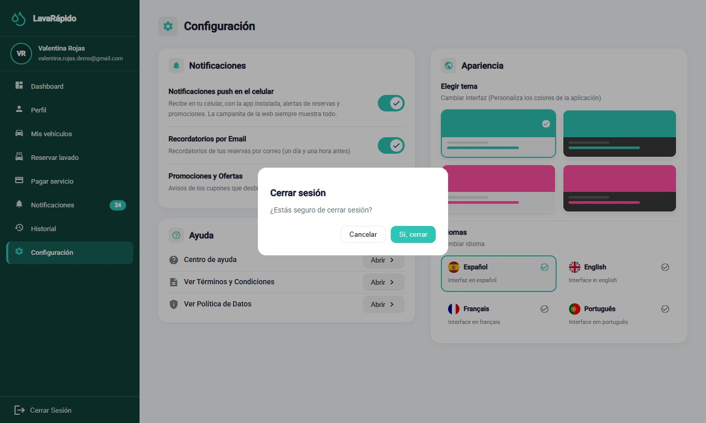

## 13. Preguntas Frecuentes

##### ¿Qué hago si olvidé mi contraseña?

En la pantalla de inicio de sesión, hacer clic en "¿Olvidaste tu contraseña?" y seguir los tres pasos de la sección 8.3. El código llega al correo registrado y es válido durante 15 minutos.

##### ¿Por qué el sistema no me deja registrarme?

El sistema solo acepta correos terminados en @gmail.com, y cada correo y cada número de documento pueden tener una sola cuenta. Además, se deben aceptar los dos documentos legales.

##### ¿Mi cuenta se puede bloquear por escribir mal la contraseña?

Sí. Después de cinco intentos fallidos en menos de 15 minutos, la cuenta queda bloqueada durante 15 minutos. Puede esperar ese tiempo o usar **¿Olvidaste tu contraseña?** para crear una contraseña nueva y entrar de inmediato.

##### ¿Cómo sé si mi reserva quedó confirmada?

Cuando la hora está libre, la reserva se confirma de inmediato: el sistema muestra "¡Reserva creada!", la reserva aparece en el panel y en el Historial con el estado Confirmada, y llega la confirmación por correo.

##### ¿Qué hago si la hora que quiero ya está ocupada?

La pantalla solo ofrece horas libres. Si otra persona toma la hora mientras usted reserva, el sistema sugiere las horas libres más cercanas del mismo día que su vehículo puede tomar (no las que se cruzan con otra reserva suya); elija una y confirme.

##### ¿Puedo elegir quién lava mi vehículo?

Sí, es opcional. Al reservar, en **Operario (opcional)** aparecen los operarios libres a esa hora. Si no elige ninguno, el sistema asigna uno libre automáticamente. Puede ver el operario asignado en el panel y recibe una notificación cuando se asigna o cambia.

##### ¿Cómo cambio la fecha de una reserva?

La aplicación web no permite cambiar la fecha ni la hora. Cancele la reserva antes de su hora de inicio y reserve de nuevo, o contacte al lavadero.

##### ¿Qué pasa si no llego a mi reserva?

El lavadero registra la reserva como No asistió. Si la reserva no tenía operario asignado, el sistema la marca así una hora después de la hora de fin. Si ya había pagado, contacte al lavadero: el reembolso lo decide el administrador.

##### ¿Cómo pago mi servicio?

En Pagar servicio, elija el método. Con Nequi, Daviplata o Transferencia, escanee el código QR, transfiera el monto exacto y adjunte el comprobante con la referencia de la transacción; con Efectivo (si el lavadero lo tiene activo), pague en el lavadero.

##### ¿El sistema guarda los datos de mi tarjeta?

No. El sistema no solicita ni guarda datos de tarjetas.

##### ¿Por qué se canceló sola mi reserva?

Si al reservar eligió **Pago digital ahora**, tenía 30 minutos (o hasta la hora del servicio, si era más pronto) para subir el comprobante. Si no lo subió a tiempo, el sistema canceló la reserva con el motivo "No se subió el comprobante de pago a tiempo" y liberó el horario. Puede reservar de nuevo y pagar dentro del plazo, o elegir **Efectivo en el lavadero** si no tiene otra reserva activa en efectivo.

##### ¿Por qué mi pago aparece "En revisión"?

Porque un administrador debe verificar que el dinero llegó a la cuenta del lavadero. Cuando lo apruebe o lo rechace, usted recibirá una notificación y un correo; también puede consultar el estado en el Historial.

##### ¿Puedo usar un código de promoción?

Sí. Cuando sus puntos desbloquean un cupón, usted recibe un aviso con su código. En Pagar servicio, escríbalo en Código del cupón y haga clic en Aplicar antes de confirmar el pago.

##### ¿Cómo gano puntos de fidelización?

Cada servicio suma los puntos que aparecen al reservar ("Suma N puntos"). Los puntos se acreditan cuando el administrador aprueba el pago de la reserva, y su progreso se ve en el panel. Los puntos no se gastan: desbloquean cupones.

##### ¿Cómo califico un servicio?

Cuando la reserva esté Completada, abra el Historial, haga clic en "Calificar Servicio", elija de una a cinco estrellas y, si lo desea, escriba un comentario. Cada reserva se puede calificar una sola vez.

##### ¿Puedo cambiar el idioma o los colores?

Sí. En Configuración puede elegir español, inglés, francés o portugués y uno de cuatro temas de color; la elección se guarda en su cuenta.

##### ¿Puedo eliminar o desactivar mi cuenta?

La opción **Desactivar mi cuenta** desactiva la cuenta, no la borra: no podrá ingresar, pero su historial se conserva. Para reactivarla, contacte al administrador. Las cuentas de administrador no tienen esta opción.

##### Soy operario y no puedo iniciar un servicio. ¿Por qué?

Un servicio se puede iniciar desde 15 minutos antes de la hora reservada (antes, el sistema responde que todavía es muy temprano) y hasta 4 horas después de su hora de fin (después responde que ya no se puede iniciar), solo si está asignado a usted y solo cuando no tiene otro servicio en curso. Si el servicio es suyo y el problema continúa, informe al administrador.

##### Atendí un vehículo y olvidé marcar Iniciar. ¿Qué hago?

Si no han pasado más de 4 horas desde la hora de fin, abra el servicio y márquelo con **Iniciar** y luego con **Finalizar**; el sistema lo acepta aunque sea tarde. Si ya no puede hacerlo, informe al administrador que el vehículo sí se atendió, para que cierre la reserva como atendida y no como No asistió.

## 14. Glosario

**Tabla 13**

*Glosario de Términos del Sistema*

| Término | Definición |
|---|---|
| Administrador | Rol que gestiona reservas, operarios, pagos, horarios, usuarios, promociones y reportes. |
| Asignación | Vínculo entre un operario y una reserva, hecho por el administrador. |
| Bahía (de lavado) | Puesto físico del lavadero donde se lava un vehículo. Dos reservas no pueden ocupar la misma bahía al mismo tiempo. |
| Calificación | Puntuación de una a cinco estrellas, con un comentario opcional, que el cliente da a un servicio completado. |
| Cliente | Persona que registra vehículos y reserva turnos. |
| Código QR | Código bidimensional que se escanea con el teléfono para pagar. |
| Comprobante | Imagen que demuestra que se hizo una transferencia. |
| Cupón | Código de descuento que el cliente desbloquea al acumular puntos de fidelización y canjea al pagar. |
| Dashboard (panel) | Pantalla de inicio que resume la información más importante de cada rol. |
| Notificación | Aviso dentro del sistema sobre un hecho relevante. |
| Operario | Empleado que lava los vehículos. |
| Puntos de fidelización | Puntos que suma cada servicio cuando se aprueba su pago; desbloquean cupones y no se gastan. |
| Recordatorio | Aviso que el sistema envía 24 horas y 1 hora antes de una reserva. |
| Referencia de la transacción | Número que el banco imprime en el comprobante para identificar la transferencia. |
| Reserva | Bloque de tiempo apartado para lavar un vehículo. |
| Servicio de lavado | Tipo de lavado ofrecido (Básico, Premium o Completo), con su propia duración, precio y puntos. |
| Tema | Combinación de colores de la interfaz que cada persona puede elegir. |

*Nota.* Basado en el glosario de la documentación del proyecto.

## Referencias

Congreso de la República de Colombia. (2012). *Ley Estatutaria 1581 de 2012, por la cual se dictan disposiciones generales para la protección de datos personales*. http://www.secretariasenado.gov.co/senado/basedoc/ley_1581_2012.html

Equipo de Desarrollo Vehicle Washing. (2026a). *Vehicle washing management system: Project documentation* (vehicle-w-docs) [Documentación de proyecto no publicada]. GitHub. https://github.com/code-sena/vehicle-w-docs

Equipo de Desarrollo Vehicle Washing. (2026b). *Front-end-proyecto-web* (rama develop) [Software]. GitHub. https://github.com/BrayanCABRERA123/Front-end-proyecto-web

Servicio Nacional de Aprendizaje. (2026). *Guía para elaborar manuales de software: Manual de usuario, manual técnico, manual de instalación y manual de administrador* [Material de formación no publicado]. Programa Tecnólogo en Análisis y Desarrollo de Software.

## 15. Anexos

### Anexo A. Origen de las Capturas

Las figuras de este manual se tomaron el 16 de octubre de 2026 sobre la versión de la rama *develop*, con el sistema completo corriendo en Docker y la web en *http://localhost:4200*. Se usaron cuentas, vehículos, reservas y pagos de prueba creados solo para las capturas, por lo que no aparecen correos, documentos, teléfonos, placas ni cuentas bancarias reales. Si una pantalla cambia en una versión futura, la captura correspondiente se debe tomar de nuevo con el mismo nombre de archivo de la carpeta *capturas*.

### Anexo B. Lista de Verificación para la Entrega

**Tabla 14**

*Lista de Verificación del Manual de Usuario*

| Criterio | Cumple |
|---|---|
| Tiene portada completa (ficha, instructora y centro de formación) y versión | Sí / No |
| Incluye tabla de contenido con páginas actualizadas | Sí / No |
| Explica el objetivo y el alcance | Sí / No |
| El contenido coincide con el software de la versión final | Sí / No |
| Todas las figuras son capturas reales de la versión final | Sí / No |
| Los pasos son claros y ordenados | Sí / No |
| No contiene información sensible ni credenciales reales | Sí / No |
| Ortografía y formato APA revisados | Sí / No |
| Exportado a PDF con el nombre Manual_usuario_LavadoVehicular_3145556.pdf | Sí / No |

*Nota.* Adaptado de la lista de verificación de la guía para elaborar manuales de software (SENA, 2026).
