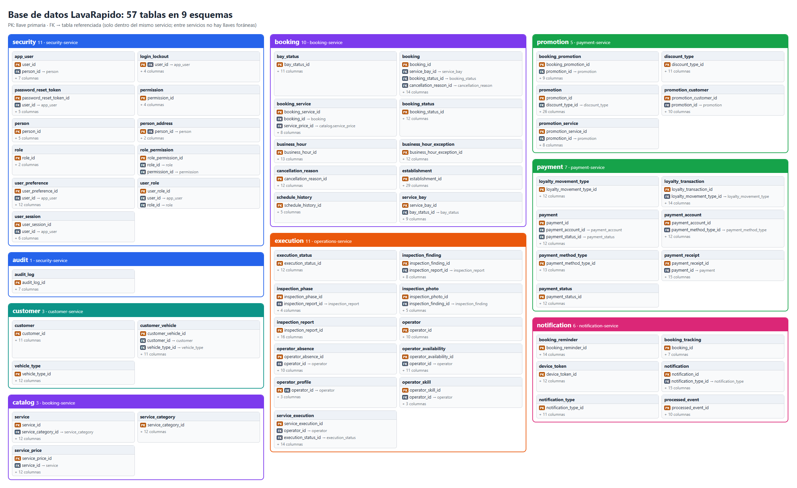
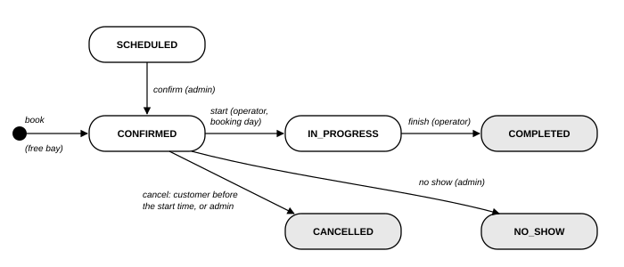

<!-- running-head: MANUAL TÉCNICO: SISTEMA DE LAVADO VEHICULAR -->

# Manual Técnico

Sistema de Gestión de Lavado Vehicular (Vehicle Washing)

Arquitectura de Microservicios, Modelo de Datos, Contratos de Integración, Seguridad y Lógica de Negocio

Brayan Estiven Patiño Cabrera (líder de proyecto), Juan Camilo Guilombo Osorio (líder de frontend) y Merari Urbano (líder de backend)

Tecnólogo en Análisis y Desarrollo de Software (ADSO), Servicio Nacional de Aprendizaje (SENA), Centro de Formación: Industria

Ficha 3145556

Instructora: Karol Daniela Correa

16 de octubre de 2026

Tipo de manual: Manual técnico (desarrolladores y arquitectos de software) · Versión 4.0

## Control de Versiones

La Tabla 1 registra el historial de cambios de este documento. Cada modificación debe agregar una fila con la versión, la fecha, la descripción del cambio y el responsable. No se debe confundir con el control de versiones del código fuente, que se describe en la sección 15.

**Tabla 1**

*Historial de Versiones del Manual Técnico*

| Versión | Fecha | Descripción del cambio | Responsable |
|---|---|---|---|
| 1.0 | 2026-10-04 | Creación inicial del manual técnico (en español) a partir de la documentación del proyecto. | Equipo de desarrollo |
| 2.0 | 2026-10-05 | Datos de portada completados, nombre del sistema ajustado a Vehicle Washing y cambio en la descripción de la estrategia de migraciones. | Equipo de desarrollo |
| 3.0 | 2026-10-07 | Traducción al inglés, formato APA (7.ª ed.) y verificación contra el código fuente. Se corrigieron: payment-service es .NET 8 (ADR-013); Spring Boot 4 en lugar de 3; SQL Server 2022; puertos reales; un changelog de Liquibase por servicio; número de tablas; el gateway no valida tokens; no hay bloqueo de cuenta; asignación manual de operarios (ADR-014); códigos de ejecución en inglés; solicitud real del endpoint de reservas; catálogo completo de endpoints y eventos; estructura real del proyecto; auditoría no poblada. Se agregaron dos diagramas reales. | Equipo de desarrollo |
| 3.1 | 2026-10-09 | Actualización contra el código de los once repositorios al 9 de octubre de 2026 (ADR-011, secciones 9 a 12, y ADR-015) y creación de esta versión en español (la versión en inglés es Manual_tecnico_LavadoVehicular_3145556_EN.md). Se actualizaron: 49 tablas (booking.schedule_history y notification.booking_tracking); puntos de fidelización por servicio y libro de puntos con reversión; promociones como cupones porcentuales; matriz de permisos de los roles fijos; interruptores de notificación del usuario; eventos, pruebas, estructura y contenedor de payment-service; avisos al personal; nuevos endpoints, rutas del gateway y códigos de error; nombre real del repositorio de operaciones; deuda técnica TD-002, TD-014, TD-015, TD-016 y TD-018 resuelta. | Equipo de desarrollo |
| 4.0 | 2026-10-16 | Revisión de los once repositorios con el sistema corriendo. Se actualizaron: 57 tablas con el diagrama entidad-relación generado desde la base de datos, diccionario de las tablas nuevas (bloqueo de cuenta, dirección, consentimiento, perfil del operario e inspección), asignación automática y elección del operario, bloqueo por intentos fallidos, informes de inspección en el servidor, datos del negocio, salud y correlación de payment-service, nuevos endpoints y eventos, resultados reales de las pruebas (639 unitarias y 19 de punta a punta), deuda técnica y discrepancias resueltas. | Equipo de desarrollo |

*Nota.* Las fechas se escriben en formato ISO 8601 (año-mes-día). Elaborado por el equipo de desarrollo.

## Tabla de Contenido

<!-- toc -->

- [Control de Versiones](#control-de-versiones)
- [4. Introducción](#4-introducción)
  - [4.1 Fuentes y Convenciones de Este Documento](#41-fuentes-y-convenciones-de-este-documento)
- [5. Objetivo](#5-objetivo)
  - [5.1 Objetivo General](#51-objetivo-general)
  - [5.2 Objetivos Específicos](#52-objetivos-específicos)
- [6. Alcance Técnico](#6-alcance-técnico)
  - [6.1 Qué Cubre Este Manual](#61-qué-cubre-este-manual)
  - [6.2 Qué No Cubre Este Manual](#62-qué-no-cubre-este-manual)
- [7. Descripción General del Sistema](#7-descripción-general-del-sistema)
  - [7.1 Resumen de la Solución](#71-resumen-de-la-solución)
  - [7.2 Tipo de Aplicación y Componentes Principales](#72-tipo-de-aplicación-y-componentes-principales)
  - [7.3 Restricciones de Arquitectura](#73-restricciones-de-arquitectura)
- [8. Tecnologías Utilizadas](#8-tecnologías-utilizadas)
- [9. Arquitectura del Sistema](#9-arquitectura-del-sistema)
  - [9.1 Estilo Arquitectónico](#91-estilo-arquitectónico)
  - [9.2 API Gateway](#92-api-gateway)
  - [9.3 Arquitectura Interna de los Servicios](#93-arquitectura-interna-de-los-servicios)
  - [9.4 Comunicación entre Componentes](#94-comunicación-entre-componentes)
  - [9.5 Aspectos Transversales](#95-aspectos-transversales)
- [10. Estructura del Proyecto](#10-estructura-del-proyecto)
  - [10.1 Repositorios](#101-repositorios)
  - [10.2 Estructura de un Servicio Java](#102-estructura-de-un-servicio-java)
  - [10.3 Estructura de payment-service](#103-estructura-de-payment-service)
  - [10.4 Estructura de la Aplicación Web](#104-estructura-de-la-aplicación-web)
  - [10.5 Estructura de la Aplicación Móvil](#105-estructura-de-la-aplicación-móvil)
- [11. Base de Datos](#11-base-de-datos)
  - [11.1 Diagrama Entidad-Relación](#111-diagrama-entidad-relación)
  - [11.2 Tablas Principales](#112-tablas-principales)
  - [11.3 Diccionario de Datos](#113-diccionario-de-datos)
  - [11.4 Reglas de Integridad](#114-reglas-de-integridad)
  - [11.5 Migraciones y Datos Iniciales](#115-migraciones-y-datos-iniciales)
- [12. Módulos Técnicos](#12-módulos-técnicos)
  - [12.1 security-service](#121-security-service)
  - [12.2 customer-service](#122-customer-service)
  - [12.3 booking-service](#123-booking-service)
  - [12.4 operations-service](#124-operations-service)
  - [12.5 payment-service](#125-payment-service)
  - [12.6 notification-service](#126-notification-service)
  - [12.7 Clientes Web y Móvil](#127-clientes-web-y-móvil)
  - [12.8 Ciclos de Vida](#128-ciclos-de-vida)
- [13. API o Rutas del Sistema](#13-api-o-rutas-del-sistema)
  - [13.1 Convenciones Generales](#131-convenciones-generales)
  - [13.2 Autenticación en la API](#132-autenticación-en-la-api)
  - [13.3 Endpoints](#133-endpoints)
  - [13.4 Eventos de Dominio (RabbitMQ)](#134-eventos-de-dominio-rabbitmq)
  - [13.5 Salud y Verificación](#135-salud-y-verificación)
- [14. Seguridad](#14-seguridad)
  - [14.1 Autenticación y Control de Sesiones](#141-autenticación-y-control-de-sesiones)
  - [14.2 Autorización](#142-autorización)
  - [14.3 Validación de Entradas](#143-validación-de-entradas)
  - [14.4 Secretos y Comunicación](#144-secretos-y-comunicación)
  - [14.5 Lista de Verificación OWASP Top 10](#145-lista-de-verificación-owasp-top-10)
  - [14.6 Protección de Datos Personales](#146-protección-de-datos-personales)
  - [14.7 Riesgos Aceptados](#147-riesgos-aceptados)
- [15. Control de Versiones](#15-control-de-versiones)
  - [15.1 Código Fuente](#151-código-fuente)
  - [15.2 Esquema de la Base de Datos](#152-esquema-de-la-base-de-datos)
  - [15.3 Decisiones de Arquitectura](#153-decisiones-de-arquitectura)
- [16. Recomendaciones de Mantenimiento](#16-recomendaciones-de-mantenimiento)
  - [16.1 Entorno Local](#161-entorno-local)
  - [16.2 Configuración](#162-configuración)
  - [16.3 Actualizaciones y Dependencias](#163-actualizaciones-y-dependencias)
  - [16.4 Base de Datos](#164-base-de-datos)
  - [16.5 Pruebas](#165-pruebas)
  - [16.6 Diagnóstico de Problemas Frecuentes](#166-diagnóstico-de-problemas-frecuentes)
  - [16.7 Deuda Técnica](#167-deuda-técnica)
  - [16.8 Evolución Recomendada](#168-evolución-recomendada)
- [17. Glosario](#17-glosario)
- [Referencias](#referencias)
- [18. Anexos](#18-anexos)
  - [Anexo A. Origen de las Figuras](#anexo-a-origen-de-las-figuras)
  - [Anexo B. Discrepancias Detectadas](#anexo-b-discrepancias-detectadas)
  - [Anexo C. Lista de Verificación para la Entrega](#anexo-c-lista-de-verificación-para-la-entrega)

<!-- /toc -->

## 4. Introducción

El Sistema de Gestión de Lavado Vehicular (Vehicle Washing), llamado internamente *LavaRapido*, es una plataforma que permite reservar turnos de lavado, asignar operarios, ejecutar y calificar servicios, verificar pagos hechos por código QR y fidelizar a los clientes con puntos y cupones en un solo lavadero. Desde el punto de vista técnico, es un conjunto de seis microservicios de dominio (cinco escritos en Java 21 con Spring Boot 4 y uno en C# con .NET 8) detrás de un gateway, con una base de datos SQL Server 2022 compartida físicamente y separada lógicamente por esquemas, mensajería asíncrona mediante RabbitMQ, un cliente web en Angular 21 y un cliente móvil en React Native.

Este manual documenta cómo está construido el sistema: la arquitectura y las decisiones que la sustentan, la estructura del proyecto, el modelo de datos, la comunicación entre servicios, la API, la seguridad y las reglas de negocio. Está dirigido a desarrolladores, arquitectos, personal de soporte técnico e instructores que deban mantener o hacer evolucionar el sistema.

La arquitectura se apoya en conceptos ampliamente documentados: los microservicios (Newman, 2021), el diseño guiado por el dominio (Evans, 2004), la arquitectura hexagonal de puertos y adaptadores (Cockburn, 2005), el patrón de mensajería de publicación y suscripción (Hohpe y Woolf, 2003) y el estilo arquitectónico REST (Fielding, 2000).

### 4.1 Fuentes y Convenciones de Este Documento

La versión 3.0 se verificó contra el código fuente de security-service, customer-service, payment-service, lavarapido-infra, la aplicación web y la aplicación móvil (rama *develop*, 5 de octubre de 2026), y contra la documentación de los demás servicios (Equipo de Desarrollo Vehicle Washing, 2026a, 2026b, 2026c, 2026d, 2026e, 2026f). La versión 3.1 revisó los once repositorios (rama *develop*, 9 de octubre de 2026). La versión 4.0 volvió a revisar los once repositorios con el sistema completo corriendo en Docker (rama *develop*, 16 de octubre de 2026): las cifras de tablas, changelogs y pruebas salen de consultas a la base de datos y de la ejecución de las pruebas, no de documentos anteriores. El Anexo B lista las discrepancias encontradas entre el código, la documentación y las versiones anteriores de los manuales, como exige la guía para elaborar manuales (Servicio Nacional de Aprendizaje [SENA], 2026). Los identificadores (esquemas, tablas, columnas, endpoints, eventos y clases) se escriben exactamente como en el código.

## 5. Objetivo

### 5.1 Objetivo General

Documentar la arquitectura, las tecnologías, la estructura, el modelo de datos, la comunicación entre servicios, la API, la seguridad y las reglas de negocio del Sistema de Gestión de Lavado Vehicular, de modo que otro desarrollador pueda entender, mantener y continuar el proyecto.

### 5.2 Objetivos Específicos

- Describir el estilo arquitectónico (microservicios con propiedad lógica de los datos) y la estructura interna de cada servicio.
- Presentar la estructura real de los repositorios y de las aplicaciones cliente.
- Presentar el modelo de datos de nueve esquemas, su diccionario y sus reglas de integridad.
- Documentar la comunicación síncrona (REST) y asíncrona (RabbitMQ) con sus endpoints y eventos.
- Explicar el modelo de seguridad: autenticación con JWT, autorización por rol y por propiedad, validaciones y protección de datos.
- Dejar recomendaciones de mantenimiento y pruebas, y registrar la deuda técnica y las discrepancias encontradas.

## 6. Alcance Técnico

### 6.1 Qué Cubre Este Manual

- Los seis servicios de backend (security, customer, booking, operations, payment y notification) y el API Gateway.
- La aplicación web (Angular) y la aplicación móvil (React Native con Expo) en su estructura y su relación con el backend.
- La base de datos SQL Server, sus migraciones con Liquibase y sus mecanismos de integridad.
- La mensajería con RabbitMQ, el correo mediante SMTP y las notificaciones push mediante Expo.
- El entorno local con Docker.

### 6.2 Qué No Cubre Este Manual

- El uso de la plataforma por parte de clientes, operarios y administradores (Manual de Usuario y Manual de Administrador).
- La instalación paso a paso (Manual de Instalación) y la puesta en operación de una versión (Procedimiento de Implementación).
- Los entornos de pruebas y de producción, que están fuera del alcance académico.
- Las pasarelas de pago, la facturación electrónica y la gestión de inventario, que no forman parte del sistema.

## 7. Descripción General del Sistema

### 7.1 Resumen de la Solución

El sistema atiende a un solo lavadero. Interactúan con él tres roles fijos: el cliente, que registra vehículos, reserva turnos, paga, acumula puntos, canjea cupones y califica; el operario, que ejecuta los servicios asignados; y el administrador, que gestiona reservas, operarios, pagos, promociones, horarios y reportes. El pago no usa una pasarela externa: el cliente transfiere desde una aplicación bancaria y sube el comprobante, que el administrador aprueba o rechaza manualmente (ADR-008). No se recogen datos de tarjetas.

### 7.2 Tipo de Aplicación y Componentes Principales

Es un sistema distribuido cliente-servidor con un backend de microservicios (Figura 1 y Tabla 2).

**Figura 1**

*Diagrama de Contenedores del Sistema*


*Nota.* Elaborado por los autores a partir de *docker-compose.yml* y del catálogo de servicios. En desarrollo, la aplicación web llega al gateway mediante *proxy.conf.json*.

**Tabla 2**

*Componentes Principales del Sistema*

| Componente | Tecnología | Puerto | Responsabilidad |
|---|---|---|---|
| Aplicación web | Angular 21 | 4200 | Interfaz de los tres roles (cliente, operario y administrador). |
| Aplicación móvil | React Native 0.86 con Expo SDK 57 | 8081 (Metro) | Interfaz de los tres roles; notificaciones push y aviso de versión nueva (APK compilado con EAS). |
| api-gateway | Spring Cloud Gateway 2025.1 (webmvc) | 8080 | Punto de entrada único; enruta */api/v1/\** por ruta; CORS. |
| security-service | Java 21, Spring Boot 4 | 3001 | Personas, cuentas, roles y permisos, sesiones, recuperación de la contraseña, perfil y preferencias. |
| customer-service | Java 21, Spring Boot 4 | 3002 | Perfil del cliente, tipos de vehículo y vehículos. |
| booking-service | Java 21, Spring Boot 4 | 3003 | Catálogo, precios y puntos, establecimiento, horario, bahías, disponibilidad y reservas. |
| operations-service | Java 21, Spring Boot 4 | 3004 | Operarios, turnos, ausencias, asignación, ejecución y calificaciones. |
| payment-service | C#, .NET 8, ASP.NET Core, EF Core | 3005 | Cuentas de pago con QR, pagos con comprobante, revisión, reembolsos, pagos manuales, promociones (cupones) y libro de puntos de fidelización. |
| notification-service | Java 21, Spring Boot 4 | 3006 | Bandeja, push, correo, recordatorios de reservas y avisos al personal. |
| SQL Server | SQL Server 2022 (contenedor) | 1433 | Base de datos *LavaRapido*, nueve esquemas, 57 tablas. |
| RabbitMQ | RabbitMQ 4 con administración | 5672 y 15672 | Eventos de dominio (exchange *carwash.events*). |
| Mailpit o SMTP | Mailpit (desarrollo) o Gmail | 1025 y 8025 | Correos. |

*Nota.* Elaborado por los autores a partir de los archivos de construcción y de *docker-compose.yml*. El gateway es infraestructura y no se cuenta como servicio de dominio.

### 7.3 Restricciones de Arquitectura

- El sistema atiende a un solo lavadero.
- SQL Server es el único motor de base de datos; todos los servicios comparten la base *LavaRapido*, con un servicio dueño por esquema.
- Ningún servicio lee ni escribe las tablas de otro; no hay claves foráneas entre esquemas de servicios distintos (ADR-003).
- La verificación de los pagos es manual; no se usa pasarela de pagos (ADR-008).
- El entorno de ejecución es local con Docker.

## 8. Tecnologías Utilizadas

**Tabla 3**

*Tecnologías y Herramientas del Proyecto*

| Componente | Tecnología | Versión o detalle |
|---|---|---|
| Lenguaje del backend (cinco servicios y gateway) | Java (Eclipse Temurin) | JDK 21 |
| Framework del backend | Spring Boot | 4.0.8: Web MVC, Validation, Security, OAuth2 Resource Server (JWT), Data JPA, Liquibase, Mail, AMQP, Actuator |
| Documentación de la API | springdoc-openapi | 3.0.3 (Swagger UI solo en el perfil *dev*) |
| Gateway | Spring Cloud Gateway (server webmvc) | 2025.1 |
| Servicio de pagos | .NET, ASP.NET Core, EF Core (SQL Server), JwtBearer, Swashbuckle, RabbitMQ.Client | .NET 8; EF Core y JwtBearer 8.0.11 |
| Base de datos | Microsoft SQL Server | 2022 (imagen mssql/server:2022-latest); controlador mssql-jdbc |
| Migraciones | Liquibase | Un changelog por servicio (SQL formateado); imagen liquibase 4.29 para pagos |
| Mensajería | RabbitMQ | 4 con complemento de administración; exchange de tipo topic *carwash.events* |
| Correo | Spring Mail con Mailpit (desarrollo) o Gmail | SMTP |
| Notificaciones push | Expo Push API | Requiere una versión EAS en el móvil |
| Frontend web | Angular, Angular Material y CDK, ngx-translate, Chart.js, jsPDF, xlsx, RxJS | 21.2.7, 21.2.7, 17, 4.5, 4.2, 0.18, 7.8; TypeScript 5.9 |
| Frontend móvil | React Native, Expo, React, React Navigation, i18next | 0.86.3, SDK 57, 19.2, 7, 26; TypeScript 6.0 |
| Contenedores | Docker y Docker Compose | Docker 24 o posterior; Compose v2 |
| Pruebas | JUnit 5 y Spring Boot Test (Java), xUnit (.NET), Vitest (web) | Mediante el Maven Wrapper, *dotnet test* y *ng test* |
| Control de versiones | Git y GitHub | Ramas *main*, *develop* y *feature/\** |
| Integración continua | Jenkins | Planeada, no configurada (TD-006) |
| Diagramas y contratos | Mermaid (C4 y diagramas UML), OpenAPI 3 | Carpetas 08-uml y 07-api de la documentación |

*Nota.* Versiones tomadas de *pom.xml*, *Directory.Build.props*, los archivos *.csproj* y *package.json* de cada repositorio.

## 9. Arquitectura del Sistema

### 9.1 Estilo Arquitectónico

El backend adopta una arquitectura de microservicios con propiedad lógica de los datos: cada servicio se despliega de forma independiente, se organiza alrededor de una capacidad del negocio y es dueño de sus datos (Newman, 2021). Por razones académicas, los seis servicios comparten la misma instancia y la misma base de datos de SQL Server, pero cada esquema tiene exactamente un servicio dueño y ningún servicio escribe ni consulta el esquema de otro (ADR-003). La descomposición actual en seis servicios reemplazó una anterior con más servicios (ADR-002, reemplazado por ADR-009).

**Tabla 4**

*Servicios, Esquemas Propios y Tablas*

| Servicio | Esquemas | Tablas | Profundidad del dominio |
|---|---|---|---|
| security-service | security, audit | 12 | Media: autenticación, bloqueo por intentos fallidos, roles, permisos, reglas de contraseña, preferencias y consentimiento. |
| customer-service | customer | 3 | Media: propiedad de clientes y vehículos. |
| booking-service | catalog, booking | 13 | Alta: disponibilidad, superposición de bahías, ciclo de vida, precios inmutables, puntos por servicio e historial del horario. |
| operations-service | execution | 11 | Alta: turnos, ausencias, asignación manual y automática, ejecución, calificación, perfil del operario e informes de inspección. |
| payment-service | payment, promotion | 12 | Alta: revisión de pagos, reembolsos, cupones porcentuales y libro de puntos. |
| notification-service | notification | 6 | Media: bandeja, consumo idempotente, push, correo, recordatorios y seguimiento de reservas para los avisos al personal. |

*Nota.* Total: 57 tablas, comprobado con una consulta a *sys.tables* el 16 de octubre de 2026. Fuente: changelogs de cada servicio.

### 9.2 API Gateway

Los clientes web y móvil llaman solo al gateway (puerto 8080), de modo que no necesitan conocer las direcciones internas (ADR-005). El gateway enruta */api/v1/\** por ruta hacia el servicio dueño, reenvía sin cambios el método, el cuerpo, la cadena de consulta y los encabezados *Authorization*, *X-Correlation-Id* y *Accept-Language*, responde CORS (incluida la verificación previa) y devuelve 404 para */internal/\** y para las rutas desconocidas. **No valida tokens**: cada servicio verifica el JWT por sí mismo (ADR-006). No tiene base de datos, caché ni límite de solicitudes. La Tabla 5 muestra las rutas.

**Tabla 5**

*Rutas del API Gateway*

| Prefijos de ruta | Servicio |
|---|---|
| /api/v1/auth/\**, /api/v1/users/\**, /api/v1/admin/users/\**, /api/v1/admin/roles-permissions/\** | security-service :3001 |
| /api/v1/vehicles/\**, /api/v1/vehicle-types, /api/v1/admin/vehicles | customer-service :3002 |
| /api/v1/catalog/\**, /api/v1/schedule/\**, /api/v1/establishment, /api/v1/bookings/\**, /api/v1/admin/bookings/\**, /api/v1/admin/catalog/\**, /api/v1/admin/schedule/\**, /api/v1/admin/bays/\**, /api/v1/operator/bookings/\** | booking-service :3003 |
| /api/v1/admin/operators/\**, /api/v1/admin/assignments/\**, /api/v1/operator/services/\**, /api/v1/operator/ratings, /api/v1/ratings/\** | operations-service :3004 |
| /api/v1/payments/\**, /api/v1/payment-accounts, /api/v1/admin/payments/\**, /api/v1/admin/payment-accounts/\**, /api/v1/admin/payment-methods, /api/v1/admin/promotions/\**, /api/v1/loyalty/\** | payment-service :3005 |
| /api/v1/notifications/\**, /api/v1/admin/notifications/\** | notification-service :3006 |

*Nota.* Las direcciones se configuran con ROUTE_SECURITY_URL, ROUTE_CUSTOMER_URL, ROUTE_BOOKING_URL, ROUTE_OPERATIONS_URL, ROUTE_PAYMENT_URL y ROUTE_NOTIFICATION_URL; el archivo de Compose las define todas con los nombres de los contenedores.

### 9.3 Arquitectura Interna de los Servicios

**Servicios Java: arquitectura hexagonal.** Los cinco servicios Java siguen el estilo de puertos y adaptadores (Cockburn, 2005; ADR-007). El dominio no depende de Spring, JPA, SQL Server ni RabbitMQ; las dependencias apuntan hacia el dominio (Tabla 6).

**Tabla 6**

*Capas de los Servicios Java*

| Capa | Contenido | Regla |
|---|---|---|
| domain | model (entidades y objetos de valor), service (políticas del dominio), event, exception (con un código estable), port/in (interfaces de casos de uso), port/out (repositorios, publicadores, directorios). | No importa Spring ni JPA. |
| application | usecase: servicios anotados con @Service y @Transactional que implementan los puertos de entrada. | Coordina puertos; las reglas pertenecen al dominio. |
| infrastructure | adapter/in/web (controladores y DTO), adapter/out/persistence (entidades y repositorios JPA), adapter/out/messaging (RabbitMQ), adapter/out/security y notification, config (seguridad, CORS, JWT, OpenAPI, correlación). | Implementa los puertos de salida; controladores delgados. |

*Nota.* Estructura verificada en los cinco servicios Java.

El siguiente fragmento de *AuthenticationService* (security-service) muestra un caso de uso que solo coordina puertos: valida la contraseña, aplica la regla del dominio (*ensureCanAuthenticate*), registra la sesión y emite el token.

```java
@Service
@Transactional
public class AuthenticationService implements AuthenticateUserUseCase, LogoutUseCase {
    @Override
    public AuthenticationResult login(LoginCommand command) {
        UserAccount account = findByEmail(command.email())
                .filter(found -> passwordHasher.matches(command.password(), found.passwordHash()))
                .orElseThrow(InvalidCredentialsException::new);
        account.ensureCanAuthenticate();          // una cuenta desactivada no puede ingresar
        Instant now = clock.instant();
        account.recordSuccessfulLogin(now);
        accounts.save(account);
        long sessionId = sessions.open(account.id(), now, now.plus(tokenIssuer.timeToLive()),
                command.ipAddress(), command.userAgent());
        IssuedToken token = tokenIssuer.issue(account, sessionId, now);
        return new AuthenticationResult(token.value(), token.expiresAt(), UserAccountView.from(account));
    }
}
```

*Nota.* Fragmento abreviado de la clase. Cuando el correo no existe, el servicio compara contra un hash ficticio para que el tiempo de respuesta no revele qué cuentas existen.

**payment-service: arquitectura por capas (Clean) en .NET.** Se organiza en cuatro proyectos con dependencias hacia el dominio (ADR-013): *PaymentService.Domain* (agregado *Payment* con su máquina de estados, *PaymentAccount*, *PaymentReceipt*, *PaymentPolicy*, *Promotion*, *LoyaltyTransaction* y eventos de dominio, sin paquetes NuGet), *PaymentService.Application* (casos de uso por funcionalidad: *PaymentCommandService*, *PaymentQueryService*, *BookingPaymentGuard* y *AmountDueCalculator*; *PaymentAccountService*; *PromotionAdminService* y *CustomerPromotionService*; *LoyaltyService* y *LoyaltyRewardService*; puertos de entrada y salida en *Ports/In* y *Ports/Out*, incluidos *IBookingDirectory* e *IDomainEventPublisher*), *PaymentService.Infrastructure* (repositorios EF Core, *BookingServiceDirectory*, un cliente HTTP hacia booking-service, y el publicador de RabbitMQ en *Messaging*) y *PaymentService.Api* (controladores, JWT bearer, CORS, *GlobalExceptionHandler*, *EnvFile* y Swagger). Mantiene el mismo contrato que los servicios Java: tokens HS256 de security-service, errores RFC 9457 con un código estable, */actuator/health* y configuración desde *lavarapido-infra/.env*.

### 9.4 Comunicación entre Componentes

#### 9.4.1 Comunicación Síncrona con REST

REST se usa cuando quien llama necesita una respuesta para continuar (ADR-004). Las llamadas entre servicios no pasan por el gateway: quien llama reenvía el token del usuario, de modo que el servicio destino aplique sus propias reglas de acceso (Tabla 7).

**Tabla 7**

*Llamadas Síncronas entre Servicios*

| Origen | Destino y llamada | Motivo |
|---|---|---|
| customer-service | security-service GET /api/v1/users/me | Leer el personId para crear un perfil de cliente faltante. |
| booking-service | customer-service GET /vehicles/{id}, /vehicles, /admin/vehicles | Propiedad y tipo del vehículo (ADR-012). |
| operations-service | booking-service /admin/bookings, /operator/bookings, PATCH /operator/bookings/{id}/status, /bookings/me; /internal/v1/bookings y /internal/v1/bookings/{id} (llave interna) | Reservas por asignar, con su bahía; pasarlas a IN_PROGRESS o COMPLETED; validar la reserva que se califica; leer la reserva cuando llega BookingConfirmed para la asignación automática, sin token de usuario (ADR-014). |
| operations-service | security-service GET /admin/users?role=OPERATOR; GET /internal/v1/users/{id}/contact (llave interna) | Cuentas y nombres de los operarios; nombre del cliente de cada servicio y estado de la cuenta (una cuenta que no existe responde OPERATOR_NOT_FOUND). |
| payment-service | booking-service GET /bookings/{id}, /bookings/me, /admin/bookings/{id} | Total, estado, dueño y puntos de fidelización de la reserva; el navegador nunca envía el monto. |
| notification-service | security-service GET /internal/v1/users/{id}/contact (encabezado X-Internal-Key) | Correo vigente, nombre, estado activo e interruptores de notificación del usuario (ADR-011, secciones 8 y 12). |
| notification-service | security-service GET /internal/v1/users/admins (encabezado X-Internal-Key) | Administradores activos que reciben los avisos al personal (ADR-011, sección 10). |

*Nota.* Si el destino no responde, quien llama responde 503 con un código estable (CUSTOMER_SERVICE_UNAVAILABLE o BOOKING_SERVICE_UNAVAILABLE). Tiempos de espera por defecto: 3 s (5 s en payment-service).

#### 9.4.2 Comunicación Asíncrona con RabbitMQ

RabbitMQ se usa para el trabajo que puede ocurrir después de la transacción original, como crear el perfil del cliente y las notificaciones. Los eventos se publican después del commit, solo cuando *MESSAGING_ENABLED=true*; en otro caso se escriben en el registro. El catálogo de eventos está en la sección 13.4.

### 9.5 Aspectos Transversales

#### 9.5.1 Bloque de Auditoría y Ciclo de Vida de los Datos

Toda tabla de dominio lleva siete columnas de auditoría: *created_at*, *created_by*, *updated_at*, *updated_by*, *deleted_at*, *deleted_by* y *row_version*. Los datos de dominio usan borrado lógico (*deleted_at*). Un disparador `tr_touch_<tabla>` actualiza *updated_at* e incrementa *row_version* en cada UPDATE, por lo que el código nunca los escribe.

El diseño también prevé la tabla *audit.audit_log*, alimentada por disparadores que leen el autor de *SESSION_CONTEXT(N'user_id')*. **En la versión actual la tabla existe, pero nadie escribe en ella**: los changelogs no crean disparadores de auditoría y los servicios no fijan el contexto de sesión. Se registra como discrepancia (Anexo B) y como acción ACO-04 del documento de acciones correctivas, preventivas y de mejoramiento.

#### 9.5.2 Concurrencia y Transacciones

La columna *row_version* existe, pero las entidades todavía no se mapean con *@Version* (TD-008), por lo que en las ediciones administrativas concurrentes gana la última escritura. Las superposiciones críticas las protege la base de datos: el disparador *tr_booking_bay_overlap* impide que dos reservas activas ocupen la misma bahía en horarios superpuestos, *tr_operator_absence_overlap* impide ausencias superpuestas y la columna *sequence_no*, única por cliente, impide que dos movimientos del libro de puntos se calculen sobre el mismo saldo. Cada caso de uso abre una transacción local que solo escribe los esquemas de su propio servicio; no hay transacciones distribuidas.

#### 9.5.3 Registros, Correlación y Errores

Los servicios escriben sus registros en la salida estándar con el nivel, el nombre del servicio y el identificador de correlación (*CorrelationIdFilter* en los servicios Java y *CorrelationIdMiddleware* en payment-service, clave *correlationId*, encabezado *X-Correlation-Id*). El encabezado se reenvía en las llamadas de booking-service a customer-service, de operations-service a booking-service y security-service, y de payment-service a booking-service. Falta reenviarlo en las llamadas de customer-service y notification-service a security-service y en los mensajes de RabbitMQ, y que el gateway lo genere (TD-007). Las contraseñas, los tokens, los códigos de recuperación y el contenido de los comprobantes nunca se registran.

Los errores siguen el RFC 9457, *Problem Details for HTTP APIs* (Nottingham et al., 2023): el cuerpo es *application/problem+json* con un *code* estable que la aplicación web traduce con la clave `API_ERRORS.<code>`. Las respuestas no incluyen trazas de pila ni mensajes internos (*server.error.include-message: never*). La Tabla 8 resume los códigos de estado.

**Tabla 8**

*Códigos de Estado HTTP que Usan los Servicios*

| Código | Significado | Ejemplos de code |
|---|---|---|
| 400 | Solicitud o entrada no válida. | VALIDATION_ERROR, INVALID_PLATE, UNKNOWN_PERMISSION, NOTIFICATION_TYPE_NOT_ALLOWED |
| 401 | Autenticación ausente, no válida o vencida. | UNAUTHORIZED, INVALID_CREDENTIALS |
| 403 | Autenticado, pero no autorizado. | FORBIDDEN, ACCOUNT_DISABLED |
| 404 | Recurso no encontrado o de otro usuario. | VEHICLE_NOT_FOUND, BOOKING_NOT_FOUND |
| 409 | Conflicto con el estado actual. | EMAIL_ALREADY_REGISTERED, SLOT_UNAVAILABLE, OPERATOR_BUSY, PAYMENT_ALREADY_REPORTED, TRANSACTION_REFERENCE_REUSED, PROMOTION_ALREADY_REDEEMED |
| 503 | Dependencia no disponible. | CUSTOMER_SERVICE_UNAVAILABLE, BOOKING_SERVICE_UNAVAILABLE |

*Nota.* Códigos tomados de los manejadores de excepciones de los servicios y del archivo de traducción de la aplicación web.

#### 9.5.4 Tiempo e Idioma

Todas las marcas de tiempo se guardan en UTC (*DATETIME2(3)*, *SYSUTCDATETIME()*). Las fechas y horas de las reservas se intercambian como fechas locales del lavadero (*yyyy-MM-dd* y *HH:mm*) en la zona *BOOKING_ZONE* (America/Bogota), y las respuestas también llevan los instantes en UTC. El backend devuelve códigos estables, y los clientes los traducen al español, inglés, francés o portugués.

#### 9.5.5 Patrones No Adoptados

El proyecto decidió no adoptar en esta versión Outbox, Saga, CQRS, Event Sourcing, BFF, malla de servicios, Redis, base de datos por servicio, interruptor de circuito formal ni pasarela de pagos. La consecuencia más importante es la ausencia de Outbox: un evento se puede perder si el servicio se detiene entre el commit y la publicación (TD-011).

## 10. Estructura del Proyecto

### 10.1 Repositorios

El proyecto se distribuye en once repositorios de Git, clonados uno al lado del otro (Tabla 9).

**Tabla 9**

*Repositorios del Proyecto*

| Repositorio | Contenido |
|---|---|
| lavarapido-infra | docker-compose.yml, .env.example, README y guía del equipo (GUIA-EQUIPO.md). |
| lavarapido-security-service, lavarapido-customer-service, lavarapido-booking-service, lavarapido-operation-service (en singular; servicio *operations-service*), lavarapido-notification-service | Servicios Java (Maven Wrapper, Dockerfile, *src/main*, *src/test*). |
| lavarapido-payment-service | Solución .NET 8, Dockerfile, changelogs de Liquibase en *db/* y su propio docker-compose para probar las migraciones. |
| lavarapido-api-gateway | Spring Cloud Gateway. |
| Front-end-proyecto-web | Aplicación Angular. |
| LavadoVehicular-Movil | Aplicación React Native con Expo. |
| vehicle-w-docs | Documentación: gobierno, requisitos, arquitectura y ADR, datos, contratos de la API, UML, servicios, DevOps, calidad, UX, operación y control del proyecto. |

*Nota.* Las direcciones de los repositorios se listan en el Manual de Instalación, sección 8.

### 10.2 Estructura de un Servicio Java

El siguiente árbol corresponde a security-service; los demás servicios Java siguen la misma organización (`com.lavarapido.<servicio>`).

```text
lavarapido-security-service/
|-- Dockerfile                      (construcción con Temurin 21 JDK, ejecución con Temurin 21 JRE)
|-- pom.xml, mvnw, mvnw.cmd
`-- src/
    |-- main/java/com/lavarapido/security/
    |   |-- SecurityServiceApplication.java
    |   |-- domain/
    |   |   |-- model/        UserAccount, Person, EmailAddress, HashedPassword, RoleCode, UserPreference...
    |   |   |-- service/      PasswordPolicy, PasswordRecoveryPolicy
    |   |   |-- event/        UserRegistered, PasswordChanged, EmailChanged, AccountDeactivated
    |   |   |-- exception/    InvalidCredentialsException, WeakPasswordException...
    |   |   `-- port/in, port/out
    |   |-- application/usecase/   AuthenticationService, AccountRegistrationService,
    |   |                          PasswordRecoveryService, UserAdministrationService...
    |   `-- infrastructure/
    |       |-- adapter/in/web/          AuthController, UserProfileController,
    |       |                            UserAdministrationController, InternalUserController, dto/
    |       |-- adapter/out/persistence/ entity/, repository/, *PersistenceAdapter
    |       |-- adapter/out/messaging/   RabbitDomainEventPublisher, LoggingDomainEventPublisher
    |       |-- adapter/out/notification/ EmailResetCodeNotifier, LoggingResetCodeNotifier
    |       |-- adapter/out/security/    BCryptPasswordHasher, JwtTokenIssuer...
    |       `-- config/                  SecurityConfig, JwtConfig, CorrelationIdFilter,
    |                                    InternalApiKeyFilter, DevDataSeeder, OpenApiConfig
    |-- main/resources/
    |   |-- application.yml, application-dev.yml
    |   `-- db/changelog/  db.changelog-master.xml, 001-..., 002-..., 003-..., 020-..., 023-..., 026-..., 030-..., seed/101-...
    `-- test/java/...      pruebas de dominio, casos de uso, seguridad y web
```

### 10.3 Estructura de payment-service

```text
lavarapido-payment-service/
|-- PaymentService.sln, Directory.Build.props (net8.0), Dockerfile
|-- db/changelog/db.changelog-master.yaml, changes/001 ... 020
|-- src/
|   |-- PaymentService.Domain/          Payments/, Promotions/, Loyalty/, Common/
|   |-- PaymentService.Application/     Payments/ (PaymentCommandService, PaymentQueryService,
|   |                                   BookingPaymentGuard, AmountDueCalculator), PaymentAccounts/,
|   |                                   Promotions/, Loyalty/ (LoyaltyService, LoyaltyRewardService),
|   |                                   Ports/In, Ports/Out, Common/
|   |-- PaymentService.Infrastructure/  Persistence/, Booking/BookingServiceDirectory.cs, Messaging/
|   `-- PaymentService.Api/             Controllers/ (Payments, AdminPayments, AdminPaymentAccounts,
|                                       Promotions, Loyalty), Program.cs, Errors/, Configuration/
`-- tests/  PaymentService.Domain.UnitTests, PaymentService.Application.UnitTests,
            PaymentService.Infrastructure.IntegrationTests
```

### 10.4 Estructura de la Aplicación Web

```text
Front-end-proyecto-web/src/
|-- app/
|   |-- app.routes.ts            (/, /auth, /client, /operator, /admin, /report/:token)
|   |-- core/
|   |   |-- constants/  api.ts (API_BASE_URL = '/api/v1'), payment-texts.ts (temporal)
|   |   |-- guards/     auth-guard.ts (sesión y rol por área)
|   |   |-- interceptors/ auth-interceptor.ts (token Bearer; sesión vencida -> /auth)
|   |   |-- models/, utils/ (api-error.ts traduce los códigos de error)
|   |   `-- services/   auth, booking-api, operations-api, payments-api, promotions-api,
|   |                   loyalty-api, role-permissions-api, notifications, vehicles,
|   |                   user-admin, preferences, inspection-store, photo-storage...
|   |-- features/
|   |   |-- landing/        página de bienvenida
|   |   |-- auth/           login, register, forgot-password (3 pasos)
|   |   |-- client/         dashboard, vehicles, reserve, payment, history, notifications, profile, configuration
|   |   |-- operator/       home, schedule, assigned-services, service-history, qualifications, notifications...
|   |   |-- admin/          dashboard, reservations, inspection, payments, management, schedule,
|   |   |                   operators, operator-detail, operator-calendar, reports, settings...
|   |   `-- public-report/  informe público de inspección
|   |-- layout/, shared/    sidebar, dialogs (modales), components, pipes
|-- assets/i18n/            es.json, en.json, fr.json, pt.json
`-- proxy.conf.json         /api -> http://localhost:8080
```

La aplicación no usa zonas (*zoneless*) y trabaja con señales; cada área tiene un módulo de carga diferida protegido por *authGuard* con el rol requerido (CLIENT, OPERATOR o ADMIN), y las páginas de autenticación usan *guestGuard*.

### 10.5 Estructura de la Aplicación Móvil

La aplicación móvil se organiza en *src/modules* por rol (*auth*, *client*, *operator* y *admin*, cada uno con sus *screens*), *src/shared* (componentes y pantallas compartidas de notificaciones, perfil y configuración) y *src/app/config/locales* (es, en, fr y pt). Todas las llamadas van al gateway mediante *EXPO_PUBLIC_API_URL*.

## 11. Base de Datos

El sistema usa una sola base de datos SQL Server 2022 llamada *LavaRapido*, dividida en nueve esquemas que pertenecen a seis servicios, con 57 tablas.

### 11.1 Diagrama Entidad-Relación

La Figura 2 se generó directamente desde la base de datos *LavaRapido* (catálogo *sys.tables*, *sys.columns* y *sys.foreign_keys*) con todos los servicios arrancados. Muestra cada tabla dentro de su esquema, sus llaves primarias y sus llaves foráneas con la tabla a la que apuntan; las demás columnas se resumen como un número. Las referencias entre servicios (por ejemplo, *execution.operator.user_id* hacia *security.app_user*) no aparecen porque no tienen llave foránea (Tabla 10).

**Figura 2**

*Diagrama Entidad-Relación del Sistema*



### 11.2 Tablas Principales

#### 11.2.1 Propiedad de los Esquemas y Reglas de Claves Foráneas

Las claves foráneas solo se permiten dentro del límite de un servicio. Entre servicios, las referencias son columnas indexadas cuyo valor valida la aplicación antes de escribir (ADR-003). Por ejemplo, *booking.booking_service.service_price_id* es una clave foránea hacia *catalog.service_price* porque ambos esquemas pertenecen a booking-service, mientras que *payment.payment.booking_id* no lo es (Tabla 10).

**Tabla 10**

*Referencias entre Servicios sin Clave Foránea*

| Columna | Apunta a | Dueño del destino |
|---|---|---|
| customer.customer.person_id, customer.customer.user_id | security.person, security.app_user | security-service |
| catalog.service_price.vehicle_type_id | customer.vehicle_type | customer-service |
| booking.booking.customer_vehicle_id | customer.customer_vehicle | customer-service |
| booking.booking.booked_by | security.app_user | security-service |
| execution.operator.user_id | security.app_user | security-service |
| execution.service_execution.booking_service_id | booking.booking_service | booking-service |
| promotion.promotion_service.service_id | catalog.service | booking-service |
| promotion.promotion_customer.customer_id, promotion.booking_promotion.booking_id | customer.customer, booking.booking | customer-service, booking-service |
| payment.payment.booking_id, payment.loyalty_transaction.booking_id | booking.booking | booking-service |
| payment.payment.approved_by, payment.payment_receipt.uploaded_by, reviewed_by | security.app_user | security-service |
| payment.loyalty_transaction.customer_id | security.app_user (guarda el user_id del cliente, ADR-015) | security-service |
| notification.notification.user_id y los user_id de device_token, booking_reminder y booking_tracking | security.app_user | security-service |

*Nota.* Elaborado por los autores a partir de los changelogs y de los modelos de datos de los servicios.

#### 11.2.2 Convenciones de Modelado

- **Claves sustitutas:** enteros IDENTITY(1,1) (BIGINT en tablas de alto crecimiento, INT o SMALLINT en catálogos), no UUID.
- **Bloque de auditoría:** siete columnas en toda tabla de dominio, salvo el núcleo compartido de seguridad.
- **Borrado lógico:** toda consulta debe incluir *deleted_at IS NULL*; las reglas de unicidad del negocio usan índices filtrados con esa condición (por ejemplo, la placa es única solo entre los vehículos activos).
- **Tiempo:** DATETIME2(3) en UTC.
- **Nombres:** esquemas de una sola palabra; tablas en snake_case singular; claves primarias `<tabla>_id`; restricciones *pk_*, *fk_*, *uq_*, *ck_*; índices *ix_* y *ux_*; disparadores *tr_* y *tr_touch_*. *[role]*, *[permission]* y *[action]* van entre corchetes porque son palabras reservadas.
- **Catálogos:** tablas separadas con la forma *code*, *name*, *display_order* e *is_active*, para que una clave foránea impida mezclar estados de entidades distintas.
- **Códigos de estado:** en inglés en la base de datos (SCHEDULED, CONFIRMED, IN_PROGRESS, COMPLETED, CANCELLED, NO_SHOW; PENDING, IN_REVIEW, APPROVED, REJECTED, REFUNDED; PENDING, IN_PROGRESS, PAUSED, COMPLETED, WITH_ISSUE). Los códigos de los métodos de pago siguen en español (EFECTIVO, NEQUI, DAVIPLATA, TRANSFERENCIA).

#### 11.2.3 Tablas por Esquema

**Tabla 11**

*Tablas del Sistema por Esquema*

| Esquema (dueño) | Tablas |
|---|---|
| security (security-service) | person, person_address, app_user, role, permission, role_permission, user_role, user_session, password_reset_token, user_preference, login_lockout |
| audit (security-service) | audit_log |
| customer (customer-service) | vehicle_type, customer, customer_vehicle |
| catalog (booking-service) | service_category, service, service_price |
| booking (booking-service) | establishment, business_hour, business_hour_exception, bay_status, service_bay, booking_status, cancellation_reason, booking, booking_service, schedule_history |
| execution (operations-service) | execution_status, operator, operator_availability, operator_absence, service_execution, operator_profile, operator_skill, inspection_report, inspection_phase, inspection_finding, inspection_photo |
| promotion (payment-service) | discount_type, promotion, promotion_service, promotion_customer, booking_promotion |
| payment (payment-service) | payment_method_type, payment_account, payment_status, payment, payment_receipt, loyalty_movement_type, loyalty_transaction |
| notification (notification-service) | notification_type, notification, device_token, processed_event, booking_reminder, booking_tracking |

*Nota.* Elaborado por los autores a partir de la estrategia de migraciones y de los modelos de datos de los servicios.

### 11.3 Diccionario de Datos

El diccionario lista, para cada tabla, sus columnas, tipos, nulabilidad y restricciones. Para que sea legible, el bloque de auditoría estándar (siete columnas) se resume como "bloque de auditoría".

**Tabla 12**

*Diccionario de Datos de los Esquemas de Seguridad y Auditoría*

| Tabla | Campo | Tipo | Nulo | Restricción o descripción |
|---|---|---|---|---|
| security.person | person_id | BIGINT | No | PK |
| | document_number | NVARCHAR(20) | No | Único (uq_person_document) |
| | first_name, last_name | NVARCHAR(60) | No | — |
| | phone | NVARCHAR(20) | Sí | — |
| | email | NVARCHAR(120) | Sí | — |
| security.app_user | user_id | BIGINT | No | PK |
| | person_id | BIGINT | No | FK a person; único |
| | username | NVARCHAR(60) | No | Único; es el correo |
| | password_hash | NVARCHAR(255) | No | Hash BCrypt |
| | is_active | BIT | No | Por defecto 1 |
| | last_login | DATETIME2(3) | Sí | — |
| | terms_accepted_at, data_policy_accepted_at | DATETIME2(3) | Sí | Fecha de aceptación de los Términos y de la Política de datos al registrarse (changelog 039); nulo en cuentas anteriores |
| | created_at | DATETIME2(3) | No | Fecha de creación de la cuenta (changelog 036) |
| security.role | role_id, code, name | SMALLINT, NVARCHAR(30), NVARCHAR(60) | No | PK; code único (ADMIN, OPERATOR, CLIENT) |
| security.permission | permission_id, code, name, resource, action | SMALLINT, NVARCHAR | No | PK; code único; catálogo cargado por el changelog 026 |
| security.role_permission | role_permission_id, role_id, permission_id | BIGINT, SMALLINT, SMALLINT | No | FK; único (role_id, permission_id); matriz informativa que edita el administrador (ADR-015) |
| security.user_role | user_role_id, user_id, role_id | BIGINT, BIGINT, SMALLINT | No | FK; único (user_id, role_id) |
| security.user_session | user_session_id, user_id | BIGINT | No | PK; FK a app_user |
| | refresh_token_hash | NVARCHAR(255) | Sí | No se usa (no hay tokens de actualización) |
| | started_at, expires_at | DATETIME2(3) | No | — |
| | revoked_at | DATETIME2(3) | Sí | Se fija al cerrar sesión |
| | ip_address, user_agent | NVARCHAR(45), NVARCHAR(300) | Sí | — |
| security.password_reset_token | password_reset_token_id, user_id | BIGINT | No | PK; FK a app_user |
| | token_hash | NVARCHAR(255) | No | Único; hash BCrypt del código |
| | requested_at, expires_at | DATETIME2(3) | No | ck: expires_at > requested_at |
| | used_at, ip_address | DATETIME2(3), NVARCHAR(45) | Sí | — |
| security.user_preference | user_preference_id, user_id | BIGINT | No | PK; FK y user_id único |
| | theme | NVARCHAR(20) | No | green-light, green-dark, pink o pink-dark |
| | language | NVARCHAR(5) | No | es, en, fr o pt |
| | notifications_enabled | BIT | No | Por defecto 1; interruptor de push |
| | email_reminders_enabled, promotions_enabled | BIT | No | Por defecto 1 (changelog 030); bloque de auditoría |
| security.person_address | person_id, address | BIGINT, NVARCHAR(200) | No | PK y FK a person; dirección de contacto del perfil (changelog 035) |
| security.login_lockout | user_id, failed_count, first_failed_at, locked_until | BIGINT, INT, DATETIME2(3) | No/Sí | PK y FK a app_user; intentos fallidos y bloqueo temporal (changelog 034) |
| audit.audit_log | audit_log_id | BIGINT | No | PK |
| | entity, entity_id, action | NVARCHAR(60), BIGINT, NVARCHAR(20) | No | — |
| | previous_data, new_data | NVARCHAR(MAX) | Sí | Texto JSON |
| | changed_by | BIGINT | Sí | — |
| | changed_at | DATETIME2(3) | No | Por defecto SYSUTCDATETIME() |

*Nota.* Fuente: changelogs 001, 002, 003, 020, 026, 030, 034, 035, 036 y 039 de security-service. El changelog 023 creó *security.custom_role* y el 026 la eliminó (ADR-015).

**Tabla 13**

*Diccionario de Datos del Esquema de Clientes*

| Tabla | Campo | Tipo | Nulo | Restricción o descripción |
|---|---|---|---|---|
| customer.vehicle_type | vehicle_type_id | SMALLINT | No | PK; identificadores 1 a 6 fijos |
| | code, name | NVARCHAR(30), NVARCHAR(60) | No | CAR, SEDAN, SUV, PICKUP, TRUCK, MOTO |
| | size_factor | DECIMAL(4,2) | No | > 0 (0,80 a 1,35); sugerencia de precio |
| | display_order, is_active | SMALLINT, BIT | No | Bloque de auditoría |
| customer.customer | customer_id | BIGINT | No | PK |
| | person_id | BIGINT | No | Único; referencia a security.person |
| | user_id | BIGINT | Sí | Único entre las filas activas; el *sub* del JWT |
| | loyalty_points | INT | No | ≥ 0; copia de presentación; el saldo oficial está en payment.loyalty_transaction (ADR-015) |
| | customer_since | DATE | No | Bloque de auditoría |
| customer.customer_vehicle | customer_vehicle_id, customer_id | BIGINT | No | PK; FK a customer |
| | license_plate | NVARCHAR(10) | No | Única entre los vehículos activos (ux_customer_vehicle_plate_active) |
| | vehicle_type_id | SMALLINT | No | FK a vehicle_type |
| | brand, model, color | NVARCHAR(50), NVARCHAR(50), NVARCHAR(30) | Sí | Bloque de auditoría |

*Nota.* Fuente: changelogs 004, 014, 015 y semilla 102 de customer-service.

**Tabla 14**

*Diccionario de Datos de los Esquemas de Catálogo y Reservas*

| Tabla | Campo | Tipo | Nulo | Restricción o descripción |
|---|---|---|---|---|
| catalog.service_category | service_category_id, code, name, description, display_order, is_active | SMALLINT, NVARCHAR | No/Sí | LAVADO, POLICHADO, DETALLADO, INTERIOR, PAQUETES |
| catalog.service | service_id, code, name, description, service_category_id, is_active | INT, NVARCHAR | No/Sí | FK a service_category; BASIC, PREMIUM, FULL |
| | loyalty_points | INT | No | Por defecto 0 (changelog 022); puntos que gana el cliente cuando se aprueba el pago |
| catalog.service_price | service_price_id, service_id, vehicle_type_id | BIGINT, INT, SMALLINT | No | FK a service; un precio vigente por par (ux_service_price_current) |
| | price, estimated_minutes | DECIMAL(12,2), SMALLINT | No | Inmutables (tr_service_price_immutable) |
| | valid_from, valid_to | DATE | No/Sí | Bloque de auditoría |
| booking.establishment | establishment_id, legal_name, trade_name, tax_id, address, phone, email, logo_url, singleton; datos del negocio (changelog 032): business_type, founded_on, legal_representative, legal_representative_document, website, tax_regime, ciiu_activity, dian_resolution, invoice_prefix, invoice_range, instagram, facebook, support_line, service_hours_note | SMALLINT, NVARCHAR, DATE, BIT | No/Sí | Una sola fila (singleton único); la editan GET y PUT /api/v1/admin/establishment |
| booking.business_hour | business_hour_id, day_of_week, opens_at, closes_at, break_starts_at, break_ends_at, is_active | SMALLINT, TIME(0), BIT | No/Sí | Una fila por día (1 = lunes) |
| booking.business_hour_exception | business_hour_exception_id, exception_date, is_closed, opens_at, closes_at, reason | INT, DATE, BIT, TIME(0), NVARCHAR(120) | No/Sí | Fecha única |
| booking.bay_status | bay_status_id, code, name, accepts_bookings, display_order | SMALLINT, NVARCHAR, BIT | No | ACTIVE, MAINTENANCE, INACTIVE |
| booking.service_bay | service_bay_id, code, name, bay_status_id | SMALLINT, NVARCHAR, SMALLINT | No | FK a bay_status; cuatro bahías en la semilla |
| booking.booking_status | booking_status_id, code, name, is_final, display_order, is_active | SMALLINT, NVARCHAR, BIT | No | Identificadores 1 a 6; 5 = CANCELLED |
| booking.cancellation_reason | cancellation_reason_id, code, name, is_customer_fault, display_order, is_active | SMALLINT, NVARCHAR, BIT | No | — |
| booking.booking | booking_id, customer_vehicle_id, service_bay_id, booking_status_id, booked_by | BIGINT, SMALLINT | No/Sí | FK a service_bay y booking_status; disparador de superposición |
| | scheduled_start, scheduled_end | DATETIME2(3) | No | UTC |
| | cancellation_reason_id | SMALLINT | Sí | Solo con el estado 5 (ck_booking_cancel) |
| | points_redeemed, points_discount_amount, notes | INT, DECIMAL(12,2), NVARCHAR(300) | No/Sí | Mecanismo de puntos distinto y sin uso (quedan en 0); no hay columna de total |
| booking.booking_service | booking_service_id, booking_id, service_price_id, quantity | BIGINT, SMALLINT | No | FK a booking y a catalog.service_price |
| booking.schedule_history | schedule_history_id, entity_type, title, detail, changed_at, changed_by | BIGINT, NVARCHAR, DATETIME2(3) | No/Sí | Registro de los cambios del horario, las excepciones y las bahías (changelog 021) |

*Nota.* Fuente: changelogs 005, 018, 021, 022 y 024 de booking-service. El changelog 024 retiró *service_bay.operator_id* (ADR-015). Cada tabla tiene también el bloque de auditoría, salvo el registro de historial.

**Tabla 15**

*Diccionario de Datos del Esquema de Ejecución*

| Tabla | Campo | Tipo | Nulo | Restricción o descripción |
|---|---|---|---|---|
| execution.execution_status | execution_status_id, code, name, is_final, display_order, is_active | SMALLINT, NVARCHAR, BIT | No | PENDING, IN_PROGRESS, PAUSED, COMPLETED, WITH_ISSUE |
| execution.operator | operator_id, user_id, hired_on, is_active | INT, BIGINT, DATE, BIT | No | user_id único; se crea automáticamente para las cuentas OPERATOR |
| execution.operator_availability | operator_availability_id, operator_id, day_of_week, starts_at, ends_at, is_active | INT, SMALLINT, TIME(0), BIT | No | Una fila por operario y día; starts_at < ends_at |
| execution.operator_absence | operator_absence_id, operator_id, starts_at, ends_at, reason | INT, DATETIME2(3), NVARCHAR(120) | No | Sin superposición (tr_operator_absence_overlap) |
| execution.service_execution | service_execution_id, booking_service_id, operator_id, execution_status_id | BIGINT, INT, SMALLINT | No | booking_service_id único |
| | started_at, finished_at | DATETIME2(3) | Sí | — |
| | quality_rating, quality_comment, rated_at | SMALLINT, NVARCHAR(500), DATETIME2(3) | Sí | Calificación de 1 a 5; comentario y fecha solo con calificación |
| | is_comment_visible | BIT | No | Bloque de auditoría |
| execution.operator_profile | operator_id, specialty | INT, NVARCHAR(80) | No/Sí | PK y FK a operator; especialidad del operario (changelog 037) |
| execution.operator_skill | operator_skill_id, operator_id, name, skill_level, display_order | INT, NVARCHAR(60), NVARCHAR(12), SMALLINT | No | FK a operator; nombre único por operario; nivel CERTIFIED, EXPERT o ADVANCED (ck_operator_skill_level) |
| execution.inspection_report | inspection_report_id, booking_id, booking_code, vehicle, plate, services, booking_date, booking_time, duration_minutes, public_token, is_published, published_at | BIGINT, NVARCHAR, DATE, TIME, INT, BIT, DATETIME2(3) | No/Sí | Un informe por reserva (uq_inspection_report_booking); token público único (changelog 033) |
| execution.inspection_phase | inspection_phase_id, inspection_report_id, phase, status, started_at, finished_at | BIGINT, NVARCHAR(20), DATETIME2(3) | No/Sí | FK a inspection_report; una fila por fase (uq_inspection_phase); fase y estado validados por restricciones ck |
| execution.inspection_finding | inspection_finding_id, inspection_report_id, phase, area, severity, note | BIGINT, NVARCHAR | No/Sí | FK a inspection_report; severidad INFO, MINOR o MAJOR (ck_inspfinding_severity) |
| execution.inspection_photo | inspection_photo_id, inspection_finding_id, content_type, content, size_bytes | BIGINT, NVARCHAR(30), VARBINARY(MAX), INT | No | FK a inspection_finding; JPG o PNG de hasta 2 MB |

*Nota.* Fuente: changelogs 007, 033 y 037 y semilla 105 de operations-service.

**Tabla 16**

*Diccionario de Datos de los Esquemas de Promociones y Pagos*

| Tabla | Campo | Tipo | Nulo | Restricción o descripción |
|---|---|---|---|---|
| promotion.discount_type | discount_type_id, code, name, display_order, is_active | SMALLINT, NVARCHAR | No | PERCENT, FIXED |
| promotion.promotion | promotion_id, code, name, description, discount_type_id, discount_value, max_discount_amount, min_purchase_amount, is_public, min_completed_booking, valid_from, valid_to, max_redemptions, max_redemptions_per_customer, is_active | INT, NVARCHAR, DECIMAL, BIT, DATE | No/Sí | discount_type PERCENT con discount_value de 1 a 100 (ADR-015) |
| | price, duration_minutes, icon, featured, benefits | DECIMAL, SMALLINT, NVARCHAR, BIT | Sí | Campos de presentación (changeset 017); precio y duración opcionales |
| | required_points | INT | No | Puntos necesarios para desbloquear el cupón; 0 = sin requisito (changeset 018) |
| promotion.promotion_service, promotion_customer, booking_promotion | Vínculos de una promoción con servicios, clientes y reservas | INT, BIGINT, DECIMAL | No/Sí | booking_promotion registra cada canje (uno por cupón y reserva) |
| payment.payment_method_type | payment_method_type_id, code, name, requires_account, requires_receipt, display_order, is_active | SMALLINT, NVARCHAR, BIT | No | EFECTIVO, NEQUI, DAVIPLATA, TRANSFERENCIA |
| payment.payment_account | payment_account_id, payment_method_type_id | SMALLINT | No | PK; FK a payment_method_type |
| | account_holder, account_number, instructions | NVARCHAR(120), NVARCHAR(50), NVARCHAR(300) | No/Sí | — |
| | qr_image_url | NVARCHAR(MAX) | Sí | Imagen del QR como URL de datos (changeset 016) |
| | is_active | BIT | No | Bloque de auditoría |
| payment.payment_status | payment_status_id, code, name, is_final, display_order | SMALLINT, NVARCHAR, BIT | No | Identificadores 1 a 5; 3 = APPROVED |
| payment.payment | payment_id, booking_id, payment_account_id, payment_status_id | BIGINT, SMALLINT | No | FK a payment_account y payment_status |
| | amount | DECIMAL(12,2) | No | > 0; monto a pagar de la reserva |
| | processed_at, approved_by, rejection_reason | DATETIME2(3), BIGINT, NVARCHAR(200) | Sí | Un pago aprobado por reserva (ux_payment_one_approved_per_booking) |
| payment.payment_receipt | payment_receipt_id, payment_id | BIGINT | No | FK a payment |
| | file_url | NVARCHAR(MAX) | No | Imagen del comprobante como URL de datos (changeset 016) |
| | transaction_reference, reported_amount | NVARCHAR(100), DECIMAL(12,2) | Sí | Referencia indexada; su reutilización la rechaza el servicio |
| | uploaded_at, uploaded_by | DATETIME2(3), BIGINT | No | — |
| | reviewed_at, reviewed_by, review_comment | DATETIME2(3), BIGINT, NVARCHAR(300) | Sí | Ambos o ninguno (ck_preceipt_review) |
| payment.loyalty_movement_type | loyalty_movement_type_id, code, name, sign, display_order, is_active | SMALLINT, NVARCHAR | No | EARNED, REDEEMED, EXPIRED, ADJUSTED, REVERSED (changeset 020) |
| payment.loyalty_transaction | loyalty_transaction_id, customer_id, loyalty_movement_type_id, booking_id, points, balance_after, expires_on, description | BIGINT, SMALLINT, INT, DATE, NVARCHAR(200) | No/Sí | FK a payment.loyalty_movement_type; customer_id guarda el user_id; EARNED una vez por cliente y reserva |
| | sequence_no | INT | No | Posición del movimiento en el libro del cliente; única por cliente (changeset 020) |

*Nota.* Fuente: changelogs 001 a 020 de payment-service. Cada tabla tiene también el bloque de auditoría.

**Tabla 17**

*Diccionario de Datos del Esquema de Notificaciones*

| Tabla | Campo | Tipo | Nulo | Restricción o descripción |
|---|---|---|---|---|
| notification.notification_type | notification_type_id, code, name, display_order, is_active | SMALLINT, NVARCHAR | No | 24 tipos (de cliente, de personal, de pago, de fidelización, de inspección, de reserva sin operario, de versión nueva de la app y de sistema) |
| notification.notification | notification_id, user_id, notification_type_id, title, message, reference_entity, reference_id, is_read, read_at, sent_at | BIGINT, SMALLINT, NVARCHAR(120), NVARCHAR(500), BIT, DATETIME2(3) | No/Sí | FK a notification_type; borrado lógico |
| notification.device_token | Token push de Expo de cada dispositivo de un usuario | — | — | Changeset 016 |
| notification.processed_event | eventId de cada evento consumido (idempotencia) | — | — | Changeset 017 |
| notification.booking_reminder | Un recordatorio pendiente por reserva y anticipación (usuario, hora de la reserva, remind_at, sent_at) | — | — | Changeset 019 |
| notification.booking_tracking | booking_id, booking_code, customer_user_id, operator_user_id, scheduled_start, is_cancelled, updated_at | BIGINT, NVARCHAR(20), DATETIME2(3), BIT | No/Sí | Proyección propia para distinguir una reserva nueva de una reprogramada y conocer al operario asignado (changeset 027) |

*Nota.* Fuente: modelo de datos y changelogs de notification-service. Las columnas de device_token, processed_event y booking_reminder se deben completar desde sus changelogs (Anexo B).

### 11.4 Reglas de Integridad

**Tabla 18**

*Reglas de Integridad y Dónde se Garantizan*

| Regla | Dónde se garantiza |
|---|---|
| Dos reservas activas no pueden ocupar la misma bahía en horarios superpuestos. | Disparador tr_booking_bay_overlap y booking-service. |
| Un vehículo no puede tener dos reservas superpuestas; una reserva no puede quedar fuera del horario, del descanso ni de las excepciones. | booking-service. |
| El precio de una línea de reserva no cambia si cambia el catálogo. | Disparador tr_service_price_immutable. |
| Un motivo de cancelación solo existe con el estado CANCELLED. | Restricción ck_booking_cancel. |
| En las reservas de un cliente solo se usan sus vehículos. | booking-service mediante customer-service (404 VEHICLE_NOT_FOUND). |
| El operario asignado debe estar activo, de turno durante toda la reserva, no ausente y no ocupado. | AssignmentPolicy en operations-service. |
| Solo el operario asignado inicia o finaliza; solo el día de la reserva; un servicio a la vez. | operations-service. |
| Una reserva se califica una vez, solo cuando está COMPLETED y solo por su dueño; la calificación se escribe en cada línea. | operations-service y restricciones ck_sexec_*. |
| Como máximo un pago aprobado por reserva; ningún segundo pago mientras uno esté en revisión; el monto es el monto a pagar de la reserva. | Índice ux_payment_one_approved_per_booking y payment-service. |
| Una referencia de transacción no se puede reutilizar. | payment-service (409 TRANSACTION_REFERENCE_REUSED). |
| Un cupón se canjea solo si está activo, en sus fechas y desbloqueado por el saldo; una vez por reserva. | payment-service (CustomerPromotionService) y promotion.booking_promotion. |
| Dos movimientos del libro de puntos del mismo cliente no se pueden calcular sobre el mismo saldo. | sequence_no única por cliente (409 en caso de conflicto). |

*Nota.* Elaborado por los autores a partir del código y de los modelos de datos de los servicios.

### 11.5 Migraciones y Datos Iniciales

Cada servicio es dueño del changelog de Liquibase de sus esquemas y lo aplica al arrancar; luego *ddl-auto: validate* comprueba que las entidades JPA coincidan con las tablas. Cada servicio registra su historial en sus propias tablas `DATABASECHANGELOG_<SERVICIO>` y `DATABASECHANGELOGLOCK_<SERVICIO>`. payment-service es la excepción: sus changelogs están en *db/changelog* y los ejecuta el contenedor *payment-migrate* (ADR-013). Todo changeset tiene una precondición *onFail:MARK_RAN*, de modo que una base de datos creada con el script global *lavarapido-6-services-sqlserver.sql* converge con una creada por los servicios. La numeración es compartida (001 a 013 esquemas iniciales, 014 en adelante cambios posteriores, 101 a 109 semillas), salvo en payment-service, que usa su propia numeración 001 a 020 (TD-019). El número más alto de la numeración global es 030; el siguiente changeset compartido es el 031. La lista de changelogs de cada servicio está en el Manual de Instalación, sección 11.2.

## 12. Módulos Técnicos

### 12.1 security-service

**Función:** identidad y acceso: registro con la aceptación de los documentos legales, ingreso con JWT y bloqueo por intentos fallidos, sesiones, recuperación de la contraseña por código, perfil (nombre, teléfono, dirección, correo, contraseña y desactivación), preferencias (tema, idioma y los tres interruptores de notificación, con actualización parcial), administración de cuentas y la matriz informativa de permisos de los tres roles fijos.

**Archivos principales:** AuthController, UserProfileController, UserAdministrationController, InternalUserController y el controlador de roles y permisos; AuthenticationService, AccountRegistrationService, PasswordRecoveryService, EmailChangeService, AccountDeactivationService, UserAdministrationService, UserPreferenceService; PasswordPolicy; JwtTokenIssuer; LoginLockout y LoginLockoutPersistenceAdapter; UserAddressController; EmailResetCodeNotifier; RabbitDomainEventPublisher; DevDataSeeder.

**Tablas:** esquemas security y audit.

**Reglas:** contraseñas con BCrypt (costo 12); política de contraseñas de 8 a 72 caracteres con una mayúscula, un dígito y un carácter especial, sin espacios; el código de recuperación tiene 6 dígitos, dura 15 minutos, es de un solo uso y cinco intentos fallidos lo invalidan (contador en memoria); solicitar un código nuevo invalida el anterior; el correo de una cuenta inexistente produce la misma respuesta; el cambio de correo y la desactivación requieren la contraseña actual; un administrador no puede desactivar su propia cuenta; los identificadores de permisos desconocidos se rechazan con 400 UNKNOWN_PERMISSION; cinco intentos fallidos en 15 minutos bloquean la cuenta durante 15 minutos (*LoginLockout*, 423 ACCOUNT_LOCKED) y un ingreso correcto o el restablecimiento de la contraseña limpian el contador; el registro guarda la fecha de aceptación de los documentos legales cuando llegan *acceptsTerms* y *acceptsDataPolicy*.

**Eventos:** publica UserRegistered (*security.user_registered*), que lleva *createdByAdmin* para que el mensaje de bienvenida explique cómo ingresar; PasswordChanged, EmailChanged y AccountDeactivated los levanta el dominio. **Rutas internas:** contacto de un usuario con sus interruptores y lista de los administradores activos.

### 12.2 customer-service

**Función:** perfil del cliente y vehículos.

**Archivos principales:** CustomerVehicleController, VehicleTypeController, AdminVehicleController; CustomerVehicleService, CustomerRegistrationService (consume UserRegistered), VehicleTypeQueryService; LicensePlatePolicy y LicensePlate.

**Tablas:** customer.vehicle_type, customer y customer_vehicle.

**Reglas:** el perfil se crea a partir del evento UserRegistered o en la primera solicitud del cliente (leyendo el *personId* de security-service); las placas se guardan limpias y en mayúsculas, con el formato ABC123 para automóviles y ABC12D para motocicletas; las placas son únicas entre los vehículos activos; el vehículo de otro cliente responde 404. **Eventos:** consume *security.user_registered* (cola *customer-service.events*); sus eventos de dominio solo se registran en el log.

### 12.3 booking-service

**Función:** catálogo, precios y puntos por tipo de vehículo, establecimiento, horario semanal con descanso, excepciones, bahías, disponibilidad y reservas.

**Reglas:** la disponibilidad se calcula sobre una rejilla de 30 minutos dentro del horario de atención, fuera del descanso, no en el pasado, hasta 60 días adelante y con al menos una bahía activa libre durante toda la duración; una reserva se crea directamente como CONFIRMED con una bahía; si el turno no se puede reservar, no se guarda nada y la respuesta 409 SLOT_UNAVAILABLE trae hasta cinco horas alternativas del mismo día y el motivo (*reason*: CLOSED_DAY, OUTSIDE_HOURS, TIME_PASSED o NO_FREE_BAY, calculado por *AvailabilityPolicy.whyUnavailable*); la solicitud puede traer *preferredOperatorId*, que viaja en BookingConfirmed para que operations-service lo respete si está libre; los clientes pueden reprogramar o cancelar solo antes del inicio; el administrador pasa las reservas por IN_PROGRESS, COMPLETED, NO_SHOW o CANCELLED; cada servicio del catálogo tiene sus *loyalty_points*, cada línea de reserva los copia cuando se construye la reserva y *Booking.totalLoyaltyPoints()* expone el total en *BookingResponse.totalLoyaltyPoints*; los cambios del horario, las excepciones y las bahías se registran en *schedule_history*; los datos del negocio del establecimiento (identidad, información tributaria y canales) se leen y guardan con *GET* y *PUT /api/v1/admin/establishment*; las rutas */internal/v1/bookings* sirven a operations-service con la llave interna. **Eventos:** publica BookingConfirmed (creada o reprogramada) y BookingCancelled.

### 12.4 operations-service

**Función:** operarios, turnos semanales, ausencias, perfil y habilidades del operario, asignación manual y automática, ejecución, calificaciones e informes de inspección (ADR-014).

**Reglas:** las filas de operarios se crean a partir de las cuentas con el rol OPERATOR; si dos solicitudes crean el mismo operario a la vez, la segunda vuelve a leer la fila ya creada en lugar de fallar; *AssignmentPolicy* devuelve el motivo que bloquea a un operario (OPERATOR_INACTIVE, OPERATOR_NOT_ON_SHIFT, OPERATOR_ABSENT, OPERATOR_BUSY); solo se asignan reservas SCHEDULED o CONFIRMED, y se crea una *service_execution* por línea de reserva. **Asignación automática (RF-008):** al consumir BookingConfirmed, *AutoAssignmentPolicy* elige al operario que pidió el cliente si sigue libre y, si no, al libre con menos reservas ese día (a igualdad, el de id menor); si nadie está libre, la reserva queda sin operario para el administrador, y una reprogramación conserva al operario que ya tenía. *GET /api/v1/operators/available* lista los operarios libres que el cliente puede elegir al reservar. Un servicio se puede iniciar desde 15 minutos antes de la hora reservada (*StartPolicy*); iniciar y finalizar mueven la reserva en booking-service; las asignaciones que devuelve *GET /api/v1/admin/assignments* incluyen la bahía de la reserva (ADR-015). **Inspección (RF-036):** solo para servicios de 180 minutos o más; fases Recepción, Exterior, Interior, Motor y Entrega; hasta cinco fotos de 2 MB por hallazgo, guardadas en *execution.inspection_photo*; el enlace público usa un token aleatorio y solo funciona después de publicar. **Eventos:** consume *booking.confirmed* y publica OperatorAssigned, ServiceStarted, ServiceCompleted e InspectionShared.

### 12.5 payment-service

**Función:** cuentas de pago con QR, pagos con comprobante, revisión, reembolsos, pagos manuales, promociones y puntos de fidelización (ADR-008, ADR-013 y ADR-015).

**Reglas:** solo se pueden pagar reservas CONFIRMED, IN_PROGRESS o COMPLETED, y *PaymentPolicy.CanReportPayment* exige además que no haya un pago aprobado ni uno pendiente o en revisión (expuesto como *payable* en *GET /api/v1/payments/me/bookings*); el monto a pagar es el total que devuelve booking-service menos el cupón canjeado (*AmountDueCalculator*); el pago que reporta el cliente pasa directamente a IN_REVIEW con el monto declarado; una referencia de transacción reutilizada se rechaza; el rechazo exige un motivo de hasta 200 caracteres; un pago manual queda aprobado de inmediato; la máquina de estados es PENDING → IN_REVIEW → APPROVED o REJECTED, y APPROVED → REFUNDED. **Fidelización y promociones (ADR-015):** una aprobación acredita los puntos de la reserva como EARNED (idempotente por cliente y reserva); un reembolso los revierte (REVERSED); el saldo es el *balance_after* del último movimiento; un cupón es un descuento porcentual que se desbloquea cuando el saldo alcanza *required_points*, y canjearlo no consume puntos. **Eventos:** publica PaymentConfirmed, PaymentRejected, PaymentRefunded, PromotionRedeemed y LoyaltyPointsEarned después del commit, solo con *MESSAGING_ENABLED=true*. **Correlación y salud:** *CorrelationIdMiddleware* toma o crea el *X-Correlation-Id* y lo reenvía a booking-service; */health* y */actuator/health* comprueban SQL Server con un límite de 3 segundos.

### 12.6 notification-service

**Función:** convierte eventos en notificaciones (bandeja, push mediante Expo y correo) y programa los recordatorios de las reservas (ADR-011).

**Reglas:** la notificación siempre se guarda primero, y una falla del push nunca hace fallar la solicitud; el consumo es idempotente por *eventId* (*processed_event*); BookingConfirmed programa recordatorios 24 h y 1 h antes, BookingCancelled los cancela y una reprogramación los mueve; los correos al cliente leen la dirección vigente y los interruptores desde security-service mediante la ruta interna; un aviso se envía por correo solo cuando cambia algo para el cliente (reserva, recordatorio, resultado de pago, cupón e informe de inspección), mientras que el avance del servicio, los puntos ganados y todos los avisos al personal se quedan en la bandeja y en push; la proyección *booking_tracking* alimenta los avisos al personal (reprogramada, cancelada y desasignada para el operario; creada, reprogramada y cancelada para todo administrador activo); el endpoint del administrador acepta solo *SYSTEM_MESSAGE* e *INSPECTION_REPORT*; InspectionShared genera el aviso al cliente con el enlace público del informe (*/report/{token}*); cada pocos minutos *UnassignedBookingAlertService* avisa a los administradores de las reservas confirmadas que empiezan en menos de 2 horas y siguen sin operario (una vez por reserva); la ruta interna *POST /internal/v1/notifications/app-update*, que llama *deploy/publish-apk.sh*, avisa por push que hay una versión nueva de la aplicación. **Configuración:** MESSAGING_ENABLED, PUSH_ENABLED, MAIL_ENABLED, INTERNAL_API_KEY, REMINDERS_ENABLED, REMINDER_LEADS y REMINDER_CHECK_INTERVAL.

### 12.7 Clientes Web y Móvil

La aplicación web consume el gateway mediante los servicios de *core/services*; *auth-interceptor* agrega el token y redirige a */auth?expired* cuando el servidor responde 401, y *api-error* traduce los códigos de error. Todas las pantallas leen y guardan mediante la API: los datos del negocio usan *BusinessStore* sobre booking-service y los informes de inspección usan *inspection-api* sobre operations-service (las fotos se comprimen en el navegador antes de enviarse). Solo los reportes se calculan en el navegador a partir de las reservas y los pagos. Los roles y permisos, las promociones, la fidelización, las preferencias y los interruptores de notificación se leen y se guardan mediante la API (*role-permissions-api*, *promotions-api*, *loyalty-api* y *preferences*). La aplicación móvil cubre los tres roles con pantallas equivalentes y guarda la sesión con *expo-secure-store*.

### 12.8 Ciclos de Vida

**Tabla 19**

*Máquinas de Estado del Dominio*

| Entidad | Estados (códigos de la base de datos) | Transiciones principales |
|---|---|---|
| Reserva | SCHEDULED, CONFIRMED, IN_PROGRESS, COMPLETED, CANCELLED, NO_SHOW | Creación → CONFIRMED; SCHEDULED → CONFIRMED; CONFIRMED → IN_PROGRESS → COMPLETED; SCHEDULED o CONFIRMED → CANCELLED o NO_SHOW. |
| Ejecución del servicio | PENDING, IN_PROGRESS, PAUSED, COMPLETED, WITH_ISSUE | PENDING → IN_PROGRESS → COMPLETED. PAUSED y WITH_ISSUE existen en el catálogo, pero no se usan. |
| Pago | PENDING, IN_REVIEW, APPROVED, REJECTED, REFUNDED | PENDING → IN_REVIEW → APPROVED o REJECTED; APPROVED → REFUNDED. |
| Movimiento de puntos | EARNED, REVERSED (también REDEEMED, EXPIRED y ADJUSTED en el catálogo) | Aprobación del pago → EARNED; reembolso → REVERSED. Los movimientos no se modifican. |

*Nota.* Elaborado por los autores a partir del código y de los modelos de datos de los servicios.

**Figura 3**

*Diagrama de Estados de la Reserva*



*Nota.* Los estados en gris son finales. El administrador también puede cambiar el estado de una reserva directamente desde el panel (*PATCH /api/v1/admin/bookings/{id}/status*).

## 13. API o Rutas del Sistema

La API externa sigue el estilo REST (Fielding, 2000). Todo acceso externo pasa por el gateway. Los contratos OpenAPI de los siete componentes están en *07-api/contracts/openapi* de la documentación, y cada servicio Java publica su Swagger UI en el perfil *dev* (*/swagger-ui.html*); payment-service lo publica en */swagger* en el entorno Development.

### 13.1 Convenciones Generales

- **Versionado:** prefijo */api/v1* en la ruta.
- **Formato:** JSON; identificadores numéricos (IDENTITY), no UUID.
- **Autenticación:** encabezado *Authorization: Bearer `<JWT>`* en toda ruta no pública.
- **Correlación:** encabezado *X-Correlation-Id*.
- **Propiedad:** la identidad proviene del token verificado, nunca del cuerpo; los precios, los totales, los descuentos y las horas de finalización nunca se aceptan del cliente.
- **Paginación:** las listas paginadas (cuentas y notificaciones) devuelven un objeto *PageResponse* con los elementos y los datos de la paginación.
- **Errores:** problem details del RFC 9457 con un *code* estable (sección 9.5.3).
- **Rutas internas:** */internal/v1/\** con el encabezado *X-Internal-Key*; el gateway no las enruta.

### 13.2 Autenticación en la API

security-service emite un JWT firmado con HS256 (secreto JWT_SECRET de al menos 32 bytes) válido durante una hora, con los claims *sub* (identificador del usuario), *roles*, *sid* (identificador de la sesión), *iss* (lavarapido-security-service), *aud* (lavarapido-api), *iat*, *nbf*, *exp* y *jti*. No hay token de actualización: cuando el token vence, la persona ingresa de nuevo. Un JWT no se puede revocar antes de su vencimiento (Jones et al., 2015); cerrar la sesión solo cierra el registro de la sesión. Todo servicio valida la firma, el emisor y la audiencia con el mismo secreto.

### 13.3 Endpoints

**Tabla 20**

*Endpoints del Sistema*

| Método | Ruta | Rol | Descripción |
|---|---|---|---|
| POST | /api/v1/auth/register | Público | Registra un cliente (documentNumber, firstName, lastName, email, phone, password, acceptsTerms, acceptsDataPolicy). |
| POST | /api/v1/auth/login | Público | Devuelve accessToken, vencimiento y usuario; 423 ACCOUNT_LOCKED después de cinco intentos fallidos. |
| POST | /api/v1/auth/logout | Token | Cierra la sesión. |
| POST | /api/v1/auth/password/forgot, /verify, /reset | Público | Recuperación de la contraseña en tres pasos. |
| GET, PATCH | /api/v1/users/me | Token | Perfil. |
| PUT | /api/v1/users/me/email, /api/v1/users/me/password | Token | Cambiar el correo o la contraseña (requiere la contraseña actual). |
| POST | /api/v1/users/me/deactivate | Token | Desactiva la propia cuenta. |
| GET, PUT | /api/v1/users/me/address | Token | Dirección de contacto del perfil. |
| GET, PUT | /api/v1/users/me/preferences | Token | Tema, idioma y los interruptores notificationsEnabled (push), emailRemindersEnabled y promotionsEnabled; PUT es parcial. |
| GET, POST | /api/v1/admin/users | ADMIN | Lista (paginada, por rol) y crea cuentas. |
| PATCH | /api/v1/admin/users/{userId}/status | ADMIN | Activa o desactiva una cuenta. |
| GET | /api/v1/admin/roles-permissions | ADMIN | Catálogo de permisos y los permisos de cada rol fijo. |
| PUT | /api/v1/admin/roles-permissions/{role} | ADMIN | Reemplaza los permisos de un rol (400 UNKNOWN_PERMISSION). |
| GET | /api/v1/vehicle-types | Público | Tipos de vehículo. |
| GET, POST | /api/v1/vehicles | CLIENT | Vehículos propios; registra un vehículo. |
| GET, PUT, DELETE | /api/v1/vehicles/{id} | CLIENT | Vehículo propio (404 si pertenece a otro cliente). |
| GET | /api/v1/admin/vehicles?ids= o ?plate= | ADMIN | Vehículos con su ownerUserId. |
| GET | /api/v1/catalog/categories, /api/v1/catalog/services?vehicleTypeId= | Público | Catálogo con precios por tipo de vehículo y puntos. |
| GET | /api/v1/schedule/business-hours, /api/v1/schedule/exceptions, /api/v1/establishment | Público | Horario y datos del lavadero. |
| GET | /api/v1/bookings/availability?date=&vehicleTypeId=&serviceIds= | Token | Horas de inicio libres de un día. |
| POST | /api/v1/bookings | CLIENT | Crea una reserva. |
| GET | /api/v1/bookings/me, /api/v1/bookings/{id}, /api/v1/bookings/cancellation-reasons | CLIENT | Reservas propias y catálogo de motivos. |
| PUT, POST | /api/v1/bookings/{id}, /api/v1/bookings/{id}/cancel | CLIENT | Reprogramar o cancelar antes del inicio. |
| GET, POST | /api/v1/admin/bookings (?from=&to=&status=) | ADMIN | Lista y crea reservas para cualquier cliente. |
| GET | /api/v1/admin/bookings/day-summary?date= | ADMIN | Indicadores del día para el panel. |
| GET, PUT | /api/v1/admin/bookings/{id} | ADMIN | Detalle y reprogramación. |
| PATCH | /api/v1/admin/bookings/{id}/status | ADMIN | Cambia el estado (con reasonCode al cancelar). |
| GET, POST, PUT, DELETE, PATCH | /api/v1/admin/catalog/services[/{id}[/status]] | ADMIN | Servicios, precios y puntos. |
| PUT | /api/v1/admin/schedule/business-hours | ADMIN | Horario semanal. |
| GET | /api/v1/admin/schedule/history | ADMIN | Historial de cambios del horario, las excepciones y las bahías. |
| GET, PUT | /api/v1/admin/establishment | ADMIN | Datos del negocio del establecimiento. |
| POST, PUT, DELETE | /api/v1/admin/schedule/exceptions[/{id}] | ADMIN | Excepciones. |
| GET, POST, PUT, DELETE | /api/v1/admin/bays[/{id}] | ADMIN | Bahías. |
| GET, PATCH | /api/v1/operator/bookings[/{id}[/status]] | OPERATOR, ADMIN | Las usa operations-service. |
| GET | /api/v1/admin/operators | ADMIN | Operarios. |
| GET, PUT | /api/v1/admin/operators/profiles, /api/v1/admin/operators/{id}/profile | ADMIN | Especialidad y habilidades de los operarios. |
| GET | /api/v1/operators/available?date=&time=&minutes= | Token | Operarios libres que el cliente puede elegir al reservar. |
| PATCH, PUT | /api/v1/admin/operators/{id}/status, /availability | ADMIN | Activar o desactivar; reemplazar el turno semanal. |
| GET, POST, DELETE | /api/v1/admin/operators/{id}/absences[/{absenceId}] | ADMIN | Ausencias. |
| GET | /api/v1/admin/assignments (?from=&to=) | ADMIN | Asignaciones con la bahía de cada reserva. |
| PUT | /api/v1/admin/assignments/{bookingId} | ADMIN | Asigna o cambia el operario (409 con el motivo). |
| GET | /api/v1/admin/assignments/{bookingId}/candidates | ADMIN | Operarios con su motivo de bloqueo. |
| GET, POST, PATCH, DELETE | /api/v1/admin/inspections/{bookingId}[/phases/{phase}, /findings[/{findingId}], /publish, /share, /photos/{photoId}] | ADMIN | Informe de inspección: iniciar, fases, hallazgos con fotos (multipart), publicar y avisar al cliente. |
| GET | /api/v1/public/inspections/{token}[/photos/{photoId}] | Público | Informe publicado y sus fotos, sin iniciar sesión. |
| GET | /api/v1/operator/services (?from=&to=) | OPERATOR | Servicios propios. |
| POST | /api/v1/operator/services/{bookingId}/start, /finish | OPERATOR | Inicia o finaliza un servicio. |
| GET | /api/v1/operator/ratings | OPERATOR | Calificaciones recibidas. |
| GET, POST | /api/v1/ratings/me, /api/v1/ratings/{bookingId} | CLIENT | Calificaciones dadas; califica una reserva (1 a 5, comentario de hasta 500). |
| GET | /api/v1/payment-accounts | Token | Cuentas activas con QR. |
| POST, GET | /api/v1/payments, /api/v1/payments/me | CLIENT | Reporta un pago con comprobante; pagos propios. |
| GET | /api/v1/payments/me/bookings | CLIENT | Último estado de pago e indicador *payable* de cada reserva propia. |
| GET, POST | /api/v1/admin/payments (?status=) | ADMIN | Lista los pagos; registra un pago manual. |
| GET | /api/v1/admin/payments/amount-due | ADMIN | Monto real a pagar de una reserva (con el descuento del cupón). |
| POST | /api/v1/admin/payments/{id}/approve, /reject, /refund | ADMIN | Revisión y reembolso de un pago. |
| GET, POST, PUT | /api/v1/admin/payment-accounts[/{id}], /api/v1/admin/payment-methods | ADMIN | Cuentas y métodos de pago. |
| GET, POST, PUT, PATCH, DELETE | /api/v1/admin/promotions[/{id}[/active]], /api/v1/admin/promotions/metrics | ADMIN | Promociones (cupones), pausa y reanudación, y métricas. |
| GET | /api/v1/loyalty/balance, /api/v1/loyalty/promotions | CLIENT | Saldo de puntos y promociones con su indicador *unlocked*. |
| POST | /api/v1/loyalty/redeem | CLIENT | Canjea un cupón en una reserva. |
| GET | /api/v1/notifications, /api/v1/notifications/unread-count | Token | Bandeja (filtros y paginación) y contador. |
| PATCH, POST, DELETE | /api/v1/notifications/{id}/read, /unread, /read-all, /{id} | Token | Estado de lectura y borrado. |
| PUT, POST | /api/v1/notifications/devices, /devices/unregister | Token | Tokens push de Expo. |
| POST | /api/v1/admin/notifications | ADMIN | Notificación manual; solo SYSTEM_MESSAGE o INSPECTION_REPORT (400 NOTIFICATION_TYPE_NOT_ALLOWED). |
| GET | /internal/v1/users/{userId}/contact | Llave interna | Contacto e interruptores de notificación de un usuario para notification-service. |
| GET | /internal/v1/users/admins | Llave interna | Identificadores de los administradores activos. |
| GET | /internal/v1/bookings?from=&to=, /internal/v1/bookings/{id} | Llave interna | Reservas para la asignación automática de operations-service. |
| POST | /internal/v1/notifications/app-update | Llave interna | Aviso push de una versión nueva de la aplicación móvil. |
| GET | /actuator/health | Público | Salud de cada servicio y del gateway. |

*Nota.* Elaborado por los autores a partir de los controladores de los servicios y de la documentación de los servicios.

#### 13.3.1 Creación de una Reserva

El cuerpo de la solicitud usa fechas locales del lavadero. El servidor calcula la hora de finalización, la bahía, el precio y los puntos.

```http
POST /api/v1/bookings
Authorization: Bearer <JWT>
Content-Type: application/json

{
  "vehicleId": 12,
  "serviceIds": [1],
  "date": "2026-10-12",
  "time": "10:30",
  "notes": "Revisar la tapicería"
}
```

*Nota.* Estructura de *CreateBookingRequest* de la aplicación web; los valores son ficticios.

**Tabla 21**

*Respuestas de Error Relevantes al Crear una Reserva*

| Situación | Respuesta |
|---|---|
| El vehículo no existe o pertenece a otro cliente | 404 VEHICLE_NOT_FOUND (la misma respuesta a propósito). |
| customer-service no responde | 503 CUSTOMER_SERVICE_UNAVAILABLE. |
| La hora no se puede reservar | 409 SLOT_UNAVAILABLE con hasta cinco horas alternativas y el motivo: CLOSED_DAY, OUTSIDE_HOURS, TIME_PASSED o NO_FREE_BAY. |
| El vehículo ya tiene una reserva a esa hora | 409 VEHICLE_ALREADY_BOOKED. |
| El servicio no se ofrece para el tipo de vehículo | SERVICE_NOT_AVAILABLE_FOR_VEHICLE. |
| Fecha no válida (pasada o más allá de 60 días) | INVALID_DATE. |
| Forma no válida de la solicitud | 400 VALIDATION_ERROR. |

*Nota.* Códigos tomados del archivo de traducción de la aplicación web y de la documentación de booking-service.

### 13.4 Eventos de Dominio (RabbitMQ)

La mensajería usa un solo exchange de tipo topic, *carwash.events*. La clave de enrutamiento sigue la convención `<esquema-dueño>.<evento_en_snake_case>` (Hohpe y Woolf, 2003). Todo mensaje lleva el mismo sobre:

```json
{
  "eventId": "uuid (clave de idempotencia)",
  "eventType": "BookingConfirmed",
  "aggregateId": "145",
  "occurredAt": "2026-10-12T15:00:00Z",
  "version": 1,
  "payload": { "bookingId": 145, "customerUserId": 7, "scheduledStart": "2026-10-12T15:00:00Z" }
}
```

**Tabla 22**

*Eventos Publicados y Consumidos*

| Evento | Clave de enrutamiento | Publicador | Consumidores | Estado |
|---|---|---|---|---|
| UserRegistered | security.user_registered | security-service | customer-service, notification-service | Publicado |
| BookingConfirmed | booking.confirmed | booking-service | notification-service, operations-service (asignación automática) | Publicado |
| BookingCancelled | booking.cancelled | booking-service | notification-service | Publicado |
| OperatorAssigned | execution.operator_assigned | operations-service | notification-service | Publicado |
| ServiceStarted | execution.service_started | operations-service | notification-service | Publicado |
| ServiceCompleted | execution.service_completed | operations-service | notification-service | Publicado |
| InspectionShared | execution.inspection_shared | operations-service | notification-service | Publicado (con el token del enlace público) |
| PaymentConfirmed, PaymentRejected, PaymentRefunded | payment.confirmed, payment.rejected, payment.refunded | payment-service | notification-service | Publicado |
| PromotionRedeemed | payment.promotion_redeemed | payment-service | notification-service | Publicado |
| LoyaltyPointsEarned | payment.loyalty_points_earned | payment-service | notification-service | Publicado (con unlockedPromotions) |
| BookingCreated | booking.created | — | notification-service (enlazado) | No publicado |

*Nota.* La entrega es al menos una vez; confirmación después del procesamiento; tres reintentos y luego la cola de mensajes muertos (*.dlq*); publicación después del commit, sin Outbox. Cada evento que genera una notificación lleva el identificador de usuario del destinatario (*customerUserId* u *operatorUserId*), de modo que notification-service no consulta otros servicios (ADR-011).

### 13.5 Salud y Verificación

Cada servicio y el gateway exponen */actuator/health* (y payment-service también */health*). Todos comprueban la base de datos: payment-service espera como máximo 3 segundos a SQL Server y, si no responde, contesta DOWN con el código 503. Las verificaciones de integración recomendadas se describen en el Manual de Instalación, sección 16, y las pruebas de punta a punta de *lavarapido-infra/e2e* recorren los flujos completos contra los contenedores.

## 14. Seguridad

La política de seguridad del proyecto se basa en la defensa en profundidad, el mínimo privilegio, los valores seguros por defecto, la seguridad desde el diseño y la confianza cero, y su lista de verificación sigue el OWASP Top 10 (OWASP Foundation, 2021).

### 14.1 Autenticación y Control de Sesiones

**Tabla 23**

*Parámetros de Autenticación*

| Elemento | Decisión |
|---|---|
| Token | JWT Bearer emitido por security-service. |
| Algoritmo | HS256 con un secreto compartido (mínimo 32 bytes); RS256 es la evolución planeada. |
| Vigencia | Una hora (JWT_ACCESS_TOKEN_TTL); sin token de actualización. |
| Claims | sub, roles, sid, iss, aud, iat, nbf, exp y jti; sin nombre, correo, teléfono ni documento. |
| Contraseñas | BCrypt con costo 12 (Provos y Mazières, 1999); máximo 72 caracteres, el límite de entrada de BCrypt. |
| Intentos de inicio de sesión | Cinco intentos fallidos en 15 minutos bloquean la cuenta durante 15 minutos (423 ACCOUNT_LOCKED, tabla *security.login_lockout*); un ingreso correcto o el restablecimiento de la contraseña limpian el contador; el tiempo de respuesta es el mismo para los correos desconocidos. |
| Sesiones | security.user_session registra cada ingreso; el cierre de sesión fija revoked_at. |
| Revocación | Un token sigue siendo válido hasta que vence (riesgo aceptado de ADR-006). |

*Nota.* Fuente: configuración y código de security-service y ADR-006.

### 14.2 Autorización

El sistema tiene tres roles fijos (ADMIN, OPERATOR y CLIENT) y no tiene roles personalizados; las tablas *permission* y *role_permission* guardan una matriz informativa de permisos que edita el administrador, pero ninguna ruta la comprueba todavía (ADR-015). Cada servicio declara en su configuración de seguridad qué roles llegan a cada ruta (por ejemplo, */api/v1/admin/\** exige ADMIN). Un rol válido no basta: cada servicio también verifica la **propiedad**, de modo que un operario no puede iniciar el servicio de otro y un cliente solo llega a sus propias reservas, vehículos, pagos, puntos y cupones. Las llamadas entre servicios reenvían el token del usuario, de modo que el servicio destino autoriza al usuario original. Las rutas */internal/\** usan un filtro distinto (*InternalApiKeyFilter*) con la llave *INTERNAL_API_KEY*; si la llave está vacía, las rutas permanecen cerradas.

### 14.3 Validación de Entradas

- Validación en el borde con Bean Validation (Java) y en el dominio con objetos de valor (EmailAddress, DocumentNumber, PhoneNumber, LicensePlate, PersonName); las validaciones de los formularios son solo una comodidad.
- Listas permitidas en lugar de listas bloqueadas (por ejemplo, correos @gmail.com, formatos de placa colombiana, cuatro temas, imágenes PNG o JPG y solo dos tipos de notificación manual).
- **Inyección SQL:** JPA y EF Core con parámetros; está prohibido concatenar SQL.
- **XSS:** la interpolación de Angular escapa por defecto; no se omite el sanitizador.
- Los precios, los totales, los descuentos y las horas de finalización nunca vienen del cliente.

### 14.4 Secretos y Comunicación

- Los secretos (contraseña de sa, secreto JWT, SMTP, RabbitMQ y llave interna) se leen de variables de entorno o de *lavarapido-infra/.env*, excluido de Git; el repositorio solo contiene *.env.example*.
- En el entorno local los servicios se conectan con *sa*; antes de cualquier despliegue compartido, cada servicio debe tener un inicio de sesión con derechos solo sobre sus esquemas.
- HTTPS con TLS 1.2 o superior es obligatorio fuera del entorno local; solo se debe exponer el gateway.
- Las cuentas de demostración de *DevDataSeeder* existen solo en el perfil *dev*.

### 14.5 Lista de Verificación OWASP Top 10

**Tabla 24**

*Controles por Categoría de OWASP*

| Categoría | Control | Estado |
|---|---|---|
| A01 Pérdida de control de acceso | Rol por ruta y propiedad en cada servicio; identidad tomada del token. | Aplicado |
| A02 Fallas criptográficas | BCrypt; secretos en variables de entorno; TLS fuera del entorno local. | Aplicado (TLS pendiente en el despliegue) |
| A03 Inyección | Consultas parametrizadas; validación de entradas. | Aplicado |
| A04 Diseño inseguro | Misma respuesta para correos desconocidos; los identificadores no se usan como control de acceso. | Aplicado |
| A05 Configuración de seguridad incorrecta | Sin trazas de pila en las respuestas; Swagger solo en dev. | Aplicado |
| A06 Componentes vulnerables | Revisión con versions:display-dependency-updates, dotnet list package --vulnerable y npm audit. | Manual |
| A07 Fallas de identificación y autenticación | Token de una hora; bloqueo temporal por intentos fallidos; sin límite de solicitudes en el gateway. | Parcial |
| A08 Fallas de integridad del software y de los datos | Versiones fijas; validación de los mensajes; mensajes no válidos a la DLQ. | Aplicado |
| A09 Fallas de registro y monitoreo de seguridad | Registros sin datos personales y con identificador de correlación; auditoría no poblada. | Parcial |
| A10 Falsificación de solicitudes del lado del servidor | Los servicios solo llaman a direcciones internas configuradas. | Aplicado |

*Nota.* Elaborado por los autores a partir de la política de seguridad y del código.

### 14.6 Protección de Datos Personales

El tratamiento de datos personales debe cumplir la Ley Estatutaria 1581 de 2012 (Congreso de la República de Colombia, 2012). El registro exige la aceptación explícita de los Términos y Condiciones y de la Política de Tratamiento de Datos Personales (dos casillas en la web y en el móvil). *RegisterRequest* envía *acceptsTerms* y *acceptsDataPolicy*, y security-service guarda la fecha y la hora de cada aceptación en *security.app_user* (columnas *terms_accepted_at* y *data_policy_accepted_at*, changelog 039). No se recogen datos de tarjetas. Los únicos datos personales que viajan por el bus de mensajes son el correo y el nombre en UserRegistered, y su *toString()* los omite para que no lleguen a los registros.

### 14.7 Riesgos Aceptados

- Imposibilidad de revocar un JWT antes de su vencimiento.
- Firma simétrica HS256 con un secreto compartido entre servicios.
- Sin límite de solicitudes en el gateway; el bloqueo de cuentas solo frena los intentos sobre una misma cuenta.
- Posible pérdida de eventos entre el commit y la publicación (sin Outbox, TD-011).
- Instancia compartida de SQL Server y cuenta *sa* en el entorno local.
- Permisos por rol editables pero no aplicados (ADR-015).
- Campos de presentación y de descuento de una promoción que ninguna restricción mantiene coherentes (ADR-015).

## 15. Control de Versiones

### 15.1 Código Fuente

El proyecto usa Git con repositorios en GitHub. Se trabaja en ramas *feature/\** o *feat/\** que se integran en *develop* (integración); *main* guarda las versiones estables y, en el momento de esta revisión, está detrás de *develop* en los servicios del backend. Los commits siguen el formato *tipo(alcance): descripción* (por ejemplo, *feat(loyalty): publish the points earned and the coupons they unlock when a payment is approved*). Las convenciones están en *00-governance/git-conventions.md*.

### 15.2 Esquema de la Base de Datos

El esquema se versiona con Liquibase: cada cambio es un changeset con un identificador y un autor, y Liquibase guarda una suma de comprobación. Los changesets son inmutables y solo avanzan; un cambio posterior se registra en un changeset nuevo.

### 15.3 Decisiones de Arquitectura

**Tabla 25**

*Registros de Decisiones de Arquitectura*

| ADR | Tema | Estado |
|---|---|---|
| ADR-001 | Idioma de la documentación (inglés) | Aceptado |
| ADR-002 | Estilo arquitectónico y descomposición original | Reemplazado por ADR-009 |
| ADR-003 | Estrategia de base de datos: una instancia, un dueño por esquema | Aceptado |
| ADR-004 | Comunicación entre servicios: REST y RabbitMQ | Aceptado |
| ADR-005 | API Gateway | Aceptado |
| ADR-006 | Autenticación y autorización: JWT HS256 verificado por cada servicio | Aceptado |
| ADR-007 | Arquitectura interna: hexagonal | Aceptado |
| ADR-008 | Verificación de pagos por QR y comprobante | Aceptado |
| ADR-009 | Descomposición revisada en seis servicios | Propuesto (en uso) |
| ADR-010 | Alineación del modelo de datos y el frontend | Aceptado |
| ADR-011 | Notificaciones: push, eventos, correos y recordatorios | Aceptado |
| ADR-012 | Reservas: resolución del vehículo por REST | Aceptado |
| ADR-013 | payment-service en .NET 8 con arquitectura por capas | Propuesto (en uso) |
| ADR-014 | Operaciones: integración con reservas, aprovisionamiento de operarios y asignación manual | Propuesto (en uso) |
| ADR-015 | Puntos de fidelización, promociones, permisos de los roles fijos y bahías por reserva | Aceptado |

*Nota.* Fuente: carpeta *05-architecture/decisions/records* de la documentación.

## 16. Recomendaciones de Mantenimiento

### 16.1 Entorno Local

El entorno local y su orden de arranque se describen en el Manual de Instalación. SQL Server y RabbitMQ deben estar sanos antes de los servicios; cada servicio debe tolerar que una dependencia no esté lista y responder 503 con un código estable.

### 16.2 Configuración

Las variables de configuración se describen en el Manual de Instalación, sección 10. Toda variable nueva se debe agregar a *.env.example* con un comentario y, si el servicio corre en Docker, a su bloque *environment* de *docker-compose.yml*.

### 16.3 Actualizaciones y Dependencias

- Antes de cada entrega, ejecutar *./mvnw versions:display-dependency-updates*, *dotnet list package --outdated --vulnerable*, *npm outdated* y *npm audit*, y corregir las vulnerabilidades críticas y altas.
- Fijar versiones exactas; no usar versiones flotantes.
- Mantener actualizados los ADR, los modelos de datos y los contratos OpenAPI cuando cambie el diseño; exportar los contratos desde el servicio en ejecución (*/v3/api-docs*).

### 16.4 Base de Datos

- Una tabla de dominio nueva debe crear su disparador *tr_touch_* en el mismo changeset.
- Toda consulta nueva debe incluir *deleted_at IS NULL*.
- Las semillas usan identificadores fijos; nunca volver a sembrar sin *IDENTITY_INSERT* (CANCELLED = 5, APPROVED = 3).
- El siguiente changeset de la numeración global es el 040.
- El siguiente changeset de la numeración global es el 031.

### 16.5 Pruebas

La estrategia de pruebas propone una pirámide de pruebas unitarias, de integración, de contrato y de punta a punta, con al menos un 80 % de cobertura de líneas y un 90 % en el dominio. El 16 de octubre de 2026 se ejecutaron todas las pruebas con estos resultados: 639 pruebas unitarias y de integración aprobadas (web 43, gateway 34, security-service 147, customer-service 68, booking-service 40, operations-service 54, notification-service 112 y payment-service 141, con 7 omitidas a propósito) y 19 de 19 pruebas de punta a punta aprobadas contra los contenedores (*lavarapido-infra/e2e*: flujo completo de reserva, pago y servicio, inspección y reglas de acceso). Los servicios Java prueban su dominio, sus casos de uso y su capa web sin base de datos (*./mvnw test*); payment-service tiene tres proyectos de prueba (dominio, aplicación e integración). Todavía no hay pruebas de persistencia con un SQL Server real dentro de los servicios Java (TD-010); las pruebas de punta a punta cubren en parte ese hueco. Las pruebas de concurrencia recomendadas son dos reservas simultáneas para la misma bahía, dos actualizaciones con la misma *row_version*, dos movimientos de puntos simultáneos del mismo cliente y la entrega duplicada del mismo evento.

### 16.6 Diagnóstico de Problemas Frecuentes

**Tabla 26**

*Problemas Frecuentes y Verificaciones Sugeridas*

| Síntoma | Causa probable | Verificación |
|---|---|---|
| 401 con un token que parecía válido | Token vencido o JWT_SECRET, emisor o audiencia distintos. | Ingresar de nuevo; verificar el archivo .env. |
| 503 CUSTOMER_SERVICE_UNAVAILABLE o BOOKING_SERVICE_UNAVAILABLE | La dependencia está caída o su URL es incorrecta. | Salud del servicio y CUSTOMER_SERVICE_URL o BOOKING_SERVICE_URL. |
| "Perfil de cliente no listo" (CUSTOMER_NOT_PROVISIONED) | No se consumió el evento UserRegistered. | Cola customer-service.events y su DLQ. |
| Notificaciones que no llegan | MESSAGING_ENABLED=false, un evento sin destinatario o un mensaje en la DLQ. | Configuración y cola notification-service.events.dlq. |
| La construcción de Compose falla para operations-service | El repositorio no se clonó como lavarapido-operation-service. | Manual de Instalación, sección 8. |
| No se acreditan puntos después de una aprobación | Servicios con 0 puntos, MESSAGING_ENABLED=false (sin aviso) o BOOKING_SERVICE_URL incorrecta. | payment.loyalty_transaction y el registro de payment-service. |
| Push no entregado | PUSH_ENABLED=false, Expo Go, interruptor de push desactivado o un token desactivado. | Configuración, security.user_preference y notification.device_token. |
| Error de suma de comprobación de Liquibase | Se editó un changeset ejecutado. | Revertir y crear un changeset nuevo. |

*Nota.* Elaborado por los autores a partir de los runbooks de los servicios.

### 16.7 Deuda Técnica

**Tabla 27**

*Principales Elementos de Deuda Técnica*

| Elemento | Descripción | Prioridad |
|---|---|---|
| TD-006 | Canalización de Jenkins por repositorio. | Media |
| TD-007 | Reenviar X-Correlation-Id de customer-service y notification-service a security-service y en los mensajes; generarlo en el gateway. | Baja |
| TD-008 | Bloqueo optimista con @Version. | Baja |
| TD-010 | Pruebas de persistencia con un SQL Server real (Testcontainers). | Baja |
| TD-011 | Outbox para los eventos. | Baja |
| TD-012 | Métricas con Micrometer y Prometheus. | Baja |
| TD-019 | Changelogs de pagos con numeración propia. | Baja |

*Nota.* Fuente: *15-project-control/technical-backlog.md* de la documentación (Equipo de Desarrollo Vehicle Washing, 2026a), revisado contra el código el 16 de octubre de 2026. Entre el 8 y el 16 de octubre de 2026 se resolvieron TD-001, TD-002, TD-003, TD-009, TD-013, TD-014, TD-015, TD-016, TD-017, TD-018, TD-020 y TD-021; su cierre se registra en el documento de acciones correctivas, preventivas y de mejoramiento.

### 16.8 Evolución Recomendada

Si el proyecto sale del alcance académico, la documentación identifica como evolución natural: firma RS256, tokens de actualización, límite de solicitudes, Outbox, un inicio de sesión de base de datos por servicio (o una base de datos por servicio), disparadores de auditoría, aplicación real de la matriz de permisos, mTLS entre servicios, observabilidad (métricas y trazabilidad), almacenamiento de imágenes fuera de la base de datos y una pasarela de pagos. Cada cambio requiere un ADR.

## 17. Glosario

**Tabla 28**

*Glosario Técnico*

| Término | Definición |
|---|---|
| ADR | Registro de decisión de arquitectura. |
| Agregado | Grupo de objetos de dominio que se mantienen coherentes en conjunto, con una raíz (Evans, 2004); por ejemplo, Payment. |
| API Gateway | Punto de entrada externo único que enruta las solicitudes; en este sistema no valida tokens. |
| Arquitectura hexagonal | Estilo de puertos y adaptadores en el que el dominio no depende de la infraestructura (Cockburn, 2005). |
| Bahía | Puesto físico de lavado; el número de bahías activas es la capacidad. |
| Borrado lógico | Marcar *deleted_at* en lugar de borrar la fila. |
| Cola de mensajes muertos (DLQ) | Cola donde se guardan los mensajes que fallaron después de los reintentos. |
| Evento de dominio | Hecho del negocio que se publica para que otros servicios reaccionen. |
| Exchange de tipo topic | Exchange de RabbitMQ que enruta los mensajes por claves de enrutamiento. |
| Identificador de correlación | Identificador que sigue una solicitud a través del gateway, los servicios y los mensajes. |
| Idempotencia | Procesar el mismo evento más de una vez sin efectos duplicados. |
| JWT | JSON Web Token: token firmado que lleva la identidad y los roles (Jones et al., 2015). |
| Libro de puntos (ledger) | Registro de los movimientos de puntos de cada cliente; el saldo es el del último movimiento. |
| Liquibase | Herramienta para versionar y migrar el esquema de la base de datos. |
| Objeto de valor | Objeto definido por sus valores (por ejemplo, LicensePlate o EmailAddress). |
| Outbox | Patrón que guarda los eventos en la misma transacción antes de publicarlos; no adoptado. |
| Problem details | Formato estándar de los errores HTTP (RFC 9457) con un código estable. |

*Nota.* Elaborado por los autores a partir del glosario del proyecto y de las referencias citadas.

## Referencias

Cockburn, A. (2005). *Hexagonal architecture*. https://alistair.cockburn.us/hexagonal-architecture/

Congreso de la República de Colombia. (2012). *Ley Estatutaria 1581 de 2012, por la cual se dictan disposiciones generales para la protección de datos personales*. http://www.secretariasenado.gov.co/senado/basedoc/ley_1581_2012.html

Equipo de Desarrollo Vehicle Washing. (2026a). *Vehicle washing management system: Project documentation* (vehicle-w-docs) [Documentación de proyecto no publicada]. GitHub. https://github.com/code-sena/vehicle-w-docs

Equipo de Desarrollo Vehicle Washing. (2026b). *Front-end-proyecto-web* (rama develop) [Software]. GitHub. https://github.com/BrayanCABRERA123/Front-end-proyecto-web

Equipo de Desarrollo Vehicle Washing. (2026c). *lavarapido-customer-service* (rama develop) [Software]. GitHub. https://github.com/camiloguilombo12/lavarapido-customer-service

Equipo de Desarrollo Vehicle Washing. (2026d). *lavarapido-infra* (rama develop) [Software]. GitHub. https://github.com/BrayanCABRERA123/lavarapido-infra

Equipo de Desarrollo Vehicle Washing. (2026e). *lavarapido-payment-service* (rama develop) [Software]. GitHub. https://github.com/merari0322/lavarapido-payment-service

Equipo de Desarrollo Vehicle Washing. (2026f). *lavarapido-security-service* (rama develop) [Software]. GitHub. https://github.com/BrayanCABRERA123/lavarapido-security-service

Evans, E. (2004). *Domain-driven design: Tackling complexity in the heart of software*. Addison-Wesley.

Fielding, R. T. (2000). *Architectural styles and the design of network-based software architectures* [Tesis doctoral, University of California, Irvine]. https://ics.uci.edu/~fielding/pubs/dissertation/top.htm

Hohpe, G., y Woolf, B. (2003). *Enterprise integration patterns: Designing, building, and deploying messaging solutions*. Addison-Wesley.

Jones, M., Bradley, J., y Sakimura, N. (2015). *JSON Web Token (JWT)* (RFC 7519). Internet Engineering Task Force. https://www.rfc-editor.org/rfc/rfc7519

Newman, S. (2021). *Building microservices: Designing fine-grained systems* (2.ª ed.). O'Reilly Media.

Nottingham, M., Wilde, E., y Dalal, S. (2023). *Problem details for HTTP APIs* (RFC 9457). Internet Engineering Task Force. https://www.rfc-editor.org/rfc/rfc9457

OWASP Foundation. (2021). *OWASP Top 10:2021*. https://owasp.org/Top10/

Provos, N., y Mazières, D. (1999). A future-adaptable password scheme. En *Proceedings of the 1999 USENIX Annual Technical Conference, FREENIX Track* (pp. 81–91). USENIX Association.

Servicio Nacional de Aprendizaje. (2026). *Guía para elaborar manuales de software: Manual de usuario, manual técnico, manual de instalación y manual de administrador* [Material de formación no publicado]. Programa Tecnólogo en Análisis y Desarrollo de Software.

## 18. Anexos

### Anexo A. Origen de las Figuras

Las Figuras 1 y 3 son diagramas elaborados a partir del código. La Figura 2 se generó el 16 de octubre de 2026 desde la base de datos real, con todos los servicios arrancados, por lo que muestra las 57 tablas tal como existen. Ninguna figura contiene secretos ni datos personales.

### Anexo B. Discrepancias Detectadas

La Tabla 29 reúne las contradicciones encontradas entre el código, la documentación del proyecto y las versiones anteriores de los manuales. Cada una se debe resolver antes de la entrega final.

**Tabla 29**

*Discrepancias y Criterio Adoptado en Este Manual*

| Tema | Discrepancia | Criterio usado aquí |
|---|---|---|
| Pila de los servicios | La versión 2.0 indicaba Java 21 y Spring Boot 3 en los seis servicios. | Código: Spring Boot 4.0.8 en los servicios Java y .NET 8 en payment-service (ADR-013). |
| Migraciones | La versión 2.0 describía un solo changelog maestro para toda la base de datos. | Código y estrategia de migraciones: un changelog por servicio aplicado al arrancar; pagos mediante payment-migrate. |
| Gateway | La versión 2.0 decía que el gateway rechaza los JWT no válidos en el borde. | Documentación del gateway y ADR-006: no valida tokens; lo hace cada servicio. |
| Bloqueo de cuenta | La versión 3.1 indicaba que no existía. | Código del 2026-10-16: cinco intentos fallidos en 15 minutos bloquean la cuenta 15 minutos (RF-004b). Resuelta. |
| Asignación de operarios | La versión 3.1 indicaba asignación solo manual y sin elección del cliente. | Código del 2026-10-16: asignación automática al confirmarse la reserva con la elección opcional del cliente (RF-008 y RF-010). Resuelta. |
| Auditoría | La arquitectura dice que los disparadores alimentan audit.audit_log. | Código: la tabla existe, pero ningún disparador ni servicio escribe en ella. |
| Solicitud de reserva | La versión 2.0 usaba customerVehicleId, scheduledStart y servicios con cantidad. | Código: vehicleId, serviceIds, date, time y notes. |
| Códigos de ejecución | La versión 2.0 usaba códigos en español (PENDIENTE, EN_PROCESO...). | Modelo de datos: PENDING, IN_PROGRESS, PAUSED, COMPLETED, WITH_ISSUE. |
| Número de tablas | La versión 2.0 citaba 43, 44 o 49 tablas; la versión 3.1 citaba 49. | 57 tablas al 2026-10-16, comprobadas en la base de datos (se agregaron las del bloqueo de cuenta, la dirección de la persona, el perfil y las habilidades del operario y los cuatro de la inspección). |
| Formato de los errores | La versión 2.0 describía un objeto con error, message y traceId. | Código: problem details del RFC 9457 con code. |
| Promociones | La versión 3.0 indicaba que las promociones funcionaban solo en el navegador. | Código del 2026-10-09: cupones porcentuales en payment-service, desbloqueables con puntos (ADR-015). Resuelta. |
| Avisos de pago y puntos | La versión 3.0 indicaba que payment-service no publicaba eventos. | Código del 2026-10-09: publica cinco eventos y acredita puntos (ADR-011 y ADR-015). Resuelta. |
| Referencia repetida | ADR-008 y RF-016 prohíben reutilizar una referencia de transacción. | Código del 2026-10-09: se rechaza con TRANSACTION_REFERENCE_REUSED. Resuelta. |
| Nombre del repositorio de operaciones | La versión 3.0 de los manuales lo llamaba lavarapido-operations-service. | Nombre real: lavarapido-operation-service (el que espera docker-compose.yml). Resuelta. |
| Módulo de administración | La versión 2.0 del manual de administrador indicaba que no tenía código. | Código: módulo completo bajo /admin. |
| README de lavarapido-infra | Marcaba operations-service y payment-service como planeados. | Corregido el 2026-10-16: todos los servicios aparecen como implementados. Resuelta. |
| Guía del equipo (sección 6) | Listaba como datos de prueba pantallas que ya estaban conectadas. | Corregida el 2026-10-16: solo quedan los reportes, calculados en el navegador, y la matriz de permisos, que no se aplica. Resuelta. |
| Textos de la interfaz | La página de bienvenida anunciaba un servicio "donde estés", el botón "Reportar progreso" no enviaba nada, la opción "Eliminar cuenta" solo desactivaba la cuenta y los textos del reembolso estaban solo en español. | Corregidos el 2026-10-16: la página habla del servicio en el lavadero, el botón se retiró, la opción se llama "Desactivar mi cuenta" y el reembolso está traducido a los cuatro idiomas. Resuelta. |
| Diccionario del esquema de notificaciones | Las columnas de device_token, processed_event y booking_reminder no se detallaron. | Propósito documentado; columnas por completar. |

*Nota.* Elaborado por los autores a partir del análisis cruzado del código y de la documentación.

### Anexo C. Lista de Verificación para la Entrega

**Tabla 30**

*Lista de Verificación del Manual Técnico*

| Criterio | Cumple |
|---|---|
| Portada completa y versión | Sí / No |
| Tabla de contenido con páginas actualizadas | Sí / No |
| Objetivo y alcance explicados | Sí / No |
| El contenido coincide con el código de la versión final | Sí / No |
| Diagrama entidad-relación incluido | Sí / No |
| Estructura del proyecto verificada contra el código real | Sí / No |
| Discrepancias del Anexo B resueltas | Sí / No |
| Sin credenciales, llaves ni datos sensibles | Sí / No |
| Ortografía y formato APA revisados | Sí / No |
| Exportado a PDF con el nombre Manual_tecnico_LavadoVehicular_3145556.pdf | Sí / No |

*Nota.* Adaptado de la lista de verificación de la guía para elaborar manuales de software (SENA, 2026).
