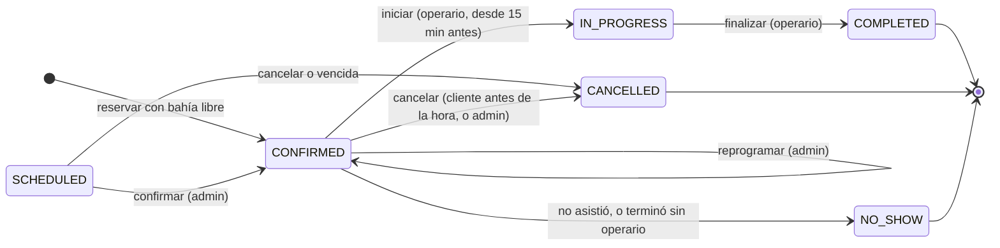
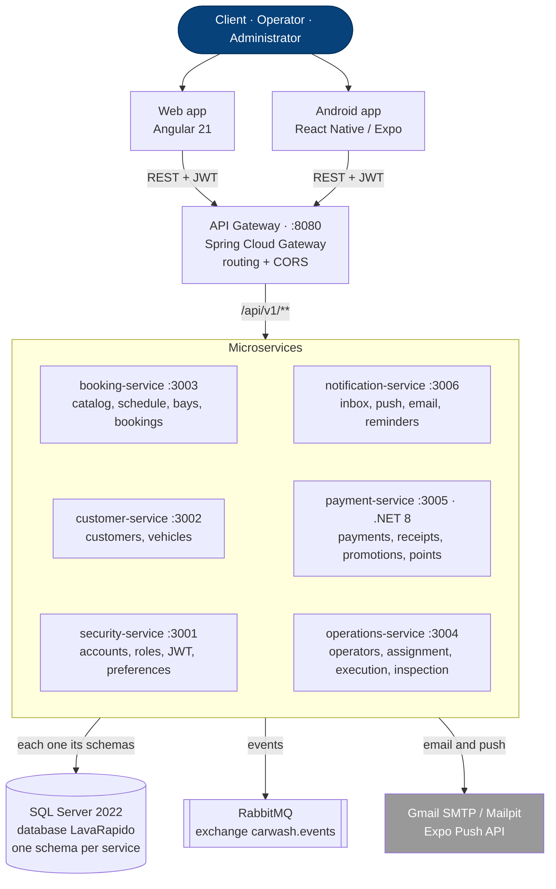
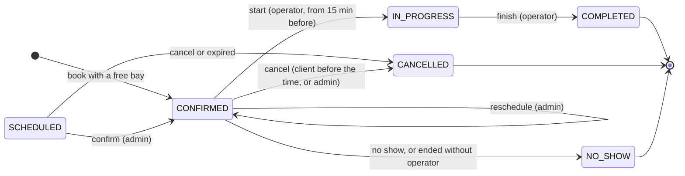

<!-- lang: es -->
<!-- running-head: PLATAFORMA DE MICROSERVICIOS PARA UN LAVADERO VEHICULAR -->
<!-- titlepage -->

# Diseño e implementación de una plataforma de microservicios para la gestión de reservas, operación y pagos verificados en un lavadero vehicular

Brayan Estiven Patiño Cabrera, Juan Camilo Guilombo Osorio y Merari Urbano Quintero

Servicio Nacional de Aprendizaje (SENA), Centro de la Industria, la Empresa y los Servicios, Regional Huila

Tecnólogo en Análisis y Desarrollo de Software (ADSO), ficha 3145556

Instructora: Karol Daniela Correa

24 de octubre de 2026

<!-- /titlepage -->

## Resumen

Este artículo describe el diseño, la implementación y la verificación de Vehicle Washing (LavaRapido), una plataforma web y Android para un lavadero vehicular de una sola sede, desarrollada como proyecto formativo del SENA. El problema documentado es que las reservas por llamada, los registros a mano, la asignación discrecional del trabajo y los pagos en efectivo sin registro no dejan trazabilidad sobre turnos, servicios ni pagos. El trabajo siguió un enfoque de documentación de diseño de software (SDD) con siete sprints inspirados en Scrum, y su alcance evolucionó desde un servicio móvil por zonas con pasarela de pagos hacia un lavadero de sede única con pagos por QR o transferencia con comprobante revisado por el administrador, o en efectivo. La solución integra seis microservicios (cinco en Java 21 con Spring Boot 4 y uno en .NET 8) detrás de un API Gateway, SQL Server 2022 con 57 tablas, RabbitMQ y clientes en Angular 21 y React Native. Al 24 de octubre de 2026, con la versión *v1.0.0* etiquetada en 9 de los 10 repositorios de código y *develop* desplegado ese día en el servidor público, 38 de los 41 requisitos funcionales estaban implementados y 3 eran parciales, y la ejecución completa del 26 de octubre aprobó 1 311 pruebas automatizadas (100 de ellas de la app móvil); el 21 de octubre se habían ejecutado 707, incluidas 7 de persistencia contra una base aislada, y 19 pruebas de punta a punta contra el sistema completo, también aprobadas; los 42 casos funcionales pasaron el 19 de octubre de 2026. El sistema corre además en un servidor público en Azure. Desde el 19 de octubre de 2026, cada repositorio compila y corre sus pruebas con GitHub Actions en cada cambio. Quedan pendientes los reportes consolidados y la validación con personas usuarias. Los beneficios operativos siguen siendo una hipótesis, porque no se han medido con personas usuarias reales.

*Palabras clave:* microservicios, arquitectura hexagonal, sistema de reservas, lavado vehicular, pagos con código QR, documentación de diseño de software

<!-- pagebreak -->

# Diseño e implementación de una plataforma de microservicios para la gestión de reservas, operación y pagos verificados en un lavadero vehicular

Un lavadero vehicular de una sola sede coordina tres actividades que dependen unas de otras: recibir solicitudes de clientes, repartir el trabajo entre operarios y cobrar por los servicios prestados. Cuando estas actividades se resuelven con llamadas, visitas al local y anotaciones a mano, el negocio pierde la información necesaria para saber qué turnos están libres, quién realizó cada servicio y qué pagos corresponden a qué reservas. Este artículo presenta Vehicle Washing, llamado internamente *LavaRapido*, una plataforma que el equipo del proyecto diseñó e implementó para centralizar ese flujo, y reporta el estado verificado de su construcción.

### Planteamiento del Problema

La especificación de requisitos de software (SRS) formula el problema como pregunta: ¿de qué manera un sistema digital puede organizar las reservas, la asignación de operarios, el registro de pagos y el seguimiento de los servicios en un lavadero de vehículos, para reducir los errores operativos y mejorar la experiencia del cliente? (Guilombo Osorio et al., 2026). Según la misma especificación, la disponibilidad de un turno no se conoce hasta llegar al local, las reservas se anotan a mano y se cruzan con facilidad, el operario depende de instrucciones verbales para saber qué servicio le corresponde, un pago en efectivo no queda ligado a la reserva y no existe un historial que permita revisar el servicio prestado ni la calificación del cliente.

La documentación del proyecto coincide con esta descripción: los clientes debían llamar o desplazarse hasta el local sin saber si había un turno libre; las reservas se llevaban a mano, los turnos se superponían, el trabajo se asignaba a criterio del administrador y los pagos en efectivo no dejaban registro del cliente (Equipo de Desarrollo Vehicle Washing, 2026b). Estas prácticas pueden causar reservas superpuestas, viajes inútiles de los clientes, responsabilidad poco clara sobre el trabajo e historial operativo incompleto.

La misma documentación advierte que esta descripción es una **hipótesis documentada del proyecto y no el resultado de una investigación de campo**: no se han recogido cifras de errores de reserva, de viajes perdidos, de tiempos ni de adopción (Equipo de Desarrollo Vehicle Washing, 2026b). Por esa razón, este artículo no atribuye al sistema mejoras operativas medidas; se limita a reportar lo que se diseñó, se construyó y se verificó.

El problema se formula, entonces, en estos términos: los clientes de un lavadero de una sola sede necesitan reservar con disponibilidad confiable y pagar de forma trazable, mientras que los operarios y el administrador necesitan una vista compartida del trabajo, porque las llamadas, las visitas y la coordinación manuscrita no ofrecen un registro consistente de turnos, asignaciones, ejecución del servicio y pagos.

### Justificación

El sistema atiende a tres roles sin formación técnica: el cliente, dueño del vehículo; el operario, que realiza el lavado; y el administrador, dueño o gerente del negocio. Cada uno necesita información distinta: el cliente, saber qué reservó y qué pagó; el operario, saber qué servicios tiene asignados; y el administrador, operar el negocio a partir de registros confiables (Equipo de Desarrollo Vehicle Washing, 2026b). Un sistema único con permisos por rol permite que una misma acción, como confirmar una reserva o aprobar un pago, quede registrada y visible para quien la necesita.

El proyecto también se justifica por sus restricciones. El tratamiento de datos personales debe cumplir la Ley Estatutaria 1581 de 2012 (Congreso de la República de Colombia, 2012), y el pago no puede depender de una pasarela comercial ni recoger datos de tarjetas, porque el negocio cobra por transferencia a sus propias cuentas (Nequi, Daviplata, transferencia bancaria) o en efectivo. Finalmente, como proyecto formativo, el trabajo sirve para aplicar y documentar prácticas de arquitectura, pruebas y gestión de la calidad en un caso concreto.

### Objetivos

Los objetivos vigentes del proyecto están en la versión 8.0 de la SRS (Guilombo Osorio et al., 2026).

**Objetivo general.** Desarrollar un sistema web y móvil que organice la reserva, la asignación de operarios, el pago y el seguimiento de los lavados en un lavadero de vehículos, garantizando que cada bahía y cada operario se asignen sin cruces de horario y que cada pago quede asociado a su reserva.

**Objetivos específicos.**

1. Permitir que el cliente registre sus vehículos y reserve un servicio en un horario disponible desde la web o la aplicación Android.
2. Validar el horario del local y la disponibilidad de las bahías antes de confirmar una reserva, y ofrecer horas alternativas cuando el turno esté ocupado.
3. Asignar operarios sin cruces de horario, bloqueando a quien no esté en turno, esté ausente o ya tenga una reserva a esa hora.
4. Registrar los pagos por QR, transferencia o efectivo, con la revisión del comprobante por parte del administrador.
5. Construir un módulo administrativo para gestionar catálogo, precios, horario, bahías, operarios, pagos, promociones y reportes.
6. Permitir que el cliente califique cada servicio completado y acumule puntos que desbloquean promociones.

### Evolución del Alcance

Estos objetivos son el resultado de una redefinición del alcance. La propuesta técnica y económica y la primera versión de la SRS (V2, 8 de septiembre de 2026) describían un servicio *móvil*, en el que el operario se desplaza hasta el cliente, con zonas de cobertura, asignación automática de operarios por cercanía y una pasarela de pagos en línea (Patiño Cabrera et al., 2025). La versión 3 de la SRS (6 de octubre de 2026) adoptó el alcance real: un lavadero de una sola sede al que el cliente lleva su vehículo, pago por QR o transferencia con comprobante revisado por el administrador, o en efectivo registrado por el administrador, y arquitectura de microservicios; la versión 4 (8 de octubre de 2026) reestructuró el documento y verificó el estado de cada requisito contra el código, y las versiones 5 a 7 (9 a 16 de octubre de 2026) actualizaron ese estado a medida que se cerraban los requisitos pendientes (Guilombo Osorio et al., 2026). El servicio a domicilio y las pasarelas de pago en línea quedaron explícitamente fuera del alcance.

El objetivo de este artículo es describir el diseño, la implementación y la verificación de la plataforma, y analizar sus resultados y limitaciones a partir de la evidencia disponible en el código y en la documentación del proyecto.

## Marco Conceptual

La documentación del proyecto no incluye una revisión de sistemas comparables de gestión de lavaderos ni de estudios del sector en Colombia (véase el Apéndice). Por ello, esta sección presenta los conceptos técnicos en los que se apoyan las decisiones de diseño.

### Microservicios y Propiedad de los Datos

Una arquitectura de microservicios organiza el software en servicios que se despliegan de forma independiente, se construyen alrededor de una capacidad del negocio y son dueños de sus datos (Newman, 2021). Este estilo facilita que cada parte evolucione por separado, pero introduce problemas propios de los sistemas distribuidos, como la consistencia entre servicios y la publicación confiable de eventos, para los que existen patrones como Saga y Outbox (Richardson, 2018). Elegir qué patrones adoptar, y documentar por qué se descartan otros, es parte del diseño.

### Diseño Guiado por el Dominio y Arquitectura Hexagonal

El diseño guiado por el dominio propone modelar el software alrededor del lenguaje y las reglas del negocio, con agregados que mantienen sus invariantes y objetos de valor definidos por sus atributos (Evans, 2004). La arquitectura hexagonal, o de puertos y adaptadores, complementa esa idea: el núcleo de la aplicación no depende de la base de datos, del framework ni de la mensajería, que se conectan mediante adaptadores (Cockburn, 2005). La combinación permite probar las reglas del negocio sin infraestructura.

### Integración Síncrona y Asíncrona

Las interfaces externas del sistema siguen el estilo arquitectónico REST (Fielding, 2000), y sus errores se expresan con el formato estándar *Problem Details for HTTP APIs* (Nottingham et al., 2023). Para el trabajo que puede ocurrir después de una transacción, como enviar una notificación, se usa mensajería de publicación y suscripción, en la que un emisor publica un evento sin conocer a sus consumidores (Hohpe y Woolf, 2003).

### Seguridad de la Aplicación

La autenticación sin estado se apoya en JSON Web Tokens (JWT), tokens firmados que transportan la identidad y los roles de la persona usuaria (Jones et al., 2015). Las contraseñas se almacenan con BCrypt, una función de derivación con costo ajustable (Provos y Mazières, 1999). La lista OWASP Top 10 sirve como referencia para revisar los riesgos más comunes de las aplicaciones web (OWASP Foundation, 2021).

### Gestión de la Calidad del Software

El proyecto toma como marco de sus acciones correctivas, preventivas y de mejora los procesos de mantenimiento y aseguramiento de la calidad de la ISO/IEC/IEEE 12207 (International Organization for Standardization [ISO] et al., 2017), los tipos de mantenimiento de la ISO/IEC/IEEE 14764 (ISO et al., 2022) y la mejora continua de la ISO 9001 (ISO, 2015). Las decisiones de arquitectura se registran como *Architecture Decision Records* (ADR), documentos breves que recogen el contexto, la decisión y sus consecuencias (Nygard, 2011), y las pruebas se escriben siguiendo el desarrollo guiado por pruebas (Beck, 2003). La investigación sobre desempeño en la entrega de software asocia la integración continua y la automatización de pruebas con mejores resultados de entrega (Forsgren et al., 2018).

## Método

### Tipo de Estudio

Se trata de un trabajo de desarrollo tecnológico aplicado, presentado como estudio de caso único y de alcance descriptivo. La unidad de análisis es el sistema construido. La evidencia proviene de los artefactos del proyecto: el código de once repositorios, la documentación de diseño (requisitos, quince ADR, modelos de datos, contratos OpenAPI), los manuales técnicos verificados contra el código y los registros de pruebas y de acciones de mejora (Patiño Cabrera et al., 2026a, 2026b). La SRS, en su versión 8.0, sigue la estructura de IEEE 830 (IEEE, 1998) y los contenidos de ISO/IEC/IEEE 29148 (ISO/IEC/IEEE, 2018), y define 41 requisitos funcionales, 12 requisitos no funcionales clasificados según el modelo de calidad de ISO/IEC 25010 (ISO/IEC, 2023), 32 casos de uso y una matriz de trazabilidad con el estado de cada requisito (Guilombo Osorio et al., 2026).

### Contexto y Participantes

El sistema se diseñó para un único lavadero con horarios fijos y operarios asignados. Lo desarrolló un equipo de tres aprendices de tiempo parcial (líder de proyecto, líder de frontend y líder de backend), con la orientación de una instructora técnica, sin financiación asignada y con equipos propios y herramientas gratuitas (Equipo de Desarrollo Vehicle Washing, 2026b).

**No se estudió una población de personas usuarias.** El plan de descubrimiento del proyecto prevé entrevistas semiestructuradas con al menos tres clientes, dos operarios y un administrador, la observación de una jornada de servicio y un recorrido del prototipo por cada rol, pero todas sus hipótesis (D-01 a D-10) figuran como pendientes de validación (Equipo de Desarrollo Vehicle Washing, 2026b) (véase el Apéndice).

### Proceso de Desarrollo

El equipo aplicó documentación de diseño de software (SDD), un enfoque en el que el diseño documentado precede y guía la implementación, la documentación se actualiza con cada cambio y cada requisito se rastrea hasta sus pruebas. El proceso se organizó en cuatro fases con puntos de control: descubrimiento (contexto, dominio y producto), definición (requisitos, arquitectura, datos y API), diseño detallado (UML, servicios y experiencia de usuario) e implementación con pruebas y operación (Equipo de Desarrollo Vehicle Washing, 2026b).

La gestión del trabajo adaptó prácticas de Scrum (Schwaber y Sutherland, 2020) al calendario académico. La instructora técnica actuó como *Product Owner* y aprobó el cierre de cada sprint; el líder de proyecto actuó como *Scrum Master*. El plan de actividades organizó 21 historias de usuario (151 puntos de historia) en siete sprints de entre dos y seis semanas, programados del 1 de enero al 15 de julio: inicio y planeación, requerimientos, diseño técnico, modelado y preparación del desarrollo, dos fases de construcción del software, e implementación y cierre (Equipo de Desarrollo Vehicle Washing, 2026a). Los registros de verificación más recientes del código y de los manuales son del 16 de octubre de 2026, posteriores al cierre planeado; las fechas reales de cada sprint no están registradas. Las convenciones del equipo definieron, además, planificación, revisión y retrospectiva por sprint, reuniones diarias asíncronas por mensajería, estimación con una escala de puntos de 1 a 13 mediante *Planning Poker* y un backlog en hoja de cálculo complementado con *issues* de GitHub. El código se integró con un flujo de ramas *feature*, *develop* y *main*, y cada decisión de arquitectura relevante se registró como ADR (quince al cierre de este informe).

### Técnicas e Instrumentos de Verificación

La verificación combinó cinco instrumentos:

1. Una estrategia de pruebas en pirámide: pruebas unitarias del dominio, pruebas de casos de uso con dobles de prueba, pruebas de la capa web con la configuración real de seguridad, pruebas de integración con vecinos simulados y pruebas de punta a punta automatizadas contra el sistema completo en Docker.
2. Una matriz de trazabilidad que relaciona cada requisito funcional con su historia de usuario, sus pruebas y su servicio responsable.
3. La verificación cruzada de los manuales contra el código de los once repositorios (rama *develop* al 16 de octubre de 2026), que registra las discrepancias encontradas (Patiño Cabrera et al., 2026b).
4. Un registro de acciones correctivas, preventivas y de mejoramiento con análisis de causa raíz e indicadores de seguimiento (Patiño Cabrera et al., 2026a).
5. Una lista de casos de prueba de aceptación (CA-01 a CA-16) definida en el procedimiento de implementación (Patiño Cabrera et al., 2026c).

### Herramientas

La Tabla 1 resume la pila tecnológica, tomada de los archivos de construcción de cada repositorio.

**Tabla 1**

*Pila Tecnológica del Sistema*

| Capa | Tecnología |
|---|---|
| Servicios de backend (cinco) y gateway | Java 21, Spring Boot 4.0.8, Spring Cloud Gateway 2025.1 |
| Servicio de pagos | C#, .NET 8, ASP.NET Core, Entity Framework Core |
| Base de datos y migraciones | SQL Server 2022; Liquibase (un changelog por servicio) |
| Mensajería | RabbitMQ 4 (exchange de tipo topic *carwash.events*) |
| Cliente web | Angular 21, Angular Material, ngx-translate, TypeScript 5.9 |
| Cliente móvil | React Native 0.86 con Expo SDK 57 (Android) |
| Correo y notificaciones push | SMTP (Mailpit en desarrollo o Gmail); Expo Push API |
| Pruebas | JUnit 5, Mockito y Spring Boot Test; xUnit; Vitest |
| Contenedores y control de versiones | Docker y Docker Compose; Git y GitHub |

*Nota.* Elaborado a partir del manual técnico (Patiño Cabrera et al., 2026b). La integración continua se hace con GitHub Actions en los 10 repositorios; el despliegue en Azure se hace por SSH con *update-server.sh*, y el despliegue continuo (cada fusión aprobada a *main* llega sola al servidor) está fusionado en *develop* desde el 24 de octubre de 2026, a falta de crear sus secretos.

Los dos clientes separan la vista de su lógica con el patrón MVVM: en la web cada página de Angular usa un ViewModel con señales (36 en total) y en la app cada pantalla usa un hook de React con el estado y las acciones; los cambios de la app que no tocan código nativo se entregan por internet con EAS Update, y los nativos, con un APK nuevo que la app obliga a instalar.

### Procedimiento de Análisis

El estado de los requisitos se tomó de la matriz de trazabilidad de la SRS, verificada contra el código el 21 de octubre de 2026 (Guilombo Osorio et al., 2026). Las pruebas se volvieron a ejecutar el 21 de octubre de 2026: las suites de cada servicio Java con el Maven Wrapper, las de payment-service con el SDK de .NET (destino *net8.0*), las de la web con Vitest y las pruebas de punta a punta de *lavarapido-infra/e2e* contra el sistema completo; los 42 casos funcionales se ejecutaron el 19 de octubre de 2026.

## Resultados

### Arquitectura Implementada

El backend quedó compuesto por seis microservicios de dominio detrás de un API Gateway (Figura 1). Los clientes web y móvil llaman solo al gateway, que enruta las rutas */api/v1/\** hacia el servicio dueño y no verifica la firma de los tokens: cada servicio verifica el JWT por sí mismo. Desde el 21 de octubre de 2026 el gateway sí confirma con security-service que la sesión del token siga abierta, de modo que un token deja de servir cuando se cierra la sesión. Los cinco servicios Java siguen la arquitectura hexagonal (dominio, aplicación e infraestructura, con un dominio que no importa Spring ni JPA), y el servicio de pagos sigue una arquitectura por capas en .NET con el mismo contrato de seguridad y de errores (Patiño Cabrera et al., 2026b).

**Figura 1**

*Diagrama de Contenedores del Sistema*

*Nota.* Adaptado del manual técnico (Patiño Cabrera et al., 2026b), con el número de tablas y los publicadores de eventos actualizados al 16 de octubre de 2026.

Por razones académicas, todos los servicios comparten una instancia y una base de datos de SQL Server, pero cada esquema tiene exactamente un servicio dueño y no existen claves foráneas entre esquemas de servicios distintos (ADR-003). La Tabla 2 muestra la distribución resultante.

**Tabla 2**

*Servicios, Responsabilidades y Tablas Propias*

| Servicio | Tecnología | Responsabilidad principal | Esquemas | Tablas |
|---|---|---|---|---|
| security-service | Java | Cuentas, roles, sesiones, bloqueo por intentos fallidos, recuperación de contraseña, preferencias y consentimiento | security, audit | 12 |
| customer-service | Java | Perfil del cliente y vehículos | customer | 3 |
| booking-service | Java | Catálogo, precios, horario, bahías, disponibilidad y reservas | catalog, booking | 13 |
| operations-service | Java | Operarios, turnos, ausencias, asignación automática y manual, ejecución, calificaciones e informes de inspección | execution | 11 |
| payment-service | .NET 8 | Pagos con comprobante, reembolsos, cupones y puntos de fidelización | payment, promotion | 12 |
| notification-service | Java | Bandeja, push, correo y recordatorios | notification | 6 |
| **Total** | | | **9 esquemas** | **57** |

*Nota.* Elaborado a partir del manual técnico (Patiño Cabrera et al., 2026b).

La comunicación síncrona (REST) se usa cuando quien llama necesita una respuesta para continuar, por ejemplo, cuando el servicio de reservas consulta al servicio de clientes si el vehículo pertenece a quien reserva. La comunicación asíncrona usa un solo exchange de RabbitMQ y doce tipos de evento publicados (entre ellos *BookingConfirmed*, *OperatorAssigned*, *PaymentConfirmed* y *LoyaltyPointsEarned*), con entrega al menos una vez, consumo idempotente por identificador de evento, tres reintentos y cola de mensajes muertos. El equipo decidió explícitamente no adoptar Outbox, Saga, CQRS ni base de datos por servicio en esta versión; la consecuencia aceptada es que un evento puede perderse si un servicio se detiene entre la confirmación de la transacción y la publicación (Patiño Cabrera et al., 2026b).

### Reglas del Negocio e Integridad de los Datos

Las reglas más críticas no dependen solo del código de la aplicación, sino que se garantizan también en la base de datos (Tabla 3). La disponibilidad se calcula sobre una rejilla de 30 minutos dentro del horario de atención, hasta 60 días adelante y con al menos una bahía libre durante toda la duración del servicio; si el turno solicitado ya está ocupado, no se guarda nada y el sistema devuelve hasta cinco horas alternativas del mismo día.

**Tabla 3**

*Reglas de Integridad Seleccionadas y Mecanismo que las Garantiza*

| Regla | Mecanismo |
|---|---|
| Dos reservas activas no pueden ocupar la misma bahía en horarios superpuestos | Disparador *tr_booking_bay_overlap* y validación en booking-service |
| El precio de una línea de reserva no cambia si cambia el catálogo | Disparador *tr_service_price_immutable* |
| Como máximo un pago aprobado por reserva | Índice único *ux_payment_one_approved_per_booking* y payment-service |
| Una referencia de transacción no se puede reutilizar | payment-service (409 *TRANSACTION_REFERENCE_REUSED*) |
| El operario asignado debe estar activo, de turno, no ausente y no ocupado | Política *AssignmentPolicy* en operations-service |
| Dos movimientos de puntos del mismo cliente no se calculan sobre el mismo saldo | Columna *sequence_no* única por cliente |

*Nota.* Selección de la tabla de reglas de integridad del manual técnico (Patiño Cabrera et al., 2026b).

La reserva, la asignación y el pago tienen ciclos de vida independientes, de modo que una reserva confirmada no hace parecer aprobado un pago pendiente. La Figura 2 muestra el ciclo de vida de la reserva; el pago recorre los estados PENDING, IN_REVIEW, APPROVED o REJECTED, y un pago aprobado puede pasar a REFUNDED.

**Figura 2**

*Diagrama de Estados de la Reserva*

*Nota.* Los estados en gris son finales. *Vencida*: el sistema cancela la reserva programada que nadie confirmó una hora después de su hora de fin; *terminó sin operario*: en el mismo plazo, la confirmada que nunca tuvo operario pasa a NO_SHOW. La confirmada con operario que nadie registró la cierra el administrador. Tomado del manual técnico (Patiño Cabrera et al., 2026b), con las etiquetas traducidas.

### Cumplimiento de los Requisitos Funcionales

La SRS define 41 requisitos funcionales: los 29 originales (RF-001 a RF-026, con RF-004b, RF-012b y RF-013b), 9 que se incorporaron en la versión 4.0 porque describían funciones ya construidas (RF-027 a RF-035) y 3 de la versión 6.0 (RF-036 a RF-038: informe de inspección, datos del negocio y ficha del operario). La Tabla 4 resume su estado al 21 de octubre de 2026: 40 implementados (98 %) y 1 parcial.

**Tabla 4**

*Estado de los Requisitos Funcionales al 24 de Octubre de 2026*

| Estado | Cantidad | Requisitos | Observación |
|---|---|---|---|
| Implementado | 38 | RF-001 a RF-004 (con RF-004b), RF-006 a RF-014 (con RF-012b y RF-013b), RF-016 a RF-022 y RF-024 a RF-038 | Construidos y verificados contra el código y las pruebas |
| Parcial | 3 | RF-005, RF-015 y RF-023 | Funcionan con un caso pendiente: la web reserva un solo servicio aunque la API acepta varios, el historial de pagos de la web no usa los filtros de la API y faltan los reportes consolidados por periodo |

*Nota.* Elaborado a partir de la matriz de trazabilidad de la SRS, versión 8.0 (Guilombo Osorio et al., 2026).

Dos decisiones se tomaron mediante ADR. La asignación de operarios se construyó primero como asignación manual del administrador, apoyada en una lista de candidatos con el motivo por el que cada operario no está disponible (ADR-014); sobre esa misma política se agregó después la asignación automática al confirmarse la reserva, que respeta el operario que el cliente elige si sigue libre. Las promociones se rediseñaron como cupones de descuento porcentual que se desbloquean con el saldo de puntos, sin consumirlos (ADR-015).

De los 12 requisitos no funcionales, 3 están implementados y 9 son parciales (Guilombo Osorio et al., 2026). Los implementados son el tiempo de respuesta (el percentil 95 más alto, medido el 14 de octubre de 2026, fue de 686 ms frente a una meta de 2 segundos), la idempotencia de los eventos y la tolerancia a fallos de los servicios externos. La disponibilidad y la seguridad siguen parciales: la máquina virtual del servidor se enciende bajo demanda (el 24 de octubre de 2026 quedó desplegada con los 11 contenedores sanos) y, aunque desde ese día el gateway revisa la sesión del token con cualquier esquema y limita las solicitudes del inicio de sesión, quedan secretos antiguos en el historial. Los otros parciales son la integridad y la concurrencia (las reservas y las asignaciones ya se hacen una a la vez con candados de la base de datos, pero faltan pruebas de integración contra SQL Server), la observabilidad, la mantenibilidad, la portabilidad, la compatibilidad (las pantallas web no se salen de 360 px, pero falta probar en un dispositivo con Android 8), la usabilidad (sin prueba con personas usuarias) y la localización.

### Resultados de las Pruebas

La ejecución completa sobre *develop* del 26 de octubre de 2026 aprobó 1 311 pruebas automatizadas (1 211 de la web y el backend y 100 de la app móvil), ninguna fallida; las 12 de persistencia de payment-service se omiten sin la base aislada (el 24 de octubre eran 1 192, el 23 de octubre 838 y el 21 de octubre 707), y en la ejecución completa del 21 de octubre siete de ellas corrieron contra una base de pruebas aislada (Tabla 5). Ese mismo día pasaron las 19 pruebas de punta a punta de *lavarapido-infra/e2e*, que recorren el sistema completo: reserva con elección de operario y asignación automática, flujo de los tres roles con pago, aprobación, puntos, ejecución y calificación, informe de inspección con fotos y enlace público, y reglas de acceso por rol, ya con el chequeo de sesión del gateway activo. La SRS registraba 347 pruebas el 6 de octubre (Guilombo Osorio et al., 2026); la diferencia corresponde a las pruebas que se agregaron con cada función nueva.

**Tabla 5**

*Resultados de la Ejecución de las Pruebas Automatizadas (26 de Octubre de 2026)*

| Componente | Casos | Aprobados | Fallidos | Omitidos |
|---|---|---|---|---|
| Aplicación web (Angular) | 239 | 239 | 0 | 0 |
| api-gateway | 62 | 62 | 0 | 0 |
| security-service | 200 | 200 | 0 | 0 |
| customer-service | 82 | 82 | 0 | 0 |
| booking-service | 133 | 133 | 0 | 0 |
| operations-service | 110 | 110 | 0 | 0 |
| notification-service | 133 | 133 | 0 | 0 |
| payment-service (.NET) | 264 | 252 | 0 | 12 |
| Aplicación móvil (React Native) | 100 | 100 | 0 | 0 |
| **Total** | **1 323** | **1 311** | **0** | **12** |

*Nota.* Ejecución completa sobre *develop* de cada repositorio el 26 de octubre de 2026: *./mvnw* en los servicios Java, *dotnet test* en payment-service (sin la base aislada, por eso se omiten las 12 de persistencia), *ng test* en la web y *npm test* en la app móvil. Las 19 pruebas de punta a punta no se incluyen en la tabla.

Además, los 42 casos funcionales de la documentación de pruebas se ejecutaron el 19 de octubre de 2026 contra el sistema completo, todos aprobados. En cambio, **no hay resultados registrados de los casos de aceptación CA-01 a CA-16** con el responsable del negocio, no se mide la cobertura de código y los servicios Java no tienen pruebas de persistencia contra un SQL Server real fuera de la suite de punta a punta.

### Seguridad

La Tabla 6 resume la revisión del sistema frente a OWASP Top 10. Siete categorías tienen controles aplicados (en A02, el servidor público ya usa HTTPS), una se revisa manualmente y dos están aplicadas parcialmente; ya no queda ninguna con brecha.

**Tabla 6**

*Estado de los Controles Frente a OWASP Top 10:2021*

| Estado | Categorías | Controles principales |
|---|---|---|
| Aplicado | A01, A02, A03, A04, A05, A08, A10 | Rol por ruta y verificación de propiedad en cada servicio; BCrypt con costo 12; consultas parametrizadas; misma respuesta para correos desconocidos; sin trazas de pila en las respuestas |
| Manual | A06 | Revisión de dependencias vulnerables antes de cada entrega; el 16 de octubre de 2026 la web quedó sin vulnerabilidades conocidas |
| Parcial | A09 | Registros sin datos personales y con identificador de correlación; la tabla de auditoría existe pero no se alimenta |
| Aplicado | A07 | Bloqueo de la cuenta durante 15 minutos tras cinco intentos fallidos y, desde el 24 de octubre de 2026, límite de 60 solicitudes por minuto por IP en el inicio de sesión y sesión revisada con cualquier esquema del encabezado |

*Nota.* Elaborado a partir de la lista de verificación OWASP del manual técnico (Patiño Cabrera et al., 2026b; OWASP Foundation, 2021).

Respecto de la protección de datos personales, el registro exige aceptar los términos y la política de tratamiento de datos, y el servidor guarda la fecha y la hora de cada aceptación, lo que permite demostrar el consentimiento exigido por la Ley 1581 de 2012 (Congreso de la República de Colombia, 2012). La opción del perfil que se llamaba "Eliminar cuenta" pasó a llamarse "Desactivar mi cuenta", porque la cuenta se desactiva y su historial se conserva.

### Gestión de Defectos y Mejora Continua

Al 21 de octubre de 2026, el registro de acciones contenía 52 acciones correctivas cerradas, 3 correctivas abiertas, 18 preventivas y 16 de mejoramiento, de las cuales 8 ya están cerradas (Patiño Cabrera et al., 2026a). El indicador de cierre de correctivas subió de 64 % el 9 de octubre a 95 % (52 de 55), por encima de la meta de 70 %, y la reincidencia fue de 0 %. Ya no quedan correctivas abiertas de severidad P0 ni P1: el bloqueo de cuenta (AC-25) y el registro del consentimiento (AC-26) se cerraron con pruebas. Entre las correcciones cerradas figuran defectos de alto impacto, como horas de reserva desplazadas cinco horas por el manejo de zonas horarias (AC-01), la posibilidad de pagar dos reservas con la misma referencia de transacción (AC-07), un libro de puntos sin reversión ni control de concurrencia (AC-09) dos solicitudes simultáneas que intentaban crear el mismo operario (AC-35) y un token que seguía sirviendo hasta una hora después de cerrar sesión (AC-44).

La verificación cruzada de los manuales contra el código encontró 19 discrepancias entre el código, la documentación del proyecto y las versiones anteriores de los manuales, por ejemplo, la versión del framework, el número de tablas, la validación de tokens en el gateway y el modo de asignación de operarios (Patiño Cabrera et al., 2026b). La revisión del 16 de octubre de 2026 cerró las que seguían abiertas y llevó los manuales a la versión 4.0, con capturas reales del sistema.

### Costos

El proyecto no tuvo financiación asignada; se desarrolló con equipos de los integrantes y herramientas gratuitas o de nivel gratuito. La propuesta técnica y económica estimó el costo del proyecto en condiciones reales en COP 148.173.000 (Patiño Cabrera et al., 2025), distribuidos como muestra la Tabla 7. El 79 % del costo corresponde al recurso humano.

**Tabla 7**

*Presupuesto Estimado del Proyecto en Condiciones Reales*

| Rubro | Detalle | Valor (COP) |
|---|---|---|
| Hardware | Cuatro computadores portátiles (Core i7 o Ryzen 7, 16–32 GB de RAM) a 5.500.000 cada uno, monitores, periféricos, enrutador y disco externo | 27.500.000 |
| Software | Licencia de Windows 10 Pro; el resto de las herramientas es gratuito | 400.000 |
| Servidores | Servidor virtual (VPS), almacenamiento para respaldos, licencia de Windows Server y memoria adicional | 273.000 |
| Recurso humano | Líder de proyecto (40.000.000), analista y desarrollador frontend (32.000.000), diseñadora de la base de datos y documentadora (15.000.000) y desarrollo backend conjunto (30.000.000) | 117.000.000 |
| Otros | Sin desglose en la propuesta | 3.000.000 |
| **Total** | | **148.173.000** |

*Nota.* Elaborado a partir de la propuesta técnica y económica y de su hoja de cálculo de hardware, software, servidores y recurso humano (Patiño Cabrera et al., 2025). La propuesta se calculó sobre la pila tecnológica inicial (Windows 10 Pro, MySQL y arquitectura en capas), anterior al cambio a microservicios y SQL Server.

### Resultados con Personas Usuarias

**No hay resultados medidos con personas usuarias.** El sistema ya corre en un servidor público en Azure, que el equipo enciende para las revisiones, pero todavía no lo han usado clientes reales; el procedimiento de implementación propone un piloto controlado de una semana con un grupo reducido de clientes antes del corte definitivo (Patiño Cabrera et al., 2026c), y el proyecto definió las medidas de éxito que se deben capturar como línea base: flujos de reserva completados, conflictos de reserva, servicios con estado final, pagos conciliados con reservas, calificaciones y notificaciones leídas (Equipo de Desarrollo Vehicle Washing, 2026b). El plan de actividades también incluía la validación de requisitos con el cliente y pruebas finales con el cliente en el último sprint (Equipo de Desarrollo Vehicle Washing, 2026a), pero en los documentos revisados no hay registros de sus resultados.

## Discusión

Los resultados muestran que el equipo construyó una plataforma funcional que cubre el flujo principal del negocio: un cliente puede registrarse, registrar su vehículo, reservar un turno con disponibilidad real y elegir operario si quiere, pagar por QR o transferencia con comprobante, o en efectivo, y calificar el servicio, y el administrador y los operarios pueden gestionar la operación. Con 40 de 41 requisitos funcionales implementados, el producto está prácticamente completo; solo faltan los reportes consolidados por periodo. La asignación automática y la elección del operario, que en la versión anterior de este artículo figuraban como pendientes, se construyeron sobre la misma política de la asignación manual. El contraste entre requisitos funcionales (98 % implementados) y no funcionales (5 de 12 implementados) muestra que el esfuerzo se concentró primero en la funcionalidad; las cualidades que dependen de medir con personas usuarias o en dispositivos reales siguen sin evidencia.

La decisión de usar microservicios para un solo lavadero merece discusión. Newman (2021) presenta este estilo como una forma de lograr despliegues independientes y propiedad clara de los datos, a costa de la complejidad de un sistema distribuido. El proyecto mitigó parte de esa complejidad con decisiones pragmáticas y documentadas: una sola instancia de base de datos con un dueño por esquema en lugar de una base por servicio (ADR-003), comunicación REST solo cuando se necesita una respuesta inmediata (ADR-004) y la renuncia explícita a patrones como Outbox o Saga (Richardson, 2018). El costo de esa simplificación quedó registrado como riesgo aceptado: la posible pérdida de un evento entre la confirmación de la transacción y su publicación.

La arquitectura también evolucionó respecto de lo planeado. La propuesta técnica eligió una arquitectura en N capas con MySQL para reducir el riesgo técnico y el costo inicial, y dejó la migración a microservicios como una ruta de evolución si la demanda crecía (Patiño Cabrera et al., 2025). El equipo adoptó los microservicios desde la primera versión, primero con una descomposición más fina y luego con seis servicios (ADR-002, reemplazado por ADR-009), y cambió MySQL por SQL Server. De igual forma, el alcance pasó de un servicio móvil por zonas con pasarela de pagos a un lavadero de sede única con pagos por QR o transferencia con comprobante revisado por el administrador, o en efectivo. Estos cambios simplificaron el dominio (sin geolocalización, rutas ni integración con una pasarela externa) y evitaron recoger datos de tarjetas, pero dejaron sin cumplir, en su forma original, los objetivos de asignación automática por cercanía, pasarela en línea y reserva según la disponibilidad geográfica.

Garantizar las reglas críticas en la base de datos, y no solo en el código, resultó adecuado para un dominio con concurrencia: dos clientes que reservan la misma bahía o dos administradores que aprueban el mismo pago no dependen de que el código de la aplicación sea correcto en todos sus caminos. Con el mismo criterio, desde el 21 de octubre de 2026 la asignación manual y la automática de un operario se hacen una a la vez con un candado de SQL Server. La revisión del equipo encontró además un riesgo en la primera versión del cierre automático de reservas, del mismo día: marcaba como No asistió toda reserva confirmada que nadie iniciaba, de modo que un servicio atendido pero no registrado habría quedado como ausencia del cliente en el historial y en los reportes. El diseño se cambió para que el sistema decida solo cuando está seguro (la reserva que nunca tuvo operario) y deje las demás al administrador en una lista de reservas por cerrar. Las pruebas de persistencia de payment-service que cubren estos casos existen, pero necesitan una base de pruebas dedicada; la suite de punta a punta sí ejercita esas reglas contra el SQL Server real del entorno Docker.

La aplicación de la arquitectura hexagonal (Cockburn, 2005) se refleja en la forma de las pruebas: 1 311 de las 1 323 pruebas automatizadas se ejecutan sin base de datos, porque prueban el dominio, los casos de uso y la capa web con dobles de prueba en lugar de la infraestructura real, lo que las hace rápidas y deterministas. Desde el 19 de octubre de 2026 esas pruebas corren solas en cada cambio con GitHub Actions; sin embargo, la ausencia de medición de cobertura limita la confianza que estas cifras pueden dar, y la suite de punta a punta, que prueba los servicios integrados, todavía se corre a mano. La investigación de Forsgren et al. (2018) asocia la integración continua y la automatización de pruebas con un mejor desempeño en la entrega de software; por eso el proyecto cerró su deuda técnica TD-006 con GitHub Actions.

La verificación cruzada entre documentación y código fue uno de los aportes más útiles del proceso: las 19 discrepancias encontradas muestran que, incluso con un enfoque que pone el diseño antes del código, la documentación se desactualiza si no se modifica en el mismo cambio que el código, como recoge la lección aprendida L-09 del proyecto (Patiño Cabrera et al., 2026a). Los ADR (Nygard, 2011) permitieron que los cambios de alcance, como la asignación manual de operarios, quedaran justificados en lugar de aparecer como incumplimientos silenciosos.

### Limitaciones

Este trabajo tiene limitaciones importantes. Primera, no hay evidencia con personas usuarias: el problema es una hipótesis documentada, no se ejecutaron los casos de aceptación y no hubo piloto, por lo que no se puede afirmar que el sistema reduzca conflictos, viajes perdidos o tiempos de gestión. Segunda, el servidor público es una sola máquina virtual que se enciende bajo demanda, sin alta disponibilidad ni un entorno de pruebas separado; desde el 21 de octubre de 2026 la base se respalda y se verifica todos los días, pero las copias quedan en el mismo disco. Tercera, la verificación automatizada no incluye cobertura medida ni pruebas de persistencia de los servicios Java contra la base de datos real fuera de la suite de punta a punta. Cuarta, siguen abiertas mejoras de seguridad como un límite de solicitudes en toda la API (desde el 24 de octubre de 2026 solo lo tiene el inicio de sesión), la auditoría poblada y un inicio de sesión de base de datos por servicio. Quinta, la SRS deja abiertas decisiones de negocio y de cumplimiento: si el pago debe estar aprobado antes de iniciar el servicio, la aplicación real de la matriz de permisos y una política de retención y supresión de datos personales (Guilombo Osorio et al., 2026). Sexta, el caso es único y de pequeña escala, por lo que sus conclusiones no se pueden generalizar a otros negocios.

## Conclusiones

El proyecto diseñó e implementó una plataforma de microservicios para un lavadero vehicular de una sola sede que integra reservas con disponibilidad real, asignación automática y manual del trabajo, ejecución, pagos por QR o transferencia con comprobante revisado por el administrador o en efectivo, notificaciones, fidelización e informes de inspección. La arquitectura resultante, con seis servicios de dominio, un gateway, una base de datos de 57 tablas con un dueño por esquema y mensajería asíncrona, se documentó en quince ADR y se verificó contra el código. Frente a los seis objetivos específicos de la SRS, se cumplieron el registro de vehículos y la reserva desde la web y Android, la validación del horario y de las bahías con horas alternativas, la asignación de operarios sin cruces de horario, el registro de pagos con revisión del comprobante y la calificación con puntos que desbloquean promociones; el módulo administrativo está construido, salvo los reportes consolidados por periodo, que son la única brecha frente a los requisitos. Respecto de la propuesta original, el servicio móvil por zonas y la pasarela de pagos en línea se retiraron del alcance.

El estado verificado es favorable en lo técnico: 38 de 41 requisitos funcionales implementados y 3 parciales, 1 311 pruebas automatizadas en la ejecución completa del 26 de octubre, 19 pruebas de punta a punta y 42 casos funcionales aprobados sin fallos, y el sistema desplegado en un servidor público con HTTPS. Las reglas críticas del negocio se garantizan en la base de datos, lo que protege el sistema frente a la concurrencia en reservas, asignaciones, pagos y puntos.

Al mismo tiempo, falta lo más importante para operar con personas usuarias reales: la validación con el negocio. También falta correr contra el servidor público la batería de punta a punta nueva y liberar la versión *v1.1.0*. Por tanto, los beneficios operativos planteados en el problema siguen siendo una hipótesis que este trabajo no confirma ni refuta.

Como trabajo futuro, la propia documentación propone: ejecutar los casos de aceptación y un piloto controlado que establezca la línea base de las medidas de éxito; llevar a la integración continua las pruebas de punta a punta; agregar pruebas de persistencia con SQL Server real y medición de cobertura; completar los reportes consolidados por periodo; extender el límite de solicitudes a toda la API; y, si el proyecto sale del ámbito académico, adoptar firma RS256, tokens de actualización, Outbox, auditoría poblada y una base de datos o un inicio de sesión de base de datos por servicio (Patiño Cabrera et al., 2026b).

## Referencias

Beck, K. (2003). *Test-driven development: By example*. Addison-Wesley.

Cockburn, A. (2005). *Hexagonal architecture*. https://alistair.cockburn.us/hexagonal-architecture/

Congreso de la República de Colombia. (2012). *Ley Estatutaria 1581 de 2012, por la cual se dictan disposiciones generales para la protección de datos personales*. http://www.secretariasenado.gov.co/senado/basedoc/ley_1581_2012.html

Equipo de Desarrollo Vehicle Washing. (2026a). *Plan de actividades Scrum del proyecto LavaRapido* (scrum1.1) [Hoja de cálculo no publicada]. Servicio Nacional de Aprendizaje.

Equipo de Desarrollo Vehicle Washing. (2026b). *Vehicle washing management system: Project documentation* (vehicle-w-docs) [Documentación de proyecto no publicada]. GitHub. https://github.com/code-sena/vehicle-w-docs

Evans, E. (2004). *Domain-driven design: Tackling complexity in the heart of software*. Addison-Wesley.

Fielding, R. T. (2000). *Architectural styles and the design of network-based software architectures* [Tesis doctoral, University of California, Irvine]. https://ics.uci.edu/~fielding/pubs/dissertation/top.htm

Forsgren, N., Humble, J., y Kim, G. (2018). *Accelerate: The science of lean software and DevOps: Building and scaling high performing technology organizations*. IT Revolution Press.

Guilombo Osorio, J. C., Patiño Cabrera, B. E., y Urbano Quintero, M. (2026). *Especificación de requisitos de software (SRS) del sistema LavaRápido: Plataforma web y móvil de reservas y gestión para un lavadero de vehículos* (Versión 8.0) [Documento no publicado]. Servicio Nacional de Aprendizaje.

Hohpe, G., y Woolf, B. (2003). *Enterprise integration patterns: Designing, building, and deploying messaging solutions*. Addison-Wesley.

IEEE. (1998). *IEEE recommended practice for software requirements specifications* (IEEE Std 830-1998). https://doi.org/10.1109/IEEESTD.1998.88286

International Organization for Standardization. (2015). *Quality management systems — Requirements* (ISO 9001:2015). https://www.iso.org/standard/62085.html

International Organization for Standardization, International Electrotechnical Commission e Institute of Electrical and Electronics Engineers. (2017). *Systems and software engineering — Software life cycle processes* (ISO/IEC/IEEE 12207:2017). https://www.iso.org/standard/63712.html

International Organization for Standardization, International Electrotechnical Commission e Institute of Electrical and Electronics Engineers. (2022). *Software engineering — Software life cycle processes — Maintenance* (ISO/IEC/IEEE 14764:2022). https://www.iso.org/standard/80710.html

ISO/IEC. (2023). *Systems and software engineering — Systems and software Quality Requirements and Evaluation (SQuaRE) — Product quality model* (ISO/IEC 25010:2023). https://www.iso.org/standard/78176.html

ISO/IEC/IEEE. (2018). *Systems and software engineering — Life cycle processes — Requirements engineering* (ISO/IEC/IEEE 29148:2018). https://www.iso.org/standard/72089.html

Jones, M., Bradley, J., y Sakimura, N. (2015). *JSON Web Token (JWT)* (RFC 7519). Internet Engineering Task Force. https://www.rfc-editor.org/rfc/rfc7519

Newman, S. (2021). *Building microservices: Designing fine-grained systems* (2.ª ed.). O'Reilly Media.

Nottingham, M., Wilde, E., y Dalal, S. (2023). *Problem details for HTTP APIs* (RFC 9457). Internet Engineering Task Force. https://www.rfc-editor.org/rfc/rfc9457

Nygard, M. (2011, 15 de noviembre). *Documenting architecture decisions*. Cognitect. https://cognitect.com/blog/2011/11/15/documenting-architecture-decisions

OWASP Foundation. (2021). *OWASP Top 10:2021*. https://owasp.org/Top10/

Patiño Cabrera, B. E., Guilombo Osorio, J. C., y Urbano, M. (2025). *Propuesta técnica y económica: Sistema integral para la gestión de servicios móviles de lavado vehicular* [Documento no publicado]. Servicio Nacional de Aprendizaje.

Patiño Cabrera, B. E., Guilombo Osorio, J. C., y Urbano, M. (2026a). *Documentación de acciones correctivas, preventivas y de mejoramiento del software: Sistema de Gestión de Lavado Vehicular (Vehicle Washing)* (Versión 2.7) [Documento no publicado]. Servicio Nacional de Aprendizaje.

Patiño Cabrera, B. E., Guilombo Osorio, J. C., y Urbano, M. (2026b). *Manual técnico: Sistema de Gestión de Lavado Vehicular (Vehicle Washing)* (Versión 4.7) [Documento no publicado]. Servicio Nacional de Aprendizaje.

Patiño Cabrera, B. E., Guilombo Osorio, J. C., y Urbano, M. (2026c). *Procedimiento de implementación del software: Sistema de Gestión de Lavado Vehicular (Vehicle Washing)* (Versión 2.6) [Documento no publicado]. Servicio Nacional de Aprendizaje.

Provos, N., y Mazières, D. (1999). A future-adaptable password scheme. En *Proceedings of the 1999 USENIX Annual Technical Conference, FREENIX Track* (pp. 81–91). USENIX Association.

Richardson, C. (2018). *Microservices patterns: With examples in Java*. Manning Publications.

Schwaber, K., y Sutherland, J. (2020). *The Scrum guide: The definitive guide to Scrum: The rules of the game*. https://scrumguides.org/scrum-guide.html

## Apéndice

### Información No Disponible en los Documentos del Proyecto

La Tabla A1 lista la información que no se encontró en las carpetas revisadas (documentación del proyecto, repositorios de código y entregable final) y que limita las conclusiones del artículo. Si se obtiene, debe incorporarse en una versión posterior.

**Tabla A1**

*Información No Disponible y Efecto en el Artículo*

| N.° | Información | Situación en los documentos | Efecto en el artículo |
|---|---|---|---|
| 1 | Resultados con personas usuarias | Los casos CA-01 a CA-16, la validación con el cliente y las pruebas finales con el cliente no tienen resultados registrados; las hipótesis D-01 a D-10 siguen pendientes | No se reportan beneficios operativos; se declara como limitación |
| 2 | Antecedentes de sistemas comparables | No hay revisión de sistemas de reservas para lavaderos ni estudios del sector | El marco se limita a conceptos técnicos |
| 3 | Fechas reales de los sprints | El plan de actividades solo registra fechas estimadas (1 de enero a 15 de julio) | Se reportan como fechas planeadas |
| 4 | Pruebas pendientes | 7 pruebas de persistencia de payment-service omitidas sin una base de pruebas dedicada | La Tabla 5 reporta solo lo ejecutado |

*Nota.* Elaborado por los autores a partir de la revisión de las carpetas del proyecto.

<!-- lang: en -->
<!-- running-head: MICROSERVICES PLATFORM FOR A CAR WASH -->
<!-- titlepage -->

# Design and Implementation of a Microservices Platform for Booking, Operations, and Verified Payment Management at a Car Wash

Brayan Estiven Patiño Cabrera, Juan Camilo Guilombo Osorio, and Merari Urbano Quintero

Servicio Nacional de Aprendizaje (SENA), Centro de la Industria, la Empresa y los Servicios, Huila Regional Office

Technologist in Software Analysis and Development (ADSO), Ficha 3145556

Instructor: Karol Daniela Correa

October 24, 2026

<!-- /titlepage -->

## Abstract

This article describes the design, implementation, and verification of Vehicle Washing (LavaRapido), a web and Android platform for a single-location car wash, developed as a training project in SENA's Technologist in Software Analysis and Development program. The documented problem is that bookings made by phone or in person, handwritten records, discretionary work assignment, and unrecorded cash payments leave no traceability over time slots, service execution, or payments. The work followed a software design documentation (SDD) approach with seven Scrum-inspired sprints. The scope evolved from a mobile, zone-based service with a payment gateway to a single-location car wash with payments by QR or transfer with a receipt reviewed by the administrator, or in cash. The solution consists of six domain microservices (five in Java 21 with Spring Boot 4 and one in .NET 8) behind an API gateway, a SQL Server 2022 database with nine schemas and 57 tables, RabbitMQ messaging, and Angular 21 and React Native clients. As of October 24, 2026, with version *v1.0.0* tagged in 9 of the 10 code repositories and *develop* deployed that day to the public server, 38 of the 41 functional requirements were implemented and 3 were partial, and the latest CI passed 1,192 automated tests (73 of them in the mobile app); on October 21, 707 had been run, including 7 persistence tests against an isolated database, and 19 end-to-end tests against the complete system also passed; the 42 functional cases passed on October 19, 2026. The system also runs on a public server on Azure. Since October 19, 2026, each repository builds and runs its tests with GitHub Actions on every change. The consolidated reports and the validation with users are still pending. The operational benefits for the business remain a hypothesis, because they have not yet been measured with real users.

*Keywords:* microservices, hexagonal architecture, booking system, car wash, QR code payments, software design documentation

<!-- pagebreak -->

# Design and Implementation of a Microservices Platform for Booking, Operations, and Verified Payment Management at a Car Wash

A single-location car wash coordinates three interdependent activities: receiving customer requests, distributing work among operators, and charging for the services provided. When these activities are handled through phone calls, walk-ins, and handwritten notes, the business loses the information it needs to know which time slots are free, who performed each service, and which payments correspond to which bookings. This article presents Vehicle Washing, internally called *LavaRapido*, a platform the project team designed and implemented to centralize that flow, and reports the verified status of its construction.

### Problem Statement

The software requirements specification (SRS) states the problem as a question: how can a digital system organize bookings, operator assignment, payment recording, and service tracking at a car wash, in order to reduce operational errors and improve the customer experience? (Guilombo Osorio et al., 2026). According to the same specification, the availability of a slot is not known until arriving at the shop, bookings are written down by hand and easily overlap, operators depend on verbal instructions to know which service is theirs, a cash payment is not linked to the booking, and there is no history to review the service provided or the customer's rating.

The project documentation agrees with this description: customers had to call or drive to the shop without knowing whether a slot was free; bookings were kept by hand, slots overlapped, work was assigned at the manager's discretion, and cash payments left no customer record (Vehicle Washing Development Team, 2026b). These practices can cause overlapping bookings, wasted customer trips, unclear work ownership, and an incomplete operational history.

The same documentation warns that this description is a **documented project hypothesis, not the result of field research**: no figures on booking errors, wasted trips, times, or adoption have been collected (Vehicle Washing Development Team, 2026b). For this reason, this article does not attribute measured operational improvements to the system; it reports only what was designed, built, and verified.

The problem is therefore stated as follows: customers of a single-location car wash need to book with reliable availability and pay traceably, while operators and the administrator need a shared view of the work, because calls, walk-ins, and handwritten coordination do not provide a consistent record of slots, assignments, service execution, and payments.

### Rationale

The system serves three roles with no technical background: the customer, who owns the vehicle; the operator, who performs the wash; and the administrator, who owns or manages the business. Each needs different information: the customer needs to know what was booked and paid for; the operator needs to know which services are assigned; and the administrator needs to run the business from reliable records (Vehicle Washing Development Team, 2026b). A single system with role-based permissions lets the same action, such as confirming a booking or approving a payment, be recorded and visible to whoever needs it.

The project is also justified by its constraints. Personal data processing must comply with Colombian Statutory Law 1581 of 2012 (Congreso de la República de Colombia, 2012), and payment cannot rely on a commercial gateway or collect card data, because the business charges through transfers to its own accounts (Nequi, Daviplata, bank transfer) or in cash. Finally, as a training project, the work serves to apply and document architecture, testing, and quality management practices in a concrete case.

### Objectives

The current project objectives are stated in version 8.0 of the SRS (Guilombo Osorio et al., 2026).

**General objective.** To develop a web and mobile system that organizes booking, operator assignment, payment, and wash tracking at a car wash, ensuring that every bay and every operator is assigned without schedule overlaps and that every payment is linked to its booking.

**Specific objectives.**

1. To allow customers to register their vehicles and book a service at an available time from the web or the Android application.
2. To validate the shop's schedule and bay availability before confirming a booking, and to offer alternative times when the slot is taken.
3. To assign operators without schedule overlaps, blocking those who are not on shift, are absent, or already have a booking at that time.
4. To record payments by QR, transfer, or cash, with the receipt reviewed by the administrator.
5. To build an administrative module to manage the catalog, prices, schedule, bays, operators, payments, promotions, and reports.
6. To allow customers to rate each completed service and accumulate points that unlock promotions.

### Scope Evolution

These objectives result from a redefinition of the scope. The technical and economic proposal and the first version of the SRS (V2, September 8, 2026) described a *mobile* service, in which the operator travels to the customer, with coverage zones, automatic operator assignment by proximity, and an online payment gateway (Patiño Cabrera et al., 2025). Version 3 of the SRS (October 6, 2026) adopted the actual scope: a single-location car wash to which the customer brings the vehicle, payment by QR or transfer with a receipt reviewed by the administrator, or in cash recorded by the administrator, and a microservices architecture; version 4 (October 8, 2026) restructured the document and verified the status of every requirement against the code, and versions 5 to 7 (October 9 to 16, 2026) updated that status as the pending requirements were closed (Guilombo Osorio et al., 2026). At-home service and online payment gateways were explicitly left out of scope.

The objective of this article is to describe the design, implementation, and verification of the platform, and to analyze its results and limitations based on the evidence available in the code and in the project documentation.

## Conceptual Framework

The project documentation does not include a review of comparable car wash management systems or of industry studies in Colombia (see the Appendix). Therefore, this section presents the technical concepts on which the design decisions rest.

### Microservices and Data Ownership

A microservices architecture organizes software into services that are deployed independently, built around a business capability, and own their data (Newman, 2021). This style makes it easier for each part to evolve separately, but it introduces problems specific to distributed systems, such as consistency across services and reliable event publishing, for which patterns such as Saga and Outbox exist (Richardson, 2018). Choosing which patterns to adopt, and documenting why others are discarded, is part of the design.

### Domain-Driven Design and Hexagonal Architecture

Domain-driven design proposes modeling software around the language and rules of the business, with aggregates that maintain their invariants and value objects defined by their attributes (Evans, 2004). Hexagonal architecture, or ports and adapters, complements that idea: the application core does not depend on the database, the framework, or messaging, which are connected through adapters (Cockburn, 2005). The combination makes it possible to test business rules without infrastructure.

### Synchronous and Asynchronous Integration

The system's external interfaces follow the REST architectural style (Fielding, 2000), and their errors are expressed in the standard *Problem Details for HTTP APIs* format (Nottingham et al., 2023). For work that can happen after a transaction, such as sending a notification, the system uses publish-subscribe messaging, in which a sender publishes an event without knowing its consumers (Hohpe & Woolf, 2003).

### Application Security

Stateless authentication relies on JSON Web Tokens (JWT), signed tokens that carry the user's identity and roles (Jones et al., 2015). Passwords are stored with BCrypt, a derivation function with an adjustable cost (Provos & Mazières, 1999). The OWASP Top 10 list serves as a reference for reviewing the most common web application risks (OWASP Foundation, 2021).

### Software Quality Management

The project frames its corrective, preventive, and improvement actions within the maintenance and quality assurance processes of ISO/IEC/IEEE 12207 (International Organization for Standardization [ISO] et al., 2017), the maintenance types of ISO/IEC/IEEE 14764 (ISO et al., 2022), and the continual improvement of ISO 9001 (ISO, 2015). Architecture decisions are recorded as Architecture Decision Records (ADRs), short documents that capture the context, the decision, and its consequences (Nygard, 2011), and tests are written following test-driven development (Beck, 2003). Research on software delivery performance associates continuous integration and test automation with better delivery outcomes (Forsgren et al., 2018).

## Method

### Type of Study

This is an applied technological development work, presented as a single, descriptive case study. The unit of analysis is the system that was built. The evidence comes from the project artifacts: the code of eleven repositories, the design documentation (requirements, fifteen ADRs, data models, OpenAPI contracts), the technical manuals verified against the code, and the test and improvement action records (Patiño Cabrera et al., 2026a, 2026c). Version 8.0 of the SRS follows the structure of IEEE 830 (IEEE, 1998) and the contents of ISO/IEC/IEEE 29148 (ISO/IEC/IEEE, 2018), and defines 41 functional requirements, 12 non-functional requirements classified according to the ISO/IEC 25010 quality model (ISO/IEC, 2023), 32 use cases, and a traceability matrix with the status of each requirement (Guilombo Osorio et al., 2026).

### Context and Participants

The system was designed for a single car wash with fixed schedules and assigned operators. It was developed by a team of three part-time apprentices (project lead, frontend lead, and backend lead), guided by a technical instructor, with no assigned funding, using their own equipment and free tools (Vehicle Washing Development Team, 2026b).

**No user population was studied.** The project's discovery plan calls for semi-structured interviews with at least three customers, two operators, and one administrator, observation of a service day, and a prototype walkthrough for each role, but all of its hypotheses (D-01 to D-10) are listed as pending validation (Vehicle Washing Development Team, 2026b) (see the Appendix).

### Development Process

The team applied software design documentation (SDD), an approach in which documented design precedes and guides implementation, documentation is updated with every change, and every requirement is traced to its tests. The process was organized into four phases with gates: discovery (context, domain, and product), definition (requirements, architecture, data, and API), detailed design (UML, services, and user experience), and implementation with testing and operations (Vehicle Washing Development Team, 2026b).

Work management adapted Scrum practices (Schwaber & Sutherland, 2020) to the academic calendar. The technical instructor acted as Product Owner and approved the close of each sprint; the project lead acted as Scrum Master. The activity plan organized 21 user stories (151 story points) into seven sprints of two to six weeks, scheduled from January 1 to July 15: kickoff and planning, requirements, technical design, modeling and development preparation, two software construction phases, and implementation and closure (Vehicle Washing Development Team, 2026a). The most recent verification records of the code and manuals are dated October 16, 2026, after the planned close; the actual dates of each sprint are not recorded. The team conventions also defined sprint planning, review, and retrospective, asynchronous daily stand-ups over messaging, estimation on a 1-to-13 point scale through Planning Poker, and a spreadsheet backlog complemented by GitHub issues. Code was integrated through a *feature*, *develop*, and *main* branch flow, and every relevant architecture decision was recorded as an ADR (fifteen at the close of this report).

### Verification Techniques and Instruments

Verification combined five instruments:

1. A test pyramid strategy: domain unit tests, use case tests with test doubles, web layer tests with the real security configuration, integration tests with simulated neighbors, and automated end-to-end tests against the complete system in Docker.
2. A traceability matrix that links each functional requirement to its user story, its tests, and its responsible service.
3. Cross-verification of the manuals against the code of the eleven repositories (*develop* branch as of October 16, 2026), which records the discrepancies found (Patiño Cabrera et al., 2026c).
4. A register of corrective, preventive, and improvement actions with root cause analysis and follow-up indicators (Patiño Cabrera et al., 2026a).
5. A list of acceptance test cases (CA-01 to CA-16) defined in the implementation procedure (Patiño Cabrera et al., 2026b).

### Tools

Table 1 summarizes the technology stack, taken from the build files of each repository.

**Table 1**

*System Technology Stack*

| Layer | Technology |
|---|---|
| Backend services (five) and gateway | Java 21, Spring Boot 4.0.8, Spring Cloud Gateway 2025.1 |
| Payment service | C#, .NET 8, ASP.NET Core, Entity Framework Core |
| Database and migrations | SQL Server 2022; Liquibase (one changelog per service) |
| Messaging | RabbitMQ 4 (topic exchange *carwash.events*) |
| Web client | Angular 21, Angular Material, ngx-translate, TypeScript 5.9 |
| Mobile client | React Native 0.86 with Expo SDK 57 (Android) |
| Email and push notifications | SMTP (Mailpit in development or Gmail); Expo Push API |
| Testing | JUnit 5, Mockito, and Spring Boot Test; xUnit; Vitest |
| Containers and version control | Docker and Docker Compose; Git and GitHub |

*Note.* Based on the technical manual (Patiño Cabrera et al., 2026c). Continuous integration runs on GitHub Actions in the 10 repositories; deployment to Azure is done over SSH with *update-server.sh*, and continuous deployment (every approved merge into *main* reaches the server on its own) is merged into *develop* since October 24, 2026, with its secrets still to be created.

Both clients separate the view from its logic with the MVVM pattern: on the web each Angular page uses a ViewModel with signals (36 in total) and in the app each screen uses a React hook with the state and the actions; app changes that do not touch native code are delivered over the internet with EAS Update, and native ones with a new APK that the app requires installing.

### Analysis Procedure

The status of the requirements was taken from the SRS traceability matrix, verified against the code on October 21, 2026 (Guilombo Osorio et al., 2026). The tests were run again on October 21, 2026: the suites of each Java service with the Maven Wrapper, those of payment-service with the .NET SDK (target *net8.0*), those of the web with Vitest, and the end-to-end tests of *lavarapido-infra/e2e* against the complete system; the 42 functional cases were run on October 19, 2026.

## Results

### Implemented Architecture

The backend consists of six domain microservices behind an API gateway (Figure 1). The web and mobile clients call only the gateway, which routes */api/v1/\** paths to the owning service and does not check the token signature: each service verifies the JWT itself. Since October 21, 2026 the gateway does confirm with security-service that the session of the token is still open, so a token stops working when the session is closed. The five Java services follow the hexagonal architecture (domain, application, and infrastructure, with a domain that does not import Spring or JPA), and the payment service follows a layered architecture in .NET with the same security and error contract (Patiño Cabrera et al., 2026c).

**Figure 1**

*System Container Diagram*

*Note.* Adapted from the technical manual (Patiño Cabrera et al., 2026c), with the number of tables and the event publishers updated as of October 16, 2026.

For academic reasons, all services share one SQL Server instance and database, but each schema has exactly one owning service, and there are no foreign keys between schemas of different services (ADR-003). Table 2 shows the resulting distribution.

**Table 2**

*Services, Responsibilities, and Owned Tables*

| Service | Technology | Main responsibility | Schemas | Tables |
|---|---|---|---|---|
| security-service | Java | Accounts, roles, sessions, lockout after failed attempts, password recovery, preferences, and consent | security, audit | 12 |
| customer-service | Java | Customer profile and vehicles | customer | 3 |
| booking-service | Java | Catalog, prices, schedule, bays, availability, and bookings | catalog, booking | 13 |
| operations-service | Java | Operators, shifts, absences, automatic and manual assignment, execution, ratings, and inspection reports | execution | 11 |
| payment-service | .NET 8 | Receipt payments, refunds, coupons, and loyalty points | payment, promotion | 12 |
| notification-service | Java | Inbox, push, email, and reminders | notification | 6 |
| **Total** | | | **9 schemas** | **57** |

*Note.* Based on the technical manual (Patiño Cabrera et al., 2026c).

Synchronous communication (REST) is used when the caller needs a response to continue, for example, when the booking service asks the customer service whether the vehicle belongs to the person booking. Asynchronous communication uses a single RabbitMQ exchange and twelve published event types (among them *BookingConfirmed*, *OperatorAssigned*, *PaymentConfirmed*, and *LoyaltyPointsEarned*), with at-least-once delivery, idempotent consumption by event identifier, three retries, and a dead-letter queue. The team explicitly decided not to adopt Outbox, Saga, CQRS, or a database per service in this version; the accepted consequence is that an event can be lost if a service stops between committing the transaction and publishing (Patiño Cabrera et al., 2026c).

### Business Rules and Data Integrity

The most critical rules do not depend only on application code; they are also enforced in the database (Table 3). Availability is computed on a 30-minute grid within business hours, up to 60 days ahead, and with at least one bay free for the full duration of the service; if the requested slot is already taken, nothing is saved and the system returns up to five alternative times on the same day.

**Table 3**

*Selected Integrity Rules and the Mechanism That Enforces Them*

| Rule | Mechanism |
|---|---|
| Two active bookings cannot occupy the same bay at overlapping times | Trigger *tr_booking_bay_overlap* and validation in booking-service |
| The price of a booking line does not change if the catalog changes | Trigger *tr_service_price_immutable* |
| At most one approved payment per booking | Unique index *ux_payment_one_approved_per_booking* and payment-service |
| A transaction reference cannot be reused | payment-service (409 *TRANSACTION_REFERENCE_REUSED*) |
| The assigned operator must be active, on shift, not absent, and not busy | *AssignmentPolicy* in operations-service |
| Two point movements for the same customer cannot be computed on the same balance | Column *sequence_no*, unique per customer |

*Note.* Selected from the integrity rules table of the technical manual (Patiño Cabrera et al., 2026c).

Booking, assignment, and payment have independent life cycles, so a confirmed booking does not make a pending payment look approved. Figure 2 shows the booking life cycle; a payment moves through the states PENDING, IN_REVIEW, APPROVED or REJECTED, and an approved payment can move to REFUNDED.

**Figure 2**

*Booking State Diagram*

*Note.* Gray states are final. *Expired*: the system cancels a scheduled booking nobody confirmed one hour after its end time; *ended without operator*: in the same time, a confirmed booking that never had an operator becomes NO_SHOW. A confirmed booking with an operator that nobody recorded is closed by the administrator. Taken from the technical manual (Patiño Cabrera et al., 2026c).

### Compliance With Functional Requirements

The SRS defines 41 functional requirements: the original 29 (RF-001 to RF-026, with RF-004b, RF-012b, and RF-013b), 9 added in version 4.0 because they described functions already built (RF-027 to RF-035), and 3 from version 6.0 (RF-036 to RF-038: inspection report, business data, and operator profile). Table 4 summarizes their status as of October 21, 2026: 40 implemented (98%) and 1 partial.

**Table 4**

*Status of the Functional Requirements as of October 24, 2026*

| Status | Count | Requirements | Remark |
|---|---|---|---|
| Implemented | 38 | RF-001 to RF-004 (with RF-004b), RF-006 to RF-014 (with RF-012b and RF-013b), RF-016 to RF-022, and RF-024 to RF-038 | Built and verified against the code and the tests |
| Partial | 3 | RF-005, RF-015, and RF-023 | They work with one pending case: the web books a single service although the API accepts several, the web payment history does not use the API filters, and the consolidated reports per period are missing |

*Note.* Based on the traceability matrix of the SRS, version 8.0 (Guilombo Osorio et al., 2026).

Two decisions were made through ADRs. Operator assignment was first built as manual assignment by the administrator, supported by a candidate list that shows why each operator is not available (ADR-014); automatic assignment when a booking is confirmed was later added on top of that same policy, and it respects the operator chosen by the customer if that operator is still free. Promotions were redesigned as percentage discount coupons that are unlocked with the points balance without spending it (ADR-015).

Of the 12 non-functional requirements, 3 are implemented and 9 are partial (Guilombo Osorio et al., 2026). The implemented ones are response time (the highest 95th percentile, measured on October 14, 2026, was 686 ms against a 2-second target), event idempotency, and tolerance to failures of external services. Availability and security remain partial: the server's virtual machine is turned on on demand (on October 24, 2026 it was deployed with the 11 containers healthy) and, although since that day the gateway checks the token's session with any scheme and limits the sign-in requests, old secrets remain in the history. The other partial ones are integrity and concurrency (bookings and assignments are already made one at a time with database locks, but integration tests against SQL Server are missing), observability, maintainability, portability, compatibility (web screens do not overflow 360 px, but testing on an Android 8 device is missing), usability (no test with users), and localization.

### Test Results

The latest *develop* CI of October 24, 2026 passed 1,192 automated tests (1,119 in the web and the backend and 73 in the mobile app), none failed; the 11 payment-service persistence tests are skipped in the CI (on October 23 there were 838 and on October 21, 707), and in the complete run of October 21 seven of them ran against an isolated test database (Table 5). That same day the 19 end-to-end tests of *lavarapido-infra/e2e* passed; they run through the complete system: booking with operator choice and automatic assignment, the flow of the three roles with payment, approval, points, execution, and rating, the inspection report with photos and a public link, and access rules per role, with the gateway session check on. The SRS recorded 347 tests on October 6 (Guilombo Osorio et al., 2026); the difference corresponds to the tests added with each new function.

**Table 5**

*Results of the Automated Test Run (October 24, 2026)*

| Component | Cases | Passed | Failed | Skipped |
|---|---|---|---|---|
| Web application (Angular) | 212 | 212 | 0 | 0 |
| api-gateway | 62 | 62 | 0 | 0 |
| security-service | 200 | 200 | 0 | 0 |
| customer-service | 82 | 82 | 0 | 0 |
| booking-service | 95 | 95 | 0 | 0 |
| operations-service | 110 | 110 | 0 | 0 |
| notification-service | 133 | 133 | 0 | 0 |
| payment-service (.NET) | 236 | 225 | 0 | 11 |
| Mobile app (React Native) | 73 | 73 | 0 | 0 |
| **Total** | **1,203** | **1,192** | **0** | **11** |

*Note.* Latest GitHub Actions CI on *develop* of each repository: *./mvnw verify* in the Java services, *dotnet test* in payment-service (without the isolated database, so the 11 persistence tests are skipped), *ng test* in the web, and *npm test* in the mobile app. The 19 end-to-end tests are not included in the table.

In addition, the 42 functional cases of the test documentation were run on October 19, 2026, against the complete system, all of them passing. In contrast, **there are no recorded results for acceptance cases CA-01 to CA-16** with the business owner, code coverage is not measured, and the Java services have no persistence tests against a real SQL Server outside the end-to-end suite.

### Security

Table 6 summarizes the review of the system against the OWASP Top 10. Seven categories have controls applied (in A02, the public server already uses HTTPS), one is reviewed manually, and two are partially applied; none has a gap anymore.

**Table 6**

*Status of Controls Against the OWASP Top 10:2021*

| Status | Categories | Main controls |
|---|---|---|
| Applied | A01, A02, A03, A04, A05, A08, A10 | Role per route and ownership checks in every service; BCrypt with cost 12; parameterized queries; same response for unknown emails; no stack traces in responses |
| Manual | A06 | Review of vulnerable dependencies before each delivery; on October 16, 2026, the web had no known vulnerabilities |
| Partial | A09 | Logs without personal data and with a correlation identifier; the audit table exists but is not populated |
| Applied | A07 | Account locked for 15 minutes after five failed attempts and, since October 24, 2026, a limit of 60 requests per minute per IP on sign-in and the session checked with any header scheme |

*Note.* Based on the OWASP checklist in the technical manual (Patiño Cabrera et al., 2026c; OWASP Foundation, 2021).

Regarding personal data protection, sign-up requires accepting the terms and the data processing policy, and the server stores the date and time of each acceptance, which makes it possible to demonstrate the consent required by Law 1581 of 2012 (Congreso de la República de Colombia, 2012). The profile option formerly called "Delete account" is now called "Deactivate my account", because the account is deactivated and its history is kept.

### Defect Management and Continual Improvement

As of October 21, 2026, the actions register contained 52 closed corrective actions, 3 open corrective actions, 18 preventive actions, and 16 improvement actions, 8 of which are already closed (Patiño Cabrera et al., 2026a). The corrective closure indicator rose from 64% on October 9 to 95% (52 of 55), above the 70% target, and recurrence was 0%. No open corrective actions of P0 or P1 severity remain: account lockout (AC-25) and consent recording (AC-26) were closed with tests. The closed corrections include high-impact defects, such as booking times shifted by five hours due to time zone handling (AC-01), the possibility of paying two bookings with the same transaction reference (AC-07), a points ledger with no reversal or concurrency control (AC-09), two simultaneous requests that tried to create the same operator (AC-35), and a token that kept working up to an hour after logout (AC-44).

Cross-verification of the manuals against the code found 19 discrepancies between the code, the project documentation, and earlier versions of the manuals, for example, the framework version, the number of tables, token validation at the gateway, and the operator assignment mode (Patiño Cabrera et al., 2026c). The review of October 16, 2026, closed the ones still open and brought the manuals to version 4.0, with real screenshots of the system.

### Costs

The project had no assigned funding; it was developed with the members' own equipment and free or free-tier tools. The technical and economic proposal estimated the project cost under real conditions at COP 148,173,000 (Patiño Cabrera et al., 2025), distributed as shown in Table 7. Human resources account for 79% of the cost.

**Table 7**

*Estimated Project Budget Under Real Conditions*

| Item | Detail | Amount (COP) |
|---|---|---|
| Hardware | Four laptops (Core i7 or Ryzen 7, 16–32 GB of RAM) at 5,500,000 each, monitors, peripherals, router, and external drive | 27,500,000 |
| Software | Windows 10 Pro license; all other tools are free | 400,000 |
| Servers | Virtual private server (VPS), backup storage, Windows Server license, and additional memory | 273,000 |
| Human resources | Project lead (40,000,000), analyst and frontend developer (32,000,000), database designer and documenter (15,000,000), and joint backend development (30,000,000) | 117,000,000 |
| Other | Not itemized in the proposal | 3,000,000 |
| **Total** | | **148,173,000** |

*Note.* Based on the technical and economic proposal and its hardware, software, server, and human resources spreadsheet (Patiño Cabrera et al., 2025). The proposal was calculated on the initial technology stack (Windows 10 Pro, MySQL, and a layered architecture), before the move to microservices and SQL Server.

### Results With Users

**There are no results measured with users.** The system already runs on a public server on Azure, which the team turns on for the reviews, but real customers have not used it yet; the implementation procedure proposes a controlled one-week pilot with a small group of customers before the final cutover (Patiño Cabrera et al., 2026b), and the project defined the success measures to be captured as a baseline: completed booking flows, booking conflicts, services with a final status, payments reconciled with bookings, ratings, and read notifications (Vehicle Washing Development Team, 2026b). The activity plan also included requirements validation with the client and final tests with the client in the last sprint (Vehicle Washing Development Team, 2026a), but the documents reviewed contain no records of their results.

## Discussion

The results show that the team built a working platform that covers the main business flow: a customer can sign up, register a vehicle, book a slot with real availability and choose an operator if desired, pay by QR or transfer with a receipt, or in cash, and rate the service, and the administrator and operators can manage the operation. With 40 of 41 functional requirements implemented, the product is practically complete; only the consolidated reports per period are missing. Automatic assignment and operator choice, which the previous version of this article listed as pending, were built on top of the same policy as manual assignment. The contrast between functional requirements (98% implemented) and non-functional ones (5 of 12 implemented) shows that the effort focused first on functionality; the qualities that depend on measuring with users or on real devices still lack evidence.

The decision to use microservices for a single car wash deserves discussion. Newman (2021) presents this style as a way to achieve independent deployments and clear data ownership, at the cost of the complexity of a distributed system. The project mitigated part of that complexity with pragmatic, documented decisions: a single database instance with one owner per schema instead of a database per service (ADR-003), REST communication only when an immediate response is needed (ADR-004), and the explicit decision not to adopt patterns such as Outbox or Saga (Richardson, 2018). The cost of that simplification was recorded as an accepted risk: the possible loss of an event between committing the transaction and publishing it.

The architecture also evolved from what was planned. The technical proposal chose an N-layer architecture with MySQL to reduce technical risk and initial cost, and left the move to microservices as an evolution path if demand grew (Patiño Cabrera et al., 2025). The team adopted microservices from the first version, first with a finer decomposition and then with six services (ADR-002, superseded by ADR-009), and replaced MySQL with SQL Server. Likewise, the scope moved from a mobile, zone-based service with a payment gateway to a single-location car wash with payments by QR or transfer with a receipt reviewed by the administrator, or in cash. These changes simplified the domain (no geolocation, routes, or integration with an external gateway) and avoided collecting card data, but they left the objectives of automatic assignment by proximity, an online gateway, and booking by geographic availability unmet in their original form.

Enforcing the critical rules in the database, and not only in code, proved appropriate for a domain with concurrency: two customers booking the same bay or two administrators approving the same payment do not depend on the application code being correct on every path. With the same criterion, since October 21, 2026 the manual and the automatic assignment of an operator are made one at a time with a SQL Server lock. The team review also found a risk in the first version of the automatic close of bookings, from the same day: it marked as No-show every confirmed booking nobody started, so a service done but not recorded would have appeared as a customer absence in the history and the reports. The design was changed so that the system decides on its own only when it is sure (a booking that never had an operator) and leaves the rest to the administrator in a list of bookings to close. The payment-service persistence tests that cover these cases exist, but they need a dedicated test database; the end-to-end suite does exercise those rules against the real SQL Server of the Docker environment.

The application of hexagonal architecture (Cockburn, 2005) is reflected in the shape of the tests: 1,192 of the 1,203 automated tests run without a database, because they test the domain, the use cases, and the web layer with test doubles instead of the real infrastructure, which makes them fast and deterministic. Since October 19, 2026, these tests run automatically on every change with GitHub Actions; however, the lack of coverage measurement limits the confidence these figures can provide, and the end-to-end suite, which tests the integrated services, is still run by hand. Research by Forsgren et al. (2018) associates continuous integration and test automation with better software delivery performance, which is why the project closed its technical debt TD-006 with GitHub Actions.

Cross-verification between documentation and code was one of the most useful contributions of the process: the 19 discrepancies found show that, even with an approach that puts design before code, documentation becomes outdated if it is not changed in the same change as the code, as captured in the project's lesson learned L-09 (Patiño Cabrera et al., 2026a). The ADRs (Nygard, 2011) allowed scope changes, such as manual operator assignment, to be justified rather than appearing as silent non-compliance.

### Limitations

This work has important limitations. First, there is no evidence from users: the problem is a documented hypothesis, the acceptance cases were not run, and there was no pilot, so it cannot be claimed that the system reduces conflicts, wasted trips, or management time. Second, the public server is a single virtual machine that is turned on on demand, without high availability or a separate test environment; since October 21, 2026 the database is backed up and checked every day, but the copies stay on the same disk. Third, automated verification does not include measured coverage or persistence tests of the Java services against the real database outside the end-to-end suite. Fourth, security improvements remain open, such as a request rate limit across the whole API (since October 24, 2026 only sign-in has it), populated auditing, and one database login per service. Fifth, the SRS leaves business and compliance decisions open: whether payment must be approved before the service starts, the actual enforcement of the permissions matrix, and a policy for retaining and deleting personal data (Guilombo Osorio et al., 2026). Sixth, the case is single and small-scale, so its conclusions cannot be generalized to other businesses.

## Conclusions

The project designed and implemented a microservices platform for a single-location car wash that integrates bookings with real availability, automatic and manual work assignment, execution, payments by QR or transfer with a receipt reviewed by the administrator or in cash, notifications, loyalty, and inspection reports. The resulting architecture, with six domain services, a gateway, a 57-table database with one owner per schema, and asynchronous messaging, was documented in fifteen ADRs and verified against the code. Against the six specific objectives of the SRS, vehicle registration and booking from the web and Android, schedule and bay validation with alternative times, operator assignment without schedule overlaps, payment recording with receipt review, and ratings with points that unlock promotions were achieved; the administrative module is built, except for the consolidated reports per period, which are the only gap against the requirements. Compared with the original proposal, the mobile, zone-based service and the online payment gateway were removed from scope.

The verified status is favorable on the technical side: 38 of 41 functional requirements implemented and 3 partial, 1,192 automated tests in the latest CI, 19 end-to-end tests, and 42 functional cases passing with no failures, and the system deployed on a public server with HTTPS. The critical business rules are enforced in the database, which protects the system against concurrency in bookings, assignments, payments, and points.

At the same time, the most important step to operate with real users is still missing: validation with the business. Running the new end-to-end battery against the public server and releasing version *v1.1.0* are also missing. Therefore, the operational benefits stated in the problem remain a hypothesis that this work neither confirms nor refutes.

As future work, the documentation itself proposes: running the acceptance cases and a controlled pilot to establish the baseline for the success measures; bringing the end-to-end tests into continuous integration; adding persistence tests against a real SQL Server and coverage measurement; completing the consolidated reports per period; extending the request rate limit to the whole API; and, if the project moves beyond the academic setting, adopting RS256 signing, refresh tokens, Outbox, populated auditing, and a database or database login per service (Patiño Cabrera et al., 2026c).

## References

Beck, K. (2003). *Test-driven development: By example*. Addison-Wesley.

Cockburn, A. (2005). *Hexagonal architecture*. https://alistair.cockburn.us/hexagonal-architecture/

Congreso de la República de Colombia. (2012). *Ley Estatutaria 1581 de 2012, por la cual se dictan disposiciones generales para la protección de datos personales* [Statutory Law 1581 of 2012, which issues general provisions for the protection of personal data]. http://www.secretariasenado.gov.co/senado/basedoc/ley_1581_2012.html

Evans, E. (2004). *Domain-driven design: Tackling complexity in the heart of software*. Addison-Wesley.

Fielding, R. T. (2000). *Architectural styles and the design of network-based software architectures* [Doctoral dissertation, University of California, Irvine]. https://ics.uci.edu/~fielding/pubs/dissertation/top.htm

Forsgren, N., Humble, J., & Kim, G. (2018). *Accelerate: The science of lean software and DevOps: Building and scaling high performing technology organizations*. IT Revolution Press.

Guilombo Osorio, J. C., Patiño Cabrera, B. E., & Urbano Quintero, M. (2026). *Especificación de requisitos de software (SRS) del sistema LavaRápido: Plataforma web y móvil de reservas y gestión para un lavadero de vehículos* [Software requirements specification (SRS) of the LavaRápido system: Web and mobile booking and management platform for a car wash] (Version 8.0) [Unpublished document]. Servicio Nacional de Aprendizaje.

Hohpe, G., & Woolf, B. (2003). *Enterprise integration patterns: Designing, building, and deploying messaging solutions*. Addison-Wesley.

IEEE. (1998). *IEEE recommended practice for software requirements specifications* (IEEE Std 830-1998). https://doi.org/10.1109/IEEESTD.1998.88286

International Organization for Standardization. (2015). *Quality management systems — Requirements* (ISO 9001:2015). https://www.iso.org/standard/62085.html

International Organization for Standardization, International Electrotechnical Commission, & Institute of Electrical and Electronics Engineers. (2017). *Systems and software engineering — Software life cycle processes* (ISO/IEC/IEEE 12207:2017). https://www.iso.org/standard/63712.html

International Organization for Standardization, International Electrotechnical Commission, & Institute of Electrical and Electronics Engineers. (2022). *Software engineering — Software life cycle processes — Maintenance* (ISO/IEC/IEEE 14764:2022). https://www.iso.org/standard/80710.html

ISO/IEC. (2023). *Systems and software engineering — Systems and software Quality Requirements and Evaluation (SQuaRE) — Product quality model* (ISO/IEC 25010:2023). https://www.iso.org/standard/78176.html

ISO/IEC/IEEE. (2018). *Systems and software engineering — Life cycle processes — Requirements engineering* (ISO/IEC/IEEE 29148:2018). https://www.iso.org/standard/72089.html

Jones, M., Bradley, J., & Sakimura, N. (2015). *JSON Web Token (JWT)* (RFC 7519). Internet Engineering Task Force. https://www.rfc-editor.org/rfc/rfc7519

Newman, S. (2021). *Building microservices: Designing fine-grained systems* (2nd ed.). O'Reilly Media.

Nottingham, M., Wilde, E., & Dalal, S. (2023). *Problem details for HTTP APIs* (RFC 9457). Internet Engineering Task Force. https://www.rfc-editor.org/rfc/rfc9457

Nygard, M. (2011, November 15). *Documenting architecture decisions*. Cognitect. https://cognitect.com/blog/2011/11/15/documenting-architecture-decisions

OWASP Foundation. (2021). *OWASP Top 10:2021*. https://owasp.org/Top10/

Patiño Cabrera, B. E., Guilombo Osorio, J. C., & Urbano, M. (2025). *Propuesta técnica y económica: Sistema integral para la gestión de servicios móviles de lavado vehicular* [Technical and economic proposal: Comprehensive system for managing mobile car wash services] [Unpublished document]. Servicio Nacional de Aprendizaje.

Patiño Cabrera, B. E., Guilombo Osorio, J. C., & Urbano, M. (2026a). *Documentation of corrective, preventive, and improvement actions for the software: Vehicle Washing Management System (Vehicle Washing)* (Version 2.7) [Unpublished document]. Servicio Nacional de Aprendizaje.

Patiño Cabrera, B. E., Guilombo Osorio, J. C., & Urbano, M. (2026b). *Software implementation procedure: Vehicle Washing Management System (Vehicle Washing)* (Version 2.6) [Unpublished document]. Servicio Nacional de Aprendizaje.

Patiño Cabrera, B. E., Guilombo Osorio, J. C., & Urbano, M. (2026c). *Technical manual: Vehicle Washing Management System (Vehicle Washing)* (Version 4.7) [Unpublished document]. Servicio Nacional de Aprendizaje.

Provos, N., & Mazières, D. (1999). A future-adaptable password scheme. In *Proceedings of the 1999 USENIX Annual Technical Conference, FREENIX Track* (pp. 81–91). USENIX Association.

Richardson, C. (2018). *Microservices patterns: With examples in Java*. Manning Publications.

Schwaber, K., & Sutherland, J. (2020). *The Scrum guide: The definitive guide to Scrum: The rules of the game*. https://scrumguides.org/scrum-guide.html

Vehicle Washing Development Team. (2026a). *Plan de actividades Scrum del proyecto LavaRapido* [Scrum activity plan of the LavaRapido project] (scrum1.1) [Unpublished spreadsheet]. Servicio Nacional de Aprendizaje.

Vehicle Washing Development Team. (2026b). *Vehicle washing management system: Project documentation* (vehicle-w-docs) [Unpublished project documentation]. GitHub. https://github.com/code-sena/vehicle-w-docs

## Appendix

### Information Not Available in the Project Documents

Table A1 lists the information that was not found in the folders reviewed (project documentation, code repositories, and final deliverable) and that limits the conclusions of the article. If it is obtained, it should be incorporated into a later version.

**Table A1**

*Unavailable Information and Its Effect on the Article*

| No. | Information | Status in the documents | Effect on the article |
|---|---|---|---|
| 1 | Results with users | Cases CA-01 to CA-16, requirements validation with the client, and final tests with the client have no recorded results; hypotheses D-01 to D-10 remain pending | No operational benefits are reported; stated as a limitation |
| 2 | Background on comparable systems | No review of car wash booking systems or industry studies | The framework is limited to technical concepts |
| 3 | Actual sprint dates | The activity plan records only estimated dates (January 1 to July 15) | Reported as planned dates |
| 4 | Pending tests | 7 payment-service persistence tests skipped without a dedicated test database | Table 5 reports only what was run |

*Note.* Prepared by the authors from the review of the project folders.
