# Diseño del Software — Sistema de Lavado Vehicular

## Portada

**Tabla 1**

*Datos de identificación del documento*

| Campo | Valor |
| --- | --- |
| Proyecto | Sistema de Gestión de Lavado Vehicular (Vehicle Washing / LavaRápido) |
| Producto | Documentación de diseño del software (sección 2.5.4) |
| Programa | Tecnólogo en Análisis y Desarrollo de Software (ADSO) |
| Ficha | 3145556 |
| Aprendices | Brayan Estiven Patiño Cabrera (líder de proyecto), Juan Camilo Guilombo Osorio (líder de frontend), Merari Urbano (líder de backend) |
| Instructora | Karol Daniela Correa |
| Centro de formación | Industria |
| Fecha | 15 de octubre de 2026 |
| Versión | 1.1 |


## 1. Introducción y alcance

El sistema se compone de siete servicios de backend detrás de un API Gateway, una aplicación web en Angular 21 y una aplicación móvil en React Native (Expo 57); los tres clientes atienden a tres roles: cliente, operario y administrador.

Este documento describe el diseño tal como está construido: interfaces gráficas, modelo arquitectónico, patrones de diseño, modelo de datos y clases principales. Cada afirmación cita el archivo donde se comprueba. Los diagramas están escritos en Mermaid (Mermaid, s.f.) con notación UML. Las rutas de archivo son relativas a la carpeta `Sistema Lavado Vehicular/`.

**Tabla 2**

*Componentes del sistema y tecnología*

| Componente | Tecnología | Puerto | Carpeta |
| --- | --- | --- | --- |
| API Gateway | Spring Boot 4.0.8, Spring Cloud Gateway (WebMVC), Java 21 | 8080 | `Backend/lavarapido-api-gateway` |
| security-service | Spring Boot 4.0.8, Spring Security, JWT, Java 21 | 3001 | `Backend/security-service` |
| customer-service | Spring Boot 4.0.8, JPA, Java 21 | 3002 | `Backend/lavarapido-customer-service` |
| booking-service | Spring Boot 4.0.8, JPA, Java 21 | 3003 | `Backend/lavarapido-booking-service` |
| operations-service | Spring Boot 4.0.8, JPA, Java 21 | 3004 | `Backend/lavarapido-operations-service` |
| payment-service | ASP.NET Core 8, Entity Framework Core 8 | 3005 | `Backend/lavarapido-payment-service` |
| notification-service | Spring Boot 4.0.8, Spring Mail, Java 21 | 3006 | `Backend/lavarapido-notification-service` |
| Base de datos | SQL Server 2022 (una base, un esquema por servicio) | 1433 | `Backend/lavarapido-infra/docker-compose.yml` |
| Mensajería | RabbitMQ 4 (exchange `carwash.events`) | 5672 | `Backend/lavarapido-infra/docker-compose.yml` |
| Aplicación web | Angular 21.2.7, Angular Material, ngx-translate, Chart.js | 4200 | `Web` |
| Aplicación móvil | React Native 0.86.3, Expo ~57, React Navigation 7, i18next | 8081 (Expo) | `LavadoVehicular-Movil` |

> *Nota.* Versiones tomadas de `pom.xml`, `Directory.Build.props` y `package.json`. Documentación oficial: Spring (s.f.), Microsoft (s.f.-a, s.f.-b), RabbitMQ (s.f.), Liquibase (s.f.), Angular (s.f.), React Native (s.f.) y Expo (s.f.).

Fuera del alcance: requisitos (ver SRS v6, `lavarapido-docs/01-informe-especificacion-requisitos`), diagramas dinámicos (producto de análisis) y costos.

## 2. Interfaces gráficas

La web tiene 34 pantallas enrutadas y la app móvil 30 pantallas; ambas separan las áreas por rol y solo dejan entrar a cada usuario a la suya. En la web lo hace `authGuard` con `data.roles` (`Web/src/app/app.routes.ts:19-49`). En el móvil, `RootNavigator` registra únicamente las pantallas del rol con sesión (`LavadoVehicular-Movil/src/core/navigation/RootNavigator.tsx:63-110`).

### 2.1 Inventario de pantallas de la aplicación web

**Tabla 3**

*Pantallas de la aplicación web (Angular)*

| Ruta | Pantalla | Rol | Propósito | Servicios / endpoints que consume |
| --- | --- | --- | --- | --- |
| `/` | Landing | Público | Presentación del lavadero, servicios y contacto | `GET /establishment` (correo y teléfono del negocio) |
| `/auth` | Inicio de sesión | Público | Autenticar con correo y contraseña | `POST /auth/login` |
| `/auth/register` | Registro | Público | Crear cuenta de cliente | `POST /auth/register` |
| `/auth/forgot-password` | Recuperar contraseña (3 pasos) | Público | Correo → código → nueva contraseña | `POST /auth/password/forgot`, `/verify`, `/reset` |
| `/report/:token` | Reporte de inspección | Público | Ver el reporte compartido por el admin | `GET /public/inspections/{token}` y sus fotos |
| `/client` | Inicio del cliente | CLIENT | Resumen, próxima reserva con su operario y puntos | `GET /bookings/me`, `/vehicles`, `/loyalty/balance`, `/operators/my-bookings` |
| `/client/reserve` | Reservar | CLIENT | Elegir vehículo, servicio, fecha, hora y, si quiere, operario | `GET /catalog/services`, `/bookings/availability`, `/operators/available`; `POST /bookings` |
| `/client/payment` | Pagos | CLIENT | Pagar una reserva y subir comprobante | `GET /payment-accounts`, `/payments/me/bookings`; `POST /payments`; `/loyalty/*` |
| `/client/history` | Historial | CLIENT | Reservas pasadas, pagos y calificación | `/bookings/me`, `/payments/me`, `POST /ratings/{bookingId}` |
| `/client/vehicles` | Mis vehículos | CLIENT | CRUD de vehículos | `GET/POST/PUT/DELETE /vehicles`, `GET /vehicle-types` |
| `/client/notifications` | Notificaciones | CLIENT | Bandeja de avisos | `/notifications/*` |
| `/client/profile` | Perfil | CLIENT | Datos personales, dirección, correo y contraseña | `/users/me`, `/users/me/address`, `/users/me/password`, `/users/me/email` |
| `/client/configuration` | Configuración | CLIENT | Tema, idioma y canales de aviso | `/users/me/preferences` |
| `/admin` | Dashboard | ADMIN | Indicadores del día y alertas | `GET /admin/bookings/day-summary` y stores de reservas, pagos, operarios y horario |
| `/admin/reservations` | Reservas | ADMIN | Crear, reprogramar, cambiar estado y asignar operario | `/admin/bookings/*`, `/admin/assignments/*` |
| `/admin/reservations/:id/inspection` | Inspección | ADMIN | Recorrer las fases, registrar hallazgos con fotos, publicar y compartir | `/admin/inspections/{bookingId}/**` |
| `/admin/payments` | Pagos | ADMIN | Revisar, aprobar, rechazar y reembolsar | `/admin/payments/*` |
| `/admin/management` | Gestión | ADMIN | Usuarios, roles y permisos, servicios, promociones | `/admin/users`, `/admin/roles-permissions`, `/admin/catalog/services`, `/admin/promotions` |
| `/admin/schedule` | Horario y bahías | ADMIN | Horario semanal, excepciones y bahías | `/admin/schedule/*`, `/admin/bays/*` |
| `/admin/operators` | Operarios | ADMIN | Lista, resumen del equipo y alta de operarios | `/admin/operators`, `/admin/operators/summary`, `POST /admin/users` |
| `/admin/operators/:id` | Detalle de operario | ADMIN | Disponibilidad, ausencias, ficha y métricas de la semana | `/admin/operators/{id}/availability`, `/absences`, `/metrics`, `/admin/operators/profiles`, `PUT /admin/operators/{id}/profile` |
| `/admin/operators/:id/calendar` | Calendario del operario | ADMIN | Agenda del operario | `/admin/assignments` |
| `/admin/reports` | Reportes | ADMIN | Ingresos y servicios; exportar PDF/Excel | Stores de pagos y reservas (jsPDF, xlsx) |
| `/admin/notifications` | Notificaciones | ADMIN | Bandeja y envío de avisos | `/notifications/*`, `POST /admin/notifications` |
| `/admin/profile` | Perfil | ADMIN | Datos de la cuenta | `/users/me` |
| `/admin/settings` | Ajustes | ADMIN | Datos del negocio y medios de pago | `/admin/payment-accounts`, `GET/PUT /admin/establishment` |
| `/operator` | Inicio del operario | OPERATOR | Servicios pendientes y estadísticas | `/operator/services`, `/notifications` |
| `/operator/assigned-services` | Servicios asignados | OPERATOR | Iniciar y finalizar servicios | `POST /operator/services/{id}/start`, `/finish` |
| `/operator/schedule` | Agenda | OPERATOR | Calendario de servicios | `GET /operator/services` |
| `/operator/service-history` | Historial | OPERATOR | Servicios terminados | `GET /operator/services` |
| `/operator/qualifications` | Calificaciones | OPERATOR | Notas y comentarios recibidos | `GET /operator/ratings` |
| `/operator/notifications`, `/profile`, `/settings` | Comunes | OPERATOR | Avisos, perfil y preferencias | `/notifications/*`, `/users/me/*` |

> *Nota.* Todas las rutas de API llevan el prefijo `/api/v1` y salen por el gateway (`Web/proxy.conf.json`). Fuente: `Web/src/app/core/services/*.ts` y rutas en `features/*/*-routing-module.ts`.

### 2.2 Inventario de pantallas de la aplicación móvil

El móvil replica las áreas de la web con pantallas propias de React Native. No incluye landing, inspección ni reporte público.

**Tabla 4**

*Pantallas de la aplicación móvil (React Native / Expo)*

| Rol | Pantallas (`src/modules/<rol>/screens`) | Equivalente web |
| --- | --- | --- |
| Sin sesión | `LoginScreen`, `RegisterScreen`, `ForgotPasswordScreen` | `/auth/*` |
| CLIENT | `ClientHome`, `ClientReserve`, `ClientPayment`, `ClientHistory`, `ClientVehicles`, `ClientNotifications`, `ClientProfile`, `ClientSettings` | `/client/*` |
| OPERATOR | `OperatorHome`, `OperatorAssigned`, `OperatorSchedule`, `OperatorHistory`, `OperatorRatings`, `OperatorNotifications`, `OperatorProfile`, `OperatorSettings` | `/operator/*` |
| ADMIN | `AdminDashboard`, `AdminReservations`, `AdminPayments`, `AdminManagement`, `AdminSchedule`, `AdminOperators`, `AdminOperatorCalendar`, `AdminReports`, `AdminNotifications`, `AdminProfile`, `AdminSettings` | `/admin/*` |

> *Nota.* Si un usuario tiene varios roles, el móvil entra al de más privilegio: ADMIN, luego OPERATOR, luego CLIENT (`RootNavigator.tsx:42-46`). La sesión se guarda en el llavero del sistema con `expo-secure-store` (`src/core/storage/sessionStorage.ts:15-20`).

### 2.3 Diagrama de navegación

**Figura 1**

*Navegación de la aplicación web por rol*

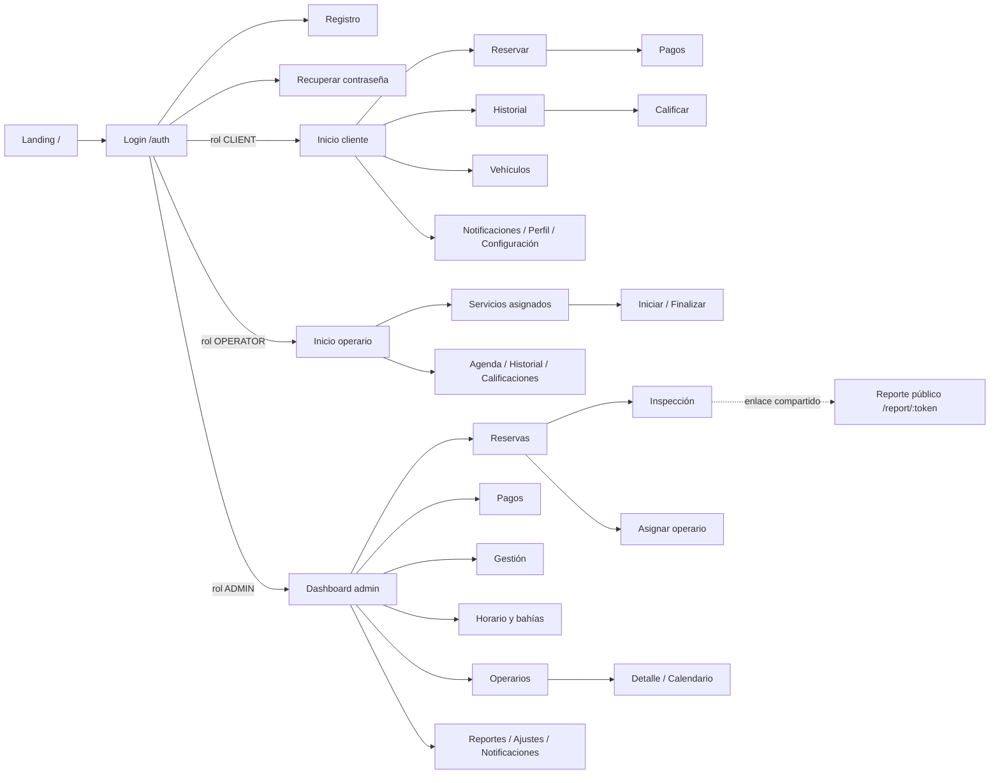

El diagrama muestra la navegación web; el móvil sigue el mismo recorrido por rol, sin landing ni inspección.

### 2.4 Capturas de pantalla

Las capturas se tomaron el 9 de octubre de 2026 con el sistema completo en ejecución: la web en Chrome a 1366 × 768 y la app móvil en su versión web (Expo) con tamaño de celular (390 × 844). Los datos visibles son de la base de desarrollo y de las pruebas funcionales.

**Figura 2**

*Página de inicio pública (web)*


**Figura 3**

*Inicio de sesión (web)*


**Figura 4**

*Inicio de sesión (aplicación móvil)*

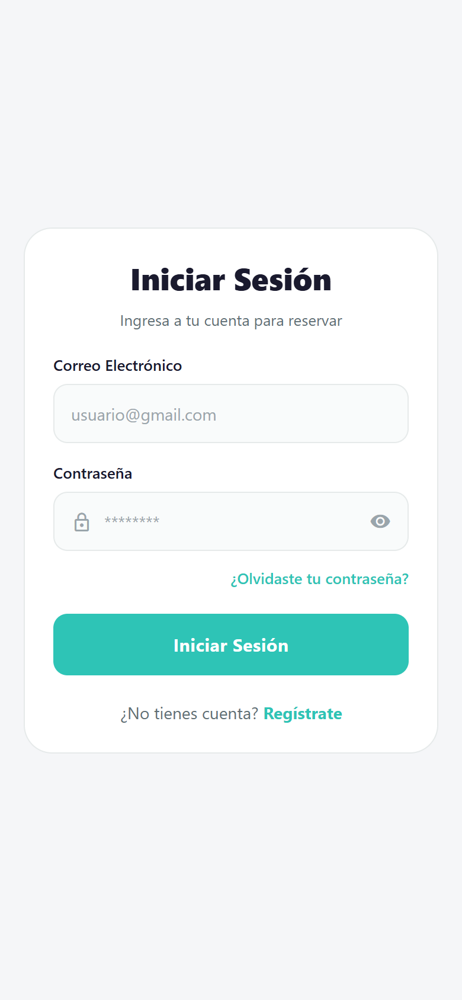

**Figura 5**

*Reservar lavado — cliente (web)*

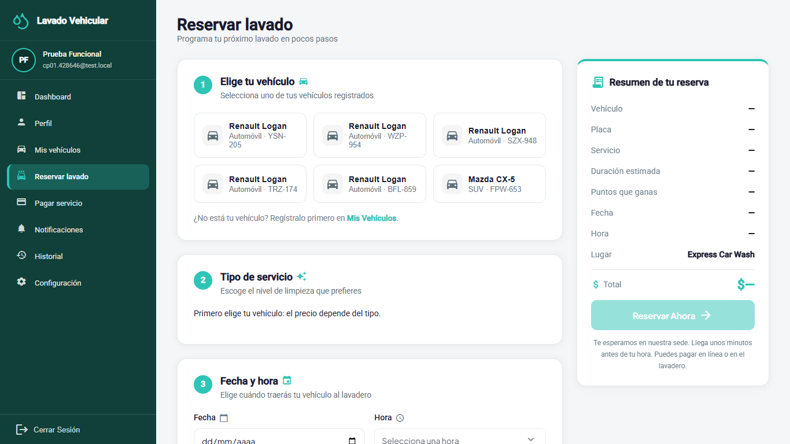

**Figura 6**

*Pagos con QR y comprobante — cliente (web)*

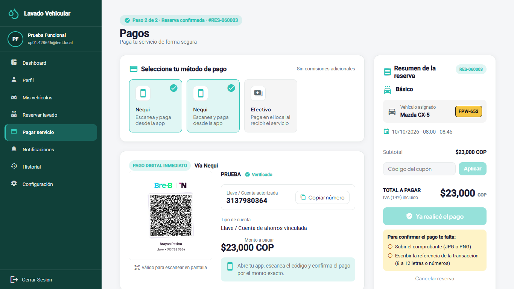

**Figura 7**

*Inicio del cliente (aplicación móvil)*


**Figura 8**

*Servicios asignados — operario (web)*

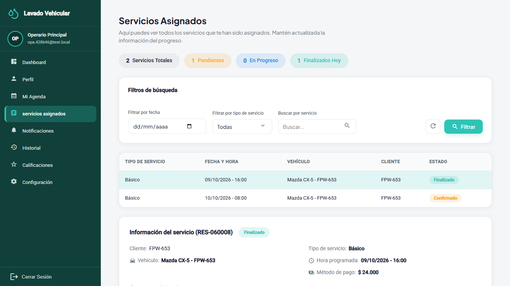

**Figura 9**

*Inicio del operario (aplicación móvil)*

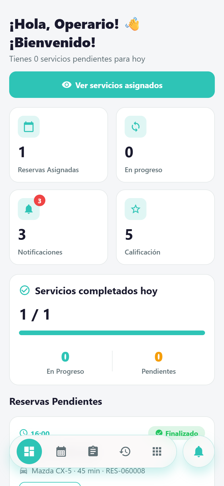

**Figura 10**

*Dashboard — administrador (web)*


**Figura 11**

*Gestión de reservas — administrador (web)*

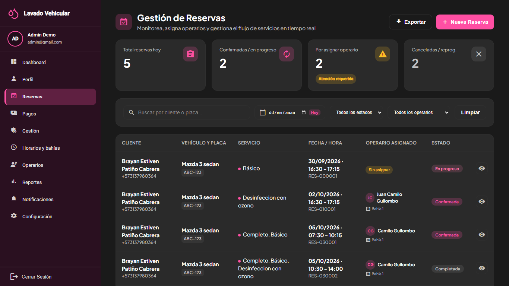

**Figura 12**

*Gestión de usuarios, roles, servicios y promociones — administrador (web)*


> *Nota.* Capturas propias tomadas con Chrome sin interfaz (headless). Las de la app móvil corresponden a su versión web; en Android la interfaz es la misma, renderizada con componentes nativos.

## 3. Modelo arquitectónico

El sistema sigue una arquitectura de microservicios (Newman, 2021): un API Gateway como punto de entrada único, seis servicios de dominio con arquitectura hexagonal, una base SQL Server separada por esquemas y RabbitMQ para eventos asíncronos.

### 3.1 Diagrama de contenedores (C4 nivel 2)

**Figura 13**

*Diagrama de contenedores del sistema (C4, nivel 2)*

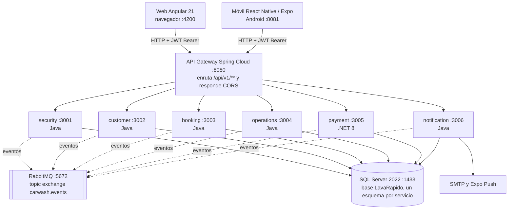

> *Nota.* Notación basada en el modelo C4 (Brown, s.f.). Los clientes solo hablan con el gateway; cada servicio valida el JWT y guarda en su propio esquema.

La web y el móvil solo llaman al puerto 8080. El gateway reenvía el encabezado `Authorization` sin validarlo; cada servicio valida el JWT por su cuenta (`Backend/lavarapido-api-gateway/src/main/resources/application.yml`, comentario de rutas, ADR-006). Las rutas `/internal/**` entre servicios no tienen ruta en el gateway y responden 404 desde afuera.

### 3.2 Responsabilidad de cada contenedor

**Tabla 5**

*Contenedores, responsabilidad y datos propios*

| Contenedor | Responsabilidad | Esquemas propios | Rutas públicas (gateway) |
| --- | --- | --- | --- |
| security-service | Registro, login con JWT y bloqueo por intentos fallidos, recuperación de contraseña, perfil y dirección, preferencias, usuarios, roles y permisos | `security`, `audit` | `/auth/**`, `/users/**`, `/admin/users/**`, `/admin/roles-permissions/**` |
| customer-service | Clientes, vehículos y tipos de vehículo | `customer` | `/vehicles/**`, `/vehicle-types/**`, `/admin/vehicles/**` |
| booking-service | Catálogo y precios, horario, bahías, disponibilidad, reservas, resumen del día y datos del negocio | `catalog`, `booking` | `/catalog/**`, `/schedule/**`, `/establishment`, `/bookings/**`, `/admin/bookings/**`, `/admin/catalog/**`, `/admin/schedule/**`, `/admin/bays/**`, `/admin/establishment`, `/operator/bookings/**` |
| operations-service | Operarios y su ficha, disponibilidad, ausencias, asignación automática y manual, ejecución, calificaciones, métricas e informe de inspección | `execution` | `/admin/operators/**`, `/operators/**`, `/admin/inspections/**`, `/public/inspections/**`, `/admin/assignments/**`, `/operator/services/**`, `/operator/ratings`, `/ratings/**` |
| payment-service (.NET) | Pagos con comprobante, cuentas de pago, promociones y puntos de fidelización | `payment`, `promotion` | `/payments/**`, `/payment-accounts`, `/admin/payments/**`, `/admin/payment-accounts/**`, `/admin/payment-methods`, `/admin/promotions/**`, `/loyalty/**` |
| notification-service | Bandeja de notificaciones, correo, push (Expo), recordatorios programados y alertas de reservas sin operario, en el idioma de cada cuenta | `notification` | `/notifications/**`, `/admin/notifications/**` |

> *Nota.* Fuente: rutas en `Backend/lavarapido-api-gateway/src/main/resources/application.yml` y changelogs Liquibase de cada servicio.

### 3.3 Comunicación entre servicios

Hay dos estilos. Las consultas que necesitan respuesta inmediata van por REST síncrono; los avisos de que algo ocurrió van como eventos por RabbitMQ.

**Tabla 6**

*Llamadas REST síncronas entre servicios*

| Origen | Destino | Para qué | Variable de entorno |
| --- | --- | --- | --- |
| booking | customer | Validar que el vehículo sea del cliente | `CUSTOMER_SERVICE_URL` |
| customer | security | Obtener el `person_id` si el evento de registro no llegó | `SECURITY_SERVICE_URL` |
| operations | booking | Leer, iniciar y terminar reservas con el token del usuario; leer reservas sin usuario para la asignación automática y los operarios libres (`/internal/v1/bookings`) | `BOOKING_SERVICE_URL`, `BOOKING_INTERNAL_URL`, `INTERNAL_API_KEY` |
| operations | security | Nombres de operarios y clientes, y si la cuenta sigue activa (ruta interna con llave compartida) | `SECURITY_SERVICE_URL`, `SECURITY_INTERNAL_URL`, `INTERNAL_API_KEY` |
| payment | booking | Consultar la reserva y su valor a pagar | `BOOKING_SERVICE_URL` |
| notification | security | Correo e idioma de cada cuenta y lista de administradores (`/internal/v1/users`) | `SECURITY_SERVICE_URL`, `INTERNAL_API_KEY` |

> *Nota.* Fuente: `Backend/lavarapido-infra/docker-compose.yml`.

**Tabla 7**

*Eventos publicados en el exchange `carwash.events`*

| Llave de ruteo | Publica | Consume |
| --- | --- | --- |
| `security.user_registered` | security | customer (crea el perfil del cliente), notification (bienvenida) |
| `customer.provisioned` | customer (solo lo escribe en el log) | Ninguno |
| `booking.confirmed` | booking | notification (aviso y recordatorios), operations (asignación automática, con el operario que eligió el cliente) |
| `booking.cancelled` | booking | notification |
| `execution.operator_assigned`, `execution.service_started`, `execution.service_completed`, `execution.inspection_shared` | operations | notification |
| `payment.confirmed`, `payment.rejected`, `payment.refunded`, `payment.promotion_redeemed`, `payment.loyalty_points_earned` | payment | notification |

> *Nota.* Fuente: `BookingEvent.java:17-18`, `ExecutionEvent.java:14-16`, `InspectionSharedEvent.java:15`, `PaymentIntegrationEvents.cs`, `CustomerProvisioned.java:15` y la lista `ROUTING_KEYS` de `notification-service/.../RabbitMessagingConfig.java`. notification escucha también `booking.created`, pero ningún servicio publica esa llave.

Las colas de notification y customer tienen su cola de mensajes muertos (dead letter). La cola de operations (`operations-service.events`, solo `booking.confirmed`) no la tiene: si la asignación automática falla, se registra en el log y la reserva queda para la alerta de reserva sin operario y la asignación manual (`BookingConfirmedListener.java`). notification guarda el `event_id` de cada evento en `notification.processed_event` para ignorar duplicados, porque la entrega es "al menos una vez" (`DomainEventConsumerService.java:61-72`). La mensajería se activa con `MESSAGING_ENABLED`; si está apagada, los servicios Java usan un publicador que solo escribe en el log (`LoggingDomainEventPublisher.java:16`).

### 3.4 Capas internas de cada servicio (hexagonal)

**Figura 14**

*Capas de un servicio con arquitectura hexagonal*

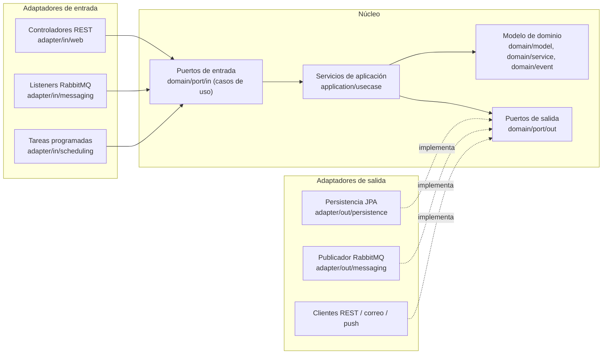

La arquitectura hexagonal separa el núcleo de dominio de la infraestructura mediante puertos y adaptadores (Cockburn, 2005); el modelado del dominio sigue a Evans (2004). Los servicios Java siguen los paquetes `domain`, `application` e `infrastructure` (por ejemplo `security-service/src/main/java/com/lavarapido/security/`). payment-service aplica la misma idea con cuatro proyectos .NET: `PaymentService.Domain`, `.Application` (con `Ports/In` y `Ports/Out`), `.Infrastructure` y `.Api`.

### 3.5 Despliegue

**Figura 15**

*Diagrama de despliegue con Docker Compose*

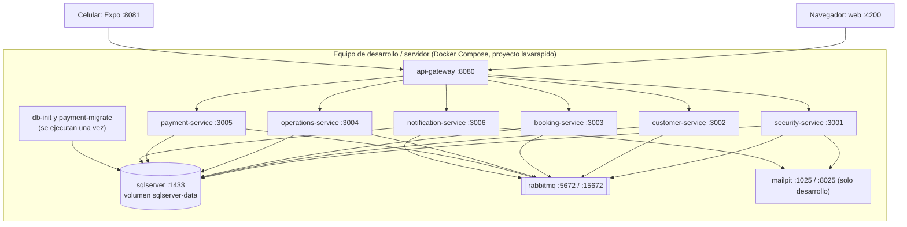

`docker compose up -d` levanta solo SQL Server, Mailpit y RabbitMQ, y los servicios se corren desde el IDE. `docker compose --profile app up -d --build` levanta además los siete servicios en contenedores (`Backend/lavarapido-infra/docker-compose.yml:1-6`). Los servicios Java crean sus tablas con Liquibase al arrancar; payment-service las crea con el contenedor `payment-migrate`.

## 4. Patrones de diseño

El código aplica 17 patrones verificables: 5 de arquitectura, 8 de diseño en el backend y 4 en los clientes. Algunos los nombra el propio código en sus comentarios (Strategy, Factory, Unit of Work). Los nombres siguen los catálogos de Gamma et al. (1994), Fowler (2002) y Hohpe y Woolf (2003).

**Tabla 8**

*Patrones de diseño identificados*

| # | Patrón | Dónde se usa | Problema que resuelve |
| --- | --- | --- | --- |
| 1 | Microservicios + API Gateway | `Backend/lavarapido-api-gateway/.../application.yml` | Un único punto de entrada para la web y el móvil; cada dominio se despliega por separado |
| 2 | Arquitectura hexagonal (puertos y adaptadores) | Paquetes `domain/port/in`, `domain/port/out`, `infrastructure/adapter` de cada servicio Java; `Ports/In`, `Ports/Out` en payment | El dominio no depende de Spring, JPA ni RabbitMQ; la infraestructura se cambia sin tocar las reglas |
| 3 | Base de datos por servicio (esquema por servicio) | Changelogs Liquibase por servicio; sin FK entre esquemas | Ningún servicio lee tablas de otro; las referencias cruzadas se validan por API |
| 4 | Publicar / suscribir (Observer distribuido) | `RabbitDomainEventPublisher.java`, `DomainEventListener.java:38`, `UserRegisteredListener.java:38` | Avisar a otros servicios sin acoplarlos ni esperar respuesta |
| 5 | Consumidor idempotente | `DomainEventConsumerService.java:61-72` + tabla `notification.processed_event` | RabbitMQ entrega "al menos una vez"; un evento repetido no genera dos notificaciones |
| 6 | Repository | `UserAccountRepository` (puerto) → `UserAccountPersistenceAdapter.java:33` → `AppUserJpaRepository.java:12` | Aislar el acceso a datos detrás de una interfaz del dominio |
| 7 | Adapter | `BCryptPasswordHasher.java:10` implementa `PasswordHasher`; `HttpAuthService` implementa `IAuthService` en el móvil | Adaptar una librería externa (BCrypt, fetch) al contrato que pide el dominio |
| 8 | Strategy | `IDiscountStrategy.cs`, `PercentageDiscountStrategy.cs`, `FixedAmountDiscountStrategy.cs` | Cada tipo de descuento calcula a su manera, sin `switch` dentro de `Promotion` |
| 9 | Factory | `DiscountStrategyFactory.cs:9-21` | Un solo lugar decide qué estrategia corresponde a cada `DiscountType` |
| 10 | Unit of Work | `IUnitOfWork.cs:8-15`, `EfUnitOfWork.cs` | Aprobar un pago y acreditar puntos se guardan juntos o no se guarda nada |
| 11 | Value Object | `EmailAddress.java:12` (record que se valida al construirse), `DocumentNumber`, `PersonName`, `HashedPassword` | Un dato inválido no puede existir dentro del dominio |
| 12 | Aggregate Root + eventos de dominio | `AggregateRoot.cs:24-39` (payment), `domain/event/*` (Java) | La entidad raíz protege sus reglas y registra lo que ocurrió |
| 13 | DTO | `LoginRequest.java:6-8` (record con validación), `dto/*` en cada servicio; `Contracts/*` en payment | Separar el contrato HTTP del modelo de dominio |
| 14 | Inyección de dependencias | `DomainConfig.java` (`@Bean`), `DependencyInjection.cs` (.NET), `inject()` en Angular, `AuthServiceProvider` en el móvil | El objeto recibe sus dependencias; en pruebas se pasan dobles |
| 15 | Null Object / implementación alterna por configuración | `LoggingDomainEventPublisher.java:16` y `NullIntegrationEventPublisher.cs` | Con `MESSAGING_ENABLED=false` el sistema funciona sin RabbitMQ |
| 16 | Guard + Interceptor (cadena de responsabilidad) | `Web/src/app/core/guards/auth-guard.ts:10-34`, `core/interceptors/auth-interceptor.ts:14-38` | Controlar el acceso por rol y adjuntar el token solo a la API propia |
| 17 | Política de dominio (Specification) | `AssignmentPolicy.java`, `AutoAssignmentPolicy.java`, `StartPolicy.java` (operations); `LoginLockout.java` (security) | Cada regla de negocio (quién puede tomar una reserva, a quién se asigna sola, desde cuándo se inicia, cuándo se bloquea una cuenta) vive en una clase pura del dominio que se prueba sin base de datos |

> *Nota.* Otros mecanismos presentes: filtro de correlación `X-Correlation-Id` (`CorrelationIdFilter.java:23-39`), stores con signals de Angular para el estado del área admin (`features/admin/services/*-store.ts`) y carga diferida de módulos por rol (`loadChildren` en `app.routes.ts`).

### 4.1 Fragmentos representativos

**Strategy + Factory** (`Backend/lavarapido-payment-service/src/PaymentService.Domain/Promotions/Discounts/DiscountStrategyFactory.cs:9-21`):

```csharp
public static class DiscountStrategyFactory
{
    private static readonly IDiscountStrategy Percentage = new PercentageDiscountStrategy();
    private static readonly IDiscountStrategy FixedAmount = new FixedAmountDiscountStrategy();

    public static IDiscountStrategy For(DiscountType type) => type switch
    {
        DiscountType.Percentage => Percentage,
        DiscountType.FixedAmount => FixedAmount,
        _ => throw new DomainException(DomainErrorCodes.PromotionDiscountUnsupported, "...")
    };
}
```

**Puerto de salida + Adapter** (`security-service/.../domain/port/out/PasswordHasher.java` y `BCryptPasswordHasher.java`):

```java
public interface PasswordHasher {
    HashedPassword hash(String raw);
    boolean matches(String raw, HashedPassword hash);
}

class BCryptPasswordHasher implements PasswordHasher {
    private final PasswordEncoder encoder;
    public boolean matches(String raw, HashedPassword hash) {
        return raw != null && encoder.matches(raw, hash.value());
    }
}
```

**Implementación alterna por configuración** (`LoggingDomainEventPublisher.java:16-17`):

```java
@ConditionalOnProperty(prefix = "app.messaging", name = "enabled", havingValue = "false", matchIfMissing = true)
class LoggingDomainEventPublisher implements DomainEventPublisher { ... }
```

**Interceptor HTTP** (`Web/src/app/core/interceptors/auth-interceptor.ts:14-25`):

```typescript
export const authInterceptor: HttpInterceptorFn = (req, next) => {
  if (!req.url.startsWith(API_BASE_URL)) {
    return next(req);
  }
  const token = inject(AuthService).accessToken();
  const request = token
    ? req.clone({ setHeaders: { Authorization: `Bearer ${token}` } })
    : req;
  ...
};
```

## 5. Modelo de datos

La base `LavaRapido` (SQL Server 2022) tiene 57 tablas en 9 esquemas, creadas por los changelogs de Liquibase de cada servicio. Las llaves foráneas solo existen dentro de un mismo esquema; las referencias a otro servicio son columnas indexadas sin FK que se validan por API.

**Tabla 9**

*Esquemas, dueño y número de tablas*

| Esquema | Servicio dueño | Tablas | Changelog |
| --- | --- | --- | --- |
| `security` | security-service | 11 | `001`–`036` en `security-service/src/main/resources/db/changelog` |
| `audit` | security-service | 1 | `002-create-security-and-audit-core.sql` |
| `customer` | customer-service | 3 | `004`, `014`, `015` |
| `catalog` | booking-service | 3 | `005`, `022` |
| `booking` | booking-service | 10 | `005`, `018`, `021`, `024`, `032` |
| `execution` | operations-service | 11 | `007`, `033`, `037` |
| `payment` | payment-service | 7 | `lavarapido-payment-service/db/changelog/changes/008`–`020` |
| `promotion` | payment-service | 5 | `003`–`007`, `017`, `018` |
| `notification` | notification-service | 6 | `010`–`031` |


### 5.1 Convenciones comunes

- **Bloque de auditoría.** Casi todas las tablas de dominio terminan con `created_at`, `created_by`, `updated_at`, `updated_by`, `deleted_at`, `deleted_by` y `row_version`. No lo tienen las tablas base de `security` (`person`, `app_user`, `role`, `permission`, `role_permission`, `user_role`, `user_session`, `password_reset_token`), `audit.audit_log`, `booking.schedule_history` ni `notification.booking_tracking`. Tampoco lo tienen completo las tablas que se agregaron en octubre (`security.login_lockout`, `security.person_address`, `execution.operator_profile`, `execution.operator_skill` y las cuatro del informe de inspección): solo guardan las columnas de fecha y autor que usan.
- **Borrado lógico.** `deleted_at` no nulo indica fila eliminada; varios índices únicos son filtrados con `WHERE deleted_at IS NULL`.
- **Concurrencia optimista.** Un trigger `tr_touch_<tabla>` actualiza `updated_at` y suma 1 a `row_version` en cada UPDATE.
- **Fechas en UTC.** Todos los valores por defecto usan `SYSUTCDATETIME()`.
- **Catálogos con código.** Los estados y tipos son tablas con `code` único (`booking_status`, `payment_status`, `execution_status`, etc.) cargadas por changelogs semilla.

### 5.2 Modelo entidad-relación

Las líneas continuas son FK reales; las punteadas son referencias lógicas a otro servicio (sin FK). Se muestran solo los atributos clave; el detalle está en el diccionario (5.4).

**Figura 16**

*Seguridad y clientes (`security`, `audit`, `customer`)*

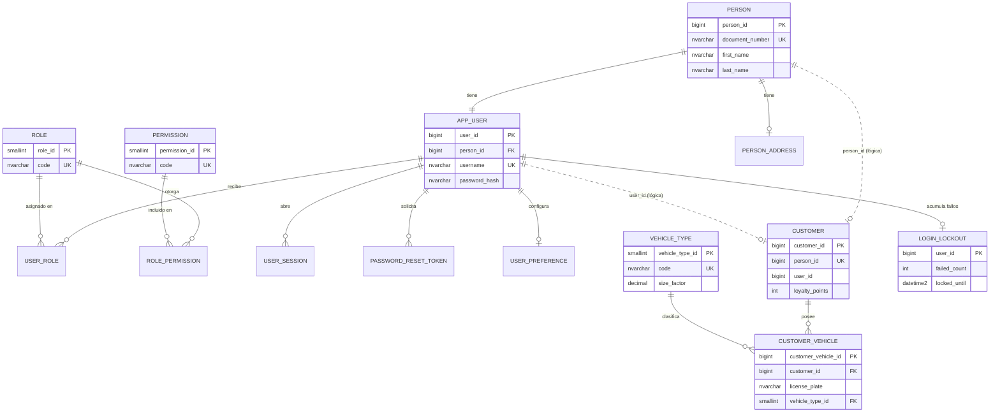

**Figura 17**

*Catálogo y reservas (`catalog`, `booking`)*

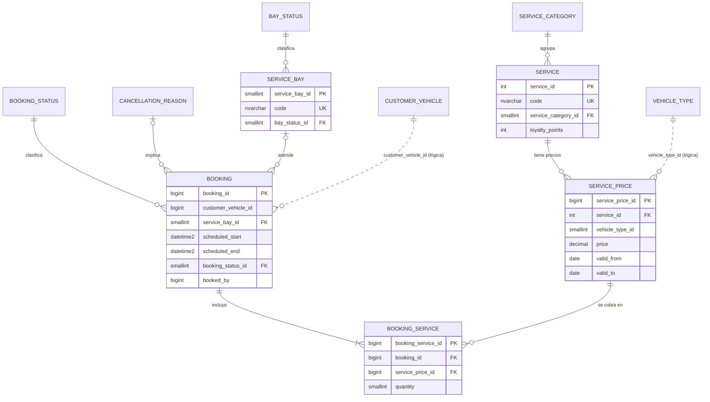

Tablas sueltas del esquema `booking` (sin relaciones): `establishment` (fila única, `singleton = 1`), `business_hour` (una fila por día), `business_hour_exception` (una por fecha) y `schedule_history`.

**Figura 18**

*Ejecución y notificaciones (`execution`, `notification`)*

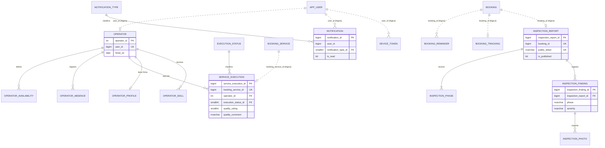

`notification.processed_event` no tiene relaciones: guarda el `event_id` de cada evento ya atendido.

**Figura 19**

*Pagos, promociones y fidelización (`payment`, `promotion`)*

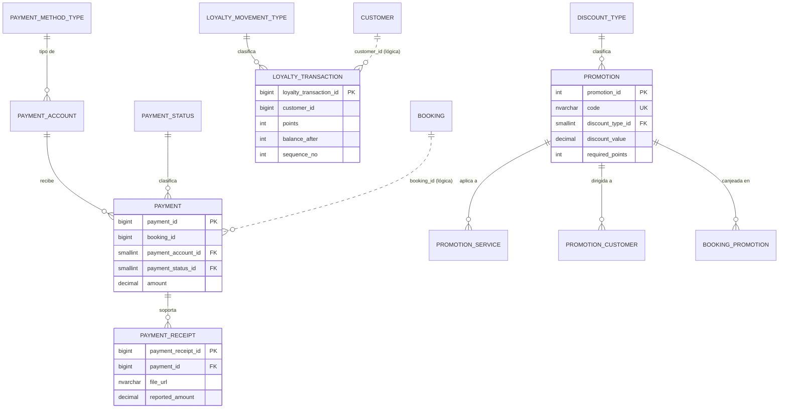

### 5.3 Modelo relacional

Notación: PK = llave primaria, UK = valor único, → = llave foránea, ⇢ = referencia lógica a otro servicio (sin FK). Se omite el bloque de auditoría.

- `security.person(person_id PK, document_number UK, first_name, last_name, phone, email)`
- `security.app_user(user_id PK, person_id → person UK, username UK, password_hash, is_active, last_login, created_at)`
- `security.login_lockout(user_id PK → app_user, failed_count, first_failed_at, locked_until, updated_at)` · `security.person_address(person_id PK → person, address, updated_at)`
- `security.role(role_id PK, code UK, name)` · `security.permission(permission_id PK, code UK, name, resource, action)`
- `security.role_permission(role_permission_id PK, role_id → role, permission_id → permission)` · `security.user_role(user_role_id PK, user_id → app_user, role_id → role)`
- `security.user_session(user_session_id PK, user_id → app_user, refresh_token_hash, started_at, expires_at, revoked_at, ip_address, user_agent)`
- `security.password_reset_token(password_reset_token_id PK, user_id → app_user, token_hash UK, requested_at, expires_at, used_at, ip_address)`
- `security.user_preference(user_preference_id PK, user_id → app_user UK, theme, language, notifications_enabled, email_reminders_enabled, promotions_enabled)`
- `audit.audit_log(audit_log_id PK, entity, entity_id, action, previous_data, new_data, changed_by, changed_at)`
- `customer.vehicle_type(vehicle_type_id PK, code UK, name, size_factor, display_order, is_active)`
- `customer.customer(customer_id PK, person_id ⇢ security.person UK, user_id ⇢ security.app_user, loyalty_points, customer_since)`
- `customer.customer_vehicle(customer_vehicle_id PK, customer_id → customer, license_plate, vehicle_type_id → vehicle_type, brand, model, color)`
- `catalog.service_category(service_category_id PK, code UK, name, description, display_order, is_active)`
- `catalog.service(service_id PK, code UK, name, description, service_category_id → service_category, loyalty_points, is_active)`
- `catalog.service_price(service_price_id PK, service_id → service, vehicle_type_id ⇢ customer.vehicle_type, price, estimated_minutes, valid_from, valid_to)`
- `booking.establishment(establishment_id PK, legal_name, trade_name, tax_id, address, phone, email, logo_url, singleton UK, business_type, founded_on, legal_representative, legal_representative_document, website, tax_regime, ciiu_activity, dian_resolution, invoice_prefix, invoice_range, instagram, facebook, support_line, service_hours_note)`
- `booking.business_hour(business_hour_id PK, day_of_week UK, opens_at, closes_at, break_starts_at, break_ends_at, is_active)`
- `booking.business_hour_exception(business_hour_exception_id PK, exception_date UK, is_closed, opens_at, closes_at, reason)`
- `booking.bay_status(bay_status_id PK, code UK, name, accepts_bookings, display_order)` · `booking.service_bay(service_bay_id PK, code UK, name, bay_status_id → bay_status)`
- `booking.booking_status(booking_status_id PK, code UK, name, is_final, display_order, is_active)` · `booking.cancellation_reason(cancellation_reason_id PK, code UK, name, is_customer_fault, display_order, is_active)`
- `booking.booking(booking_id PK, customer_vehicle_id ⇢ customer.customer_vehicle, service_bay_id → service_bay, scheduled_start, scheduled_end, booking_status_id → booking_status, booked_by ⇢ security.app_user, cancellation_reason_id → cancellation_reason, points_redeemed, points_discount_amount, notes)`
- `booking.booking_service(booking_service_id PK, booking_id → booking, service_price_id → catalog.service_price, quantity)`
- `booking.schedule_history(schedule_history_id PK, entity_type, title, detail, changed_at, changed_by)`
- `execution.execution_status(execution_status_id PK, code UK, name, is_final, display_order, is_active)`
- `execution.operator(operator_id PK, user_id ⇢ security.app_user UK, hired_on, is_active)`
- `execution.operator_availability(operator_availability_id PK, operator_id → operator, day_of_week, starts_at, ends_at, is_active)`
- `execution.operator_absence(operator_absence_id PK, operator_id → operator, starts_at, ends_at, reason)`
- `execution.service_execution(service_execution_id PK, booking_service_id ⇢ booking.booking_service UK, operator_id → operator, execution_status_id → execution_status, started_at, finished_at, quality_rating, quality_comment, rated_at, is_comment_visible)`
- `execution.operator_profile(operator_id PK → operator, specialty, updated_at, updated_by)` · `execution.operator_skill(operator_skill_id PK, operator_id → operator, name, skill_level, display_order)`
- `execution.inspection_report(inspection_report_id PK, booking_id ⇢ booking.booking UK, booking_code, vehicle, plate, services, booking_date, booking_time, duration_minutes, public_token UK, is_published, published_at)`
- `execution.inspection_phase(inspection_phase_id PK, inspection_report_id → inspection_report, phase, status, started_at, finished_at)` · `execution.inspection_finding(inspection_finding_id PK, inspection_report_id → inspection_report, phase, area, severity, note)` · `execution.inspection_photo(inspection_photo_id PK, inspection_finding_id → inspection_finding, content_type, content, size_bytes)`
- `payment.payment_method_type(payment_method_type_id PK, code UK, name, requires_account, requires_receipt, display_order, is_active)`
- `payment.payment_account(payment_account_id PK, payment_method_type_id → payment_method_type, account_holder, account_number, qr_image_url, instructions, is_active)`
- `payment.payment_status(payment_status_id PK, code UK, name, is_final, display_order, is_active)`
- `payment.payment(payment_id PK, booking_id ⇢ booking.booking, payment_account_id → payment_account, payment_status_id → payment_status, amount, processed_at, approved_by, rejection_reason)`
- `payment.payment_receipt(payment_receipt_id PK, payment_id → payment, file_url, transaction_reference, reported_amount, uploaded_at, uploaded_by, reviewed_at, reviewed_by, review_comment)`
- `payment.loyalty_movement_type(loyalty_movement_type_id PK, code UK, name, sign, display_order, is_active)`
- `payment.loyalty_transaction(loyalty_transaction_id PK, customer_id ⇢ customer.customer, loyalty_movement_type_id → loyalty_movement_type, booking_id ⇢ booking.booking, points, balance_after, sequence_no, expires_on, description)`
- `promotion.discount_type(discount_type_id PK, code UK, name, display_order, is_active)`
- `promotion.promotion(promotion_id PK, code UK, name, description, discount_type_id → discount_type, discount_value, max_discount_amount, min_purchase_amount, is_public, min_completed_booking, valid_from, valid_to, max_redemptions, max_redemptions_per_customer, is_active, price, duration_minutes, icon, featured, benefits, required_points)`
- `promotion.promotion_service(promotion_service_id PK, promotion_id → promotion, service_id ⇢ catalog.service)`
- `promotion.promotion_customer(promotion_customer_id PK, promotion_id → promotion, customer_id ⇢ customer.customer, assigned_at, assigned_by)`
- `promotion.booking_promotion(booking_promotion_id PK, booking_id ⇢ booking.booking, promotion_id → promotion, applied_amount)`
- `notification.notification_type(notification_type_id PK, code UK, name, display_order, is_active)`
- `notification.notification(notification_id PK, user_id ⇢ security.app_user, notification_type_id → notification_type, title, message, reference_entity, reference_id, is_read, read_at, sent_at)`
- `notification.device_token(device_token_id PK, user_id ⇢ security.app_user, token UK, platform, is_active, last_seen_at)`
- `notification.processed_event(processed_event_id PK, event_id UK, event_type, processed_at)`
- `notification.booking_reminder(booking_reminder_id PK, booking_id ⇢ booking.booking, user_id ⇢ security.app_user, booking_code, scheduled_start, lead_minutes, remind_at, sent_at)`
- `notification.booking_tracking(booking_id PK ⇢ booking.booking, booking_code, customer_user_id, operator_user_id, scheduled_start, is_cancelled, unassigned_alert_at, updated_at)`

### 5.4 Diccionario de datos

Hay un diccionario por cada una de las 57 tablas, agrupados por esquema. La columna "Nulo" indica si el campo admite NULL; PK = llave primaria, FK = llave foránea, UK = valor único y ⇢ = referencia lógica a otro servicio (sin FK). Las tablas que tienen el bloque de auditoría (sección 5.1) lo muestran en una sola fila al final.

#### Esquema `security`

Cuentas, roles, permisos, sesiones y preferencias. Dueño: security-service.

**Tabla 10**

*Diccionario de datos de `security.person` — datos personales*

| Campo | Tipo | Nulo | Llave | Descripción |
| --- | --- | --- | --- | --- |
| person_id | BIGINT IDENTITY | No | PK | Identificador de la persona |
| document_number | NVARCHAR(20) | No | UK | Número de documento |
| first_name | NVARCHAR(60) | No |  | Nombres |
| last_name | NVARCHAR(60) | No |  | Apellidos |
| phone | NVARCHAR(20) | Sí |  | Teléfono |
| email | NVARCHAR(120) | Sí |  | Correo de contacto |

**Tabla 11**

*Diccionario de datos de `security.app_user` — cuenta de acceso*

| Campo | Tipo | Nulo | Llave | Descripción |
| --- | --- | --- | --- | --- |
| user_id | BIGINT IDENTITY | No | PK | Identificador del usuario |
| person_id | BIGINT | No | FK → person, UK | Persona dueña de la cuenta (1 a 1) |
| username | NVARCHAR(60) | No | UK | Correo usado para iniciar sesión |
| password_hash | NVARCHAR(255) | No |  | Hash BCrypt de la contraseña |
| is_active | BIT | No |  | Cuenta habilitada (por defecto 1) |
| last_login | DATETIME2(3) | Sí |  | Último inicio de sesión |
| created_at | DATETIME2(3) | No |  | Fecha de registro de la cuenta (migración `036`) |

**Tabla 12**

*Diccionario de datos de `security.role` — roles del sistema*

| Campo | Tipo | Nulo | Llave | Descripción |
| --- | --- | --- | --- | --- |
| role_id | SMALLINT IDENTITY | No | PK | Identificador del rol |
| code | NVARCHAR(30) | No | UK | `ADMIN`, `OPERATOR` o `CLIENT` (semilla `101`) |
| name | NVARCHAR(60) | No |  | Nombre visible |

**Tabla 13**

*Diccionario de datos de `security.permission` — permisos*

| Campo | Tipo | Nulo | Llave | Descripción |
| --- | --- | --- | --- | --- |
| permission_id | SMALLINT IDENTITY | No | PK | Identificador del permiso |
| code | NVARCHAR(60) | No | UK | `VIEW_PANELS`, `CREATE_RECORDS`, `EDIT_DATA` o `DELETE` (changelog `026`) |
| name | NVARCHAR(80) | No |  | Nombre visible |
| resource | NVARCHAR(60) | No |  | Recurso sobre el que actúa |
| action | NVARCHAR(30) | No |  | Acción permitida |

**Tabla 14**

*Diccionario de datos de `security.role_permission` — permisos de cada rol*

| Campo | Tipo | Nulo | Llave | Descripción |
| --- | --- | --- | --- | --- |
| role_permission_id | BIGINT IDENTITY | No | PK | Identificador de la asignación |
| role_id | SMALLINT | No | FK → role; UK con permission_id | Rol |
| permission_id | SMALLINT | No | FK → permission | Permiso otorgado |

**Tabla 15**

*Diccionario de datos de `security.user_role` — roles de cada usuario*

| Campo | Tipo | Nulo | Llave | Descripción |
| --- | --- | --- | --- | --- |
| user_role_id | BIGINT IDENTITY | No | PK | Identificador de la asignación |
| user_id | BIGINT | No | FK → app_user; UK con role_id | Usuario |
| role_id | SMALLINT | No | FK → role | Rol asignado |

**Tabla 16**

*Diccionario de datos de `security.user_session` — sesiones abiertas*

| Campo | Tipo | Nulo | Llave | Descripción |
| --- | --- | --- | --- | --- |
| user_session_id | BIGINT IDENTITY | No | PK | Identificador de la sesión |
| user_id | BIGINT | No | FK → app_user | Usuario |
| refresh_token_hash | NVARCHAR(255) | Sí |  | Hash del token de refresco |
| started_at | DATETIME2(3) | No |  | Inicio de la sesión (UTC) |
| expires_at | DATETIME2(3) | No |  | Vencimiento |
| revoked_at | DATETIME2(3) | Sí |  | Cierre de sesión |
| ip_address | NVARCHAR(45) | Sí |  | IP de origen |
| user_agent | NVARCHAR(300) | Sí |  | Navegador o app de origen |

**Tabla 17**

*Diccionario de datos de `security.password_reset_token` — códigos de recuperación de contraseña*

| Campo | Tipo | Nulo | Llave | Descripción |
| --- | --- | --- | --- | --- |
| password_reset_token_id | BIGINT IDENTITY | No | PK | Identificador de la solicitud |
| user_id | BIGINT | No | FK → app_user | Usuario que pidió el código |
| token_hash | NVARCHAR(255) | No | UK | Hash del código de 6 dígitos |
| requested_at | DATETIME2(3) | No |  | Fecha de solicitud |
| expires_at | DATETIME2(3) | No |  | Vencimiento; CHECK `expires_at > requested_at` |
| used_at | DATETIME2(3) | Sí |  | Momento en que se usó |
| ip_address | NVARCHAR(45) | Sí |  | IP de la solicitud |

**Tabla 18**

*Diccionario de datos de `security.user_preference` — preferencias de interfaz y avisos*

| Campo | Tipo | Nulo | Llave | Descripción |
| --- | --- | --- | --- | --- |
| user_preference_id | BIGINT IDENTITY | No | PK | Identificador de la preferencia |
| user_id | BIGINT | No | FK → app_user, UK | Usuario (una fila por usuario) |
| theme | NVARCHAR(20) | No |  | `green-light`, `green-dark`, `pink` o `pink-dark` |
| language | NVARCHAR(5) | No |  | `es`, `en`, `fr` o `pt` |
| notifications_enabled | BIT | No |  | Notificaciones en la app |
| email_reminders_enabled | BIT | No |  | Recordatorios por correo |
| promotions_enabled | BIT | No |  | Avisos de promociones |
| created_at, created_by, updated_at, updated_by, deleted_at, deleted_by, row_version | — | — | | Bloque de auditoría (sección 5.1) |

**Tabla 19**

*Diccionario de datos de `security.login_lockout` — bloqueo por intentos fallidos*

| Campo | Tipo | Nulo | Llave | Descripción |
| --- | --- | --- | --- | --- |
| user_id | BIGINT | No | PK, FK → app_user | Cuenta con fallos recientes o bloqueada |
| failed_count | INT | No |  | Fallos dentro de la ventana actual, de 0 a 4 (por defecto 0) |
| first_failed_at | DATETIME2(3) | Sí |  | Inicio de la ventana de 15 minutos |
| locked_until | DATETIME2(3) | Sí |  | Hasta cuándo está bloqueada; NULL si no lo está |
| updated_at | DATETIME2(3) | No |  | Último cambio |

**Tabla 20**

*Diccionario de datos de `security.person_address` — dirección de contacto*

| Campo | Tipo | Nulo | Llave | Descripción |
| --- | --- | --- | --- | --- |
| person_id | BIGINT | No | PK, FK → person | Persona dueña de la dirección |
| address | NVARCHAR(200) | No |  | Dirección de contacto del perfil; no puede quedar en blanco |
| updated_at | DATETIME2(3) | No |  | Último cambio |

#### Esquema `audit`

Bitácora de cambios. Dueño: security-service.

**Tabla 21**

*Diccionario de datos de `audit.audit_log` — bitácora de cambios*

| Campo | Tipo | Nulo | Llave | Descripción |
| --- | --- | --- | --- | --- |
| audit_log_id | BIGINT IDENTITY | No | PK | Identificador del registro |
| entity | NVARCHAR(60) | No |  | Entidad afectada |
| entity_id | BIGINT | No |  | Fila afectada |
| action | NVARCHAR(20) | No |  | Acción realizada |
| previous_data | NVARCHAR(MAX) | Sí |  | Estado anterior |
| new_data | NVARCHAR(MAX) | Sí |  | Estado nuevo |
| changed_by | BIGINT | Sí |  | Usuario que hizo el cambio |
| changed_at | DATETIME2(3) | No |  | Fecha del cambio (UTC) |

#### Esquema `customer`

Clientes y vehículos. Dueño: customer-service.

**Tabla 22**

*Diccionario de datos de `customer.vehicle_type` — tipos de vehículo*

| Campo | Tipo | Nulo | Llave | Descripción |
| --- | --- | --- | --- | --- |
| vehicle_type_id | SMALLINT IDENTITY | No | PK | Identificador del tipo |
| code | NVARCHAR(30) | No | UK | `CAR`, `SEDAN`, `SUV`, `PICKUP`, `TRUCK` o `MOTO` |
| name | NVARCHAR(60) | No |  | Nombre visible |
| size_factor | DECIMAL(4,2) | No |  | Factor de tamaño (> 0) |
| display_order | SMALLINT | No |  | Orden de presentación |
| is_active | BIT | No |  | Tipo vigente |
| created_at, created_by, updated_at, updated_by, deleted_at, deleted_by, row_version | — | — | | Bloque de auditoría (sección 5.1) |

**Tabla 23**

*Diccionario de datos de `customer.customer` — clientes*

| Campo | Tipo | Nulo | Llave | Descripción |
| --- | --- | --- | --- | --- |
| customer_id | BIGINT IDENTITY | No | PK | Identificador del cliente |
| person_id | BIGINT | No | UK, ⇢ security.person | Persona del cliente |
| user_id | BIGINT | Sí | UK filtrada, ⇢ security.app_user | Cuenta del cliente |
| loyalty_points | INT | No |  | Copia de visualización del saldo de puntos (≥ 0) |
| customer_since | DATE | No |  | Fecha de alta |
| created_at, created_by, updated_at, updated_by, deleted_at, deleted_by, row_version | — | — | | Bloque de auditoría (sección 5.1) |

**Tabla 24**

*Diccionario de datos de `customer.customer_vehicle` — vehículos de los clientes*

| Campo | Tipo | Nulo | Llave | Descripción |
| --- | --- | --- | --- | --- |
| customer_vehicle_id | BIGINT IDENTITY | No | PK | Identificador del vehículo |
| customer_id | BIGINT | No | FK → customer | Dueño |
| license_plate | NVARCHAR(10) | No | UK filtrada (activos) | Placa |
| vehicle_type_id | SMALLINT | No | FK → vehicle_type | Tipo de vehículo |
| brand | NVARCHAR(50) | Sí |  | Marca |
| model | NVARCHAR(50) | Sí |  | Modelo |
| color | NVARCHAR(30) | Sí |  | Color |
| created_at, created_by, updated_at, updated_by, deleted_at, deleted_by, row_version | — | — | | Bloque de auditoría (sección 5.1) |

#### Esquema `catalog`

Catálogo de servicios y precios. Dueño: booking-service.

**Tabla 25**

*Diccionario de datos de `catalog.service_category` — categorías de servicio*

| Campo | Tipo | Nulo | Llave | Descripción |
| --- | --- | --- | --- | --- |
| service_category_id | SMALLINT IDENTITY | No | PK | Identificador de la categoría |
| code | NVARCHAR(30) | No | UK | `LAVADO`, `POLICHADO`, `DETALLADO`, `INTERIOR` o `PAQUETES` |
| name | NVARCHAR(60) | No |  | Nombre visible |
| description | NVARCHAR(200) | Sí |  | Descripción |
| display_order | SMALLINT | No |  | Orden de presentación |
| is_active | BIT | No |  | Categoría vigente |
| created_at, created_by, updated_at, updated_by, deleted_at, deleted_by, row_version | — | — | | Bloque de auditoría (sección 5.1) |

**Tabla 26**

*Diccionario de datos de `catalog.service` — servicios de lavado*

| Campo | Tipo | Nulo | Llave | Descripción |
| --- | --- | --- | --- | --- |
| service_id | INT IDENTITY | No | PK | Identificador del servicio |
| code | NVARCHAR(30) | No | UK | Código (`BASIC`, `PREMIUM`, `FULL` en la semilla) |
| name | NVARCHAR(100) | No |  | Nombre visible |
| description | NVARCHAR(MAX) | Sí |  | Descripción |
| service_category_id | SMALLINT | No | FK → service_category | Categoría |
| is_active | BIT | No |  | Disponible para reservar |
| loyalty_points | INT | No |  | Puntos que otorga al completarse (changelog `022`) |
| created_at, created_by, updated_at, updated_by, deleted_at, deleted_by, row_version | — | — | | Bloque de auditoría (sección 5.1) |

**Tabla 27**

*Diccionario de datos de `catalog.service_price` — precios por tipo de vehículo*

| Campo | Tipo | Nulo | Llave | Descripción |
| --- | --- | --- | --- | --- |
| service_price_id | BIGINT IDENTITY | No | PK | Identificador del precio |
| service_id | INT | No | FK → service | Servicio |
| vehicle_type_id | SMALLINT | No | ⇢ customer.vehicle_type | Tipo de vehículo |
| price | DECIMAL(12,2) | No |  | Precio (≥ 0) |
| estimated_minutes | SMALLINT | No |  | Duración estimada (> 0) |
| valid_from | DATE | No |  | Inicio de vigencia |
| valid_to | DATE | Sí |  | Fin de vigencia; solo un precio abierto por servicio y tipo (índice filtrado); filas inmutables por trigger |
| created_at, created_by, updated_at, updated_by, deleted_at, deleted_by, row_version | — | — | | Bloque de auditoría (sección 5.1) |

#### Esquema `booking`

Establecimiento, horario, bahías y reservas. Dueño: booking-service.

**Tabla 28**

*Diccionario de datos de `booking.establishment` — datos del lavadero*

| Campo | Tipo | Nulo | Llave | Descripción |
| --- | --- | --- | --- | --- |
| establishment_id | SMALLINT IDENTITY | No | PK | Identificador |
| legal_name | NVARCHAR(150) | No |  | Razón social |
| trade_name | NVARCHAR(150) | No |  | Nombre comercial |
| tax_id | NVARCHAR(30) | No |  | NIT |
| address | NVARCHAR(200) | No |  | Dirección |
| phone | NVARCHAR(20) | Sí |  | Teléfono |
| email | NVARCHAR(120) | Sí |  | Correo |
| logo_url | NVARCHAR(500) | Sí |  | Logo |
| business_type | NVARCHAR(100) | Sí |  | Tipo de negocio (migración `032`) |
| founded_on | DATE | Sí |  | Fecha de fundación; no puede estar en el futuro (migración `032`) |
| legal_representative | NVARCHAR(150) | Sí |  | Representante legal (migración `032`) |
| legal_representative_document | NVARCHAR(30) | Sí |  | Documento del representante legal (migración `032`) |
| website | NVARCHAR(200) | Sí |  | Sitio web (migración `032`) |
| tax_regime | NVARCHAR(150) | Sí |  | Régimen tributario (migración `032`) |
| ciiu_activity | NVARCHAR(150) | Sí |  | Actividad económica CIIU (migración `032`) |
| dian_resolution | NVARCHAR(60) | Sí |  | Resolución de facturación de la DIAN (migración `032`) |
| invoice_prefix | NVARCHAR(10) | Sí |  | Prefijo de facturación (migración `032`) |
| invoice_range | NVARCHAR(30) | Sí |  | Rango de facturación (migración `032`) |
| instagram | NVARCHAR(100) | Sí |  | Instagram (migración `032`) |
| facebook | NVARCHAR(150) | Sí |  | Facebook (migración `032`) |
| support_line | NVARCHAR(30) | Sí |  | Línea de atención (migración `032`) |
| service_hours_note | NVARCHAR(150) | Sí |  | Horario de atención que se muestra al cliente (migración `032`) |
| singleton | BIT | No | UK | Siempre 1: impide una segunda fila |
| created_at, created_by, updated_at, updated_by, deleted_at, deleted_by, row_version | — | — | | Bloque de auditoría (sección 5.1) |

**Tabla 29**

*Diccionario de datos de `booking.business_hour` — horario semanal*

| Campo | Tipo | Nulo | Llave | Descripción |
| --- | --- | --- | --- | --- |
| business_hour_id | SMALLINT IDENTITY | No | PK | Identificador |
| day_of_week | SMALLINT | No | UK | Día de la semana (1 a 7) |
| opens_at | TIME(0) | No |  | Apertura |
| closes_at | TIME(0) | No |  | Cierre (posterior a la apertura) |
| is_active | BIT | No |  | Día laborable |
| break_starts_at | TIME(0) | Sí |  | Inicio de la pausa (changelog `018`) |
| break_ends_at | TIME(0) | Sí |  | Fin de la pausa |
| created_at, created_by, updated_at, updated_by, deleted_at, deleted_by, row_version | — | — | | Bloque de auditoría (sección 5.1) |

**Tabla 30**

*Diccionario de datos de `booking.business_hour_exception` — excepciones de horario*

| Campo | Tipo | Nulo | Llave | Descripción |
| --- | --- | --- | --- | --- |
| business_hour_exception_id | INT IDENTITY | No | PK | Identificador |
| exception_date | DATE | No | UK | Fecha especial |
| is_closed | BIT | No |  | Cerrado todo el día |
| opens_at | TIME(0) | Sí |  | Apertura especial (si abre) |
| closes_at | TIME(0) | Sí |  | Cierre especial (si abre) |
| reason | NVARCHAR(120) | No |  | Motivo |
| created_at, created_by, updated_at, updated_by, deleted_at, deleted_by, row_version | — | — | | Bloque de auditoría (sección 5.1) |

**Tabla 31**

*Diccionario de datos de `booking.bay_status` — estados de bahía*

| Campo | Tipo | Nulo | Llave | Descripción |
| --- | --- | --- | --- | --- |
| bay_status_id | SMALLINT IDENTITY | No | PK | Identificador |
| code | NVARCHAR(30) | No | UK | `ACTIVE`, `MAINTENANCE` o `INACTIVE` |
| name | NVARCHAR(60) | No |  | Nombre visible |
| accepts_bookings | BIT | No |  | Si admite reservas |
| display_order | SMALLINT | No |  | Orden de presentación |
| created_at, created_by, updated_at, updated_by, deleted_at, deleted_by, row_version | — | — | | Bloque de auditoría (sección 5.1) |

**Tabla 32**

*Diccionario de datos de `booking.service_bay` — bahías de lavado*

| Campo | Tipo | Nulo | Llave | Descripción |
| --- | --- | --- | --- | --- |
| service_bay_id | SMALLINT IDENTITY | No | PK | Identificador de la bahía |
| code | NVARCHAR(20) | No | UK | Código (`BAY-01`…) |
| name | NVARCHAR(60) | No |  | Nombre visible |
| bay_status_id | SMALLINT | No | FK → bay_status | Estado (por defecto 1, activa) |
| created_at, created_by, updated_at, updated_by, deleted_at, deleted_by, row_version | — | — | | Bloque de auditoría (sección 5.1) |

**Tabla 33**

*Diccionario de datos de `booking.booking_status` — estados de reserva*

| Campo | Tipo | Nulo | Llave | Descripción |
| --- | --- | --- | --- | --- |
| booking_status_id | SMALLINT IDENTITY | No | PK | 1 `SCHEDULED`, 2 `CONFIRMED`, 3 `IN_PROGRESS`, 4 `COMPLETED`, 5 `CANCELLED`, 6 `NO_SHOW` |
| code | NVARCHAR(30) | No | UK | Código del estado |
| name | NVARCHAR(60) | No |  | Nombre visible |
| is_final | BIT | No |  | Si es un estado final |
| display_order | SMALLINT | No |  | Orden de presentación |
| is_active | BIT | No |  | Estado vigente |
| created_at, created_by, updated_at, updated_by, deleted_at, deleted_by, row_version | — | — | | Bloque de auditoría (sección 5.1) |

**Tabla 34**

*Diccionario de datos de `booking.cancellation_reason` — motivos de cancelación*

| Campo | Tipo | Nulo | Llave | Descripción |
| --- | --- | --- | --- | --- |
| cancellation_reason_id | SMALLINT IDENTITY | No | PK | Identificador |
| code | NVARCHAR(30) | No | UK | Código (seis motivos semilla) |
| name | NVARCHAR(60) | No |  | Nombre visible |
| is_customer_fault | BIT | No |  | Si la falta es del cliente |
| display_order | SMALLINT | No |  | Orden de presentación |
| is_active | BIT | No |  | Motivo vigente |
| created_at, created_by, updated_at, updated_by, deleted_at, deleted_by, row_version | — | — | | Bloque de auditoría (sección 5.1) |

**Tabla 35**

*Diccionario de datos de `booking.booking` — reservas*

| Campo | Tipo | Nulo | Llave | Descripción |
| --- | --- | --- | --- | --- |
| booking_id | BIGINT IDENTITY | No | PK | Identificador de la reserva |
| customer_vehicle_id | BIGINT | No | ⇢ customer.customer_vehicle | Vehículo a lavar |
| service_bay_id | SMALLINT | Sí | FK → service_bay | Bahía asignada; un trigger impide cruces de horario |
| scheduled_start | DATETIME2(3) | No |  | Inicio programado |
| scheduled_end | DATETIME2(3) | No |  | Fin programado (posterior al inicio) |
| booking_status_id | SMALLINT | No | FK → booking_status | Estado |
| booked_by | BIGINT | No | ⇢ security.app_user | Usuario que creó la reserva |
| cancellation_reason_id | SMALLINT | Sí | FK → cancellation_reason | Solo si el estado es `CANCELLED` |
| points_redeemed | INT | No |  | Puntos canjeados |
| points_discount_amount | DECIMAL(12,2) | No |  | Descuento por puntos (ambos 0 o ambos > 0) |
| notes | NVARCHAR(300) | Sí |  | Observaciones |
| created_at, created_by, updated_at, updated_by, deleted_at, deleted_by, row_version | — | — | | Bloque de auditoría (sección 5.1) |

**Tabla 36**

*Diccionario de datos de `booking.booking_service` — líneas de servicio de cada reserva*

| Campo | Tipo | Nulo | Llave | Descripción |
| --- | --- | --- | --- | --- |
| booking_service_id | BIGINT IDENTITY | No | PK | Identificador de la línea |
| booking_id | BIGINT | No | FK → booking; UK con service_price_id | Reserva |
| service_price_id | BIGINT | No | FK → catalog.service_price | Precio aplicado al reservar |
| quantity | SMALLINT | No |  | Cantidad (> 0) |
| created_at, created_by, updated_at, updated_by, deleted_at, deleted_by, row_version | — | — | | Bloque de auditoría (sección 5.1) |

**Tabla 37**

*Diccionario de datos de `booking.schedule_history` — historial de cambios de horario*

| Campo | Tipo | Nulo | Llave | Descripción |
| --- | --- | --- | --- | --- |
| schedule_history_id | BIGINT IDENTITY | No | PK | Identificador |
| entity_type | NVARCHAR(20) | No |  | `WEEK`, `EXCEPTION` o `BAY` |
| title | NVARCHAR(200) | No |  | Resumen del cambio |
| detail | NVARCHAR(300) | Sí |  | Detalle del cambio |
| changed_at | DATETIME2(3) | No |  | Fecha del cambio (UTC) |
| changed_by | BIGINT | Sí |  | Usuario que hizo el cambio |

#### Esquema `execution`

Operarios y ejecución de servicios. Dueño: operations-service.

**Tabla 38**

*Diccionario de datos de `execution.execution_status` — estados de ejecución*

| Campo | Tipo | Nulo | Llave | Descripción |
| --- | --- | --- | --- | --- |
| execution_status_id | SMALLINT IDENTITY | No | PK | 1 `PENDING`, 2 `IN_PROGRESS`, 3 `PAUSED`, 4 `COMPLETED`, 5 `WITH_ISSUE` |
| code | NVARCHAR(30) | No | UK | Código del estado |
| name | NVARCHAR(60) | No |  | Nombre visible |
| is_final | BIT | No |  | Si es un estado final |
| display_order | SMALLINT | No |  | Orden de presentación |
| is_active | BIT | No |  | Estado vigente |
| created_at, created_by, updated_at, updated_by, deleted_at, deleted_by, row_version | — | — | | Bloque de auditoría (sección 5.1) |

**Tabla 39**

*Diccionario de datos de `execution.operator` — operarios*

| Campo | Tipo | Nulo | Llave | Descripción |
| --- | --- | --- | --- | --- |
| operator_id | INT IDENTITY | No | PK | Identificador del operario |
| user_id | BIGINT | No | UK, ⇢ security.app_user | Cuenta del operario |
| hired_on | DATE | No |  | Fecha de ingreso |
| is_active | BIT | No |  | Habilitado para asignaciones |
| created_at, created_by, updated_at, updated_by, deleted_at, deleted_by, row_version | — | — | | Bloque de auditoría (sección 5.1) |

**Tabla 40**

*Diccionario de datos de `execution.operator_availability` — turno semanal del operario*

| Campo | Tipo | Nulo | Llave | Descripción |
| --- | --- | --- | --- | --- |
| operator_availability_id | INT IDENTITY | No | PK | Identificador |
| operator_id | INT | No | FK → operator; UK con day_of_week | Operario |
| day_of_week | SMALLINT | No |  | Día de la semana (1 a 7) |
| starts_at | TIME(0) | No |  | Inicio del turno |
| ends_at | TIME(0) | No |  | Fin del turno (posterior al inicio) |
| is_active | BIT | No |  | Turno vigente |
| created_at, created_by, updated_at, updated_by, deleted_at, deleted_by, row_version | — | — | | Bloque de auditoría (sección 5.1) |

**Tabla 41**

*Diccionario de datos de `execution.operator_absence` — ausencias del operario*

| Campo | Tipo | Nulo | Llave | Descripción |
| --- | --- | --- | --- | --- |
| operator_absence_id | INT IDENTITY | No | PK | Identificador |
| operator_id | INT | No | FK → operator | Operario |
| starts_at | DATETIME2(3) | No |  | Inicio de la ausencia |
| ends_at | DATETIME2(3) | No |  | Fin de la ausencia; un trigger impide ausencias cruzadas |
| reason | NVARCHAR(120) | No |  | Motivo |
| created_at, created_by, updated_at, updated_by, deleted_at, deleted_by, row_version | — | — | | Bloque de auditoría (sección 5.1) |

**Tabla 42**

*Diccionario de datos de `execution.service_execution` — ejecución de cada línea de servicio*

| Campo | Tipo | Nulo | Llave | Descripción |
| --- | --- | --- | --- | --- |
| service_execution_id | BIGINT IDENTITY | No | PK | Identificador de la ejecución |
| booking_service_id | BIGINT | No | UK, ⇢ booking.booking_service | Línea de la reserva |
| operator_id | INT | No | FK → operator | Operario asignado |
| execution_status_id | SMALLINT | No | FK → execution_status | Estado de ejecución |
| started_at | DATETIME2(3) | Sí |  | Inicio real |
| finished_at | DATETIME2(3) | Sí |  | Fin real |
| quality_rating | SMALLINT | Sí |  | Calificación de 1 a 5 |
| quality_comment | NVARCHAR(500) | Sí |  | Comentario; solo con calificación |
| rated_at | DATETIME2(3) | Sí |  | Fecha de la calificación |
| is_comment_visible | BIT | No |  | Si el comentario se muestra |
| created_at, created_by, updated_at, updated_by, deleted_at, deleted_by, row_version | — | — | | Bloque de auditoría (sección 5.1) |

**Tabla 43**

*Diccionario de datos de `execution.operator_profile` — especialidad del operario*

| Campo | Tipo | Nulo | Llave | Descripción |
| --- | --- | --- | --- | --- |
| operator_id | INT | No | PK, FK → operator | Operario |
| specialty | NVARCHAR(80) | Sí |  | Especialidad |
| updated_at | DATETIME2(3) | No |  | Último cambio |
| updated_by | BIGINT | Sí |  | Administrador que lo cambió ⇢ security.app_user |

**Tabla 44**

*Diccionario de datos de `execution.operator_skill` — habilidades del operario*

| Campo | Tipo | Nulo | Llave | Descripción |
| --- | --- | --- | --- | --- |
| operator_skill_id | INT IDENTITY | No | PK | Identificador |
| operator_id | INT | No | FK → operator | Operario |
| name | NVARCHAR(60) | No | UK con operator_id | Nombre de la habilidad |
| skill_level | NVARCHAR(12) | No |  | `CERTIFIED`, `EXPERT` o `ADVANCED` |
| display_order | SMALLINT | No |  | Orden en la ficha |

**Tabla 45**

*Diccionario de datos de `execution.inspection_report` — informe de inspección del vehículo*

| Campo | Tipo | Nulo | Llave | Descripción |
| --- | --- | --- | --- | --- |
| inspection_report_id | BIGINT IDENTITY | No | PK | Identificador |
| booking_id | BIGINT | No | UK, ⇢ booking.booking | Reserva inspeccionada (un informe por reserva) |
| booking_code, vehicle, plate, services | NVARCHAR | Sí |  | Copia de los datos de la reserva al crear el informe |
| booking_date, booking_time, duration_minutes | DATE, TIME(0), INT | No |  | Fecha, hora y duración de la reserva |
| public_token | NVARCHAR(64) | No | UK | Código aleatorio del enlace público |
| is_published | BIT | No |  | El enlace muestra el informe (por defecto 0) |
| published_at | DATETIME2(3) | Sí |  | Fecha de publicación; obligatoria si está publicado |
| created_at, created_by, updated_at, updated_by, row_version | — | — |  | Auditoría |

**Tabla 46**

*Diccionario de datos de `execution.inspection_phase` — fases del informe*

| Campo | Tipo | Nulo | Llave | Descripción |
| --- | --- | --- | --- | --- |
| inspection_phase_id | BIGINT IDENTITY | No | PK | Identificador |
| inspection_report_id | BIGINT | No | FK → inspection_report; UK con phase | Informe |
| phase | NVARCHAR(20) | No |  | `RECEPTION`, `EXTERIOR`, `INTERIOR`, `ENGINE` o `DELIVERY` |
| status | NVARCHAR(20) | No |  | `PENDING`, `IN_PROGRESS` o `DONE` |
| started_at, finished_at | DATETIME2(3) | Sí |  | Inicio y fin de la fase |

**Tabla 47**

*Diccionario de datos de `execution.inspection_finding` — hallazgos del informe*

| Campo | Tipo | Nulo | Llave | Descripción |
| --- | --- | --- | --- | --- |
| inspection_finding_id | BIGINT IDENTITY | No | PK | Identificador |
| inspection_report_id | BIGINT | No | FK → inspection_report | Informe |
| phase | NVARCHAR(20) | No |  | Fase donde se encontró |
| area | NVARCHAR(120) | No |  | Zona del vehículo |
| severity | NVARCHAR(10) | No |  | `INFO`, `MINOR` o `MAJOR` |
| note | NVARCHAR(500) | Sí |  | Observación |
| created_at, created_by, deleted_at, deleted_by | — | — |  | Creación y borrado lógico |

**Tabla 48**

*Diccionario de datos de `execution.inspection_photo` — fotos de los hallazgos*

| Campo | Tipo | Nulo | Llave | Descripción |
| --- | --- | --- | --- | --- |
| inspection_photo_id | BIGINT IDENTITY | No | PK | Identificador |
| inspection_finding_id | BIGINT | No | FK → inspection_finding | Hallazgo (hasta 5 fotos cada uno) |
| content_type | NVARCHAR(30) | No |  | `image/jpeg` o `image/png` |
| content | VARBINARY(MAX) | No |  | Imagen |
| size_bytes | INT | No |  | Tamaño, hasta 2 MB |
| created_at, created_by | — | — |  | Creación |

#### Esquema `payment`

Pagos, cuentas de pago y puntos. Dueño: payment-service.

**Tabla 49**

*Diccionario de datos de `payment.payment_method_type` — medios de pago*

| Campo | Tipo | Nulo | Llave | Descripción |
| --- | --- | --- | --- | --- |
| payment_method_type_id | SMALLINT IDENTITY | No | PK | Identificador |
| code | NVARCHAR(30) | No | UK | `EFECTIVO`, `NEQUI`, `DAVIPLATA` o `TRANSFERENCIA` |
| name | NVARCHAR(60) | No |  | Nombre visible |
| requires_account | BIT | No |  | Si requiere cuenta |
| requires_receipt | BIT | No |  | Si requiere comprobante |
| display_order | SMALLINT | No |  | Orden de presentación |
| is_active | BIT | No |  | Medio vigente |
| created_at, created_by, updated_at, updated_by, deleted_at, deleted_by, row_version | — | — | | Bloque de auditoría (sección 5.1) |

**Tabla 50**

*Diccionario de datos de `payment.payment_account` — cuentas receptoras del lavadero*

| Campo | Tipo | Nulo | Llave | Descripción |
| --- | --- | --- | --- | --- |
| payment_account_id | SMALLINT IDENTITY | No | PK | Identificador de la cuenta |
| payment_method_type_id | SMALLINT | No | FK → payment_method_type | Medio de pago |
| account_holder | NVARCHAR(120) | No |  | Titular |
| account_number | NVARCHAR(50) | Sí |  | Número o llave |
| qr_image_url | NVARCHAR(MAX) | Sí |  | Imagen QR guardada como dato (changelog `016`) |
| instructions | NVARCHAR(300) | Sí |  | Instrucciones para el cliente |
| is_active | BIT | No |  | Cuenta visible para el cliente |
| created_at, created_by, updated_at, updated_by, deleted_at, deleted_by, row_version | — | — | | Bloque de auditoría (sección 5.1) |

**Tabla 51**

*Diccionario de datos de `payment.payment_status` — estados de pago*

| Campo | Tipo | Nulo | Llave | Descripción |
| --- | --- | --- | --- | --- |
| payment_status_id | SMALLINT IDENTITY | No | PK | Identificador |
| code | NVARCHAR(30) | No | UK | `PENDING`, `IN_REVIEW`, `APPROVED`, `REJECTED` o `REFUNDED` |
| name | NVARCHAR(60) | No |  | Nombre visible |
| is_final | BIT | No |  | Si es un estado final |
| display_order | SMALLINT | No |  | Orden de presentación |
| is_active | BIT | No |  | Estado vigente |
| created_at, created_by, updated_at, updated_by, deleted_at, deleted_by, row_version | — | — | | Bloque de auditoría (sección 5.1) |

**Tabla 52**

*Diccionario de datos de `payment.payment` — pagos*

| Campo | Tipo | Nulo | Llave | Descripción |
| --- | --- | --- | --- | --- |
| payment_id | BIGINT IDENTITY | No | PK | Identificador del pago |
| booking_id | BIGINT | No | ⇢ booking.booking | Reserva pagada; un solo pago aprobado por reserva (índice filtrado) |
| payment_account_id | SMALLINT | No | FK → payment_account | Cuenta donde se pagó |
| payment_status_id | SMALLINT | No | FK → payment_status | Estado |
| amount | DECIMAL(12,2) | No |  | Valor (> 0) |
| processed_at | DATETIME2(3) | Sí |  | Fecha de revisión |
| approved_by | BIGINT | Sí |  | Administrador que aprobó |
| rejection_reason | NVARCHAR(200) | Sí |  | Motivo de rechazo |
| created_at, created_by, updated_at, updated_by, deleted_at, deleted_by, row_version | — | — | | Bloque de auditoría (sección 5.1) |

**Tabla 53**

*Diccionario de datos de `payment.payment_receipt` — comprobantes de pago*

| Campo | Tipo | Nulo | Llave | Descripción |
| --- | --- | --- | --- | --- |
| payment_receipt_id | BIGINT IDENTITY | No | PK | Identificador del comprobante |
| payment_id | BIGINT | No | FK → payment | Pago |
| file_url | NVARCHAR(MAX) | No |  | Imagen del comprobante |
| transaction_reference | NVARCHAR(100) | Sí |  | Referencia de la transacción |
| reported_amount | DECIMAL(12,2) | Sí |  | Valor declarado por el cliente (> 0) |
| uploaded_at | DATETIME2(3) | No |  | Fecha de carga |
| uploaded_by | BIGINT | No |  | Usuario que lo subió |
| reviewed_at | DATETIME2(3) | Sí |  | Fecha de revisión |
| reviewed_by | BIGINT | Sí |  | Revisor (junto con reviewed_at) |
| review_comment | NVARCHAR(300) | Sí |  | Comentario de la revisión |
| created_at, created_by, updated_at, updated_by, deleted_at, deleted_by, row_version | — | — | | Bloque de auditoría (sección 5.1) |

**Tabla 54**

*Diccionario de datos de `payment.loyalty_movement_type` — tipos de movimiento de puntos*

| Campo | Tipo | Nulo | Llave | Descripción |
| --- | --- | --- | --- | --- |
| loyalty_movement_type_id | SMALLINT IDENTITY | No | PK | Identificador |
| code | NVARCHAR(30) | No | UK | `EARNED`, `REDEEMED`, `EXPIRED`, `ADJUSTED` o `REVERSED` |
| name | NVARCHAR(60) | No |  | Nombre visible |
| sign | SMALLINT | No |  | +1 o -1 |
| display_order | SMALLINT | No |  | Orden de presentación |
| is_active | BIT | No |  | Tipo vigente |
| created_at, created_by, updated_at, updated_by, deleted_at, deleted_by, row_version | — | — | | Bloque de auditoría (sección 5.1) |

**Tabla 55**

*Diccionario de datos de `payment.loyalty_transaction` — libro de movimientos de puntos*

| Campo | Tipo | Nulo | Llave | Descripción |
| --- | --- | --- | --- | --- |
| loyalty_transaction_id | BIGINT IDENTITY | No | PK | Identificador del movimiento |
| customer_id | BIGINT | No | ⇢ customer.customer; UK con sequence_no | Cliente |
| loyalty_movement_type_id | SMALLINT | No | FK → loyalty_movement_type | Tipo de movimiento |
| booking_id | BIGINT | Sí | ⇢ booking.booking | Reserva que originó el movimiento |
| points | INT | No |  | Puntos del movimiento (≠ 0) |
| balance_after | INT | No |  | Saldo resultante (≥ 0); fuente de verdad del saldo |
| expires_on | DATE | Sí |  | Vencimiento de los puntos |
| description | NVARCHAR(200) | Sí |  | Detalle |
| sequence_no | INT | No |  | Consecutivo por cliente (changelog `020`) |
| created_at, created_by, updated_at, updated_by, deleted_at, deleted_by, row_version | — | — | | Bloque de auditoría (sección 5.1) |

#### Esquema `promotion`

Promociones y cupones. Dueño: payment-service.

**Tabla 56**

*Diccionario de datos de `promotion.discount_type` — tipos de descuento*

| Campo | Tipo | Nulo | Llave | Descripción |
| --- | --- | --- | --- | --- |
| discount_type_id | SMALLINT IDENTITY | No | PK | Identificador |
| code | NVARCHAR(30) | No | UK | `PERCENT`, `FIXED` o `PACKAGE` |
| name | NVARCHAR(60) | No |  | Nombre visible |
| display_order | SMALLINT | No |  | Orden de presentación |
| is_active | BIT | No |  | Tipo vigente |
| created_at, created_by, updated_at, updated_by, deleted_at, deleted_by, row_version | — | — | | Bloque de auditoría (sección 5.1) |

**Tabla 57**

*Diccionario de datos de `promotion.promotion` — promociones*

| Campo | Tipo | Nulo | Llave | Descripción |
| --- | --- | --- | --- | --- |
| promotion_id | INT IDENTITY | No | PK | Identificador de la promoción |
| code | NVARCHAR(30) | No | UK | Código del cupón |
| name | NVARCHAR(100) | No |  | Nombre visible |
| description | NVARCHAR(300) | Sí |  | Descripción |
| discount_type_id | SMALLINT | No | FK → discount_type | Tipo de descuento |
| discount_value | DECIMAL(12,2) | No |  | Valor del descuento (> 0) |
| max_discount_amount | DECIMAL(12,2) | Sí |  | Tope del descuento |
| min_purchase_amount | DECIMAL(12,2) | No |  | Compra mínima |
| is_public | BIT | No |  | Visible para todos los clientes |
| min_completed_booking | INT | No |  | Reservas completadas exigidas (≥ 0) |
| valid_from | DATE | No |  | Inicio de vigencia |
| valid_to | DATE | No |  | Fin de vigencia |
| max_redemptions | INT | Sí |  | Límite total de canjes |
| max_redemptions_per_customer | INT | Sí |  | Límite por cliente (≤ total) |
| is_active | BIT | No |  | Promoción activa |
| price | DECIMAL(12,2) | Sí |  | Precio del paquete (changelog `017`) |
| duration_minutes | INT | Sí |  | Duración del paquete |
| icon | NVARCHAR(40) | Sí |  | Ícono |
| featured | BIT | No |  | Destacada |
| benefits | NVARCHAR(600) | Sí |  | Beneficios del paquete |
| required_points | INT | No |  | Puntos necesarios para canjear (≥ 0; changelog `018`) |
| created_at, created_by, updated_at, updated_by, deleted_at, deleted_by, row_version | — | — | | Bloque de auditoría (sección 5.1) |

**Tabla 58**

*Diccionario de datos de `promotion.promotion_service` — servicios a los que aplica cada promoción*

| Campo | Tipo | Nulo | Llave | Descripción |
| --- | --- | --- | --- | --- |
| promotion_service_id | INT IDENTITY | No | PK | Identificador |
| promotion_id | INT | No | FK → promotion; UK con service_id | Promoción |
| service_id | INT | No | ⇢ catalog.service | Servicio |
| created_at, created_by, updated_at, updated_by, deleted_at, deleted_by, row_version | — | — | | Bloque de auditoría (sección 5.1) |

**Tabla 59**

*Diccionario de datos de `promotion.promotion_customer` — clientes destinatarios de cada promoción*

| Campo | Tipo | Nulo | Llave | Descripción |
| --- | --- | --- | --- | --- |
| promotion_customer_id | BIGINT IDENTITY | No | PK | Identificador |
| promotion_id | INT | No | FK → promotion; UK con customer_id | Promoción |
| customer_id | BIGINT | No | ⇢ customer.customer | Cliente destinatario |
| assigned_at | DATETIME2(3) | No |  | Fecha de asignación |
| assigned_by | BIGINT | Sí |  | Usuario que asignó |
| created_at, created_by, updated_at, updated_by, deleted_at, deleted_by, row_version | — | — | | Bloque de auditoría (sección 5.1) |

**Tabla 60**

*Diccionario de datos de `promotion.booking_promotion` — canjes de promoción en reservas*

| Campo | Tipo | Nulo | Llave | Descripción |
| --- | --- | --- | --- | --- |
| booking_promotion_id | BIGINT IDENTITY | No | PK | Identificador del canje |
| booking_id | BIGINT | No | ⇢ booking.booking; UK con promotion_id | Reserva |
| promotion_id | INT | No | FK → promotion | Promoción canjeada |
| applied_amount | DECIMAL(12,2) | No |  | Descuento aplicado (> 0) |
| created_at, created_by, updated_at, updated_by, deleted_at, deleted_by, row_version | — | — | | Bloque de auditoría (sección 5.1) |

#### Esquema `notification`

Notificaciones, dispositivos y recordatorios. Dueño: notification-service.

**Tabla 61**

*Diccionario de datos de `notification.notification_type` — tipos de notificación*

| Campo | Tipo | Nulo | Llave | Descripción |
| --- | --- | --- | --- | --- |
| notification_type_id | SMALLINT IDENTITY | No | PK | Identificador |
| code | NVARCHAR(40) | No | UK | Uno de los 23 códigos, de `USER_WELCOME` a `ADMIN_BOOKING_UNASSIGNED` |
| name | NVARCHAR(80) | No |  | Nombre visible |
| display_order | SMALLINT | No |  | Orden de presentación |
| is_active | BIT | No |  | Tipo vigente |
| created_at, created_by, updated_at, updated_by, deleted_at, deleted_by, row_version | — | — | | Bloque de auditoría (sección 5.1) |

**Tabla 62**

*Diccionario de datos de `notification.notification` — notificaciones*

| Campo | Tipo | Nulo | Llave | Descripción |
| --- | --- | --- | --- | --- |
| notification_id | BIGINT IDENTITY | No | PK | Identificador de la notificación |
| user_id | BIGINT | No | ⇢ security.app_user | Destinatario |
| notification_type_id | SMALLINT | No | FK → notification_type | Tipo |
| title | NVARCHAR(120) | No |  | Título |
| message | NVARCHAR(500) | No |  | Mensaje |
| reference_entity | NVARCHAR(40) | Sí |  | Entidad relacionada (por ejemplo, reserva) |
| reference_id | BIGINT | Sí |  | Identificador de la entidad relacionada |
| is_read | BIT | No |  | Leída (coherente con read_at por CHECK) |
| read_at | DATETIME2(3) | Sí |  | Fecha de lectura |
| sent_at | DATETIME2(3) | No |  | Fecha de envío |
| created_at, created_by, updated_at, updated_by, deleted_at, deleted_by, row_version | — | — | | Bloque de auditoría (sección 5.1) |

**Tabla 63**

*Diccionario de datos de `notification.device_token` — dispositivos para notificaciones push*

| Campo | Tipo | Nulo | Llave | Descripción |
| --- | --- | --- | --- | --- |
| device_token_id | BIGINT IDENTITY | No | PK | Identificador del dispositivo |
| user_id | BIGINT | No | ⇢ security.app_user | Dueño |
| token | NVARCHAR(200) | No | UK | Token de Expo Push |
| platform | NVARCHAR(10) | No |  | Plataforma; el CHECK admite `ANDROID` o `IOS` |
| is_active | BIT | No |  | Dispositivo vigente |
| last_seen_at | DATETIME2(3) | No |  | Último registro del dispositivo |
| created_at, created_by, updated_at, updated_by, deleted_at, deleted_by, row_version | — | — | | Bloque de auditoría (sección 5.1) |

**Tabla 64**

*Diccionario de datos de `notification.processed_event` — eventos ya atendidos*

| Campo | Tipo | Nulo | Llave | Descripción |
| --- | --- | --- | --- | --- |
| processed_event_id | BIGINT IDENTITY | No | PK | Identificador |
| event_id | NVARCHAR(64) | No | UK | Id del evento de RabbitMQ |
| event_type | NVARCHAR(60) | No |  | Tipo de evento |
| processed_at | DATETIME2(3) | No |  | Fecha de procesamiento |
| created_at, created_by, updated_at, updated_by, deleted_at, deleted_by, row_version | — | — | | Bloque de auditoría (sección 5.1) |

**Tabla 65**

*Diccionario de datos de `notification.booking_reminder` — recordatorios de reserva*

| Campo | Tipo | Nulo | Llave | Descripción |
| --- | --- | --- | --- | --- |
| booking_reminder_id | BIGINT IDENTITY | No | PK | Identificador del recordatorio |
| booking_id | BIGINT | No | ⇢ booking.booking; UK con lead_minutes | Reserva |
| user_id | BIGINT | No | ⇢ security.app_user | Cliente |
| booking_code | NVARCHAR(20) | Sí |  | Código de la reserva |
| scheduled_start | DATETIME2(3) | No |  | Hora de la cita |
| lead_minutes | INT | No |  | Minutos de anticipación (`REMINDER_LEADS`, por defecto 24 h y 1 h) |
| remind_at | DATETIME2(3) | No |  | Cuándo avisar |
| sent_at | DATETIME2(3) | Sí |  | Cuándo se envió |
| created_at, created_by, updated_at, updated_by, deleted_at, deleted_by, row_version | — | — | | Bloque de auditoría (sección 5.1) |

**Tabla 66**

*Diccionario de datos de `notification.booking_tracking` — copia local del estado de las reservas*

| Campo | Tipo | Nulo | Llave | Descripción |
| --- | --- | --- | --- | --- |
| booking_id | BIGINT | No | PK, ⇢ booking.booking | Reserva |
| booking_code | NVARCHAR(20) | Sí |  | Código de la reserva |
| customer_user_id | BIGINT | Sí |  | Usuario cliente |
| operator_user_id | BIGINT | Sí |  | Usuario operario asignado |
| scheduled_start | DATETIME2(3) | Sí |  | Hora de la cita |
| is_cancelled | BIT | No |  | Reserva cancelada |
| updated_at | DATETIME2(3) | No |  | Última actualización |
| unassigned_alert_at | DATETIME2(3) | Sí |  | Cuándo se alertó que no tenía operario (changelog `031`) |

> *Nota.* Fuente de los tipos y restricciones: archivos `.sql` en `*/src/main/resources/db/changelog/` (servicios Java) y `lavarapido-payment-service/db/changelog/changes/`, incluidos los `ALTER` posteriores a la creación de cada tabla.

## 6. Diagramas de clases

Hay al menos un diagrama de clases por cada uno de los seis servicios; los cuatro más grandes tienen dos: uno del modelo de dominio y otro de la capa de aplicación con sus puertos. Las reglas de negocio viven en las entidades de dominio, no en los controladores: por ejemplo, `Booking.moveTo()` decide qué cambios de estado son válidos y `ServiceExecution.rate()` permite calificar una sola vez y solo un servicio terminado.

Convenciones de los diagramas:

- Los estereotipos UML se escriben en inglés: `aggregate root` (raíz de agregado), `entity` (entidad), `value object` (objeto valor), `enumeration`, `domain service`, `application service`, `interface` (puerto de salida), `event`, `factory` y `abstract`.
- La línea `implements …` de un servicio de aplicación indica los puertos de entrada (casos de uso) que implementa.
- Una flecha continua (`-->`) es una dependencia inyectada por constructor; una punteada (`..>`) es un uso o una referencia por identificador.
- Se omiten getters, constructores, excepciones, DTO de respuesta (`*View`, `*Dto`) y comandos de entrada (`*Command`, `*Request`).

### 6.1 security-service

**Figura 20**

*Modelo de dominio de security-service*

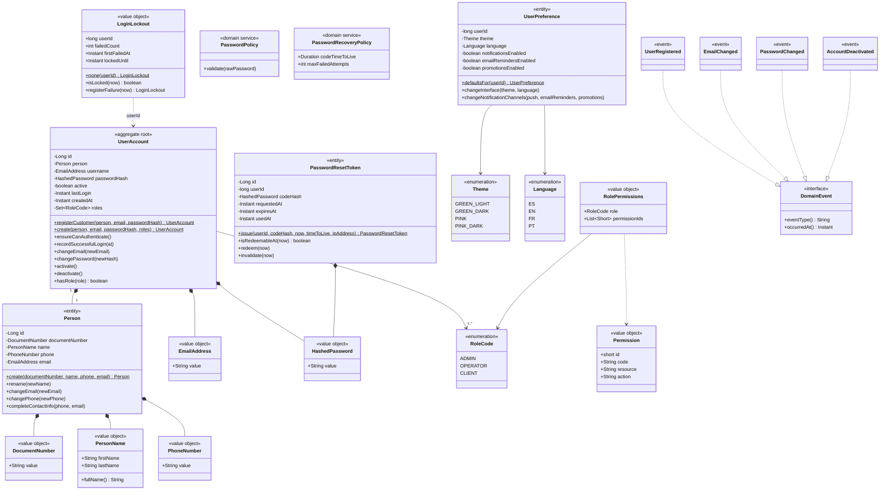

**Figura 21**

*Servicios de aplicación y puertos de security-service*

```mermaid
classDiagram
  direction LR
  class AuthenticationService {
    <<application service>>
    implements AuthenticateUserUseCase, LogoutUseCase
    +login(command) AuthenticationResult
    +logout(userId, sessionId)
  }
  class AccountRegistrationService {
    <<application service>>
    implements RegisterUserUseCase, CreateUserAccountUseCase
    +register(command) UserAccountView
    +createAccount(command) UserAccountView
  }
  class PasswordRecoveryService {
    <<application service>>
    implements RequestPasswordResetUseCase, VerifyPasswordResetCodeUseCase, ResetPasswordUseCase
    +requestReset(command)
    +verifyCode(command)
    +resetPassword(command)
  }
  class UserProfileService {
    <<application service>>
    implements GetUserProfileUseCase, UpdateUserProfileUseCase, ChangePasswordUseCase
    +getProfile(userId) UserAccountView
    +updateProfile(command) UserAccountView
    +changePassword(command)
  }
  class EmailChangeService {
    <<application service>>
    implements ChangeEmailUseCase
    +changeEmail(command) UserAccountView
  }
  class AccountDeactivationService {
    <<application service>>
    implements DeactivateOwnAccountUseCase
    +deactivateOwnAccount(command)
  }
  class UserAdministrationService {
    <<application service>>
    implements ListUserAccountsUseCase, ChangeAccountStatusUseCase
    +listAccounts(query) PageResult~UserAccountView~
    +changeStatus(targetUserId, active, actingUserId) UserAccountView
  }
  class UserPreferenceService {
    <<application service>>
    implements GetUserPreferencesUseCase, UpdateUserPreferencesUseCase
    +getPreferences(userId) PreferenceView
    +updatePreferences(command) PreferenceView
  }
  class RolePermissionAdministrationService {
    <<application service>>
    implements ListRolePermissionsUseCase, UpdateRolePermissionsUseCase
    +listPermissions() List~Permission~
    +listRolePermissions() List~RolePermissions~
    +updateRolePermissions(role, permissionIds) RolePermissions
  }
  class UserAccountRepository {
    <<interface>>
    +findById(userId) Optional~UserAccount~
    +findByUsername(username) Optional~UserAccount~
    +existsByUsername(username) boolean
    +findPersonByDocument(documentNumber) Optional~Person~
    +save(account) UserAccount
    +findAll(role, page, size) PageResult~UserAccount~
  }
  class UserSessionRepository {
    <<interface>>
    +open(userId, startedAt, expiresAt, ipAddress, userAgent) long
    +revoke(sessionId, userId, revokedAt)
    +revokeAll(userId, revokedAt)
  }
  class PasswordResetTokenRepository {
    <<interface>>
    +save(token) PasswordResetToken
    +findLatestRedeemableByUserId(userId, now) Optional~PasswordResetToken~
  }
  class UserPreferenceRepository {
    <<interface>>
    +findByUserId(userId) Optional~UserPreference~
    +save(preference) UserPreference
  }
  class RolePermissionRepository {
    <<interface>>
    +findPermissions() List~Permission~
    +findRolePermissions() List~RolePermissions~
    +replacePermissions(role, permissionIds) RolePermissions
  }
  class PasswordHasher {
    <<interface>>
    +hash(raw) HashedPassword
    +matches(raw, hash) boolean
  }
  class TokenIssuer {
    <<interface>>
    +issue(account, sessionId, issuedAt) IssuedToken
    +timeToLive() Duration
  }
  class ResetCodeGenerator {
    <<interface>>
    +generate() String
  }
  class ResetCodeNotifier {
    <<interface>>
    +send(to, name, code, expiresAt)
  }
  class ResetAttemptCounter {
    <<interface>>
    +recordFailure(tokenId) int
    +clear(tokenId)
  }
  class DomainEventPublisher {
    <<interface>>
    +publish(event)
  }
  class PersonAddressService {
    <<application service>>
    implements PersonAddressUseCase
    +getAddress(userId) String
    +updateAddress(userId, address) String
  }
  class LoginLockoutRepository {
    <<interface>>
    +findByUserId(userId) Optional~LoginLockout~
    +save(lockout)
    +clear(userId)
  }
  class PersonAddressRepository {
    <<interface>>
    +findByPersonId(personId) Optional~String~
    +save(personId, address)
    +delete(personId)
  }
  AuthenticationService --> UserAccountRepository
  AuthenticationService --> LoginLockoutRepository
  PasswordRecoveryService --> LoginLockoutRepository
  PersonAddressService --> UserAccountRepository
  PersonAddressService --> PersonAddressRepository
  AuthenticationService --> UserSessionRepository
  AuthenticationService --> PasswordHasher
  AuthenticationService --> TokenIssuer
  AccountRegistrationService --> UserAccountRepository
  AccountRegistrationService --> PasswordHasher
  AccountRegistrationService --> DomainEventPublisher
  PasswordRecoveryService --> UserAccountRepository
  PasswordRecoveryService --> PasswordResetTokenRepository
  PasswordRecoveryService --> ResetCodeGenerator
  PasswordRecoveryService --> ResetCodeNotifier
  PasswordRecoveryService --> ResetAttemptCounter
  PasswordRecoveryService --> PasswordHasher
  UserProfileService --> UserAccountRepository
  UserProfileService --> PasswordHasher
  EmailChangeService --> UserAccountRepository
  EmailChangeService --> DomainEventPublisher
  AccountDeactivationService --> UserAccountRepository
  AccountDeactivationService --> UserSessionRepository
  UserAdministrationService --> UserAccountRepository
  UserAdministrationService --> UserSessionRepository
  UserPreferenceService --> UserPreferenceRepository
  RolePermissionAdministrationService --> RolePermissionRepository
```

> *Nota.* Adaptadores de salida: `UserAccountPersistenceAdapter`, `UserSessionPersistenceAdapter`, `PasswordResetTokenPersistenceAdapter`, `UserPreferencePersistenceAdapter`, `RolePermissionPersistenceAdapter`, `LoginLockoutPersistenceAdapter` y `PersonAddressPersistenceAdapter` (JPA); `BCryptPasswordHasher`; `JwtTokenIssuer`; `SecureRandomResetCodeGenerator`; `EmailResetCodeNotifier`, `LoggingResetCodeNotifier` y `UndeliveredResetCodeNotifier`; `InMemoryResetAttemptCounter`; `RabbitDomainEventPublisher` y `LoggingDomainEventPublisher`. Adaptadores de entrada: `AuthController`, `UserProfileController`, `UserAdministrationController`, `RolePermissionController`, `UserAddressController` e `InternalUserController`. Fuente: `security-service/src/main/java/com/lavarapido/security/`.

### 6.2 customer-service

**Figura 22**

*Clases de customer-service*

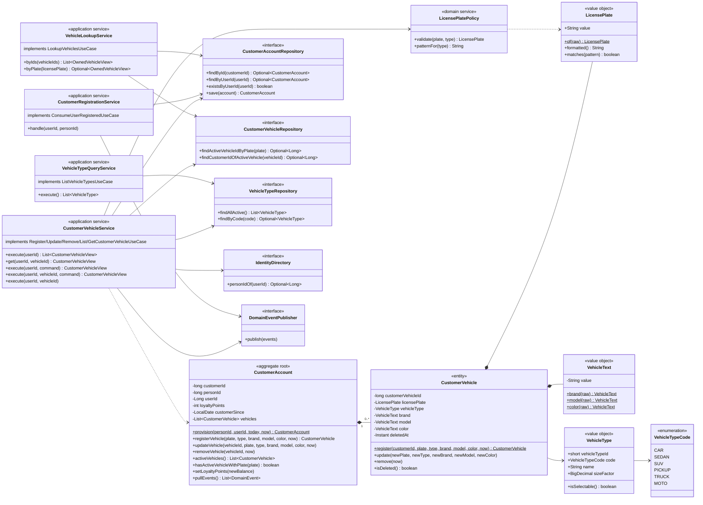

> *Nota.* `Register/Update/Remove/List/GetCustomerVehicleUseCase` abrevia los cinco puertos de entrada de vehículos. Adaptadores de salida: `CustomerAccountPersistenceAdapter`, `CustomerVehiclePersistenceAdapter` y `VehicleTypePersistenceAdapter` (JPA); `SecurityServiceIdentityDirectory` (REST a security-service); `LoggingDomainEventPublisher`, que solo escribe los eventos en el log. Adaptadores de entrada: `CustomerVehicleController`, `AdminVehicleController`, `VehicleTypeController` y `UserRegisteredListener` (RabbitMQ). Fuente: `lavarapido-customer-service/src/main/java/com/lavarapido/customer/`.

### 6.3 booking-service

**Figura 23**

*Modelo de dominio de booking-service*

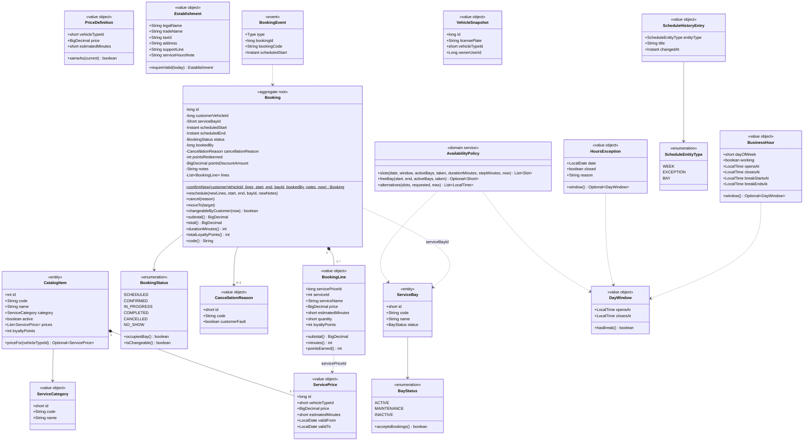

**Figura 24**

*Servicios de aplicación y puertos de booking-service*

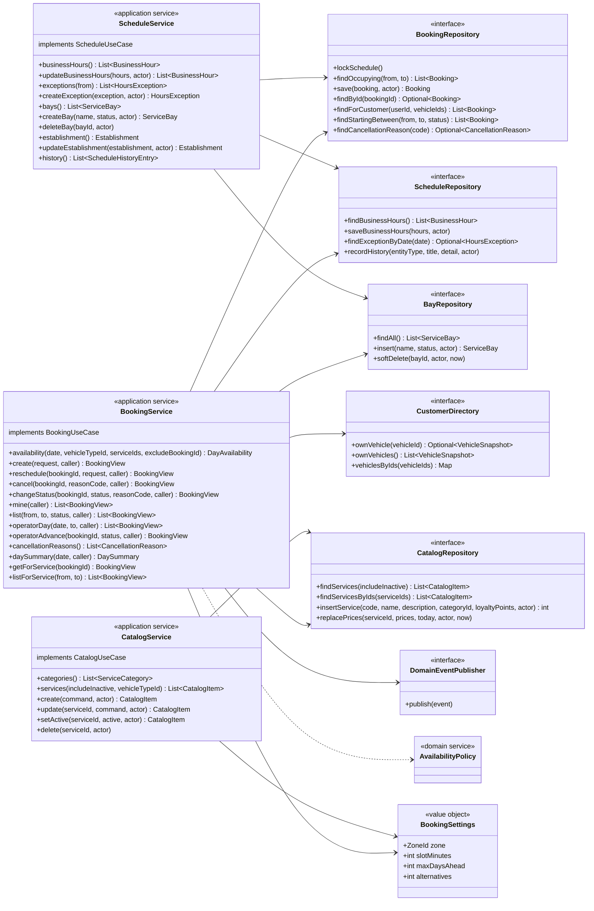

> *Nota.* Adaptadores de salida: `BookingPersistenceAdapter`, `CatalogPersistenceAdapter`, `SchedulePersistenceAdapter` y `BayPersistenceAdapter` (JPA); `CustomerServiceDirectory` (REST a customer-service); `RabbitDomainEventPublisher` y `LoggingDomainEventPublisher`. Adaptadores de entrada: `BookingController`, `AdminBookingController`, `OperatorBookingController`, `CatalogController`, `ScheduleController` e `InternalBookingController` (`/internal/v1/bookings`, con `X-Internal-Key`). Fuente: `lavarapido-booking-service/src/main/java/com/lavarapido/booking/`.

### 6.4 operations-service

**Figura 25**

*Clases de operations-service*

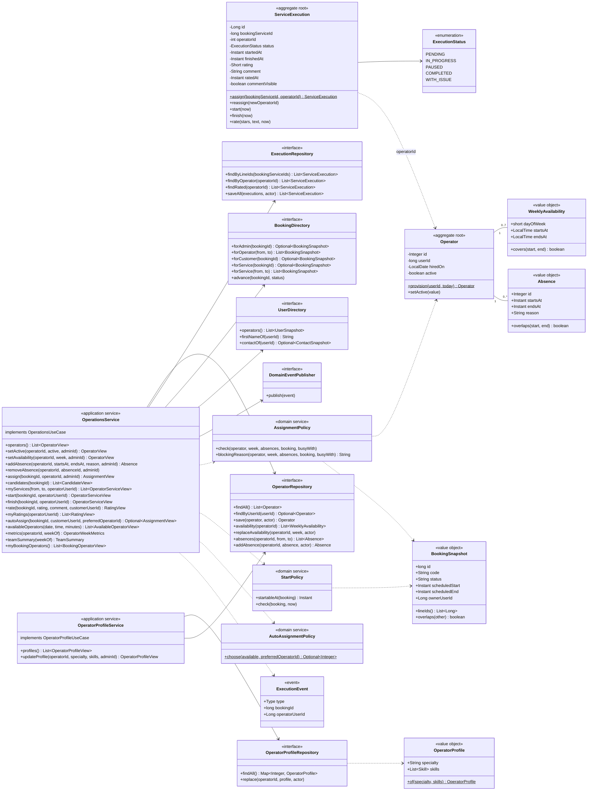

> *Nota.* Adaptadores de salida: `OperatorPersistenceAdapter`, `ExecutionPersistenceAdapter`, `OperatorProfilePersistenceAdapter` e `InspectionPersistenceAdapter` (JPA); `BookingServiceDirectory` (REST a booking-service, con el token del usuario o con la llave interna); `SecurityUserDirectory` (REST a security-service); `RabbitDomainEventPublisher` y `LoggingDomainEventPublisher`. Adaptadores de entrada: `OperationsControllers` (rutas de administrador, operario y calificaciones), `AvailableOperatorsController`, `OperatorProfileController`, `InspectionControllers` y `BookingConfirmedListener` (RabbitMQ, asignación automática). Fuente: `lavarapido-operations-service/src/main/java/com/lavarapido/operations/`.

**Figura 26**

*Informe de inspección en operations-service*

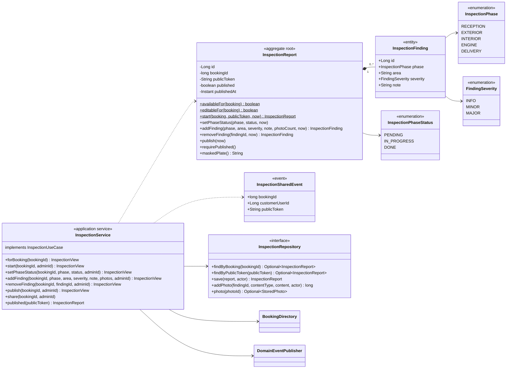

> *Nota.* El informe solo existe para reservas de 180 minutos o más, se edita mientras la reserva está Confirmada o En proceso y solo se comparte publicado; el enlace público usa `publicToken` y muestra la placa enmascarada. Adaptadores: `InspectionPersistenceAdapter` (JPA) e `InspectionControllers` (rutas `/admin/inspections/**` y `/public/inspections/**`).

### 6.5 payment-service (.NET)

**Figura 27**

*Modelo de dominio de payment-service*

```mermaid
classDiagram
  direction TB
  class Entity~TId~ {
    <<abstract>>
    +TId Id
  }
  class AggregateRoot~TId~ {
    <<abstract>>
    +DomainEvents IReadOnlyCollection
    #AddDomainEvent(domainEvent)
    +ClearDomainEvents()
  }
  class Payment {
    <<aggregate root>>
    +long BookingId
    +short PaymentAccountId
    +decimal Amount
    +PaymentStatus Status
    +DateTime ProcessedAtUtc
    +long ApprovedBy
    +string RejectionReason
    +Create(bookingId, paymentAccountId, amount) Payment$
    +ReportWithReceipt(bookingId, paymentAccountId, amount, receiptFile, reportedBy, transactionReference, nowUtc) Payment$
    +RegisterInPerson(bookingId, paymentAccountId, amount, registeredBy, transactionReference, nowUtc) Payment$
    +AttachReceipt(fileUrl, uploadedBy, nowUtc)
    +SubmitForReview()
    +Approve(approvedBy, nowUtc)
    +Reject(rejectedBy, reason, nowUtc)
    +Refund(nowUtc)
  }
  class PaymentReceipt {
    <<entity>>
    +string FileUrl
    +string TransactionReference
    +decimal ReportedAmount
    +long UploadedBy
    +long ReviewedBy
  }
  class PaymentStatus {
    <<enumeration>>
    Pending
    InReview
    Approved
    Rejected
    Refunded
  }
  class PaymentPolicy {
    <<domain service>>
    +IsBookingPayable(bookingStatus) bool$
    +CanReportPayment(bookingStatus, paymentsOfBooking) bool$
    +AmountDue(bookingTotal, appliedDiscounts) decimal$
  }
  class PaymentAccount {
    <<aggregate root>>
    +short PaymentMethodTypeId
    +string AccountHolder
    +string AccountNumber
    +string QrImageUrl
    +bool IsActive
    +Create(method, holder, number, qrImageUrl, instructions, active) PaymentAccount$
    +Update(method, holder, number, qrImageUrl, instructions, active)
  }
  class PaymentMethodType {
    <<entity>>
    +string Code
    +bool RequiresAccount
    +bool RequiresReceipt
  }
  class Promotion {
    <<aggregate root>>
    +string Code
    +DateOnly ValidFrom
    +DateOnly ValidTo
    +bool IsActive
    +DiscountType DiscountType
    +decimal DiscountValue
    +decimal MaxDiscountAmount
    +int MaxRedemptions
    +int MaxRedemptionsPerCustomer
    +int RequiredPoints
    +Create(definition) Promotion$
    +Update(definition)
    +SetActive(active)
    +IsAvailableOn(today) bool
    +IsUnlockedFor(customerPoints) bool
    +CalculateDiscount(subtotal) decimal
    +Redeem(request) PromotionRedemption
  }
  class PromotionDefinition {
    <<value object>>
  }
  class RedemptionRequest {
    <<value object>>
    +long BookingId
    +int CustomerPoints
    +decimal Subtotal
  }
  class PromotionRedemption {
    <<entity>>
    +long BookingId
    +int PromotionId
    +decimal AppliedAmount
  }
  class DiscountType {
    <<enumeration>>
    Percentage
    FixedAmount
    Package
  }
  class IDiscountStrategy {
    <<interface>>
    +Calculate(subtotal, discountValue) decimal
    +Validate(discountValue)
  }
  class PercentageDiscountStrategy
  class FixedAmountDiscountStrategy
  class DiscountStrategyFactory {
    <<factory>>
    +For(type) IDiscountStrategy$
  }
  class LoyaltyTransaction {
    <<entity>>
    +long CustomerId
    +LoyaltyMovementType MovementType
    +int Sequence
    +long BookingId
    +int Points
    +int BalanceAfter
    +Earn(customerId, bookingId, points, current, actor, nowUtc) LoyaltyTransaction$
    +ReverseEarned(customerId, bookingId, earnedPoints, current, actor, nowUtc) LoyaltyTransaction$
  }
  class LoyaltyBalance {
    <<value object>>
    +int Points
    +int Sequence
  }
  class LoyaltyMovementType {
    <<enumeration>>
    Earned
    Redeemed
    Expired
    Adjusted
    Reversed
  }
  AggregateRoot~TId~ --|> Entity~TId~
  Payment --|> AggregateRoot~TId~
  PaymentAccount --|> Entity~TId~
  Promotion --|> AggregateRoot~TId~
  Payment "1" *-- "0..*" PaymentReceipt
  Payment --> PaymentStatus
  Payment ..> PaymentAccount : PaymentAccountId
  PaymentAccount --> PaymentMethodType
  Promotion --> DiscountType
  Promotion ..> PromotionDefinition
  Promotion ..> RedemptionRequest
  Promotion ..> PromotionRedemption
  Promotion ..> DiscountStrategyFactory
  DiscountStrategyFactory ..> IDiscountStrategy
  PercentageDiscountStrategy ..|> IDiscountStrategy
  FixedAmountDiscountStrategy ..|> IDiscountStrategy
  LoyaltyTransaction --> LoyaltyMovementType
  LoyaltyTransaction ..> LoyaltyBalance
```

**Figura 28**

*Servicios de aplicación y puertos de payment-service*

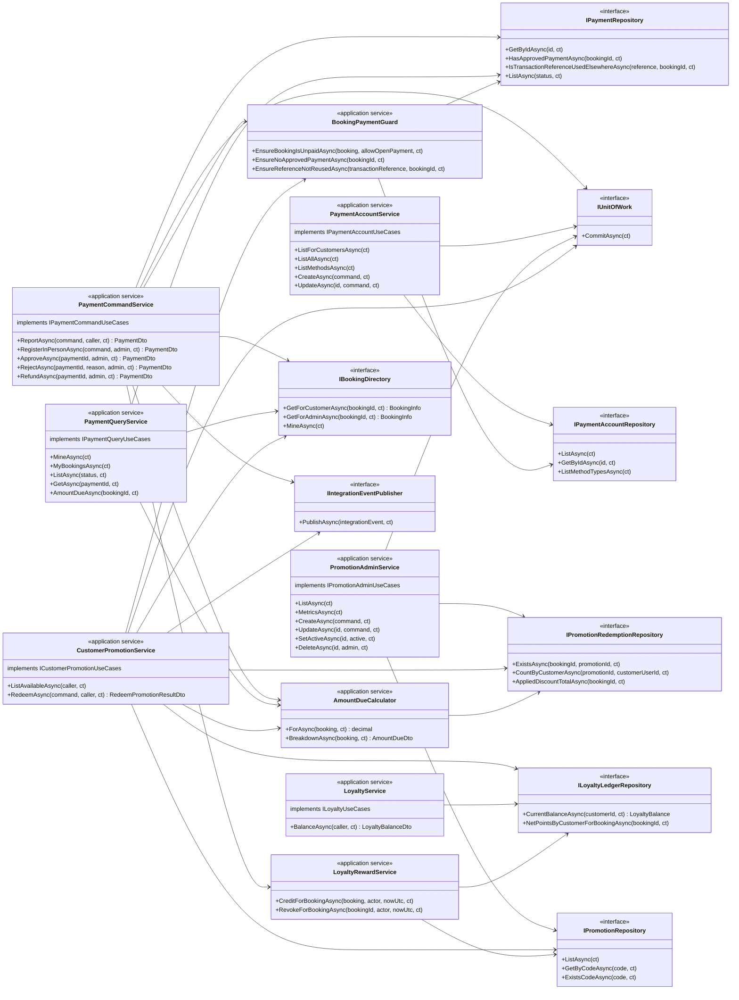

> *Nota.* En .NET los atributos son propiedades públicas de solo lectura y los métodos de aplicación son asíncronos (`Async`) con un `CancellationToken ct`. Adaptadores de salida: `PaymentRepository`, `PaymentAccountRepository`, `PromotionRepository`, `PromotionRedemptionRepository`, `LoyaltyLedgerRepository` y `EfUnitOfWork` (Entity Framework Core); `BookingServiceDirectory` (REST a booking-service); `RabbitMqIntegrationEventPublisher` y `NullIntegrationEventPublisher`. Adaptadores de entrada: `PaymentsController`, `AdminPaymentsController`, `AdminPaymentAccountsController`, `PromotionsController` y `LoyaltyController`. Fuente: `lavarapido-payment-service/src/PaymentService.Domain` y `PaymentService.Application`.

### 6.6 notification-service

**Figura 29**

*Modelo de dominio de notification-service*

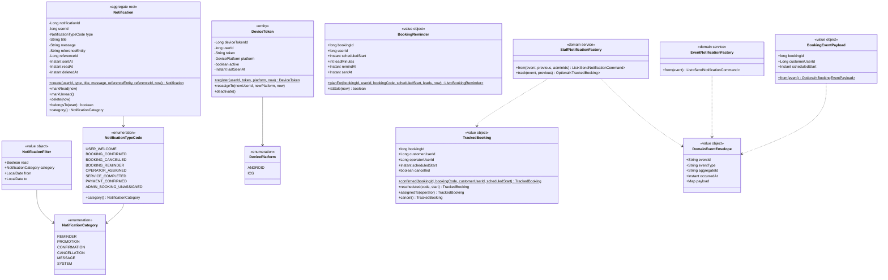

**Figura 30**

*Servicios de aplicación y puertos de notification-service*

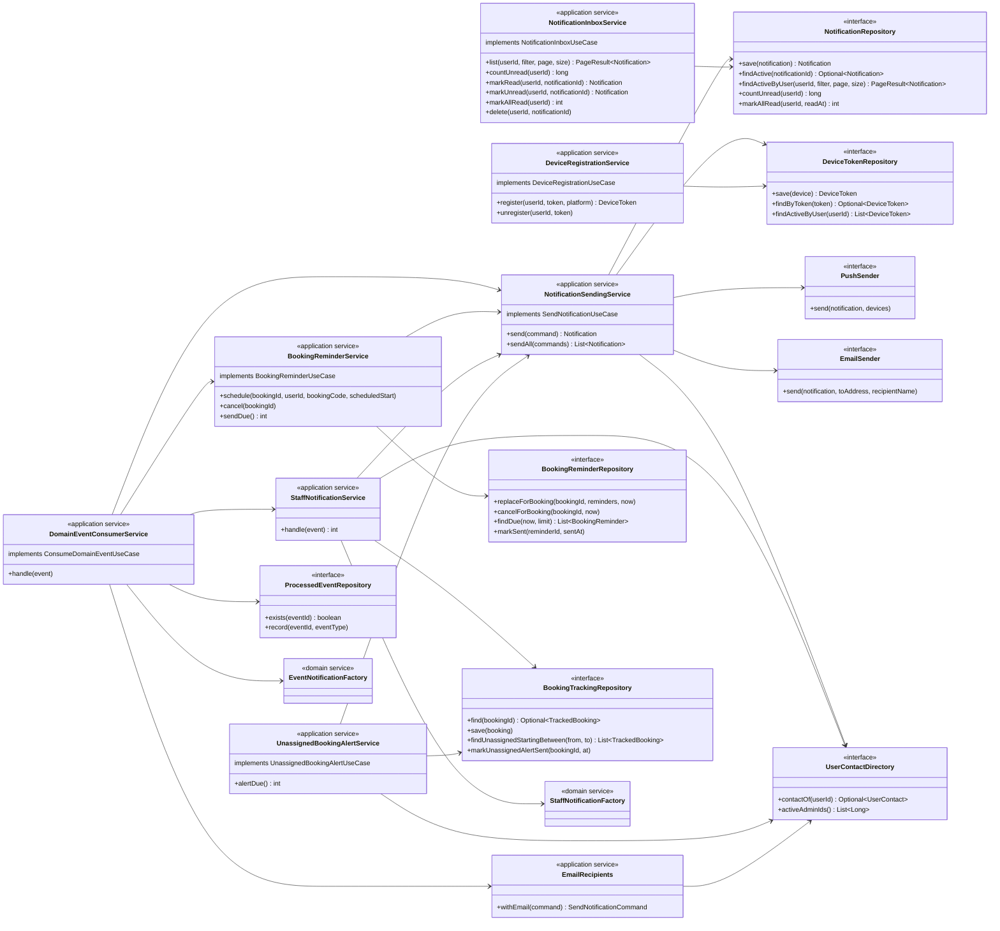

> *Nota.* Entre servicios de aplicación la dependencia real es el puerto de entrada: por ejemplo, `DomainEventConsumerService` recibe un `SendNotificationUseCase`, que implementa `NotificationSendingService`. `NotificationTypeCode` tiene 23 códigos; el diagrama muestra solo algunos. Adaptadores de salida: `NotificationPersistenceAdapter`, `DeviceTokenPersistenceAdapter`, `BookingReminderPersistenceAdapter`, `BookingTrackingPersistenceAdapter` y `ProcessedEventPersistenceAdapter` (JPA); `SmtpEmailSender` y `LoggingEmailSender`; `ExpoPushSender` y `LoggingPushSender`; `SecurityServiceUserContactDirectory` (REST interna a security-service). Adaptadores de entrada: `NotificationController`, `AdminNotificationController`, `DeviceController`, `DomainEventListener` (RabbitMQ) y `ReminderScheduler` (tarea programada). Fuente: `lavarapido-notification-service/src/main/java/com/lavarapido/notification/`.

### 6.7 Estados de las entidades principales

**Tabla 67**

*Transiciones de estado permitidas por el dominio*

| Entidad | Transición | Condición (código) |
| --- | --- | --- |
| Reserva | SCHEDULED → CONFIRMED | Tiene bahía asignada (`Booking.java:110`) |
| Reserva | CONFIRMED → IN\_PROGRESS o NO\_SHOW | `Booking.java:111` |
| Reserva | IN\_PROGRESS → COMPLETED | `Booking.java:112` |
| Reserva | → CANCELLED | Solo por `cancel(reason)`, no por `moveTo` (`Booking.java:95, 113`) |
| Ejecución | PENDING → IN\_PROGRESS → COMPLETED | `start()` y `finish()` (`ServiceExecution.java:65-80`) |
| Ejecución | Calificación | Solo si está COMPLETED y una vez (`ServiceExecution.java:82-90`) |
| Pago | Creado → en revisión → aprobado, rechazado o reembolsado | Métodos `SubmitForReview`, `Approve`, `Reject`, `Refund` (`Payment.cs:116-157`) |
| Ejecución | Inicio | Solo desde 15 minutos antes de la hora de la reserva (`StartPolicy.java`) |
| Cuenta | Bloqueada 15 minutos | Al quinto fallo dentro de 15 minutos; un inicio correcto o restablecer la contraseña la libera (`LoginLockout.java`) |
| Informe de inspección | Borrador → publicado | `publish()`; solo un informe publicado se comparte (`InspectionReport.java`) |
| Fase de inspección | PENDING ↔ IN\_PROGRESS ↔ DONE | `setPhaseStatus()`; un hallazgo en una fase pendiente la pone IN\_PROGRESS (`InspectionReport.java`) |

## 7. Hallazgos de diseño y pendientes

**Tabla 68**

*Inconsistencias encontradas al contrastar el código con la documentación previa*

| # | Hallazgo | Evidencia |
| --- | --- | --- |
| 1 | El Manual técnico v2.0 dice que los seis microservicios están en Java 21; payment-service está en .NET 8 | `lavarapido-payment-service/Directory.Build.props` (`net8.0`) |
| 2 | `MODELO-DE-DATOS.md` documentaba 43 tablas y el SRS v4 (Tabla 6) decía 47; los changelogs crean 57 al 15 de octubre de 2026 | Tabla 9 de este documento |
| 3 | notification se suscribe a `booking.created`, pero booking solo publica `booking.confirmed` y `booking.cancelled` | `BookingEvent.java:17-18` y `ROUTING_KEYS` de notification |
| 4 | customer define los eventos `customer.provisioned`, `VehicleRegistered`, `VehicleUpdated`, `VehicleRemoved` y `LoyaltyPointsChanged`, pero su único publicador los escribe en el log: no llegan a RabbitMQ ni tienen consumidor | `CustomerProvisioned.java:15`, `customer/.../adapter/out/messaging/LoggingDomainEventPublisher.java` |
| 5 | La inspección de vehículos, su reporte público y los datos del negocio en Ajustes son simulados: se guardan en el navegador, no en el backend | `Web/src/app/core/services/inspection-store.ts:20`, `features/admin/services/business-store.ts:52`; en móvil `scheduleMock.ts`, `settingsMock.ts` |
| 6 | En `docker-compose.yml` el build de security y operations apunta a `../lavarapido-security-service` y `../lavarapido-operation-service`, que son los nombres reales de los repositorios. En esta copia local las carpetas se llaman `security-service` y `lavarapido-operations-service`, así que `--profile app` falla si no se clonan con su nombre original. | `Backend/lavarapido-infra/docker-compose.yml` (security-service y operations-service) |
| 7 | booking-service contiene una carpeta `bin/src/main/java` además de `src/main/java` (copia generada por el IDE) | `Backend/lavarapido-booking-service/bin` |
| 8 | La cuenta de efectivo no viaja en `GET /payment-accounts` (solo cuentas que requieren comprobante); la web y el móvil la agregan por su cuenta. Es intencional, pero el contrato no lo documenta | `PaymentAccountService.cs:24-25`, `Web/.../client/pages/payment/payment.ts:44-57` |
| 9 | Textos fijos de prueba en la interfaz: "¡Hola, Laura!" en el dashboard del administrador y "Laura Méndez" en la revisión de pagos | `admin/pages/dashboard/dashboard.ts:73`, `payment-review-modal.html:167` |
| 10 | En "Servicios asignados" del operario (web) la columna Cliente muestra la placa | `operator/pages/assigned-services/assigned-services.ts:141` |
| 11 | El nombre de la marca no es uniforme entre clientes ("AquaWash", "Car Wash", "Lavado Vehicular", "Express Car Wash") y la landing anuncia "servicio móvil… donde estés", aunque el SRS v4 define un único local | Figuras 2 y 7 |

> *Nota.* Revisión del código del 15 de octubre de 2026: el hallazgo 5 está corregido (el informe de inspección, su enlace público y los datos del negocio se guardan en operations-service y booking-service; en el móvil `settingsMock.ts` solo conserva las preferencias de aviso iniciales) y el 7 también (`bin/` quedó en el `.gitignore` de booking-service). Los hallazgos 3, 4, 8, 9, 10 y 11 siguen en el código.

## Referencias

Angular. (s.f.). *Angular documentation*. Google. Recuperado el 9 de octubre de 2026, de https://angular.dev/

Brown, S. (s.f.). *The C4 model for visualising software architecture*. Recuperado el 9 de octubre de 2026, de https://c4model.com/

Cockburn, A. (2005). *Hexagonal architecture*. https://alistair.cockburn.us/hexagonal-architecture/

Evans, E. (2004). *Domain-driven design: Tackling complexity in the heart of software*. Addison-Wesley.

Expo. (s.f.). *Expo documentation*. Recuperado el 9 de octubre de 2026, de https://docs.expo.dev/

Fowler, M. (2002). *Patterns of enterprise application architecture*. Addison-Wesley.

Gamma, E., Helm, R., Johnson, R. y Vlissides, J. (1994). *Design patterns: Elements of reusable object-oriented software*. Addison-Wesley.

Hohpe, G. y Woolf, B. (2003). *Enterprise integration patterns: Designing, building, and deploying messaging solutions*. Addison-Wesley.

Liquibase. (s.f.). *Liquibase documentation*. Recuperado el 9 de octubre de 2026, de https://docs.liquibase.com/

Mermaid. (s.f.). *Mermaid: Diagramming and charting tool*. Recuperado el 9 de octubre de 2026, de https://mermaid.js.org/

Microsoft. (s.f.-a). *.NET documentation*. Recuperado el 9 de octubre de 2026, de https://learn.microsoft.com/dotnet/

Microsoft. (s.f.-b). *SQL Server technical documentation*. Recuperado el 9 de octubre de 2026, de https://learn.microsoft.com/sql/sql-server/

Newman, S. (2021). *Building microservices: Designing fine-grained systems* (2.ª ed.). O'Reilly Media.

RabbitMQ. (s.f.). *RabbitMQ documentation*. Broadcom. Recuperado el 9 de octubre de 2026, de https://www.rabbitmq.com/docs

React Native. (s.f.). *React Native documentation*. Meta Platforms. Recuperado el 9 de octubre de 2026, de https://reactnative.dev/docs/getting-started

Spring. (s.f.). *Spring Boot reference documentation*. Broadcom. Recuperado el 9 de octubre de 2026, de https://docs.spring.io/spring-boot/
